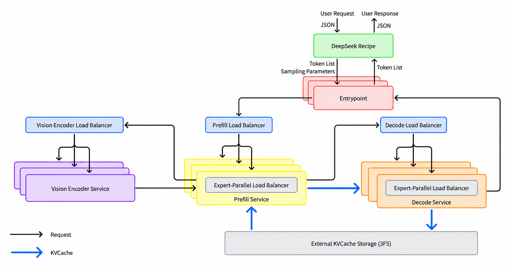
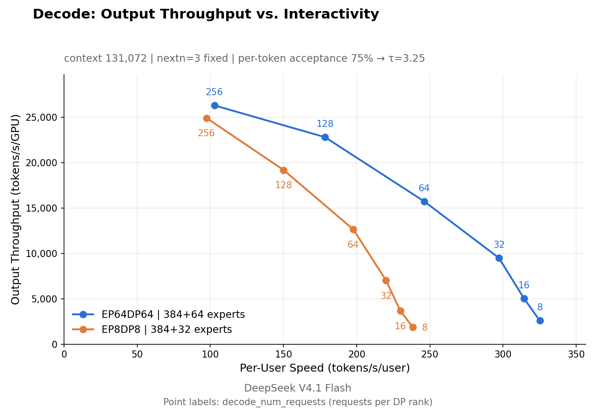

> 这一篇的底本是 DeepSeek 随 [DeepInfer](https://github.com/deepseek-ai/DeepInfer) 一起放出的 **《DeepSeek V4.1 Flash Inference Deployment Q&A》**——仓库里的 `doc/inference_deployment_qa.md`,312 行,Apache-2.0。它不是营销文档,是一份工程 Q&A:EC 编码条数、TTL 天数、时间预算单位、投机验证的逐点吞吐,都写了。
>
> 触发我读它的是「vLLM 小课堂(二十一)」那期直播(`BV1cgHP6BEp1`),主题正是从 DeepInfer 源码讲到技术报告。但**我没有那期的文稿**,所以本文不转述直播内容,只做我能核实的事:把这份 Q&A 与仓库代码对齐。
>
> 于是这篇有两个目的,而且是并列的:
>
> 1. **把架构讲清楚**:Prefill/Decode 并行策略、3FS 上的 KV Cache 池化、EPLB 与 DPLB、时间预算式 Prefill 调度、DSpark 动态投机验证。这几个机制为什么长这样,比它们叫什么更重要。
> 2. **把"文档写了"和"代码里有"分清楚。** Q&A 第 21 行自己就写了:KV Cache 管理与负载均衡组件"not yet fully open-sourced"。这句话是本文的骨架——**读开源架构文档时,最值钱的技能就是知道哪一段你无法验证。**
>
> 所有引用都落到 `文件:行号`。DeepInfer 对应修订 `774ce24`(2026-10-20)。
>
> 沿用「量化解剖」系列的纪律:数字给出处;推断了就标推断;**没核实的一律写成没核实**。这次手上没有 GPU 也没有集群,凡是要跑一次才能定的结论都不写成实测。

## 目录

- [0 先看一组数字](#0-先看一组数字)
- [1 一张图看懂 EPD 与存储](#1-一张图看懂-epd-与存储)
- [2 开源边界:哪些是真代码](#2-开源边界哪些是真代码)
- [3 Prefill 与 Decode:为什么并行策略是反的](#3-prefill-与-decode为什么并行策略是反的)
- [4 3FS 上的 KV Cache 池化](#4-3fs-上的-kv-cache-池化)
- [5 EPLB 与 DPLB:两种完全不同的负载均衡](#5-eplb-与-dplb两种完全不同的负载均衡)
- [6 时间预算式 Prefill 调度](#6-时间预算式-prefill-调度)
- [7 DSpark:把投机验证的长度变成变量](#7-dspark把投机验证的长度变成变量)
- [8 结构化输出与异步调度](#8-结构化输出与异步调度)
- [9 deepseek-recipe:被低估的那一半](#9-deepseek-recipe被低估的那一半)
- [10 局限与没核实的事](#10-局限与没核实的事)
- [11 一页总表](#11-一页总表)

## 0 先看一组数字

先给规模感,因为这些数字决定了后面每个设计取舍的分量:

| 指标 | 数值 | 出处 |
|---|---|---|
| 单集群日处理 | **155 万亿 token** | Q&A `:17` |
| 整体收入 | **US$38 / GPU-hour**(低谷电价) | Q&A `:17` |
| KV Cache 保活目标 | 从设计之初就定成 **> 72 小时** | Q&A `:13` |
| KV Cache 实际 TTL | agent 流量 3 天 / 聊天流量 7 天 | Q&A `:153` |
| 3FS 提供给 KV Cache 的容量 | 约 **100 PiB** SSD | Q&A `:153` |
| 存储集群与在线 GPU 的比例 | 约 **14.4 TB / GPU**(逻辑容量) | Q&A `:81` |
| 单台 KV Cache 存储服务器 | 20 × 30.73 TB SSD,读 ≥ 40 GB/s | Q&A `:77` |
| 负载均衡达到的水平 | 约为完美均衡离线基准的 **80%** | Q&A `:127` |

**最该注意的一行是「> 72 小时」和「3 天 / 7 天」的关系。** 设计目标写的是保活 72 小时以上,而线上实际给聊天流量放到 7 天。为什么聊天流量要给更久?Q&A `:153` 给了理由,而且是全文最诚实的一句工程判断:

> Chatbot traffic has a much heavier long tail of hits — a small amount of KV cache is read very many times, so losing it costs noticeably more overall hit rate.

翻译过来:**聊天流量的命中是长尾的——少量 KV Cache 被反复读很多次,所以丢掉它的代价明显更高。** 它还给了量化代价:TTL 只给 3 天的话,聊天流量要损失 0.5%–1% 的 KV Cache 命中率。

这是一个典型的"缓存经济学"权衡:命中率损失看着只有 0.5%–1%,但代价要折算成被重复计算的 prefill 算力。**保 7 天比保 3 天多占一倍以上存储,换回不到 1% 的命中率——值不值取决于存储和算力的相对价格。** DeepSeek 的答案是值。这个判断换一家公司可能就反过来了。

## 1 一张图看懂 EPD 与存储



这张图是仓库自带的(`doc/images/architecture_overview.png`),信息量很大,值得逐块读:

- **最上面是 DeepSeek Recipe**,接 Chat Completions / Responses / Messages 三种 API 协议,往下交给 **Entrypoint**(图中画了三层,是复数的 Entrypoint 实例)。
- **Entrypoint 往下分三路**,对应三个负载均衡器:**Vision Encoder Load Balancer**、**Prefill Load Balancer**、**Decode Load Balancer**。这就是 Q&A `:33` 说的那四个负载均衡器中的前三个。
- **Prefill Service 和 Decode Service 内部各有一个 Expert-Parallel Load Balancer**,也就是 EPLB——注意它**不在** Entrypoint 那一层,而是在引擎内部,这是后面第 5 节的关键。
- **底部一整条是 External KVCache Storage (3FS)**,用蓝色箭头(KVCache)连到 Prefill 和 Decode。**KV Cache 不在 GPU 本地,也不在本地内存,而是在一条独立的存储集群上。**
- 图中 Prefill → Decode 之间那条蓝色箭头,是 KV Cache 的 P-to-D 传递路径。

架构的骨架是 **E/P/D 分离**:**Vision Encoder、Prefill、Decode 三段独立部署**,外加**专用存储节点**(`:43`)。Q&A `:31` 解释了为什么拆:拆开才能让 **TTFT**(首 token 延迟)和 **TBT**(token 间隔)**各自独立地控制和优化**。如果不拆,一个 batch 里既有长 prefill 又有 decode,两者的延迟目标会互相打架。

## 2 开源边界:哪些是真代码

这是全文最重要的一节。Q&A 自己在 `:21` 就交代了边界:

> The KV cache management and load balancing components of the inference system are tightly coupled to our internal infrastructure, so that code is not yet fully open-sourced.

**KV Cache 管理与负载均衡组件与内部基础设施耦合太紧,尚未完全开源。** 它同时指向了一篇知乎博客(`:21`),说那篇会讲整体架构和这两个组件的设计。

所以读这份 Q&A,**必须把"文档描述的架构"和"仓库里能跑的代码"当成两件事**。我按机制逐个核对了,结果如下:

| 机制 | 文档 | 代码 | 结论 |
|---|---|---|---|
| EPLB(专家负载均衡) | 有(`:95-103`) | **有**,`deepinfer/model_executor/eplb/`(792 行) | 真代码 |
| DSpark 投机验证 | 有(`:243`) | **有**,`v4_modules/heads.py` 等 6 文件 | 真代码 |
| 结构化输出 | 有(`:280-288`) | **有**,`deepinfer/structure_output/`(595 行) | 真代码 |
| 多厂商 / Ascend | 有(`:9`) | **有**,`deepinfer/platform.py` | 真代码 |
| 3FS KV Cache 存储 | 有(`:135-153`) | **没有** | 文档-only |
| DPLB / Prefill Load Balancer | 有(`:107-115`) | **没有** | 文档-only |
| 时间预算式调度 | 有(`:115`) | **没有** | 文档-only |
| Decode Load Balancer | 有(`:119`) | **没有** | 文档-only |
| kvcache-store 服务 | 有(`:135`) | **没有** | 文档-only |

先把账算清(全部用 `git ls-files` 统计,不是目录树估算):**270 个 Python 文件、54,929 行**;**`csrc/` 33 个文件、5,908 行,但 `.cu` 和 `.cuh` 各 0 个**——**仓库里没有任何手写 CUDA 内核源码**,`csrc/` 装的是引擎(scheduler / block manager / ZOS / MTP-varlen)。性能内核全部走 **TileLang**,按后端分目录:`tilelang_ops/` 下 **`cuda/` 和 `asc/` 各 30 个文件**(平台切换点只有 `ops.py:15` 一行 `importlib.import_module(f"{__package__}.{PLATFORM.tilelang_ops_backend}")`)。另有 **15 个测试文件、75 个测试函数**,带 `ci` / `ci_npu` 双平台标记(`pyproject.toml:35-41`)——**EPLB 和 DSpark 都有专门的测试**(`tests/models/test_eplb_policy.py`、`tests/distributed/test_expert_shuffle.py`)。

**一句话总结这张表:算法层面的东西开了,系统层面的东西没开。** EPLB(怎么把专家分配到 GPU 上)和 DSpark(怎么做投机验证)是算法,开源了;而 Prefill/Decode Load Balancer、KV Cache 存储服务、时间预算调度器是部署形态相关的基础设施,没开。

### 2.1 而且仓库自己把这件事写在了 README 里

上面那张表是我逐项查出来的,但**DeepSeek 自己把它写得更直白**。`README.md:38-42` 有一节标题就叫 "Required for a complete inference service (**not included in this release**)":

> - A KV cache system
> - VE/Prefill/Decode disaggregation (most required engine functionality is already implemented)
> - Load balancing across data-parallel replicas for both prefill and decode

翻译:**"要组成一个完整的推理服务还需要的东西(本次发布不包含)"——一个 KV Cache 系统、VE/Prefill/Decode 分离、以及 prefill 和 decode 两侧跨 DP 副本的负载均衡。**

括号里那句尤其值得读两遍:`most required engine functionality is already implemented`——**引擎该有的功能大部分已经实现了,缺的是把它们拼成服务的那一层。**

**这比我自己列表格有说服力得多。** 官方主动划边界,而不是等人去发现——**这种自述在开源文档里很少见,应该给分。**

这个边界其实很合理,但**对读者来说是个陷阱**:如果只看那篇架构博客,你会以为整套系统都能跑起来。实际上你拿到的是**算子和引擎**,不是**线上服务**。

我专门查了 3FS 集成:全仓库 **`3fs` 只有 8 处命中,零处是代码**——7 处是 Q&A 的正文(`:83`/`:87`/`:134`/`:135`/`:141`/`:153`/`:157`),加上**一处必须排除的假命中**:`deepinfer/model_executor/eplb/__init__.py:314` 的日志格式串 `time=%.3fs`——那是"三位小数、单位秒",不是 3FS。**任何对这个仓库做 `grep 3fs` 的人都会撞上它,所以这里明确点出来。**

顺着 3FS 该有的零件再查一遍:`hf3fs` 客户端引用、挂载路径、RDMA/GDR 拷贝、独立拉取进程、TTL/GC、前缀哈希匹配——**全部为零**。

**还有一个更容易骗人的同名符号**:`deepinfer/worker/cache_engine.py:101` 有个 `get_kvstore_swa_block_size()`,名字里有 "kvstore"。但它自己的 docstring 写的是"**kvstore 视角的 swa_block_size**",讲的是**本地** SWA 落盘粒度(128 token)。**这里的 `kvstore` 是本地 SWA 环形缓冲,不是 3FS 那套 store。** 看到 `kvstore` 就往 3FS 上想会直接读错。

**结论:3FS 在这个仓库里只以"文字"形式存在**——用来描述 DeepSeek 的生产系统,以及那张架构图上的一个方框。

## 3 Prefill 与 Decode:为什么并行策略是反的

这是我觉得最值得单独讲的一个设计,因为它违反直觉。

| 阶段 | EP / DP | 选择原则 | 出处 |
|---|---|---|---|
| **Prefill** | EP2–8 / DP2–8 | **HBM 允许的最小** EP/DP | Q&A `:47` |
| **Decode** | EP64–128 / DP64–128(Wide-EP) | **GPU 允许的最大** EP/DP | Q&A `:49` |
| VE(视觉编码器) | 单 GPU 通常够,建议用便宜卡 | — | Q&A `:51` |
| TP / CP | **部署中不用** | — | Q&A `:53`(与 README 有出入,见下) |

**Prefill 要小并行,Decode 要大并行——方向是反的。** 为什么?

关键在于两个阶段的瓶颈不同:

- **Prefill 是计算密集的。** 一次要吃下整个 prompt,矩阵乘很大,GPU 算力是瓶颈。这时候 EP 开大反而有害:专家切得越细,**all-to-all 通信的相对开销越高**,而通信换不来算力收益(算力本来就够)。所以取"HBM 允许的最小"——用最小并行度把权重装下就行。
- **Decode 是访存密集的。** 每步只生成一个 token,矩阵乘退化成矩阵-向量乘,**瓶颈是读权重**。这时候 EP 开大就有直接收益:专家分散到更多卡上,**每张卡每步要读的权重变少**,单步访存压力下降。

Q&A `:57` 把这个收益说得很明确:Wide-EP"大幅降低 MoE 专家部分的每步访存,配合良好的 EPLB 支持,有效提升 TPS"。而 `:57` 配的那张图正是 EP8 vs EP64 的对比基准。



**先说一处文档和 README 打架的地方。** `:53` 说 "TP and CP are not used for now"——但 `README.md:12` 在介绍特性时明确写着:

> - Parallelism: Attention DP / balanced CP, MoE EP + EPLB

**"balanced CP" 是作为能力列出来的**,而 CP 在代码里也是真的(`parallel_utils/parallel_state.py:97` 有 `cp_ranks = rearrange(ranks, "(dp cp) -> dp cp", cp=cp_size)`,`scheduler.hpp` 里还有 `cp_align` 参与 chunk 对齐)。

**怎么理解这个矛盾?** 我的判断是:**`:53` 说的是"DeepSeek 当前部署没用 TP/CP",而 README 说的是"软件支持 CP"。** 一个讲部署现状,一个讲能力边界——**两句话都对,但不能混着引用。** 我倾向这个解释,但官方没明说,所以标为我的判断。

同理,文档 `:47`/`:49` 那些 EP/DP 具体数字(EP2–8、EP64–128)在代码里**也没有对应物**——没有默认值、没有预设、没有校验。**Wide-EP 是部署时传进去的选择,不是仓库里的一个开关。**

**这里有个容易读漏的因果链**:Wide-EP 提升吞吐的前提是"good EPLB support"(`:57`)。因为 EP 开得越大,专家被切得越散,**负载不均的绝对影响越大**——EP64 上有 64 份专家分片,只要有一张卡偏热,整步就被它拖住。所以 Wide-EP 和 EPLB 是绑在一起的,不是一个能单独成立的选择。这也解释了为什么 EPLB 在 Decode 侧要持续重排。

还有两个工程细节值得记:

- **最小可用部署单元是 1P + 1D**(`:67`),但实际 P:D 的 GPU 配比约 1:1;因为推荐的 decode 配置在 EP64 以上,**最小的高效部署单元是 64 GPU prefill + 64 GPU decode**,也就是 128 卡起步。
- **跨数据中心是可行的**(`:73`),因为 V4.1 Flash 把 KV Cache 压缩得足够小。预算按**每 8 GPU 约 400 Gbps** 互联带宽算。现实中他们的推理节点部署在**不同但相邻**的数据中心——`:73` 还给了个很实在的风险提示:跨数据中心的光纤"easily severed by construction work"(容易被施工挖断)。

## 4 3FS 上的 KV Cache 池化

这是视频里点名、也是我认为最有意思的一块。先把 Q&A `:131-135` 那张表搬过来:

| 内容 | 介质 | 副本 | 由谁管理 |
|---|---|---|---|
| 在途 block KV + state KV | 推理 GPU 显存 | — | Prefill / Decode 实例 |
| **SWA KV Cache** | **本地主机内存** | 单副本,**不上 3FS** | Prefill / Decode 实例;跨机命中走 400G VLAN 拉取 |
| **Paged block KV Cache** | **专用 3FS 存储集群** | 无应用层副本,依赖 3FS 自身冗余 | kvcache-store |

**关键设计:block KV Cache 不放本地内存,而是放一条专用存储集群。** Q&A `:141` 给了三条理由,每一条都值得单独想:

1. **让每台 prefill 机器都能命中任意前缀。** 如果按"前缀亲和性"路由(谁的本地缓存里有就给谁),路由策略就和负载均衡打架——你可能为了命中缓存把请求发给一台已经很忙的机器。放到共享存储,"任何引擎能命中任何前缀",于是 `:111` 那句"**no prefix-affinity routing**"(不做前缀亲和路由)才成立。
2. **存储节点和计算节点的扩缩容解耦。** 两者可以各自按需伸缩,不用捆绑。
3. **计算节点故障不影响 KV Cache。** `:141` 给了一个很硬的经验数字:**计算节点的故障率比存储节点高一个数量级以上。** 所以把 KV Cache 放在故障率低的那一侧。

第 3 条是这套设计里最"生产化"的考量——**它不是性能优化,是可用性优化。** 顺带解释了 `:135` 那句"无应用层副本,依赖 3FS 自身冗余":既然存储节点足够可靠,就不必再叠一层副本。

### 4.1 3FS 侧的两个数字

- **10+2 纠删码**(`:87`):每个 EC 组容忍**两个节点同时故障**。
- **读的时候同时向组内 11 个存储节点发请求,任意 10 个返回就能解码**(`:89`)。

第 2 条是 EC 读放大的经典处理:**用并发换尾延迟**。如果只发 10 个请求、等其中一个慢节点,尾延迟就会被它决定;发 11 个取前 10 个,**最慢的那个被自然淘汰掉**。代价是常态多打一份请求量。

- **回收全靠 3FS 自己的 GC Worker**(`:91`):每个存储节点部署一个实例,周期性按 **LRU** 淘汰,把磁盘占用压在水位以下。
- **kvcache-store 侧没有过期逻辑**(`:153`)——TTL 语义完全由 3FS 的 GC 承担。

### 4.2 三种开销,只藏掉了两种

`:157` 这段是全篇信息密度最高的地方。它把 KV Cache 的开销拆成三段,并逐个交代能不能藏:

| 阶段 | 做什么 | 能否与计算重叠 |
|---|---|---|
| **Matching** | Entrypoint 对本地 kvcache-store(CHECK 角色)做**只读元数据的哈希链前缀匹配** | **不能**——命中长度必须在路由前算出来 |
| **Fetching KV** | 独立进程异步把 KV Cache 从 3FS 搬进**主机共享内存** | 能(独立进程异步) |
| **Swap-in** | 引擎进程内线程把共享内存搬进 HBM | 能(与 forward 计算重叠) |

**"命中长度必须在路由前算出来,所以藏不掉"**——这句话点出了整个 KV Cache 体系里唯一无法隐藏的成本。因为路由决策依赖命中长度(命中得多,这台机器实际要算的 token 就少),所以匹配必须在路由之前完成,无法与计算重叠。**优化掉其它一切,这一段的延迟依然暴露在关键路径上。**

### 4.3 Swap-in 为什么用 GDR

`:157` 最后一句是个漂亮的工程决策:

> Because the CUDA copy engine performs poorly on the fine-grained copies of KV cache blocks, swap-in is implemented with GDR: an RDMA NIC saturates PCIe bandwidth without consuming SMs.

**因为 CUDA copy engine 处理细粒度拷贝性能很差,所以 swap-in 用 GDR 实现:RDMA 网卡能在不占用 SM 的情况下打满 PCIe 带宽。**

两个要点:
- KV Cache 的 H2D 拷贝是**细粒度**的(按 block),copy engine 在这种小拷贝上效率不高;
- 用 **GDR(GPUDirect RDMA)** 让网卡直接写显存,好处是**不消耗 SM**——SM 要留给 forward 计算。

这是"把搬运工作从计算单元卸载到专用硬件"的典型思路。**顺带一提**:GDR 用的正是 RDMA 网卡,而 RDMA 的缓冲区复用与安全回收是另一整套问题,我在[另一篇](/rdma-buffer-reuse/)里专门读过——把预注册的 Buffer 池化复用之后,超时回收会踩到远端仍在操作的窗口。**池化换性能,都要在生命周期管理上还回来。**

### 4.4 SWA KV Cache:另一条完全不同的路

SWA(sliding-window attention)的 KV Cache **不走上面这套**,它留在**产生它的那台机器的本地内存**里(`:169`),靠 Entrypoint 维护一份"逻辑统一、物理按 key 分片"的内存目录来定位(`:169`),跨机命中走 400G VLAN 拉(`:177`)。

尺寸是明确算出来的(`:169`):

```text
state_size_to_disk = 20 层 × 134 token × 528 B = 1,415,040 B / 序列
```

其中 **528 B/token 是 MXFP8 的 SWA KV 格式**,**V4.1 存储的是前 20 层**(`:163`)。

这里有一组很讲究的对齐规则(`:165`):

- SWA KV 只在 **128 token 的整数倍位置**存储;
- prefill 结束后,**在序列末尾预留一个 token 再向下取整到 128**;如果剩下的不足一个完整 128 单元,这一轮**什么都不存**;
- **chunked prefill 只在最后一个 chunk 存**,中间不存;
- decode 期间在显存里另开一块 replica 区,**每跨过一次 128 边界就把当前窗口拷进 replica**;请求结束时,从 replica 里最近一次完整拷贝取存储内容;
- 拷贝位置最多会超出边界 5 个 token,这个误差**被 slot 环形缓冲区比窗口多出的 6 个位置吸收**。

最后那条是关键:**5 个 token 的越界被 6 个位置的余量吸收**,所以不需要在拷贝时做精确对齐。这是"用一点冗余空间换掉对齐逻辑复杂度"的做法。

## 5 EPLB 与 DPLB:两种完全不同的负载均衡

**这两个东西经常被混为一谈,但它们在完全不同的层次上。** Q&A 把它们分成两节,不是排版习惯。

### 5.1 EPLB:在引擎内部重排专家

EPLB 解决的是**专家并行下 MoE 专家负载不均**。机制是(:97):除了自己负责的专家,**每张 GPU 再持有少量"冗余专家"作为热点专家的副本**;收集最近 N 步每个专家的负载,每 M 步按统计**重新分配专家到 GPU**;权重交换通过 NVLink 的 `symm_mem` 在组内完成。

配置和实测结果:

| | 冗余专家起点 | 统计窗口 | 重排间隔 | 实测 `moe_lb` |
|---|---|---|---|---|
| **Prefill** | 每 GPU 4 个 | 100 步 | **1,000 步** | **1.074**(EP4DP4)/ **1.045**(EP2DP2) |
| **Decode** | 每 GPU 1 个 | 1,000 步 | **10,000 步** | **1.090** |

(`moe_lb` = 最慢 rank / 平均,越接近 1 越均衡。出处 `:99` / `:103`。)

**但这里有个必须补上的前提:EPLB 机制在,默认却没开。**

`deepinfer/environ.py:116` 是 `DEEPINFER_EXPERT_REARRANGEMENT_STEP_INTERVAL = EnvVar.int()`——**没给默认值**;而 `EnvVar.int()` 的签名是 `def int(*, default: int = 0)`(`environ.py:62`),也就是**默认 0**。再看 `eplb/__init__.py:147`,重排的入口第一件事就是:

```text
if self._rearrangement_interval == 0:
    return
```

**所以不配这个环境变量,重排根本不会发生。** 同理 `DEEPINFER_OVERRIDE_NUM_EXTRA_EXPERTS`(`environ.py:114`,默认 0)不配就没有冗余专家。

**这直接影响怎么读文档里那张配置表**:`:99` 说的"每 GPU 4 个冗余专家、100 步窗口、1,000 步重排"——**只有 100 步窗口对得上代码默认值**(`environ.py:115` `EnvVar.int(default=100)`);"4" 和 "1,000" 是**运维侧传进来的值,仓库里没有对应的默认值**。**仓库给的是机制,不是那几个常数。**

**这是读开源文档最容易踩的一类坑**:文档描述的是"线上这么配的",而不是"你 clone 下来就是这样跑的"。两者差着一次配置。

**为什么 Prefill 重排得频繁、Decode 重排得稀疏?** 这里 Q&A 只给了配置没给理由,所以以下是**我的推断**:

- Prefill 处理的是**长度差异极大的请求**(后面第 6 节会看到,长度分四档从 <16K 到 ≥256K),专家的激活模式随请求内容剧烈变化,所以需要快窗口(100 步)快手(1,000 步)跟上。
- Decode 每步只生成一个 token,**负载模式稳定得多**,1000 步的窗口更平滑,10,000 步重排一次就够——**重排本身要搬权重,是有成本的**,间隔太短得不偿失。

`:103` 还给了一个很实在的细节:decode 在 EP64 下,1 个冗余专家"向上取整后"变成**每 GPU 7 个专家**(不含共享专家)。**取整是为了让总专家数能被 `ep_size` 整除**——这是并行度约束传导到配置上的典型例子。

### 5.2 DPLB:在集群层面分流量

DPLB 解决的是**请求该发给哪台机器**。三个层次各不相同(`:107-113`):

**第一层:Total context length 分桶。** 按总上下文长度分 **4 档:`<16K` / `16–64K` / `64–256K` / `≥256K`**。分配给每档的引擎数量**按上一轮该档占用的算力配额需求动态重分配**,每档还有自己的 per-batch 算力配额上限。

**为什么要分档?** 因为长请求和短请求的算力代价差异巨大。如果混在一起,一批短请求里夹一个 256K 的请求,整批的完成时间就由它决定——**短请求被长请求拖累**。分档等于按代价归类,让同类请求互相竞争。

**第二层:跨 DP 组按剩余配额拉取。** 引擎按自己剩余的 compute quota 去拉活。而且正因为 KV Cache 在共享 3FS 上(第 4 节),这里才能写出 `:111` 那句:**"Since any engine can hit any prefix, there is no prefix-affinity routing."**(既然任何引擎都能命中任何前缀,就不做前缀亲和路由。)

**这句话是第 4 节设计的回报。** 把 KV Cache 放到共享存储,直接买来了路由自由度。

**第三层:组内挑配额负载最低的 DP rank。** 最直接的一层。

**Decode 侧的原则完全不同**(`:119`):在**所有** decode 实例的**所有** GPU 之间均匀路由,但同时平衡**两个维度**——**请求数**(决定每步 batch size)和**总 KV Cache 长度**(决定 attention 部分的代价)。启发式是:

- **短请求 → 发给"并发低但总 KV 长度大"的 GPU**;
- **长请求 → 发给"总 KV 长度小"的 GPU**。

这个反向配对有点反直觉,但逻辑站得住:**短请求的 attention 代价小,所以它能容忍一个 KV 已经很长(attention 已经偏重)的 GPU;长请求自带很重的 attention 代价,应该放到 KV 还比较空的 GPU 上,避免叠加。** 换句话说是让"轻活"去填"重机器"的空隙。

**最终水平**:约为完美均衡离线基准的 **80%**(`:127`)。**注意这个数字的读法**——它不是说负载均衡算法达到了 80% 的效率,而是说**在真实约束下(不可抢占、请求到达随机、匹配必须在路由前完成)能达到理想离线调度的 80%**。剩下 20% 就是"在线"和"离线"的差距,这部分基本不可能消掉。

## 6 时间预算式 Prefill 调度

这是单机内部的调度,和上一节的集群调度是两回事。

**核心思想:不再按固定 token 数切 chunk,而是先给这一步一个时间预算,再反解出该算多少 token。**(`:115`)

机制是这样的:

1. 每个 prefill step 拿到一个时间预算,单位是**纳秒**(配置项 `compute_quota_limit`);
2. 用一个**拟合出来的二次代价模型** `cost(q, c)` 预测该 step 要花多久——`q` 是这一步要算的序列 token 数,`c` 是该序列**已经算过的前缀长度**;
3. 对 `q` **解这个二次方程**,取**在 32,768 token 上限内、且刚好把剩余时间预算花完的最大 `q`**;
4. 预算本身还要在 **DP 组内做一次 all-reduce MIN** 再下调。

逐条看这几个设计的用意:

- **为什么用时间做预算而不是 token 数?** token 的代价不是常数——同样是 1 个 token,前缀 1K 和前缀 256K 的 attention 代价差两个数量级。用 token 数当预算,等于用一个和真实代价脱钩的单位。用时间预算,才能让每个 step 的**实际耗时**可控,这是延迟 SLO 的前提。
- **为什么代价模型要依赖前缀长度 `c`?** 因为 attention 是 O(长度) 的,`c` 越大,同样的 `q` 越贵。所以 `cost` 必须是 `(q, c)` 的二元函数,不能只看 `q`。
- **为什么取"刚好用完预算"的最大 `q`?** 这是在**打满预算和避免超时之间取平衡**:取小了浪费算力,取大了超出预算。解二次方程拿到的是那个临界点。
- **为什么还要组内 all-reduce MIN?** 因为 DP 组内是同步的(要一起做通信)。**只要有一个 rank 超预算,整组都要等它。** 所以要拿全组最小的剩余预算来约束自己——这是**木桶效应下的必要妥协**:最慢的那个 rank 决定了全组的节奏,那不如让大家都按它的额度来。

### 6.1 一个必须说清的对照:代码里管住 chunk 的是 token 数

上面整节讲的是**文档描述的机制**。我按同一批关键词去查代码,结论要说清楚:

- `compute_quota_limit`、`quadratic`、`nanosecond` 在整个仓库里**各只出现一次,都在 `doc:115` 这一行**。
- 代码里真正管住 chunk 大小的是**一个 token 数**,`csrc/engine/scheduler.hpp:470`:

```text
if (seq_workload > (max_num_batched_tokens - num_batched_tokens) / cp_align * cp_align) {
```

- 代码里**确实有一个代价模型**,但它是**给可观测性算 FLOPs 的,不是给调度算延迟的**:`csrc/engine/flops_estimator.hpp:22` 注释写着 `// Estimate main-model work in FP8-equivalent FLOPs`,而且只在打日志时才调用(`scheduler.hpp:712` 的 `if (log_stats) {` 里),**从不参与 chunk 选择**。

**所以这一节是"文档写了、代码里没有"的第五个例子。** 这和它还不太一样:前四个是"组件没开源",这个是**同一个功能在代码里以另一种方式存在**——用 token 数当界,而不是用时间预算反解。

**顺带排除一个容易误认的巧合。** 文档说预算要在 DP 组内做 all-reduce MIN,而代码里**确实有** DP 组的 all-reduce MIN——`scheduler.hpp:316`:

```text
do_prefill = (_dp_allreduce(want ? 0 : 1, c10d::ReduceOp::MIN) == 0); // ANY：任一 rank 想做即触发
```

但它归约的是**"这一步要不要做 prefill"的投票**(`want` 由显存水位和有无等待中的 prefill 决定,见 `scheduler.hpp:313`),**不是剩余时间预算**。**看到 all-reduce MIN 就往预算归约上想,会得出错误的"代码里有"结论。** 两个东西形状像,语义完全不同。

**这里还隐藏着一个我认为很关键的张力:** 每个 step 的长度是**动态变化**的,而 batch 内不同序列会被切成不同长度的 chunk。这意味着**同一个 batch 里,各序列推进的进度不一样**。这种"不整齐"的 batch 对后续的 kernel 和 KV Cache 管理都是负担,但换来的是延迟的可控性。**这是一个把"整齐"换成"可控"的交易。**

## 7 DSpark:把投机验证的长度变成变量

投机解码的常规做法是固定验证长度(比如每次让 draft 模型生成 5 个 token,全部送进去验证)。**DSpark 的出发点是:这个固定长度是浪费的。**(`:243`)

Q&A `:243` 的论证很直接:**因为每个 draft token 的接受概率随请求和位置而变,固定长度验证会在低概率 token 上浪费验证算力。**

DSpark 的做法分三步:

1. 用 **Confidence Head 预测每个 draft token 的接受率**;
2. 调度时**把验证算力分配给边际收益最高的 token**;
3. 生产上 draft 模型一次生成 5 个 token;根据**实测的硬件吞吐曲线**和**每请求、每 draft token 的接受率**,把 draft token 按**期望接受率排序**,选出**使有效吞吐最大的那个前缀子集**去验证。

**第 3 步的"前缀子集"是个硬约束**:不能挑第 1、3、5 个验证而跳过第 2 个——投机验证必须从前往后连续,因为第 k 个 token 的接受与否依赖前面 token 被接受。所以问题不是"选哪些 token",而是"**在哪里截断**"。Q&A 说的 "prefix subset" 就是这个意思。

**代码里的落点**:真正的 Confidence Head 是 `deepinfer/model_executor/models/mtp/dflash.py:46` 的 `class ConfidenceHead(nn.Module)`,docstring 写得很直白:

```text
"""Predict the acceptance probability of each draft token."""
```

它还带一个温度参数 `DEEPINFER_DFLASH_CONFIDENCE_HEAD_TEMPERATURE`(`dflash.py:62`),用来调预测的锐度。

**我要在这里更正自己一个中间结论。** 我最初在 `v4_modules/heads.py:37` 找到 `class AcceptRatePredictor`,名字很像就认定它是 Confidence Head。**读了实现才发现不是**:它整个类体只有一个 `ReplicatedLinear(input_dim, 1, bias=False)`(`heads.py:40-42`)——**是一个单层线性投影,不是完整的置信度头**。同文件的 `MarkovGPTHead`(`:26`,`"""Final DFlash head with a first-order Markov correction to logits."""`)给 logits 加一阶马尔可夫修正——**draft 模型的输出分布不独立,而依赖上一个 token**,这个修正直接影响接受率。

`heads.py:105` 那句 `self.confidence_head = AcceptRatePredictor(...)` 说明**这个线性投影是置信度头的一个组件**;但把 `AcceptRatePredictor` 直接说成 Confidence Head 是不准的。**一个名字里的暗示,和它的实际形状,是两回事。**

**另外,和 EPLB 一样,DSpark 默认也是关的。** `README.md:24` 写得很清楚:

> Set `DEEPINFER_ENABLE_MTP_VARLEN=1`; `DEEPINFER_USE_NEXTN_DECODE` controls the maximum draft length (default: 5).

**要显式设 `DEEPINFER_ENABLE_MTP_VARLEN=1` 才启用**;而 draft 长度默认就是 5——**这正好对上文档 `:243` 说的"一次生成 5 个 token"**(`environ.py` 里 `DEEPINFER_USE_NEXTN_DECODE = EnvVar.int(default=5)`)。

### 7.1 收益:一张逐点表

Q&A `:249-256` 给了逐并发的数据,这是全文最实的一张表(EP64/DP64 基准):

| 并发(seqs/rank) | 固定-5 验证长度 | 动态验证长度 | 固定-5 接受长度 | 动态接受长度 | 固定-5 吞吐(tok/s/rank) | 动态吞吐 | 动态 vs 固定-5 |
| ---: | ---: | ---: | ---: | ---: | ---: | ---: | ---: |
| 16 | 5 | 4.44 | 3.32 | 3.24 | 4891 | 4816 | **−1.5%** |
| 32 | 5 | 3.65 | 3.25 | 3.17 | 8964 | 9111 | +1.6% |
| 48 | 5 | 3.94 | 3.3 | 3.26 | 12032 | 12467 | +3.6% |
| **60** | 5 | **3.58** | 3.3 | 3.21 | 13730 | 14466 | **+5.4%** |
| 72 | 5 | 3.24 | 3.29 | 3.12 | 14962 | 15961 | +6.7% |
| 96 | 5 | 3.24 | 3.3 | 3.15 | 16817 | 18660 | **+11.0%** |

**这张表最值得注意的是它的形状,不是它的峰值。** 收益随并发**单调上升**,并且在**低并发时是负的**(16 并发时 −1.5%)。

**为什么低并发会亏?** 因为低并发时 GPU 本来就没打满,**验证算力不是稀缺资源**。这时候少验证几个 token 省不下任何东西,反而要为"预测接受率 + 排序挑前缀"付出额外开销。**只有当验证算力真正成为瓶颈时,"把算力花在刀刃上"才有意义。**

生产工作点是 `:247` 说的**每 rank 约 60 个并发序列**,对应 **+4–7% 吞吐**。而 Q&A `:247` 给的总结数字是:

> Dynamic-length verification cuts the number of draft tokens verified per step by about 30% (5.00 → 3.2–4.4) while leaving the average accepted length essentially unchanged (3.29 vs. 3.20).

**每步验证的 draft token 数砍掉约 30%(5.00 → 3.2–4.4),而平均接受长度基本不变(3.29 vs 3.20)。** 这就是全部收益的来源:**少干了活,但没少拿到东西。**

**我要在这张表上加一句 Q&A 没写的话:这 4–7% 是"白拿"的吗?** 不是。代价是**一个 Confidence Head 的推理开销**,以及调度侧那套排序逻辑。而且这张表自己就标注了性质:两列表头写的是 "**estimated** throughput"(`:249`),**是估算值,不是线上实测**。`estimated` 这个词在整份 312 行的 Q&A 里只出现了这一次——**作者只在给不出实测的地方用它。** 至于 Confidence Head 的开销是否已经计入这两个数字,文档没有说明,**这一点我无法核实**。

### 7.2 和异步调度的耦合

`:264` 讲了一个很有意思的实现细节,揭示了这两个机制的耦合:

> When `schedule(N+1)` runs, the confidence from step N has not been returned yet, so CPU scheduling only fixes the total budget; the per-request lengths are recomputed on the GPU by a TileLang kernel...

**当 `schedule(N+1)` 执行时,第 N 步的 confidence 还没返回。** 这是异步调度的必然结果——CPU 已经在排下一步了,GPU 上第 N 步的结果还没出来(这正是异步调度要的效果)。所以:**CPU 只定总预算,每请求的具体长度交给 GPU 上的一个 TileLang kernel 现算**,那个 kernel 做累积乘积、全局排序取 top-k(带一个融合的 remap scatter),结果写回一块 **pinned buffer**。

**这个设计的精妙处在于承认了约束而不是绕开它。** 既然 confidence 在 CPU 做调度决策时物理上还没算出来,那就把"按 confidence 分配长度"这一步**搬到 GPU 上、放在能拿到 confidence 的那一刻**。CPU 负责它现在就能决定的(总预算),GPU 负责它等一下才知道的(每请求长度)。**这是一次职责的重新划分,而不是一个优化。**

## 8 结构化输出与异步调度

### 8.1 结构化输出:编译与推理解耦

`:284` 的核心设计是**编译和推理解耦**:

- **编译阶段**(在专门的 SO 机器上):把格式约束(JSON schema / 正则 / EBNF)**编译成语法自动机**;编译是异步的,请求进入引擎**之前**就取到编译结果。
- **运行阶段**:每个 decode step 推进一次自动机,确定**合法 token 集合**,生成 **mask** 施加到采样逻辑上,强制输出符合目标结构(`:288`)。

**代码里的落点**:`deepinfer/structure_output/` 共 595 行,四个文件各司其职:

| 文件 | 关键符号 | 行号 |
|---|---|---|
| `compiler.py` | `class XGrammarCompiler` | `:14` |
| `matcher.py` | `class XGrammarMatcher` / `class XGrammarMatcherFuture` | `:58` / `:261` |
| `matcher.py` | `def _kmp_failure(seq: list[int])` | `:24` |
| `mask.py` | `class XGrammarUtils` / `def allocate_vocab_mask` | `:23` / `:10` |
| `so_matcher_builder.py` | `class SOMatcherBuilder` | `:19` |

注意这里有 **XGrammar**,而我之前[精读过 XGrammar-2](/xgrammar2-source-reading/)。**这个上下文正好能解释 `:284` 那句"编译解耦"为什么重要**:语法编译是**按 schema 缓存**的,不是按请求的;所以把它挪出请求关键路径,就能让同一个 schema 的后续请求直接复用编译结果。Q&A 特意说编译在"专门的 SO 机器"上跑,说明这一步的开销大到值得单独配机器。

`:264` 那个 TileLang kernel 里的"累积乘积 + 全局排序 + 融合 remap scatter"也是同一类思路——**把多个小步骤融合成一个 kernel,减少 kernel launch 和内存往返。**

### 8.2 异步调度:消掉 GPU 的空转

`:270` 把问题定义得很清楚。decode 第 N 步的执行序列是:

```text
schedule(N) → forward(N) → sample(N) → post-process(N)
```

其中 `schedule` 和 `post-process` 是**纯 CPU 逻辑**,而在 `post-process(N)` 之前需要一次 **GPU-CPU 同步**来拿到 `sample(N)` 的结果。结果就是:**GPU 在 `post-process(N)` 和 `schedule(N+1)` 期间完全空转。**

解法(`:274`)是让 CPU 和 GPU 真正并行:

- **GPU 侧**:`forward(N) → sample(N)`
- **CPU 侧(同时)**:`schedule(N+1) → launch_forward(N+1) → post-process(N−1) → launch_sample(N+1)`

两个流水线重叠之后,GPU 就没有空转窗口了。`:274` 也坦率注明了这是**跟随已有实现**(SGLang、NanoFlow)的做法——**这一点值得肯定,因为是"zero-overhead"这个说法的来源:它优化掉的是 CPU 逻辑暴露出来的空转,不是计算本身。**

**但要注意它的代价**,`:264` 已经暴露了一部分:**异步是有代价的——CPU 做调度决策时,需要的 GPU 结果还没出来。** DSpark 那里被迫把长度计算搬到 GPU 上就是代价之一。**"零开销"省下的是空转,付出的是"决策时信息不全"。**

## 9 deepseek-recipe:被低估的那一半

`:19` 说 DeepSeek 同时开源了 [**deepseek-recipe**](https://github.com/deepseek-ai/deepseek-recipe),一个生产级的 token 编解码组件。它值得单独一节,因为它的定位很特殊(`:19`):

> Its processing logic is fully aligned with the official DeepSeek API, so third-party deployments get the same API behavior as the official one.

**处理逻辑与官方 DeepSeek API 完全对齐,所以第三方部署能得到和官方一样的 API 行为。**

`:296` 说请求转换、prompt 编码、输出解析**全部用 Rust 实现**,带 Python 绑定。(本地核对:`deepseek-recipe@935817c`,MIT 许可,工作区确实是标准 Cargo workspace。)

三个细节值得记:

**其一,安全:防止文本注入控制 token。**(`:300`)构建 prompt 时**显式记录插入的特殊 token 及其位置**,编码时直接映射到对应 token ID;而普通文本用基础词表编码。关键在于:

> Strings such as `<｜User｜>` and `<｜image｜>` appearing in user input, tool results, or tool-call arguments are encoded as the corresponding ordinary token sequences, preventing text from injecting control tokens that would influence model behavior.

**用户输入、工具结果或工具调用参数里出现的 `<｜User｜>`、`<｜image｜>` 这类字符串,会被编码成普通 token 序列**——这样就防止了文本注入控制 token 影响模型行为。

**这是一个真实的安全边界。** 如果用户能在输入里伪造出特殊 token,他就可能劫持对话结构(比如伪造出一个 assistant 回合)。`:302` 说明输出侧也做了对称处理:识别 `</think>` 和 DSML 标签靠的是**token ID**,所以模型用普通 token 拼出的同样文本**会被正确当作字面内容保留,不会获得触发思考结束或工具调用的能力**。

**其二,性能:分段并行编码。**(`:304`)因为构建 prompt 时特殊 token 的位置已知,而 BPE 分词器的性质决定了**特殊 token 之间的普通文本段可以独立编码**,所以直接**跳过在普通文本内部匹配和切分特殊 token**,把各段并行编码再按原序拼接。这降低了超长上下文的 tokenization 时间。

**其三,流式解析的状态机。**(`:308-310`)推理后端按 token 粒度返回 chunk,所以**一个 UTF-8 字符、一个 DSML 标签、或一个工具参数都可能被切在几个 chunk 里**。解法是:

- **跨 chunk 处理不完整 UTF-8 字符**:缓存相关 token,等后续 token 补全再交给 parser;
- parser 在 reasoning / body / tool-argument 三个阶段间**维护状态**,用**增量 KMP 匹配**处理分隔符;
- **chunk 在标记中途结束时保留匹配进度**,下个 chunk 到了继续识别;
- **已确定的内容边解析边输出**,不需要重复扫描前面的文本。

`:310` 提到的那个细节——**不完整 UTF-8 字符要跨 chunk 缓冲**——是流式解析里最容易被忽略的坑:一个中文字符是 3 个字节,如果按 token 切 chunk,完全可能把一个汉字劈成两半。**不处理这个,就会在中文输出里看到乱码。**

## 10 局限与没核实的事

按本系列的规矩,把边界写清楚:

1. **我没有视频文稿。** 「vLLM 小课堂(二十一)」那期直播我只知道题目和简介(`BV1cgHP6BEp1`),**没有它的内容**。所以本文没有转述直播里的任何说法,全部内容来自仓库文档和代码。如果直播讲了本文没覆盖的东西,那是我看不到的部分。
2. **大量机制无法验证。** 第 2 节那张表里的"文档-only"部分——3FS KV Cache 存储、DP 负载均衡、时间预算调度、kvcache-store——**在本仓库里没有实现**,我只能核对文档自述,不能核对代码。Q&A `:21` 自己承认了这一点。
3. **没有 GPU、没有集群、没有跑过。** DeepInfer 需要 NVIDIA 或 Ascend 硬件才能跑。本文所有结论都是**文档 + 静态源码**层面的。我没有执行 `examples/benchmark.py`,也没有复现任何一张图。
4. **第 0 节的数字是厂商自述。** 155 万亿 token/天、$38/GPU-hour、100 PiB、80% 均衡度——这些都出自 DeepSeek 自己的文档,**没有第三方复现**。我原样引用并标注了出处,不代表我验证了它们。
5. **DSpark 的增益是估算值。** `:249` 的两列表头写的是 "estimated throughput",出自 EP64/DP64 benchmark 数据,**不是线上 A/B 实测**;Confidence Head 的开销是否已计入,文档未说明。
6. **EPLB 的配置解释是我的推断。** 第 5.1 节里"为什么 Prefill 重排频繁、Decode 稀疏",Q&A **只给了配置没给理由**,那段推理是我的,已标注为推断。
7. **架构图是仓库自带的。** 本文用的两张图来自 `doc/images/`(Apache-2.0),不是我重画的;它们随仓库修订 `774ce24` 冻结。
8. **两个旗舰机制默认都是关的。** EPLB 要配 `DEEPINFER_EXPERT_REARRANGEMENT_STEP_INTERVAL`,DSpark 要配 `DEEPINFER_ENABLE_MTP_VARLEN=1`;不配就都不生效(第 5.1、7 节)。**文档描述的是线上配置,不是你 clone 下来就有的形态**——两者之间隔着一次配置。
9. **GDR / RDMA 那条路径在发布代码里也没有。** `:157` 说 swap-in 用 GDR 实现,但我查了全仓库:`gdr`、`rdma`、`ibg`、`gpudirect` 相关的 KV 传输**为零**,`RDMABuf` 在这份 checkout 和三个兄弟仓库里都不存在。`parallel_utils/nccl_memory.py` **名字像但实际是通信器内存日志器**(`class NCCLMemoryStatsLogger`),和 KV 传输无关。**所以 GDR 那一段同样只是文档。**
10. **"未完全开源"的具体范围我只能反推。** Q&A 说的是 "KV cache management and load balancing components",我按代码存在与否逐项分类(第 2 节),但这个划分是我的判断,官方没有给逐项清单。

## 11 一页总表

**五个机制,一句话各一条:**

1. **并行策略是反的**:Prefill 取 HBM 允许的最小 EP/DP(EP2–8),因为它是计算密集、大并行只会加重 all-to-all;Decode 取 GPU 允许的最大(EP64–128 Wide-EP),因为它是访存密集,专家分散能直接降低每步权重读取。**并且 Wide-EP 的前提是 EPLB**——切得越散,负载不均的绝对影响越大。
2. **KV Cache 池化在 3FS 上,是为了路由自由**:block KV 放共享存储而非本地内存,换来"任何引擎命中任何前缀",于是才能不做前缀亲和路由;同时让存储与计算独立扩缩容,并把 KV 放在故障率低一个数量级的那一侧。**代价是三段开销里 Matching 那段藏不掉**,因为命中长度必须在路由前算出来。
3. **两种负载均衡在不同层次**:EPLB 在引擎内部按统计重排专家(冗余专家 + NVLink `symm_mem` 交换权重);DPLB 在集群层面分流量(按上下文长度 4 档分桶 + 算力配额)。**Decode 侧按"请求数 × 总 KV 长度"两个维度反向配对**——短请求发给 KV 已长的 GPU,长请求发给 KV 还空的 GPU。
4. **时间预算式 Prefill 调度把"整齐"换成"可控"**:先给一步一个纳秒级预算,用二次代价模型 `cost(q, c)` 反解最大的 `q`,再在 DP 组内 all-reduce MIN 下调。**用时间而不是 token 数当预算,是因为 token 的代价随前缀长度差两个数量级。**
5. **DSpark 把投机验证长度变成变量**:用 Confidence Head(`mtp/dflash.py:46`)预测每个 draft token 的接受率,选出使有效吞吐最大的**前缀**(不是任意子集)——验证量砍 30%,接受长度不变,生产工作点 +4–7%。**收益随并发单调上升,低并发时是负的**,因为验证算力那时还不是瓶颈。**这套东西在代码里比文档写的还完整**:C++ 侧有 `MTPVarlen` 调度器和两个运行时估计器(`SamplerRuntimeEstimator`、`ForwardRuntimeEstimator`,拟合吞吐曲线),GPU 侧有 TileLang 核 `compute_seqlens_q_by_confidence_rates`(`cumprod` → 排序 → 分配额外预算),结果写回 `torch::empty({n_seq}, pinned(torch::kInt32))` 的固定缓冲(`zos.cpp:239`)。

**读开源架构文档的三条纪律(建议照抄):**

1. **先找"没开源"那句自述。** Q&A `:21` 一句话省了我几天功夫。**架构文档描述的是线上系统,不是你 clone 下来的东西。**
2. **逐项分"文档/代码"两栏核对**,不要整体相信或整体怀疑。这次的结果是**算法开了、系统没开**——这个边界很符合直觉,但只有逐项查过才知道。
3. **注意 `estimated` / "约为" 这类措辞。** DSpark 的 +4–7% 是 estimated,80% 均衡度是"约为";**厂商自述的数字引用时要保留它的原始限定词。**

---

**材料与出处**

- 第二份底本:**仓库自己的 `README.md`**——`README.md:38-42` 那节 "Required for a complete inference service (not included in this release)" 是本文界定开源边界的直接依据,`:12` 的并行能力列表和 `:24` 的 DSpark 启用开关同样按行引用。
- 底本:DeepSeek[《DeepSeek V4.1 Flash Inference Deployment Q&A》](https://github.com/deepseek-ai/DeepInfer/blob/main/doc/inference_deployment_qa.md),即 `DeepInfer/doc/inference_deployment_qa.md`,312 行。[DeepInfer](https://github.com/deepseek-ai/DeepInfer) 修订 `774ce244b87cc0eb8d4b94ab9f5de2ab22049f01`(2026-10-20),**Apache-2.0**;本文全部 Q&A 行号与代码行号对应此修订。文中引用为节选与翻译,架构图取自该仓库 `doc/images/`(Apache-2.0)。
- 同批开源:[deepseek-recipe](https://github.com/deepseek-ai/deepseek-recipe)(修订 `935817c`,MIT 许可),[TileKernels](https://github.com/deepseek-ai/TileKernels) / DeepGEMM(本地工作区另有,DSPark 的 "mega" 系列 kernel 与 DeepGEMM 修订 `5081f85` 同期)。
- 触发来源:「vLLM 小课堂(二十一):拆解 DeepSeek 生产推理架构,从 DeepInfer 源码到技术报告」直播,`BV1cgHP6BEp1`。**本文未获取该直播文稿,未转述其内容**;仅借其选题确定阅读范围。
- Q&A `:21` 指向的官方架构博客:[知乎《DeepSeek V4.1 Flash 推理系统》](https://zhuanlan.zhihu.com/p/2095560295930508953)(本文未引用其中内容)。
- 本博客相邻:[RDMA Buffer 的安全复用](/rdma-buffer-reuse/) · [XGrammar-2 精读](/xgrammar2-source-reading/) · [AI Infra:从一条推理命令到硬件](/aiinfra-command-to-hardware/)
