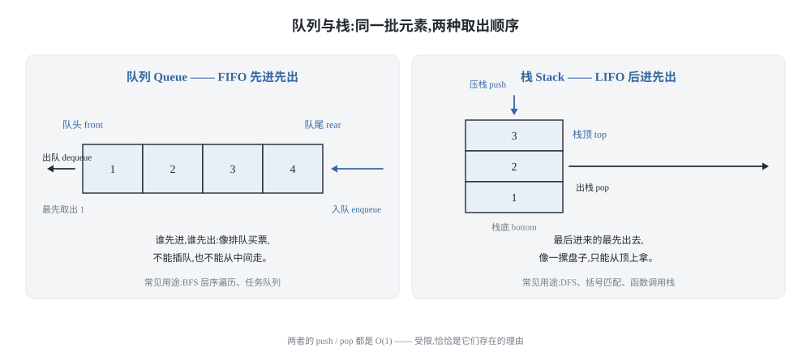
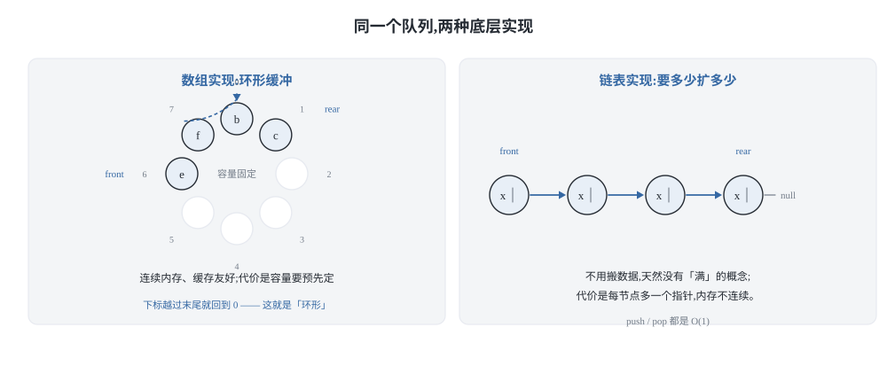
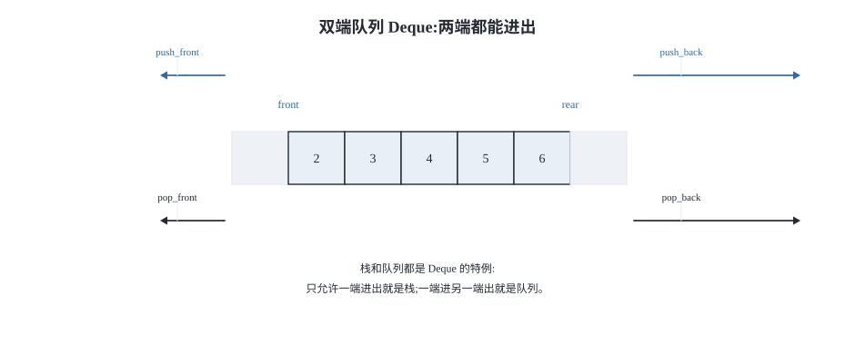
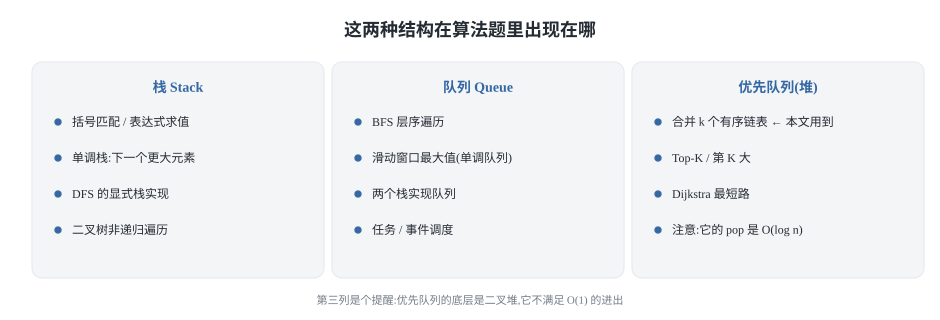
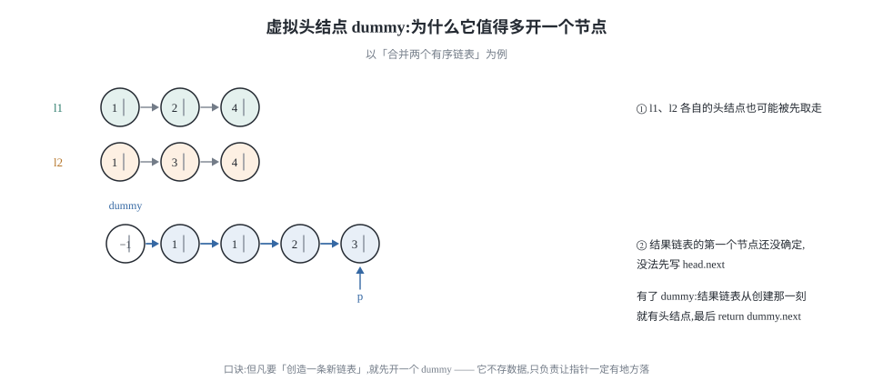
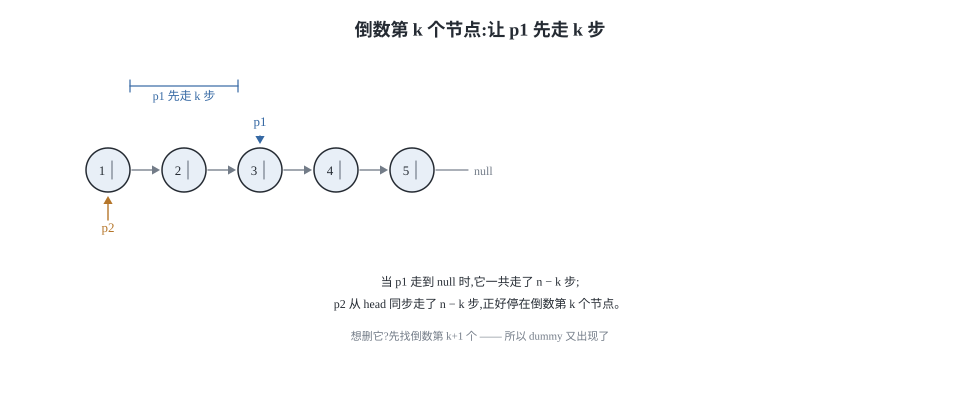
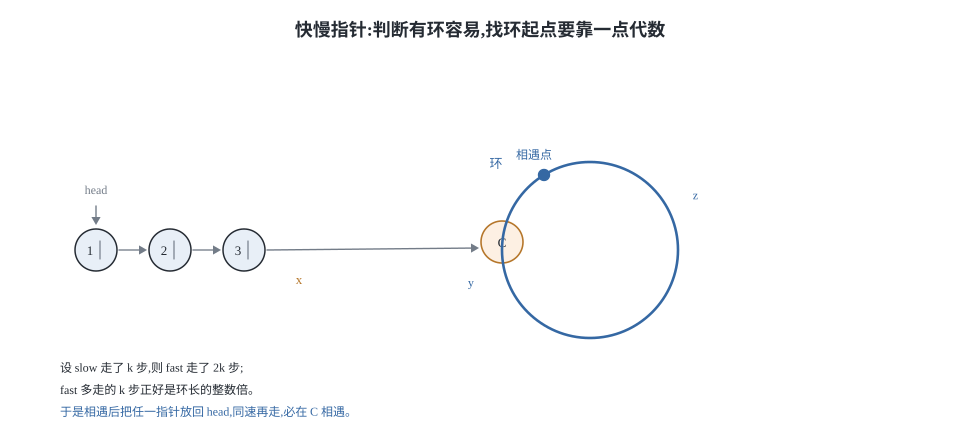
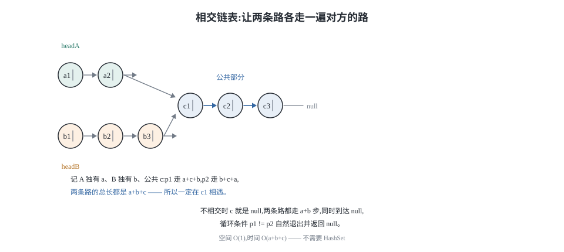

## 0 先说明材料和我的写法

这篇是我自己的学习笔记，材料来自 labuladong 的两篇教程：

- 《队列/栈基本原理》—— <https://labuladong.online/zh/algo/data-structure-basic/queue-stack-basic/>
- 《双指针技巧秒杀七道链表题目》—— <https://labuladong.online/algo/essential-technique/linked-list-skills-summary/>

需要讲清楚的是：**这不是转载，也不是翻译**。原文有完整的可视化面板和动图，那是这套教程最有价值的部分，而我这里复现不了。所以下面写的是我自己的理解——每个技巧我会补上"为什么这样是对的"，以及我在自己写的时候踩过或差点踩到的坑。图的 8 张示意图都是我自己用 SVG 画的。

**代码是 Python 3 和 C++ 两版**，不是原文的语言。教程原文用 Java 写，我按自己的习惯重新实现了一遍，所以这些片段是我写的、不是从原文抄的；不过每道题的**算法骨架和注释要点忠于原文**，方便你对照着读。两种语言并排给出，因为它们的坑不一样——比如第 2.3 节的最小堆，Python 和 C++ 在"值相等时怎么比较"上的行为完全不同，那是只有把两种语言都写一遍才会撞上的地方。

有一点要坦白：写第一节的时候，教程原文的正文我没能取到。那个页面是客户端渲染的，静态 HTML 里只有侧边栏目录和元信息（标题「队列/栈基本原理」，以及一句话摘要"队列和栈是操作受限的数据结构，底层可以用数组或链表实现，分别支持先进先出和先进后出的操作"）。所以**第一节的讲解是从这个标题和摘要出发，我自己组织的第一性原理推导**，其中我没有逐字对照过原文。第二节的 7 道链表题则取到了完整正文，所有结论和复杂度我都核对过原文。

### 目录

- [0 先说明材料和我的写法](#0-先说明材料和我的写法)
- [1 队列与栈:受限,恰恰是它们存在的理由](#1-队列与栈受限恰恰是它们存在的理由)
- [2 链表:7 道题,其实只有 5 个字](#2-链表7-道题其实只有-5-个字)
- [3 把这 7 道题收成一张表](#3-把这-7-道题收成一张表)
- [4 材料与出处](#4-材料与出处)

## 1 队列与栈:受限,恰恰是它们存在的理由

### 1.1 一句话区分

队列和栈都是**操作受限的线性表**。这是理解它们的唯一钥匙——不是"它们能做什么"，而是"它们禁止你做什么"。



- **队列**:先进先出（FIFO）。元素从一端进、从另一端出。
- **栈**:后进先出（LIFO）。元素只在同一端进出。

这个"受限"经常被当成缺点，其实正好相反。当一条数据通路上只允许一种顺序时，很多本来需要额外状态才能描述的问题就自动变得可推理了：BFS 需要"按层"的顺序，DFS 需要"最近未处理"的顺序，括号匹配需要"最近的左括号"。这些顺序需求如果用一个普通数组加游标去手工维护，代码里就会到处是边界判断；而用一个只允许一种进出的结构，顺序本身就变成了类型的一部分。

两者基础操作的复杂度都是 **O(1)**。注意这里说的是用数组或链表直接实现的情况，后面第 2 节要讲的优先队列不满足这一条。

### 1.2 底层实现:数组还是链表



用数组实现队列时，会遇到一个经典麻烦:**假溢出**。front 指针一路往后走，前面的空间虽然空了但没法直接复用，于是看起来"满了"其实没有。标准解法是把数组看成环——下标越过末尾就回到 0，也就是**环形缓冲**。

代价是容量必须预先定死。要支持动态增长就得扩容，而扩容要整体搬迁:单次 O(n)，但摊销下来是 O(1)。

用链表实现则天然没有这个问题:要多少申请多少，push/pop 都是 O(1)，不用搬数据。代价是每个节点多一个指针，而且内存不连续、缓存不友好。

所以这里其实没有什么"更好"的实现，只有权衡:**在意缓存和内存开销就选数组（并接受定容），在意弹性就选链表（并接受额外的指针开销）**。

### 1.3 双端队列:栈和队列都是它的特例



双端队列（Deque）把两端的进出权限都打开，一共四种操作。反过来看就很清楚:

- 只允许一端进出 → 栈
- 一端进、另一端出 → 队列

这也是为什么很多语言的标准库里只有 Deque 而没有单独的 Stack/Queue 实现——它俩都是特例。在 C++ 里 `stack` 和 `queue` 默认就是套在 `deque` 外面的适配器。

### 1.4 在算法题里它们出现在哪



第三列是个提醒:**优先队列不是队列**。它的底层是二叉堆，pop 的复杂度是 O(log n) 而不是 O(1)。本文第 2 节的第 3 道题就会用到它。

## 2 链表:7 道题,其实只有 5 个字

现在进入正题。这一节的材料来自《双指针技巧秒杀七道链表题目》，覆盖这 7 道题:

| # | 技巧 | 对应题目 |
|---|---|---|
| 1 | 合并两个有序链表 | 力扣 21 |
| 2 | 单链表的分解 | 力扣 86 |
| 3 | 合并 k 个有序链表 | 力扣 23 |
| 4 | 寻找倒数第 k 个节点 | 力扣 19 |
| 5 | 寻找单链表的中点 | 力扣 876 |
| 6 | 判断有环并找环起点 | 力扣 141 / 142 |
| 7 | 判断两个链表是否相交 | 力扣 160 |

先说结论:这 7 道题的解法只用到两个零件——**虚拟头结点（dummy）**和**快慢指针**。而这两个零件背后的共同思路，就是我标题里说的那 5 个字:**多开一个指针**。

面试里这些题的隐藏考点其实不是"能不能做出来"，而是**能不能只遍历一次**。链表的最大特点是你拿不到长度 n，只能顺着 next 走；任何"先算 n 再走第二遍"的解法都会被追问"能不能一趟扫描"。

### 2.1 虚拟头结点:为什么值得多开一个节点



第 1 道题（力扣 21，合并两个有序链表）看起来平淡无奇，但它是后面所有"造新链表"类题目的模板。原文用了一个很准确的类比:**拉拉链**——两条链表是锯齿，`p` 指针是拉索往前进。

第 1 道题（力扣 21，合并两个有序链表）的解法。下面所有 Python 代码都用这个节点定义:

```python
class ListNode:
    def __init__(self, val=0, next=None):
        self.val, self.next = val, next
```

所有 C++ 代码都用这个节点定义:

```cpp
struct ListNode {
    int val;
    ListNode* next;
    ListNode(int x = 0) : val(x), next(nullptr) {}
};
```

（C++ 需要 `<vector>`、`<queue>`;如果按力扣的原样提交，这两行平台已经替你包好了。）

**Python 3**:

```python
def mergeTwoLists(l1: ListNode, l2: ListNode) -> ListNode:
    dummy = ListNode(-1)          # 虚拟头结点
    p = dummy
    p1, p2 = l1, l2

    while p1 and p2:
        # 比较 p1 和 p2，把值较小的节点接到 p 后面
        if p1.val > p2.val:
            p.next = p2
            p2 = p2.next
        else:
            p.next = p1
            p1 = p1.next
        p = p.next                # p 不断前进

    p.next = p1 if p1 else p2     # 把还没走完的那条整条接上
    return dummy.next
```

**C++**:

```cpp
ListNode* mergeTwoLists(ListNode* l1, ListNode* l2) {
    ListNode dummy(-1);           // 虚拟头结点，栈上分配即可
    ListNode* p = &dummy;
    ListNode* p1 = l1;
    ListNode* p2 = l2;

    while (p1 && p2) {
        if (p1->val > p2->val) {
            p->next = p2;
            p2 = p2->next;
        } else {
            p->next = p1;
            p1 = p1->next;
        }
        p = p->next;
    }
    p->next = p1 ? p1 : p2;       // 剩余部分整条接上
    return dummy.next;
}
```

关键不在比较逻辑，而在 `dummy`。不用它会发生什么？结果链表的**第一个节点还没确定**——它可能是 l1 的头，也可能是 l2 的头，取决于第一次比较。于是你没法在循环开始前写下 `head.next = ...`，只能在循环里到处判断"这是不是第一个节点"。

原文给出的判断标准很简洁:**当你需要创造一条新链表的时候，就可以用虚拟头结点**。它不存任何数据，唯一职责是让"接下一个节点"这个动作永远有地方落。最后返回 `dummy.next` 即可。

### 2.2 单链表的分解:唯一一个必须"断开"的地方

第 2 道题（力扣 86）给一个链表和一个值 x，要求把小于 x 的节点放前面、大于等于 x 的放后面，且保持各自的相对顺序。

思路是开两个 dummy，分别长成"小于区"和"大于等于区"两条新链表，最后把两条接起来。原文的代码里有一行特别值得盯住:

原文的代码里有一行特别值得盯住:

```text
ListNode temp = p.next;
// 断开原链表中的每个节点的 next 指针
p.next = null;
p = temp;
```

**Python 3**:

```python
def partition(head: ListNode, x: int) -> ListNode:
    d1, d2 = ListNode(-1), ListNode(-1)   # 两条新链表的虚拟头结点
    p1, p2 = d1, d2
    p = head

    while p:
        if p.val < x:
            p1.next = p
            p1 = p1.next
        else:
            p2.next = p
            p2 = p2.next
        temp = p.next             # 断开原链表中的每个节点的 next 指针
        p.next = None
        p = temp

    p1.next = d2.next             # 把两条链表接起来
    return d1.next
```

**C++**:

```cpp
ListNode* partition(ListNode* head, int x) {
    ListNode d1(-1), d2(-1);
    ListNode* p1 = &d1;
    ListNode* p2 = &d2;
    ListNode* p = head;

    while (p) {
        if (p->val < x) {
            p1->next = p;
            p1 = p1->next;
        } else {
            p2->next = p;
            p2 = p2->next;
        }
        ListNode* temp = p->next;   // 断开原链表中的每个节点的 next 指针
        p->next = nullptr;
        p = temp;
    }
    p1->next = d2.next;
    return d1.next;
}
```

**这一行如果省掉，结果里就会出现环。** 原因是:当 `p.next = null` 不执行时，被接进新链表的节点仍然保留着原来指向下一个节点的指针，而这些节点可能已经被接到别处去了——某个节点被两个地方指着，链就成环了。

原文的总结是:**但凡遇到这种情况，就把原链表的节点断开**。我自己的理解是:只要你在"重新编排"已有节点的 next 指针（而不是新建节点），就得先假设每个节点的 next 是脏的，接走之前清干净。这个坑在后面几道题里不会再出现，因为在那些题里我只是**读**链表，不改它的 next。

### 2.3 合并 k 个有序链表:第一次引入优先队列

第 3 道题（力扣 23）是第 1 道题的推广。逻辑骨架完全一样，难点变成:**怎么快速从 k 个节点里找出最小的那个**。

答案是用最小堆。

**Python 3**:

```python
import heapq

def mergeKLists(lists: list) -> ListNode:
    if not lists:
        return None
    dummy = ListNode(-1)
    p = dummy
    # 最小堆，元素是 (节点值, 唯一序号, 节点)
    pq = []
    for i, head in enumerate(lists):
        if head:                          # 空链表不能进堆
            heapq.heappush(pq, (head.val, i, head))

    while pq:
        _, i, node = heapq.heappop(pq)    # 取出最小节点
        p.next = node
        if node.next:                     # 别忘了把它的后继放回去
            heapq.heappush(pq, (node.next.val, i, node.next))
        p = p.next

    return dummy.next
```

**C++**:

```cpp
ListNode* mergeKLists(vector<ListNode*>& lists) {
    if (lists.empty()) return nullptr;
    ListNode dummy(-1);
    ListNode* p = &dummy;
    // 小根堆：比较器只看 val
    auto cmp = [](ListNode* a, ListNode* b) { return a->val > b->val; };
    priority_queue<ListNode*, vector<ListNode*>, decltype(cmp)> pq(cmp);

    for (ListNode* head : lists) {
        if (head) pq.push(head);
    }
    while (!pq.empty()) {
        ListNode* node = pq.top(); pq.pop();
        p->next = node;
        if (node->next) pq.push(node->next);
        p = p->next;
    }
    return dummy.next;
}
```

Python 这里有个坑要专门说:`heapq` 在元素值相同时会去比较元组的**第二个元素**。如果直接塞 `(val, node)`，一旦两个 `val` 相等，它就会尝试比较两个 `ListNode` 对象，而 Python 没有给自定义类定义 `<`，于是抛 `TypeError`。所以必须塞一个**能比较、且各不相同**的序号 `i` 进去——这是个只有真跑过才会知道的细节。

C++ 没这个问题:`priority_queue` 的比较器只读 `val`，相等时不会去比较指针所指向的对象。

两个容易忽略的细节:

1. `for` 循环里判了 `head != null`。输入里可能有空链表，直接 `add` 会空指针。
2. `poll` 出来的节点如果还有 next，要把它**继续放回堆里**——否则那条链表后面就丢了。

复杂度:堆里元素最多 k 个，所以每次 poll/add 是 O(logk)；总共 N 个节点进出一次，整体是 **O(Nlogk)**，其中 k 是链表条数、N 是节点总数。

这道题原文还提到一个经典替代解法是分治，思路是两两合并，这里不展开。

### 2.4 倒数第 k 个节点:让一个指针先走 k 步



第 4 道题。最容易想到的解法是先遍历一遍算出长度 n，再走第二遍找第 n−k+1 个。但题目（力扣 19）的进阶要求恰恰是"你能尝试使用一趟扫描实现吗"。

只需要让一个指针先走 k 步:

```python
def findFromEnd(head: ListNode, k: int) -> ListNode:
    p1 = head
    for _ in range(k):            # p1 先走 k 步
        p1 = p1.next
    p2 = head
    while p1:                     # p1 和 p2 同时走 n - k 步
        p2 = p2.next
        p1 = p1.next
    return p2                     # 此时 p2 在倒数第 k 个节点
```

```cpp
ListNode* findFromEnd(ListNode* head, int k) {
    ListNode* p1 = head;
    for (int i = 0; i < k; i++) {  // p1 先走 k 步
        p1 = p1->next;
    }
    ListNode* p2 = head;
    while (p1) {                   // p1 和 p2 同时走 n - k 步
        p2 = p2->next;
        p1 = p1->next;
    }
    return p2;                     // p2 现在在倒数第 k 个节点
}
```

**为什么对**:两个指针之间的间距被钉死在 k。当 p1 走到末尾的空指针时，它一共前进了 n−k 步；p2 同步前进 n−k 步，正好停在正数第 n−k+1 个位置，也就是倒数第 k 个。

严格说，两种解法的时间复杂度都是 O(N)，big O 表示法看不出来区别。它赢在**少一趟扫描**，这在面试里就是分水岭。

### 2.5 找中点:快指针走两步

第 5 道题（力扣 876）。让 slow 每次走一步、fast 每次走两步，fast 到末尾时 slow 正好在中点:

```python
def middleNode(head: ListNode) -> ListNode:
    slow = fast = head
    while fast and fast.next:     # 快指针走到末尾时停止
        slow = slow.next          # 慢指针走一步
        fast = fast.next.next     # 快指针走两步
    return slow                   # slow 指向中点
```

```cpp
ListNode* middleNode(ListNode* head) {
    ListNode* slow = head;
    ListNode* fast = head;
    while (fast && fast->next) {
        slow = slow->next;        // 慢指针走一步
        fast = fast->next->next;  // 快指针走两步
    }
    return slow;                  // slow 指向中点
}
```

两个必须记住的边界:

- 循环条件是 `fast != null && fast.next != null`。**后半句不能少**——`fast.next.next` 要先访问 `fast.next`，所以必须先确认它非空。
- 链表长度为偶数时中点有两个，这个写法返回的是**靠后的那个**。题目如果要求靠前的，初始化要调整。

原文特意提了一句:这段代码稍加修改就能用来判断链表成环。这正是下一题。

### 2.6 判环与找环起点:唯一需要一点代数的地方

判断有没有环很简单:如果 fast 能正常走到末尾，就没有环；如果 fast 走着走着和 slow 相遇了，说明它在环里转圈，有环。

```python
def hasCycle(head: ListNode) -> bool:
    slow = fast = head
    while fast and fast.next:
        slow = slow.next
        fast = fast.next.next
        if slow is fast:          # 快慢指针相遇，说明有环
            return True
    return False                  # 走到末尾，没有环
```

```cpp
bool hasCycle(ListNode* head) {
    ListNode* slow = head;
    ListNode* fast = head;
    while (fast && fast->next) {
        slow = slow->next;
        fast = fast->next->next;
        if (slow == fast) return true;   // 相遇即有环
    }
    return false;                        // 走到末尾则无环
}
```

注意 Python 这里要用 `is` 而不是 `==`:`is` 判的是"是不是同一个对象"，`==` 会去调用 `__eq__`。本节为了简化没给 `ListNode` 定义 `__eq__`，所以此刻两者结果一样;但只要哪天你给节点加了按值比较，`==` 就会悄悄改变判环的语义。判"同一个节点"永远应该用 `is`。

真正有意思的是进阶版（力扣 142）:**如果有环，环的起点在哪？**



```python
def detectCycle(head: ListNode) -> ListNode:
    slow = fast = head
    while fast and fast.next:
        fast = fast.next.next
        slow = slow.next
        if slow is fast:
            break
    # 上面的逻辑和 hasCycle 一样
    if not fast or not fast.next:
        return None               # fast 走到空指针，说明没有环

    slow = head                   # 一个指针重新指向头结点
    while slow is not fast:       # 同速前进
        fast = fast.next
        slow = slow.next
    return slow                   # 相遇点就是环起点
```

```cpp
ListNode* detectCycle(ListNode* head) {
    ListNode* slow = head;
    ListNode* fast = head;
    while (fast && fast->next) {
        fast = fast->next->next;
        slow = slow->next;
        if (slow == fast) break;
    }
    if (!fast || !fast->next) return nullptr;   // 无环

    slow = head;                  // 一个指针重新指向头结点
    while (slow != fast) {        // 同速前进
        fast = fast->next;
        slow = slow->next;
    }
    return slow;                  // 相遇点就是环起点
}
```

结论是:**相遇之后，把任一指针放回 head，然后两个指针以相同速度前进，再次相遇的位置就是环起点。**

为什么？这是全篇唯一需要动笔推一下的地方。

设从 head 到环起点 C 的距离为 x，从 C 到相遇点的距离为 y，从相遇点绕回 C 的距离为 z（所以环长是 y+z）。相遇时:

- slow 走了 x + y
- fast 走了 x + y + n(y + z)，因为它多绕了 n 整圈

而 fast 的速度是 slow 的两倍，所以:

```text
2(x + y) = x + y + n(y + z)
   x + y = n(y + z)
       x = n(y + z) − y
       x = (n − 1)(y + z) + z
```

最后这一行是关键。`(n−1)(y+z)` 是环长的整数倍，绕圈不影响位置；所以 **x ≡ z (mod 环长)**，也就是说:从 head 走 x 步到 C，从相遇点走 z 步**也**到 C。

于是让一个指针从 head 出发、另一个从相遇点出发、同速前进，走 x 步后必然在 C 相遇。

顺带一个边界:`break` 之后要先判断 `fast == null || fast.next == null` 才能确认"没有环"。因为循环退出也可能是"fast 走到头了"——这时候不能当作找到环来处理。

**这里要说明一下记法**:教程原文用的是另一套符号——设 slow 走了 k 步（此时 fast 走了 2k 步，所以 k 是环长的整数倍），设相遇点距环起点为 m，于是环起点距 head 为 k−m，而从相遇点再走 k−m 步也能到环起点，两边一凑就得出了结论。我的推导用的是 x/y/z 记法，结论和原文一致，但这一段是我自己重写的，不是原文的表述。

### 2.7 判断两个链表是否相交:让两条路各走一遍对方的路

最后一题（力扣 160）。如果两个链表相交，返回相交的那个节点；不相交返回 null。



直觉解法是用 HashSet 存一条链表的所有节点再对比，但那需要额外空间。题目要求 O(1) 空间。

难点在于两条链表长度可能不同，两个指针没法同步走到公共节点。破局思路是**让两条路的总长相等**:

```python
def getIntersectionNode(headA: ListNode, headB: ListNode) -> ListNode:
    p1, p2 = headA, headB
    while p1 is not p2:
        # p1 走一步；走到 A 的末尾就转到 B
        p1 = headB if p1 is None else p1.next
        # p2 走一步；走到 B 的末尾就转到 A
        p2 = headA if p2 is None else p2.next
    return p1                     # 相交则返回交点，不相交则是 None
```

```cpp
ListNode* getIntersectionNode(ListNode* headA, ListNode* headB) {
    ListNode* p1 = headA;
    ListNode* p2 = headB;
    while (p1 != p2) {
        // p1 走一步；走到 A 的末尾就转到 B
        p1 = (p1 == nullptr) ? headB : p1->next;
        // p2 走一步；走到 B 的末尾就转到 A
        p2 = (p2 == nullptr) ? headA : p2->next;
    }
    return p1;                    // 相交则返回交点，否则是 nullptr
}
```

记 A 独有部分长 a、B 独有部分长 b、公共部分长 c。p1 走的是 a+c+b，p2 走的是 b+c+a——**总长都是 a+b+c**，所以它们一定同时到达 c 的第一个节点。

不相交的情况也自然覆盖:这时把 c 看成 null，两条路各走 a+b 步后同时到达 null，循环条件 `p1 != p2` 不成立直接退出，返回的 p1 就是 null。

原文在 2022/1/24 的更新里补充了两种读者提出的替代思路，其中一种是先各自算出长度、把长的那条先走 |lenA−lenB| 步再同步走。代码多一些但更好懂，复杂度同样是 O(N)。

## 3 把这 7 道题收成一张表

| 题目 | 核心零件 | 复杂度 | 最容易错的那一行 |
|---|---|---|---|
| 21 合并两个有序链表 | dummy + 尾插 | O(n+m) | 忘了把剩余部分接上去 |
| 86 分隔链表 | 两个 dummy | O(n) | 没写 `p.next = null`，结果成环 |
| 23 合并 k 个有序链表 | dummy + 最小堆 | O(Nlogk) | 忘了判空、忘了把 `node.next` 放回堆 |
| 19 删除倒数第 n 个 | 快慢指针先走 k 步 | O(n) | 删头结点时要找倒数第 n+1 个，得用 dummy |
| 876 链表中间结点 | 快慢指针 | O(n) | 循环条件漏掉 `fast.next != null` |
| 141/142 判环 + 找环起点 | 快慢指针 | O(n) | break 后没判 null；把"走到头"当成"找到环" |
| 160 相交链表 | 双指针换路 | O(a+b+c) | `p1 == null` 时转 headB，判的是 null 不是 `p1.next` |

如果要我只留一句话:链表题里凡是出现"拿不到长度但又需要位置信息"的地方，答案基本都是**多开一个指针，让它和另一个指针保持一个固定的差值**。dummy 是让这个差值可以从 0 开始算，快慢指针是让差值为 k，换路是让两条路的总长相等。

## 4 材料与出处

这篇的素材来自 labuladong 的教程，建议直接去读原文，那里的可视化面板对理解快慢指针的运动过程帮助很大:

- 《队列/栈基本原理》
  <https://labuladong.online/zh/algo/data-structure-basic/queue-stack-basic/>
  所属章节还包括《用链表实现队列/栈》《用数组实现队列/栈》《双端队列（Deque）原理及实现》《二叉堆/优先级队列代码实现》。
- 《双指针技巧秒杀七道链表题目》
  <https://labuladong.online/algo/essential-technique/linked-list-skills-summary/>

第 2 节涉及的题目原文链接:

| 题号 | 题目 | 链接 |
|---|---|---|
| 21 | 合并两个有序链表 | <https://leetcode.cn/problems/merge-two-sorted-lists/> |
| 86 | 分隔链表 | <https://leetcode.cn/problems/partition-list/> |
| 23 | 合并 K 个升序链表 | <https://leetcode.cn/problems/merge-k-sorted-lists/> |
| 19 | 删除链表的倒数第 N 个结点 | <https://leetcode.cn/problems/remove-nth-node-from-end-of-list/> |
| 876 | 链表的中间结点 | <https://leetcode.cn/problems/middle-of-the-linked-list/> |
| 141 | 环形链表 | <https://leetcode.cn/problems/linked-list-cycle/> |
| 142 | 环形链表 II | <https://leetcode.cn/problems/linked-list-cycle-ii/> |
| 160 | 相交链表 | <https://leetcode.cn/problems/intersection-of-two-linked-lists/> |

再次说明:本节的讲解、推导和 8 张示意图都是我自己写的，教程原文的代码片段我保留了原样以便对照，读者请以原文为准。第 1 节我没能取到原文正文，那里的内容是我从标题和摘要出发自行组织的，没有逐字对照。
