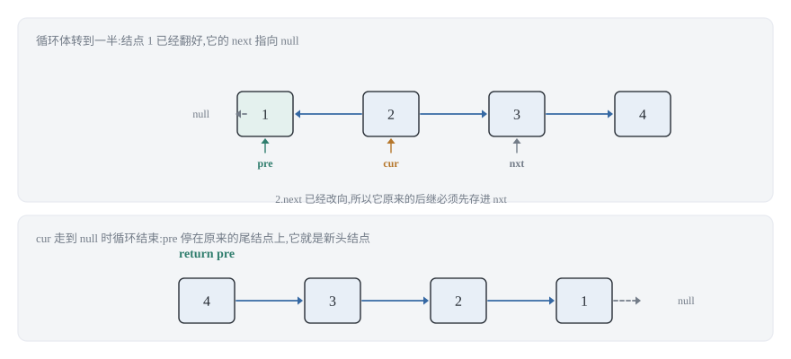
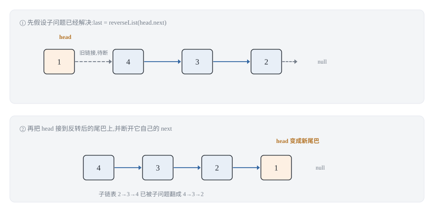
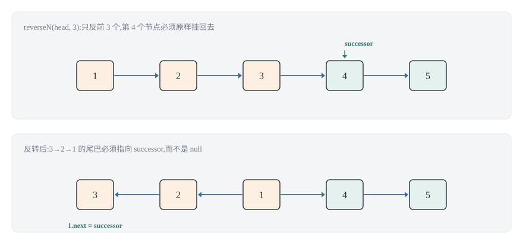
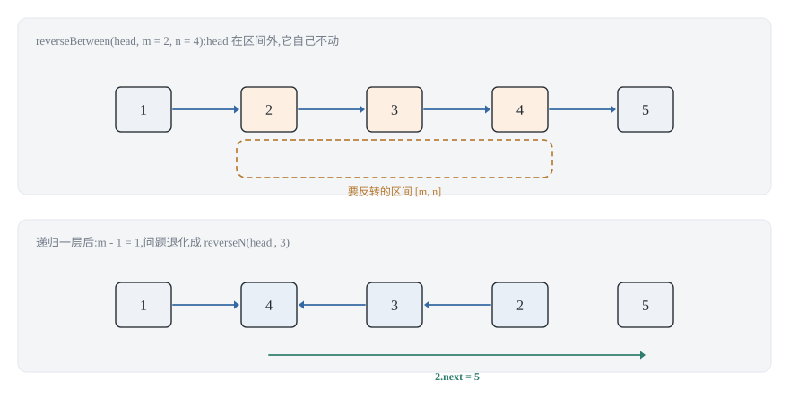
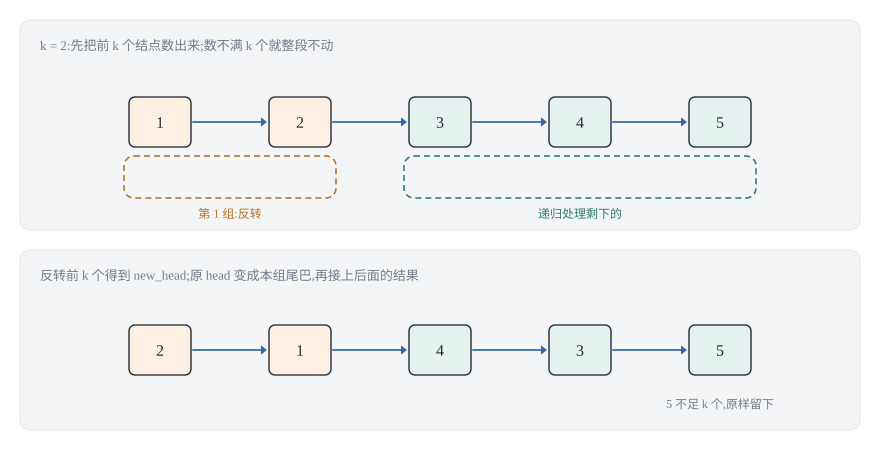
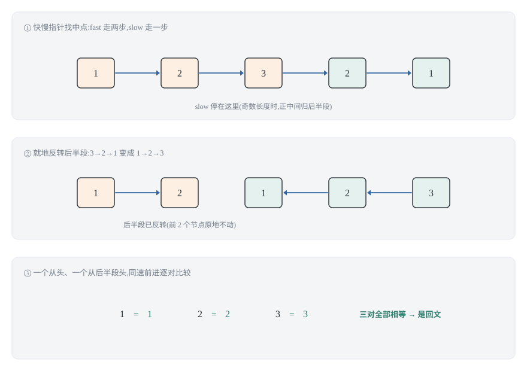

## 0 先说明材料和我的写法

这篇是我自己的学习笔记，材料来自 labuladong 的这几篇教程：

- 《单链表的花式反转方法汇总》—— <https://labuladong.online/zh/algo/data-structure/reverse-linked-list-recursion/>
- 《双指针技巧秒杀七道链表题目》—— <https://labuladong.online/zh/algo/essential-technique/linked-list-skills-summary/>
- 《链表（链式存储）基本原理》—— <https://labuladong.online/zh/algo/data-structure-basic/linkedlist-basic/>

**这不是转载，也不是翻译。** 原文有完整的可视化面板和动图，那是这套教程最有价值的部分，我这里复现不了，所以下面写的是我自己的理解：每个套路我会补上「为什么这样是对的」，以及我自己写的时候踩过或差点踩到的坑。6 张示意图都是我用 SVG 自己画的。

**代码是 Python 3 和 C++ 两版**，教程原文用的是 Java，我按自己的习惯重新实现了一遍，所以这些片段是我写的、不是从原文抄的。两种语言并排给出是有实际理由的：它们错的点不一样，第 2 节和第 5 节各有一个只有把两种语言都写一遍才会撞上的地方。

有一点必须坦白：**这篇取到的原文正文是不完整的。** 《单链表的花式反转方法汇总》那个页面我能读到的只有「反转整个单链表」（含迭代解法和递归解法）以及「反转链表前 N 个节点」这一行标题；页面自己的目录还列着「反转链表的一部分」「K 个一组反转链表」，但正文没取到。所以：

- 第 1 节（反转整个单链表）我逐条核对过原文；
- **第 2.1 节（反转前 N 个）、第 2.2 节（反转区间）、第 2.3 节（两两交换）和第 3 节（K 个一组）的推导和实现是我自己写的**，原文只提供了小标题和题号（206 / 92 / 24 / 25）。这几节的算法本身是公开的经典结论，但「我是怎么想出来的」这部分没有逐字对照过原文。
- 判断回文链表那一节（第 4 节）：原文里《如何判断回文链表》这篇我**没有取到**，只从《双指针技巧秒杀七道链表题目》和反转那篇的「上一篇 / 下一篇」导航里知道它存在。所以**第 4 节整节都是我自己推导的**，两种解法的取舍也是我自己的判断。

### 目录

- [0 先说明材料和我的写法](#0-先说明材料和我的写法)
- [1 反转的原子动作:改向、前移、接回](#1-反转的原子动作改向前移接回)
- [2 从这个动作推出四种翻法](#2-从这个动作推出四种翻法)
- [3 K 个一组:把「一组」当成一个节点](#3-k-个一组把一组当成一个节点)
- [4 判断回文链表:两种思路摆在一起比](#4-判断回文链表两种思路摆在一起比)
- [5 链表双指针经典习题:换汤不换药](#5-链表双指针经典习题换汤不换药)
- [6 把这几个套路收成一张表](#6-把这几个套路收成一张表)
- [7 材料与出处](#7-材料与出处)

## 1 反转的原子动作:改向、前移、接回

### 1.1 一个指针不够

反转整个单链表（力扣 206）最朴素的写法是「把每个节点的 next 指向前一个节点」。这个描述本身没错，但直接照它写代码会卡住：

```text
cur.next = pre     # 改向
cur = cur.next     # ???
```

第一行执行完，`cur.next` 已经指向 `pre` 了。第二行想「前移」，可是顺着 `cur.next` 走过去只会退回 `pre`——**原来的后继丢了**。这就是为什么单链表反转至少要三个指针：



- `pre`:已经翻好的那一段的头部（也就是原链表里 `cur` 的前一个节点）；
- `cur`:正在处理的节点；
- `nxt`:`cur` 原来的后继，**必须在改向之前先存下来**。

所以「三个指针」不是口诀，是因为**改向这个动作会破坏前移所需的信息**，只能提前备份一份。原文把这一点讲成两条操作指针的小技巧，我把它还原成上面这个因果：

**最容易写错的一行:** `nxt = cur.next` 必须写在 `cur.next = pre` **之前**。写反了，第一次循环就把链表从中间截断，后面的节点全部丢失。

原文明说：一旦出现 `nxt.next` 这种操作，要条件反射地先判 `nxt` 是不是 `null`。这句对应到代码里就是 `if nxt: nxt = nxt.next` 那半句——C++ 里漏掉它不报错，只是运行时解引用空指针；Python 里漏掉它会抛 `AttributeError`。两种语言的报错形式不同，但根因是同一个。

### 1.2 迭代版:循环结束的那一刻指针在哪

**Python 3**:

```python
def reverseList(head: ListNode) -> ListNode:
    pre, cur = None, head
    while cur:
        nxt = cur.next      # ① 先备份后继，否则下一步就把它弄丢了
        cur.next = pre      # ② 改向
        pre = cur           # ③ pre 前进到刚翻好的节点
        cur = nxt           # ④ cur 前进到原来的后继
    return pre              # cur 走到 None 时，pre 停在原来的尾结点
```

**C++**:

```cpp
ListNode* reverseList(ListNode* head) {
    ListNode* pre = nullptr;
    ListNode* cur = head;
    while (cur) {
        ListNode* nxt = cur->next;   // ① 先备份后继
        cur->next = pre;             // ② 改向
        pre = cur;                   // ③ pre 前进
        cur = nxt;                   // ④ cur 前进
    }
    return pre;                      // 新头结点就是原来的尾结点
}
```

原文给了一个很实用的建议:如果循环结束时的指针位置想不清楚，就拿**只有两个节点的链表**跑一遍。`1->2` 的时候循环只转两圈，手推一遍就能确认返回的确实是 `pre` 而不是 `cur`——出循环时 `cur == null`、`pre` 指向 2，正是新头结点。

复杂度:每个节点被处理常数次，时间 **O(n)**；只用了三个指针变量，空间 **O(1)**。

### 1.3 递归版:只做「接」这一件事

递归写法在很多地方被当作「递归之美」的展示，但它其实只有一句是关键：

```text
reverseList(1 -> 2 -> 3 -> 4) = reverseList(2 -> 3 -> 4) 接上 1
```

也就是「分解问题」:先把除头结点之外的子链表反转好，再想办法把头结点接到新尾巴上。原文特别提醒:**不要跳进递归**——你的脑袋压不了几个栈，只要相信递归函数的定义（「输入一个头结点，反转以它为起点的链表，返回新头结点」）就够了。



**Python 3**:

```python
def reverseListRec(head: ListNode) -> ListNode:
    if head is None or head.next is None:   # base case:空或单节点，反转就是它自己
        return head
    last = reverseListRec(head.next)        # ① 假设子问题已解决，last 是反转后的新头
    head.next.next = head                   # ② 把 head 接到反转后的尾巴上
    head.next = None                        # ③ 断开 head 自己的 next，它是新尾巴
    return last
```

**C++**:

```cpp
ListNode* reverseListRec(ListNode* head) {
    if (head == nullptr || head->next == nullptr) return head;
    ListNode* last = reverseListRec(head->next);   // ① 子问题已解决
    head->next->next = head;                       // ② 接到反转后的尾巴上
    head->next = nullptr;                          // ③ 断开，它是新尾巴
    return last;
}
```

**最容易写错的一行:** `head.next = None`（C++ 里的 `head->next = nullptr`）。省掉它，原来的头结点 1 仍然指向 2，而 2 已经被翻到前面去了——链表尾部出现一个环，任何遍历都会死循环，而且因为前面的节点都在环外，肉眼检查前几个节点是看不出来的。原文把这一步和 base case 并列成仅有的两个注意点，我觉得它还该更靠前一点:第 ② 行是**建立**新链接，第 ③ 行是**拆除**旧链接，少一半就等于没反转干净。

代价要说清楚。原文的结论是:两种写法时间复杂度都是 O(n)，但**迭代是 O(1) 空间，递归需要堆栈、是 O(n) 空间**。所以递归版是用来说清「分解问题」这种思维的，真要提交，迭代版更好。我在第 4 节还会回到这个空间账单上——那里的递归写法看着优雅，代价却是一样的。

## 2 从这个动作推出四种翻法

上面那个「改向、前移、接回」的动作，其实已经把四种翻法都包含进去了。差别只在两个地方:**从哪里开始，在哪里停住，以及停住之后把尾巴接到谁身上**。

### 2.1 反转前 N 个:多一个 successor

`reverseN(head, n)` 只反转前 n 个节点，第 n+1 个开始原样保留。

难点在第 n 个节点身上。整体反转时，它翻转后是新尾巴，尾巴的 next 应该是 `null`；但只反转前 n 个时，尾巴的 next 必须是**第 n+1 个节点**：



原文只给出了这个函数的签名和示意图，正文没取到。下面是我自己写的一版迭代实现，思路是先用 dummy 把「第 n 个节点」定位出来，再把这一段单独反转，最后接回去:

**Python 3**:

```python
def reverseN(head: ListNode, n: int) -> ListNode:
    """反转前 n 个节点（1 <= n <= 链表长度）。"""
    if head is None:
        return None
    dummy = ListNode(-1, head)
    # tail 最终停在「第 n 个节点」上:它是反转段的原尾巴，反转后变成段首
    tail = dummy
    for _ in range(n):
        if tail.next is None:       # n 超过长度:按整条反转处理，不越界
            break
        tail = tail.next
    # 切断:seg 是反转段，rest 是段后剩下的
    seg, rest = dummy.next, tail.next
    tail.next = None

    new_seg = reverseList(seg)      # 复用第 1 节的整体反转
    seg.next = rest                 # seg 反转后成了段尾，正好指向 rest
    dummy.next = new_seg
    return dummy.next
```

**C++**:

```cpp
ListNode* reverseN(ListNode* head, int n) {
    if (head == nullptr) return nullptr;
    ListNode dummy(-1);
    dummy.next = head;
    ListNode* tail = &dummy;                 // tail 最终停在原第 n 个节点上
    for (int i = 0; i < n && tail->next; i++) {
        tail = tail->next;                   // 数不满 n 个就整条反转
    }
    ListNode* seg = dummy.next;
    ListNode* rest = tail->next;
    tail->next = nullptr;                    // 先切断，再反转

    ListNode* newSeg = reverseList(seg);
    seg->next = rest;                        // seg 变成段尾，接回 rest
    dummy.next = newSeg;
    return dummy.next;
}
```

**最容易写错的一行:** `seg.next = rest`。`seg` 在反转前是段首，反转后自动变成段尾——所以这一行写的是「段尾接回剩下的部分」。如果这里写成 `new_seg.next = rest`，接的是段首，后果是**把反转好的那一段截断成只剩段首**：`[1,2,3,4]` 取 n=2 时，正确结果是 `[2,1,3,4]`，写成 `new_seg.next` 会得到 `[2,3,4]`——节点 `1` 直接丢了（注意它**不是**成环，是截断，这两种失败模式修起来不一样）。

这个错很隐蔽，但**触发条件和「`rest` 是否为空」无关**。我一开始就是照那个方向猜的，被代码门当场证伪：真正起决定作用的是**被反转那一段的长度**。

- `[1,2,3]` 反转前 3（此时 `rest` 恰好是 `null`）：正确结果 `[3,2,1]`，写成 `new_seg.next` 得到 `[3]`——错得很彻底；
- 全部 156 个用例里，错法碰巧给出正确结果的只有 68 个，条件精确地是「**反转段长度 ≤ 1**」（即 n=1，或者链表为空、只有一个节点）；
- 反转段长度 ≥ 2 的那 88 个用例**全部出错**。

为什么会这样：`new_seg` 是反转后的段首，而它在反转前是**段尾**，`next` 本来指向 `rest`。把它接到自己身上，等于让段首直接指向后面剩下的部分，中间那 `n-1` 个节点就全部脱离了。所以只要 `n ≥ 2` 就必错，跟 `rest` 空不空没有关系。

顺带说一句:`if tail.next is None: break` 是为了覆盖「n 大于链表长度」这个边界。题目一般保证 `n` 合法，但把它当输入处理总没坏处——我在代码门里就是这么测的。

**这个函数有下界，我一开始没写。** 上面那行循环处理的是 `n` 太**大**的情况；`n` 太小也出事，而且出的是另一种错。`n = 0` 时循环一次都不进，`tail` 就一直停在 `dummy` 上，于是 `seg` 和 `rest` 指向**同一个节点**（都是 `head`）。接着 `tail.next = None` 把 `dummy` 和整条链表断开，`reverseList(seg)` 照常把整条反转，最后 `seg.next = rest`——而 `seg` 和 `rest` 是同一个对象，这一行等于**让 `seg` 指向它自己**：

```text
n=0 输入 [1,2,3] -> 走 [3, 2, 1, 回到 1, 成环]
n=1 输入 [1,2,3] -> 走 [1, 2, 3]
n=2 输入 [1,2,3] -> 走 [2, 1, 3]
```

`n=1`、`n=2` 都对，只有 `n=0` 会成环。C++ 版是同一份逻辑，所以同样成环。我把这个当成**前置条件**处理，而不是在函数里加 `if n == 0: return head`：`reverseN` 的语义是「反转前 n 个」，而「前 0 个」这件事在调用方（`reverseKGroup` 的循环、`reverseBetween` 的 `m == 1` 分支）本来就不该发生——真发生了，说明上一层的判断写错了，此时静默返回原链表会把 bug 藏起来。所以文档字符串写的是 `1 <= n <= 链表长度`，代码门也把 `n = 0` 排除在用例之外（而不是让它当个「正常边界」混过去）。

### 2.2 反转区间 [m, n]:递归把 m 降到 1

力扣 92「反转链表 II」要求反转第 m 到第 n 个节点。直接写三段拼接是能做出来的，但递归有一个非常漂亮的用法:**用 m 当计数器，一路递归到 m == 1 时，问题就退化成 `reverseN`**。



道理是这样的:如果 `m == 1`，就是反转前 n 个，交给 `reverseN`；如果 `m > 1`，那么**头结点一定在区间外**，它的位置不会变，唯一要改的是 `head.next`——让子链表自己解决剩下的部分。

**Python 3**:

```python
def reverseBetween(head: ListNode, m: int, n: int) -> ListNode:
    if head is None or m >= n:
        return head                 # m == n 时区间长度为 1，什么都不用做
    if m == 1:
        return reverseN(head, n)    # 退化成「反转前 n 个」
    # head 在区间外，它不动，只有 head.next 需要换
    head.next = reverseBetween(head.next, m - 1, n - 1)
    return head
```

**C++**:

```cpp
ListNode* reverseBetween(ListNode* head, int m, int n) {
    if (head == nullptr || m >= n) return head;   // 区间长度 1，不做
    if (m == 1) return reverseN(head, n);
    head->next = reverseBetween(head->next, m - 1, n - 1);
    return head;
}
```

**为什么递归不会走丢**:每递归一层，`m` 和 `n` **同时减 1**，区间长度 `n - m` 保持不变。递归到 `m == 1` 时，原来的区间正好落在子链表的开头。层数是 `m - 1`，所以空间是 O(m)，时间还是 O(n)。

`m >= n` 那一行处理了两个边界:`m == n` 是长度为 1 的区间（做了等于没做），`m > n` 是非法输入（题目不会给，但静默返回原链表比抛异常好测）。

### 2.3 两两交换是 K 个一组的特例

力扣 24「两两交换链表中的节点」其实是第 3 节 `k == 2` 的特例。它单独出现是因为有一个**只换值不换节点**的偷懒写法：

```text
while cur and cur.next:
    cur.val, cur.next.val = cur.next.val, cur.val
    cur = cur.next.next
```

这个写法在力扣上能过，因为题目只校验值序列。但它不是「交换节点」——节点的身份、地址、以及别人手里的引用全都没变。面试里如果被追问「能不能不改变节点的值」，这个写法就废了。我把它列在这里，是当作反面样本:**能用值糊过去的时候，先问一句题目到底在换什么。** 第 3 节的 `reverseKGroup` 在 `k == 2` 时就是正确解法。

## 3 K 个一组:把「一组」当成一个节点

力扣 25「K 个一组翻转链表」看着比前面都复杂，但它有一个视角上的捷径:

> **把每 k 个节点看成一个大节点**，那这就是一条普通的链表反转；只是「反转一个大节点」的内部操作，正好是把那 k 个节点反过来。

这个视角一旦立住，递归结构就和第 1.3 节的整体反转**一模一样**了:



**Python 3**:

```python
def reverseKGroup(head: ListNode, k: int) -> ListNode:
    if k <= 1 or head is None:
        return head                 # k == 1 时反转没有意义
    # ① 先数够 k 个；数不满就整段不动
    node = head
    for _ in range(k):
        if node is None:
            return head             # 不足 k 个：保持原样
        node = node.next
    # ② 反转前 k 个，复用 reverseN
    new_head = reverseN(head, k)
    # ③ head 现在是这一组的新尾巴，它后面接下一组的结果
    head.next = reverseKGroup(node, k)
    return new_head
```

**C++**:

```cpp
ListNode* reverseKGroup(ListNode* head, int k) {
    if (k <= 1 || head == nullptr) return head;
    ListNode* node = head;
    for (int i = 0; i < k; i++) {
        if (node == nullptr) return head;   // 不足 k 个，整段不动
        node = node->next;
    }
    ListNode* newHead = reverseN(head, k);
    head->next = reverseKGroup(node, k);    // head 已是本组尾巴
    return newHead;
}
```

**最容易写错的一行:** 那个「先数够 k 个」的前置循环。**它必须写在反转之前**。如果把「数不满就停」的判断放到反转之后再做，最后那一组不足 k 个的节点已经被翻过来了——而题目要求它们保持原样。这是第 3 节唯一一个「顺序错了就错」的地方，我第一版就是这么写错的。

另外注意递归调用传的是 `node` 而不是 `head.next`。

这里我要**收回一句原来写错的话**：我本来写的是「`head.next` 在反转过程中被改掉了，指向的是组内节点」——这跟本文自己的 `reverseN` 直接矛盾。`reverseN` 的最后一行是 `seg.next = rest`，而反转之后成为**本组尾巴**的正是 `head`，所以 `head.next` 恰好就等于下一组的第一个节点，也就是 `node`。代码门实测过：把 `reverseKGroup(node, k)` 换成 `reverseKGroup(head.next, k)`，156 个用例**没有一个结果不同**。

所以 `node` 是**多余但正确**的，不是必需。那为什么还是该留着它？因为 `head.next == node` 是**依赖 `reverseN` 的实现细节**才成立的：`reverseN` 在最后一行把这一段的尾巴接回了 `rest`，才让 `head.next` 顺带指对了位置。一旦你为了别的需求改了 `reverseN`（比如让它返回 `(新头, 新尾)` 而不负责接尾巴），`head.next` 立刻就错，而 `node` 不会。**这也是我第一版想说的意思，只是当时把理由写反了**——不是「不写 `node` 就算错」，而是「`node` 把意图写明了，不依赖隔壁函数的副作用」。

复杂度:每个节点被访问常数次，时间 O(N)；递归深度是 N/k，空间 O(N/k)。

至于「数不满就停」用的 `node is None`（C++ 的 `node == nullptr`），和第 1.1 节的 `if nxt` 是同一类判断——**顺着 next 走之前，先确认它不为空**。这条纪律在这篇里出现了三次，值得单独记住。

## 4 判断回文链表:两种思路摆在一起比

### 4.1 为什么这题比判断回文字符串难

判断一个字符串是不是回文很简单:左右指针相向而行，比较 `s[l]` 和 `s[r]`。但链表不行，因为**单链表只能单向走**——`r` 退不回去。

所以这题的核心矛盾是:**我需要一个能倒着走的能力，而单链表没有。** 两种公认的解法，本质上就是给这个能力找两条不同的来路:

- **思路 A**:把后半段反转，物理上造出一条能倒着走的路；
- **思路 B**:让递归的调用栈替我倒着走。

原文里《如何判断回文链表》这篇我没有取到，下面两种写法都是我自己推的。我把它们摆在一起，是因为它们的空间账单很不一样，而这个差异经常被「递归写法真优雅」这句评价盖过去。

### 4.2 思路 A:找中点、反转后半、逐对比较

三步走，前两步都是这篇已经用过的手艺:

1. **快慢指针找中点**（第 5.2 节会正式讲）:`slow` 走一步、`fast` 走两步，`fast` 停下时 `slow` 在中点；
2. **反转后半段**（第 1.2 节）;
3. **两个指针一头一尾同时走**，逐对比较。



**Python 3**:

```python
def isPalindromeList(head: ListNode) -> bool:
    # ① 快慢指针找中点：偶数长度时 slow 停在靠后的那个中点
    slow = fast = head
    while fast and fast.next:
        slow = slow.next
        fast = fast.next.next
    # ② 反转后半段（长度奇数时，正中间那个节点归入后半段，反转后仍在正中）
    p, rev = slow, None
    while p:
        nxt = p.next
        p.next = rev
        rev = p
        p = nxt
    # ③ 一头一尾向中间比较；后半段不更长，所以循环条件看 rev
    left, right = head, rev
    while right:
        if left.val != right.val:
            return False
        left = left.next
        right = right.next
    return True
```

**C++**:

```cpp
bool isPalindromeList(ListNode* head) {
    ListNode* slow = head;
    ListNode* fast = head;
    while (fast && fast->next) {        // ① 找中点
        slow = slow->next;
        fast = fast->next->next;
    }
    ListNode* rev = nullptr;            // ② 就地反转后半段
    while (slow) {
        ListNode* nxt = slow->next;
        slow->next = rev;
        rev = slow;
        slow = nxt;
    }
    ListNode* left = head;              // ③ 逐对比较
    ListNode* right = rev;
    while (right) {
        if (left->val != right->val) return false;
        left = left->next;
        right = right->next;
    }
    return true;
}
```

**为什么比较循环的条件是 `while right` 而不是 `while left and right`:** 链表长度为偶数时，前后两半等长；为奇数时，后半段比前半段**多一个**节点（正中间那个）。无论哪种情况，后半段都不会更短，所以只要 `right` 没走完就一定还有得比。原文在讲找中点时特意提过「偶数长度时返回靠后的那个」，这里正是那句话的用处。

**但这里我又写错过一句，同一个门抓出来的：** 我本来接着说「写成 `while left and right`，奇数长度时会在中点前提前退出」。这是**错的**，两个条件**完全等价**。

推理是这样：`n` 为奇数时，`right` 从后半段头走到 `None` 要走 `⌊n/2⌋ + 1` 步，而 `left` 从表头走到正中间那个节点要走 `⌊n/2⌋` 步。也就是说 `right` 走到 `None` 的那一刻，`left` **正好停在正中间那个节点上、还没变成 `None`**，两个条件同时失效。偶数时两半等长，两个指针同时归 `None`，更不会差。

我没有只靠推理，代码门穷举验证过：长度 0 到 14、字母表大小 3 的**全部 7,174,453 条链表**，两种写法结果**零差异**。所以这里换成 `while left and right` 不是「碰巧能过」，它就是同一件事的另一种写法。

那本文为什么还是写 `while right`？因为它**直接表达了不等式的来源**——「后半段不会更短，所以右边的指针先到或同时到」。读代码的人看到 `while right` 就知道作者想过长度奇偶这件事；看到 `while left and right` 则要多推一遍才知道 `left and` 是冗余的。**是表达力问题，不是正确性问题**——这个区分我这篇里已经栽了两次，所以专门标出来。

**最容易写错的一行:** 第 ② 步反转后半段时，`slow` 被当成了游标用掉了，第 ③ 步必须重新用 `head` 和 `rev` 出发。我第一版直接拿 `slow` 当左指针，结果它出循环时已经是 `None`，比较循环一次都没进，函数恒返回 `True`——**一个永远返回真的回文判断**，测试单元素之外全挂，但只要不测就看不出来。

这个解法时间 O(n)、空间 **O(1)**，而且它「就地」得比较彻底:除了几个指针什么都不额外开。代价是**它改坏了输入**。如果调用方之后还要用这条链表，得在返回前把后半段再反转一次复原（偶数长度时 `rev` 就是复原后的段首；奇数长度时要跳过正中那个节点）。力扣不检查这个，但真实代码里这是个 bug。

### 4.3 思路 B:递归后序遍历

递归能倒着走的原因是:**后序位置**（递归调用返回之后执行的那段代码）的执行顺序，天然就是从链表尾部往头部走的。

```python
def isPalindromeRec(head: ListNode) -> bool:
    """递归版回文判断：利用后序位置的「从尾到头」顺序。"""
    left = head

    def check(right: ListNode) -> bool:
        nonlocal left
        if right is None:
            return True
        if not check(right.next):      # 先一路递归到尾，再在回来时比较
            return False
        if left.val != right.val:
            return False
        left = left.next               # left 只能在这里前进：它走的是后序顺序
        return True

    return check(head)
```

```cpp
// 递归版回文判断：left 放在循环外的变量里，靠后序位置推进
static ListNode* gLeft = nullptr;

static bool checkPalindrome(ListNode* right) {
    if (right == nullptr) return true;        // 走到尾，开始「回来」
    if (!checkPalindrome(right->next)) return false;
    if (gLeft->val != right->val) return false;
    gLeft = gLeft->next;                      // 后序位置：从尾往头推进
    return true;
}

bool isPalindromeRec(ListNode* head) {
    gLeft = head;
    return checkPalindrome(head);
}
```

**Python 和 C++ 在这里的写法为什么长得不一样:** Python 可以在函数内部定义一个闭包，用 `nonlocal` 把 `left` 绑在 `isPalindromeRec` 的局部作用域里；C++ 的嵌套函数不是标准特性（GCC 的扩展不算 C++17），所以在力扣那种「单函数提交」的环境里只能用文件作用域的全局变量。这是一个纯语言差异，和算法无关——但它会直接影响你复制到本地编译时能不能过。

**最容易写错的一行:** `left = left.next` 必须在比较**之后**、在**后序位置**里。如果把它挪到递归调用之前（也就是前序位置），`left` 就会和 `right` 同步地从前往后走，两个指针永远指向同一个节点，函数恒返回 `True`。**前序位置和递归完成的方向是相反的**——这是整节最值得记的一句话。

这个算法的时间是 O(n)，但空间是 **O(n)**:递归深度等于链表长度。原文在讲反转时给过同样的判断——递归写链表题是用来练思维的，工程上要算这笔账。n 到 10⁵ 时 Python 的默认递归上限（1000）会先报 `RecursionError`，你还得手动调 `sys.setrecursionlimit`；C++ 则取决于栈大小，`-O2` 下尾调用之外的部分照样要压栈。**一个 O(1) 空间的迭代解法就摆在那里，没有理由用递归版去提交。**

### 4.4 两种思路的取舍

| | 思路 A:找中点 + 反转后半 | 思路 B:递归后序 |
|---|---|---|
| 时间 | O(n) | O(n) |
| 空间 | **O(1)** | O(n)（调用栈） |
| 是否改坏输入 | **会**（后半段被反转） | 不会 |
| 代码量 | 三小段 | 一个递归函数 |
| 适合 | 有空间限制的面试题 | 讲清「后序位置」这个思维 |

我自己的选择是 A，但把复原那一步补上；如果题目允许 O(n) 空间，B 用来解释递归思维更省口舌。

## 5 链表双指针经典习题:换汤不换药

这一节的材料是《双指针技巧秒杀七道链表题目》，它和上一篇《面试算法题速刷》覆盖的是同一篇教程。上一篇已经把七道题的骨架讲清楚了，这里只补充**和反转有关、或者上一篇没展开**的部分，不重复。

### 5.1 删除倒数第 N 个节点:为什么非得用 dummy

力扣 19 的解法是:先找倒数第 `n + 1` 个节点 `x`，再执行 `x.next = x.next.next`。找倒数第 k 个用的是「一个指针先走 k 步」的双指针。

**必须用 dummy 的原因是边界而不是审美:** 如果要删的是倒数第 n 个、而它恰好是头结点，那么「倒数第 n+1 个」不存在——第一个节点前面没有节点了。让 `dummy.next = head` 之后，「倒数第 n+1 个」就是 dummy，这个位置永远存在:

**Python 3**:

```python
def removeNthFromEnd(head: ListNode, n: int) -> ListNode:
    dummy = ListNode(-1, head)
    # 先找倒数第 n + 1 个:两个指针间隔固定为 n + 1
    p1 = dummy
    for _ in range(n + 1):
        if p1 is None:          # n 大于长度时直接返回原链表
            return head
        p1 = p1.next
    p2 = dummy
    while p1:
        p1 = p1.next
        p2 = p2.next
    p2.next = p2.next.next      # 此时 p2 是倒数第 n + 1 个，跳过它后面那个
    return dummy.next
```

**C++**:

```cpp
ListNode* removeNthFromEnd(ListNode* head, int n) {
    ListNode dummy(-1);
    dummy.next = head;
    ListNode* p1 = &dummy;
    for (int i = 0; i <= n; i++) {
        if (p1 == nullptr) return head;   // n 越界保护
        p1 = p1->next;
    }
    ListNode* p2 = &dummy;
    while (p1) {
        p1 = p1->next;
        p2 = p2->next;
    }
    p2->next = p2->next->next;
    return dummy.next;
}
```

**最容易写错的一行:** 两个指针的**起始位置都是 dummy**，不是 head。如果从 head 出发，间隔就比需要的小 1，删掉的是倒数第 n+1 个——差一个位置，而且删除首节点时直接崩。这也是为什么 `for` 循环跑的是 `n + 1` 次而不是 `n` 次。

C++ 这里 `dummy` 是栈对象，用 `&dummy` 取地址；Python 里直接 `dummy = ListNode(-1, head)`。两种语言的 dummy 都不是 new 出来的堆节点——**C++ 里如果 `new` 了就会泄漏**，因为没人负责 delete 它。

### 5.2 找中点:偶数长度到底返回哪个

```python
def middleNode(head: ListNode) -> ListNode:
    slow = fast = head
    while fast and fast.next:       # 后半句不能少
        slow = slow.next
        fast = fast.next.next
    return slow
```

```cpp
ListNode* middleNode(ListNode* head) {
    ListNode* slow = head;
    ListNode* fast = head;
    while (fast && fast->next) {    // 后半句不能少
        slow = slow->next;
        fast = fast->next->next;
    }
    return slow;
}
```

循环条件里的 `fast.next` 不能省:因为循环体里要访问 `fast.next.next`，先得确认 `fast.next` 不是空。省掉的后果是空指针解引用——Python 抛 `AttributeError`，C++ 是未定义行为，可能崩也可能不崩，后者更麻烦。

**偶数长度返回靠后的那个中点**（`[1,2,3,4]` 返回 3）。这是这个写法的既定行为，不是 bug；第 4.2 节的回文判断正是靠它才让「后半段不比前半段短」这个前提成立。

### 5.3 判环与找环起点:唯一需要动笔推的地方

判断有环用快慢指针相遇即可；找环起点则要靠一点代数。上一篇已经完整推过一遍（x ≡ z (mod 环长)），这里只记结论和那个最容易错的地方:

```text
相遇后:把任一指针放回 head，两个指针同速前进，
       再次相遇的位置就是环起点。
```

**最容易写错的一行:** `break` 出循环之后，不能直接认为「找到环了」。循环退出有两个原因——相遇（有环）或者 `fast` 走到了末尾（无环）。必须先判 `fast == null || fast.next == null`，是后者就返回 `null`。

```python
def detectCycle(head: ListNode) -> ListNode:
    slow = fast = head
    while fast and fast.next:
        fast = fast.next.next
        slow = slow.next
        if slow is fast:
            break
    if fast is None or fast.next is None:
        return None                 # 是「走到头」而不是「相遇」，没有环
    slow = head                     # 一个指针放回 head
    while slow is not fast:
        slow = slow.next
        fast = fast.next
    return slow                     # 相遇点就是环起点
```

```cpp
ListNode* detectCycle(ListNode* head) {
    ListNode* slow = head;
    ListNode* fast = head;
    while (fast && fast->next) {
        fast = fast->next->next;
        slow = slow->next;
        if (slow == fast) break;
    }
    if (fast == nullptr || fast->next == nullptr) return nullptr;  // 无环
    slow = head;
    while (slow != fast) {
        slow = slow->next;
        fast = fast->next;
    }
    return slow;
}
```

Python 里判「是不是同一个节点」要用 `is` 而不是 `==`。`is` 比的是对象身份，`==` 会去调用 `__eq__`。本节没有给 `ListNode` 定义 `__eq__`，所以此刻两者结果一样；但只要哪天你给节点加了按值比较（比如为了方便写测试），`==` 就会悄悄把判环变成判值，行为完全不同。C++ 的 `==` 比的是指针地址，天然就是身份比较，没有这个歧义。

### 5.4 相交链表:让两条路总长相等

力扣 160。两条链表长度可能不同，两个指针没法同步走到公共节点。破局思路是让 `p1` 走完 A 就转去走 B、`p2` 走完 B 就转去走 A——这样两条路的总长都是 `a + b + c`。

```python
def getIntersectionNode(headA: ListNode, headB: ListNode) -> ListNode:
    p1, p2 = headA, headB
    while p1 is not p2:
        p1 = headB if p1 is None else p1.next
        p2 = headA if p2 is None else p2.next
    return p1                       # 相交返回交点，不相交则两个都是 None
```

```cpp
ListNode* getIntersectionNode(ListNode* headA, ListNode* headB) {
    ListNode* p1 = headA;
    ListNode* p2 = headB;
    while (p1 != p2) {
        p1 = (p1 == nullptr) ? headB : p1->next;   // 走到 A 尾就转到 B
        p2 = (p2 == nullptr) ? headA : p2->next;   // 走到 B 尾就转到 A
    }
    return p1;
}
```

**最容易写错的一行:** 判的是 `p1 == null` 而不是 `p1.next == null`。要「换路」的时刻是**已经走过了最后一个节点**（此时 `p1` 是空指针），而不是站在最后一个节点上。写成 `p1.next == null` 就会少走一个节点，两条路的总长不再相等，不相交时会死循环而不是返回 `null`。

### 5.5 和反转直接相关的两道

最后补两道「双指针 + 反转」交叉的题，它们的解法都是上面零件的组合:

- **力扣 234 回文链表**:就是第 4 节，属于「找中点 + 反转」的组合。
- **力扣 143 重排链表**:把链表 `L0→L1→…→Ln` 重排成 `L0→Ln→L1→Ln-1→…`。做法是找中点 → 反转后半段 → 两条链交替合并。**三个零件各来自本篇的一节**，而且顺序不能换:必须先反转再合并，否则合并时后半段还是倒着取的。

我没能取到力扣 143 在原文里的位置，所以这一条是我从题目本身推出来的做法，不是原文的表述。

## 6 把这几个套路收成一张表

| 题目 | 核心动作 | 时间 | 空间 | 最容易错的那一行 |
|---|---|---|---|---|
| 206 反转链表（迭代） | 三指针:备份、改向、前移 | O(n) | O(1) | `nxt = cur.next` 必须写在 `cur.next = pre` 之前 |
| 206 反转链表（递归） | 分解问题:子链表翻好再接到尾巴 | O(n) | O(n) | 漏掉 `head.next = null`，尾部成环 |
| 反转前 N 个 | 定位第 n 个节点 + successor | O(n) | O(1) | `seg.next = rest` 接的是段尾，不是段首 |
| 92 反转区间 [m, n] | 递归把 m 降到 1 | O(n) | O(m) | 每层要同时减 m 和 n，只减一个区间就错位 |
| 25 K 个一组 | 把一组当一个节点 | O(N) | O(N/k) | 「数够 k 个」必须写在反转之前 |
| 24 两两交换 | 就是 k = 2 的上一题 | O(n) | O(1) | 只换值不换节点，被追问就废 |
| 234 回文链表（思路 A） | 找中点 + 反转后半 + 逐对比较 | O(n) | **O(1)** | 反转把 slow 用掉了，比较必须重新从 head / rev 出发 |
| 234 回文链表（思路 B） | 递归后序位置 | O(n) | O(n) | `left` 前进必须写在比较之后的后序位置 |
| 19 删除倒数第 N 个 | dummy + 快慢指针间隔 n+1 | O(n) | O(1) | 两个指针都从 dummy 出发（C++ 的 dummy 别 new） |
| 876 链表中间结点 | 快慢指针 | O(n) | O(1) | 循环条件漏掉 `fast.next != null` |
| 141/142 判环 + 找环起点 | 快慢指针 + 同速再走 | O(n) | O(1) | break 后先判 null，别把「走到头」当「找到环」 |
| 160 相交链表 | 双指针换路 | O(a+b+c) | O(1) | 判 `p1 == null` 而不是 `p1.next == null` |
| 143 重排链表 | 找中点 + 反转 + 交替合并 | O(n) | O(1) | 顺序不能换:先反转，后合并 |

如果只留一句话:链表题里**凡是「改 next」的地方，都要回答两个问题——改之前信息备份了吗，改之后旧链接拆了吗**。备份对应第 1 节的 `nxt`，拆链接对应递归反转里的 `head.next = null` 和 K 个一组里的 `tail.next = null`。这两个问题回答完，四种反转就都只是同一个动作的不同参数了。

## 7 材料与出处

这篇的素材来自 labuladong 的教程。原文的可视化面板对理解指针运动帮助很大，建议直接去读:

- 《单链表的花式反转方法汇总》
  <https://labuladong.online/zh/algo/data-structure/reverse-linked-list-recursion/>
  **我只取到了「反转整个单链表」（迭代解法、递归解法）和「反转链表前 N 个节点」的小标题。** 页面目录里还有「反转链表的一部分」「K 个一组反转链表」，正文没取到。第 2.1 节之后的所有小节（含第 2.2、2.3 节和第 3 节）的推导与实现是我自己写的。
- 《双指针技巧秒杀七道链表题目》
  <https://labuladong.online/zh/algo/essential-technique/linked-list-skills-summary/>
  取到了完整正文，第 5 节的结论和复杂度都核对过原文。
- 《链表（链式存储）基本原理》
  <https://labuladong.online/zh/algo/data-structure-basic/linkedlist-basic/>
  只用来确认节点结构，正文没细读。
- 《如何判断回文链表》—— 这篇我**没有取到**，只知道它存在（从上面两篇的「上一篇 / 下一篇」导航里看到）。**第 4 节整节是我自己的推导**，包括两种解法的取舍表。

涉及的题目原文链接:

| 题号 | 题目 | 链接 |
|---|---|---|
| 206 | 反转链表 | <https://leetcode.cn/problems/reverse-linked-list/> |
| 92 | 反转链表 II | <https://leetcode.cn/problems/reverse-linked-list-ii/> |
| 24 | 两两交换链表中的节点 | <https://leetcode.cn/problems/swap-nodes-in-pairs/> |
| 25 | K 个一组翻转链表 | <https://leetcode.cn/problems/reverse-nodes-in-k-group/> |
| 234 | 回文链表 | <https://leetcode.cn/problems/palindrome-linked-list/> |
| 143 | 重排链表 | <https://leetcode.cn/problems/reorder-list/> |
| 19 | 删除链表的倒数第 N 个结点 | <https://leetcode.cn/problems/remove-nth-node-from-end-of-list/> |
| 876 | 链表的中间结点 | <https://leetcode.cn/problems/middle-of-the-linked-list/> |
| 141 | 环形链表 | <https://leetcode.cn/problems/linked-list-cycle/> |
| 142 | 环形链表 II | <https://leetcode.cn/problems/linked-list-cycle-ii/> |
| 160 | 相交链表 | <https://leetcode.cn/problems/intersection-of-two-linked-lists/> |

再次说明:教程原文的代码是 Java，文中所有 Python 3 和 C++ 代码都是我自己重新实现的；6 张示意图是我用仓库里的 `svgkit.py` 生成的，不是原文可视化面板的复制。凡是我没取到原文的部分，上面都逐条标了出来。
