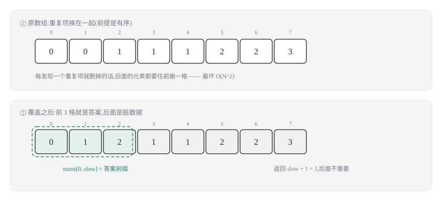
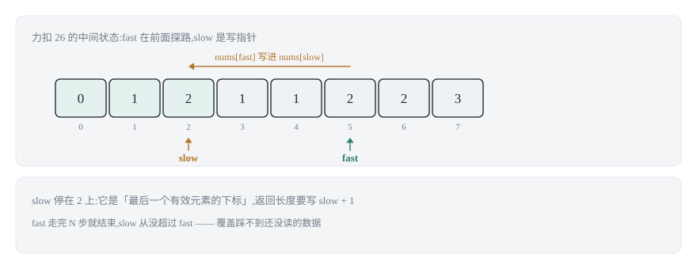
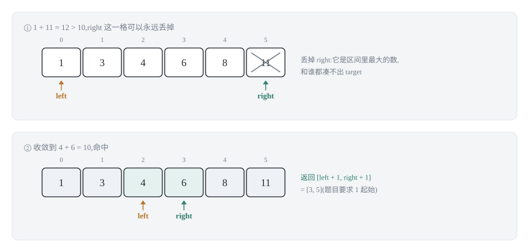
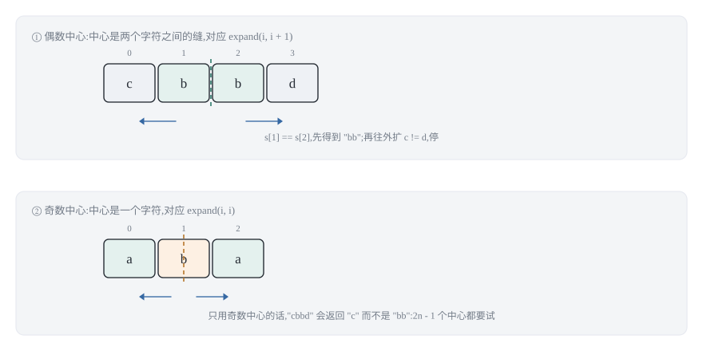
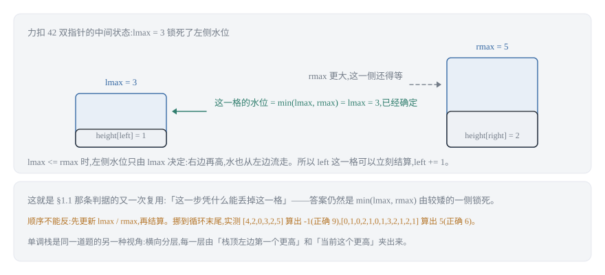
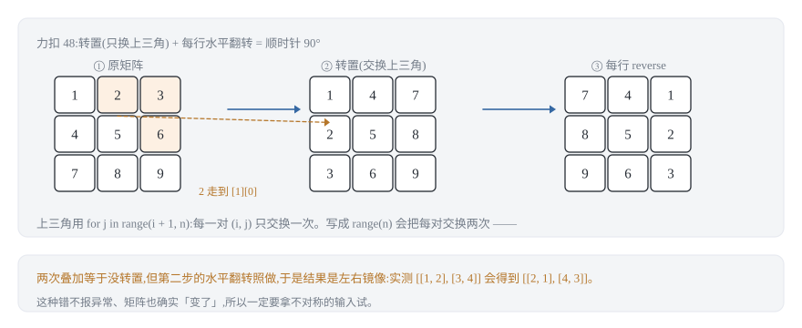
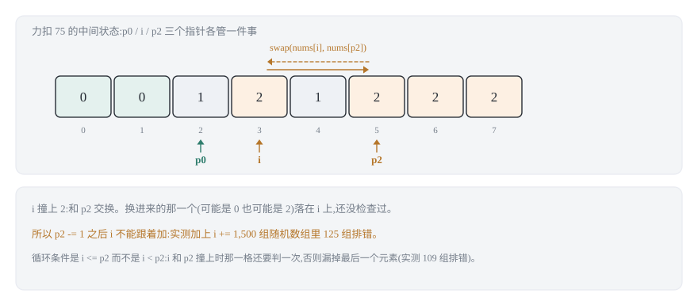

## 0 先说明材料和我的写法

这篇是我自己的学习笔记，材料来自 labuladong 的《双指针技巧秒杀七道数组题目》：
<https://labuladong.online/zh/algo/essential-technique/array-two-pointers-summary/>

**这不是转载，也不是翻译。** 这篇教程的可视化面板和动图是它最有价值的部分，我这里复现不了，所以下面写的是我自己的理解：每条技巧我会补上"这个不变式为什么成立"、"这个剪枝凭什么合法"，以及我自己写的时候踩到或差点踩到的坑。

关于材料的可得性，有一点必须说清楚。原文的**正文我取到了**——分类、不变式、剪枝理由、以及"力扣 27 和力扣 26 的写法差一个下标"这类对照，都是从原文读来的，不是我自己猜的。但原文嵌在正文里的 **Java 代码片段没有完整取到**：我拿到的版本在 `<` 处被截断（抽取工具把 `<` 当成了 HTML 标签的开头），`while (fast < nums.length)` 这样的行只剩前半截。所以：

- **讲解和结论**（两族分类、每条不变式、剪枝为什么安全、复杂度）来自原文，我核对过；
- **下面所有代码是我自己写的**，不是从原文抄的，也没有逐行对照过原文的 Java 实现。

**代码一律 Python 3 + C++ 两版**，教程原文是 Java。两种语言并排给出，因为它们的坑不一样：比如第 3.2 节的反转字符串，Python 的切片和 C++ 的 `size_t` 在"空串"上的表现完全不同——C++ 里 `s.size() - 1` 会回绕成一个巨大的数，那是只有把两种语言都写一遍才会撞上的地方。

还有两条边界要先划清：**二分查找**和**滑动窗口**也是双指针家族的成员，但它们各自已经有单独一篇，本文只在第 4 节说清楚"分界线在哪里"，不重复展开。

**关于覆盖面，有一件必须提前交代的事。** 路线图挂在这个 slug 上的条目一共五行，除了本篇教程主线的"双指针速解数组七题"（力扣 26、83、27、283、167、344、5），还有四项：nSum 问题统一解法、接雨水、二维数组的花式遍历、数组双指针经典习题。这四项我**没有拿到可用的素材**——抽取下来的文件要么是空壳（"数组双指针"那份只有 29 行，除了题目清单什么都没有），要么在关键处截断（nSum 那份停在"强行改 twoSum"；接雨水那份只有题目描述；二维数组那份只到旋转的开头）。所以第 5、6、7、8 节里，**除了题目清单和"用哪两道框架"这个提示之外，解法、推导、踩坑、对照实验全部是我自己写的**，每节开头都标了「**这一节是我自己的推导**」。如果你要引用这几节，请引用它们是我写的，而不是那篇教程的结论。

### 目录

- [0 先说明材料和我的写法](#0-先说明材料和我的写法)
- [1 双指针只有两族:相向,还是同向](#1-双指针只有两族相向还是同向)
- [2 快慢指针:把删除换成覆盖](#2-快慢指针把删除换成覆盖)
- [3 左右指针:用有序换掉一层循环](#3-左右指针用有序换掉一层循环)
- [4 两条边界:滑动窗口与二分查找](#4-两条边界滑动窗口与二分查找)
- [5 nSum:一层循环套一层递归](#5-nsum一层循环套一层递归)
- [6 接雨水:同一道题的两种框架](#6-接雨水同一道题的两种框架)
- [7 二维数组的花式遍历](#7-二维数组的花式遍历)
- [8 数组双指针经典习题](#8-数组双指针经典习题)
- [9 把 23 道题收成一张表](#9-把-23-道题收成一张表)
- [10 材料与出处](#10-材料与出处)

## 1 双指针只有两族:相向,还是同向

先把名词理清楚，后面七道题才不会觉得零散。

**数组里并没有真正意义上的"指针"。** 链表节点的 `next` 是一个真实存在的地址，而数组的"指针"只是一个下标整数。这一点听起来像废话，但它决定了数组双指针的全部形态：既然指针就是下标，那么"两个指针"就只是两个整数变量，它们之间唯一能发生的关系就是**谁在谁前面、以及各自往哪个方向走**。

按走法分类，只有两族：

```text
快慢指针(fast / slow)          左右指针(left / right)

  同向而行,一快一慢               相向而行(或相背而行)

  [0 1 2 3 4 5 6 7]             [0 1 2 3 4 5 6 7]
   s                             l               r
     f                             -->         <--

  用途:原地修改 / 覆盖           用途:利用有序性做出取舍
  代表:26 83 27 283              代表:167 344 5
```

两族的**难度来源完全不同**，这是这一节最想说的一句话：

- **快慢指针的难点在"边界"**。它的循环体几乎永远是"条件成立就写一格、慢指针走一步"，写起来不难；难的是不变式到底该写成 `nums[0..slow]` 还是 `nums[0..slow-1]`。这两个只差一个下标，但一个要 `return slow + 1`，另一个要 `return slow`——第 2 节的四道题正好把这两种都占全了。
- **左右指针的难点在"凭什么丢"**。两个指针相向而行，每一步都会"丢掉"某一格。如果丢的理由不成立，算法就是错的，而且错得很隐蔽：它在题面给的例子上通常还能跑对。第 3 节的重点就是把这个理由写出来。

### 1.1 一条统一的判据

写任何一道双指针题之前，先回答这两个问题，通常就不需要试错了：

1. **不变式是什么？** 也就是"循环进行到任意时刻，我已经处理完的那一段，满足什么性质"。快慢指针题的不变式几乎都形如"`nums[0..slow]` 是我要保留的元素"；左右指针题的不变式则是"答案一定还在 `[left, right]` 里"。
2. **每一步丢掉了什么，凭什么？** 快慢指针里被丢的是"不保留的元素"，理由是题面直接要求的（重复项、等于 val、零）；左右指针里被丢的是"不可能构成答案的格子"，理由必须来自**有序性**或某种单调性——这是第 3 节要反复用到的那把钥匙。

第 1 个问题决定了你的返回值和循环边界怎么写，第 2 个问题决定了你的算法对不对。下面七道题，本质上就是把这两个问题各回答了两遍。

## 2 快慢指针:把删除换成覆盖

这一节的四道题（26、83、27、283）背后是同一句话：**不要删除元素，要覆盖元素。**

先看"删除"为什么贵。数组的内存是连续的，删掉中间一格就必须把后面所有元素往前搬一格；如果像力扣 26 那样"每发现一个重复项就立即删掉它"，最坏情况（全部元素相同）要搬 O(N) 次、每次 O(N)，总复杂度 O(N²)。而这道题一次遍历就够。

快慢指针绕开搬移的办法是：**不删，只覆盖。** `fast` 负责在前面探路，读出每一个"要保留"的元素；`slow` 负责在后面写下它。因为 `fast` 永远走在 `slow` 前面或者和它重合，把 `nums[fast]` 写到 `nums[slow]` 永远不会覆盖掉还没读过的东西——这就是整个技巧成立的全部理由。



于是四道题的差别只剩两处：**保留条件是什么**，以及**不变式的右端是开还是闭**。前者一眼能看出，后者才是真正会写错的地方。

### 2.1 原地去重(力扣 26):slow 是写指针

题目要求在**非严格递增**的数组里原地去重，返回去重后的长度。

先说为什么"比较 `nums[fast]` 和 `nums[slow]`"是对的。因为数组有序，相同的元素一定挨在一起；而 `nums[slow]` 恰好是**目前保留的最后一个元素**。所以"`nums[fast]` 和 `nums[slow]` 不等"就等价于"`nums[fast]` 是一个从没出现过的新值"。这就是有序性白送给我们的一条捷径——如果数组无序，这个比较就不成立了，得换成哈希表。



```python
def removeDuplicates(nums):
    """力扣 26:原地删除有序数组中的重复项,返回去重后的长度。

    不变式:循环中任意时刻,nums[0..slow] 是 nums[0..fast] 去重后的结果。
    也就是说 slow 是"最后一个有效元素的下标"(闭区间),不是长度。
    """
    if not nums:
        return 0
    slow = 0
    for fast in range(1, len(nums)):
        if nums[fast] != nums[slow]:
            slow += 1                  # 先给新元素腾出下标,再写
            nums[slow] = nums[fast]
    return slow + 1                    # 闭区间 -> 长度,要 +1
```

```cpp
int removeDuplicates(std::vector<int>& nums) {
    if (nums.empty()) return 0;
    int slow = 0;
    for (int fast = 1; fast < static_cast<int>(nums.size()); ++fast) {
        if (nums[fast] != nums[slow]) {
            ++slow;                    // 先腾下标
            nums[slow] = nums[fast];   // 再写
        }
    }
    return slow + 1;                   // 闭区间 -> 长度
}
```

**最容易写错的一行:** `return slow + 1;`

写 `return slow` 是最常见的错法，而且它在 `[1,1,2]` 这种例子上会返回 2 而不是 3——不是差一，是**直接把最后一个唯一元素丢了**。根因是不变式的右端是闭区间：`slow` 指向"最后一个保留下来的元素"，它同时是下标和"长度减一"。判断方法很简单：拿长度为 1 的输入试一遍（`[7]`），如果返回值是 0，那么你把下标当成了长度。

C++ 这里还埋了一个和算法无关的坑：`nums.size()` 是 `size_t`（无符号），`fast < nums.size()` 会让 `fast` 被提升成无符号数比较，`g++ -Wall -Wextra` 下会报 `-Wsign-compare` 告警。本文统一写成 `static_cast<int>(nums.size())`：一是把这个告警消掉，二是让"长度减一"这类表达式仍然留在有符号域里——第 3.2 节会看到一个真实的翻车例子，空数组上 `s.size() - 1` 会回绕成一个天文数字。

**复杂度推导:** `fast` 从 1 走到 N-1，恰好 N-1 步；`slow` 的推进次数不超过 `fast` 的步数，也是 O(N)。循环体是常数时间，没有数组搬移。所以时间 O(N)、额外空间 O(1)。对照"发现重复就搬移"的写法，那是 O(N²)——差别不在常数，在数量级。

### 2.2 链表上的同一道题(力扣 83)

力扣 83 是"有序**链表**去重"。它和上一节是**同一套不变式**，唯一的变化是：数组里"写"是赋值，链表里"写"是改指针。

```python
class ListNode:
    def __init__(self, val=0, next=None):
        self.val = val
        self.next = next

def deleteDuplicates(head):
    """力扣 83:删除排序链表中的所有重复元素,使每个元素只出现一次。"""
    if head is None:
        return None
    slow = fast = head
    while fast is not None:
        if fast.val != slow.val:
            slow.next = fast       # 相当于 nums[slow] = nums[fast]
            slow = slow.next       # 相当于 slow++
        fast = fast.next
    slow.next = None               # 断开与后面重复节点的连接
    return head
```

```cpp
struct ListNode {
    int val;
    ListNode* next;
    ListNode(int v = 0, ListNode* n = nullptr) : val(v), next(n) {}
};

ListNode* deleteDuplicates(ListNode* head) {
    if (head == nullptr) return nullptr;
    ListNode* slow = head;
    ListNode* fast = head;
    while (fast != nullptr) {
        if (fast->val != slow->val) {
            slow->next = fast;     // 相当于 nums[slow] = nums[fast]
            slow = slow->next;     // 相当于 slow++
        }
        fast = fast->next;
    }
    slow->next = nullptr;          // 断开与后面重复节点的连接
    return head;
}
```

**最容易写错的一行:** `slow.next = None;`（循环结束之后那一行）

漏掉它，`[1,1,2]` 会返回 `1 -> 2 -> 2`：`slow` 停在第二个节点上，而那个节点原来的 `next` 还指着被丢弃的重复节点。数组里"超出新长度的部分无所谓"，链表里**没有"无所谓"**——多出来的节点只要还挂在链上，它就是答案的一部分。所有"原地删除"的链表题都要问自己一句：尾巴断干净了吗？

**关于被丢掉的节点:** 链表题和数组题在这里有一个真实差别，原文也专门提了一句。被跳过的重复节点并没有从内存里消失，只是不再被链上引用：Python 有引用计数，`slow.next` 一改，没人引用的节点就被回收；C++ 没有垃圾回收，这些节点是真泄漏了。如果是在生产代码里而不是刷题，需要自己把它们 `delete` 掉（或者干脆用智能指针）。刷题时为了看清新旧指针的关系，保留这段"不释放"的写法是划算的，但要心里有数。

**复杂度推导:** `fast` 沿链表走完 N 个节点，`slow` 最多走 N 步，每个节点被访问常数次。时间 O(N)、额外空间 O(1)。

### 2.3 移除元素(力扣 27):不变式差一个下标

力扣 27 要求原地移除所有等于 `val` 的元素。套路完全一样，但**写法不能照抄上一节**——这正是这道题的价值。

对照着看：

- 力扣 26 里，第一个元素是**无条件保留**的（它一定是唯一的），所以 `slow` 一上来就站在一个合法下标 `0` 上，代码是"先 `slow += 1`，再写"。
- 力扣 27 里，第一个元素就可能等于 `val`，**没有任何元素是无条件保留的**，所以 `slow` 一开始只能表示"已保留的个数" `0`，代码是"先写，再 `slow += 1`"。

```python
def removeElement(nums, val):
    """力扣 27:原地移除所有等于 val 的元素,返回新的长度。

    不变式:nums[0..slow-1] 是已经确认保留的元素。
    也就是说 slow 本身就是新长度,不需要 +1。
    """
    slow = 0
    for fast in range(len(nums)):
        if nums[fast] != val:
            nums[slow] = nums[fast]    # 先写
            slow += 1                  # 后走
    return slow
```

```cpp
int removeElement(std::vector<int>& nums, int val) {
    int slow = 0;
    for (int fast = 0; fast < static_cast<int>(nums.size()); ++fast) {
        if (nums[fast] != val) {
            nums[slow] = nums[fast];   // 先写
            ++slow;                    // 后走
        }
    }
    return slow;
}
```

**最容易写错的一行:** 把 26 的 `slow += 1` 提前到赋值之前。

这一行错了以后，`[3,2,2,3], val = 3` 会返回长度 2，但数组前两个位置是 `[2,2]`——最后一个保留元素处的 `2` 被漏写了。原因不是"少走了一步"这么简单：提前自增会让**写指针跳过一个槽位**，于是每个保留元素都被写到下一格去，第一格永远是脏的。

判断不变式是闭还是开，有一个不用背的办法：**问"0 号元素是不是无条件保留的"**。是（26），`slow` 是闭区间下标，返回 `slow + 1`；不是（27），`slow` 是长度，返回 `slow`。

**复杂度推导:** 同 2.1，时间 O(N)、空间 O(1)。注意这道题和 26 的循环体形状一模一样，只是 `slow` 的语义不同——这也说明"双指针模板"这个说法有点误导：骨架相同，语义完全可以不同。

### 2.4 移动零(力扣 283):复用,而不是重写

力扣 283 要求把所有 `0` 移到数组末尾，非零元素的相对顺序不变，且必须原地完成。

如果你已经写了 2.3，这道题**不需要新的指针逻辑**：把 `0` 全部"移除"，剩下的位置补零就行。非零元素的相对顺序天然保持，因为快慢指针是保序的。

```python
def moveZeroes(nums):
    """力扣 283:把所有 0 移到末尾,非零元素相对顺序不变,原地完成。

    直接复用力扣 27:val = 0。
    """
    p = removeElement(nums, 0)          # 非零元素已经挤到前面,p 是新长度
    for i in range(p, len(nums)):
        nums[i] = 0                     # 从 p 开始补零
```

```cpp
void moveZeroes(std::vector<int>& nums) {
    int p = removeElement(nums, 0);     // 复用力扣 27,val = 0
    for (int i = p; i < static_cast<int>(nums.size()); ++i) {
        nums[i] = 0;                    // 从 p 开始补零
    }
}
```

**最容易写错的一行:** `for i in range(p, len(nums))` 的起点——是 `p`，不是 `p + 1`。

`p` 是"第一个被丢弃的槽位"，它自己也要补零。以 `[0,1,0,3,12]` 为例：`removeElement` 之后数组是 `[1,3,12,3,12]`、`p = 3`；从 3 开始补零得到 `[1,3,12,0,0]`，正确。如果从 `p + 1 = 4` 开始，得到 `[1,3,12,3,0]`——下标 3 上残留的 3 既是脏数据，也破坏了"零都在末尾"。

**复杂度推导:** `removeElement` 是 O(N)，补零循环最多 N 次，所以总时间 O(N)、额外空间 O(1)。两次遍历看起来比一次遍历"慢"，但大 O 意义下都是 O(N)；面试里如果被追问"能不能一趟"，是可以的（在快指针遇到非零元素时直接交换 `nums[slow]` 和 `nums[fast]`），只是那样写的解释成本更高，本文选择复用 27 的版本。

## 3 左右指针:用有序换掉一层循环

快慢指针的两族里，第二族是**左右指针**：两个指针一头一尾，相向而行。

它和快慢指针的差别不只是方向。快慢指针里 `slow` 写下的东西是"确定要保留的"，这一步不需要证明；而左右指针每一步都在**排除一整批候选**，所以必须回答"凭什么排除"。这一节的三个例子正好给出两种排除理由：有序性（167）和对撞结构本身（344、5）。

### 3.1 两数之和 II(力扣 167):为什么可以放心地丢

题目给一个**已经按非递减排序**的数组，要求找出两个数使它们的和等于 `target`，返回这两个数的下标（**从 1 开始计数**），且同一个元素不能重复使用。

暴力解法是枚举所有 `(i, j)` 对，O(N²)。双指针能把它降到 O(N)，靠的是一条**剪枝引理**。先把不变式写清楚：

> **不变式:** 如果答案存在，那么它一定在 `[left, right]` 这个闭区间里。

初始时 `left = 0, right = n - 1`，这句显然成立（整个数组都在区间里）。关键在于每一步怎么维持它。设 `s = nums[left] + nums[right]`：

- **若 `s == target`**：找到了，直接返回。
- **若 `s < target`**：那么 `nums[left]` 可以**永远丢掉**。理由是数组有序：对任何 `r' < right`，都有 `nums[r'] <= nums[right]`，于是 `nums[left] + nums[r'] <= nums[left] + nums[right] = s < target`。也就是说，`nums[left]` 和区间里**任何一个**数配对都不够大，它不可能是答案的一部分。所以 `left += 1`。
- **若 `s > target`**：对称地，`nums[right]` 和区间里任何一个数配对都太大，`right -= 1`。

这两条就是全部。它们同时也是"数组必须有序"这句话的真正含义所在——**无序数组上这个引理不成立**，那时只能退回哈希表（力扣 1 的解法）。



```python
def twoSumSorted(numbers, target):
    """力扣 167:在有序数组中找出和为 target 的两个数,返回 1 起始的下标。

    不变式:答案如果存在,一定还在 [left, right] 里。
    """
    left, right = 0, len(numbers) - 1
    while left < right:
        s = numbers[left] + numbers[right]
        if s == target:
            return [left + 1, right + 1]      # 题目要求 1 起始
        if s < target:
            left += 1                          # 丢掉 nums[left]
        else:
            right -= 1                         # 丢掉 nums[right]
    return []                                  # 题目保证有解,这里只是兜底
```

```cpp
std::vector<int> twoSumSorted(const std::vector<int>& numbers, int target) {
    int left = 0;
    int right = static_cast<int>(numbers.size()) - 1;
    while (left < right) {
        int s = numbers[left] + numbers[right];
        if (s == target) {
            return {left + 1, right + 1};    // 题目要求 1 起始
        }
        if (s < target) {
            ++left;                          // 丢掉 nums[left]
        } else {
            --right;                         // 丢掉 nums[right]
        }
    }
    return {};                               // 题目保证有解
}
```

**最容易写错的一行:** `return [left + 1, right + 1]`

力扣 167 的下标是 **1 起始**的，这是题面里很容易读漏的一句，而且它错了以后不会崩溃、不会死循环，只会得到一个"看起来合理"的错答案。这类错误在面试里的代价特别高，因为它说明你没读题。习惯做法是：函数名里带 `Sorted`、返回处留一句 `# 题目要求 1 起始`。

第二个容易写错的点不在某一行，而在循环条件：必须是 `while left < right` 而不是 `while left <= right`。`left == right` 时两个指针指的是**同一个元素**，题目不允许同一个元素用两次；写成 `<=` 会让 `numbers[left] + numbers[right]` 变成 `2 * numbers[left]`，如果 `target` 恰好是某个元素的 2 倍，就会返回一对非法下标。

**复杂度推导:** 每一轮循环，要么 `left` 加一、要么 `right` 减一，两者之间的距离严格减少 1。距离初值是 `n - 1`，减到 0 就结束，所以循环最多跑 `n - 1` 轮；每轮是常数时间。时间 O(N)、额外空间 O(1)。换个角度看：暴力解法在枚举 `n × n` 个格子，而这个写法每轮**划掉一整行或一整列**，所以只走 O(N) 步——这也是"用有序性换掉一层循环"的字面含义。

### 3.2 反转字符串(力扣 344):最纯粹的相向

力扣 344 要求原地反转一个字符数组。这道题没有任何技巧，就是"左右指针相向而行"的最小骨架：交换两端，然后同时往中间收，直到相遇。

```python
def reverseString(s):
    """力扣 344:原地反转字符数组,不返回任何值。"""
    left, right = 0, len(s) - 1
    while left < right:
        s[left], s[right] = s[right], s[left]   # 必须同时交换
        left += 1
        right -= 1
```

```cpp
void reverseString(std::vector<char>& s) {
    int left = 0;
    int right = static_cast<int>(s.size()) - 1;   // 先转 int,见下文
    while (left < right) {
        std::swap(s[left], s[right]);
        ++left;
        --right;
    }
}
```

**最容易写错的一行:** C++ 里的 `int right = static_cast<int>(s.size()) - 1;`

这一行是本文唯一一个**只在 C++ 里存在**的坑，而且它是空输入专属的。`std::vector::size()` 返回 `size_t`（无符号），当 `s` 为空时 `s.size() - 1` 不会得到 -1，而是**回绕成 `SIZE_MAX`**（64 位上是 18446744073709551615）。如果写成 `size_t right = s.size() - 1;`，那么 `left = 0 < right = SIZE_MAX` 成立，循环体立刻执行，`s[SIZE_MAX]` 是越界访问——空输入直接段错误。

Python 不会遇到这个问题（`len(s) - 1` 就是 `-1`，`0 < -1` 为假，循环自然不执行），所以"两种语言都写一遍"在这里不是形式主义：**同一条逻辑在两种语言里的边界行为是可以不一样的**。本文的 C++ 代码统一先把长度转成 `int`，把这个回绕问题掐死在源头。

**复杂度推导:** 每轮交换两个元素并各走一步，共 `⌊n / 2⌋` 轮，时间 O(N)；除交换用的临时变量外没有额外空间，O(1)。注意 `while left < right` 而不是 `left <= right` 也对：`left == right` 时是自己和自己交换，白做一次，不影响正确性。

### 3.3 最长回文子串(力扣 5):从中心向两端扩展

力扣 5 要求返回字符串 `s` 中最长的回文子串。

回文的定义本身就在提示算法：一个回文串去掉首尾两个字符还是回文串。所以与其枚举所有子串再判断（那是 O(N³)），不如**从中心往两端长**——只要两端字符相同就继续扩，扩不动就停。

关键在于"中心"有两种：

- **奇数长度**的回文，中心是一个字符，比如 `ab|c|ba` 的中心是 `c`；
- **偶数长度**的回文，中心是**两个字符之间的缝隙**，比如 `ab|ba` 的中心在两个 `b` 之间。

一个长度为 `n` 的字符串有 `n` 个"单字符中心"和 `n - 1` 个"缝隙中心"，共 `2n - 1` 个。统一写成一个接受 `(l, r)` 的辅助函数：`l == r` 是奇数中心，`r == l + 1` 是偶数中心。



```python
def longestPalindrome(s):
    """力扣 5:返回 s 中最长的回文子串(中心扩展法)。"""

    def expand(l, r):
        """从中心 (l, r) 向两端扩展,返回扩展后的回文串。"""
        while l >= 0 and r < len(s) and s[l] == s[r]:
            l -= 1
            r += 1
        # 退出时 l 和 r 各自多走了一步,所以左端要 +1,右端本来就开区间
        return s[l + 1:r]

    res = ""
    for i in range(len(s)):
        odd = expand(i, i)          # 奇数中心:自己
        even = expand(i, i + 1)     # 偶数中心:自己和右边一格之间的缝
        if len(odd) > len(res):
            res = odd
        if len(even) > len(res):
            res = even
    return res
```

```cpp
std::string longestPalindrome(const std::string& s) {
    auto expand = [&s](int l, int r) {
        while (l >= 0 && r < static_cast<int>(s.size()) && s[l] == s[r]) {
            --l;
            ++r;
        }
        // 退出时 l、r 各多走一步:左端 +1,长度是 r - l - 1
        return s.substr(static_cast<size_t>(l + 1),
                        static_cast<size_t>(r - l - 1));
    };

    std::string res;
    for (int i = 0; i < static_cast<int>(s.size()); ++i) {
        std::string odd = expand(i, i);        // 奇数中心
        std::string even = expand(i, i + 1);   // 偶数中心
        if (odd.size() > res.size()) res = odd;
        if (even.size() > res.size()) res = even;
    }
    return res;
}
```

**最容易写错的一行:** `return s[l + 1:r]`

循环退出时，`l` 和 `r` 各自**多走了一步**：`l` 指向回文串左边一格，`r` 指向右边一格。所以左端要 `+1`；而 Python 的切片右端本来就是开区间，`r` 直接写就行。对应到 C++ 是 `s.substr(l + 1, r - l - 1)`——长度是 `(r - 1) - (l + 1) + 1 = r - l - 1`。写成 `s[l:r]` 会多带一个字符，`substr(l + 1, r - l)` 也会多一个字符，而且这两种错法在 `"bb"` 这种短例子上表现得比在长例子上更明显。

第二个坑是**只取奇数中心**。只用 `expand(i, i)`，`"cbbd"` 会返回 `"c"`（长度为 1），正确答案是 `"bb"`。原因就是这个字符串里唯一的回文是偶数长度的。检查方法：拿一个全偶数长度的用例试，比如 `"abba"`。

**复杂度推导:** 有 `2n - 1` 个中心；每个中心的扩展循环最多走 `⌊n / 2⌋` 步（走到边界），所以扩展本身总计 O(N²)。返回时切一次子串是 O(长度)，`2n - 1` 次切片的长度总和不超过 `2n · n`，仍然是 O(N²)，**不会把总复杂度推到 O(N³)**——这一点值得自己动手确认一遍，因为"循环里套了一个 O(N) 的切片"很容易让人误判。空间上除了返回值没有额外结构，O(1)（不计返回值）。

顺带说清楚边界：这道题的最优解是 Manacher 算法，能在 O(N) 时间内求出最长回文子串；动态规划也能做，但要 O(N²) 的空间。两者都超出了本文的范围，本文只讲中心扩展——它的价值是**代码短、推导直白、把"回文的结构"讲得最清楚**，在面试里通常也够用。原文最后有一句总结我很认同：前面两族左右指针都是"从两端向中间相向而行"，只有回文串这类问题让指针"从中心向两端扩展"。

## 4 两条边界:滑动窗口与二分查找

双指针这个筐很大，很容易啥都往里装。这一节只做一件事：把**滑动窗口**和**二分查找**的边界画出来，证明它们和前面七道题不是一回事。它们各自有单独一篇，这里不重复写。

### 4.1 滑动窗口不是快慢指针

滑动窗口确实是"两个指针同向、一圈走完 O(N)"，形状上和快慢指针很像——这大概是它最常被误归类的原因。但有三处硬差别：

**第一，问的对象不同。** 快慢指针处理的是**元素**的取舍："这一格留不留"。滑动窗口处理的是**一段连续区间**的性质："以 `right` 结尾的子数组里，满足约束的最长/最短的那一段有多长"。所以题面里出现"子数组 / 子串 + 最长 / 最短 / 恰好"时，那是窗口；出现"原地 / 删除 / 去重 / 移动"时，那是快慢指针。

**第二，两个"左指针"的语义完全不同。** 快慢指针的 `slow` 是**写指针**，它的含义是"已经定稿到这里了"，它每前进一次都跟着一次写入。滑动窗口的 `left` 是**可行性边界**，它的含义是"再往左窗口就不满足约束了"，它前进**不写任何东西**，只是把左端缩进来让窗口重新合法。

**第三，判据的依赖范围不同，这是最本质的一条。** 快慢指针的保留判据是**局部的**：力扣 26 只看 `nums[fast]` 和 `nums[slow]` 两个值，力扣 27 只看 `nums[fast]` 自己，不需要任何累积状态。滑动窗口的约束是**整段区间的聚合量**（区间和、字符计数、不同字符个数……），必须一边移动一边增量维护这份状态，`left` 该不该动取决于这份状态。换句话说：快慢指针可以只靠两个指针就决定下一步，滑动窗口还得额外背一个"窗口当前长什么样"。

一句话判据：**快慢指针的两个指针是"读指针 + 写指针"，滑动窗口的两个指针是"窗口的两条边"。**

### 4.2 二分查找的左右指针,凭什么是 O(log N)

二分查找也是 `left` / `right` 相向而行，看起来和 3.1 的两数之和 II 同族。但两者每步丢掉的量差了一个量级：

- **3.1 的剪枝是"丢一个"**：`nums[left] + nums[right] < target` 只能证明 `nums[left]` 一个元素不可能参与答案。所以 O(N) 步。
- **二分的剪枝是"丢一半"**：因为数组有序，中点 `mid` 的大小关系能一次性排除掉**整个左半边或整个右半边**。所以 O(log N) 步。

凭什么二分能丢一半、两数之和只能丢一个？因为二分利用的是**位置本身携带的信息**：下标有序 ⇒ "如果 `nums[mid] < target`，那么答案不可能在 `[left, mid]` 里"。这句话之所以成立，是因为二分要找的目标值**只有一个维度**（值的大小），而数组有序恰好把这个维度映射到了下标上。167 要找的是一对数，两个未知量没法用一次比较排除一半的候选区间，只能一次排除一个。

顺带回答一个很自然的疑问：**167 的数组既然有序，为什么不二分？** 可以——固定 `left`，在它右边二分找 `target - nums[left]`，复杂度 O(N log N)。但那比双指针的 O(N) 更差。这也说明"数组有序"不等于"就该二分"：有序只是给了你几种可以选的武器，选哪把取决于你要找的东西有几个自由度。

| | 167 两数之和 II | 二分查找 |
|---|---|---|
| 两个指针的关系 | 相向而行 | 相向而行 |
| 每步排除多少 | 1 个元素 | 一半区间 |
| 排除的依据 | 数值有序（`nums[r'] <= nums[right]`） | 下标有序 + 单调判定 |
| 复杂度 | O(N) | O(log N) |

这两篇的完整推导不在这里：二分查找见本系列 `2026-11-15-binary-search.md`，滑动窗口见 `2026-11-20-sliding-window.md`。本节的意义只是**划界**——知道什么题不该用双指针，和知道什么题该用双指针一样重要。

## 5 nSum:一层循环套一层递归

**这一节是我自己的推导。** 素材里 nSum 那一篇的正文在"强行把 twoSum 改造成 nSum"的地方被抽取工具截断了（`<` 被当成了 HTML 标签开头），我能确认的只有题目清单（1 / 167 / 15 / 18）；下面的解法、去重规则和反例都是我自己写的、并且在 `verify_code.py` 里跑过的。

§3.1 已经把 167 讲透了：有序数组上的两数之和是 O(N)。这一节把"两数"推广到"n 数"，你会看到力扣 15 和 18 的代码骨架**完全一样**，差别只是一个参数。

### 5.1 先决定一件事:要不要保留下标

排序是 nSum 全部威力的来源，但排序会打乱下标。所以拿到题先问一句：**答案要的是值，还是下标？**

| 题 | 输入 | 答案要什么 | 能不能排序 | 该用什么 |
|---|---|---|---|---|
| 1 两数之和 | 无序 | 下标（0 起始） | 不能 | 哈希表，O(N) |
| 167 两数之和 II | 已经有序 | 下标（1 起始） | 不需要 | 左右指针，O(N) |
| 15 三数之和 | 无序 | 三元组本身 | 能 | 排序 + 左右指针，O(N²) |
| 18 四数之和 | 无序 | 四元组本身 | 能 | 排序 + 左右指针，O(N³) |

力扣 1 要下标，所以只能一边扫描一边把"见过的值 → 下标"记进哈希表：

```python
def twoSum(nums, target):
    """力扣 1:返回和为 target 的两个数的下标(0 起始),哈希表一遍扫描。"""
    seen = {}
    for i, x in enumerate(nums):
        if target - x in seen:
            return [seen[target - x], i]   # 先查后记,天然不会用到同一个元素
        if x not in seen:
            seen[x] = i                    # 只记第一次出现的下标
    return []
```

```cpp
std::vector<int> twoSum(const std::vector<int>& nums, int target) {
    std::unordered_map<int, int> seen;
    for (int i = 0; i < static_cast<int>(nums.size()); ++i) {
        std::unordered_map<int, int>::const_iterator it = seen.find(target - nums[i]);
        if (it != seen.end()) {
            return {it->second, i};        // 先查后记,同一个元素不会用两次
        }
        if (seen.find(nums[i]) == seen.end()) {
            seen[nums[i]] = i;             // 只记第一次出现的下标
        }
    }
    return {};
}
```

注意 `if x not in seen` 这一句：只记第一次出现的下标，是为了让结果稳定（`[3, 3], target = 6` 应该返回 `[0, 1]` 而不是别的组合）。这道题**先查后记**的顺序也很关键——如果先把 `x` 记进去再查，`[3, 3], target = 6` 会在 `i = 0` 时就用 `nums[0]` 查到它自己。

那哈希表为什么搞不定 15 和 18？哈希表能在 O(1) 里回答"`target - x` 在不在"，所以它能处理**两层**：外层枚举一个数、内层查表。三数之和要枚举两个数再查第三个，那是 O(N²) 次查表，复杂度竟然也够——但它**没法去重**：哈希表给出的是下标，同一组值可以对应很多组下标，你还得额外花力气把它们归并。排序之后"相同的值挨在一起"，去重就退化成"跳过相邻的相同值"这一件小事。这就是 15 / 18 的标准解法宁可先花 O(N log N) 排序的原因。

### 5.2 递归:把 n 降到 2

`nSum(nums, n, start, target)` 的含义是"在 `nums[start:]` 里找 n 个数，使它们的和等于 target，返回所有不重复的组合"：

- `n == 2`：递归出口，就是 §3.1 的左右指针；
- `n > 2`：枚举第一个数 `nums[i]`，再递归求"在 `nums[i+1:]` 里找 n-1 个数、和为 `target - nums[i]`"，把 `nums[i]` 拼在每组结果前面。

```python
def nSum(nums, n, start, target):
    """在已排序的 nums[start:] 里找 n 个数,和为 target,返回不重复的组合。"""
    res = []
    if n < 2 or len(nums) - start < n:
        return res                        # 候选不够 n 个,剪掉
    if n == 2:                            # 递归出口:两数之和,左右指针
        left, right = start, len(nums) - 1
        while left < right:
            s = nums[left] + nums[right]
            if s == target:
                res.append([nums[left], nums[right]])
                while left < right and nums[left] == nums[left + 1]:
                    left += 1             # 跳过重复的左值
                while left < right and nums[right] == nums[right - 1]:
                    right -= 1            # 跳过重复的右值
                left += 1
                right -= 1
            elif s < target:
                left += 1                 # 丢掉 nums[left],理由见 3.1
            else:
                right -= 1                # 丢掉 nums[right]
        return res
    for i in range(start, len(nums)):
        if i > start and nums[i] == nums[i - 1]:
            continue                      # 第一处去重:跳过重复的第一个数
        for tail in nSum(nums, n - 1, i + 1, target - nums[i]):
            res.append([nums[i]] + tail)
    return res


def threeSum(nums):
    """力扣 15:所有和为 0 的不重复三元组。"""
    return nSum(sorted(nums), 3, 0, 0)


def fourSum(nums, target):
    """力扣 18:所有和为 target 的不重复四元组。"""
    return nSum(sorted(nums), 4, 0, target)
```

```cpp
std::vector<std::vector<int>> nSum(const std::vector<int>& nums, int n,
                                   int start, int target) {
    std::vector<std::vector<int>> res;
    if (n < 2 || static_cast<int>(nums.size()) - start < n) return res;
    if (n == 2) {                                  // 递归出口:两数之和
        int left = start;
        int right = static_cast<int>(nums.size()) - 1;
        while (left < right) {
            int s = nums[left] + nums[right];
            if (s == target) {
                res.push_back({nums[left], nums[right]});
                while (left < right && nums[left] == nums[left + 1]) ++left;
                while (left < right && nums[right] == nums[right - 1]) --right;
                ++left;
                --right;
            } else if (s < target) {
                ++left;
            } else {
                --right;
            }
        }
        return res;
    }
    for (int i = start; i < static_cast<int>(nums.size()); ++i) {
        if (i > start && nums[i] == nums[i - 1]) continue;   // 第一处去重
        std::vector<std::vector<int>> tails =
            nSum(nums, n - 1, i + 1, target - nums[i]);
        for (std::size_t t = 0; t < tails.size(); ++t) {
            std::vector<int> one;
            one.push_back(nums[static_cast<std::size_t>(i)]);
            one.insert(one.end(), tails[t].begin(), tails[t].end());
            res.push_back(one);
        }
    }
    return res;
}

std::vector<std::vector<int>> threeSum(std::vector<int> nums) {
    std::sort(nums.begin(), nums.end());
    return nSum(nums, 3, 0, 0);
}

std::vector<std::vector<int>> fourSum(std::vector<int> nums, int target) {
    std::sort(nums.begin(), nums.end());
    return nSum(nums, 4, 0, target);
}
```

**递归为什么会停、为什么不会漏。** 每递归一层，`start` 至少加一、`n` 减一，候选区间严格变短，降到 2 就是出口，所以深度只有 n-2 层。不漏的理由是枚举的完备性：任何一组合法解，把它按值排好序之后，最小的那个数一定会在某一轮 `i` 上被枚举到（`i` 扫过整个区间），剩下 n-1 个数必然落在 `nums[i+1:]` 里，交给子问题；子问题本身又是完备的，归纳下去就覆盖了所有解。

### 5.3 去重必须在两处

这是 nSum 唯一真正难的地方：写漏了不会崩溃、不会超时，只会**输出重复的组合**——而力扣 15 的判题恰好会因此判错。两处缺一不可。

**第一处，递归层跳过相邻的相同值：**

```text
if i > start and nums[i] == nums[i - 1]:
    continue
```

**反例:** `nums = [-1, 0, 1, 2, -1, -4]`（力扣 15 的样例），排序后是 `[-4, -1, -1, 0, 1, 2]`。这里有两个 `-1`。没有这行的话，`i` 走到第二个 `-1` 时会再解出一次 `[-1, 0, 1]`，答案里就多一组重复。

**第二处，两数之和命中之后，左右指针各自跳过相邻的相同值：**

```text
while left < right and nums[left] == nums[left + 1]:
    left += 1
while left < right and nums[right] == nums[right - 1]:
    right -= 1
```

**反例:** `nums = [-2, 0, 0, 2, 2]`, `target = 0`（力扣 15 的另一个样例）。外层枚举到 `-2` 之后，子问题是"在 `[0, 0, 2, 2]` 里找和为 2 的两个数"。第一次命中是下标 `(1, 4)` 这一对，值是 `(0, 2)`；不跳过的话，左右各收缩一格变成下标 `(2, 3)`，值还是 `(0, 2)`——于是 `[-2, 0, 2]` 被输出两次。

这处重复不是"相邻的相同首元素"造成的（那是第一处管的），而是**两端各自有重复值**时在子问题内部撞出来的，所以第一处去重救不了它。顺带说一个我实测的细节：`[0, 0, 0, 0]` 这种"全是同一个值"的输入**反而试不出这处漏洞**——收缩一格之后 `left` 和 `right` 立刻相遇，子问题只剩一对可配。要用"两端各有重复"的输入才暴露得出来，力扣 15 的样例里正好放了 `[-2, 0, 0, 2, 2]`。

**最容易写错的一行:** `if i > start and nums[i] == nums[i - 1]: continue`

三个细节都在这七个字里面，错一个就出问题：

1. 是 `i > start`，**不是 `i > 0`**。递归到子区间时 `start` 不是 0，子区间的第一个元素必须保留，写成 `i > 0` 会漏解——这是"照抄外层写法"最容易踩的坑。
2. 比的是 `nums[i]` 和 `nums[i - 1]`（**前一个**），不是后一个。跟前面的比才能保证"这一层的第一个值只被用一次"。
3. 这一行必须在**递归调用之前**。写在 `for tail in ...` 之后等于没写，因为重复的答案已经被追加进 `res` 了。

**复杂度推导:** 排序 O(N log N)，被后面的枚举吃掉。3Sum 是"枚举第一个数 O(N) × 两数之和 O(N)" = O(N²)；4Sum 是"O(N) × O(N) × O(N)" = O(N³)。一般地，nSum 是 O(N^(n-1))——**每递归一层就消掉一个循环**，这正是"用排序换掉一层枚举"的推广。空间上递归深度是 n-2，不计返回值是 O(n)。

## 6 接雨水:同一道题的两种框架

**这一节是我自己的推导。** 素材里接雨水那一篇只取到了题面，两种解法的正文整段被截断，所以下面的按列公式、单调栈、双指针以及三者的对照都是我写的；能确认来自素材的只有题目清单（42 接雨水、11 盛最多水的容器）和两个样例。

题面：n 根宽度为 1 的非负整数柱子，下雨之后能接多少水。样例 `[0,1,0,2,1,0,1,3,2,1,2,1]` 答案是 6，`[4,2,0,3,2,5]` 答案是 9。

### 6.1 先把"一格能装多少水"写成一行

对第 i 格，它上面的水由**它左边最高的柱子**和**它右边最高的柱子**里较矮的那根决定：

```text
第 i 格的水 = max(0, min(左边的最高柱子, 右边的最高柱子) - height[i])
```

这一行是整道题的根。对每格往左右各扫一遍就是 O(N²) 的按列暴力——它太慢，但**它显然是对的**，所以我在 `verify_code.py` 里把它实现成了对拍基准：下面两种 O(N) 解法和它跑同一批用例（含空数组、单元素、全零、单调升降、力扣样例），三份结果逐行比对。

### 6.2 单调栈:横向分层

按列看是"一列一列"地攒水；单调栈换了个方向，**一层一层**地攒。

想象水是横着铺上去的：当右边出现一根比栈顶更高的柱子时，栈顶那根柱子左右两边就都有了墙，于是"栈顶到当前柱子之间"这一段可以结算一层。所以：

- 栈里存**下标**而不是高度——结算要用到宽度；
- 栈内下标对应的高度**单调不增**，一旦出现更高的就弹栈结算；
- 一层的高度 = `min(左墙, 右墙) - 被弹出的底部`，宽度 = `右墙下标 - 左墙下标 - 1`。

```python
def trapStack(height):
    """力扣 42:单调栈,横向分层结算。"""
    stack = []                              # 存下标,对应高度单调不增
    water = 0
    for i, h in enumerate(height):
        while stack and height[stack[-1]] < h:
            bottom = stack.pop()
            if not stack:
                break                       # 左边没有更高的柱子,这一层兜不住
            left = stack[-1]
            width = i - left - 1
            depth = min(height[left], h) - height[bottom]
            water += width * depth
        stack.append(i)
    return water
```

```cpp
int trapStack(const std::vector<int>& height) {
    std::vector<int> stack;                     // 存下标,对应高度单调不增
    int water = 0;
    for (int i = 0; i < static_cast<int>(height.size()); ++i) {
        int h = height[i];
        while (!stack.empty() && height[stack.back()] < h) {
            int bottom = stack.back();
            stack.pop_back();
            if (stack.empty()) break;            // 左边没有更高的柱子
            int left = stack.back();
            int width = i - left - 1;
            int depth = std::min(height[left], h) - height[bottom];
            water += width * depth;
        }
        stack.push_back(i);
    }
    return water;
}
```

**最容易写错的一行:** `if not stack: break`（弹出栈顶之后立刻判空）

弹出 `bottom` 之后栈可能就空了，那意味着它左边**根本没有更高的柱子**来挡水，这一层不存在，必须跳出。漏掉这一句，样例 `[4,2,0,3,2,5]` 和 `[0,1,0,2,1,0,1,3,2,1,2,1]` 都会在弹出下标 0 之后立刻去读 `stack[-1]`：Python 抛 `IndexError`，C++ 是 `stack.back()` 对空容器取值——未定义行为，可能不崩、但结果是垃圾。

还有一处不算错但容易绕晕的地方：宽度用的是 `i - left - 1`，其中 `left` 是**弹出之后**的新栈顶，不是被弹出的 `bottom`。写成 `i - bottom` 就多算了一格。

### 6.3 双指针:较矮的那一侧是瓶颈

第二种框架把空间压到 O(1)，用的还是第 3 节那把钥匙：**相向的两个指针，凭什么敢丢一格。**

左右各维护一个"到目前为止见过的最高柱子" `lmax` 和 `rmax`。关键的一步推理是：

- 如果 `lmax < rmax`：`left` 这一格的水**只由 `lmax` 决定**。因为右边已经出现过一根高度为 `rmax > lmax` 的柱子，`min(左边最高, 右边最高)` 里的"右边最高"一定不低于 `lmax`，所以 `min(...) = lmax`——与右边具体长什么样无关。既然答案已经确定，`left` 格可以立刻结算并丢掉。
- 反之 `rmax <= lmax`：`right` 格的水只由 `rmax` 决定，结算并丢掉 `right`。

这就是"丢掉不可能构成答案的那一格"的第三次复用：3.1 靠的是**有序性**，这里靠的是**两侧最高柱的单调性**——`lmax` 和 `rmax` 只会变大，所以"较矮的那侧是瓶颈"这句话一旦成立，就永远成立。



```python
def trapTwoPointers(height):
    """力扣 42:双指针 + 左右最大值,较矮的一侧是瓶颈。"""
    left, right = 0, len(height) - 1
    lmax = rmax = 0
    water = 0
    while left < right:
        lmax = max(lmax, height[left])       # 先更新,再结算
        rmax = max(rmax, height[right])
        if lmax < rmax:
            water += lmax - height[left]     # 左边较矮:由 lmax 定
            left += 1
        else:
            water += rmax - height[right]    # 右边不高于左边:由 rmax 定
            right -= 1
    return water
```

```cpp
int trapTwoPointers(const std::vector<int>& height) {
    int left = 0;
    int right = static_cast<int>(height.size()) - 1;
    int lmax = 0;
    int rmax = 0;
    int water = 0;
    while (left < right) {
        lmax = std::max(lmax, height[left]);     // 先更新,再结算
        rmax = std::max(rmax, height[right]);
        if (lmax < rmax) {
            water += lmax - height[left];        // 左边较矮:由 lmax 定
            ++left;
        } else {
            water += rmax - height[right];       // 右边不高于左边:由 rmax 定
            --right;
        }
    }
    return water;
}
```

循环退出时 `left == right`，剩下的那一格是全局最高点，它上面装不了水，所以不用再结算。

**最容易写错的一行:** `lmax = max(lmax, height[left])` 必须写在结算**之前**

把两次更新挪到循环体末尾（或者塞进 `if` 里"只更新要移动的那一侧"），`water += lmax - height[left]` 用的就是上一轮的旧值——当前这根柱子没被算进"左边的墙"，于是它自己被当成了能积水的坑。我在 `verify_code.py` 里真跑了这个改动：样例 `[4,2,0,3,2,5]` 算出 **-1**（正确答案 9），`[0,1,0,2,1,0,1,3,2,1,2,1]` 算出 5（正确答案 6）。**接出来的水是负数**，这是"旧值参与结算"最典型的症状，见到负数就该回头看更新时机。

顺便说一个我实测过的等价写法：把判断换成 `height[left] < height[right]`（比较**当前**柱高，而不是两侧的历史最大值），在 400 组随机数组上也和按列暴力完全一致——两个判据在"该往哪边走"上总是一致。所以看到别人的代码用哪种判据都不必惊讶；但更新时机那一处，两种写法都躲不掉。

### 6.4 两种框架的对照

| | 单调栈 | 双指针 |
|---|---|---|
| 视角 | 横向：水一层一层铺 | 纵向：一格一格结算 |
| 额外空间 | 栈，最坏 O(N) | 两个变量，O(1) |
| 每个元素 | 进栈一次、出栈一次 | 只被访问一次 |
| 时间复杂度 | O(N) | O(N) |
| 真正难的地方 | 弹栈后判空、宽度用**新**栈顶算 | 更新时机、认准较矮侧 |
| 适合推广到 | "找上一个更大/更小元素"一类 | 答案能从两端单调确定的题 |

两句话总结分工：单调栈是**按层**凑出每一层的水，双指针是**按格**确认每一格的水；前者通用（很多题都能套栈模板），后者省空间。

和本系列 `monotonic-stack` 那一篇的分工也要说清楚：那边讲的是**栈模板本身**（下一个更大元素、每日温度那一类），这边讲的是**同一道题换框架**——为什么按列、按层、按指针三种视角会算出同一个数。

### 6.5 收口:11 盛最多水的容器

同一批柱子换个问法：找两根柱子，使它们和 x 轴围出的容器装水最多。这题不需要"接住"水，只需要**一对边界**，所以 6.3 的"较矮侧是瓶颈"直接给出答案：从两端出发，每次移动**较矮**的那一根。

为什么敢丢？设 `height[left] < height[right]`，当前面积是 `height[left] * (right - left)`。若保留 `left`、把 `right` 往左挪，宽度只会变小，而高度被 `height[left]` 封顶（`min` 取的就是较矮的那根）——所以**以 `left` 为左边界的任何容器都不可能比现在更大**。`left` 已经尽到全力，可以丢。这又是 §1 那条判据在"求最值"型题目上的样子：丢掉一格的理由，必须能证明"它不可能更好"。

```python
def maxArea(height):
    """力扣 11:盛最多水的容器,每次移动较矮的一侧。"""
    left, right = 0, len(height) - 1
    best = 0
    while left < right:
        h = min(height[left], height[right])
        best = max(best, h * (right - left))
        if height[left] < height[right]:
            left += 1                        # 丢掉较矮的那根
        else:
            right -= 1
    return best
```

```cpp
int maxArea(const std::vector<int>& height) {
    int left = 0;
    int right = static_cast<int>(height.size()) - 1;
    int best = 0;
    while (left < right) {
        int h = std::min(height[left], height[right]);
        int area = h * (right - left);
        if (area > best) best = area;
        if (height[left] < height[right]) {
            ++left;                              // 丢掉较矮的那根
        } else {
            --right;
        }
    }
    return best;
}
```

**最容易写错的一行:** `if height[left] < height[right]: left += 1 else: right -= 1`

比较的必须是**两根柱子的高度**。用当前面积当判据是错的——面积里已经含了宽度，"这一格现在更大"不代表"以它为边界的未来更大"；移动较高的一侧同样错，那等于把唯一可能变大的那一侧（较矮侧换一根更高的）先让给对手。两根等高时移动哪边都对（实测 400 组随机数组与暴力一致）：此时 `min` 由两侧共同决定，丢掉任意一侧都不会让上界变差。

**复杂度推导:** `left` 和 `right` 一共移动 N-1 次，循环体常数时间，时间 O(N)、额外空间 O(1)。对照 §6.1 的按列暴力 O(N²)：这又是一次"用单调性换掉一层循环"。

## 7 二维数组的花式遍历

**这一节是我自己的推导。** 素材里 2D 遍历那一篇只取到了"顺时针旋转矩阵"的开头，螺旋矩阵往后的内容全被截断，所以下面的转置+翻转、四条边界、以及 151 / 61 的处理都是我自己写的；能确认来自素材的只有题目清单（48 / 54 / 59 / 151 / 61）。

"花式遍历"听起来像一堆互不相干的技巧，其实只有两件事：**把矩阵看成一组可以互换的对称位置**（旋转），和**把矩阵看成一层层可以剥开的壳**（螺旋）。前者决定能不能原地改，后者决定要维护几条边界。

### 7.1 原地旋转矩阵(力扣 48):转置 + 水平翻转

顺时针旋转 90° 把 `(i, j)` 送到 `(j, n-1-i)`。这个映射可以拆成两步做的复合：

```text
转置:     (i, j) -> (j, i)
水平翻转: (j, i) -> (j, n-1-i)     <- 合起来正好是目标
```

为什么值得拆成两步、而不是一步到位地做四元环交换？因为**两步各自都是"对称位置互换"**：转置只交换上三角（`j > i` 的那些对），水平翻转只交换每行的左半列。两者都不重不漏，都不需要额外矩阵，于是"原地"是白送的。逆时针 90° 同理，是转置 + 垂直翻转；转置 + 水平翻转 + 转置 + 垂直翻转就是 180°。



```python
def rotate(matrix):
    """力扣 48:原地顺时针旋转 90°,转置 + 水平翻转。"""
    n = len(matrix)
    for i in range(n):                    # 第一步:转置(只扫上三角)
        for j in range(i + 1, n):
            matrix[i][j], matrix[j][i] = matrix[j][i], matrix[i][j]
    for row in matrix:                    # 第二步:每行水平翻转
        row.reverse()
```

```cpp
void rotate(std::vector<std::vector<int>>& matrix) {
    int n = static_cast<int>(matrix.size());
    for (int i = 0; i < n; ++i) {                  // 第一步:转置(只扫上三角)
        for (int j = i + 1; j < n; ++j) {
            std::swap(matrix[i][j], matrix[j][i]);
        }
    }
    for (int i = 0; i < n; ++i) {                  // 第二步:每行水平翻转
        for (int j = 0; j < n / 2; ++j) {
            std::swap(matrix[i][j], matrix[i][n - 1 - j]);
        }
    }
}
```

**最容易写错的一行:** `for j in range(i + 1, n):`（转置只扫上三角）

写成 `range(n)` 会把每一对 `(i, j)` 和 `(j, i)` 各交换一次，两次叠加等于**没转置**——程序不报错，第二步的水平翻转照做，于是你拿到的是一张**左右镜像**，不是顺时针旋转。实测 2×2 的 `[[1, 2], [3, 4]]`：正确结果是 `[[3, 1], [4, 2]]`，写成 `range(n)` 得到的是 `[[2, 1], [4, 3]]`。它"看着也变了"，所以比报错更危险——只有拿对称矩阵试才发现不了，一定要用不对称的输入。

**复杂度推导:** 转置访问上三角、翻转访问左半列，加起来每个元素常数次，时间 O(N²)；交换都在原矩阵内完成，额外空间 O(1)。

### 7.2 螺旋矩阵(力扣 54)与螺旋矩阵 II(力扣 59):四条边界

螺旋遍历把矩阵看成一层层壳：维护 `top / bottom / left / right` 四条边界，每走完一条边就把那条边界往里收一格，直到边界相遇。

54 是按"右 → 下 → 左 → 上"的顺序**读**，59 是按同样的顺序**填**——59 就是 54 的镜像练习，只是"读到什么"换成了计数器。

```python
def spiralOrder(matrix):
    """力扣 54:螺旋遍历,返回读到的顺序。"""
    if not matrix or not matrix[0]:
        return []
    res = []
    top, bottom = 0, len(matrix) - 1
    left, right = 0, len(matrix[0]) - 1
    while left <= right and top <= bottom:
        for j in range(left, right + 1):          # 上边:从左到右
            res.append(matrix[top][j])
        top += 1
        for i in range(top, bottom + 1):          # 右边:从上到下
            res.append(matrix[i][right])
        right -= 1
        if top <= bottom:                         # 下边:只剩一行时不能走
            for j in range(right, left - 1, -1):
                res.append(matrix[bottom][j])
            bottom -= 1
        if left <= right:                         # 左边:只剩一列时不能走
            for i in range(bottom, top - 1, -1):
                res.append(matrix[i][left])
            left += 1
    return res
```

```cpp
std::vector<int> spiralOrder(const std::vector<std::vector<int>>& matrix) {
    std::vector<int> res;
    if (matrix.empty() || matrix[0].empty()) return res;
    int top = 0;
    int bottom = static_cast<int>(matrix.size()) - 1;
    int left = 0;
    int right = static_cast<int>(matrix[0].size()) - 1;
    while (left <= right && top <= bottom) {
        for (int j = left; j <= right; ++j) res.push_back(matrix[top][j]);
        ++top;
        for (int i = top; i <= bottom; ++i) res.push_back(matrix[i][right]);
        --right;
        if (top <= bottom) {                      // 下边:只剩一行时不能走
            for (int j = right; j >= left; --j) res.push_back(matrix[bottom][j]);
            --bottom;
        }
        if (left <= right) {                      // 左边:只剩一列时不能走
            for (int i = bottom; i >= top; --i) res.push_back(matrix[i][left]);
            ++left;
        }
    }
    return res;
}
```

```python
def generateMatrix(n):
    """力扣 59:按螺旋顺序填入 1..n²。"""
    matrix = [[0] * n for _ in range(n)]
    top, bottom = 0, n - 1
    left, right = 0, n - 1
    num = 1
    while left <= right and top <= bottom:
        for j in range(left, right + 1):
            matrix[top][j] = num
            num += 1
        top += 1
        for i in range(top, bottom + 1):
            matrix[i][right] = num
            num += 1
        right -= 1
        if top <= bottom:
            for j in range(right, left - 1, -1):
                matrix[bottom][j] = num
                num += 1
            bottom -= 1
        if left <= right:
            for i in range(bottom, top - 1, -1):
                matrix[i][left] = num
                num += 1
            left += 1
    return matrix
```

```cpp
std::vector<std::vector<int>> generateMatrix(int n) {
    std::vector<std::vector<int>> matrix(static_cast<std::size_t>(n),
                                         std::vector<int>(static_cast<std::size_t>(n), 0));
    int top = 0;
    int bottom = n - 1;
    int left = 0;
    int right = n - 1;
    int num = 1;
    while (left <= right && top <= bottom) {
        for (int j = left; j <= right; ++j) matrix[top][j] = num++;
        ++top;
        for (int i = top; i <= bottom; ++i) matrix[i][right] = num++;
        --right;
        if (top <= bottom) {
            for (int j = right; j >= left; --j) matrix[bottom][j] = num++;
            --bottom;
        }
        if (left <= right) {
            for (int i = bottom; i >= top; --i) matrix[i][left] = num++;
            ++left;
        }
    }
    return matrix;
}
```

**最容易写错的一行(54):** `if top <= bottom:`（走下边之前必须再判一次）

一圈里的第三条边（下边）和第四条边（左边）要各加一次判重。原因是走完上边和右边之后，`top` 可能已经越过 `bottom`（矩阵只剩一行）或者 `left` 可能越过 `right`（只剩一列）。单行矩阵 `[[1, 2, 3]]` 就是反例：走完上边之后 `top` 变成 1、`bottom` 还是 0，不判重就继续走下边，结果是 `[1, 2, 3, 2, 1]`——`2` 和 `1` 各多输出一次。

有意思的是**单列**情况删掉这条判重反而看不出问题：`[[1], [2], [3]]` 依然输出 `[1, 2, 3]`，因为此时宽度已经缩成 0、下边那条循环空转，真正兜住它的是第二条判重 `if left <= right`（实测）。所以两条判重各管一种退化情形——一个管"只剩一行"，一个管"只剩一列"，不能只留一条。

**最容易写错的一行(59):** `while left <= right and top <= bottom:`

59 不需要"每条边各判一次"——填满 n² 个数自然就停了；但循环条件必须是 `<=`。写成 `while left < right`，**奇数阶**矩阵的最中心那一格永远填不上：`n = 3` 时 `matrix[1][1]` 留在初始值 0 上（漏掉 9），`n = 5` 漏掉 25，`n = 1` 干脆一格都不填；偶数阶反而完全正常（实测）。这也是"数组下标差一个"的又一种样子：54 差的是判重条件，59 差的是循环条件。

**复杂度推导:** 两个函数都让每个元素恰好被访问一次，时间 O(N²)；54 除答案数组外是 O(1)，59 的额外空间就是输出矩阵本身。

### 7.3 反转字符串中的单词(力扣 151):两次反转

151 要求把句子里的单词顺序倒过来，并且原地完成（力扣的进阶要求）、还要处理首尾和单词之间的多余空格。技巧是**两次反转**：

1. 把整串反转 —— 单词的**顺序**对了，但每个单词内部的字符也反了；
2. 再逐个单词反转 —— 把单词内部翻回来。

两次反转叠加，只有"单词顺序"这一层被反转，单词内部的字符被翻了两次等于没翻。这正好是第 3 节"相向反转"和快慢指针"同向写"的组合：第一步是 `left / right` 相向交换，第二步是 `read / write` 同向扫描。

```python
def reverseWords(s):
    """力扣 151:反转单词顺序,原地做法(整串反转 + 逐词反转 + 压缩空格)。"""
    chars = list(s)
    n = len(chars)

    def rev(lo, hi):                       # 反转闭区间 chars[lo..hi]
        while lo < hi:
            chars[lo], chars[hi] = chars[hi], chars[lo]
            lo += 1
            hi -= 1

    rev(0, n - 1)                          # 第一步:整串反转
    write = 0
    i = 0
    while i < n:
        while i < n and chars[i] == ' ':   # 跳过空格
            i += 1
        if i == n:
            break
        if write > 0:                      # 单词之间补一个空格
            chars[write] = ' '
            write += 1
        start = write
        while i < n and chars[i] != ' ':
            chars[write] = chars[i]
            write += 1
            i += 1
        rev(start, write - 1)              # 第二步:把这个单词反转回来
    return ''.join(chars[:write])
```

```cpp
std::string reverseWords(std::string s) {
    int n = static_cast<int>(s.size());
    for (int lo = 0, hi = n - 1; lo < hi; ++lo, --hi) {
        std::swap(s[lo], s[hi]);                       // 第一步:整串反转
    }
    int write = 0;
    int i = 0;
    while (i < n) {
        while (i < n && s[i] == ' ') ++i;              // 跳过空格
        if (i == n) break;
        if (write > 0) s[write++] = ' ';               // 单词之间补一个空格
        int start = write;
        while (i < n && s[i] != ' ') s[write++] = s[i++];
        for (int lo = start, hi = write - 1; lo < hi; ++lo, --hi) {
            std::swap(s[lo], s[hi]);                  // 第二步:把这个单词反转回来
        }
    }
    s.resize(static_cast<std::size_t>(write));
    return s;
}
```

**最容易写错的一行:** `if write > 0:`（补空格之前先确认已经写过单词）

漏掉这个判断，结果串开头会多一个空格（`"  the sky"` 会变成 `" blue is sky the"` 前面带空格）；如果改成"写完单词再补空格"，结尾又会多一个。压缩空格这件事没有捷径：**空格只能写在两个单词之间**，所以只能在写单词之前、且只在 `write > 0` 时写。

**复杂度推导:** 整串反转 O(N)，逐词反转合计也是 O(N)，压缩空格再走一遍 O(N)——总时间 O(N)；Python 里 `chars` 是必须的（字符串不可变），C++ 版本是真的原地（额外空间 O(1)）。

### 7.4 旋转链表(力扣 61):先成环,再断开

61 是"数组旋转"的链表版，但链表反而更好写：不需要搬移元素，只要找到正确的断开点。步骤是**先成环、再断开**：

- 先走一遍数出长度 n，`k %= n`（k 可能远大于 n，取模是必须的）；
- `k == 0` 时直接返回原头，否则会把环接上却在不正确的位置断开；
- 尾节点的 `next` 指向旧头，**成环**；
- 从旧头往前走 `n - k - 1` 步，停在**新尾巴**上，它的下一个节点就是新头；
- 把新尾巴的 `next` 置空，断开。

节点定义沿用 §2.2 的 `ListNode`，不重复贴一遍。

```python
def rotateRight(head, k):
    """力扣 61:链表右旋 k 位。先成环,再在正确的位置断开。"""
    if head is None or head.next is None:
        return head
    n = 1
    tail = head
    while tail.next is not None:       # 数长度,顺便找到尾节点
        tail = tail.next
        n += 1
    k %= n
    if k == 0:
        return head
    tail.next = head                   # 成环
    new_tail = head
    for _ in range(n - k - 1):         # 走到新尾巴
        new_tail = new_tail.next
    new_head = new_tail.next
    new_tail.next = None               # 断开
    return new_head
```

```cpp
ListNode* rotateRight(ListNode* head, int k) {
    if (head == nullptr || head->next == nullptr) return head;
    int n = 1;
    ListNode* tail = head;
    while (tail->next != nullptr) {          // 数长度,顺便找到尾节点
        tail = tail->next;
        ++n;
    }
    k %= n;
    if (k == 0) return head;
    tail->next = head;                       // 成环
    ListNode* new_tail = head;
    for (int step = 0; step < n - k - 1; ++step) {   // 走到新尾巴
        new_tail = new_tail->next;
    }
    ListNode* new_head = new_tail->next;
    new_tail->next = nullptr;                // 断开
    return new_head;
}
```

**最容易写错的一行:** `for _ in range(n - k - 1):`（走 `n-k-1` 步,不是 `n-k` 步）

目标是停在新尾巴上，也就是下标 `n-k-1` 的节点；从下标 0 出发要走 `n-k-1` 步。写成 `n-k` 就多走一格，`new_head` 会变成新尾巴的下一个——整个链表错位一格，而且**不会报错**。实测把这个 `-1` 去掉，`[1,2,3,4,5], k=2` 会给出 `[5,1,2,3,4]` 而不是 `[4,5,1,2,3]`。

还有一处值得留意：`k %= n` 之后 `k == 0` 的提前返回，坦白说不是**正确性**上的必需——漏掉它，`k` 是 n 的整数倍时照样会走 `n-1` 步、在同一处断开，结果仍是原链表（我实测过）。但它是**可读性**上的必需：那条"成环 → 绕一整圈 → 又断回原处"的路径白接了一个环，也最容易在下一次修改时写错成真的环状链表。把它显式写出来，读代码的人不用在脑子里绕这一圈。

**复杂度推导:** 数长度 O(N)，走到新尾巴 O(N-k)，总时间 O(N)；只用了几个指针变量，额外空间 O(1)。

## 8 数组双指针经典习题

**这一节是我自己的推导。** 素材里那份"数组双指针"题单只有 29 行、除了题目列表几乎是个空壳，所以下面六道题的解法、以及每道题"最容易写错的一行"都是我写的；题目清单（80 / 125 / 75 / 88 / 977 / 14）来自素材。

这六道题是第 2、3 节那两族指针的习题集：80 / 88 / 977 是快慢写指针的变体，125 是相向指针，75 是三指针一趟扫，14 是同向多指针。每一道都只考一件事——**你能不能把"为什么可以丢"说清楚**。

### 8.1 删除有序数组中的重复项 II(力扣 80):每个值最多留两次

数组已经有序，所以同一个值一定连在一起。沿用 §2 的 `read / write`，问题变成：写之前先看一眼**已经写好的倒数第二个元素**——如果它和当前读到的值相同，说明这个值已经写过两次，再写就超了。

```python
def removeDuplicatesII(nums):
    """力扣 80:每个值最多保留两次,返回新长度(原地)。"""
    slow = 0
    for fast in range(len(nums)):
        if slow < 2 or nums[slow - 2] != nums[fast]:
            nums[slow] = nums[fast]
            slow += 1
    return slow
```

```cpp
int removeDuplicatesII(std::vector<int>& nums) {
    int slow = 0;
    for (int fast = 0; fast < static_cast<int>(nums.size()); ++fast) {
        if (slow < 2 || nums[slow - 2] != nums[fast]) {
            nums[slow] = nums[fast];
            ++slow;
        }
    }
    return slow;
}
```

**最容易写错的一行:** `if slow < 2 or nums[slow - 2] != nums[fast]:`

`slow < 2` 不是保险，而是**必需**：`slow` 还不到 2 的时候 `nums[slow - 2]` 是负数下标。Python 会安静地把它解释成"从末尾数"，于是判断完全错位——实测把 `slow < 2` 去掉，`[1, 1]` 返回 **0**（两个元素全被丢掉），`[1, 1, 1]` 也返回 0；C++ 里负数下标是越界读，属于未定义行为。

顺带说清 `-2` 这个偏移的来历：要限制"同一个值最多出现两次"，而已经写好的部分里，最后一个是 `nums[slow - 1]`、倒数第二个是 `nums[slow - 2]`。只要 `nums[slow - 2] != nums[fast]`，写进去之后这个值在结果里最多出现两次。想改成"最多留 k 次"，把两处 `2` 换成 k 就行——这就是通用解法。

**复杂度推导:** `fast` 走一遍数组，时间 O(N)；`nums` 原地改写，额外空间 O(1)。

### 8.2 验证回文串(力扣 125):相向指针 + 跳过噪声

只保留字母和数字、忽略大小写，判断是否回文。用相向指针，但两个指针在每次比较之前都要先跳过"不算数"的字符。

```python
def isPalindrome(s):
    """力扣 125:只保留字母数字、忽略大小写,两边相向比对。"""
    left, right = 0, len(s) - 1
    while left < right:
        while left < right and not s[left].isalnum():
            left += 1
        while left < right and not s[right].isalnum():
            right -= 1
        if s[left].lower() != s[right].lower():
            return False
        left += 1
        right -= 1
    return True
```

```cpp
bool isPalindrome(const std::string& s) {
    int left = 0;
    int right = static_cast<int>(s.size()) - 1;
    while (left < right) {
        while (left < right && !std::isalnum(static_cast<unsigned char>(s[left]))) ++left;
        while (left < right && !std::isalnum(static_cast<unsigned char>(s[right]))) --right;
        char a = static_cast<char>(std::tolower(static_cast<unsigned char>(s[left])));
        char b = static_cast<char>(std::tolower(static_cast<unsigned char>(s[right])));
        if (a != b) return false;
        ++left;
        --right;
    }
    return true;
}
```

**最容易写错的一行:** `while left < right and not s[left].isalnum():`（内层的边界不能省）

外层已经有 `left < right`，所以很容易觉得内层再判一次是多余的。不是。如果字符串**整体**都是非字母数字的噪声（力扣样例 `".,"` 就是一例），两个内层循环会一路走出去：实测去掉内层边界，Python 立刻抛 `IndexError: string index out of range`，C++ 是越界读。真正兜住"跳过噪声"这个动作的边界，是**内层**那一个。

C++ 里还有一处小坑：`std::isalnum` / `std::tolower` 的参数必须转成 `unsigned char`。直接传 `char`，碰到高位字节（中文、emoji）时是未定义行为——这是 `<cctype>` 家族的老规矩，不是这道题特有的。

**复杂度推导:** 两个指针合计走 N 步，时间 O(N)；只用了两个下标，额外空间 O(1)。

### 8.3 颜色分类(力扣 75):荷兰国旗,三指针一趟扫描

数组里只有 0 / 1 / 2，要求原地排成 `0…0 1…1 2…2`。三个指针分工：

- `p0`：`0` 的下一个空位（从左往右长）；
- `p2`：`2` 的下一个空位（从右往左长）；
- `i`：当前正在检查的元素，**只往右走**。

扫到 0 就和 `p0` 交换、两个一起前进；扫到 1 直接前进；扫到 2 就和 `p2` 交换、`p2` 后退但 `i` **不动**——因为从右边换进来的那个元素还没被检查过。



```python
def sortColors(nums):
    """力扣 75:荷兰国旗,三指针一趟扫描(原地)。"""
    p0, i, p2 = 0, 0, len(nums) - 1
    while i <= p2:
        if nums[i] == 0:
            nums[p0], nums[i] = nums[i], nums[p0]
            p0 += 1
            i += 1
        elif nums[i] == 2:
            nums[p2], nums[i] = nums[i], nums[p2]
            p2 -= 1                       # 换进来的元素还没检查
        else:
            i += 1
```

```cpp
void sortColors(std::vector<int>& nums) {
    int p0 = 0;
    int i = 0;
    int p2 = static_cast<int>(nums.size()) - 1;
    while (i <= p2) {
        if (nums[i] == 0) {
            std::swap(nums[p0], nums[i]);
            ++p0;
            ++i;
        } else if (nums[i] == 2) {
            std::swap(nums[p2], nums[i]);
            --p2;                          // 换进来的元素还没检查
        } else {
            ++i;
        }
    }
}
```

**最容易写错的一行:** `elif nums[i] == 2:` 分支里 `p2 -= 1` 之后**不能**再写 `i += 1`

从右边换进来的元素可能还是 0 或 2，必须留在原地再检查一遍。实测：加上 `i += 1` 之后，500 组随机小数组里有 **125 组**排错；比如 `[0, 1, 2, 0, 2, 0, 0, 0]` 正确结果是 `[0, 0, 0, 0, 0, 1, 2, 2]`，加上 `i += 1` 会得到 `[0, 0, 0, 1, 0, 0, 2, 2]`。

还有个边界值得留意：循环条件是 `while i <= p2` 而不是 `i < p2`。写成 `i < p2` 时最后一个待检查元素永远轮不到——同样的随机测试里有 109 组排错。`i == p2` 时那一格既不是 0 的候选也不是 2 的候选（左边的 0 都归位了、右边的 2 也都归位了），但它仍然要经过一次判断才能收工。

**复杂度推导:** `i` 单调前进、`p2` 单调后退，两者移动次数之和不超过 N，时间 O(N)；交换都在原数组里，额外空间 O(1)。

### 8.4 合并两个有序数组(力扣 88):从后往前填

`nums1` 的后半段是空位（`m` 个有效值 + `n` 个占位 0），`nums2` 有 `n` 个值，要求把 `nums2` 并进 `nums1` 且保持有序。

从前往后合并会**盖住还没读的 `nums1` 元素**；从后往前不会，因为要填的位置永远是当前最大的那个，而它只可能来自两个数组各自"最右边还没用"的元素。

```python
def merge(nums1, m, nums2, n):
    """力扣 88:两个有序数组合并进 nums1,从后往前填。"""
    i, j, write = m - 1, n - 1, m + n - 1
    while j >= 0:
        if i >= 0 and nums1[i] > nums2[j]:
            nums1[write] = nums1[i]
            i -= 1
        else:
            nums1[write] = nums2[j]
            j -= 1
        write -= 1
```

```cpp
void merge(std::vector<int>& nums1, int m, std::vector<int>& nums2, int n) {
    int i = m - 1;
    int j = n - 1;
    int write = m + n - 1;
    while (j >= 0) {
        if (i >= 0 && nums1[i] > nums2[j]) {
            nums1[write] = nums1[i];
            --i;
        } else {
            nums1[write] = nums2[j];
            --j;
        }
        --write;
    }
}
```

**最容易写错的一行:** `while j >= 0:`（循环条件只看 `nums2`）

`nums2` 空了就该收工：剩下的 `nums1` 前缀本来就在正确的位置上，不用搬。实测从前往后填的后果：`[4, 5, 6]` 和 `[1, 2, 3]` 合并，正确结果是 `[1, 2, 3, 4, 5, 6]`，从前往后填会得到 `[1, 1, 1, 1, 2, 3]`——写指针追上读指针之后，`4` 被自己刚写下的 `1` 覆盖掉了。

同理，`if i >= 0 and nums1[i] > nums2[j]` 里的 `i >= 0` 也不能省：`nums1` 的有效部分用完之后，剩下的全部从 `nums2` 取。

**复杂度推导:** `write` 从 `m+n-1` 走到 0，时间 O(m+n)；没有开新数组，额外空间 O(1)。

### 8.5 有序数组的平方(力扣 977):从两端取大的,从后往前填

数组已经有序（可能含负数），平方之后**最大值一定出现在两端**——绝对值大的那一端。于是相向指针，结果数组从末尾往前填。

```python
def sortedSquares(nums):
    """力扣 977:有序数组的平方,两端取绝对值大的,从后往前填。"""
    n = len(nums)
    res = [0] * n
    left, right = 0, n - 1
    for write in range(n - 1, -1, -1):
        if abs(nums[left]) > abs(nums[right]):
            res[write] = nums[left] * nums[left]
            left += 1
        else:
            res[write] = nums[right] * nums[right]
            right -= 1
    return res
```

```cpp
std::vector<int> sortedSquares(const std::vector<int>& nums) {
    int n = static_cast<int>(nums.size());
    std::vector<int> res(static_cast<std::size_t>(n), 0);
    int left = 0;
    int right = n - 1;
    for (int write = n - 1; write >= 0; --write) {
        if (std::abs(nums[left]) > std::abs(nums[right])) {
            res[static_cast<std::size_t>(write)] = nums[left] * nums[left];
            ++left;
        } else {
            res[static_cast<std::size_t>(write)] = nums[right] * nums[right];
            --right;
        }
    }
    return res;
}
```

**最容易写错的一行:** `if abs(nums[left]) > abs(nums[right]):`

比的是**绝对值**，不是数值本身。实测直接比大小，`[-4, -1, 0, 3, 10]` 会输出 `[16, 1, 0, 9, 100]`，而正确答案是 `[0, 1, 9, 16, 100]`——负数那一端被当成了"小的那端"，写指针和读指针就错位了。

还有一处：`n == 0` 时 `for write in range(-1, -1, -1)` 一次都不执行，直接返回空数组，不需要额外特判（C++ 版本同理）。

**复杂度推导:** 每个元素被读一次、写一次，时间 O(N)；除返回数组外额外空间 O(1)。

### 8.6 最长公共前缀(力扣 14):纵向扫描

把所有字符串**按列**看：第 0 列、第 1 列……只要某一列在所有字符串里都是同一个字符，这一列就属于公共前缀；一旦某个字符串在这一列上不同、或者已经走到头，就停。

```python
def longestCommonPrefix(strs):
    """力扣 14:纵向扫描,一列一列比对。"""
    if not strs:
        return ""
    for col in range(len(strs[0])):
        ch = strs[0][col]
        for s in strs[1:]:
            if col >= len(s) or s[col] != ch:
                return strs[0][:col]
    return strs[0]
```

```cpp
std::string longestCommonPrefix(const std::vector<std::string>& strs) {
    if (strs.empty()) return "";
    for (std::size_t col = 0; col < strs[0].size(); ++col) {
        char ch = strs[0][col];
        for (std::size_t i = 1; i < strs.size(); ++i) {
            if (col >= strs[i].size() || strs[i][col] != ch) {
                return strs[0].substr(0, col);
            }
        }
    }
    return strs[0];
}
```

**最容易写错的一行:** `if col >= len(s) or s[col] != ch:`

`col >= len(s)` 必须写在 `or` 的**前面**（靠短路保护后面的 `s[col]`）。力扣的用例 `["ab", "a"]` 就是反例：不判长度会直接越界，实测 Python 抛 `IndexError: string index out of range`。另一条安全的写法是先算出最短串长度当列上限，但那样要多扫一遍数组；把长度判断放回循环里，一次扫完。

**复杂度推导:** 最坏情况（所有字符串完全相同）要检查每一列、每列看 n 个字符，总共 O(S)（S 为所有字符串的字符数之和）；只用了常数个变量，额外空间 O(1)。

## 9 把 23 道题收成一张表

这一篇从头到尾过了 23 道题（教程主线只有七道，另外十六道分布在 §5–§8）。下面按节分组收口，每组一张表，只留四样东西：套路、不变式、最容易写错的那一行、代价。

### 9.1 快慢指针：把删除换成覆盖

| 题号 | 套路 | 不变式 | 最容易写错的那一行 | 时间 / 空间 |
|---|---|---|---|---|
| 26 删除有序数组中的重复项 | 快慢指针，覆盖 | `nums[0..slow]` 已去重（**闭区间**） | `return slow + 1` | O(N) / O(1) |
| 83 删除排序链表中的重复元素 | 同一套，改成改指针 | 同上，但"写"是 `slow.next = fast` | `slow.next = None`（断尾） | O(N) / O(1) |
| 27 移除元素 | 快慢指针，覆盖 | `nums[0..slow-1]` 已保留（**半开**） | `slow += 1` 不能提到赋值之前 | O(N) / O(1) |
| 283 移动零 | 复用 27，再补零 | 前 `p` 个位置已是全部非零元素 | 补零循环起点是 `p`，不是 `p + 1` | O(N) / O(1) |
| 80 删除有序数组中的重复项 II | 快慢指针，多看一格历史 | `nums[0..slow-1]` 里每个值最多两次 | `if slow < 2 or nums[slow - 2] != nums[fast]:` | O(N) / O(1) |
| 88 合并两个有序数组 | 三指针，从后往前填 | `nums1[write+1..]` 已是全局最大的一批 | `while j >= 0:`（只看 `nums2`） | O(m+n) / O(1) |
| 977 有序数组的平方 | 相向读、从后往前写 | 结果数组 `[write+1..]` 已填好最大的 | `if abs(nums[left]) > abs(nums[right]):` | O(N) / O(N) |
| 75 颜色分类（荷兰国旗） | 同向三指针，一趟扫 | `p0` 左边全是 0、`p2` 右边全是 2、`p0..i-1` 全是 1 | `p2 -= 1` 之后 `i` 不能跟着加 | O(N) / O(1) |

表里最值得盯着看的是第 1 行和第 3 行的对照：**两道题的循环体形状一模一样，只有 `slow` 的语义从"闭区间下标"变成了"长度"**，于是自增的位置和返回值全都跟着变。这也是我在 §1 说"双指针模板有点误导"的原因——骨架能背，语义背不了。80 和 88 是这条线的两个变体：80 把"看一格历史"变成"看两格"，88 把写指针从前往后翻成从后往前。

### 9.2 左右指针：用有序换掉一层循环

| 题号 | 套路 | 不变式 | 最容易写错的那一行 | 时间 / 空间 |
|---|---|---|---|---|
| 167 两数之和 II | 左右指针，相向 | 答案仍在 `[left, right]` 内 | `return [left + 1, right + 1]`（1 起始） | O(N) / O(1) |
| 344 反转字符串 | 左右指针，相向 | 区间外已反转完毕 | C++ 里 `s.size() - 1` 在空串上回绕 | O(N) / O(1) |
| 5 最长回文子串 | 左右指针，向外扩 | 以 `(l, r)` 为中心的最长回文 | `return s[l + 1:r]`（两端都多走了一步） | O(N²) / O(1) |
| 125 验证回文串 | 相向 + 跳过噪声 | 区间外已比对完毕 | `while left < right and not s[left].isalnum():` | O(N) / O(1) |
| 14 最长公共前缀 | 同向多指针，按列扫 | 前 `col` 列已是公共前缀 | `if col >= len(s) or s[col] != ch:` | O(S) / O(1) |

### 9.3 nSum 与接雨水：递归和两种框架

| 题号 | 套路 | 不变式 | 最容易写错的那一行 | 时间 / 空间 |
|---|---|---|---|---|
| 1 两数之和 | 哈希，放弃下标顺序 | 遍历到 `i` 时表里存着 `nums[0..i-1]` | 先查 `target - x` 再存 `x` | O(N) / O(N) |
| 15 三数之和 | nSum 递归降到 2 | `nums[0..i-1]` 已固定，结果集不重 | 去重要在递归入口和双指针**两处** | O(N²) / O(1) |
| 18 四数之和 | 同一个 `nSum(n, start)` | 同上，多降一层 | 同上（两处去重一次都不能省） | O(N³) / O(1) |
| 42 接雨水 | 单调栈 / 双指针（两版都对拍过） | 栈内高度单调递减；`lmax/rmax` 是两侧已见最大值 | 双指针：先更新 `lmax/rmax` 再结算 | O(N) / O(1) |
| 11 盛最多水的容器 | 相向 + 移动较矮的一侧 | 答案仍在 `[left, right]` 内 | 移动的是**较矮**那一侧 | O(N) / O(1) |

42 那行要特别说明：我在 §6 里把单调栈和双指针**两版都实现并逐行对照**过，还拿 O(N²) 的按列暴力解做了三方对拍（13 组输入全部一致）。两个框架都对——单调栈横向分层、双指针利用"较矮的一侧是瓶颈"，这不是"一种对一种错"，是两种视角。

### 9.4 二维数组：边界收缩

| 题号 | 套路 | 不变式 | 最容易写错的那一行 | 时间 / 空间 |
|---|---|---|---|---|
| 48 旋转图像 | 转置 + 水平翻转 | 上三角已交换；行已翻转 | `for j in range(i + 1, n):` | O(N²) / O(1) |
| 54 螺旋矩阵 | 四条收缩边界 | 已走过的外圈不再访问 | `if top <= bottom:` | O(mn) / O(1) |
| 59 螺旋矩阵 II | 同一套边界，改成填数 | 同上 | `while left <= right and top <= bottom:` | O(n²) / O(n²) |
| 151 反转字符串中的单词 | 整体反转 + 逐词反转 + 压缩空格 | 已写下的部分不含多余空格 | 压缩空格时 `slow > 0` 才补空格 | O(N) / O(N) |
| 61 旋转链表 | 先成环，再断开 | 新头是第 `n-k` 个节点 | `range(n - k - 1)`（少一步就错位） | O(N) / O(1) |

### 9.5 五条可以带走的判据

1. **看到"原地删除 / 去重 / 移动"，先想覆盖，不要想删除。** 真删一个元素要搬移后面所有数据，那是 O(N²)；覆盖不需要。
2. **设计完快慢指针，先问"0 号元素是不是无条件保留"。** 是 → `slow` 是闭区间下标，返回 `slow + 1`；不是 → `slow` 是长度，返回 `slow`。
3. **设计完左右指针，先写出"这一步凭什么丢掉那一格"。** 写不出这个理由，算法就是错的，哪怕它在样例上过了。
4. **看到"n 数之和"，先问要不要保留下标、再问去重放在哪。** 要下标 → 哈希；不要下标 → 排序 + 递归到 `twoSum`，而递归入口和双指针两处的去重一个都不能省（§5.3 有两个反例）。
5. **看到"边界收缩"（螺旋、旋转、区间翻转），先把四条边界写成变量、每走完一条边就更新一次。** 用下标硬算的版本在退化形状（单行、单列、奇数阶）上几乎必错，而这几条判重条件正是"最后两条边会重复"的补丁。

## 10 材料与出处

**主材料**（正文已通读，§1–§4 的讲解部分主要依据它）：

- labuladong《双指针技巧秒杀七道数组题目》 <https://labuladong.online/zh/algo/essential-technique/array-two-pointers-summary/>

**路线图挂在同一个 slug 上的另外四项**（§5–§8），我拿到的抽取文件都不足以支撑讲解，只提供了题目清单和"用哪种框架"的提示：

| 素材文件 | 拿到多少 | 用它决定了什么 |
|---|---|---|
| `practice-in-action__nsum.md` | 74 行，停在"强行改 twoSum" | §5 的题目清单（1 / 15 / 18）与"递归降维"这个方向 |
| `frequency-interview__trapping-rain-water.md` | 80 行，只有题目描述 | §6 要讲 42，以及"单调栈 / 双指针"两个框架都要写 |
| `practice-in-action__2d-array-traversal-summary.md` | 123 行，只到旋转的开头 | §7 的题目清单（48 / 54 / 59 / 151 / 61） |
| `problem-set__array-two-pointers.md` | 29 行，只有题目列表 | §8 的题目清单（80 / 125 / 75 / 88 / 977 / 14） |

§1–§4 覆盖的七道题（按文中出现顺序）：

| 题号 | 题目 | 链接 |
|---|---|---|
| 26 | 删除有序数组中的重复项 | <https://leetcode.cn/problems/remove-duplicates-from-sorted-array/> |
| 83 | 删除排序链表中的重复元素 | <https://leetcode.cn/problems/remove-duplicates-from-sorted-list/> |
| 27 | 移除元素 | <https://leetcode.cn/problems/remove-element/> |
| 283 | 移动零 | <https://leetcode.cn/problems/move-zeroes/> |
| 167 | 两数之和 II - 输入有序数组 | <https://leetcode.cn/problems/two-sum-ii-input-array-is-sorted/> |
| 344 | 反转字符串 | <https://leetcode.cn/problems/reverse-string/> |
| 5 | 最长回文子串 | <https://leetcode.cn/problems/longest-palindromic-substring/> |

**关于出处，需要如实说明的三点：**

1. **正文可取，代码片段不可取。** 上面那篇教程的正文我完整读到了（分类、不变式、剪枝理由、力扣 27 与 26 的写法差异、链表去重里关于垃圾回收的那段说明，都来自原文）。但它嵌在正文里的 Java 代码片段在我拿到的版本里于 `<` 处被截断（抽取工具把 `<` 当成了 HTML 标签的开头，`while (fast < nums.length)` 这样的行只剩前半截），所以**本文所有代码是我自己写的**，没有逐行对照过原文的 Java 实现。文中标注为"我的理解"的部分（比如"0 号元素是否无条件保留"这条判据、C++ `size_t` 回绕的坑、167 与二分查找的对照）都是我自己补的，不是原文的结论。
2. **§5–§8 是我自己的推导，不是材料的转述。** 路线图里挂在这个 slug 上的四项——「nSum 问题统一解法」「接雨水」「二维数组的花式遍历」「数组双指针经典习题」——都在本文里（分别是 §5、§6、§7、§8），每节开头都标了「**这一节是我自己的推导**」。它们的素材要么是空壳、要么在中途截断（见上面的表），所以那四节的解法、去重规则、两种框架的对照、退化形状的坑、以及所有"这样写会错"的实测结论，都是我写的，没有原文可对照。§1–§4 的讲解来自材料正文，代码同样是我写的（原因见第 1 条）。二分查找和滑动窗口只划边界、不展开，见本系列各自的篇目。
3. **代码验证方式。** 文中 23 段 Python 和 23 段 C++ 都是从这篇文章的正文里**抽取出来**、而不是另存副本去跑的：Python 直接执行并与暴力解/库函数对拍，C++ 把抽出的代码块原样拼成一个程序，以 `g++ -std=c++17 -Wall -Wextra -Werror`（零警告）编译后跑**同一批 191 个用例**——覆盖空数组、单元素、全相等、全负数、无解、退化形状（单行/单列/奇数阶/空串）等边界，两种语言的结果逐行比对。

验证脚本还会做三件额外的事，因为"跑通"和"证明对了"是两回事：

- **每个 op 都必须有独立预言机。** 24 个 op 全部有和实现无关的对照（库函数、暴力解、或从另一侧写的等价算法）；漏掉一个就直接失败（`no oracle branch for op ... - refusing to pass silently`），不允许"只靠两种语言互相一致"蒙过去。
- **每条用例的 token 数必须等于它的 op 该消费的数量。** 这条闸上线时立刻抓到一条多写了一个数字的用例——Python 侧会静默忽略多余 token，C++ 侧却会输入错位，属于"用例写错但门放行"的漏洞。
- **正文里每一句"这样写会错"都在脚本里真跑一遍，并逐字断言正文引用的数字。** 比如"500 组随机数组里有 125 组排错"、"从前往后填会得到 `[1, 1, 1, 1, 2, 3]`"、"`[-4, -1, 0, 3, 10]` 会输出 `[16, 1, 0, 9, 100]`"——散文和门绑在一起，改了代码不改正文就会红。

跑法：

```bash
/opt/miniconda3/bin/python3 assets/blog/array-two-pointers-20261111/verify_code.py
```

4. **图也是脚本生成的，没有手改 SVG。** 全部示意图由 `assets/blog/array-two-pointers-20261111/make_figs.py` 生成（依赖 `assets/blog/_tools/svgkit.py`），生成时会跑一遍文字/箭头重叠与出界检查（`layout problem(s) total` 必须是 0），再由 `assets/blog/_tools/verify_svg.py` 全仓复查一遍。
