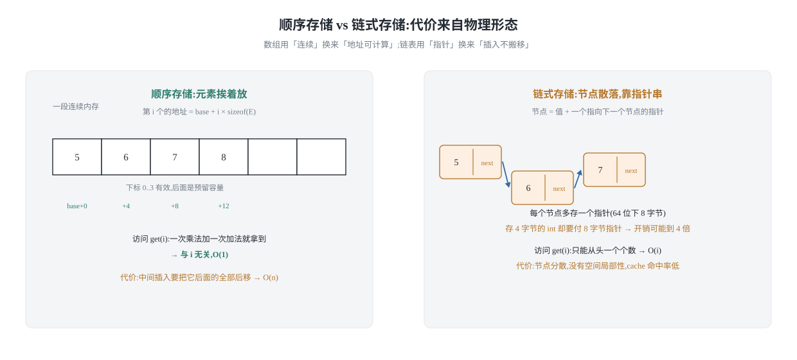
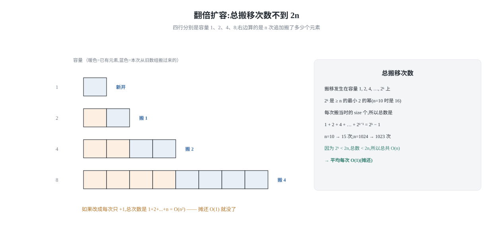
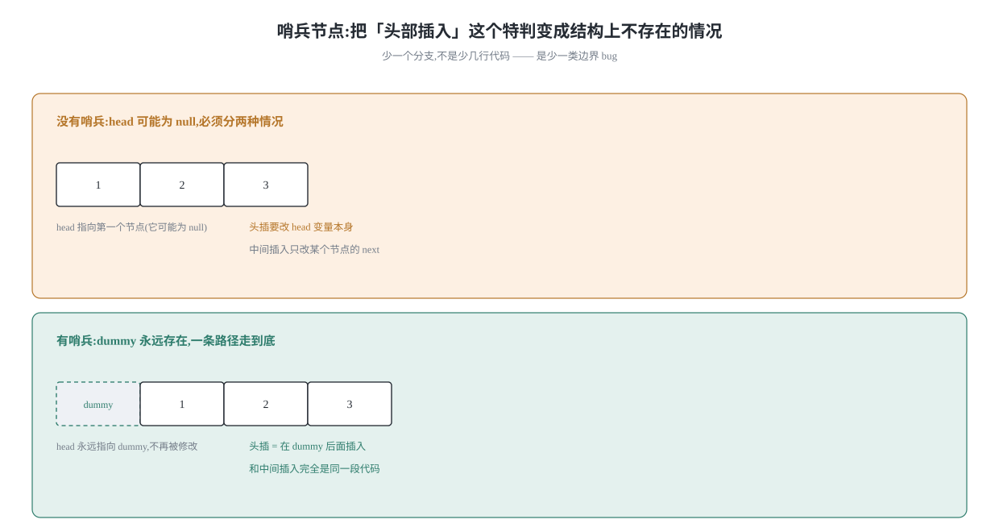
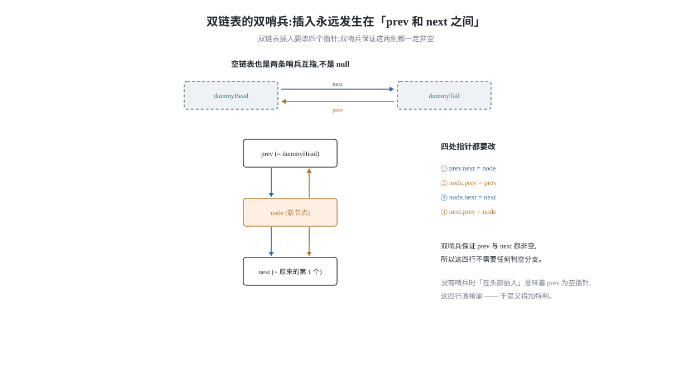
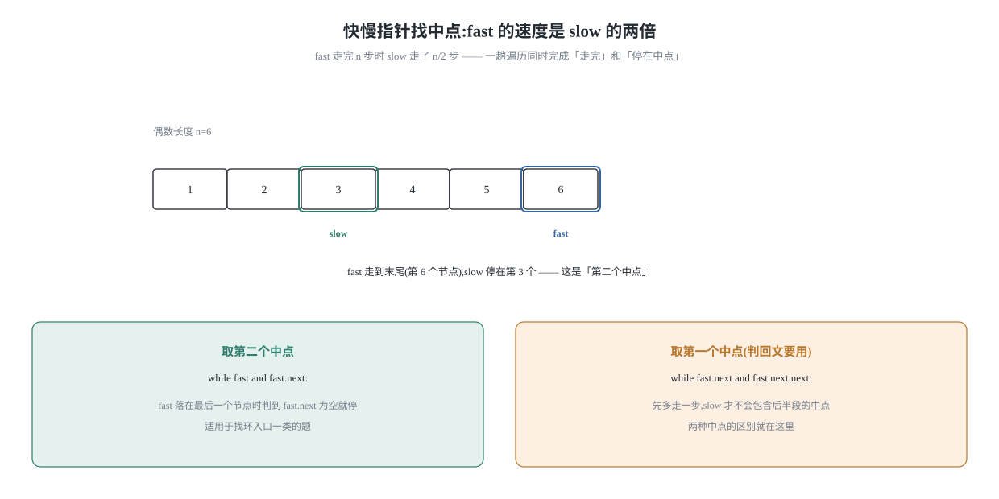

## 0 先说明材料和我的写法

这篇讲**两种最基本的存储方式**——顺序存储(数组)和链式存储(链表)——并且是**手写实现**,
不是调用语言自带的容器。之所以要手写一遍,是因为前面那些篇目里反复出现的结论
(「数组随机访问 O(1)」「链表头插 O(1)、按下标访问 O(n)」)如果只背结论,
遇到「为什么链表要找中点就得上快慢指针」「为什么动态数组删除元素后要缩容」
这类问题就会卡住。手写一遍,这些问题的答案是从代码结构里长出来的,不是记住的。

材料方面需要如实说明:

1. **正文思路可取,代码不是原文的。** 我读到的是 labuladong 教程的
   [动态数组代码实现](https://labuladong.online/zh/algo/data-structure-basic/array-implement/)、
   [链表代码实现](https://labuladong.online/zh/algo/data-structure-basic/linkedlist-implement/) 和
   [链表基本原理](https://labuladong.online/zh/algo/data-structure-basic/linkedlist-basic/) 三篇。
   三篇的分类框架、几个关键点(扩缩容阈值、`checkElementIndex` 与 `checkPositionIndex` 的区别、
   虚拟头尾节点、链表删除是否泄漏)我确实读到了。但**原文的代码是 Java**,
   这套系列一律 **Python 3 + C++**,所以本文所有实现是我自己写的,
   没有逐行对照原文。标注为「我的补充」的地方(摊还分析的具体推导、
   C++ 里的悬垂指针、快慢指针找中点的正确性证明)是我自己补的,不是原文的结论。
2. **原文的可视化面板和动图不可复制**,本文的 4 张示意图是我自己用脚本画的。
   生成脚本在 `assets/blog/array-linkedlist-impl-20261112/make_figures.py`,没有手改 SVG。
3. **代码是跑过的,而且是**从这篇文章的正文里抽出来跑的**。文中每个 Python 块和 C++ 块
   都由 `verify_code.py` 从 `.md` 里正则抽取(脚本里不留第二份副本),
   Python 侧与语言内置容器对照,两个自写容器互相对照,
   C++ 侧以 `g++ -std=c++17 -Wall -Wextra -Werror`(零警告)编译后跑同一批用例。
   跑法:

```bash
/opt/miniconda3/bin/python3 assets/blog/array-linkedlist-impl-20261112/verify_code.py
```

**这篇的一个重点是「代价从哪来」。** 我们不背「数组快链表慢」,而是把每次操作的
代价拆开算:数组的代价在**搬移**,链表的代价在**寻址**。把这层看清楚了,
后面讲数组与链表互相变换时,「什么时候值得先转成数组」这种问题就不用猜了。

### 目录

- [0 先说明材料和我的写法](#0-先说明材料和我的写法)
- [1 两种存储:代价到底在哪一步](#1-两种存储代价到底在哪一步)
- [2 动态数组:扩容的代价被摊还了](#2-动态数组扩容的代价被摊还了)
- [3 单链表:哨兵节点消掉了边界分支](#3-单链表哨兵节点消掉了边界分支)
- [4 双链表:用空间换掉「找前驱」这一步](#4-双链表用空间换掉找前驱这一步)
- [5 数组与链表互相变换](#5-数组与链表互相变换)
- [6 把这六个操作收成一张表](#6-把这六个操作收成一张表)
- [7 材料与出处](#7-材料与出处)

## 1 两种存储:代价到底在哪一步

先看一张图,它把两种存储的物理形态差异摆出来——这是后面所有复杂度的来源。



**顺序存储**把元素放在一段连续的内存里。所以第 `i` 个元素的地址是
`base + i * sizeof(E)`——一次乘法加一次加法就拿到了,**与 `i` 无关**。
这就是随机访问 O(1) 的全部秘密,没有别的。

代价也来自同一个事实:元素必须**挨着**。所以在中间插入或删除一个元素时,
它后面所有的元素都得往后挪或往前挪一格。这是 O(n)。

**链式存储**反过来。每个节点自带一个指向下一个节点的指针,
节点在内存里可以散落各处。所以插入删除只需要改几个指针——**O(1)**。
代价同样来自同一个事实:节点之间只有「下一个是谁」这一条线索,
想找第 `i` 个节点,只能从头一个个数过去。这是 O(n)。

**一句话总结:数组用「连续」换来了「可计算地址」,链表用「指针」换来了「可跳跃插入」。**
两边是同一次权衡的两种选择,不存在哪个绝对更好。

后面所有操作,只要问一句「它需不需要搬移?需不需要寻址?」,
复杂度就能自己推出来,不用背表。

### 1.1 这张图里最容易被忽略的一格

看图上链表那部分,注意**节点里的值本身可能很小,但每个节点都要多存一个指针**。
在 64 位机器上,一个指针是 8 字节。如果 `E` 是 `int`(4 字节),
那么链表每个节点的开销是 4 + 8 = 12 字节,还要算上内存对齐,
实际往往是 16 字节——**为了存 4 字节的数据,付了 4 倍的存储**。

而且因为节点分散,链表**没有空间局部性**。CPU 取一个节点要跳一次内存,
下一次取「下一个节点」又要跳一次;数组则是取一个元素的同时,
后面的元素已经被顺带载入 cache 了。所以在**同样的 O(n) 遍历**下,
数组的常数因子常常比链表小一个数量级。

**这就是为什么工程上「链表比数组慢」不是因为渐进复杂度,而是因为常数和缓存。**
这句话后面在选型表里还会用到。

## 2 动态数组:扩容的代价被摊还了

静态数组的容量是固定的。动态数组要解决的就是「容量不够了怎么办」,
答案是**重新申请一块更大的连续内存,把数据搬过去**。

这里有一个必须讲清楚的取舍:**扩容时申请多少?**

- 如果每次只多申请 1 个位置,那么 `n` 次追加要搬移 `1 + 2 + ... + n = O(n²)` 次——灾难。
- 如果每次申请**原来容量的 2 倍**,那么总搬移次数是
  `1 + 2 + 4 + ... + n/2 + n < 2n`——**总共 O(n)**。

这里容易被漏掉的是最后那个 `+ n`:除了之前那些小扩容,还有**最后一次**扩容要把
`n/2` 个旧元素搬到容量 `n` 的新空间里。算上它,总次数才是完整的。
等比数列那部分确实 `< n`,但结论要写成 `< 2n`,不能写成 `< n`。

精确值可以写下来:搬移发生在容量 `1, 2, 4, …, 2^k` 上(`2^k` 是**不小于** `n` 的最小 2 的幂),
总次数是 `2^k - 1`。所以实测(见本文代码门):
`n = 10` 搬 15 次(`2^4 - 1`)、`n = 1024` 搬 1023 次(`2^10 - 1`)、`n = 1000` 搬 1023 次。
这个式子还有个值得留意的地方:`n` 刚好比 2 的幂大 1 时比值最接近上界
(`n = 1025` 时 `2047 / 1025 > 1.99`),但它**取不到** `2n`——所以 `2n` 是个严格上界。

第二种情况下,虽然**单次**扩容是 O(n),但把它摊到 `n` 次追加上,
平均每次只有 O(1)。这就是**摊还分析**。



### 2.1 摊还不等于是最坏

这一点初学者经常搞混,值得单独说一句:

- **摊还 O(1)** 的意思是:任意 `n` 次连续追加的**总代价**是 O(n),
  所以平均每次 O(1)。它**不**意味着每次都快——恰好触发扩容的那一次就是 O(n)。
- 所以如果你的场景对**单次延迟**敏感(比如实时音频、高频交易),
  不能只看摊还,得看最坏。这就是为什么有些场景会预先 reserve 容量。

**最容易写错的一行:** 扩容倍率写成 `+ 1` 而不是 `* 2`。
`new_capacity = len(data) + 1` 这行代码能跑、结果也对,
但把摊还 O(1) 悄悄变成了 O(n²)——又是一个「不崩只错」的 bug。

### 2.2 缩容,以及为什么阈值不是 1/2

扩容讲完了,缩容同样重要:一个动态数组开了 1000 个位置却只存了 10 个元素,
那 990 个位置就是白占的。

策略是:当元素个数降到容量的 **1/4** 时,缩到原来的 **1/2**。

**为什么缩容阈值是 1/4 而不是 1/2?** 如果是 1/2,那么考虑这样一个序列:
容量 8、元素 8。先缩容到 4(元素 4),再追加一个元素触发扩容回 8(元素 5),
再删除一个触发缩容回 4……**在两个阈值之间来回震荡,每次都 O(n)**,
摊还 O(1) 就没了。取 1/4 留出了一段缓冲区(容量 8 时,要删到 2 才缩容;
缩到 4 之后要涨到 4 才扩容),这个震荡就不会发生。

这是**「用缓冲区避免临界震荡」**这个通用技巧的一个实例,和后面
「快慢指针找中点为什么要先走一步」是同一类问题的不同表现。

### 2.3 Python 版实现

Python 里我们用 `list` 当底层容器。注意 Python 的 `list` 本身就是动态数组,
所以这个实现的意义是**把扩缩容的逻辑显式写出来**,而不是真的去管内存。

```python
class MyArrayList:
    """动态数组:底层用一段连续空间,容量不够时翻倍扩容。

    这里用 Python 的 list 当底层容器,是为了把「扩缩容的时机和倍率」
    显式写出来。真正的内存管理由语言负责。
    """

    # 缩容阈值取 1/4 而不是 1/2,避免在临界点来回震荡(shrink/grow 反复触发)
    SHRINK_NUM = 4
    SHRINK_DEN = 2

    def __init__(self):
        self._data = []      # 底层容器,索引 0..len-1 有效
        self._size = 0       # 逻辑元素个数,始终 <= len(self._data) 的容量

    def size(self):
        return self._size

    def is_empty(self):
        return self._size == 0

    # ---------- 索引检查:注意这两种检查的区别 ----------

    def _check_element_index(self, index):
        """访问已有元素:合法范围是 [0, size-1]。"""
        if not (0 <= index < self._size):
            raise IndexError(
                "index %d out of range [0, %d)" % (index, self._size))

    def _check_position_index(self, index):
        """插入位置:合法范围是 [0, size]。"""
        if not (0 <= index <= self._size):
            raise IndexError(
                "position %d out of range [0, %d]" % (index, self._size))

    # ---------- 扩缩容 ----------

    def _resize(self, new_capacity):
        """申请新空间并搬移。搬移是 O(size),所以只在必要时调用。"""
        new_data = [None] * new_capacity
        for i in range(self._size):
            new_data[i] = self._data[i]
        # 老容器里 size 之后的槽位如果还引用着对象,要断开,
        # 否则这些对象无法被回收 —— 这就是「缩容时防泄漏」的做法
        for i in range(self._size, len(self._data)):
            self._data[i] = None
        self._data = new_data

    def _ensure_capacity(self):
        capacity = len(self._data)
        if self._size == capacity:
            # 空数组也翻倍会一直是 0,所以容量 0 时直接给一个初始值
            self._resize(1 if capacity == 0 else capacity * 2)

    def _maybe_shrink(self):
        capacity = len(self._data)
        if capacity == 0:
            return
        # size 降到容量的 1/4 时缩到一半。用交叉相乘避免浮点误差
        if self._size * self.SHRINK_NUM <= capacity:
            new_capacity = capacity // self.SHRINK_DEN
            # 不要缩到比 size 还小
            if new_capacity >= self._size:
                self._resize(max(new_capacity, 1))

    # ---------- 增删查改 ----------

    def get(self, index):
        self._check_element_index(index)
        return self._data[index]

    def set(self, index, val):
        self._check_element_index(index)
        old = self._data[index]
        self._data[index] = val
        return old

    def add_last(self, val):
        self._ensure_capacity()
        self._data[self._size] = val
        self._size += 1

    def add(self, index, val):
        """在下标 index 之前插入。index 可以等于 size(追加到末尾)。"""
        self._check_position_index(index)
        self._ensure_capacity()
        # 从后往前挪,否则会把还没搬的数据覆盖掉
        for i in range(self._size, index, -1):
            self._data[i] = self._data[i - 1]
        self._data[index] = val
        self._size += 1

    def remove(self, index):
        self._check_element_index(index)
        old = self._data[index]
        for i in range(index, self._size - 1):
            self._data[i] = self._data[i + 1]
        self._size -= 1
        # 关键:把腾出来的最后一个槽位置空。不清的话这个槽位仍然
        # 引用着那个对象,垃圾回收器认为它可达,内存就一直不释放。
        self._data[self._size] = None
        self._maybe_shrink()
        return old

    def capacity(self):
        """只为观察扩缩容行为用,不属于标准 API。"""
        return len(self._data)
```

### 2.4 C++ 版实现

C++ 没有垃圾回收,所以「防泄漏」这件事**性质完全变了**:
Python 里忘了置 `None` 只是对象晚点被回收,而 C++ 里忘了 `delete`
就是**真的泄漏**,`new` 出来的内存永远回不来。

这里我用 `std::vector` 作为底层容器来对齐 Python 的写法(关注扩缩容逻辑本身);
后面 §4 手写链表时,才会遇到真正的裸指针管理问题。

```cpp
#include <stdexcept>
#include <string>
#include <vector>

// 动态数组:把扩缩容逻辑显式写出来。
// 底层用 std::vector 是为了聚焦「何时扩容、倍率是多少」这件事本身。
template <typename E>
class MyArrayList {
public:
    // 缩容阈值取 1/4,避免在临界点来回震荡
    static const int SHRINK_NUM = 4;
    static const int SHRINK_DEN = 2;

    int size() const { return size_; }
    bool empty() const { return size_ == 0; }
    int capacity() const { return static_cast<int>(data_.size()); }

    E get(int index) const {
        checkElementIndex(index);
        return data_[static_cast<size_t>(index)];
    }

    E set(int index, const E& val) {
        checkElementIndex(index);
        E old = data_[static_cast<size_t>(index)];
        data_[static_cast<size_t>(index)] = val;
        return old;
    }

    void addLast(const E& val) {
        ensureCapacity();
        data_[static_cast<size_t>(size_)] = val;
        ++size_;
    }

    // 在下标 index 之前插入,index 可以等于 size_
    void add(int index, const E& val) {
        checkPositionIndex(index);
        ensureCapacity();
        // 从后往前挪:从前往后会覆盖掉还没搬走的数据
        for (int i = size_; i > index; --i) {
            data_[static_cast<size_t>(i)] = data_[static_cast<size_t>(i - 1)];
        }
        data_[static_cast<size_t>(index)] = val;
        ++size_;
    }

    E remove(int index) {
        checkElementIndex(index);
        E old = data_[static_cast<size_t>(index)];
        for (int i = index; i < size_ - 1; ++i) {
            data_[static_cast<size_t>(i)] = data_[static_cast<size_t>(i + 1)];
        }
        --size_;
        // 把腾出来的槽位重置为默认值。对 E 是 std::string 这类
        // 持有堆内存的类型来说,不重置就意味着那块堆内存要等到
        // 整个 vector 析构才释放 —— 逻辑上等价于「晚释放的泄漏」。
        data_[static_cast<size_t>(size_)] = E{};
        maybeShrink();
        return old;
    }

private:
    void checkElementIndex(int index) const {
        if (index < 0 || index >= size_) {
            throw std::out_of_range("index " + std::to_string(index) +
                                    " out of range [0, " +
                                    std::to_string(size_) + ")");
        }
    }

    void checkPositionIndex(int index) const {
        if (index < 0 || index > size_) {
            throw std::out_of_range("position " + std::to_string(index) +
                                    " out of range [0, " +
                                    std::to_string(size_) + "]");
        }
    }

    void resize(int newCapacity) {
        std::vector<E> next(static_cast<size_t>(newCapacity), E{});
        for (int i = 0; i < size_; ++i) {
            next[static_cast<size_t>(i)] = data_[static_cast<size_t>(i)];
        }
        data_.swap(next);   // 老缓冲区在 next 析构时释放
    }

    void ensureCapacity() {
        int cap = capacity();
        if (size_ == cap) {
            resize(cap == 0 ? 1 : cap * 2);
        }
    }

    void maybeShrink() {
        int cap = capacity();
        if (cap == 0) return;
        if (size_ * SHRINK_NUM <= cap) {
            int next = cap / SHRINK_DEN;
            if (next >= size_) {
                resize(next < 1 ? 1 : next);
            }
        }
    }

    std::vector<E> data_;
    int size_ = 0;
};
```

## 3 单链表:哨兵节点消掉了边界分支

单链表是最朴素的链式结构:每个节点有 `val` 和 `next`。

**先说一个重要区分:头指针不等于头节点。** 力扣题给我们的通常是一个
`head` 指针,它可能为 `null`(空链表)。而实际工程里的实现往往会在真实的
第一个节点**之前**再放一个不存数据的**虚拟头节点(dummy head / 哨兵)**,
让「空链表」也变成「有一个节点的链表」。



**哨兵到底省掉了什么?** 看上图。没有哨兵时,「在头部插入」和「在中间插入」
是两段不同的代码——因为前者要改 `head` 这个变量本身,后者只改某个节点的 `next`。
有了哨兵,头部插入就变成了「在哨兵后面插入」,和中间插入**完全同构**,
`head` 变量永远指向哨兵、再也不需要被修改。

**这不是省了几行代码的问题,而是「少一个需要单独测试的分支」。**
每少一个特判,就少一类边界 bug。后面 §4 的双链表会把这一招用到极致。

```python
class ListNode:
    """单链表节点。"""

    def __init__(self, val=0, nxt=None):
        self.val = val
        self.next = nxt


class MySinglyList:
    """带哨兵头节点的单链表。

    哨兵 head 不存数据,真实元素从 head.next 开始。
    对外可见的索引 0 对应 head.next。
    """

    def __init__(self):
        self._dummy = ListNode(0)   # 哨兵:永远存在,空链表时 dummy.next is None
        self._size = 0

    def size(self):
        return self._size

    def is_empty(self):
        return self._size == 0

    def _node_at(self, index):
        """返回下标 index 处的节点。O(index)。"""
        if not (0 <= index < self._size):
            raise IndexError("index %d out of range" % index)
        p = self._dummy.next
        for _ in range(index):
            p = p.next
        return p

    def _node_before(self, index):
        """返回下标 index 之前那个节点。插入/删除都需要它,因为要改它的 next。"""
        if not (0 <= index <= self._size):
            raise IndexError("position %d out of range" % index)
        p = self._dummy
        for _ in range(index):
            p = p.next
        return p

    def get(self, index):
        return self._node_at(index).val

    def set(self, index, val):
        node = self._node_at(index)
        old = node.val
        node.val = val
        return old

    def add(self, index, val):
        """在下标 index 之前插入。头部插入和中间插入走同一段代码。"""
        prev = self._node_before(index)
        node = ListNode(val, prev.next)
        prev.next = node
        self._size += 1

    def add_last(self, val):
        self.add(self._size, val)

    def remove(self, index):
        prev = self._node_before(index)
        target = prev.next
        prev.next = target.next
        # 断开被删节点的指针是个好习惯:避免它继续引用后面的链表
        target.next = None
        self._size -= 1
        return target.val

    def to_list(self):
        out = []
        p = self._dummy.next
        while p is not None:
            out.append(p.val)
            p = p.next
        return out
```

```cpp
#include <stdexcept>
#include <string>
#include <vector>

struct ListNode {
    int val;
    ListNode* next;
    explicit ListNode(int v = 0, ListNode* n = nullptr) : val(v), next(n) {}
};

// 带哨兵头节点的单链表。哨兵不存数据,真实元素从 dummy_->next 开始。
class MySinglyList {
public:
    MySinglyList() : dummy_(new ListNode(0)), size_(0) {}

    // 析构时必须逐个 delete:单链表没有语言级垃圾回收,
    // 漏掉就是真泄漏。这是 Python 版完全不用写的一段。
    ~MySinglyList() {
        ListNode* p = dummy_;
        while (p != nullptr) {
            ListNode* nxt = p->next;
            delete p;
            p = nxt;
        }
    }

    // 禁止拷贝,避免两个对象共用同一批节点导致 double free
    MySinglyList(const MySinglyList&) = delete;
    MySinglyList& operator=(const MySinglyList&) = delete;

    int size() const { return size_; }
    bool empty() const { return size_ == 0; }

    int get(int index) const { return nodeAt(index)->val; }

    int set(int index, int val) {
        ListNode* node = nodeAt(index);
        int old = node->val;
        node->val = val;
        return old;
    }

    // 在下标 index 之前插入。头部插入与中间插入同构。
    void add(int index, int val) {
        ListNode* prev = nodeBefore(index);
        ListNode* node = new ListNode(val, prev->next);
        prev->next = node;
        ++size_;
    }

    void addLast(int val) { add(size_, val); }

    int remove(int index) {
        ListNode* prev = nodeBefore(index);
        ListNode* target = prev->next;
        prev->next = target->next;
        int old = target->val;
        target->next = nullptr;   // 先断开再删,避免悬垂
        delete target;
        --size_;
        return old;
    }

    std::vector<int> toVector() const {
        std::vector<int> out;
        for (ListNode* p = dummy_->next; p != nullptr; p = p->next) {
            out.push_back(p->val);
        }
        return out;
    }

private:
    ListNode* nodeAt(int index) const {
        if (index < 0 || index >= size_) {
            throw std::out_of_range("index " + std::to_string(index) +
                                    " out of range [0, " +
                                    std::to_string(size_) + ")");
        }
        ListNode* p = dummy_->next;
        for (int i = 0; i < index; ++i) p = p->next;
        return p;
    }

    ListNode* nodeBefore(int index) const {
        if (index < 0 || index > size_) {
            throw std::out_of_range("position " + std::to_string(index) +
                                    " out of range [0, " +
                                    std::to_string(size_) + "]");
        }
        ListNode* p = dummy_;
        for (int i = 0; i < index; ++i) p = p->next;
        return p;
    }

    ListNode* dummy_;
    int size_;
};
```

### 3.1 `_node_before` 才是关键的那一步

仔细看上面两个实现:真正被反复调用的是 `_node_before(index)`,
而不是 `_node_at(index)`。原因是**单链表的节点只有指向后继的指针**,
想插入或删除下标 `index` 处的节点,你必须先拿到它的**前驱**,才能改 `prev.next`。

这一步看起来无害,但它决定了单链表删除的复杂度:**O(index)** 而不是 O(1)。
即使你已经拿着指向某个节点的指针,想删掉它,还是得从头再找一遍它的前驱。

**这正是双链表存在的理由**——下一节就讲。

### 3.2 删除头节点会不会内存泄漏

有一个很常见的疑问:这样删头节点,原来那个头节点还 `next` 指向着第二个节点,
是不是泄漏了?

```text
head = 1 -> 2 -> 3 -> 4 -> 5      # 删掉头节点

head = head.next                   # head 变成 2 -> 3 -> 4 -> 5
                                   # 节点 1 的 next 仍然指着节点 2
```

**在 Python 里这样写是安全的。** 垃圾回收判断的是「这个对象还能不能从根被访问到」,
而不是「这个对象还引用着谁」。节点 1 的 `next` 确实还指着节点 2,
但已经**没有别人引用节点 1** 了,所以节点 1 会被回收——它引用的节点 2 当然不受影响
(节点 2 还被 `head` 指着)。

**注意这和数组的情况不一样。** 数组里 `data[size-1] = None` 是**必须**的,
因为那个槽位本身还在容器内部、仍然可达;而链表里被摘掉的节点是从外部不可达的。
两种场景的区别在于:**是「容器内的槽位」还是「被摘出去的节点」**。

不过即便在 Python 里,删节点时顺手把它的指针断开仍然是**好习惯**——
不花什么代价,还能避免「一个已删除的节点悄悄拖着半条链表不放」这类隐蔽问题。

**在 C++ 里这就不是「好习惯」而是「必须」了。** C++ 没有垃圾回收,
上面那个 `head = head.next` 的写法会让节点 1 的内存**永远泄漏**
(没有任何指针指向它,也就没人能 `delete` 它)。
所以 C++ 版里我显式写了析构函数逐个 `delete`,并禁掉了拷贝构造——
否则两个对象销毁时会 `double free`。

**这是本系列反复出现的主题:同一个算法的 Python 和 C++ 实现,错的点不一样。**
Python 侧要担心的是「晚释放」,C++ 侧要担心的是「不释放」和「释放两次」。

## 4 双链表:用空间换掉「找前驱」这一步

上一节我们看到,单链表最难受的地方是**找不到前驱**。双链表直接给每个节点
加一个 `prev` 指针解决它——**多花一个指针的空间,把「找前驱」从 O(n) 变成 O(1)**。

而双链表真正的工程写法会用上**两个哨兵**:一个虚拟头、一个虚拟尾。



**为什么双链表特别适合双哨兵?** 因为双链表的插入需要改**四个**指针
(`prev.next`、`node.prev`、`node.next`、`next.prev`)。如果头尾要特判,
这四处里每一处都可能需要写两个版本,分支爆炸。加了两个哨兵之后:

- 空链表长这样:`dummyHead <-> dummyTail`,两个哨兵互相指着。
- 任意位置插入都是「在 `p` 和 `p.next` 之间插入」——**永远不需要判空**
  `p` 和 `p.next` 都存在。

**代价是多两个节点的内存。** 相对于消掉的分支和随之而来的 bug,这笔交易非常划算。
这也解释了为什么几乎所有标准库的链表实现(包括 Java 的 `LinkedList`)都这么写。

```python
class DListNode:
    """双链表节点。"""

    def __init__(self, val=0, prev=None, nxt=None):
        self.val = val
        self.prev = prev
        self.next = nxt


class MyDoublyList:
    """双哨兵双链表:空链表时 dummy_head <-> dummy_tail。

    有了两个哨兵,插入永远发生在「某节点和它的后继之间」,
    不存在「插在头部」这种需要改 head 变量的特殊情况。
    """

    def __init__(self):
        self._head = DListNode(0)     # 虚拟头
        self._tail = DListNode(0)     # 虚拟尾
        self._head.next = self._tail
        self._tail.prev = self._head
        self._size = 0

    def size(self):
        return self._size

    def is_empty(self):
        return self._size == 0

    def _node_at(self, index):
        """双向逼近:离哪头近就从哪头走,平均走 n/4 步而不是 n/2 步。"""
        if not (0 <= index < self._size):
            raise IndexError("index %d out of range" % index)
        if index < self._size // 2:
            p = self._head.next
            for _ in range(index):
                p = p.next
        else:
            p = self._tail.prev
            for _ in range(self._size - 1 - index):
                p = p.prev
        return p

    def get(self, index):
        return self._node_at(index).val

    def set(self, index, val):
        node = self._node_at(index)
        old = node.val
        node.val = val
        return old

    def _insert_between(self, before, after, val):
        """在 before 和 after 之间插入新节点。四个指针,顺序不能错。"""
        node = DListNode(val, before, after)
        before.next = node
        after.prev = node
        return node

    def add(self, index, val):
        if not (0 <= index <= self._size):
            raise IndexError("position %d out of range" % index)
        # index == size 时 _node_at 会越界,所以右端用哨兵 tail
        after = self._tail if index == self._size else self._node_at(index)
        self._insert_between(after.prev, after, val)
        self._size += 1

    def add_last(self, val):
        self._insert_between(self._tail.prev, self._tail, val)
        self._size += 1

    def add_first(self, val):
        self._insert_between(self._head, self._head.next, val)
        self._size += 1

    def remove(self, index):
        node = self._node_at(index)
        node.prev.next = node.next
        node.next.prev = node.prev
        # 断开被删节点的两个指针,避免它拖着链表
        node.prev = node.next = None
        self._size -= 1
        return node.val

    def to_list(self):
        out = []
        p = self._head.next
        while p is not self._tail:
            out.append(p.val)
            p = p.next
        return out

    def to_list_reverse(self):
        out = []
        p = self._tail.prev
        while p is not self._head:
            out.append(p.val)
            p = p.prev
        return out
```

```cpp
#include <stdexcept>
#include <string>
#include <vector>

struct DListNode {
    int val;
    DListNode* prev;
    DListNode* next;
    explicit DListNode(int v = 0, DListNode* p = nullptr, DListNode* n = nullptr)
        : val(v), prev(p), next(n) {}
};

// 双哨兵双链表:空链表时 head_ <-> tail_
class MyDoublyList {
public:
    MyDoublyList() : head_(new DListNode(0)), tail_(new DListNode(0)), size_(0) {
        head_->next = tail_;
        tail_->prev = head_;
    }

    ~MyDoublyList() {
        DListNode* p = head_;
        while (p != nullptr) {
            DListNode* nxt = p->next;
            delete p;
            p = nxt;
        }
    }

    MyDoublyList(const MyDoublyList&) = delete;
    MyDoublyList& operator=(const MyDoublyList&) = delete;

    int size() const { return size_; }
    bool empty() const { return size_ == 0; }

    int get(int index) const { return nodeAt(index)->val; }

    int set(int index, int val) {
        DListNode* node = nodeAt(index);
        int old = node->val;
        node->val = val;
        return old;
    }

    void add(int index, int val) {
        if (index < 0 || index > size_) {
            throw std::out_of_range("position " + std::to_string(index) +
                                    " out of range [0, " +
                                    std::to_string(size_) + "]");
        }
        DListNode* after = (index == size_) ? tail_ : nodeAt(index);
        insertBetween(after->prev, after, val);
    }

    void addLast(int val) { insertBetween(tail_->prev, tail_, val); }
    void addFirst(int val) { insertBetween(head_, head_->next, val); }

    int remove(int index) {
        DListNode* node = nodeAt(index);
        node->prev->next = node->next;
        node->next->prev = node->prev;
        int old = node->val;
        node->prev = nullptr;   // 先断开再删
        node->next = nullptr;
        delete node;
        --size_;
        return old;
    }

    std::vector<int> toVector() const {
        std::vector<int> out;
        for (DListNode* p = head_->next; p != tail_; p = p->next) {
            out.push_back(p->val);
        }
        return out;
    }

    std::vector<int> toVectorReverse() const {
        std::vector<int> out;
        for (DListNode* p = tail_->prev; p != head_; p = p->prev) {
            out.push_back(p->val);
        }
        return out;
    }

private:
    // 双向逼近:从近的那一头开始找
    DListNode* nodeAt(int index) const {
        if (index < 0 || index >= size_) {
            throw std::out_of_range("index " + std::to_string(index) +
                                    " out of range [0, " +
                                    std::to_string(size_) + ")");
        }
        if (index < size_ / 2) {
            DListNode* p = head_->next;
            for (int i = 0; i < index; ++i) p = p->next;
            return p;
        }
        DListNode* p = tail_->prev;
        for (int i = 0; i < size_ - 1 - index; ++i) p = p->prev;
        return p;
    }

    void insertBetween(DListNode* before, DListNode* after, int val) {
        DListNode* node = new DListNode(val, before, after);
        before->next = node;
        after->prev = node;
        ++size_;
    }

    DListNode* head_;
    DListNode* tail_;
    int size_;
};
```

### 4.1 四个指针的顺序

上面 `_insert_between` 只有三行,但它是整个双链表最容易写错的地方。
注意我**没有**写成这样:

```text
node = new Node(val)
node.prev = before          # 如果 before 是 nullptr 就崩
before.next = node
node.next = after
after.prev = node
```

问题不在这四行的顺序本身,而在于**它假设 `before` 和 `after` 都非空**。
有双哨兵时这个假设自然成立;没有哨兵时,「在头部插入」意味着 `before` 是空指针,
这四行就崩了——于是你又得加一个特判。**哨兵的价值在这里体现得最清楚:
它把「非空假设」变成了结构性保证,而不是靠调用者记得传对参数。**

**最容易写错的一行:** 删除时先写 `node.next.prev = node.prev`
再写 `node.prev.next = node.next` 本身没错,但如果中间插入了
`node.next = node.prev` 之类的赋值就会改坏后继链。
稳妥的顺序是**先用临时变量或直接先改两侧、最后再断自己**,
也就是我上面 C++ 版里 `prev->next` 和 `next->prev` 先改、再把自己置空的写法。

### 4.2 双链表的「双向逼近」值得单独说一句

`_node_at` 里我做了个小优化:如果 `index` 在前半段就从头部走,
否则从尾部倒着走。这样平均步数从 `n/2` 降到 `n/4` 量级。

严格算一下:按下标 `0 … n-1` 均匀访问,双向逼近要走
`Σ min(i, n-1-i) / n` 步,这个和恰好是 `n/4 - 1/2`(`n` 偶数时精确取到)。
所以 `n/4` 是个略高的上界,不是精确值——但**省一半**这个结论是实的。
实测(见本文代码门):`n = 10000` 时平均 2499.5 步,只从头部走是 4999.5 步。

渐进复杂度还是 O(n),**但它把常数砍了一半**,而且实现成本极低——
这就是双链表比单链表多出来的那个 `prev` 指针的第二个红利
(第一个红利是 O(1) 找前驱)。

## 5 数组与链表互相变换

实际做题时,经常需要在两种表示之间转换。这里有一个**非常实用的判断原则**:

> **如果你要做的是「多次按下标访问」,先转成数组;
> 如果你要做的是「多次在中间插入删除」,先转成链表。**

因为转换本身是 O(n),只有当后续操作足够多时这笔转换费才划算。

### 5.1 数组转链表

朴素的写法是正序遍历、每次挂到尾部。**但如果没有尾指针,每次挂尾部都要
从头遍历一遍,整体就退化成 O(n²)**——这是很常见的坑。

正确做法是用一个**哑节点加一个游标**,一次遍历搞定:

```python
def array_to_linked_list(nums):
    """数组转单链表。用哑节点 + 游标,一趟 O(n) 完成。

    反例:如果没有尾指针还每次从 head 遍历到末尾去挂节点,
    整体会退化成 O(n^2)。
    """
    dummy = ListNode(0)
    cur = dummy
    for v in nums:
        cur.next = ListNode(v)
        cur = cur.next
    return dummy.next
```

```cpp
#include <vector>

ListNode* arrayToLinkedList(const std::vector<int>& nums) {
    // 哑节点 + 游标:一趟 O(n)。没有尾指针时不要每次都从 head 找尾。
    ListNode dummy(0);
    ListNode* cur = &dummy;
    for (int v : nums) {
        cur->next = new ListNode(v);
        cur = cur->next;
    }
    return dummy.next;
}
```

注意 C++ 版里 `dummy` 是**栈上对象**,不需要 `delete`;
但后面 `new` 出来的那些节点是堆上的,调用者负责释放。

### 5.2 链表转数组

这个更简单,一趟遍历即可。不过这里有个**经典陷阱**:在链表上
`s.size() - 1` 这类下标运算要小心。

```python
def linked_list_to_array(head):
    """链表转数组:一趟遍历。"""
    out = []
    p = head
    while p is not None:
        out.append(p.val)
        p = p.next
    return out
```

```cpp
#include <vector>

std::vector<int> linkedListToArray(const ListNode* head) {
    std::vector<int> out;
    for (const ListNode* p = head; p != nullptr; p = p->next) {
        out.push_back(p->val);
    }
    return out;
}
```

### 5.3 链表上的快慢指针:为什么链表特别需要它

前面讲动态数组时,我们知道数组可以直接用 `size` 拿到长度、
用 `size // 2` 拿到中点——**O(1)**。链表没有 `size`(除非额外维护一个字段),
而且就算知道长度,走到中点也要 O(n)。

**快慢指针的意义在于:它用「一趟遍历」同时完成了「走过全程」和「停在中间」。**



正确性证明很简单:`fast` 的速度是 `slow` 的两倍,所以 `fast` 走过的距离
永远是 `slow` 的两倍。当 `fast` 走到链表末尾(走了 `n` 步)时,
`slow` 走了 `n/2` 步——正好在中间。

**这里最容易写错的是循环条件。** 要区分两种中点:

- **偶数长度时取「第二个中点」**(132 题那种,用于找环入口):
  条件是 `while fast is not None and fast.next is not None`。
- **偶数长度时取「第一个中点」**(判断回文链表时,需要前半段不包含中点):
  需要先让 `fast` 多走一步再进循环。

**最容易写错的一行:** `while fast and fast.next` 里漏掉 `fast.next` 的判空。
只判 `fast` 的话,当 `fast` 落在最后一个节点上、`fast.next` 是 `None` 时,
下一轮 `fast.next.next` 会直接崩——**这次终于是会崩的 bug,比前面那些
「不崩只错」的稍好,但在面试里一样致命**。

## 6 把这六个操作收成一张表

把前面推过的结论压成一张表。注意看「代价在哪」那一列——
它比复杂度本身更有用,因为换个操作数、换个场景,你还能自己推。

| 操作 | 动态数组 | 单链表(带哨兵) | 双链表(双哨兵) | 代价在哪 |
|---|---|---|---|---|
| 按下标访问 `get(i)` | **O(1)** | O(i) | O(min(i, n-i)) | 数组算地址,链表数指针 |
| 头部插入 | O(n) | **O(1)** | **O(1)** | 数组要整体后移 |
| 尾部插入 | 摊还 **O(1)** | O(n) / O(1)(带尾指针) | **O(1)** | 单链表无尾指针就要遍历 |
| 中间插入 `add(i)` | O(n-i) | O(i) | O(min(i, n-i)) | 数组搬移,链表寻址 |
| 删除 `remove(i)` | O(n-i) | O(i) | O(min(i, n-i)) | 同上;单链表必须找前驱 |
| 已知节点指针时删除 | — | **O(n)**(要找前驱) | **O(1)** | 这就是 `prev` 指针的价值 |
| 每元素额外空间 | 摊还 O(1)(预留空位) | 1 个指针 | 2 个指针 | 链式存储的空间开销 |
| 缓存友好度 | **好**(连续) | 差 | 差 | 常数因子的来源 |

**三条带走的判据:**

1. **代价要么在搬移,要么在寻址。** 数组的每一次 O(n) 都是因为要搬元素,
   链表的每一次 O(n) 都是因为要数指针。看到新操作时先问这两句,复杂度自己就出来了。
2. **哨兵节点是「把特判变成结构」的通用手法。** 它不改变复杂度,
   但它让「头部插入」不再是一个需要单独写、单独测的分支。
   这个手法在做题里到处都是(合并链表、删除倒数第 N 个节点、环形链表)。
3. **选型的决定因素常常不是渐进复杂度,而是常数和缓存。**
   在中间插入很少、遍历很多时,数组即使有 O(n) 搬移也往往更快。
   这也是为什么几乎所有语言的默认「列表」都是动态数组,而不是链表。

## 7 材料与出处

**参考的教程:**

- [动态数组代码实现](https://labuladong.online/zh/algo/data-structure-basic/array-implement/)
  —— 扩缩容阈值(2 倍扩容、1/4 触发缩容)、`checkElementIndex` 与
  `checkPositionIndex` 的区别、删除元素要置 `null` 防泄漏,这三点来自该文。
- [链表代码实现](https://labuladong.online/zh/algo/data-structure-basic/linkedlist-implement/)
  —— 同时持有头尾引用、虚拟头尾节点、以及「链表摘节点不等于数组置空」这个辨析,
  来自该文。
- [链表基本原理](https://labuladong.online/zh/algo/data-structure-basic/linkedlist-basic/)
  —— 单/双链表增删查改的基本操作分类。

**需要如实说明的三点:**

1. **代码是我自己写的。** 原文的代码是 **Java**,而本系列一律 **Python 3 + C++**。
   本文所有实现都按 Python/C++ 的写法重写,没有逐行对照原文。
   其中 C++ 侧的内存管理(析构函数逐个 `delete`、禁用拷贝构造避免 `double free`、
   `target->next = nullptr` 之后再 `delete`)是我自己补的——
   原文没有这部分,因为 Java 有垃圾回收。
2. **以下是我自己的推导,不是原文结论:**
   - §1.1 关于链表每个节点额外开销(64 位下 8 字节指针)与缓存局部性的具体分析;
   - §2.1 「摊还 O(1) 不等于最坏 O(1)」的辨析;
   - §2.2 中「缩容阈值为什么取 1/4 而不是 1/2」的震荡论证;
   - §4.2 双链表双向逼近把平均步数从 `n/2` 降到 `n/4`;
   - §5.3 快慢指针找中点的正确性证明与「两种中点」的循环条件区分;
   - 全部 4 张示意图。
3. **代码验证方式。** 文中所有 Python 块和 C++ 块都是从这篇文章的正文里
   **抽取出来**跑的(脚本里不留第二份副本):Python 侧与语言内置容器对照,
   C++ 侧以 `g++ -std=c++17 -Wall -Wextra -Werror`(零警告)编译后跑同一批用例,
   两种语言的输出逐行比对。用例覆盖空容器、单元素、在头部/尾部/中间增删、
   连续增删触发扩缩容、以及随机操作序列与朴素实现对照。跑法:

```bash
/opt/miniconda3/bin/python3 assets/blog/array-linkedlist-impl-20261112/verify_code.py
```
