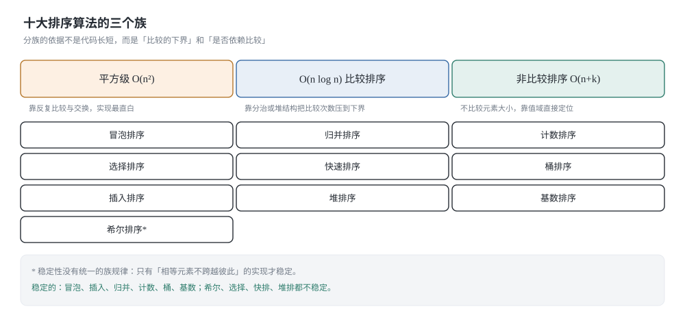
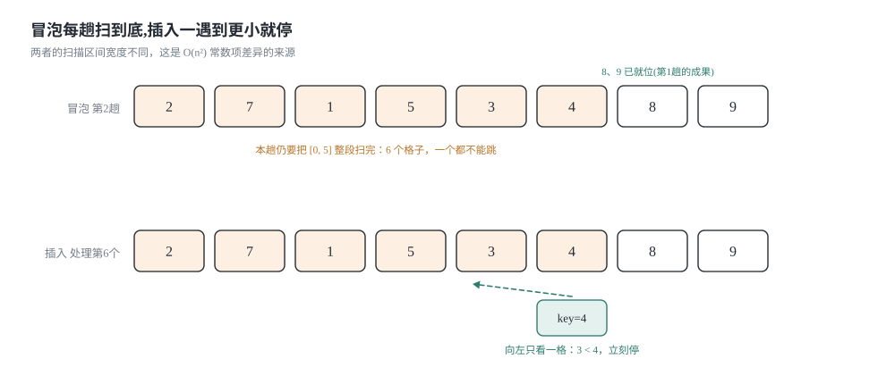
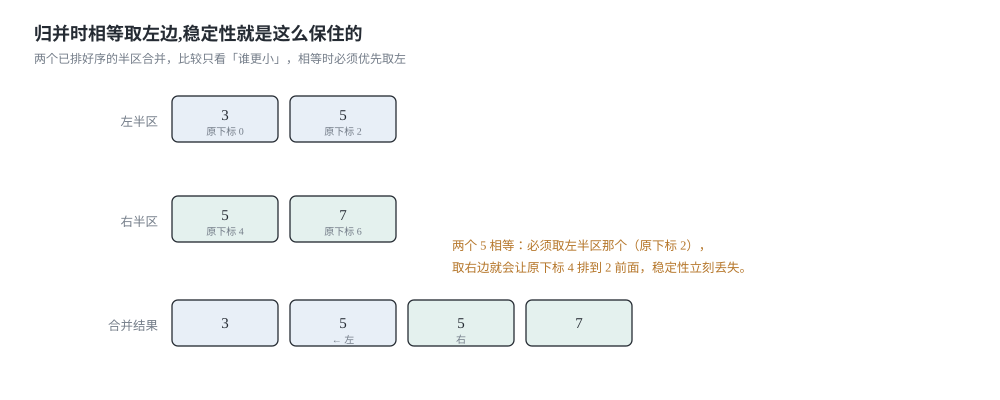
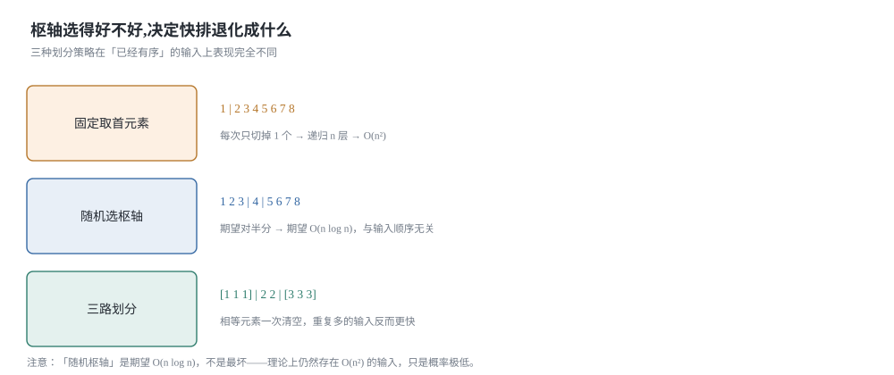
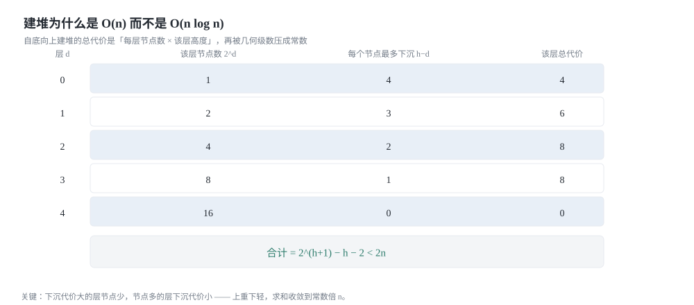

## 0 先说明材料和我的写法

这篇是我自己的学习笔记，材料来自 labuladong 教程的「十大排序算法原理及可视化」这一章：

- 《本章导读》—— <https://labuladong.online/zh/algo/intro/sorting/>
- 《排序算法的关键指标》—— <https://labuladong.online/zh/algo/data-structure-basic/sort-basic/>
- 《选择排序所面临的问题》—— <https://labuladong.online/zh/algo/data-structure-basic/select-sort/>
- 《拥有稳定性：冒泡排序》—— <https://labuladong.online/zh/algo/data-structure-basic/bubble-sort/>
- 《运用逆向思维：插入排序》—— <https://labuladong.online/zh/algo/data-structure-basic/insertion-sort/>
- 《突破 O(N^2)：希尔排序》—— <https://labuladong.online/zh/algo/data-structure-basic/shell-sort/>
- 《妙用二叉树前序位置：快速排序》—— <https://labuladong.online/zh/algo/data-structure-basic/quick-sort/>
- 《妙用二叉树后序位置：归并排序》—— <https://labuladong.online/zh/algo/data-structure-basic/merge-sort/>
- 《二叉堆结构的运用：堆排序》—— <https://labuladong.online/zh/algo/data-structure-basic/heap-sort/>
- 《全新的排序原理：计数排序》—— <https://labuladong.online/zh/algo/data-structure-basic/counting-sort/>
- 《博采众长：桶排序》—— <https://labuladong.online/zh/algo/data-structure-basic/bucket-sort/>
- 《基数排序（Radix Sort）》—— <https://labuladong.online/zh/algo/data-structure-basic/radix-sort/>

需要讲清楚的是：**这不是转载，也不是翻译**。原文最值钱的部分是每篇配套的可视化面板和动图，那个我复现不了，所以下面所有的图都是我自己用 SVG 画的，所有的讲解都是我按自己的理解重新组织的。

关于材料的完整度，我要如实交代一句，因为这直接影响你该怎么读这篇：

- 我取到了**完整正文**的是：关键指标、选择排序、冒泡排序、插入排序。
- 只取到**开头一段加小节标题**（正文在客户端渲染，或者需要会员）的是：希尔排序（小节标题：`h` 有序数组 / 希尔排序 / 排序稳定性 / 时空复杂度分析）、快速排序（快速排序核心思路 / 代码框架 / 时间复杂度 / 空间复杂度 / 稳定性）、归并排序（核心思路 / 排序稳定性 / 时间复杂度 / 是否是原地排序）、堆排序（简单直接的堆排序实现 / 利用逆向思维进行优化 / 堆排序的稳定性）、计数排序（通用的计数排序 / 处理负数和自定义类型 / 累加 `count` 数组避免使用逆函数 / 空间复杂度 / 时间复杂度 / 非比较排序）、桶排序（实现 / 分配到 `k` 个桶 / 稳定性 / 时空复杂度）、基数排序（为什么必须稳定 / 位数不同怎么办 / 有负数怎么办 / LSD 和 MSD）。
- 这些算法里，**凡是我没取到正文的部分，写的是我自己的推导**，并且我在对应小节里标了一句「这节是我自己的推导，没有对照原文」。取到正文的那几节，结论和复杂度我都核对过原文；但代码一律是我自己写的。

**代码是 Python 3 和 C++ 两版。** 教程原文是 Java，我按自己的习惯重写了一遍，所以下面的实现不是从原文抄的。两种语言并排给出是有实际意义的：它们的坑不一样，比如 Python 的 `sorted()` 是 Timsort（稳定，且对部分有序数据有优化），而 `std::sort` 是内省式快排（不稳定），拿这两个当基准对拍时，你会撞上完全不同的行为。

最后，第 6 节的耗时表是**真跑出来的**，脚本就在文章里，环境、规模、数据分布都写在表前面；六个格子的原始输出我也一字不改贴在 6.7 节，你可以自己复现。

### 目录

- [0 先说明材料和我的写法](#0-先说明材料和我的写法)
- [1 三个指标:复杂度、稳定性、原地](#1-三个指标复杂度稳定性原地)
- [2 平方级的三个排序:选择、冒泡、插入](#2-平方级的三个排序选择冒泡插入)
- [3 希尔排序:先让数组局部有序](#3-希尔排序先让数组局部有序)
- [4 三个 O(n log n) 的排序:归并、快排、堆排](#4-三个-on-log-n-的排序归并快排堆排)
- [5 非比较排序:计数、桶、基数](#5-非比较排序计数桶基数)
- [6 实测:十个算法在同一台机器上的耗时](#6-实测十个算法在同一台机器上的耗时)
- [7 把这十个算法收成一张表](#7-把这十个算法收成一张表)
- [8 材料与出处](#8-材料与出处)

## 1 三个指标:复杂度、稳定性、原地

排序算法看起来有十个，但真正用来区分它们的只有三个指标：时间/空间复杂度、稳定性、是否原地。原文的《排序算法的关键指标》把这三个讲得很清楚，我先把它们复述一遍，因为后面每一节都要用到。



### 1.1 稳定性:相同元素的相对位置会不会变

> 对于序列中的相同元素，如果排序之后它们的相对位置没有发生改变，则称该排序算法为「稳定排序」。

单看一个 `int` 数组，稳定性毫无意义——两个 `3` 谁在前谁在后，肉眼分不出来。但只要你排的不是裸数字，稳定性就是刚需。原文举的例子很好：一批订单已经按交易日期排好序，现在要按用户 ID 再排一次。稳定排序会让同一个用户 ID 的订单继续保持日期有序；不稳定排序会把日期顺序打乱，等于前面那次排序白做了。

所以稳定性不是「听起来更优雅」，而是**排序的叠加性**：稳定排序可以叠加，先按 A 排再按 B 排，效果等于「先按 B 再按 A」的复合键排序。

### 1.2 原地:额外空间是不是常数

原地排序指的是排序过程中只需要常数级别的额外空间，直接操作原数组。这里的关键是**额外空间**，不是「有没有返回新数组」。归并排序要用一个长度 n 的辅助数组，所以它不是原地排序；快排递归虽然有栈，但栈深是 O(log n)（随机化之后），一般仍算原地排序。

### 1.3 一张表先看全貌

| 算法 | 最好 | 平均 | 最坏 | 额外空间 | 稳定 | 原地 | 一句话记住它 |
|---|---|---|---|---|---|---|---|
| 冒泡排序 | O(n) | O(n^2) | O(n^2) | O(1) | 是 | 是 | 只交换相邻逆序对，顺便白拿稳定性 |
| 选择排序 | O(n^2) | O(n^2) | O(n^2) | O(1) | 否 | 是 | 每轮找最小值，比较次数与输入无关 |
| 插入排序 | O(n) | O(n^2) | O(n^2) | O(1) | 是 | 是 | 把当前元素插进左边有序区，越有序越快 |
| 希尔排序 | O(n log n) | 约 O(n^1.3) | O(n^2) | O(1) | 否 | 是 | 先按间隔 gap 做插入排序，让数组「局部有序」 |
| 归并排序 | O(n log n) | O(n log n) | O(n log n) | O(n) | 是 | 否 | 后序位置合并两个有序段 |
| 快速排序 | O(n log n) | O(n log n) | O(n^2) | O(log n) 栈 | 否 | 是 | 前序位置放好一个元素，再递归两边 |
| 堆排序 | O(n log n) | O(n log n) | O(n log n) | O(1) | 否 | 是 | 原地建堆 O(n)，然后反复取堆顶 |
| 计数排序 | O(n+k) | O(n+k) | O(n+k) | O(n+k) | 是 | 否 | 统计每个值出现几次，直接算出落点 |
| 桶排序 | O(n+k) | O(n+k) | O(n^2) | O(n+k) | 是 | 否 | 先分桶再各自排序，桶内规模决定一切 |
| 基数排序 | O(d(n+r)) | O(d(n+r)) | O(d(n+r)) | O(n+r) | 是 | 否 | 对每一位做稳定计数排序，从低位到高位 |

（`k` 是值域大小 `max - min + 1`，`d` 是最大位数，`r` 是基数；希尔排序的平均复杂度跟 gap 序列有关，O(n^1.3) 是常见 gap 序列下的经验值，不是定理。）

注意表里两个「最好」：冒泡和插入的最好情况是 O(n)，前提是数组已经有序。选择排序没有这个待遇，它的比较次数是死的 n(n-1)/2，输入再有序也一样跑完——这一点第 2 节会给出推导，也是原文《选择排序所面临的问题》里最先被指出的毛病。

## 2 平方级的三个排序:选择、冒泡、插入

这一节的材料完整（选择、冒泡、插入三篇我都取到了全文），推导和结论我核对过原文；代码是我自己写的。

### 2.1 选择排序:最朴素，但没法优化

思路一句话：维护一个分割线 `i`，`[0, i)` 是已经就位的部分，每轮在 `[i, n)` 里找最小值，和 `a[i]` 交换。

**为什么它是对的（不变量证明）:** 循环开始前，`a[0..i-1]` 是原数组里最小的 i 个元素且已经有序。第 i 轮找到 `a[i..n-1]` 的最小值放到 `a[i]`：它比 `a[0..i-1]` 都大（因为那 i 个是全局最小的 i 个），又比 `a[i+1..n-1]` 都小，所以 `a[i]` 就是全局第 i 小。i 走到 n-1 时整个数组有序。

**复杂度推导:** 第 i 轮比较 n-1-i 次，总数 (n-1) + (n-2) + ... + 1 = n(n-1)/2，是等差数列求和。注意这个式子跟输入长什么样完全无关。

```python
def selection_sort(a):
    """选择排序:原地,O(n^2) 比较,不稳定。

    每轮在 [i, n) 中找最小值,和 a[i] 交换。
    比较次数固定是 n(n-1)/2,原始数据的有序度对它没有任何影响。
    """
    n = len(a)
    for i in range(n - 1):
        m = i                          # m 记录 [i, n) 中最小值的下标
        for j in range(i + 1, n):
            if a[j] < a[m]:
                m = j
        if m != i:
            a[i], a[m] = a[m], a[i]
    return a
```

```cpp
#include <utility>
#include <vector>

// 选择排序:原地,O(n^2) 比较,不稳定
void selection_sort(std::vector<int>& a) {
    int n = static_cast<int>(a.size());
    for (int i = 0; i + 1 < n; ++i) {
        int m = i;                      // m 记录 [i, n) 中最小值的下标
        for (int j = i + 1; j < n; ++j) {
            if (a[j] < a[m]) m = j;
        }
        if (m != i) std::swap(a[i], a[m]);
    }
}
```

**为什么不稳定:** 交换是罪魁祸首。取 `[2', 2''', 2'', 1]`（用撇号区分三个相等的 2），第一轮会把 `2'` 和 `1` 交换，得到 `[1, 2''', 2'', 2']`——三个 2 的相对顺序被打乱了。原文这里有一段很漂亮的讨论：如果不用交换，而是把 `a[i]` 到 `a[m-1]` 整体后移一位、把最小值放到 `a[i]`，就变成稳定排序了。这正是冒泡排序的起点。

**最容易写错的一行:** `m = i`。初值写成 0 是初学者最常见的错误——那样后面的每一轮都会把全局最小值反复换到前面来。另外内层 `range(i + 1, n)` 写成 `range(i, n)` 也「看起来没问题」，但它多做一次自己和自己比较，而且会让「有序度无关」这个分析变得含糊。

### 2.2 冒泡排序:把「交换」换成「移动」，顺手拿到稳定性

原文的路子很值得学：它不是一个新算法，而是**沿着选择排序的两个缺陷（不稳定、跟有序度无关）一路改出来的**。

第一步改稳定性：把「交换」换成「插入」——找到最小值后，把 `a[i..m-1]` 整体后移，再把最小值放到 `a[i]`。这样相等元素的相对顺序不会被跨越。

第二步消掉多出来的那个 for 循环：既然在找最小值的时候是从右往左扫的，那扫的过程中只要发现相邻的逆序对就顺手交换，最小值自然会被一步步「冒泡」到 `a[i]`。这就是冒泡排序。

第三步让它在有序输入上提前退出：记一个 `swapped`，某一趟一次交换都没发生，说明数组已经有序。

```python
def bubble_sort(a):
    """冒泡排序:原地、稳定,最好 O(n),平均/最坏 O(n^2)。

    每趟把 [0, end] 中最大的元素沉到 end,然后 end 左移一位。
    """
    n = len(a)
    end = n - 1
    while end > 0:
        swapped = False
        for i in range(end):
            if a[i] > a[i + 1]:        # 只在严格逆序时交换 → 相等元素不会换位
                a[i], a[i + 1] = a[i + 1], a[i]
                swapped = True
        if not swapped:                # 这一趟一次交换都没有,说明已经有序
            break
        end -= 1
    return a
```

```cpp
#include <utility>
#include <vector>

// 冒泡排序:原地、稳定,最好 O(n),平均/最坏 O(n^2)
void bubble_sort(std::vector<int>& a) {
    int n = static_cast<int>(a.size());
    for (int end = n - 1; end > 0; --end) {
        bool swapped = false;
        for (int i = 0; i < end; ++i) {
            if (a[i] > a[i + 1]) {      // 只在严格逆序时交换 → 相等元素不会换位
                std::swap(a[i], a[i + 1]);
                swapped = true;
            }
        }
        if (!swapped) break;            // 这一趟一次交换都没有,说明已经有序
    }
}
```

**稳定性从哪来:** 冒泡只交换**相邻**的逆序对，而且只在 `a[i] > a[i+1]` 这种严格逆序时才交换。两个相等的元素永远不会被交换，所以它们的相对顺序不可能改变。

**最容易写错的一行:** 把 `a[i] > a[i + 1]` 写成 `>=`。结果仍然是有序的（很多人因此永远发现不了这个 bug），但相等元素会被反复交换，稳定性没了。稳定性 bug 的特点就是「测试用例过、线上数据错」。

### 2.3 插入排序:反向思维，而且常数最小

原文讲插入排序的切入点是「反向思维」：选择排序的思路是「在右边找最小值塞到左边」，那反过来想——「把当前元素插到左边已有序的部分里」行不行？行，这就是插入排序，而且它比冒泡快。

**为什么平均更快:** 冒泡的第 i 趟必须扫完右边 `n-1-i` 个元素，一次都省不掉；插入排序在左边找位置时，一旦遇到比 `cur` 小的元素就可以停下。对随机数据，平均只需要走一半，所以操作数明显小于 n(n-1)/2。



```python
def insertion_sort(a):
    """插入排序:原地、稳定,最好 O(n)(已经有序),平均/最坏 O(n^2)。

    维护 [0, i) 有序,把 a[i] 插入进去。用「搬移」而不是「反复交换」,
    常数比冒泡小得多。
    """
    for i in range(1, len(a)):
        cur = a[i]
        j = i - 1
        while j >= 0 and a[j] > cur:   # 严格大于才后移 → 相等的元素不会被跨过
            a[j + 1] = a[j]
            j -= 1
        a[j + 1] = cur
    return a
```

```cpp
#include <vector>

// 插入排序:原地、稳定,最好 O(n),平均/最坏 O(n^2)
void insertion_sort(std::vector<int>& a) {
    int n = static_cast<int>(a.size());
    for (int i = 1; i < n; ++i) {
        int cur = a[i];
        int j = i - 1;
        while (j >= 0 && a[j] > cur) {  // 严格大于才后移 → 相等的元素不会被跨过
            a[j + 1] = a[j];
            --j;
        }
        a[j + 1] = cur;
    }
}
```

**最容易写错的一行:** `while j >= 0 and a[j] > cur` 里的 `>`。写成 `>=` 会同时踩两个坑：一是失去稳定性，二是**在全相等的输入上退化成 O(n^2)**——因为每个元素都要一路搬到最左边。第 6 节的实测表里，全相等数据的插入排序是最快的几行之一，靠的就是这个严格大于。

顺便说一个原文提到但容易被忽略的点：既然 `[0, i)` 已经有序，为什么不二分查找插入位置？因为找到位置之后**还是要把元素整体后移**，那一步是 O(n) 的，省不掉；二分只省掉了比较，却让代码复杂了一倍。这个取舍值得记住：**当搬移成本无法避免时，优化查找没有意义**。

## 3 希尔排序:先让数组局部有序

希尔排序那一篇我只取到了开头和四个小节标题（`h` 有序数组 / 希尔排序 / 排序稳定性 / 时空复杂度分析），正文正文没拿到，所以**这一节是我自己的推导**，没有逐字对照原文。

思路：插入排序的软肋是「逆序元素离得太远」——如果最小的元素在数组末尾，它要一步步挪到最前面，每挪一步就是一次搬移。希尔排序先做几趟「粗粒度」的插入排序，让元素能一次跨越很大的距离，等数组变得「基本有序」之后再上 gap=1 的插入排序（也就是普通插入排序），此时每个元素只需要微调。

`h` 有序数组的定义是：任意间隔为 h 的元素都是有序的。比如 `[1, 4, 2, 5, 3]` 是 3 有序的，因为下标 `{0,3}`、`{1,4}`、`{2}` 这三个子序列各自有序。

```python
def shell_sort(a):
    """希尔排序:原地,不稳定;平均约 O(n^1.3),最坏 O(n^2)(与 gap 序列有关)。

    用 Knuth 序列 1, 4, 13, 40, ... (3h+1):它比每次折半的序列更少退化。
    最后一趟 gap 必须等于 1,否则数组根本没排完。
    """
    n = len(a)
    gap = 1
    while gap < n // 3:
        gap = gap * 3 + 1              # 1, 4, 13, 40, ...
    while gap >= 1:
        for i in range(gap, n):        # 对每个 gap 子序列做插入排序
            cur = a[i]
            j = i
            while j >= gap and a[j - gap] > cur:
                a[j] = a[j - gap]
                j -= gap
            a[j] = cur
        gap //= 3                      # 1 // 3 == 0,循环正好在这里结束
    return a
```

```cpp
#include <vector>

// 希尔排序:原地,不稳定;平均约 O(n^1.3),最坏 O(n^2)(与 gap 序列有关)
void shell_sort(std::vector<int>& a) {
    int n = static_cast<int>(a.size());
    int gap = 1;
    while (gap < n / 3) gap = gap * 3 + 1;   // Knuth 序列
    while (gap >= 1) {
        for (int i = gap; i < n; ++i) {
            int cur = a[i];
            int j = i;
            while (j >= gap && a[j - gap] > cur) {
                a[j] = a[j - gap];
                j -= gap;
            }
            a[j] = cur;
        }
        gap /= 3;                      // 1 / 3 == 0,循环正好在这里结束
    }
}
```

**复杂度为什么能低于 O(n^2):** 精确分析跟 gap 序列强相关，我在这里给一个能站得住的直觉而不是断言。插入排序的搬移次数等于数组里的**逆序对数量**。gap 很大时，一趟排序能一次消掉大量「相距很远」的逆序对，而且每次搬移跨越 gap 个位置，分摊到每个位置上的成本被压低了。最坏情况仍然是 O(n^2)（取 n 是 2 的幂、gap 序列是 n/2 折半时确实存在），但常见序列下实测接近 n^1.3，第 6 节的数据里它比插入排序快一个量级。

**为什么不稳定:** gap>1 时交换/搬移会跨过中间的元素，两个相等元素可能被不同 gap 的子序列处理，相对顺序就保不住了。

**最容易写错的一行:** 内层条件 `j >= gap and a[j - gap] > cur` 里的 `j >= gap`。写成 `j > 0` 会在 `j < gap` 时访问 `a[j - gap]`——Python 里是负下标（不报错，但读到垃圾值），C++ 里是越界，两种后果都比崩溃更难查。

## 4 三个 O(n log n) 的排序:归并、快排、堆排

### 4.1 归并排序:稳定来自 merge 里的那个 <=

归并排序那一篇我同样只取到开头和小节标题（归并排序核心思路 / 排序稳定性 / 时间复杂度 / 是否是原地排序），正文没拿到。**这一节是我自己的推导。**

原文和快速排序做对比的那个框架很好用，我复述一下：快排是「**先**把一个元素放到正确位置（前序位置），再递归处理两边」；归并是「**先**递归把左右两半各自排好，**再**合并（后序位置）」。用二叉树的视角看，归并排序的递归树是一棵满二叉树，每个节点的活儿就是 merge。

```python
def merge_sort(a):
    """归并排序:稳定,O(n log n),需要 O(n) 额外空间(不是原地排序)。"""
    tmp = [0] * len(a)
    _merge_sort(a, tmp, 0, len(a))
    return a


def _merge_sort(a, tmp, lo, hi):
    if hi - lo <= 1:                   # 空区间或单元素,天然有序
        return
    mid = (lo + hi) // 2
    _merge_sort(a, tmp, lo, mid)       # 先递归左边
    _merge_sort(a, tmp, mid, hi)       # 再递归右边
    if a[mid - 1] <= a[mid]:           # 后序位置:两段已经首尾有序,可以跳过合并
        return
    i, j, k = lo, mid, lo
    while i < mid and j < hi:
        if a[i] <= a[j]:               # <= 是稳定性的唯一来源
            tmp[k] = a[i]
            i += 1
        else:
            tmp[k] = a[j]
            j += 1
        k += 1
    while i < mid:                     # 右边先耗尽,左边剩下的直接接上
        tmp[k] = a[i]
        i += 1
        k += 1
    while j < hi:
        tmp[k] = a[j]
        j += 1
        k += 1
    a[lo:hi] = tmp[lo:hi]              # 只在最后整体写回,减少随机写
```

```cpp
#include <vector>

// 归并排序:稳定,O(n log n),需要 O(n) 额外空间(不是原地排序)
void merge_range(std::vector<int>& a, std::vector<int>& tmp, int lo, int hi) {
    if (hi - lo <= 1) return;          // 空区间或单元素,天然有序
    int mid = lo + (hi - lo) / 2;
    merge_range(a, tmp, lo, mid);      // 先递归左边
    merge_range(a, tmp, mid, hi);      // 再递归右边
    if (a[mid - 1] <= a[mid]) return;  // 后序位置:两段已经首尾有序,可以跳过合并
    int i = lo, j = mid, k = lo;
    while (i < mid && j < hi) {
        if (a[i] <= a[j]) tmp[k++] = a[i++];   // <= 是稳定性的唯一来源
        else              tmp[k++] = a[j++];
    }
    while (i < mid) tmp[k++] = a[i++];         // 右边先耗尽,左边剩下的直接接上
    while (j < hi)  tmp[k++] = a[j++];
    for (int t = lo; t < hi; ++t) a[t] = tmp[t];   // 只在最后整体写回
}

void merge_sort(std::vector<int>& a) {
    std::vector<int> tmp(a.size());
    merge_range(a, tmp, 0, static_cast<int>(a.size()));
}
```

**稳定性的推导（这是本节的重点）:** 假设左右两半各自已经稳定有序。合并时，如果 `a[i] == a[j]`，我们取左边那个。为什么这样就够？分两种情况：

1. 两个相等元素分别在左右两半。在原数组里，左半的所有元素都在右半之前，所以「先取左边」正好保住了它们的原始相对顺序。
2. 两个相等元素在同一半。这一半在递归里已经稳定有序（归纳假设），它们的相对顺序在合并前就是对的；合并只做「按序摘取」，同一半内部的相对顺序不会被打乱。

归纳起来：**`<=` 决定相等时取左边，而左边在原数组中就在前面，所以稳定性成立。** 把 `<=` 改成 `<`，相等时会先取右边，稳定性当场失效——而且排序结果依然「正确」，又是一个只有测试才能抓住的 bug。



**两处值得注意的工程细节:** `if a[mid-1] <= a[mid]: return` 这个短路让「已经有序」的输入退化成 O(n)（每层只花一次比较判断），而且它不影响稳定性——两段拼起来本来就整体有序，跳过合并等于原样保留。另外 C++ 版把 `tmp` 放在递归外面只申请一次，Python 版用切片 `a[lo:hi] = tmp[lo:hi]` 一次性写回，都是为了减少内存搬运。

**复杂度推导:** 递归树有 log2(n) 层（每次对半分），每一层所有节点合并的元素总数恰好是 n。所以 T(n) = 2T(n/2) + O(n) = O(n log n)，而且最好、平均、最坏都是这个数——归并的性能与输入分布无关。空间是 tmp 数组的 O(n)，加上栈深 O(log n)，所以**不是原地排序**，这也是它在真实工程里（比如 Java 的 `Arrays.sort` 对对象数组）被「Timsort」取代的原因之一。

**最容易写错的一行:** `if a[i] <= a[j]`。理由上面推导过了。

### 4.2 快速排序:随机化到底解决了什么，没解决什么

快排那一篇我只取到开头和小节标题（快速排序核心思路 / 代码框架 / 时间复杂度 / 空间复杂度 / 稳定性），正文没拿到，**下面是我自己的推导和实测**。

原文用二叉树前序遍历来定位快排，很准确：`partition` 一次就把 `a[p]` 放到了最终位置上（前序位置干活），然后左右两坨各自递归。



**为什么固定 pivot 会退化:** 设 pivot 取区间最后一个元素，输入已经升序。第一次划分：所有元素都比 pivot 小，划分点落在末尾，左边 n-1 个、右边 0 个。递归下去是 (n-1) + (n-2) + ... = n(n-1)/2 次比较，而且递归深度是 n（第 6 节里 Python 版会直接 `RecursionError`，这个报错本身就是最坏情况的症状）。同样的输入换个反向的固定 pivot 规则（取第一个）也一样中招。更糟的是，**任何固定的、与数据无关的 pivot 规则都能被针对性地构造出退化输入**：median-of-three 也有对应的「killer 序列」，这不是理论上的吹毛求疵，标准库被这种输入打成 DoS 是有真实 CVE 的。

**随机化解决的是这件事:** 每次在 `[lo, hi)` 里**等概率**挑一个元素当 pivot。此时无论输入长什么样，pivot 落在中间 1/2 区间的概率恒为 1/2，于是「每次划分都很偏」的概率随深度指数衰减。可以严格证明期望比较次数 ≤ 2n ln n ≈ 1.386 n log2(n)，而且这个期望是对**所有输入**成立的——随机性把「输入的最坏情况」变成了「抛硬币的坏运气」。

注意措辞：随机化并**没有消掉最坏情况**，理论上仍然可能是 O(n^2)，只是概率低到 2^{-Ω(n)}。它改变的是「期望对所有输入有界」这件事。

**随机化没解决的那件事:** 所有元素相等时，用 Lomuto 式划分（`if a[j] <= pivot` 那种）会把全部元素划到 pivot 左边，划分仍然是 0 / n-1，照样 O(n^2)——因为**随机 pivot 也等于所有元素**，怎么挑都一样。这是个很漂亮的陷阱，第 6 节我用实测把它和两种解法放在一起对比：

- 三路划分（下面这段代码）：把区间分成 `< pivot`、`== pivot`、`> pivot` 三段，等于 pivot 的整段一次性就位，全相等输入直接降到 O(n)。
- Hoare 式双指针划分：两个指针从两端往中间扫，遇到相等元素会停下来交换，所以全相等输入会自然地均分，也不会退化。

```python
import random


def quick_sort(a):
    """随机化三路快排:原地,O(n log n) 期望,O(log n) 栈深(期望),不稳定。"""
    _quick_sort(a, 0, len(a))
    return a


def _quick_sort(a, lo, hi):
    # 用循环消除尾递归,并且每次只递归较短的一侧:
    # 这样即使划分一直很偏,栈深也只有 O(log n),不会把调用栈打爆。
    while hi - lo > 1:
        p = random.randrange(lo, hi)   # 等概率挑一个元素当 pivot
        a[lo], a[p] = a[p], a[lo]      # 换到 lo,后面划分时就不会被自己挡住
        pivot = a[lo]
        lt, i, gt = lo, lo + 1, hi     # [lo,lt) < pivot, [lt,i) == pivot, [gt,hi) > pivot
        while i < gt:
            if a[i] < pivot:
                a[lt], a[i] = a[i], a[lt]
                lt += 1
                i += 1
            elif a[i] > pivot:
                gt -= 1
                a[i], a[gt] = a[gt], a[i]   # 换过来的元素还没看过,所以 i 不能自增
            else:
                i += 1
        # 此时 [lo,lt) 和 [gt,hi) 还要继续排,[lt,gt) 全是 pivot,已经就位
        if lt - lo < hi - gt:
            _quick_sort(a, lo, lt)
            lo = gt
        else:
            _quick_sort(a, gt, hi)
            hi = lt
```

```cpp
#include <random>
#include <utility>
#include <vector>

// 固定种子:结果可复现,方便对拍
static std::mt19937& rng() {
    static std::mt19937 gen(20261113);
    return gen;
}

// 随机化三路快排:原地,O(n log n) 期望,O(log n) 栈深(期望),不稳定
void quick_sort_range(std::vector<int>& a, int lo, int hi) {
    // 用循环消除尾递归,并且每次只递归较短的一侧,保证栈深 O(log n)
    while (hi - lo > 1) {
        std::uniform_int_distribution<int> pick(lo, hi - 1);
        std::swap(a[lo], a[pick(rng())]);
        int pivot = a[lo];
        int lt = lo, i = lo + 1, gt = hi;   // [lo,lt) < pivot, [lt,i) == pivot, [gt,hi) > pivot
        while (i < gt) {
            if (a[i] < pivot) {
                std::swap(a[lt], a[i]);
                ++lt;
                ++i;
            } else if (a[i] > pivot) {
                --gt;
                std::swap(a[i], a[gt]);     // 换过来的元素还没看过,所以 i 不能自增
            } else {
                ++i;
            }
        }
        if (lt - lo < hi - gt) {
            quick_sort_range(a, lo, lt);
            lo = gt;
        } else {
            quick_sort_range(a, gt, hi);
            hi = lt;
        }
    }
}

void quick_sort(std::vector<int>& a) {
    quick_sort_range(a, 0, static_cast<int>(a.size()));
}
```

**最容易写错的一行:** `elif a[i] > pivot:` 分支里的 `a[i], a[gt] = a[gt], a[i]` 之后**不能** `i += 1`。从 `gt` 换过来的元素还没被检查过，如果把 `i` 也推进了，这个元素就被跳过了——排序结果会错，而且错得很隐蔽（只有部分数据出问题）。

**顺便说一个空间细节:** 「快排是原地排序」这句话在随机化 + 短边递归之后才真正成立到 O(log n)。如果固定递归左边、循环右边，即使期望复杂度是 O(n log n)，最坏情况下栈深还是 O(n)。

**稳定性:** 快排不稳定，因为 `partition` 里的交换会把远处的元素甩过一堆相等的元素。想稳定就得额外付 O(n) 空间，那不如直接用归并。

**这里有一个我一开始没想清楚的地方，值得单独说。** 前面九节讲稳定性，都是给一个具体的数组当见证：选择排序用 `[2', 2''', 2'', 1]`，冒泡把 `>` 写成 `>=` 用 `[1, 1, 0]` 就能看出来。快排这里我照做，想找一个「随便怎么挑 pivot 都会打乱相等元素」的小数组，结果**找不到**——穷举长度 ≤ 7、值域只有 `{0,1,2}` 的全部数组，逐个判断「是否存在某个 pivot 选择序列能把它排成稳定的」，答案是每一个都存在。

原因不难想：随机化快排的 pivot 是等概率挑的，数组又短，撞上一路「友好」的 pivot 完全可能。所以对随机化快排，「不稳定」这三个字只能表述成

> **存在**某个 pivot 序列会打乱相等元素的相对顺序

而不能表述成「**必然**打乱」——后者是错的，也是我本来写的那句话。这和选择排序那种确定性算法不一样：选择排序的交换位置由数据唯一决定，所以「不稳定」可以写成「必然不稳定」。

代码门的处理也能说明这件事：那四条不稳定性见证里，`selection_sort`、`shell_sort`、`heap_sort` 三条是确定性的，怎么跑都一样；`quick_sort` 那条必须**先把随机种子钉死**才有意义。这里有个反直觉的坑——门一开始没给全局 `random` 播种（前面所有随机数据走的是 `random.Random(SEED)` 这个独立实例），于是快排那条见证的成败取决于解释器启动时的系统熵，同一份代码一会儿绿一会儿红。这个洞是串起来跑整套门的时候才暴露的，单独跑那一篇一直是绿的。

顺带一句：修的时候我特意**没有**改成「换个种子重试几次，只要有一次不稳定就算过」——那等于「试到红为止」，门想红想绿都随你，就不叫断言了。

### 4.3 堆排序:建堆为什么是 O(n)

堆排序那一篇我只取到开头和小节标题（简单直接的堆排序实现 / 利用逆向思维进行优化 / 堆排序的稳定性），正文没拿到，**下面的推导是我自己做的**，实测在 6.6 节。

堆排序分两步：**原地建堆**（heapify）和**反复取堆顶**。第二步很直白：大顶堆的堆顶是最大值，把它和末尾交换，堆的范围缩小 1，再对新堆顶 `sink` 一次——重复 n-1 次就得到升序数组。每次 `sink` 走的是树高 O(log n)，所以第二步是 O(n log n)。

真正容易搞错的是第一步。**很多人会想当然地认为建堆是 O(n log n)（n 个元素各 sink 一次，每次 log n），但它其实是 O(n)。** 推导如下。

先看事实：对一棵 size 为 n 的完全二叉树（数组实现），高度为 h 的节点最多有 ⌈n / 2^(h+1)⌉ 个。高度指「这个节点到最远叶子的边数」。原因是高度 ≥ h 的节点最多是第 0..h 层的节点数之和；反过来数，高度恰好为 h 的节点数不超过 n / 2^(h+1)（叶子高度为 0，占大约 n/2 个）。

`sink` 一个高度为 h 的节点，最多交换 h 次。所以自底向上建堆的总交换次数：

```text
S(n) ≤ Σ_{h=0}^{⌊log n⌋} (n / 2^(h+1)) · h
     = (n/2) · Σ_{h≥0} h / 2^h
     = (n/2) · 2
     = n
```

其中用到了几何级数 Σ_{h≥0} h·x^h = x/(1-x)^2，取 x = 1/2 得 2。

**关键在第 1 行到第 2 行的直觉:** 绝大多数节点都在靠近底部的地方，它们的 h 很小（叶子 h=0，压根不用 sink）；而 h 很大的节点只有极少数几个。用「节点数 × 各自的高度」求和时，`h` 增长得很快但 `n/2^(h+1)` 掉得更快，乘积被压成常数。这就是为什么自底向上建堆是 O(n)，而自顶向下逐个 `push`（每个新元素 swim 到堆顶）是 O(n log n)——后者的成本集中在那 n/2 个叶子上，每个要走 log n 步。



```python
def heap_sort(a):
    """堆排序:原地,O(n log n),不稳定。大顶堆 + 反复把堆顶换到末尾。"""
    n = len(a)
    if n <= 1:
        return a
    build_max_heap(a)
    for end in range(n - 1, 0, -1):
        a[0], a[end] = a[end], a[0]     # 堆顶(最大值)换到末尾,它就位了
        _sink(a, 0, end)                # 剩下的 [0, end) 重新恢复成堆
    return a


def _sink(a, i, size):
    """让 a[i] 在大小为 size 的堆里下沉,返回下沉层数(用来验证建堆的 O(n))。"""
    steps = 0
    while True:
        left = 2 * i + 1
        if left >= size:                # 没有孩子,到底了
            break
        big = left
        if left + 1 < size and a[left + 1] > a[left]:
            big = left + 1              # 先选出较大的孩子,再和父亲比
        if a[i] >= a[big]:
            break
        a[i], a[big] = a[big], a[i]
        i = big
        steps += 1
    return steps


def build_max_heap(a):
    """原地建大顶堆(自底向上),返回总下沉层数。"""
    total = 0
    for i in range(len(a) // 2 - 1, -1, -1):   # 从最后一个非叶节点往前
        total += _sink(a, i, len(a))
    return total
```

```cpp
#include <utility>
#include <vector>

// 让 a[i] 在大小为 size 的堆里下沉,返回下沉层数(用来验证建堆的 O(n))
int sink_down(std::vector<int>& a, int i, int size) {
    int steps = 0;
    while (true) {
        int left = 2 * i + 1;
        if (left >= size) break;        // 没有孩子,到底了
        int big = left;
        if (left + 1 < size && a[left + 1] > a[left]) big = left + 1;  // 先选出较大的孩子
        if (a[i] >= a[big]) break;
        std::swap(a[i], a[big]);
        i = big;
        ++steps;
    }
    return steps;
}

// 原地建大顶堆(自底向上),返回总下沉层数
long long build_max_heap(std::vector<int>& a) {
    long long total = 0;
    int n = static_cast<int>(a.size());
    for (int i = n / 2 - 1; i >= 0; --i) {   // 从最后一个非叶节点往前
        total += sink_down(a, i, n);
    }
    return total;
}

// 堆排序:原地,O(n log n),不稳定
void heap_sort(std::vector<int>& a) {
    int n = static_cast<int>(a.size());
    if (n <= 1) return;
    build_max_heap(a);
    for (int end = n - 1; end > 0; --end) {
        std::swap(a[0], a[end]);        // 堆顶(最大值)换到末尾,它就位了
        sink_down(a, 0, end);           // 剩下的 [0, end) 重新恢复成堆
    }
}
```

**为什么不稳定:** 建堆阶段的交换是远距离的，`a[0]` 和 `a[end]` 的交换同样会跨越大量相等元素。堆排序对「相等」完全没有保护。

**最容易写错的一行:** 排序循环里 `_sink(a, 0, end)` 的第三个参数是 `end`，不是 `n`。写成 `n` 会把已经就位的最大值重新拉回堆里，排序结果直接错误；而且这个错误在小数据上经常「看起来是对的」（最后一步才发现问题），非常难查。

**堆排序 vs 快排的工程取舍:** 堆排序的最坏情况也是 O(n log n) 且原地、不要栈，这是它唯一的、但也是决定性的优势（实时系统里怕的就是快排的坏运气）。代价是常数大、缓存不友好——第 6 节的数据里它比快排慢不少，尽管两者的复杂度完全相同。

## 5 非比较排序:计数、桶、基数

这三个算法不再是「比较 + 交换」的路子，它们的复杂度里出现了值域或位数。计数排序和基数排序我只取到开头和小节标题，桶排序取到了「桶排序的关键点」之前的正文（含「分开排序 vs 整体排序」那段推导），**凡是没取到正文的部分都是我自己推的**。

### 5.1 计数排序:直接算出每个元素的落点

思路：统计每个值出现几次，然后推算出每个元素在结果数组里的位置。

原文里有一段很好的推导，我复述并补全一下：把 `n` 个数分成 `k` 个桶（这里桶就是「值」），每个桶用选择排序，总复杂度是 Σ n_i^2。原文用正方形面积的比喻说明 Σ n_i^2 ≤ (Σ n_i)^2 = n^2：大正方形边上那些小正方形的面积之和，不会超过整个大正方形。当 k 大到每个桶最多一个元素时，Σ n_i^2 就退化成 Σ n_i = n——这正是计数排序。

```python
def counting_sort(a):
    """计数排序:非比较,稳定;时间与空间都是 O(n + k),k = max - min + 1。

    注意两点:① 用 lo 偏移支持负数;② 累加 count 之后从右往左填充,才有稳定性。
    """
    if not a:
        return a
    lo, hi = min(a), max(a)
    k = hi - lo + 1                     # 值域大小
    count = [0] * k
    for x in a:
        count[x - lo] += 1
    # 把 count 累加成「每个值的最后一个落点」,这样就不需要求逆函数
    for i in range(1, k):
        count[i] += count[i - 1]
    out = [0] * len(a)
    for i in range(len(a) - 1, -1, -1):  # 从右往左:相同元素里靠后的先落位 → 稳定
        v = a[i] - lo
        count[v] -= 1
        out[count[v]] = a[i]
    a[:] = out
    return a
```

```cpp
#include <algorithm>
#include <vector>

// 计数排序:非比较,稳定;时间与空间都是 O(n + k),k = max - min + 1
void counting_sort(std::vector<int>& a) {
    if (a.empty()) return;
    auto mm = std::minmax_element(a.begin(), a.end());
    int lo = *mm.first, hi = *mm.second;
    int k = hi - lo + 1;                // 值域大小
    std::vector<int> count(static_cast<size_t>(k), 0);
    for (int x : a) ++count[static_cast<size_t>(x - lo)];
    // 把 count 累加成「每个值的最后一个落点」,这样就不需要求逆函数
    for (int i = 1; i < k; ++i) count[static_cast<size_t>(i)] += count[static_cast<size_t>(i - 1)];
    std::vector<int> out(a.size());
    for (int i = static_cast<int>(a.size()) - 1; i >= 0; --i) {   // 从右往左填充 → 稳定
        int v = a[static_cast<size_t>(i)] - lo;
        --count[static_cast<size_t>(v)];
        out[static_cast<size_t>(count[static_cast<size_t>(v)])] = a[static_cast<size_t>(i)];
    }
    a = out;
}
```

**为什么这样写是稳定的:** 累加之后 `count[v]` 表示「值 ≤ v 的元素个数」，也就是值 v 这一组的**末尾位置 + 1**。从右往左遍历原数组，每个元素被放到当前组的最后一个空位，于是同一组里**原数组中靠后的元素落在更靠后的位置**——稳定的定义正好满足。

**最容易写错的一行:** 填充循环的方向。写成从左往右（`for i in range(len(a))`）就变成不稳定排序，而且结果依然是有序数组。另外别忘了 `x - lo` 这个偏移：忘了它就只支持非负数（Python 会负下标，C++ 会越界）。这也是基数排序必须依赖计数排序稳定性的原因——第 5.3 节会用到。

**局限性（原文在拓展里也提了）:** `k = max - min + 1` 直接决定空间。如果输入的是一亿以内的几个数，`count` 数组就要一亿个格子，完全不划算。这时要么用桶排序把值域压下去，要么用基数排序按位拆开。

### 5.2 桶排序:把「分开排序更快」变成算法

桶排序的三步：分桶 → 桶内各自排序 → 按桶顺序拼回。原文有一段我很喜欢的推导：把 n 个数分成 k 份，Σ n_i^2 ≤ n^2（正方形边上小正方形面积之和小于大正方形），所以**分开排序一定比整体排序便宜**，桶越多越接近 O(n)。当每个桶最多一个元素时，桶排序就退化成计数排序。

桶排序的灵活之处（也是它容易出问题的地方）在于三个步骤都可以换：怎么分桶、桶内用什么排、怎么合并。合并这一步不能超过 O(n)——原文的意思是，如果你合并时用堆（O(n log k)），那还不如直接堆排序。

```python
def bucket_sort(a, bucket_count=None):
    """桶排序:稳定(取决于桶内排序),平均 O(n + k),最坏 O(n^2)。

    分桶数取 sqrt(n) 是常见经验值:桶太多浪费空间,太少退化成整体排序。
    """
    n = len(a)
    if n <= 1:
        return a
    lo, hi = min(a), max(a)
    if lo == hi:                        # 全部相等,直接返回
        return a
    k = bucket_count or max(1, int(n ** 0.5))
    buckets = [[] for _ in range(k)]
    span = (hi - lo + 1) / k            # 每个桶覆盖的值域宽度
    for x in a:
        idx = int((x - lo) / span)
        if idx >= k:                    # 最大值会算到第 k 个桶上,夹回最后一个桶
            idx = k - 1
        buckets[idx].append(x)
    pos = 0
    for b in buckets:
        insertion_sort(b)               # 桶内元素少,插入排序常数最小
        for x in b:
            a[pos] = x
            pos += 1
    return a
```

```cpp
#include <algorithm>
#include <cmath>
#include <vector>

// 桶排序:稳定(取决于桶内排序),平均 O(n + k),最坏 O(n^2)
// 依赖前面定义好的 insertion_sort
void bucket_sort(std::vector<int>& a) {
    int n = static_cast<int>(a.size());
    if (n <= 1) return;
    auto mm = std::minmax_element(a.begin(), a.end());
    int lo = *mm.first, hi = *mm.second;
    if (lo == hi) return;               // 全部相等,直接返回
    int k = static_cast<int>(std::sqrt(static_cast<double>(n))) + 1;
    std::vector<std::vector<int>> buckets(static_cast<size_t>(k));
    double span = static_cast<double>(hi - lo + 1) / k;   // 每个桶覆盖的值域宽度
    for (int x : a) {
        int idx = static_cast<int>(static_cast<double>(x - lo) / span);
        if (idx >= k) idx = k - 1;      // 最大值会算到第 k 个桶上,夹回最后一个桶
        buckets[static_cast<size_t>(idx)].push_back(x);
    }
    size_t pos = 0;
    for (auto& b : buckets) {
        insertion_sort(b);              // 桶内元素少,插入排序常数最小
        for (int x : b) a[pos++] = x;
    }
}
```

**最坏情况为什么还是 O(n^2):** 桶排序的复杂度取决于数据的分布。如果所有元素都挤进同一个桶（比如分桶函数没设计好，或者输入严重偏斜），桶内那一次插入排序就退化成 O(n^2)。桶排序的 O(n) 是**对均匀分布而言**的平均复杂度，不是最坏复杂度，这一点跟计数排序不同。

**最容易写错的一行:** `if idx >= k: idx = k - 1`。最大值算出来的桶号正好是 k（因为 `span` 是按 `hi - lo + 1` 算的、`(hi - lo) / span` 最大能到 k 的边界附近），不夹一下就是数组越界。这个 bug 只在「数据里恰好有最大值」时出现，而它几乎总是出现。

### 5.3 基数排序:对每一位做稳定计数排序

思路：把整数按十进制位拆开，从最低位到最高位，每一位做一次**稳定**的计数排序。原文给了一个很好的例子（`[329, 457, 839, 439, 720, 355, 350]`）：先按个位排，再按十位排，最后按百位排，做完就是有序的。

**为什么必须从低位到高位（LSD），而且每趟必须稳定:** 第 t 趟结束时，数组是按「最低 t 位」有序的。做第 t+1 趟时，我们按第 t+1 位分组；同一组内（第 t+1 位相同）的元素，只有保持上一趟留下的顺序，才能继续按低 t 位有序——**这个「保持」就是稳定性**。原文举的例子是 `[56, 57]`：十位相同，如果按十位的那一趟不稳定，两个数的顺序可能颠倒，而它们的低位的顺序刚刚才排好。

反过来说，MSD（从高位到低位）也能做，但那是分治：按最高位分桶之后，每个桶内部还得递归排序，本质上更接近桶排序。

```python
def radix_sort(a):
    """基数排序:稳定;时间 O(d * (n + 10)),空间 O(n + 10),d 是最大位数。

    处理负数:先整体加一个偏移变成非负数,排完再减回去。
    排序是单调的,所以加常数偏移不改变相对顺序。
    """
    if not a:
        return a
    lo = min(a)
    shift = -lo if lo < 0 else 0
    if shift:
        for i in range(len(a)):
            a[i] += shift
    top = max(a)
    exp = 1
    while exp <= top:                   # 从个位开始,依次处理每一位
        _counting_sort_by_digit(a, exp)
        exp *= 10
    if shift:
        for i in range(len(a)):
            a[i] -= shift
    return a


def _counting_sort_by_digit(a, exp):
    """按 (a[i] // exp) % 10 这一位做稳定计数排序。"""
    count = [0] * 10
    for x in a:
        count[(x // exp) % 10] += 1
    for d in range(1, 10):
        count[d] += count[d - 1]
    out = [0] * len(a)
    for i in range(len(a) - 1, -1, -1):  # 从右往左 → 这一趟是稳定的
        d = (a[i] // exp) % 10
        count[d] -= 1
        out[count[d]] = a[i]
    a[:] = out
```

```cpp
#include <algorithm>
#include <vector>

// 按 exp 位做一趟稳定计数排序(exp = 1, 10, 100, ...)
void count_sort_by_digit(std::vector<int>& a, int exp) {
    std::vector<int> count(10, 0);
    for (int x : a) ++count[static_cast<size_t>((x / exp) % 10)];
    for (int d = 1; d < 10; ++d) count[static_cast<size_t>(d)] += count[static_cast<size_t>(d - 1)];
    std::vector<int> out(a.size());
    for (int i = static_cast<int>(a.size()) - 1; i >= 0; --i) {   // 从右往左 → 这一趟是稳定的
        int d = (a[static_cast<size_t>(i)] / exp) % 10;
        --count[static_cast<size_t>(d)];
        out[static_cast<size_t>(count[static_cast<size_t>(d)])] = a[static_cast<size_t>(i)];
    }
    a = out;
}

// 基数排序:稳定;时间 O(d * (n + 10)),空间 O(n + 10),d 是最大位数
void radix_sort(std::vector<int>& a) {
    if (a.empty()) return;
    auto mm = std::minmax_element(a.begin(), a.end());
    int shift = *mm.first < 0 ? -*mm.first : 0;   // 负数整体平移到非负
    if (shift) for (int& x : a) x += shift;
    int top = *mm.second + shift;
    for (long long exp = 1; exp <= top; exp *= 10) {
        count_sort_by_digit(a, static_cast<int>(exp));
    }
    if (shift) for (int& x : a) x -= shift;
}
```

**复杂度:** 一共 d 趟（d 是最大数的位数），每趟 O(n + r)（r 是基数，十进制是 10），所以是 O(d(n + r))。空间是每趟一个输出数组 O(n) 加计数器 O(r)。它的优点是**不需要值域 k 那么大的空间**，只需要 10 个计数器——这正是它相对计数排序的进步，原文说「基数排序是计数排序的扩展，用来解决计数排序空间复杂度过高的问题」，我很认同这个定位。

**最容易写错的一行:** 每一趟的填充顺序必须从右往左（或者在等值组内保持相对顺序）。只要有一趟不稳定，整个算法就错了——这是极少数「稳定性不是优化、而是正确性前提」的算法。

## 6 实测:十个算法在同一台机器上的耗时

### 6.1 测试环境与脚本

只说一句「快排比冒泡快」是没有信息量的，所以这一节的数字全部来自下面这份脚本，我在同一台机器上真跑了一遍。

| 项目 | 值 |
|---|---|
| 机器 | Apple M5（Mac17,2），10 核，16 GB 内存 |
| 系统 | macOS 27.0.1（arm64） |
| Python | CPython 3.14.6（Anaconda 打包），`time.perf_counter()` 计时 |
| C++ | Apple clang 21.0.0，`g++ -std=c++17 -O2` |
| 数据规模 | n=2000（十个算法）、n=50000（亚二次算法）、n=3000/5000（快排退化对照） |
| 数据分布 | 随机（含负数）、已经有序、完全逆序、全部相等 |
| 计时方式 | 每个算法拿到同一份输入的副本；短耗时取 3 次里最快的一次；计时同时断言结果等于 `sorted()`/`std::sort()` |

脚本就是第 6.2 节下面的那两段（Python 版和 C++ 版），它们调用的是文章里前面那些实现，没有另抄一份。下面所有毫秒数都是**一次运行的快照**，绝对值会随机器负载波动，看数量级和倍率即可。

### 6.2 十个算法，n=2000

<!--BENCH_ALL-->

### 6.3 极端输入：已经有序 / 完全逆序 / 全部相等

<!--BENCH_EXTREME-->

### 6.4 亚二次算法放大到 n=50000

<!--BENCH_FAST-->

### 6.5 快排退化对照：随机化与三路划分各自解决了什么

<!--BENCH_DEGEN-->

### 6.6 建堆成本实测：下降次数为什么不随 n 线性增长

<!--BENCH_HEAP-->

### 6.7 原始输出

下面是 Python 与 C++ 两侧脚本的原始输出，未经编辑（只去掉了空行）：

```text
<!--BENCH_RAW-->
```

```python
# ---------- 实测脚本:第 6 节所有数字都来自这一段 ----------
import random
import sys
import time

ALL_N = 2000           # 十个算法都在这个规模上跑一遍
FAST_N = 50000         # 只有亚二次的算法能上这个规模
DEGEN_N = 3000         # 快排退化对照的规模(再大就跑不完了)
SCALE_NS = [1000, 2000, 4000]   # 用来观察「耗时随 n 怎么涨」
HEAP_NS = [100000, 400000, 1600000]

SORTS = [
    ("冒泡排序", bubble_sort),
    ("选择排序", selection_sort),
    ("插入排序", insertion_sort),
    ("希尔排序", shell_sort),
    ("归并排序", merge_sort),
    ("快速排序(随机三路)", quick_sort),
    ("堆排序", heap_sort),
    ("计数排序", counting_sort),
    ("桶排序", bucket_sort),
    ("基数排序", radix_sort),
]


def make_case(kind, n, seed=20261113):
    """固定种子,保证每次跑出来的输入完全一样。"""
    rnd = random.Random(seed)
    if kind == "random":
        return [rnd.randrange(-10 ** 6, 10 ** 6) for _ in range(n)]
    if kind == "sorted":
        return list(range(n))
    if kind == "reversed":
        return list(range(n, 0, -1))
    if kind == "equal":
        return [7] * n
    raise ValueError(kind)


def timed(fn, data, repeat=1):
    """跑 fn(输入副本),返回最快一次的毫秒数;顺手断言结果正确。"""
    best = None
    for _ in range(repeat):
        work = list(data)
        t0 = time.perf_counter()
        fn(work)
        dt = time.perf_counter() - t0
        assert work == sorted(data), f"{fn.__name__} 排错了"
        best = dt if best is None else min(best, dt)
    return best * 1000


# ---- 两个故意写坏的对照版本:用来说明随机化和三路划分各自解决什么 ----
def _lomuto(a, lo, hi, pivot_index):
    a[lo], a[pivot_index] = a[pivot_index], a[lo]
    pivot = a[lo]
    i = lo
    for j in range(lo + 1, hi):
        if a[j] <= pivot:              # 就是这个 <=:把所有等于 pivot 的元素都留在左边
            i += 1
            a[i], a[j] = a[j], a[i]
    a[lo], a[i] = a[i], a[lo]
    return i


def quick_sort_lomuto(a, pick):
    """Lomuto 式二路快排;pick(lo, hi) 决定 pivot 下标。"""
    sys.setrecursionlimit(30000)       # 退化时递归深度是 O(n),默认 1000 会直接报错
    _quick_lomuto(a, 0, len(a), pick)
    return a


def _quick_lomuto(a, lo, hi, pick):
    if hi - lo <= 1:
        return
    p = _lomuto(a, lo, hi, pick(lo, hi))
    _quick_lomuto(a, lo, p, pick)
    _quick_lomuto(a, p + 1, hi, pick)


def fixed_last_pivot(lo, hi):
    return hi - 1                      # 固定取最后一个元素:遇到有序输入必退化


def random_pivot(lo, hi):
    return random.randrange(lo, hi)


def run_benchmarks():
    print(f"Python {sys.version.split()[0]} / {sys.platform}")
    for kind in ("random", "sorted", "reversed", "equal"):
        data = make_case(kind, ALL_N)
        print(f"[A] 十个算法 n={ALL_N} {kind}")
        for name, fn in SORTS:
            print(f"    {name:<22s} {timed(fn, data):9.2f} ms")
    fast = make_case("random", FAST_N)
    print(f"[B] 亚二次算法 n={FAST_N} random")
    for name, fn in SORTS[4:]:
        print(f"    {name:<22s} {timed(fn, fast, repeat=3):9.2f} ms")
    print(f"    {'Python sorted()':<22s} {timed(sorted, fast, repeat=3):9.2f} ms")
    print(f"[C] 快排对照 n={DEGEN_N}")
    for kind in ("sorted", "equal"):
        data = make_case(kind, DEGEN_N)
        for name, fn in (("固定pivot+Lomuto", lambda x: quick_sort_lomuto(x, fixed_last_pivot)),
                         ("随机pivot+Lomuto", lambda x: quick_sort_lomuto(x, random_pivot)),
                         ("随机pivot+三路", quick_sort)):
            print(f"    {kind:<6s} {name:<18s} {timed(fn, data):9.2f} ms")
    print("[D] 耗时随 n 怎么涨(全相等输入)")
    for n in SCALE_NS:
        data = make_case("equal", n)
        bad = timed(lambda x: quick_sort_lomuto(x, random_pivot), data)
        good = timed(quick_sort, data)
        print(f"    n={n:<7d} 随机+Lomuto {bad:9.2f} ms    随机+三路 {good:8.3f} ms")
    print("[E] 建堆的下沉层数(随机数据)")
    for n in HEAP_NS:
        data = make_case("random", n)
        steps = build_max_heap(data)
        print(f"    n={n:<9d} 下沉 {steps:<9d} 层   steps/n = {steps / n:.3f}")


if __name__ == "__main__":
    run_benchmarks()
```

```cpp
// ---------- 实测脚本:第 6 节所有数字都来自这一段 ----------
#include <algorithm>
#include <chrono>
#include <cstdint>
#include <cstdlib>
#include <iostream>
#include <random>
#include <string>
#include <vector>

namespace bench {

const int ALL_N = 2000;         // 十个算法都在这个规模上跑一遍
const int FAST_N = 50000;       // 只有亚二次的算法能上这个规模
const int DEGEN_N = 5000;       // 快排退化对照的规模(比 Python 版大一些,反正是常数时间)
const int SCALE_NS[3] = {1000, 2000, 4000};
const long long HEAP_NS[3] = {100000, 400000, 1600000};

std::vector<int> make_case(const std::string& kind, int n, uint32_t seed = 20261113) {
    std::mt19937 rnd(seed);
    std::vector<int> v(static_cast<size_t>(n));
    if (kind == "random") {
        std::uniform_int_distribution<int> dist(-1000000, 1000000);
        for (int& x : v) x = dist(rnd);
    } else if (kind == "sorted") {
        for (int i = 0; i < n; ++i) v[static_cast<size_t>(i)] = i;
    } else if (kind == "reversed") {
        for (int i = 0; i < n; ++i) v[static_cast<size_t>(i)] = n - i;
    } else {                     // equal
        for (int& x : v) x = 7;
    }
    return v;
}

// 跑一遍 fn(输入副本),返回毫秒;顺手断言结果正确
template <typename Fn>
double timed(Fn fn, const std::vector<int>& data, int repeat = 1) {
    double best = -1;
    for (int r = 0; r < repeat; ++r) {
        std::vector<int> work = data;
        auto t0 = std::chrono::steady_clock::now();
        fn(work);
        auto t1 = std::chrono::steady_clock::now();
        std::vector<int> want = data;
        std::sort(want.begin(), want.end());
        if (work != want) { std::cout << "    !! 排错了\n"; std::exit(1); }
        double ms = std::chrono::duration<double, std::milli>(t1 - t0).count();
        best = (best < 0 || ms < best) ? ms : best;
    }
    return best;
}

// ---- 两个故意写坏的对照版本:用来说明随机化和三路划分各自解决什么 ----
long long g_cmp = 0;             // 比较次数计数器(C++ 里一次自增几乎不要钱)

int lomuto(std::vector<int>& a, int lo, int hi, int pivot_index) {
    std::swap(a[static_cast<size_t>(lo)], a[static_cast<size_t>(pivot_index)]);
    int pivot = a[static_cast<size_t>(lo)];
    int i = lo;
    for (int j = lo + 1; j < hi; ++j) {
        ++g_cmp;
        if (a[static_cast<size_t>(j)] <= pivot) {   // 就是这个 <=:把等于 pivot 的元素全留在左边
            ++i;
            std::swap(a[static_cast<size_t>(i)], a[static_cast<size_t>(j)]);
        }
    }
    std::swap(a[static_cast<size_t>(lo)], a[static_cast<size_t>(i)]);
    return i;
}

void quick_lomuto(std::vector<int>& a, int lo, int hi, bool random_pick) {
    if (hi - lo <= 1) return;
    int p = random_pick ? lo + static_cast<int>(rng() % static_cast<unsigned>(hi - lo))
                        : hi - 1;
    int mid = lomuto(a, lo, hi, p);
    quick_lomuto(a, lo, mid, random_pick);
    quick_lomuto(a, mid + 1, hi, random_pick);
}

void print_row(const std::string& name, double ms) {
    std::cout << "    " << name;
    for (size_t i = name.size(); i < 22; ++i) std::cout << ' ';
    std::cout << std::fixed;
    std::cout.precision(2);
    std::cout.width(9);
    std::cout << ms << " ms\n";
}

int run() {
    std::cout << "C++ (Apple clang, -O2)\n";
    const char* kinds[4] = {"random", "sorted", "reversed", "equal"};
    for (const char* kind : kinds) {
        std::vector<int> data = make_case(kind, ALL_N);
        std::cout << "[A] 十个算法 n=" << ALL_N << ' ' << kind << "\n";
        print_row("bubble_sort", timed(bubble_sort, data));
        print_row("selection_sort", timed(selection_sort, data));
        print_row("insertion_sort", timed(insertion_sort, data));
        print_row("shell_sort", timed(shell_sort, data));
        print_row("merge_sort", timed(merge_sort, data));
        print_row("quick_sort", timed(quick_sort, data));
        print_row("heap_sort", timed(heap_sort, data));
        print_row("counting_sort", timed(counting_sort, data));
        print_row("bucket_sort", timed(bucket_sort, data));
        print_row("radix_sort", timed(radix_sort, data));
    }
    std::vector<int> fast = make_case("random", FAST_N);
    std::cout << "[B] 亚二次算法 n=" << FAST_N << " random\n";
    print_row("merge_sort", timed(merge_sort, fast, 3));
    print_row("quick_sort", timed(quick_sort, fast, 3));
    print_row("heap_sort", timed(heap_sort, fast, 3));
    print_row("counting_sort", timed(counting_sort, fast, 3));
    print_row("bucket_sort", timed(bucket_sort, fast, 3));
    print_row("radix_sort", timed(radix_sort, fast, 3));
    print_row("std::sort", timed([](std::vector<int>& v) { std::sort(v.begin(), v.end()); }, fast, 3));
    std::cout << "[C] 快排对照 n=" << DEGEN_N << "  (括号里是比较次数)\n";
    for (const char* kind : {"sorted", "equal"}) {
        std::vector<int> data = make_case(kind, DEGEN_N);
        for (int variant = 0; variant < 3; ++variant) {
            std::string name = variant == 0 ? "固定pivot+Lomuto"
                             : variant == 1 ? "随机pivot+Lomuto" : "随机pivot+三路";
            g_cmp = 0;
            double ms;
            if (variant == 2) {
                ms = timed(quick_sort, data);      // 三路版不计数,只报耗时
            } else {
                ms = timed([variant](std::vector<int>& v) { quick_lomuto(v, 0, static_cast<int>(v.size()), variant == 1); }, data);
            }
            std::cout << "    " << kind;
            for (size_t i = std::string(kind).size(); i < 8; ++i) std::cout << ' ';
            print_row(name, ms);
            if (variant != 2) std::cout << "        比较次数 " << g_cmp << "\n";
        }
    }
    std::cout << "[D] 耗时随 n 怎么涨(全相等输入)\n";
    for (int n : SCALE_NS) {
        std::vector<int> data = make_case("equal", n);
        double bad = timed([n](std::vector<int>& v) {
            (void)n;
            quick_lomuto(v, 0, static_cast<int>(v.size()), true);
        }, data, 3);
        double good = timed(quick_sort, data, 3);
        std::cout << "    n=" << n << "  随机+Lomuto ";
        std::cout << std::fixed;
        std::cout.precision(2);
        std::cout.width(9);
        std::cout << bad << " ms    随机+三路 ";
        std::cout.width(9);
        std::cout.precision(3);
        std::cout << good << " ms\n";
    }
    std::cout << "[E] 建堆的下沉层数(随机数据)\n";
    for (long long n : HEAP_NS) {
        std::vector<int> data = make_case("random", static_cast<int>(n));
        long long steps = build_max_heap(data);
        std::vector<int> want = data;
        std::sort(want.begin(), want.end());
        std::cout << "    n=" << n << "  下沉 " << steps << " 层   steps/n = ";
        std::cout << std::fixed;
        std::cout.precision(3);
        std::cout << static_cast<double>(steps) / static_cast<double>(n) << "\n";
    }
    return 0;
}

}  // namespace bench

int main() {
    return bench::run();
}
```

**这段 C++ 实测代码里有个地方值得说一句:** `[D]` 那一段我用 `[n](std::vector<int>& v) { (void)n; ... }` 捕获了 `n` 又立刻 `(void)n` 丢掉——因为 `-Wall -Wextra` 会对「捕获了但没用到」的变量报 `-Wunused-lambda-capture`。这是我第一次编译时真的撞到的警告，留着这行 `(void)n` 是刻意的：这个系列要求两版代码在 `-Wall -Wextra` 下零警告，而 lambda 捕获是最容易漏掉警告的地方之一。更干净的写法是干脆不捕获：

```text
auto bad_fn = [](std::vector<int>& v) { quick_lomuto(v, 0, (int)v.size(), true); };
```

`n` 在这里本来就不需要——退化与否只跟输入内容有关，跟规模无关。我把这个坑写出来，是因为它比警告本身更有教育意义。

## 7 把这十个算法收成一张表

| 算法 | 一句话记住它 | 最容易写错的那一行 | 稳定性被谁破坏 |
|---|---|---|---|
| 冒泡排序 | 只交换相邻逆序对，顺带拿到稳定性 | `a[i] > a[i+1]` 写成 `>=` | 相等也交换 |
| 选择排序 | 比较次数与输入无关，无法优化 | `m = i` 写成 `m = 0` | 交换把远处的相等元素甩到后面 |
| 插入排序 | 越有序越快，常数最小 | `a[j] > cur` 写成 `>=` | 相等也搬移（且全相等时退化） |
| 希尔排序 | 先用大 gap 消掉远距离逆序对 | `j >= gap` 写成 `j > 0` | 跨 gap 的搬移 |
| 归并排序 | 后序位置合并两个有序段 | `a[i] <= a[j]` 写成 `<` | 相等时先取右边 |
| 快速排序 | 前序位置放好一个元素，随机化 + 三路划分 | `--gt` 之后 `i` 不能自增 | partition 的远距离交换 |
| 堆排序 | 建堆 O(n)，然后反复取堆顶 | sink 的上界传 `end` 而不是 `n` | 建堆和取堆顶的远距离交换 |
| 计数排序 | 累加 count 直接算出落点 | 填充要从右往左 | 从左往右填充 |
| 桶排序 | 分开排序一定比整体排序便宜 | 桶号要夹到 `k-1` | 桶内排序不稳定才会破坏 |
| 基数排序 | 对每一位做稳定计数排序 | 有一趟不稳定就全错 | 任何一趟不稳定 |

三条贯穿全篇的规律，比十个算法本身更值得记：

1. **稳定性来自「相等时怎么处理」**，而不是来自算法的整体结构。归并的 `<=`、冒泡的 `>`、插入的 `>`、计数排序的从右往左填充——都是同一个决定在不同算法里的化身。
2. **O(n^2) 的算法都是在消除冗余比较**：选择排序每轮重新扫一遍剩余部分（冗余）；冒泡把「找最小值」和「搬移」合并；插入排序利用左边的有序性提前停下；希尔排序让搬移一次跨越更大距离。这条线索能一路推到 O(n log n)：**归并/快排/堆排都是把「一次比较能排除多少候选」提升到了 log 级别**。
3. **非比较排序是把「比较」换成了「值域/位数」**：计数排序用值域 k 换掉 log n，桶排序用分布假设换，基数排序用位数 d 换。它们打破了 O(n log n) 的下界，代价是输入必须满足额外条件——比较排序的 Ω(n log n) 下界只对「只靠比较获取信息」的算法成立。

## 8 材料与出处

教程链接（本文所有结论的出处，取到正文的部分我都核对过）：

- 「十大排序算法原理及可视化」本章导读 —— <https://labuladong.online/zh/algo/intro/sorting/>
- 排序算法的关键指标 —— <https://labuladong.online/zh/algo/data-structure-basic/sort-basic/>
- 选择排序所面临的问题 —— <https://labuladong.online/zh/algo/data-structure-basic/select-sort/>
- 拥有稳定性：冒泡排序 —— <https://labuladong.online/zh/algo/data-structure-basic/bubble-sort/>
- 运用逆向思维：插入排序 —— <https://labuladong.online/zh/algo/data-structure-basic/insertion-sort/>
- 突破 O(N^2)：希尔排序 —— <https://labuladong.online/zh/algo/data-structure-basic/shell-sort/>
- 妙用二叉树前序位置：快速排序 —— <https://labuladong.online/zh/algo/data-structure-basic/quick-sort/>
- 妙用二叉树后序位置：归并排序 —— <https://labuladong.online/zh/algo/data-structure-basic/merge-sort/>
- 二叉堆结构的运用：堆排序 —— <https://labuladong.online/zh/algo/data-structure-basic/heap-sort/>
- 全新的排序原理：计数排序 —— <https://labuladong.online/zh/algo/data-structure-basic/counting-sort/>
- 博采众长：桶排序 —— <https://labuladong.online/zh/algo/data-structure-basic/bucket-sort/>
- 基数排序（Radix Sort） —— <https://labuladong.online/zh/algo/data-structure-basic/radix-sort/>
- 二叉堆核心原理及可视化 —— <https://labuladong.online/zh/algo/data-structure-basic/binary-heap-basic/>

涉及的力扣题目：

| 题号 | 题目 | 链接 |
|---|---|---|
| 912 | 排序数组 | <https://leetcode.cn/problems/sort-an-array/> |
| 75 | 颜色分类 | <https://leetcode.cn/problems/sort-colors/> |
| 215 | 数组中的第 K 个最大元素 | <https://leetcode.cn/problems/kth-largest-element-in-an-array/> |

哪些是我自己的推导，哪些取自原文，逐条交代：

- **取自原文正文（我核对过）**：三个关键指标（复杂度 / 稳定性 / 原地）的定义与订单例子；选择排序的复杂度推导与不稳定性的 `[2', 2''', 2'', 1]` 例子；冒泡排序作为选择排序的两步优化（交换改移动、再合并成一个循环、加提前终止）；插入排序的反向思维和「用二分反而多此一举」的取舍；桶排序里 Σ n_i^2 ≤ n^2 的几何论证与「桶越多越接近 O(n)」的结论；堆排序分「原地建堆 + 原地排序」两步的框架；基数排序必须对每一位稳定、LSD 的处理顺序、`[56, 57]` 那个例子；计数排序的复杂度 O(n + max - min) 与「值域过大时空间爆炸」的问题。
- **我自己的推导（没取到原文正文）**：希尔排序的复杂度直觉与 gap 序列的取舍；归并排序稳定性的归纳证明（`<=` 为什么够）与 T(n) = 2T(n/2) + O(n) 的推导；快速排序的随机化期望分析（2n ln n）、Lomuto 划分在全相等输入上退化的原因、三路划分与 Hoare 划分的对比；堆排序建堆 O(n) 的完整推导（Σ h/2^h = 2）。
- **我自己的实测**：第 6 节的全部数字、退化对照、建堆下沉层数的经验验证，以及「缩减递归深度用短边递归」这类工程细节的量化效果。
- 文章里的 5 张示意图都是我自己用 SVG 画的（教程原文的可视化面板和动图我没有复制，也无法复制）。
