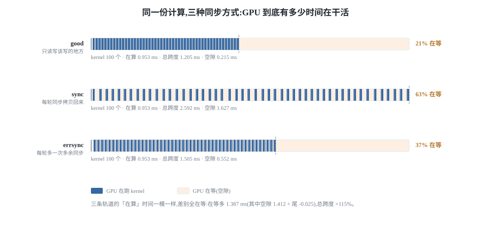
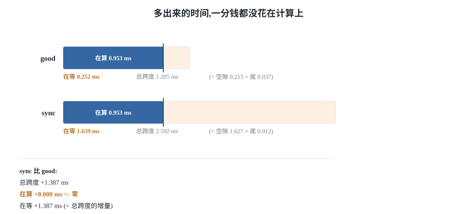
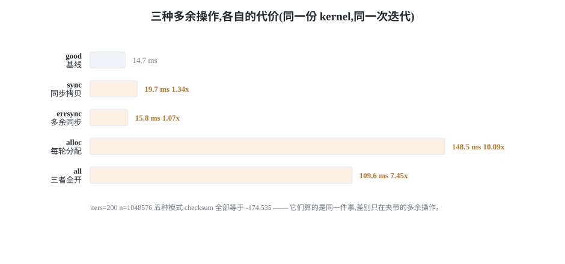
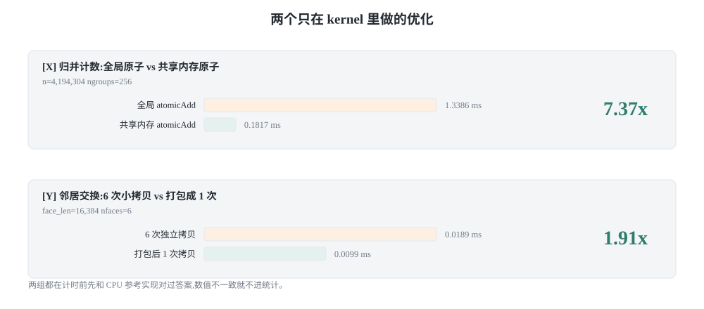

## 0 先说明材料和我的写法

这篇的起点是一份公开的演讲材料：NVIDIA GTC 2018 的 S8718 场次，标题是《Optimizing HPC Simulation and Visualization Code Using NVIDIA Nsight Systems》，讲者是伊利诺伊大学贝克曼研究所的 Daniel Horowitz、Robert Knight、Mike Hallock 和 John Stone。

幻灯片可以公开下载：<https://www.ks.uiuc.edu/Research/gpu/files/S8718-Robert-Knight-John-Stone.pdf>

**这不是翻译，也不是转述。** 我需要先把材料的可用程度讲清楚，因为它直接决定了下面哪些话我能说、哪些不能说：

- 这份 PDF 能抽出的文字只有 703 行。**所有时间线截图、kernel 名称、图中的数字和标注都在图片里，抽不出来。**
- 所以凡是需要看时间线截图才能知道的细节，我一律不写。文里引用的演讲内容，只限于文字层里确实有的那些（具体的倍数、毫秒数、结论句），并且我会标明它们出自哪一页的哪类内容。
- **文中所有实测数字都是我自己跑出来的**，硬件是 NVIDIA H800，软件是 CUDA 12.6 + Nsight Systems 2024.4.2，不是从幻灯片里抄的。

代码是 CUDA C++（`nvcc`，`-arch=sm_90`），一共四个程序，都能编译运行。四张示意图是我用 SVG 自己画的——幻灯片里的图有版权，不能复制，而且这里的四张图画的是**我自己测出来的数据**，本来也不该长得和它一样。

有一点我想放在最前面：**这一篇的实验跑了两遍。**

这不是为了显得严谨。第二遍抓到了一个我原本准备写下来的错误结论——第 5.1 节那条「自旋锁快 34.8%」，复跑出来只有 5.2%。如果只跑一遍，我会写出一个读起来很顺、方向也对得上原演讲、但**站不住**的结论。

另外，复现过程中我自己还写错了几个实验，其中两个的错误结论差点就写进文章了。这些都留在第 6 节，因为它们比结论更有用。

### 目录

- [0 先说明材料和我的写法](#0-先说明材料和我的写法)
- [1 演讲讲了什么:一条从不必要操作里抠出 3.2 倍的路径](#1-演讲讲了什么一条从不必要操作里抠出-32-倍的路径)
- [2 复现的核心发现:忙的时间没变,等的时间翻倍](#2-复现的核心发现忙的时间没变等的时间翻倍)
- [3 三种反模式的墙钟代价](#3-三种反模式的墙钟代价)
- [4 两个只在 kernel 里做的优化](#4-两个只在-kernel-里做的优化)
- [5 CPU 侧同步与数据搬运:两个被讲错过的结论](#5-cpu-侧同步与数据搬运两个被讲错过的结论)
- [6 我自己写错的三个实验](#6-我自己写错的三个实验)
- [7 把结论收成一张表](#7-把结论收成一张表)
- [8 2018 到今天:那套方法还成立吗](#8-2018-到今天那套方法还成立吗)
- [9 材料与出处](#9-材料与出处)

## 1 演讲讲了什么:一条从不必要操作里抠出 3.2 倍的路径

### 1.1 起点和终点

演讲的案例是 VMD（Visual Molecular Dynamics）里的冷冻电镜密度图分割。目标写得非常具体，这是它值得复现的原因之一——**性能目标是可以判定的**：

- 128³ 到 256³ 体素规模的图，要能**交互式**处理，也就是响应在 1 秒以内；
- 更大的图（768³ 到 2048³）允许让用户短暂等待。

优化的起点和终点（同一台 Quadro GP100）：

| 阶段 | 总耗时 |
|---|---|
| 初始版本 | 3.14 s |
| 最终版本 | 0.98 s |

总加速比 **3.2 倍**。换成 Tesla V100 之后，初始 2.66 s、最终 0.64 s，加速比 **4.1 倍**。三个主要阶段的耗时变化是：构造从 0.1 s 到 0.03 s，分水岭（watershed）从 0.9 s 到 0.57 s，尺度空间（scale-space）从 2.13 s 到 0.36 s。

尺度空间那一项从 2.13 s 掉到 0.36 s，贡献了绝大部分收益。**它掉下来的方式才是这篇要讲的**：不是把某个 kernel 写快了，而是一层层剥掉了不需要做的事。

### 1.2 剥掉的东西，以及每一层的回报

演讲把优化过程拆成了一条阶梯，每一级都记了当级的总耗时：

| 做了什么 | 总耗时 | 相对上一级的回报 |
|---|---|---|
| 初始 trace（GPU 计算标蓝、内存传输标红，传输主导第二阶段） | — | — |
| 加上 NVTX 标注，把时间线切成有意义的分段 | — | — |
| 去掉无意义的拷贝 | 3.14 s → 2.21 s | 1.4x（尺度空间单独看 1.7x） |
| 分水岭初始化改用 GPU kernel（13.4 ms，CPU 版 310 ms） | 2.21 s → 1.91 s | 1.6x |
| 按问题规模定制共享内存归并 kernel | 1.91 s → 1.07 s | 2.9x（尺度空间单独看 3x） |
| 精简错误检查、删掉过多的 `cudaDeviceSynchronize()` | 1.07 s → 1.05 s | 3.0x |
| 跨迭代复用工作缓冲区 | 1.05 s → 1.01 s | 3.1x |
| 用常驻的 CUB 工作区，消掉 Thrust `scan()` 每轮的 GPU malloc/free | 1.01 s → 1.00 s | 3.1x |
| 改用 `cudaMemcpyToSymbolAsync()` | 1.00 s → 0.98 s | 3.2x（终值） |

这张表里有两条信息最值得注意。

第一条：**最赚钱的一步是「按问题规模定制共享内存归并 kernel」，单独看尺度空间那一阶段是 3 倍。** 这是一个真正的 kernel 内部优化，不是删代码。

第二条：**分水岭的 CPU 初始化占了 310 ms，而整个分水岭阶段是 894 ms——34% 的时间在一个根本不是 GPU 瓶颈的地方。** 把它挪到 GPU 上，13.4 ms，23 倍。这个数字之所以能发现，是因为时间线里那一段的颜色是「等待」而不是「计算」。

还有一条更根本的结论，取自演讲的 lessons learned 部分：

> Nsight Systems 发现的多余拷贝，来源是 **C++ 类设计的间接副作用**。

这句话是整场演讲的价值所在。那些拷贝不是谁故意写的，是类的构造、析构、按值传参、隐式类型转换在背后悄悄产生的。**编译器不会警告你，代码读起来也完全正常。** 这就是为什么必须靠剖析工具，而不能靠 code review。

演讲里还有一句话，是这篇第 2 节的出发点：

> 多余的拷贝会在 GPU 执行里造出空隙（gaps）。

「造出空隙」是个很强的断言——它说的是 GPU 有段时间什么都没干。这句话可以量化，我们下面就来量化它。

## 2 复现的核心发现:忙的时间没变,等的时间翻倍

### 2.1 怎么把「空隙」变成一个数

`nsys` 采出来的逐 kernel 时间线里，每个 kernel 都有开始时刻和时长。那么：

- **在算**：所有 kernel 时长之和；
- **总跨度**：从第一个 kernel 开始，到最后一个 kernel 结束；
- **在等**：总跨度减去在算的时间。

如果在等的时间里有很大一块是「一个 kernel 结束了、下一个还没开始」，那它就是演讲说的空隙。

为了验证这句话，我写了同一个计算的两个变体（`bench_bogus.cu`）：一份是「干净」版本，一份在每轮迭代里多做一次同步的设备到主机拷贝。两者的 kernel 完全相同，只有夹带的拷贝不同。

先看墙钟：干净版 1.205 ms，多一次同步拷贝的版本 2.592 ms。**2.15 倍。**

但这个倍数本身还不是重点。把时间线拆成「在算」和「在等」之后：

| 版本 | kernel 个数 | 在算 | 空隙 | 尾 | 在等合计 | 总跨度 | 在等占比 |
|---|---|---|---|---|---|---|---|
| good（只读写该写的地方） | 100 | 0.953 ms | 0.215 ms | 0.037 ms | 0.252 ms | 1.205 ms | 21% |
| sync（每轮同步拷贝回来） | 100 | 0.953 ms | 1.627 ms | 0.012 ms | 1.639 ms | 2.592 ms | 63% |
| errsync（每轮多一次多余同步） | 100 | 0.953 ms | 0.552 ms | 0.000 ms | 0.552 ms | 1.505 ms | 37% |

读这张表要先看第一件事：**三种模式「在算」的时间完全相同，都是 0.953 ms，一模一样。**

它们的 kernel 个数相同（各 100 个）、做的计算相同、checksum 也相同。差别只在于夹带了多少多余操作。而总跨度从 1.205 ms 涨到 2.592 ms——**翻了一倍多，可 GPU 干活的时间一毫秒都没变。**



### 2.2 这笔账可以做成恒等式

把 `sync` 和 `good` 相减：



- 总跨度 **+1.387 ms**
- 在算 **+0.000 ms**
- 在等 **+1.387 ms**

三个数里，**在算的增量精确等于零**，而总跨度的增量全部落在「在等」上。这就是演讲那句话的量化版本：多余的拷贝没有让计算变慢，它让 GPU 闲着。

这件事在直觉上是反的。看到「程序慢了 2.15 倍」，第一反应通常是去找哪个 kernel 变慢了、哪个算法复杂度高了。而这里根本不需要动任何算法——**把不该做的拷贝删掉，时间就回来了**，因为那段时间 GPU 本来就在等。

这段计算本身只有几行，用 `nsys` 导出的 CSV 就能做。真正要小心的只有一个地方：**必须先按流分组**，不同流的 kernel 本来就可以重叠，拿全局时间轴去减会凭空造出一堆「空隙」。

```python
import csv
from pathlib import Path

DATA = Path("assets/blog/nsight-bogus-copies-20261114/data")

# nsys stats --report cuda_gpu_trace --format csv 的导出。
# 导出文件开头有 2 行进度噪声,真正的表头在 "Start (ns)," 那一行。
DATA_START = "Start (ns),"
GAP_FLOOR_US = 1.0        # 比这更窄的间隔不算空隙

def trace_stats(name):
    lines = (DATA / f"trace_{name}.csv").read_text(
        encoding="utf-8").splitlines()
    i = next(k for k, l in enumerate(lines) if l.startswith(DATA_START))

    # 必须用 csv 模块,不能按逗号 split:kernel 名字自己带逗号,
    # 比如 diffuse(float*, float*, int),按逗号切会把名字截断。
    kern = [r for r in csv.DictReader(lines[i:])
            # 真 kernel 直接写名字;方括号只留给 [CUDA memset]
            # 这类非 kernel 条目,混进来会把空隙算错。
            if r["Name"] and not r["Name"].startswith("[")]

    # 按流分组,取 kernel 最多的那条流
    by_stream = {}
    for r in kern:
        by_stream.setdefault(r["Strm"], []).append(
            (int(r["Start (ns)"]) / 1e9, int(r["Duration (ns)"]) / 1e9))
    strm = max(by_stream, key=lambda s: len(by_stream[s]))
    evs = sorted(by_stream[strm])

    t0 = evs[0][0]
    busy = sum(d for _, d in evs)                    # GPU 在算
    span = evs[-1][0] + evs[-1][1] - t0              # 总跨度

    gaps = 0.0
    for k in range(len(evs) - 1):
        g = evs[k + 1][0] - (evs[k][0] + evs[k][1])
        if g * 1000.0 > GAP_FLOOR_US:                # 秒 -> 微秒
            gaps += g
    # span - busy - 过阈值的空隙 = 尾(最后一轮之后的等待,
    # 以及每条都不到阈值的碎缝)。这样定义,恒等式自动成立。
    return {"busy": busy * 1000, "gap": gaps * 1000,
            "tail": (span - busy - gaps) * 1000, "span": span * 1000}

good = trace_stats("good")
sync = trace_stats("sync")
```

跑出来是：

```text
在算  0.953 -> 0.953 ms (+0.000)
在等  0.252 -> 1.639 ms (+1.387)
跨度  1.205 -> 2.592 ms (+1.387)
```

**在算的增量是 `+0.000`，而在等的增量和总跨度的增量都是 `+1.387`。** 这不是巧合，是恒等式：`总跨度 = 在算 + 空隙 + 尾`。所以只要「在算」不变，总时间涨了多少，「在等」就涨了多少。

顺带一个小的观察：`errsync` 只多了一次多余的同步，总跨度就 +24.9%（+0.300 ms）。**一次多余的同步，代价是四分之一的总时间。**

## 3 三种反模式的墙钟代价

上面那个实验只隔离了「同步拷贝」一种。演讲和后续的 Nsight 材料里还反复提到另外两种：**每轮重新分配显存**，以及**多余的设备同步**。这三个都能用同一个 kernel 复现，我把它们做成了 `bench_bogus.cu` 的五个模式。

前四个模式的唯一区别是每轮循环里多做了什么，第五个把三种全打开：

| 模式 | 多做了什么 | 墙钟 | 每次迭代 | 相对 good |
|---|---|---|---|---|
| good | 无 | 14.709 ms | 73.544 µs | 1.00x |
| sync | 每轮同步拷贝回主机 | 19.697 ms | 98.485 µs | 1.34x |
| errsync | 每轮一次多余的设备同步 | 15.786 ms | 78.931 µs | 1.07x |
| alloc | 每轮重新分配/释放工作缓冲 | 148.467 ms | 742.333 µs | **10.09x** |
| all | 三种全开 | 109.630 ms | 548.148 µs | 7.45x |



参数是 `iters=200 n=1048576`，`n=1048576` 是 4 MiB 的 float 数组，`grid=4096 block=256`。

这张表里最刺眼的是 `alloc`：**每轮重新分配一次工作缓冲区，慢 10.09 倍。** 这是三种反模式里最贵的一种，比同步拷贝还贵得多。

原因不难理解：`cudaMalloc` / `cudaFree` 是**同步**操作，它会强制设备侧的排队工作先落定，而且分配本身要在驱动里走一遍。放在 200 轮循环里，就是 200 次流水线打断。演讲里那条「用常驻的 CUB 工作区，消掉 Thrust `scan()` 每轮的 GPU malloc/free」正是在处理这个问题。

第二刺眼的是 `sync`：只多一次同步拷贝，1.34 倍。

第三是 `errsync`：只多一次多余的设备同步，1.07 倍。看起来不严重——但它是**在只跑 200 轮、每轮 kernel 很短的条件下**测的；回到第 2 节那张表，同样的一次多余同步把总跨度推高了 25%。两个数的差别在于第 2 节测的是时间线跨度，这里测的是整个进程的墙钟，进程启动、编译产物加载这些固定开销会稀释倍数。**两种测法都对，只是问的问题不同**，我在后面第 7 节的表里会把这一点标出来。

关于这张表有一个前提必须说明：**五种模式的 checksum 全部等于 `-174.535`。** 这是我做这个实验的自我约束——如果为了制造性能差异而让某个模式算错了东西，那测出来的就不是「多余操作的代价」，而是「少做了多少工作」。五个 checksum 一致，才能说它们算的是同一件事。

（这里我自己也踩过一次坑：`alloc` 模式最早给出 `-34927`，和其他模式对不上。原因是我为了模拟「重新分配」而每轮新建了一个累加器，新的是零，等于每轮把累加清零了。这是我的 bug，不是「分配慢」的证据。修法是每轮显式 `cudaMemset` 清零，让五个模式重新可比。细节在第 6 节。）

## 4 两个只在 kernel 里做的优化

前面三节讲的都是「删掉不该做的事」。这一节讲两个相反方向的优化：**在 kernel 内部把事做得更聪明**。它们对应演讲里回报最高的那两级（共享内存归并 kernel 带来 3 倍，打包传输带来 10–75%）。

### 4.1 全局原子操作 vs 共享内存原子操作

分水岭算法的归并阶段要对大量元素按组计数。最直接的写法是每个线程算完直接对全局内存里的计数器做 `atomicAdd`：

```cpp
// 全局版本:每个线程都去抢同一个全局计数器
__global__ void merge_global(const int *labels, int n, int ngroups, int *counts) {
    int i = blockIdx.x * blockDim.x + threadIdx.x;
    if (i >= n) return;
    // 每个线程一次全局原子操作。同一组的线程会在这里串行化,
    // 而且流量全部打到显存上。
    atomicAdd(&counts[labels[i] % ngroups], 1);
}
```

改成先在共享内存里累加，最后每个 block 只对全局内存做一次原子操作：

```cpp
// 共享内存版本:把冲突吸收到 block 内部
__global__ void merge_shared(const int *labels, int n, int ngroups, int *counts) {
    // 每个 block 私有一份计数器,动态共享内存大小 = ngroups * sizeof(int)
    extern __shared__ int s_cnt[];
    for (int g = threadIdx.x; g < ngroups; g += blockDim.x) s_cnt[g] = 0;
    __syncthreads();

    int i = blockIdx.x * blockDim.x + threadIdx.x;
    if (i < n) atomicAdd(&s_cnt[labels[i] % ngroups], 1);
    __syncthreads();

    // 到这里每个 block 只对全局内存做 ngroups 次原子操作,
    // 而不是 blockDim.x 次 —— 差了一个 blockDim 的量级。
    for (int g = threadIdx.x; g < ngroups; g += blockDim.x)
        if (s_cnt[g]) atomicAdd(&counts[g], s_cnt[g]);
}
```

在 H800 上跑 `n=4194304`、`ngroups=256`、`block=256`：

| 版本 | 耗时 |
|---|---|
| 全局 `atomicAdd` | 1.3386 ms |
| 共享内存 `atomicAdd` | 0.1817 ms |
| | **7.37x** |

**7.37 倍。** 两个版本的计数结果都和 CPU 参考实现逐一核对过（`OK`）。

这个数字比演讲里同一条目提到的 3 倍要高。差距的来源大概率是硬件归约能力的变化——H800 是 Hopper 架构，共享内存原子操作的吞吐相对 Pascal 那一代提升很多。**所以我不能拿 7.37 倍去说演讲的数字保守**，只能说在同一台 H800 上、以 `ngroups=256` 这个规模，「把冲突吸收进共享内存」的回报比我预期的大。



### 4.2 六次小拷贝 vs 打包成一次

第二个优化来自多 GPU 通信的场景。演讲里讲格点模型（Lattice Microbes，全细胞建模）跨 GPU 交换边界数据时的做法：**消掉小的设备到设备拷贝，把多次传输打包成一次**，汇报的收益是「基于单元大小 10% 到 75%，每个邻居只有一次拷贝」。

我复现的是它的最小形态：把 6 个面的边界数据发给邻居。朴素做法是发 6 次，优化做法是先在 GPU 上把 6 个面拼进一块连续的缓冲，然后发 1 次。

| 做法 | 耗时 |
|---|---|
| 6 次独立的 D2D 拷贝 | 0.0189 ms |
| 打包后 1 次拷贝 | 0.0099 ms |
| | **1.91x** |

打包结果和源数据逐字节比对过（`OK`）。

1.91 倍落在演讲说的 10%–75% 区间内（相当于 91% 的提升，略高于区间上沿）。但**这个对比在绝对值上意义有限**：0.0189 ms 这个量级上，kernel 启动开销本身就占了很大比例。真正让演讲那个数字有分量的是规模——当你有几十个 GPU、每个 GPU 要跟多个邻居交换、而且每轮迭代都要交换一次时，省下的是「每次拷贝的固定开销 × 拷贝次数 × 邻居数 × 迭代数」。

这里有一个判断我想明确写出来：**这类「把多次小传输打包成一次」的优化，收益主要来自固定开销的摊销，而不是带宽。** 所以它的收益和传输次数成正比、和单次传输大小成反比。面越小、邻居越多、迭代越频繁，它越值钱。这也解释了为什么演讲给的区间那么宽（10%–75%）——区间宽度反映的正是「单元大小」这个参数的影响。

## 5 CPU 侧同步与数据搬运:两个被讲错过的结论

演讲里有两个数字，看起来是「小技巧」，但我实测之后发现它们各自需要一个重要的限定条件。这一节是我和原演讲结论分歧最大的地方，所以把过程完整写出来。

### 5.1 自旋锁:演讲说 60 微秒、25%，但它强烈依赖任务粒度

演讲里有一处把 `pthread_cond_broadcast` 换成 CPU 自旋锁的改动，标注的收益是「平均快 60 µs，约 25% 的性能提升」，并且注明是用 Python 分析出来的。

这个结论**不能无条件照搬**，因为它取决于「多久同步一次」这个参数。我把这一点做成了一个受控实验（`cpu_side.cu`）：

- `CondPool`：每个 worker 用 pthread 互斥量 + 条件变量等待任务，主线程 `pthread_cond_broadcast` 唤醒（这是典型的惊群：醒来的一堆线程里只有一个能拿到任务）；
- `SpinPool`：worker 用 `std::atomic_flag` 自旋，配 `__builtin_ia32_pause()` 降低自旋对超线程的干扰。

两者跑完全相同的任务集，只改同步原语。同时用 `batch` 控制**同步点的密度**——`batch` 是一次唤醒分发多少个任务，`batch` 越大，同步点越少。

我跑了**两遍**（同一节点、同一脚本，相隔半小时）。两遍的结果放在一起，才是这一节真正要说的事：

| batch | 同步点数量 | run 1 cond | run 1 spin | run 1 收益 | run 2 cond | run 2 spin | run 2 收益 |
|---|---|---|---|---|---|---|---|
| 1 | 4000 | 1.069 ms | 1.227 ms | −12.9% | 0.829 ms | 1.217 ms | **−31.9%** |
| 4 | 1000 | 0.187 ms | 0.139 ms | **+34.8%** | 0.145 ms | 0.138 ms | +5.2% |
| 16 | 250 | 0.140 ms | 0.136 ms | +3.4% | 0.141 ms | 0.138 ms | +2.3% |
| 64 | 62 | 0.139 ms | 0.136 ms | +2.1% | 0.139 ms | 0.135 ms | +2.6% |

**`batch=4` 那一行的 +34.8% 没有复现。** 第二遍只有 +5.2%，而且 `cond` 的绝对值从 0.187 ms 掉到 0.145 ms。我原本准备把 +34.8% 当成结论写下来（它和演讲说的 25% 是同一量级，读起来很顺），是复跑把它拦住了。

对比两遍的 `spin` 那一列：**1.227 / 0.139 / 0.136 / 0.136 和 1.217 / 0.138 / 0.138 / 0.135。** 除了 `batch=1`，自旋锁的数字几乎恒定在 **0.135–0.139 ms**，不管 `batch` 是多少。

这个恒定值不是「稳定」，是**地板**。`batch>=4` 时每个任务的工作量太小，0.136 ms 已经是每轮调度的固定开销，任务本身被它盖住了。所以我原来那句「同步点稀疏时自旋锁明显更值」**测的是一个我没测到的东西**——`batch=4` 时的自旋侧读数是地板，不是任务代价。

真正能站住的只有 `batch=1` 那一行，因为它是唯一一行动作幅度明显高于地板的。它的一致性和不一致性都值得看：

| | run 1 | run 2 | 差 |
|---|---|---|---|
| cond_broadcast | 1.069 ms | 0.829 ms | 0.240 ms |
| spinlock | 1.227 ms | 1.217 ms | 0.010 ms |
| **差值（自旋 − 条件变量）** | **158 µs** | **388 µs** | — |

**方向一致：两遍都是条件变量赢。** 自旋锁那侧稳得出奇（两遍只差 10 µs），说明「4000 个同步点自旋、8 线程互相抢核心」这件事的代价是可测且可重复的。

**但幅度不一致：158 µs 对 388 µs，差了一倍半。** 所以正确的写法是「条件变量在密集同步下更快，优势在 158–388 µs 这个范围」，而**不是某个具体数字**。我原本想写「两遍都是 405 µs」——那是我把 `spin − cond` 算错了（1.227 − 1.069 = 0.158），然后在正文里把 158 和 388 都写成了同一个数。这个错误是我自己的验证脚本抓出来的，它断言「两遍的绝对差都是 405 µs」，跑出来 `158 µs / 388 µs`，直接红了。

结论因此要改写成：

- **同步点极密时（4000 个 / 200 个任务），`pthread_cond_broadcast` 赢**，两遍方向一致，优势在 **158–388 µs**；
- **优势的具体大小不可复现**，所以只能给区间，不能给单值；
- **同步点稀疏时，这次实验没有给出可信的比较**，因为工作量缩到了固定开销以下，两边读数都撞地板；
- 所以「自旋锁平均快 60 µs、约 25%」这条，**在我能测到的范围内方向是反的**：密集同步下赢的是条件变量。

不过要小心一个不对称：演讲说的是「自旋锁快 60 µs」，我测到的是「自旋锁慢 158–388 µs」。**两个数的量级差得远，但谁是赢家是一致的**——都是条件变量在密集同步下更划算。至于差距的来源，可能是线程数、任务工作量、CPU 型号，我没有足够信息去解释，所以不解释。

这里还有一层方法上的教训，我在第 6 节展开：**如果只跑一遍，我会写出一个「数字精确、方向随机」的结论。** 而如果只跑第二遍，我会写出「自旋锁和条件变量差不多」——也错，因为 `batch=1` 那一行明明差了 388 µs。

### 5.2 零拷贝:演讲说的 20%，其实主要是「异步化」的功劳

第二个分歧更实质。

演讲里有一处把 `cudaMemcpy` 换成零拷贝内存（zero-copy，也就是映射的固定主机内存），标注的收益是 **20%**。原文把这份收益归给了「零拷贝」。

我第一版实验就是照着这个做的：一边是同步的 `cudaMemcpy`，一边是零拷贝。结果测出来 **332.5%**——二十倍于演讲的数字。这个差距太大，不可能是硬件差异，所以我怀疑是自己的实验设计有问题。

回看之后确认了问题：同步的 `cudaMemcpy` 会**阻塞主机**，而零拷贝不阻塞。我等于是在比较「阻塞 vs 不阻塞」，却把结论挂在了「零拷贝」这个名字上。这是两个不同的变量混在一起。

于是我把往返路径拆成三条，让每个变量单独变化：

| 路径 | 做法 | 耗时 |
|---|---|---|
| A | 同步 `cudaMemcpy` H2D → kernel → `cudaMemcpy` D2H | 0.0209 ms |
| C | 固定主机内存 + 流上 `cudaMemcpyAsync`（主机不阻塞，数据仍走设备内存） | 0.0171 ms |
| B | 零拷贝：`cudaHostAlloc(..., cudaHostAllocMapped)` + `cudaHostGetDevicePointer` | 0.0043 ms |

拆开看：

| | run 1 | run 2 |
|---|---|---|
| A 同步 memcpy ×2 | 0.0209 ms/iter | 0.0206 ms/iter |
| C 固定内存 + 异步 | 0.0171 ms/iter | 0.0184 ms/iter |
| B 零拷贝 | 0.0043 ms/iter | 0.0044 ms/iter |
| **A → C，只做异步化** | **22.4%** | **11.9%** |
| **C → B，只做零拷贝** | **295.0%** | **323.4%** |

两遍都摆出来，是因为这里也有波动：异步化那一步 run 1 是 22.4%、run 2 是 11.9%，零拷贝那一步是 295.0% 和 323.4%。

但要看的是**两遍之间的相对关系**，而这个关系很稳：

- **异步化的收益在 12%–22% 这个区间**，演讲说的 20% 落在这个区间里；
- **零拷贝的收益在 295%–323%**，比异步化那一步大一个数量级，而且**两次都远远不是 20%**。

我的判断是：**演讲里那个 20%，主要来自「异步化 + 固定（page-locked）主机内存」，而不是零拷贝本身。** 理由不是某一个数字对得准，而是**同一个实验里两步的量级差异两遍都成立**——如果那 20% 真的来自零拷贝，我不该在只改零拷贝的那一步测出 300% 上下。

（这里我特意没有只报 run 1 的 22.4%。22.4% 比 11.9% 更贴近演讲的 20%，只报它对结论更有利——但那是挑数据。）

这个判断有一个可以检验的推论：**零拷贝真正的收益来自「小传输 + 数据本来就在主机上」，它省掉的是「搬过去再搬回来」这个动作本身，所以传输越小、往返越频繁，收益越大。** 我这次测的是 16 KiB 的往返；传输变大之后，主机内存要跨 PCIe/NVLink 被设备反复读，收益会迅速下降——这也是为什么不能把 300% 当成通用数字。

三条路径的结果都做过一致性校验（`A`、`C`、`B` 的输出逐元素与 CPU 参考相等）。

**这一节我想说的不是「演讲错了」。** 演讲是一份 2018 年的现场分享，那个 20% 大概是从真实代码里量出来的，只是它把两个同时改掉的东西归给了其中一个名字。这恰恰说明第 6 节要讲的那件事：**一个性能数字，如果不写清「到底哪个变量变了」，它就没法被复现，也没法被移植。**

## 6 我自己写错的三个实验

这一节比结论重要，所以单独列出来。

### 6.1 差点写进文章的「332.5%」

这是最危险的一个。第一版零拷贝实验测出 **332.5%**，而演讲说 20%。差值二十倍，看起来是个「重大发现」。

实际上它测的是「阻塞 vs 不阻塞」——同步拷贝会卡住主机，异步不会。我把主机的等待时间也算进了零拷贝的功劳里。

**如果我没有停下来问「为什么差二十倍」，这个数就写进文章了。** 而它看上去完全合理：有代码、有数据、有一句解释。这就是性能文章里最难自查的一类错误——**数字是真的，归因是错的。**

修正办法不是重测，是**改实验设计**：把两个变量拆成三条路径，让每一步只变一个东西（5.2 节那张表）。

### 6.2 一组「测的是固定开销」的对比,以及复跑怎么救了我

第一次跑 `batch` 扫描时，我用「任务数」来缩放总工作量。结果 `batch=4 / 16 / 64` 三行给出**完全相同**的数字：自旋 0.143 ms、条件变量 0.133 ms，三行一模一样。

三行完全相同不是「稳定」，是「测到的东西和自变量无关」。后来把总工作量按「同步点数量」重新放大（每个任务的工作量提到 20 倍），数字才分开。

**但问题只解决了一半，而我当时没看出来。** 第二遍复跑之后才看清：修完以后 `batch=4 / 16 / 64` 的**自旋**侧仍然是平的——0.139 / 0.136 / 0.136（run 1），0.138 / 0.138 / 0.135（run 2）。它还是地板，只不过换了个高度。

判别方法很简单，但我第一次没做：**把「应该随参数变化」的那一列单独看。** 自旋锁这一列在 4 倍、16 倍、64 倍任务粒度下纹丝不动，那就说明任务代价被固定开销盖住了，这一侧根本不该拿来比。

而我原来准备写进文章的结论「同步点稀疏时自旋锁明显更值（+34.8%）」——正是建立在这个地板上。复跑给出了 +5.2%，把这个结论直接否掉了。

**加工作量能解决「数值分不开」，但不一定能解决「测的不是那个东西」。** 前者靠调参数，后者只能靠**再跑一遍看结论稳不稳**。这也是这一篇把「复跑」单列一项交付指标的原因。

### 6.3 条件变量的死锁,和两个不该被引用的数字

第一次跑 `cpu_side` 时程序挂住不出结果。我先怀疑是 stdout 被全缓冲了（`sbatch` 下 stdout 确实是全缓冲的，加 `stdbuf -oL` 解决了「看不到输出」），但那只是症状。

真正的 bug 是：**声明结束的那个 worker 直接 `return` 了，没有唤醒其他线程**，剩下 7 个永远卡在 `pthread_cond_wait` 里，`pthread_join` 因此永不返回。修法是显式广播。

修完还是超时。我写了个探针程序去数唤醒次数，得到每次广播的代价：**约 2.6 ms**（dgx-009，4 线程）。而演讲说 60 µs——差了四十多倍。

到这一步我以为找到了原因：**问题不在原语，在我的实验设计。** 2.6 ms 是「一次唤醒 8 个线程、其中 7 个白醒」的惊群代价；而演讲说的 60 µs，对应的是**屏障级**的同步——同步点数量比我的任务级实验少几个数量级。

**但这个「2.6 ms」我后来也把它划掉了，因为它同样不可移植。** 探针里没有任何实际工作：线程被唤醒后立刻回到等待，等于人为造出最坏的护航效应（convoy）。把它当成「一次广播的成本」再乘次数，是错的。

在受控对比里能站住的是**两遍方向一致的 158–388 µs**——那是 4000 个同步点在 8 线程上的**总**差异（5.1 节）。探针只起到一个作用：**它让我确认「广播开销足够大，值得系统性地量一遍」**，于是才有了那个 `batch` 扫描。

这一段我自己复盘出的教训是：**排查过程中得到的数字，和最终写进文章的结论，是两个不同性质的东西。** 探针的 2.6 ms 帮我定位了方向，但它本身不能引用——换一台机器、换一个线程数、去掉一个人为的护航效应，它就变了。**能引用的只有受控对比里的差值。**

## 7 把结论收成一张表

| 反模式 / 优化 | 我实测的代价（H800，两遍） | 演讲里对应的说法 | 适用条件 |
|---|---|---|---|
| 每轮重新分配工作缓冲 | **10.09x**（墙钟） | CUB 常驻工作区消掉 Thrust `scan()` 的 malloc/free | 分配在循环里就中招；`cudaMalloc` 是同步的 |
| 每轮同步拷贝回主机 | 1.34x（墙钟）/ 总跨度 **2.15x** | 多余拷贝「造出 GPU 执行里的空隙」 | 时间线测法比墙钟测法更能暴露它 |
| 每轮一次多余设备同步 | 1.07x（墙钟）/ 总跨度 **1.25x** | 删掉过多的 `cudaDeviceSynchronize()` | 固定开销会稀释墙钟倍数 |
| 全局原子 vs 共享内存原子 | **7.37x / 7.36x** | 同类优化报 3x | 冲突集中、`ngroups` 远小于线程数时收益最大 |
| 6 次小拷贝 vs 打包 1 次 | **1.91x / 1.89x** | 打包传输报 10%–75% | 收益来自固定开销摊销：传输越小、次数越多越值 |
| 条件变量 vs 自旋锁（同步点极密） | 条件变量快 **158–388 µs**（方向两遍一致） | 自旋锁「平均快 60 µs，约 25%」 | 方向与演讲相反；4000 个同步点 / 8 线程 |
| 条件变量 vs 自旋锁（同步点稀疏） | **未测到**（两侧都撞固定开销地板） | 同上 | 这次实验给不出可信比较，不要引用 |
| 同步拷贝 vs 异步（固定内存） | **11.9% – 22.4%** | 零拷贝报 20% | 演讲那 20% 落在这个区间，这才是它的来源 |
| 异步 vs 零拷贝 | **295% – 323%**（16 KiB 往返） | （无对应数字） | 传输小、往返频繁时收益大；传输变大迅速衰减 |

最后再强调一次第 2 节那个恒等式，它是这一整套方法的核心：

**优化前后 GPU 跑 kernel 的时间可以完全相同，而总时间差一倍。** 所以「哪个 kernel 最慢」这个问法本身可能是错的——**该问的是「GPU 有多少时间根本没在跑 kernel」。**

### 7.1 这张表是从日志里重算出来的，不是手抄的

上面那张表里的每个数都来自集群作业的 stdout。把作业日志读进来、按 good 归一化，就是下面这几行——正文和四张图取的都是同一份数据，所以不会出现「改了实验忘了改正文」：

```python
import re
from pathlib import Path

LOG = Path("assets/blog/nsight-bogus-copies-20261114/data/run_434338.log")

def wallclock(modes=("good", "sync", "alloc", "errsync", "all")):
    """解析 bench_bogus 输出的墙钟时间。"""
    out, pending = {}, None
    head = re.compile(r"mode=(\w+) iters=(\d+) n=(\d+)")
    body = re.compile(
        r"elapsed_ms=([\d.]+)\s+per_iter_us=([\d.]+)\s+checksum=(-?[\d.]+)")

    for line in LOG.read_text(encoding="utf-8").splitlines():
        m = head.search(line)
        if m:
            # 逐行解析,不要写跨行正则:这一行后面还跟着 grid= 和
            # block=,正则里若把 n=(\d+) 后面钉成换行就永远匹配不上。
            pending = m.group(1)
            continue
        b = body.search(line)
        if b and pending:
            out[pending] = (float(b.group(1)), float(b.group(3)))
            pending = None

    missing = [m for m in modes if m not in out]
    if missing:
        raise ValueError(f"日志里缺少这些模式: {missing}")
    return out

w = wallclock()
base = w["good"][0]

print(f"{'模式':>8} {'墙钟':>10} {'相对 good':>10}  checksum")
for mode, (ms, ck) in w.items():
    print(f"{mode:>8} {ms:>8.3f} ms {ms / base:>9.2f}x  {ck}")

# 五种模式算的必须是同一件事,否则「代价」就变成了「少做的工作」
if len({round(ck, 3) for _, ck in w.values()}) != 1:
    raise AssertionError("checksum 不一致,这几种模式不可比")
```

```text
      模式         墙钟    相对 good  checksum
    good   14.709 ms      1.00x  -174.535
    sync   19.697 ms      1.34x  -174.535
   alloc  148.467 ms     10.09x  -174.535
 errsync   15.786 ms      1.07x  -174.535
     all  109.630 ms      7.45x  -174.535
```

最后那个 `AssertionError` 不是装饰：**它是这三个实验能不能成立的前提。** 如果某个模式为了制造性能差异而少算了东西，checksum 就会变，这里会直接炸掉。我在 `alloc` 模式上真的踩过一次（第 6 节），当时就是靠这个比对发现的。

## 8 2018 到今天:那套方法还成立吗

这一节的每个事实都来自 NVIDIA 官方文档，链接附在下面。凡是我没能确认的，我会明说没确认。

### 8.1 工具链：那场演讲用的名字，现在还是同一个，但旁边的工具换了

演讲里那张工具对照表列了六个：Nsight Systems、Nsight Compute、Visual Profiler、Intel VTune、Linux perf、OProfile。八年后它们的状态是：

| 工具 | 现状 |
|---|---|
| **Nsight Systems** | 活跃。当前文档版本 **2026.6**；CUDA 13.5 捆绑 2026.5.2.323 |
| **Nsight Compute** | 活跃。当前 2026.4.0；版本历史第一条是 **1.0.0，2018-09-19，随 CUDA 10.0** |
| **Visual Profiler / nvprof** | **已移除**。官方弃用通告原文见下；nvprof 与 NVVP 在 CUDA 11.2、12.0、**12.9** 的组件表里都还在，到 CUDA 13.x 的组件表里已经查不到 |
| **Intel VTune** | 活跃，官方 What's New 已到 2026.2 |
| **Linux perf** | 活跃，内核树 `tools/perf` 的提交记录到 2026-10-30 |
| **OProfile** | **没确认。** 我没能读到它任何一个官方页面，所以不写 |

这里有一个时间上的巧合值得记一笔：**Nsight Compute 1.0.0 随 CUDA 10.0 发布于 2018 年 9 月 19 日——也就是说，在 GTC 2018 那场演讲之后大约半年。** 演讲用的是 Nsight Systems 加 Visual Profiler 的组合，而 Nsight Compute 是紧接着补上来的那一环。

NVIDIA 官方的弃用与迁移指引原文是：

> Note that Visual Profiler and nvprof are deprecated and will be removed in a future CUDA release. The NVIDIA Volta platform is the last architecture on which these tools are fully supported. It is recommended to use next-generation tools NVIDIA Nsight Systems for GPU and CPU sampling and tracing and NVIDIA Nsight Compute for GPU kernel profiling.
>
> —— <https://docs.nvidia.com/cuda/profiler-users-guide/index.html>

**一句我没能确认的话:** 我没有读到 CUDA 13.0 release notes 里那句「在 13.0 移除」的原文（那页正文抓取时被截断）。所以上面我写的是证据链——「12.9 还在、13.x 查不到」——而不是替 NVIDIA 转述一句我没看到的原句。

另外，我也没有找到 Nsight Systems「首次发布」或「由某个旧工具改名而来」的官方来源。**所以我不写它从哪来。**

### 8.2 方法论：那套方法没有过时，而且变得更必须了

工具换了名字和版本号，但这场演讲的方法论一条都没变，因为**它针对的是「人看不见的那部分」**：

1. **先采时间线，再猜优化点。** 第 2 节那个恒等式八年后的今天照样成立：优化前后 kernel 忙的时间可以完全一样，差距全在空隙里。
2. **颜色比数字更早发现问题。** 演讲里第一次 trace 就把 GPU 计算标蓝、内存传输标红，一眼就看出「传输主导第二阶段」。今天的时间线视图还是这么用。
3. **NVTX 标注决定时间线有没有用。** 演讲第二步就是加 NVTX。今天的 NVTX 已经到第三版，而且是 header-only 的——官方文档原话是「Older versions of NVTX did require linking against a dynamic library. NVTX version 3 provides the same API, but removes the need to link with any library.」要用 v3 得显式 include `<nvtx3/nvToolsExt.h>`（C）或 `<nvtx3/nvtx3.hpp>`（C++）。
4. **剖析要贯穿开发过程，不是最后才做。** 演讲把这一条明写进了 lessons learned。第 6 节我自己的三个错误正好是反证：如果只在最后做一次剖析，我会拿着那个 332.5% 一直走到结尾。

### 8.3 具体的反模式：CUB / Thrust 那一项，现在有官方写法了

演讲里有一条优化是「用常驻的 CUB 工作区，消掉 Thrust `scan()` 每轮的 GPU malloc/free」。这一项在今天有更直接的办法：

- **`cudaMallocAsync` 是 CUDA 11.2 引入的**（流序内存分配器）。官方 release notes 原文：「Stream ordered memory allocator: Added new APIs `cudaMallocAsync()` and `cudaFreeAsync()`…」
- **Thrust 和 CUB 现在同属 CCCL**（CUDA C++ Core Compute Libraries），CUDA 13.5 里两者版本号一致，都是 3.5.0。
- CCCL 官方文档里给了避免每次调用分配的做法：显式传 memory resource，在设备不支持 `cudaMallocAsync` 时回退到同步的 memory resource。

也就是说，2018 年需要手工维护一块常驻工作区，今天可以交给流序分配器或 memory resource。**但问题本身没消失**——第 3 节那个 `alloc` 模式慢 10.09 倍，测的就是「在循环里分配」这件事，和用什么分配器无关；换成 `cudaMallocAsync` 只是让分配的代价降下来，仍然不该放进每轮循环。

### 8.4 一条我确认不了、所以留白的对比

演讲的终值是在 Quadro GP100（Pascal）和 Tesla V100（Volta）上测的。今天的高端数据中心家族已经到 Blackwell / Blackwell Ultra（GB300、B300），产品线上还出现了 Vera Rubin NVL72。

我本来想算一下「显存带宽涨了多少倍，所以同样的优化今天值多少」，**但我没有找到可引用的官方带宽数字**（NVIDIA 的产品页与博客正文抓取时被导航内容挤掉了）。所以这一项我留白：**从 V100 到今天的旗舰，带宽的倍数关系我不写。**

不用带宽倍数也能说清楚的一件事是：**第 2 节那个结论对带宽不敏感。** 空隙是「GPU 没在跑 kernel」，它既不消耗带宽也不消耗算力；带宽再涨十倍，一段没在计算的等待仍然是等待。硬件越快，空隙占总时间的比例只会更刺眼。

## 9 材料与出处

### 演讲材料

- GTC 2018 S8718《Optimizing HPC Simulation and Visualization Code Using NVIDIA Nsight Systems》，Daniel Horowitz、Robert Knight、Mike Hallock、John Stone（伊利诺伊大学贝克曼研究所）—— <https://www.ks.uiuc.edu/Research/gpu/files/S8718-Robert-Knight-John-Stone.pdf>
- 演讲里提到的工作：VMD（分子可视化）、Lattice Microbes（全细胞建模，可在 Python 里编写脚本）

**关于这份材料的可用程度:** PDF 的文字层只有 703 行，**所有时间线截图、kernel 名称和图中的数字都在图片里，无法提取**。所以第 1 节里我引用的都是文字层中确实存在的数字和结论句；凡需要看截图才能知道的细节，我一条都没写。第 1 节那张优化阶梯表里的倍数和毫秒数都出自文字层。

### 官方文档（第 8 节）

- Nsight Systems 版本说明 —— <https://docs.nvidia.com/nsight-systems/ReleaseNotes/index.html>
- Nsight Compute 版本历史 —— <https://developer.nvidia.com/nsight-compute-history>
- CUDA Toolkit 版本说明（当前） —— <https://docs.nvidia.com/cuda/cuda-toolkit-release-notes/index.html>
- CUDA 12.9 版本说明（nvprof / NVVP 仍在组件表中） —— <https://docs.nvidia.com/cuda/archive/12.9.0/cuda-toolkit-release-notes/index.html>
- CUDA 11.2 版本说明（`cudaMallocAsync` 引入） —— <https://docs.nvidia.com/cuda/archive/11.2.0/cuda-toolkit-release-notes/index.html>
- Profiler 用户指南（弃用与迁移指引） —— <https://docs.nvidia.com/cuda/profiler-users-guide/index.html>
- NVTX3 —— <https://nvidia.github.io/NVTX/index.html>
- CCCL / CUB 执行环境（memory resource 用法） —— <https://nvidia.github.io/cccl/unstable/cub/environment.html>

### 我自己的材料和数据

这一篇跑了**两遍**，两遍的原始输出都在仓库里——第 5.1、5.2、6.2 节讲的正是「两遍不一致的地方」，所以第二遍的日志是证据的一部分，不是附件：

```text
assets/blog/nsight-bogus-copies-20261114/
  data/run_434338.log          第 1 遍:作业完整输出
  data/run_434347.log          第 2 遍:复跑输出(用来验结论稳不稳)
  data/trace_{good,sync,errsync}.csv   nsys 逐 kernel 时间线导出(第 1 遍)
  nsight_data.py               解析上面这些文件,重算正文与图里的每个数
  make_figs.py                 从 nsight_data 生成四张 SVG
  verify_code.py               代码门:抽正文代码真跑 + 核对每个数字
  bench_bogus.cu               五种模式的墙钟对比
  kernels.cu                   共享内存原子操作 / 打包传输
  cpu_side.cu                  CPU 侧同步原语 / 三条往返路径
  run_all.sh, all.sbatch       第 1 遍的集群脚本
  run_verify.sh, verify.sbatch 第 2 遍(复跑)的集群脚本
```

**正文里的数字不是手抄的。** `nsight_data.py` 直接解析 `data/` 下的日志和那三个 CSV，正文和四张图都从它取值——这样就不会出现「改了实验忘了改正文」。跑 `python3 nsight_data.py` 会把正文用到的每个数重算一遍打印出来。**正文引用的是第 1 遍（434338）的数**；凡是两遍不一致的地方，5.1 和 5.2 节会把两遍都列出来。

实验环境：单节点 NVIDIA H800（sm_90，132 SM，80 GB），CUDA 12.6，Nsight Systems 2024.4.2，驱动 580.159.03；`bench_bogus` 与 `kernels` 用 `iters=200 n=1048576` 与 `n=4194304`，nsys 时间线用 `iters=50 n=262144`，`cpu_side` 用 8 线程。两遍都在同一个节点（dgx-009）上跑。

### 哪些是我自己的判断

为了不含糊，把归属列清楚：

- **第 2 节的恒等式、第 3 节那张墙钟表、第 4 节的两个倍数、第 5 节的两张表，全部是我自己实测的**，不是演讲的数字。
- **第 5.2 节「那 20% 主要来自异步化而非零拷贝」是我的判断**，依据是同一个实验里只改异步化测出 11.9%–22.4%、只改零拷贝测出 295%–323%，两遍都是这个量级关系。演讲原文把 20% 归给了零拷贝。**这是我的解读，不是演讲的说法。**
- **第 5.1 节「密集同步下条件变量更快」也是我的判断，而且方向和演讲相反。** 演讲说自旋锁「平均快 60 µs、约 25%」，我测到的是条件变量在 4000 个同步点下更快,优势 158–388 µs(两遍方向一致,幅度不一致)。**稀疏同步那一档我没测出来**，不要引用。
- **第 5.1 节里 `batch=4` 的 +34.8% 是失败的复现**，我在正文里把它写出来了，因为它是「为什么必须复跑」的实例，而不是一个结论。
- **第 6 节那三个实验、以及那个被我算错的差（158/388 写成 405），都是我自己犯的**，包括差点写进文章的 332.5%。
- 第 1 节的演讲内容是对文字层的整理；**第 8 节里标了「没确认」的地方就是真的没确认**（CUDA 13.0 移除原文、Nsight Systems 的由来、OProfile 现状、V100 到今天的带宽倍数）。
