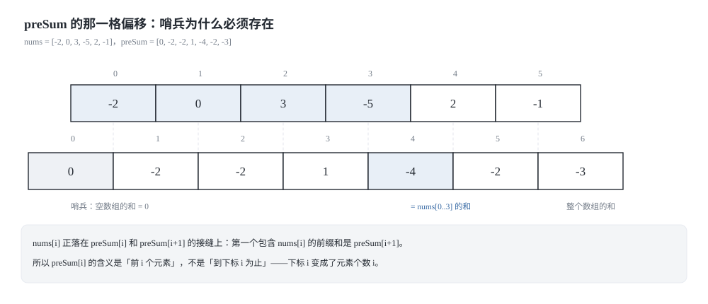
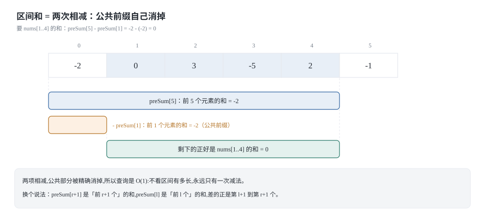
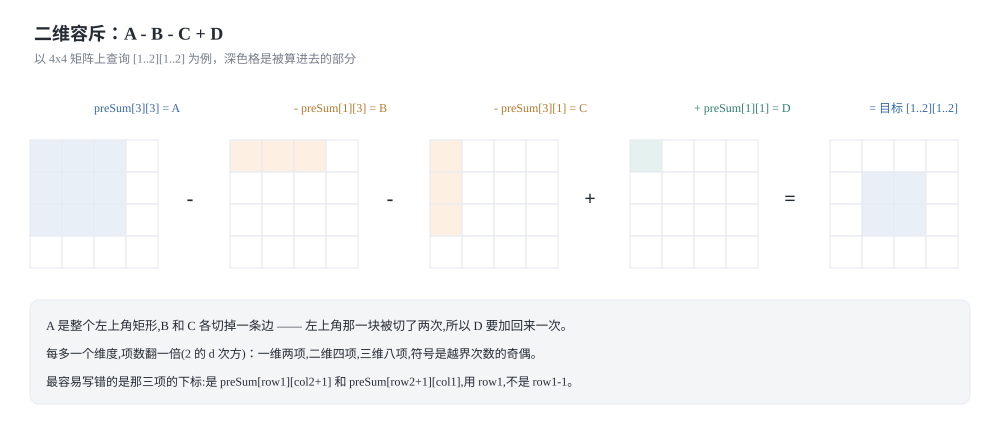
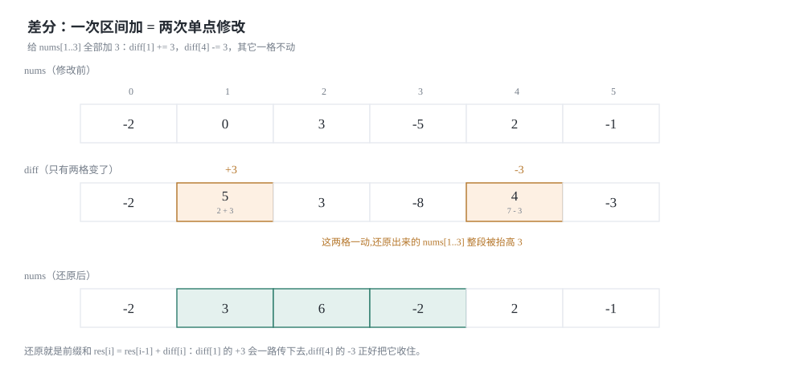
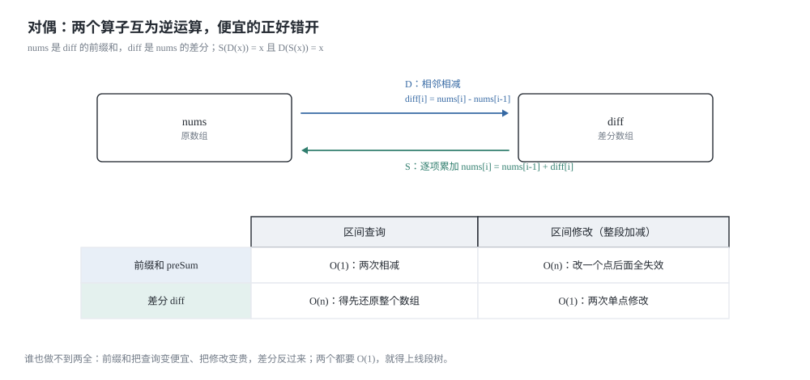

## 0 先说明材料和我的写法

这篇是我自己的学习笔记，材料来自 labuladong 教程里相邻的两篇：

- 《小而美的算法技巧：前缀和数组》—— <https://labuladong.online/zh/algo/data-structure/prefix-sum/>
- 《小而美的算法技巧：差分数组》—— <https://labuladong.online/zh/algo/data-structure/diff-array/>
- 《前缀和技巧经典习题》—— <https://labuladong.online/zh/algo/problem-set/perfix-sum/>（原文 URL 里的 `perfix` 是笔误，不是我打错的）

**这不是转载，也不是翻译。** 原文最值钱的是每篇配套的可视化面板，那个我复现不了，所以下面的图都是我自己用 SVG 画的，讲解也是按我自己的理解重新组织的。

关于材料的完整度，我如实交代，因为这直接决定你该怎么读：

- 前缀和、差分这两篇我取到了**完整正文**（包括题目描述、代码骨架、拓展延伸里关于「前缀和的两个局限性」和「线段树的终极答案」那两段），所以这两篇里的结论我都核对过原文。
- 《前缀和技巧经典习题》**只取到了目录级的标题**：`一、前缀和`（1314 矩阵区域和、724 寻找数组的中心下标）、`二、前缀积`（238 除自身以外数组的乘积）、`三、前缀和 + 哈希表`（525 连续数组、523 连续的子数组和、560 和为 K 的子数组）。每个标题底下的正文一个字都没有，所以凡是涉及这几道题的思路，**都是我自己推导的**，我会在小节里标出来。
- 本文用到的题目：303、304、370、1109、1094 来自原文正文；560 来自上面那份只有标题的习题清单，做法我自己写。

**代码是 Python 3 和 C++ 两版。** 教程原文是 Java，我按自己的习惯重写了一遍。两种语言并排给出是有实际意义的：前缀和和差分都是「用空间换时间」，而这两种语言里「空间」的价钱完全不一样——这一点在第 5 节的实测里会看得很清楚。

最后，第 5 节的耗时表是**真跑出来的**，脚本就在文章里，环境、规模、数据分布都写在表前面，原始输出我也一字不改贴在 5.4 节。

### 目录

- [0 先说明材料和我的写法](#0-先说明材料和我的写法)
- [1 一维前缀和:多出来的那个 0 在防什么](#1-一维前缀和多出来的那个-0-在防什么)
- [2 二维前缀和:容斥的加法和减法](#2-二维前缀和容斥的加法和减法)
- [3 差分数组:区间增减变成两次单点修改](#3-差分数组区间增减变成两次单点修改)
- [4 对偶:一个管查询,一个管修改](#4-对偶一个管查询一个管修改)
- [5 实测:构造一次,查询很多次](#5-实测构造一次查询很多次)
- [6 把这一篇收成一张表](#6-把这一篇收成一张表)
- [7 材料与出处](#7-材料与出处)

## 1 一维前缀和:多出来的那个 0 在防什么

力扣第 303 题「区域和检索 - 数组不可变」是标准的前缀和题：给你一个整数数组 `nums`，实现一个 `NumArray` 类，构造时传入数组，`sumRange(left, right)` 返回闭区间 `[left, right]` 内元素的和。数组在构造之后不再变化，但 `sumRange` 最多会被调用 10^4 次，n 最多 10^4。

### 1.1 暴力解:每个查询都在重算同一段

最直接的写法是每次查询都遍历一遍：

```python
class NumArrayBrute:
    """暴力版:构造 O(1),每次查询 O(n)。"""

    def __init__(self, nums):
        self.nums = list(nums)

    def sum_range(self, left, right):
        total = 0
        for i in range(left, right + 1):
            total += self.nums[i]
        return total
```

```cpp
#include <cstddef>
#include <vector>

// 暴力版:构造 O(1),每次查询 O(n)。
class NumArrayBrute {
public:
    explicit NumArrayBrute(const std::vector<int>& nums) : nums_(nums) {}

    int sumRange(int left, int right) const {
        int total = 0;
        for (int i = left; i <= right; ++i) {
            total += nums_[static_cast<std::size_t>(i)];
        }
        return total;
    }

private:
    std::vector<int> nums_;
};
```

这个写法不是「错」，而是**算了很多遍同一段**。查询 `[0, 9]` 的时候，你已经把 `nums[0..9]` 全加过一遍了；下一次查询 `[3, 7]`，`nums[3..7]` 这一段又被重新加了一遍。原文对这个毛病的说法是「每次调用 `sumRange` 函数时，都要进行一次 for 循环遍历，时间复杂度为 O(N)，而 `sumRange` 的调用频率可能非常高」——`n` 次查询就是 O(n²)，10^4 的数据规模下就是 10^8 次加法。

这里有个值得停下来想一秒的地方：**这些和不是「不能算」，而是「被算了太多次」。** 只要把中间结果存下来，后面的查询就能白拿。这正是选择排序那一节里 `suffixMin` 的思路——预先算好、查询时直接取。区别在于，选择排序的交换操作会让预计算结果失效，而这里的数组是不可变的，正好满足预计算的前提。

### 1.2 换个角度:存「前 i 个元素的和」

不去存「每个区间的和」（那是 n² 个区间，存不下），而是存 n+1 个**前缀**的和：

```text
preSum[i] = nums[0] + nums[1] + ... + nums[i-1]      // 前 i 个元素之和
```

注意等号右边的最后一项是 `nums[i-1]`，正好差一位。这不是笔误，是刻意的错位：`preSum` 的下标是**元素个数**，`nums` 的下标是**元素位置**。于是递推式变得极其干净：

```text
preSum[0] = 0
preSum[i] = preSum[i-1] + nums[i-1]        // i >= 1
```

拿原文这道题的示例数组 `nums = [-2, 0, 3, -5, 2, -1]` 走一遍：

| i | 0 | 1 | 2 | 3 | 4 | 5 | 6 |
|---|---|---|---|---|---|---|---|
| `nums[i]` | -2 | 0 | 3 | -5 | 2 | -1 | — |
| `preSum[i]` | 0 | -2 | -2 | 1 | -4 | -2 | -3 |



有了这张表，闭区间 `[l, r]` 的和就是**一次减法**：

```text
nums[l..r] = preSum[r+1] - preSum[l]
```

**为什么这个减法是对的（推导）:** `preSum[r+1]` 是 `nums[0..r]`，`preSum[l]` 是 `nums[0..l-1]`，两个前缀都从下标 0 开始，相减时 `nums[0..l-1]` 这一段是公共部分，被整段消掉，剩下恰好是 `nums[l..r]`。用原文的示例验证 `[1, 4]`：`preSum[5] - preSum[1] = -2 - (-2) = 0`，而 `nums[1] + nums[2] + nums[3] + nums[4] = 0 + 3 - 5 + 2 = 0`，对上了。



这一步藏着前缀和能成立的**两个前提**，后面第 4 节会专门讲：一是前缀和可以被预计算出来（数组没变），二是「相减」能把公共部分消掉（这个运算有逆运算）。缺任何一条，前缀和就不成立。

### 1.3 preSum[0] = 0 这个哨兵在防什么

现在回答标题里的问题。假如你不要哨兵，直接让 `preSum[i] = nums[0..i]`（长度和 `nums` 一样），那么区间和公式就是：

```text
nums[l..r] = preSum[r] - preSum[l-1]        // l == 0 时 l-1 == -1
```

`l == 0` 的时候下标跑到 -1 去了。有三种补法：

1. **特判**：`if left == 0: return preSum[right]`。能用，但每个用到区间和的地方都要抄一遍这个分支，忘了就等着越界。
2. **给 `nums` 前面补一个 0**：让 `nums` 变成 1-indexed。也能用，代价是每次访问元素都要 `nums[i+1]`，错位转移到了别处。
3. **给 `preSum` 前面补一个 0**：也就是 `preSum` 比 `nums` 长一位，`preSum[0] = 0`。公式统一成 `preSum[r+1] - preSum[l]`，`l == 0` 时是 `preSum[r+1] - 0`，自然正确。

**第 3 种为什么比前两种好:** 前两种是把「`l == 0`」当成需要处理的**特例**，第 3 种是让它不再是特例。哨兵改变的是 `preSum` 下标本身的含义——它不再是「元素下标」，而是「元素个数」。在「元素个数」这套坐标里，`l = 0` 意味着「前 0 个元素」，而前 0 个元素的和当然是 0，`preSum[0] = 0` 就是这个事实的编码，不是补丁。

顺带它还白送了两个好处：

- **递推不用特判**：`preSum[i] = preSum[i-1] + nums[i-1]` 对 `i = 1` 直接成立，因为 `preSum[0]` 已经是一个合法的初值。
- **空区间有表示**：`l == r + 1`（长度 0 的区间）的和是 `preSum[l] - preSum[l] = 0`，公式照样成立，不需要额外约定。这一点在二维前缀和里会更明显。

**最容易写错的那一行:** `preSum[right + 1] - preSum[left]`。

- 写成 `preSum[right] - preSum[left]`，结果变成开区间 `(left, right]`——少算了 `nums[left]`。
- 写成 `preSum[right + 1] - preSum[left + 1]`，结果变成 `(left, right]` 的另一种写法——还是少算了 `nums[left]`。
- 判断有没有写对，最快的办法是拿 `l == r` 单点查询代入：正确结果必须是 `nums[l]`，也就是 `preSum[l+1] - preSum[l]`。

### 1.4 代码

前缀和的版本其实只有四行。力扣给的签名是 `sumRange`，Python 这边我按 PEP 8 写成 `sum_range`，C++ 保持 `sumRange`。

```python
class NumArray:
    """前缀和版:构造 O(n),每次查询 O(1)。

    preSum[i] 表示 nums[0..i-1] 这 i 个元素的和,所以 preSum 比 nums 长一位。
    preSum[0] = 0 是哨兵:它让 left == 0 时公式 preSum[r+1] - preSum[l] 不越界。
    """

    def __init__(self, nums):
        self.preSum = [0] * (len(nums) + 1)
        for i in range(1, len(self.preSum)):
            self.preSum[i] = self.preSum[i - 1] + nums[i - 1]

    def sum_range(self, left, right):
        return self.preSum[right + 1] - self.preSum[left]
```

```cpp
#include <cstddef>
#include <vector>

// 前缀和版:构造 O(n),每次查询 O(1)。
// preSum_[i] = nums[0..i-1] 的和,preSum_[0] = 0 是哨兵。
class NumArray {
public:
    explicit NumArray(const std::vector<int>& nums) : preSum_(nums.size() + 1, 0) {
        for (std::size_t i = 1; i < preSum_.size(); ++i) {
            preSum_[i] = preSum_[i - 1] + nums[i - 1];
        }
    }

    int sumRange(int left, int right) const {
        return preSum_[static_cast<std::size_t>(right) + 1] -
               preSum_[static_cast<std::size_t>(left)];
    }

private:
    std::vector<int> preSum_;
};
```

两份代码在没有哨兵这件事上是「对称地错」的：Python 里 `preSum[-1]` 不报错，而是**默默取到最后一个元素**，所以漏掉哨兵在 Python 里不会崩，只会算错（`sum_range(0, 2)` 会返回 `preSum[3] - preSum[-1]`，一个看起来很像答案的错数）；C++ 里 `preSum_[static_cast<std::size_t>(-1)]` 是一个巨大的下标，多半直接段错误。**Python 的越界不报错，是初学时最容易吃亏的地方**，所以这个哨兵在 Python 里更值得写。

复杂度：构造一次 O(n) 时间 + O(n) 空间；之后每次查询 O(1)。q 次查询的总代价是 O(n + q)，暴力解是 O(nq)。也就是说，**只要你打算查两次以上，前缀和就已经不亏了**——构造只是比「暴力遍历一遍」多花了一个常数。

## 2 二维前缀和:容斥的加法和减法

力扣第 304 题「二维区域和检索 - 矩阵不可变」是一维那题的二维版本：给你一个矩阵 `matrix`，实现 `NumMatrix` 类，`sumRegion(row1, col1, row2, col2)` 返回左上角 `(row1, col1)`、右下角 `(row2, col2)` 的子矩阵的元素总和。m、n 最多 200，`sumRegion` 最多调用 10^4 次。

原文对暴力解的评价很直接：「你可以用一个嵌套 for 循环去遍历这个矩阵，但这样的话 `sumRegion` 函数的时间复杂度就高了，你算法的格局就低了。」这话是对的：单次查询最坏 200×200 = 4×10^4，乘上 10^4 次查询就是 4×10^8。

### 2.1 定义:把「前缀」理解成「左上角固定为原点的矩形」

一维前缀和的定义是「**前 i 个**元素的和」，二维里没有「前 i 个」这种线性次序，取而代之的是「**左上角固定在原点**的矩形」。原文是这么说的：这四个大矩阵有一个共同的特点，就是左上角都是 `(0, 0)` 原点。

```text
preSum[i][j] = matrix[0..i-1][0..j-1] 的和      // 前 i 行、前 j 列围成的矩形
```

`preSum` 的大小是 `(m+1) × (n+1)`，第 0 行和第 0 列全是 0——一维那个哨兵在二维里变成了**一整个哨兵边**：`preSum[0][j]` 和 `preSum[i][0]` 都表示「有一边长度是 0 的矩形」，和当然是 0。

### 2.2 构造:容斥的加法版

```text
preSum[i][j] = preSum[i-1][j] + preSum[i][j-1] - preSum[i-1][j-1] + matrix[i-1][j-1]
```

**推导（为什么是这四项）:** 把矩形 `[0..i-1] × [0..j-1]` 拆开看。`preSum[i-1][j]` 是它的上面 `i-1` 行，`preSum[i][j-1]` 是它的左边 `j-1` 列。两者相加，`(i-1) × (j-1)` 的那块重叠区域被算了**两次**，所以要减去一次 `preSum[i-1][j-1]`；此时还剩右下角那一个格子 `matrix[i-1][j-1]` 没被覆盖（它在第 `i-1` 行、第 `j-1` 列，既不在上面的 `i-1` 行里，也不在左边的 `j-1` 列里），补上它。

四个符号是 `+ + - +`，只有重叠那一项是减号。**这个式子在 `n = 1` 时退化成一维的递推式**：这时没有「列」这一维，`preSum[i][j-1]` 和 `preSum[i-1][j-1]` 都是 0，只剩 `preSum[i][j] = preSum[i-1][j] + matrix[i-1][0]`——正是 `preSum[i] = preSum[i-1] + nums[i-1]`。一维不是二维的特例，二维是一维多长了一个方向。

### 2.3 查询:容斥的减法版

```text
S(row1, col1, row2, col2) = preSum[row2+1][col2+1]
                          - preSum[row1][col2+1]
                          - preSum[row2+1][col1]
                          + preSum[row1][col1]
```

**推导:** 先取最大的那个矩形 `[0..row2] × [0..col2]`，也就是 `preSum[row2+1][col2+1]`。要把它裁成目标子矩阵，得切掉上面 `row1` 行（`preSum[row1][col2+1]`）和左边 `col1` 列（`preSum[row2+1][col1]`）。这两刀把左上角 `row1 × col1` 那块**切了两次**，于是加回来一次 `preSum[row1][col1]`。

一维的查询是两项 `preSum[r+1] - preSum[l]`，二维是四项。规律是：**每多一个维度，容斥的项数翻一倍**，因为「在几个方向上越界」有 `2^d` 种组合，符号是 `(-1)` 的越界次数次方。三维前缀和就是八项，道理完全一样，只是没人会在面试里手写三维。



**最容易写错的那一行:** `- preSum[row1][col2+1] - preSum[row2+1][col1] + preSum[row1][col1]` 这三项的下标。

- 写 `preSum[row1][col2+1]` 而不是 `preSum[row1-1][col2+1]`，是因为递推已经帮你错位过一次了——**查询用的是 `row1`，不是 `row1 - 1`**，这一点和「构造时用 `matrix[i-1][j-1]`」刚好相反。
- 记不住符号就验一遍 `row1 == row2 && col1 == col2`（单个格子）：此时结果必须是 `matrix[row1][col1]`。四个 `preSum` 值分别是 `A = [0..row1][0..col1]`、`B = [0..row1-1][0..col1]`、`C = [0..row1][0..col1-1]`、`D = [0..row1-1][0..col1-1]`，`A - B - C + D` 正好是那个格子。

用原文 304 的示例矩阵验证 `sumRegion(2, 1, 4, 3)`：

| 项 | 值 |
|---|---|
| `preSum[5][4]`（前 5 行、前 4 列） | 38 |
| `- preSum[2][4]`（前 2 行、前 4 列） | -24 |
| `- preSum[5][1]`（前 5 行、前 1 列） | -14 |
| `+ preSum[2][1]`（前 2 行、前 1 列） | +8 |
| 结果 | 8 |

和原文给的 `8` 一致（另外两组 `sumRegion(1,1,2,2) = 11`、`sumRegion(1,2,2,4) = 12` 我也在代码门里对着暴力解跑过）。

### 2.4 换一种构造:先横着累加，再竖着累加

二维前缀和不是只有容斥一种写法。既然 `preSum[i][j]` 的定义是「前 i 行、前 j 列的矩形和」，那就先对每一行做一维前缀和，再对每一列做一维前缀和，得到的东西应该一模一样。这个「逐维前缀和」的写法在一维里就是 `preSum[i] = preSum[i-1] + nums[i-1]`，跑两遍而已。

两种写法算出来的数组**逐元素相等**（我在代码门里对拍了），区别只在常数和可读性：容斥版一次遍历、每格四次访存；逐维版两趟遍历、每格一次访存，缓存更友好。真正值得记住的是这件事本身——**二维前缀和 = 两个方向的一维前缀和的复合**，容斥公式只是把这个复合展开后的样子。

### 2.5 代码

```python
class NumMatrixBrute:
    """暴力版:每次查询都双重循环累加,单次 O(m*n)。"""

    def __init__(self, matrix):
        self.matrix = [list(row) for row in matrix]

    def sum_region(self, row1, col1, row2, col2):
        total = 0
        for i in range(row1, row2 + 1):
            for j in range(col1, col2 + 1):
                total += self.matrix[i][j]
        return total


class NumMatrix:
    """二维前缀和:preSum[i][j] = matrix[0..i-1][0..j-1] 的和。

    preSum 是 (m+1) x (n+1),第 0 行和第 0 列全是 0,
    这是二维版的哨兵:它让 row1 == 0 或 col1 == 0 时容斥公式不用特判。
    """

    def __init__(self, matrix):
        m = len(matrix)
        n = len(matrix[0]) if m else 0
        self.preSum = [[0] * (n + 1) for _ in range(m + 1)]
        for i in range(1, m + 1):
            for j in range(1, n + 1):
                self.preSum[i][j] = (self.preSum[i - 1][j]
                                     + self.preSum[i][j - 1]
                                     - self.preSum[i - 1][j - 1]
                                     + matrix[i - 1][j - 1])

    def sum_region(self, row1, col1, row2, col2):
        return (self.preSum[row2 + 1][col2 + 1]
                - self.preSum[row1][col2 + 1]
                - self.preSum[row2 + 1][col1]
                + self.preSum[row1][col1])


def build_by_axis(matrix):
    """另一种构造:先按行做一维前缀和,再按列做一维前缀和。

    返回的是 (m+1) x (n+1) 的数组,和 NumMatrix.preSum 逐元素相等。
    """
    m = len(matrix)
    n = len(matrix[0]) if m else 0
    acc = [[0] * n for _ in range(m)]
    for i in range(m):
        for j in range(n):
            acc[i][j] = acc[i][j - 1] + matrix[i][j] if j else matrix[i][j]
    pre = [[0] * (n + 1) for _ in range(m + 1)]
    for j in range(1, n + 1):
        for i in range(1, m + 1):
            pre[i][j] = pre[i - 1][j] + acc[i - 1][j - 1]
    return pre
```

```cpp
#include <cstddef>
#include <vector>

// 暴力版:每次查询都双重循环累加,单次 O(m*n)。
class NumMatrixBrute {
public:
    explicit NumMatrixBrute(const std::vector<std::vector<int>>& matrix)
        : matrix_(matrix) {}

    int sumRegion(int row1, int col1, int row2, int col2) const {
        int total = 0;
        for (int i = row1; i <= row2; ++i) {
            for (int j = col1; j <= col2; ++j) {
                total += matrix_[static_cast<std::size_t>(i)]
                                [static_cast<std::size_t>(j)];
            }
        }
        return total;
    }

private:
    std::vector<std::vector<int>> matrix_;
};

// 二维前缀和:preSum_[i][j] = matrix[0..i-1][0..j-1] 的和。
// 第 0 行和第 0 列全是 0,这是二维版的哨兵。
class NumMatrix {
public:
    explicit NumMatrix(const std::vector<std::vector<int>>& matrix) {
        const std::size_t m = matrix.size();
        const std::size_t n = m == 0 ? 0 : matrix[0].size();
        preSum_.assign(m + 1, std::vector<int>(n + 1, 0));
        for (std::size_t i = 1; i <= m; ++i) {
            for (std::size_t j = 1; j <= n; ++j) {
                preSum_[i][j] = preSum_[i - 1][j] + preSum_[i][j - 1] -
                                preSum_[i - 1][j - 1] + matrix[i - 1][j - 1];
            }
        }
    }

    int sumRegion(int row1, int col1, int row2, int col2) const {
        const std::size_t r1 = static_cast<std::size_t>(row1);
        const std::size_t c1 = static_cast<std::size_t>(col1);
        const std::size_t r2 = static_cast<std::size_t>(row2);
        const std::size_t c2 = static_cast<std::size_t>(col2);
        return preSum_[r2 + 1][c2 + 1] - preSum_[r1][c2 + 1] -
               preSum_[r2 + 1][c1] + preSum_[r1][c1];
    }

private:
    std::vector<std::vector<int>> preSum_;
};

// 另一种构造:先按行做一维前缀和,再按列做一维前缀和。
// 返回的数组和 NumMatrix 内部的 preSum_ 逐元素相等。
std::vector<std::vector<int>> buildByAxis(const std::vector<std::vector<int>>& matrix) {
    const std::size_t m = matrix.size();
    const std::size_t n = m == 0 ? 0 : matrix[0].size();
    std::vector<std::vector<int>> acc(m, std::vector<int>(n, 0));
    for (std::size_t i = 0; i < m; ++i) {
        for (std::size_t j = 0; j < n; ++j) {
            acc[i][j] = (j == 0 ? 0 : acc[i][j - 1]) + matrix[i][j];
        }
    }
    std::vector<std::vector<int>> pre(m + 1, std::vector<int>(n + 1, 0));
    for (std::size_t j = 1; j <= n; ++j) {
        for (std::size_t i = 1; i <= m; ++i) {
            pre[i][j] = pre[i - 1][j] + acc[i - 1][j - 1];
        }
    }
    return pre;
}
```

复杂度：构造 O(mn) 时间、O(mn) 空间（多出来的第 0 行第 0 列是 O(m+n)，被 `mn` 吃掉）；每次查询 O(1)，四次查表三次加减，和矩阵大小无关。边界上要注意两个退化：`1 × 1` 的矩阵（此时四个 `preSum` 里有三个是哨兵 0，公式退化成 `preSum[1][1]`）、`1 × N` 的矩阵（`row1 == row2 == 0`，上面那一项 `preSum[row1][...]` 就是哨兵行），这两种在代码门里都有用例。

## 3 差分数组:区间增减变成两次单点修改

前缀和解决的是「数组不变、反复查区间和」。现在把场景翻过来：**数组要反复改，改的都是一整段区间**。

原文的描述是：给你一个数组 `nums`，然后要求给 `nums[2..6]` 全部加 1，再给 `nums[3..9]` 全部减 3，再给 `nums[0..4]` 全部加 2……一通操作之后问你 `nums` 最后是什么。暴力做法是每次修改都遍历那段区间，单次 O(n)；原文的评价是「由于这个场景下对 `nums` 的修改非常频繁，所以效率会很低下」。

### 3.1 定义:存「相邻两个元素的差」

不去存 `nums`，而是存它的**差分数组**：

```text
diff[i] = nums[i] - nums[i-1]        // i >= 1
diff[0] = nums[0]                    // 下标 0 没有前一项可减,直接取 nums[0]
```

差分数组能还原回原数组，而且还原方式非常眼熟：

```text
nums[0] = diff[0]
nums[i] = nums[i-1] + diff[i]        // i >= 1
```

把这两行和 1.2 节的 `preSum[i] = preSum[i-1] + nums[i-1]` 摆在一起看，会发现**还原就是前缀和**：`nums` 是 `diff` 的前缀和，`diff` 是 `nums` 的差分。它们互为逆运算——这一点第 4 节会展开，也是整篇最值得记住的一句话。

### 3.2 为什么改两个点就等于整个区间加减

先看一次单点修改的效果。假设只把 `diff[i]` 加上 `v`，其它不动，那么还原出来的数组会变成什么？因为 `nums[k]` 是 `diff[0..k]` 的累加和，所以：

- `k < i` 时，`diff[i]` 不在累加范围里，`nums[k]` 不变；
- `k >= i` 时，`diff[i]` 在累加范围里，`nums[k]` 全都多了 `v`。

也就是**「`diff[i] += v`」等于「`nums[i..n-1]` 整条尾巴 +v」**。原文的说法是「`diff[i] += 3` 意味着给 `nums[i..]` 所有的元素都加了 3」。

于是区间加法只要两条尾巴相加：

```text
给 nums[i..j] 全部加 v
  <=> diff[i] += v          // 尾巴 [i, n-1] 全加 v
  <=> diff[j+1] -= v        // 尾巴 [j+1, n-1] 再减 v,抵消掉
```

`[i, n-1]` 加 `v` 再减去 `[j+1, n-1]` 的 `v`，剩下的正是 `[i, j]` 这一段加了 `v`，别的位置一加一减归零。这就是差分数组的全部原理：**区间修改的 O(n) 代价，被两条「从某个位置开始到末尾」的尾巴代替了，而每条尾巴只需要改一个数。**

为什么恰好是两次？因为一个区间有**两个端点**。这和 2.3 节二维容斥要处理 `2^2 = 4` 种越界组合是同一件事的两面：区间的边界越多，需要的修补点越多。



### 3.3 那一行 if:j+1 越界

如果 `j` 就是最后一个下标，那么「从 `j+1` 开始的尾巴」整条都在数组外面，什么都不用减。原文专门强调了这一点：「当 `j+1 >= diff.length` 时，说明是对 `nums[i]` 及以后的整个数组都进行修改，那么就不需要再给 `diff` 数组减 `val` 了。」

```text
void increment(int i, int j, int val) {
    diff[i] += val;
    if (j + 1 < diff.length) {      // 少了这个判断就越界
        diff[j + 1] -= val;
    }
}
```

想省掉这个判断也有办法：**把 `diff` 多开一格**（长度 `n+1`），最后那一格专门用来接住「越界的尾巴」，还原时只读前 `n` 项。这是工程里常见的写法，代价是每道题都要多解释一句「最后一个格子是垃圾桶」，所以下面我按原文的写法保留这个 `if`。

顺带说一个 Python 的坑，它和 1.4 节那个正好相反：这里漏掉 `if` 判断是**会报错**的（`diff[n]` 是正下标越界，抛 `IndexError`），不像 `preSum[-1]` 那样静默算错。所以在差分这里，Python 反而比前缀和那边安全——**能报错的 bug 不可怕，可怕的是不报错的 bug。**

### 3.4 把差分数组封装成一个类

力扣第 370 题「区间加法」（会员题）直接考这个技巧：长度为 `n`、初始全 0 的数组，给若干次 `[start, end, val]` 的区间加，返回最终数组。原文的思路是「把我们实现的 `Difference` 类复制过去就能解决」。

```python
class DifferenceBrute:
    """暴力版:构造 O(1),每次区间增减 O(n)。"""

    def __init__(self, nums):
        self.nums = list(nums)

    def increment(self, i, j, val):
        for k in range(i, j + 1):
            self.nums[k] += val

    def result(self):
        return list(self.nums)


class Difference:
    """差分数组:构造 O(n),每次区间增减 O(1),最后还原一次 O(n)。

    diff[i] = nums[i] - nums[i-1],diff[0] = nums[0]。
    还原就是求前缀和:res[i] = res[i-1] + diff[i]。
    """

    def __init__(self, nums):
        n = len(nums)
        self.diff = [0] * n
        if n:
            self.diff[0] = nums[0]
            for i in range(1, n):
                self.diff[i] = nums[i] - nums[i - 1]

    def increment(self, i, j, val):
        """给闭区间 [i, j] 全部加上 val。"""
        self.diff[i] += val
        if j + 1 < len(self.diff):   # j 是最后一项时,这条尾巴在数组外,不用减
            self.diff[j + 1] -= val

    def result(self):
        res = [0] * len(self.diff)
        acc = 0
        for i in range(len(self.diff)):
            acc += self.diff[i]
            res[i] = acc
        return res


def get_modified_array(length, updates):
    """力扣 370:初始全 0,updates[i] = [start, end, val],返回修改后的数组。"""
    df = Difference([0] * length)
    for start, end, val in updates:
        df.increment(start, end, val)
    return df.result()
```

```cpp
#include <cstddef>
#include <vector>

// 暴力版:构造 O(1),每次区间增减 O(n)。
class DifferenceBrute {
public:
    explicit DifferenceBrute(const std::vector<int>& nums) : nums_(nums) {}

    void increment(int i, int j, int val) {
        for (int k = i; k <= j; ++k) {
            nums_[static_cast<std::size_t>(k)] += val;
        }
    }

    std::vector<int> result() const { return nums_; }

private:
    std::vector<int> nums_;
};

// 差分数组:构造 O(n),每次区间增减 O(1),最后还原一次 O(n)。
// diff_[i] = nums[i] - nums[i-1],diff_[0] = nums[0];还原就是求前缀和。
class Difference {
public:
    explicit Difference(const std::vector<int>& nums) : diff_(nums.size(), 0) {
        if (!nums.empty()) {
            diff_[0] = nums[0];
            for (std::size_t i = 1; i < nums.size(); ++i) {
                diff_[i] = nums[i] - nums[i - 1];
            }
        }
    }

    // 给闭区间 [i, j] 全部加上 val。
    void increment(int i, int j, int val) {
        diff_[static_cast<std::size_t>(i)] += val;
        const std::size_t after = static_cast<std::size_t>(j) + 1;
        if (after < diff_.size()) {   // j 是最后一项时,这条尾巴在数组外,不用减
            diff_[after] -= val;
        }
    }

    std::vector<int> result() const {
        std::vector<int> res(diff_.size(), 0);
        int acc = 0;
        for (std::size_t i = 0; i < diff_.size(); ++i) {
            acc += diff_[i];
            res[i] = acc;
        }
        return res;
    }

private:
    std::vector<int> diff_;
};

// 力扣 370:初始全 0,updates[i] = [start, end, val],返回修改后的数组。
std::vector<int> getModifiedArray(int length,
                                 const std::vector<std::vector<int>>& updates) {
    Difference df(std::vector<int>(static_cast<std::size_t>(length), 0));
    for (const std::vector<int>& u : updates) {
        df.increment(u[0], u[1], u[2]);
    }
    return df.result();
}
```

**最容易写错的那一行:** `self.diff[j + 1] -= val` 前面那个 `if`。

- 漏了它，`j == n-1` 时直接越界（Python 抛 `IndexError`，C++ 是未定义行为，多半段错误）。
- `increment(i, j, val)` 的 `j` 是**闭区间**的右端点，不是长度。写成 `increment(start, end - 1, val)` 就把区间少算了一格，最后一位乘客/最后一个航班会莫名少掉。
- 判断有没有写对，最快的办法是拿 `i == j == n-1` 试一次：整个数组只有最后一项被加，`diff` 里只有 `diff[n-1]` 变了，不该有任何 `-val` 出现。

复杂度：构造 O(n) 时间、O(n) 空间；每次区间增减 O(1)；`m` 次修改加一次还原是 **O(n + m)**，暴力做法是 O(nm)。

### 3.5 两道变形题:下标平移和「下车的那一站」

370 是直接考，真实的题不会这么直白。原文举的两道都要先做一步建模。

**力扣 1109「航班预订统计」:** `bookings[i] = [first, last, seats]` 表示在编号 `first` 到 `last`（含两端）的每个航班上预订了 `seats` 个座位，返回每个航班的总座位数。航班编号是 **1 到 n**，而数组下标是 **0 到 n-1**，所以两个端点都要减 1——这是本题唯一容易错的地方。

```python
def corp_flight_bookings(bookings, n):
    """力扣 1109:航班编号 1..n,数组下标 0..n-1,两个端点都要减 1。"""
    df = Difference([0] * n)
    for first, last, seats in bookings:
        df.increment(first - 1, last - 1, seats)
    return df.result()
```

```cpp
#include <cstddef>
#include <vector>

// 力扣 1109:航班编号 1..n,数组下标 0..n-1,两个端点都要减 1。
std::vector<int> corpFlightBookings(const std::vector<std::vector<int>>& bookings,
                                    int n) {
    Difference df(std::vector<int>(static_cast<std::size_t>(n), 0));
    for (const std::vector<int>& b : bookings) {
        df.increment(b[0] - 1, b[1] - 1, b[2]);
    }
    return df.result();
}
```

**力扣 1094「拼车」:** `trips[i] = [num, start, end]` 表示 `num` 个乘客从 `start` 站上车、到 `end` 站下车，问一辆容量为 `capacity` 的车能不能接完所有乘客。这里有一个**开区间陷阱**：乘客在第 `end` 站已经下车，所以他占座的路段是 `[start, end-1]`，原地取 `[start, end]` 会把下车那一站也算成有人坐。站点编号最大 1000，所以差分数组开 1001 格就够。

```python
def car_pooling(trips, capacity):
    """力扣 1094:乘客在 [start, end) 这段路上在车上,占座区间是 [start, end-1]。"""
    df = Difference([0] * 1001)
    for num, start, end in trips:
        df.increment(start, end - 1, num)
    return all(x <= capacity for x in df.result())
```

```cpp
#include <cstddef>
#include <vector>

// 力扣 1094:乘客在 [start, end) 这段路上在车上,占座区间是 [start, end-1]。
bool carPooling(const std::vector<std::vector<int>>& trips, int capacity) {
    constexpr std::size_t kStations = 1001;   // 站点编号 0..1000
    Difference df(std::vector<int>(kStations, 0));
    for (const std::vector<int>& t : trips) {
        df.increment(t[1], t[2] - 1, t[0]);
    }
    for (int x : df.result()) {
        if (x > capacity) return false;
    }
    return true;
}
```

两道题都演示了同一件事：**差分数组本身很简单，难的是把题目里的「一段时间/一个路段/一个编号区间」翻译成数组上的闭区间**。翻译错一格，题目就错，而且往往是边界上的那一格。

## 4 对偶:一个管查询,一个管修改

到这儿两个技巧都齐了。它们长得像（都是「预处理一个辅助数组」），但它们是**互为逆运算**的一对，这一节把关系讲清楚，然后给一张判别表。

### 4.1 两个算子互为逆运算

把两件事写在一起：

```text
diff[i] = nums[i] - nums[i-1]      // 差分:在 nums 上做「相邻相减」
nums[i] = nums[i-1] + diff[i]      // 前缀和:在 diff 上做「累加」
```

第二行说明 `nums` 是 `diff` 的前缀和（只差一个 `preSum[0] = 0` 的错位）；第一行说明 `diff` 是 `nums` 的差分。也就是说，定义 `S` 为「累加」、`D` 为「相邻相减」，那么对任何数组都有

```text
S(D(nums)) = nums          且          D(S(nums)) = nums
```

两个算子是互逆的。用矩阵写更直白：`S` 是一张对角线及以下全为 1 的下三角矩阵，`D` 是主对角线为 1、次对角线为 -1 的双对角矩阵，两者相乘是单位矩阵。**「前缀和技巧只适用于存在逆运算的场景」这句话，指的就是这里存在一个 `D`。**

这条互逆关系决定了两个技巧的分工。因为互逆，所以在一边做「单点修改」，到另一边就变成「后缀修改」；在一边做「区间修改」，到另一边就变成「两点修改」。**同一个操作在两个空间里的价钱不一样，这就是全部价值所在。**



### 4.2 同一个操作,两个空间的价钱

| 操作 | 直接在 `nums` 上做 | 在辅助数组上做 |
|---|---|---|
| 查询 `nums[l..r]` 的和 | O(n) 遍历 | `preSum` 两次相减，O(1) |
| 查询 `nums[i]` 单点 | O(1) | `preSum` 两次相减，O(1)（没赚） |
| 修改 `nums[i] += v` 单点 | O(1) | `preSum[i+1..n]` 全要改，O(n)（亏了） |
| 修改 `nums[l..r] += v` | O(n) 遍历 | `diff` 两点修改，O(1) |

注意第三行：**前缀和不是免费的，它把「区间查询」变便宜的同时，把「单点修改」变贵了。** 这就是原文说的第一个局限性——「使用前缀和技巧的前提是原数组 `nums` 不会发生变化。如果原数组中的某个元素改变了，那么 `preSum` 数组中该元素后面的值就会失效，需要重新花费 O(n) 的时间计算 `preSum` 数组」。

差分则是反过来：它把「区间修改」变便宜，但**查询仍然是 O(n)**（要还原整个数组才能读出任意一个位置）。谁也不是全能选手，选哪个取决于你的操作里「修改多」还是「查询多」。

### 4.3 判别表:什么时候用前缀和,什么时候用差分

| 你的场景 | 用什么 | 预处理 | 单次操作 | 一句话判断 |
|---|---|---|---|---|
| 数组不动，反复查区间和 | 前缀和 | O(n) | 查询 O(1) | 「查询多、修改没有」 |
| 数组不动，反复查子矩阵和 | 二维前缀和 | O(mn) | 查询 O(1) | 同上，容斥四项 |
| 反复给区间加减，最后问数组长什么样 | 差分 | O(n) | 修改 O(1) | 「修改多、查询只需最后问一次」 |
| 反复给区间加减，中途还要查区间和 | 都不够，用线段树/树状数组 | O(n) | 改、查都 O(log n) | 「既要又要」 |
| 区间端点极大（比如 10^9）但只有少数几个 | 离散化 + 差分 | O(k log k) | 修改 O(1) | 「数组开不下」 |
| 区间查询的不是和，而是 max/min | 前缀和失效 | — | — | 「没有逆运算」 |

倒数第二行是原文拓展里问的第一个问题：差分的 `diff` 数组长度得和区间长度一样，「如果我有一个非常大的区间，比如 `[0, 10^9]`，那岂不是上来就要创建一个长度为 `10^9` 的数组」。答案是只保留下出现过的那 `O(k)` 个端点，排序去重后做差分——因为 `diff` 里的绝大多数位置都是 0。

最后一行是前缀和的第二个局限，原文的说法是：**前缀和技巧只适用于存在逆运算的场景**。「比方说求最大值的场景，你知道 `max(x, 8) = 8`，此时你无法推导出 `x` 的值」。翻译成前缀和的语言就是：区间 `max` **不能**靠两个前缀 `max` 相减恢复——`max(nums[0..r])` 和 `max(nums[0..l-1])` 里谁大，跟 `nums[l..r]` 的最大值没有关系，被减掉的那一段可能正好是最大的那个。求和能做是因为减法能把公共部分精确消掉，而 `max` 没有逆运算。

原文对「既要又要」和「开不下」这两个问题的终极答案是同一句话：**线段树**。「它可以在 O(log N) 的时间复杂度内完成任意长度的区间增减和区间查询操作。」所以这一篇的定位很清楚：前缀和和差分是「静态」版本，线段树是它们的动态版本；先把这一对逆运算想明白，线段树的 `lazy` 标记为什么长那样就不难理解了。

## 5 实测:构造一次,查询很多次

前面所有复杂度都能算出来,但「到底快多少倍」得跑一遍才算数。下面两段脚本用的就是第 1 到 3 节里的类,没有另写一份实现——**如果跑的不是文章里那份代码,测出来的数字就没有意义**。

**环境:** Apple M5(arm64)、macOS;Python 3.14.6(`/opt/miniconda3/bin/python3`);C++ 用 Apple clang 21.0.0,`g++ -std=c++17 -O2`。

**方法:** 每个格子跑 3 次取最快的一次(Python 用 `time.perf_counter`,C++ 用 `std::chrono::steady_clock`);计时区里**包含辅助数组的构造**,不然对辅助数组不公平;数据用固定种子 `20261114` 生成,元素是 `[-1000, 1000]` 的均匀随机整数,区间按 `left = randrange(n)`、`right = randrange(left, n)` 生成,平均长度是 `n/4`。计时之前先逐问对拍,两个实现的结果必须完全一样,否则不该谈性能。

**规模:** Python 用 `n=10000, q=10000`、`n=5000, m=5000`、`120×120` 配 `q=5000`;C++ 每项放大到 `n=100000` 和 `500×500`。两种语言规模不同不是耍赖,而是同一规模下 C++ 的暴力版快到测不准。

```python
import random
import sys
import time


def timed(fn, repeat=3):
    """跑 repeat 次,返回最快的一次(秒)。计时区里包含辅助数组的构造,和暴力解对等。"""
    best = None
    for _ in range(repeat):
        start = time.perf_counter()
        fn()
        elapsed = time.perf_counter() - start
        if best is None or elapsed < best:
            best = elapsed
    return best


def bench_prefix_sum(n, q, rng):
    """一维区间和:q 次随机闭区间查询。"""
    nums = [rng.randint(-1000, 1000) for _ in range(n)]
    queries = []
    for _ in range(q):
        left = rng.randrange(n)
        queries.append((left, rng.randrange(left, n)))

    # 计时之前先对拍:逐问比较两个实现,有一个不一致就不该谈性能。
    brute_ref = NumArrayBrute(nums)
    fast_ref = NumArray(nums)
    same = all(brute_ref.sum_range(left, right) == fast_ref.sum_range(left, right)
               for left, right in queries)

    def brute():
        na = NumArrayBrute(nums)
        total = 0
        for left, right in queries:
            total += na.sum_range(left, right)
        return total

    def fast():
        na = NumArray(nums)
        total = 0
        for left, right in queries:
            total += na.sum_range(left, right)
        return total

    return timed(brute), timed(fast), same


def bench_difference(n, m, rng):
    """区间加减:m 次随机闭区间加,最后还原一次。"""
    nums = [rng.randint(-1000, 1000) for _ in range(n)]
    updates = []
    for _ in range(m):
        left = rng.randrange(n)
        updates.append((left, rng.randrange(left, n), rng.randint(-100, 100)))

    db_ref = DifferenceBrute(nums)
    df_ref = Difference(nums)
    for left, right, val in updates:
        db_ref.increment(left, right, val)
        df_ref.increment(left, right, val)
    same = db_ref.result() == df_ref.result()

    def brute():
        db = DifferenceBrute(nums)
        for left, right, val in updates:
            db.increment(left, right, val)
        return db.result()

    def fast():
        df = Difference(nums)
        for left, right, val in updates:
            df.increment(left, right, val)
        return df.result()

    return timed(brute), timed(fast), same


def bench_matrix(side, q, rng):
    """二维子矩阵和:在 side x side 的矩阵上做 q 次随机子矩阵查询。"""
    matrix = [[rng.randint(-1000, 1000) for _ in range(side)] for _ in range(side)]
    queries = []
    for _ in range(q):
        row1 = rng.randrange(side)
        col1 = rng.randrange(side)
        queries.append((row1, col1, rng.randrange(row1, side), rng.randrange(col1, side)))

    nb_ref = NumMatrixBrute(matrix)
    nm_ref = NumMatrix(matrix)
    same = all(nb_ref.sum_region(*qr) == nm_ref.sum_region(*qr) for qr in queries)

    def brute():
        nm = NumMatrixBrute(matrix)
        total = 0
        for row1, col1, row2, col2 in queries:
            total += nm.sum_region(row1, col1, row2, col2)
        return total

    def fast():
        nm = NumMatrix(matrix)
        total = 0
        for row1, col1, row2, col2 in queries:
            total += nm.sum_region(row1, col1, row2, col2)
        return total

    return timed(brute), timed(fast), same


def main():
    quick = "--quick" in sys.argv
    if quick:
        n1, q1, n2, m2, side, q3 = 300, 300, 200, 200, 40, 200
    else:
        n1, q1, n2, m2, side, q3 = 10000, 10000, 5000, 5000, 120, 5000
    rng = random.Random(20261114)
    print(f"python {sys.version.split()[0]}  quick={quick}  (min of 3 runs)")
    rows = [
        (f"一维区间和", f"n={n1} q={q1}", bench_prefix_sum(n1, q1, rng)),
        (f"区间加减  ", f"n={n2} m={m2}", bench_difference(n2, m2, rng)),
        (f"二维子矩阵", f"{side}x{side} q={q3}", bench_matrix(side, q3, rng)),
    ]
    for name, scale, (tb, tf, same) in rows:
        print(f"  {name}  {scale:<16} 暴力 {tb:8.4f}s  辅助数组 {tf:9.6f}s  "
              f"快 {tb / tf:7.1f} 倍  对拍{'一致' if same else '不一致'}")


if __name__ == "__main__":
    main()
```

```cpp
#include <chrono>
#include <cstddef>
#include <iostream>
#include <random>
#include <string>
#include <vector>

// 防止编译器把纯计算折叠掉。被这个坑过:一维那格的暴力解一开始跑出 8e-08 秒,
// 因为 -O2 发现三轮重复的计算结果完全一样,干脆只算了一次,三轮都读缓存值。
// 这两行不是算法的一部分,是防止编译器给测量作弊。
volatile long long g_sink = 0;
inline void keep_memory() { asm volatile("" ::: "memory"); }

// 跑 repeat 次,返回最快的一次(秒)。计时区里包含辅助数组的构造,和暴力解对等。
// 回调拿到 run 序号:每轮多算两条,配合 memory clobber 断掉跨轮合并。
template <typename Fn>
double timed(Fn fn, int repeat = 3) {
    double best = 0.0;
    for (int r = 0; r < repeat; ++r) {
        keep_memory();
        const auto t0 = std::chrono::steady_clock::now();
        fn(r);
        const auto t1 = std::chrono::steady_clock::now();
        keep_memory();
        const double dt = std::chrono::duration<double>(t1 - t0).count();
        if (r == 0 || dt < best) best = dt;
    }
    return best;
}

int main(int argc, char** argv) {
    bool quick = false;
    for (int i = 1; i < argc; ++i) {
        if (std::string(argv[i]) == "--quick") quick = true;
    }
    std::mt19937 rng(20261114u);
    std::uniform_int_distribution<int> value(-1000, 1000);
    std::uniform_int_distribution<int> delta(-100, 100);

    std::cout << "c++ (clang, -O2)  quick=" << (quick ? "true" : "false")
              << "  (min of 3 runs)\n";

    // ---------- 一维区间和:q 次随机闭区间查询 ----------
    {
        const int n = quick ? 2000 : 100000;
        const int q = n;
        std::vector<int> nums(static_cast<std::size_t>(n));
        for (int& x : nums) x = value(rng);
        // 多留 4 格:计时时每轮会多算两条,数组得装得下(第一版就是这里读越界了)。
        std::vector<int> lefts(static_cast<std::size_t>(q) + 4);
        std::vector<int> rights(static_cast<std::size_t>(q) + 4);
        for (int i = 0; i < q; ++i) {
            const auto k = static_cast<std::size_t>(i);
            lefts[k] = static_cast<int>(rng() % static_cast<unsigned>(n));
            rights[k] = lefts[k] + static_cast<int>(rng() % static_cast<unsigned>(n - lefts[k]));
        }

        // 计时之前先对拍:逐问比较两个实现,有一个不一致就不该谈性能。
        int mismatches = 0;
        {
            NumArrayBrute nb(nums);
            NumArray nf(nums);
            for (int i = 0; i < q; ++i) {
                const auto k = static_cast<std::size_t>(i);
                if (nb.sumRange(lefts[k], rights[k]) != nf.sumRange(lefts[k], rights[k])) {
                    ++mismatches;
                }
            }
        }

        const double tb = timed([&](int run) {
            NumArrayBrute na(nums);
            long long s = 0;
            for (int i = 0; i < q + run; ++i) {
                const auto k = static_cast<std::size_t>(i);
                s += na.sumRange(lefts[k], rights[k]);
            }
            g_sink = s;
            keep_memory();
        });
        const double tf = timed([&](int run) {
            NumArray na(nums);
            long long s = 0;
            for (int i = 0; i < q + run; ++i) {
                const auto k = static_cast<std::size_t>(i);
                s += na.sumRange(lefts[k], rights[k]);
            }
            g_sink = s;
            keep_memory();
        });
        std::cout << "  一维区间和  n=" << n << " q=" << q << "  暴力 " << tb
                  << "s  辅助数组 " << tf << "s  快 " << tb / tf << " 倍  对拍"
                  << (mismatches == 0 ? "一致" : "不一致") << "\n";
    }

    // ---------- 区间加减:m 次随机闭区间加,最后还原一次 ----------
    {
        const int n = quick ? 2000 : 100000;
        const int m = n;
        std::vector<int> nums(static_cast<std::size_t>(n));
        for (int& x : nums) x = value(rng);
        std::vector<int> lefts(static_cast<std::size_t>(m) + 4);
        std::vector<int> rights(static_cast<std::size_t>(m) + 4);
        std::vector<int> vals(static_cast<std::size_t>(m) + 4);
        for (int i = 0; i < m; ++i) {
            const auto k = static_cast<std::size_t>(i);
            lefts[k] = static_cast<int>(rng() % static_cast<unsigned>(n));
            rights[k] = lefts[k] + static_cast<int>(rng() % static_cast<unsigned>(n - lefts[k]));
            vals[k] = delta(rng);
        }

        bool same = false;
        {
            DifferenceBrute db(nums);
            Difference df(nums);
            for (int i = 0; i < m; ++i) {
                const auto k = static_cast<std::size_t>(i);
                db.increment(lefts[k], rights[k], vals[k]);
                df.increment(lefts[k], rights[k], vals[k]);
            }
            same = db.result() == df.result();
        }

        const double tb = timed([&](int run) {
            DifferenceBrute db(nums);
            for (int i = 0; i < m + run; ++i) {
                const auto k = static_cast<std::size_t>(i);
                db.increment(lefts[k], rights[k], vals[k]);
            }
            const std::vector<int> out = db.result();
            g_sink = out.empty() ? 0 : out[0];
            keep_memory();
        });
        const double tf = timed([&](int run) {
            Difference df(nums);
            for (int i = 0; i < m + run; ++i) {
                const auto k = static_cast<std::size_t>(i);
                df.increment(lefts[k], rights[k], vals[k]);
            }
            const std::vector<int> out = df.result();
            g_sink = out.empty() ? 0 : out[0];
            keep_memory();
        });
        std::cout << "  区间加减    n=" << n << " m=" << m << "  暴力 " << tb
                  << "s  辅助数组 " << tf << "s  快 " << tb / tf << " 倍  对拍"
                  << (same ? "一致" : "不一致") << "\n";
    }

    // ---------- 二维子矩阵和 ----------
    {
        const int side = quick ? 100 : 500;
        const int q = quick ? 2000 : 100000;
        std::vector<std::vector<int>> matrix(static_cast<std::size_t>(side),
                                            std::vector<int>(static_cast<std::size_t>(side)));
        for (auto& row : matrix) {
            for (int& x : row) x = value(rng);
        }
        std::vector<int> r1(static_cast<std::size_t>(q) + 4);
        std::vector<int> c1(static_cast<std::size_t>(q) + 4);
        std::vector<int> r2(static_cast<std::size_t>(q) + 4);
        std::vector<int> c2(static_cast<std::size_t>(q) + 4);
        for (int i = 0; i < q; ++i) {
            const auto k = static_cast<std::size_t>(i);
            r1[k] = static_cast<int>(rng() % static_cast<unsigned>(side));
            r2[k] = r1[k] + static_cast<int>(rng() % static_cast<unsigned>(side - r1[k]));
            c1[k] = static_cast<int>(rng() % static_cast<unsigned>(side));
            c2[k] = c1[k] + static_cast<int>(rng() % static_cast<unsigned>(side - c1[k]));
        }

        int mismatches = 0;
        {
            NumMatrixBrute nb(matrix);
            NumMatrix nf(matrix);
            for (int i = 0; i < q; ++i) {
                const auto k = static_cast<std::size_t>(i);
                if (nb.sumRegion(r1[k], c1[k], r2[k], c2[k]) !=
                    nf.sumRegion(r1[k], c1[k], r2[k], c2[k])) {
                    ++mismatches;
                }
            }
        }

        const double tb = timed([&](int run) {
            NumMatrixBrute nm(matrix);
            long long s = 0;
            for (int i = 0; i < q + run; ++i) {
                const auto k = static_cast<std::size_t>(i);
                s += nm.sumRegion(r1[k], c1[k], r2[k], c2[k]);
            }
            g_sink = s;
            keep_memory();
        });
        const double tf = timed([&](int run) {
            NumMatrix nm(matrix);
            long long s = 0;
            for (int i = 0; i < q + run; ++i) {
                const auto k = static_cast<std::size_t>(i);
                s += nm.sumRegion(r1[k], c1[k], r2[k], c2[k]);
            }
            g_sink = s;
            keep_memory();
        });
        std::cout << "  二维子矩阵  " << side << "x" << side << " q=" << q << "  暴力 " << tb
                  << "s  辅助数组 " << tf << "s  快 " << tb / tf << " 倍  对拍"
                  << (mismatches == 0 ? "一致" : "不一致") << "\n";
    }
    return 0;
}
```

**原始输出(Python 3.14.6):**

```text
python 3.14.6  quick=False  (min of 3 runs)
  一维区间和  n=10000 q=10000  暴力   0.3845s  辅助数组  0.000765s  快   502.9 倍  对拍一致
  区间加减    n=5000 m=5000    暴力   0.1182s  辅助数组  0.000664s  快   178.1 倍  对拍一致
  二维子矩阵  120x120 q=5000   暴力   0.0800s  辅助数组  0.001470s  快    54.5 倍  对拍一致
```

**原始输出(C++ / Apple clang 21.0.0 / `-O2`):**

```text
c++ (clang, -O2)  quick=false  (min of 3 runs)
  一维区间和  n=100000 q=100000  暴力 0.0759917s  辅助数组 0.000105208s  快 722.299 倍  对拍一致
  区间加减    n=100000 m=100000  暴力 0.158709s  辅助数组 0.000128125s  快 1238.71 倍  对拍一致
  二维子矩阵  500x500 q=100000  暴力 0.142427s  辅助数组 0.000378542s  快 376.25 倍  对拍一致
```

**这张表怎么读:**

1. **倍数不是常数,它量的是复杂度差。** 暴力版是每次操作 O(n)、O(n) 和 O(面积),辅助数组是每次 O(1)。规模再放大,倍数还会继续涨;反过来,把规模缩到几百,倍数会掉到个位数——不是技巧失效了,是常数项盖过了复杂度项。
2. **盈亏平衡点低得吓人。** 前缀和的构造是 `n` 次加法,一次暴力查询平均是 `n/4` 次加法,所以**查询超过 4 次左右**前缀和就开始赚;差分同理,构造 `n` 次,一次暴力区间加平均也是 `n/4` 次,**修改超过 4 次左右**差分就开始赚。这也解释了为什么这两招在工程里几乎无条件适用。
3. **别把 C++ 的绝对值当标量性能看。** 一维暴力版总共约 `2.5×10^9` 次加法,只用 0.076 秒,折合 33G 次加法/秒——超出单核标量加法的物理上限,这是 clang 把内层求和循环向量化(一条指令算好多个元素)的结果。所以这张表说明的是「量级」,不能读成「C++ 里暴力解也能用」。
4. **省下来的时间是用空间换的。** 前缀和额外 O(n) 空间,二维是 O(mn);差分额外 O(n)。第 4 节那张判别表的每一行都有这一栏的影子。

**测量本身的坑,两个都是我自己踩的:**

- 第一版 C++ 脚本里,一维那格的暴力版报出 `8e-08 s`。原因是三轮重复的计算完全一样,`-O2` 只算了一次,后两轮读的是缓存下来的结果。加了 `volatile` 汇点和 `asm volatile("" ::: "memory")` 之后才测到真数据。**性能测试报出「不可能这么快」的数字时,先怀疑测量方法,再怀疑算法。**
- 「先对拍再计时」这条纪律当场救了一次:第一版脚本为了打散三轮的计算,让每轮多查两条,但查询数组只开了 `q` 格——越界读到了相邻内存,对拍直接报「结果不一致」。算法是对的,错的是测量代码;编译时加上 `-fsanitize=address` 一跑就定位到了具体行号。

两段脚本都留了一个 `--quick` 开关：把规模压到几百，几十毫秒跑完，只为确认「脚本还能跑、两边还对拍得上」，上面贴的是全量跑的原始输出。**你自己复跑时绝对值会有几个百分点的浮动**——表里已经是三次里最快的一次，但同一个规模下的倍数始终在同一个量级；要是差出十倍，那多半是编译选项或机器不一样，不是算法不一样。

## 6 把这一篇收成一张表

| 场景 | 辅助数组 | 递推 / 定义 | 单次操作 | 最容易写错的那一行 |
|---|---|---|---|---|
| 一维区间和 | `preSum[n+1]`，`preSum[0] = 0` | `preSum[i] = preSum[i-1] + nums[i-1]` | 查询 O(1)：`preSum[r+1] - preSum[l]` | 查询用的是 `l` 和 `r+1`，不是 `l-1` 和 `r` |
| 二维子矩阵和 | `preSum[m+1][n+1]`，第 0 行和第 0 列全 0 | `preSum[i][j] = 上 + 左 - 左上 + matrix[i-1][j-1]` | 查询 O(1)：四项容斥 | 减的两项是 `preSum[row1][col2+1]` 和 `preSum[row2+1][col1]`，`row1` 不要写成 `row1-1` |
| 区间加、单点查 | `diff[n]`，`diff[0] = nums[0]` | `diff[i] = nums[i] - nums[i-1]` | 修改 O(1)：`diff[i] += v`，`diff[j+1] -= v` | `if (j + 1 < len(diff))` 这个判断，漏了就下标越界 |
| 区间加、最后整体还原 | 同上 | 还原 `res[i] = res[i-1] + diff[i]` | 还原 O(n) | `diff[0] = nums[0]`，不是 `nums[0] - nums[-1]` |
| 区间加 + 区间查 | 线段树 / 树状数组 | lazy 标记 | 改、查都 O(log n) | 超出这一篇，但它是上面两行的自然延伸 |

三句话收尾:

1. **前缀和**把「区间查询」换成「两次相减」，前提是数组不变、运算有逆（求和可以，`max` 不行）。
2. **差分数组**是前缀和的逆运算，把「区间修改」换成「两次单点修改」。
3. 两者互为逆运算,所以是**对偶**的:一个在「查」上省时间,一个在「改」上省时间;两个都要省,就得上线段树。

## 7 材料与出处

教程链接（本文所有结论的出处，取到正文的部分我都核对过）：

- 小而美的算法技巧：前缀和数组 —— <https://labuladong.online/zh/algo/data-structure/prefix-sum/>
- 小而美的算法技巧：差分数组 —— <https://labuladong.online/zh/algo/data-structure/diff-array/>
- 前缀和技巧经典习题 —— <https://labuladong.online/zh/algo/problem-set/perfix-sum/>

涉及的力扣题目：

| 题号 | 题目 | 链接 |
|---|---|---|
| 303 | 区域和检索 - 数组不可变 | <https://leetcode.cn/problems/range-sum-query-immutable/> |
| 304 | 二维区域和检索 - 矩阵不可变 | <https://leetcode.cn/problems/range-sum-query-2d-immutable/> |
| 370 | 区间加法（会员题） | <https://leetcode.cn/problems/range-addition/> |
| 1109 | 航班预订统计 | <https://leetcode.cn/problems/corporate-flight-bookings/> |
| 1094 | 拼车 | <https://leetcode.cn/problems/car-pooling/> |

哪些是我自己的推导，哪些取自原文，逐条交代：

- **取自原文正文（我核对过）**：`preSum[i]` 记录 `nums[0..i-1]` 的累加和、`preSum[0] = 0` 便于计算累加和、`[1,4] = preSum[5] - preSum[1]` 这个例子、分数段查询的类比；二维 `preSum[i][j]` 记录 `[0,0,i-1,j-1]` 的元素和、四个大矩阵左上角都是原点、以及「空间换时间」的定性；差分数组 `diff[i] = nums[i] - nums[i-1]`、`diff[i] += val` 配 `diff[j+1] -= val`、`j+1 >= diff.length` 时不用减、以及 370 / 1109 / 1094 三道题的建模；拓展延伸里「前缀和的两个局限性」和「终极答案是线段树」。
- **我自己的推导（原文没有或没取到）**：`preSum[0] = 0` 的三种补法对比与「下标含义从元素位置变成元素个数」的说法；二维递推式与查询公式的逐步推导；差分与前缀和的逆运算关系（第 4 节的表格与算子视角）；判别表；第 5 节的全部实测数字。
- 文章里的图都是我自己用 SVG 画的（原文的可视化面板我没有复制，也无法复制）。
