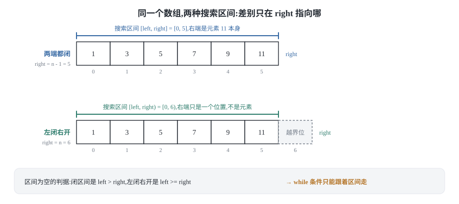
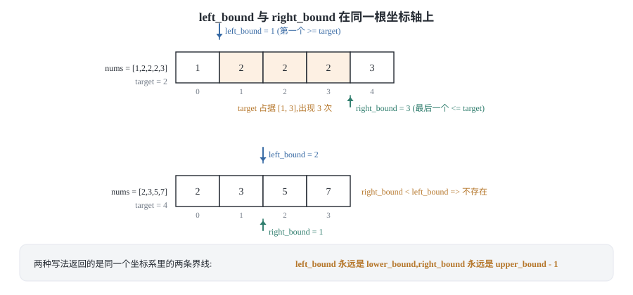
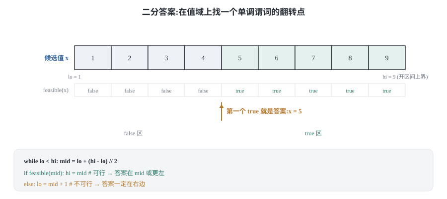
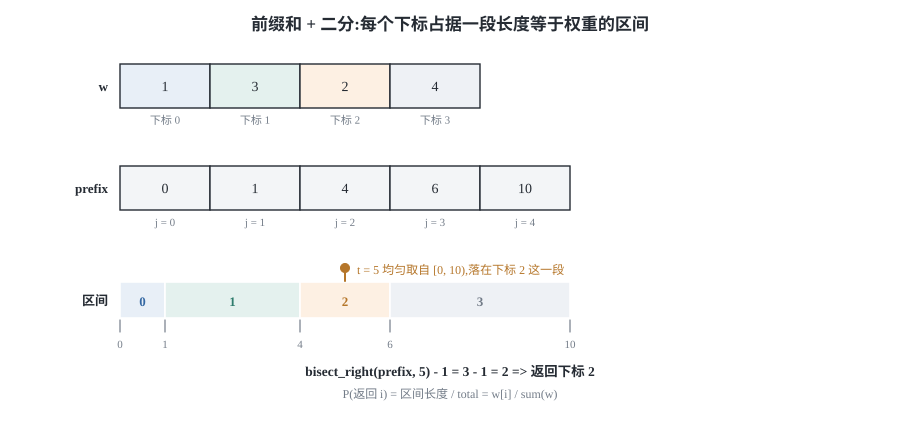

## 0 先说明材料和我的写法

这篇是我自己的学习笔记，材料来自 labuladong 的三篇教程：

- 《二分搜索算法核心代码模板》—— <https://labuladong.online/zh/algo/essential-technique/binary-search-framework/>
- 《二分搜索左闭右开写法》—— <https://labuladong.online/zh/algo/essential-technique/binary-search-left-open/>
- 《实际运用二分搜索时的思维框架》—— <https://labuladong.online/zh/algo/frequency-interview/binary-search-in-action/>

**这不是转载，也不是翻译。** 原文最有价值的是配套的可视化面板，那个我复现不了；下面写的是我自己的理解，重点在「为什么这样写是对的」，以及我自己写的时候踩过的坑。

材料获取情况我如实交代，因为这直接影响你该信哪一部分：

- 第 1~3 节（两种写法与边界）**取到了完整正文**，《二分搜索算法核心代码模板》和《二分搜索左闭右开写法》两篇我都逐条核对过，包括原文那句很关键的「两种写法没有优劣之分」和它对 `right` 初始化的解释。
- 第 4 节（二分答案）**只取到了免费预览部分**。正文在「原始的二分搜索代码」这一节之后就被截断了，我拿到的是它的开头，以及它的完整小节目录：`二分搜索问题的泛化运用` / `二分搜索的套路框架` / 例题（珂珂吃香蕉、包裹运送、分割数组最大值）。所以**第 4 节的框架是我自己组织的推导**，我保留了原文点到的那道关键线索——「算法题一般都让你求最值，求最值的过程必然是搜索一个边界的过程」，其余判定函数怎么设计、值域上下界怎么定，是我自己写的。
- 第 6 节（带权重的随机选择）**同样只取到题目描述**，`解法思路` 和 `解法代码` 两节都没有正文。所以第 6 节的推导和实现完全是我自己的。
- 第 5 节（无序数组上二分）**原文素材里没有对应文章**，是我自己加的，用来补上「二分到底依赖什么」这个更容易被忽略的问题。

**代码是 Python 3 和 C++ 两版**，教程原文用 Java，我按自己的习惯重新实现了一遍，这些片段是我写的、不是从原文抄的。两种语言并排给，因为它们的坑不一样：C++ 里 `(left + right) / 2` 会整型溢出而 Python 不会，`lower_bound` 的返回值语义在 C++ 标准库里是「第一个不小于 target 的位置」——和本文讲的 `left_bound` 完全一致，而 Python 的 `bisect_left` 也是这个语义，但 `bisect_right` 对应的才是本文的 `right_bound + 1`，很容易记混。

### 目录

- [0 先说明材料和我的写法](#0-先说明材料和我的写法)
- [1 二分的本质:每一步丢掉一半](#1-二分的本质每一步丢掉一半)
- [2 两端都闭的写法:三种场景套同一个模板](#2-两端都闭的写法三种场景套同一个模板)
- [3 左闭右开的写法:边界为什么不一样](#3-左闭右开的写法边界为什么不一样)
- [4 二分答案:把最优化问题变成判定问题](#4-二分答案把最优化问题变成判定问题)
- [5 数组无序也能二分](#5-数组无序也能二分)
- [6 带权重的随机选择:前缀和加二分](#6-带权重的随机选择前缀和加二分)
- [7 把这几个套路收成一张表](#7-把这几个套路收成一张表)
- [8 材料与出处](#8-材料与出处)

## 1 二分的本质:每一步丢掉一半

### 1.1 搜索区间才是主角

大部分人第一次学二分，记住的是「取中点、比较、缩一半」。这个描述没错，但它漏掉了唯一重要的一件事：**`left` 和 `right` 不是在指向元素，它们是在描述一个区间。**

这句话是全文的地基：

- 把 `right` 初始化成 `n - 1`，`left` 和 `right` 合起来描述的是**闭区间** `[left, right]`——两端都包含。
- 把 `right` 初始化成 `n`，描述的是**左闭右开区间** `[left, right)`——`left` 那端包含，`right` 那端不包含。



左闭右开那个 `right = n` 看着别扭，但它的含义非常清楚：**`right` 不是「最后一个元素的下标」，而是「搜索区间右边界的下标」**，它自然可以等于 `n`，因为 `n` 本来就只是一个位置、不是元素。

所以 `left` 和 `right` 的正确读法是「区间端点」，而不是「指针」。一旦这么读，后面所有加一减一都能推出来。

### 1.2 两条铁律

原文把二分搜索的正确性归结为两条要求，我把它抄在这里，因为整篇文章都是这两条的推论：

1. **搜索区间为空时，循环必须停止**，否则死循环。
2. **收缩搜索区间的过程中，不能漏掉元素**，否则答案会错。

第一条决定 `while` 的条件，第二条决定边界怎么更新。就这么简单，剩下的都是算术。

先说第一条。一个区间什么时候是空的？

```text
闭区间 [left, right] 为空  ⟺  left > right      （left == right 时还剩一个元素）
左闭右开 [left, right) 为空 ⟺  left >= right     （left == right 时区间是 [left, left)，已经空了）
```

于是两种写法的 `while` 条件**不是风格差异，是被「区间为空的判据」逼出来的**：

```text
两端都闭：区间非空就继续，所以写 while (left <= right)
左闭右开：区间非空就继续，所以写 while (left < right)
```

这就是第一个问题的答案：`<=` 还是 `<`，取决于你的区间是闭的还是开的，不取决于你想表达什么。

再说第二条。中点 `nums[mid]` 已经被检查过了，下一次搜索必须把它排除在外。那么排除之后新区间是什么？

```text
两端都闭 [left, right]：排除 mid 后是 [left, mid-1] 或 [mid+1, right]
左闭右开 [left, right)：排除 mid 后是 [left, mid)   或 [mid+1, right)
```

注意右边的收缩：闭区间写 `right = mid - 1`，开区间写 `right = mid`。**它们表达的是同一件事**——「`mid` 不要了」——只是因为开区间本来就不含 `right`，所以 `right = mid` 就已经把 `mid` 排除掉了。而左边的收缩两种写法完全一样，都是 `left = mid + 1`，因为两种写法里 `left` 都是闭的。

这就是「左闭右闭与左闭右开的边界为什么不同」的完整答案：**差别的唯一源头是 `right` 那一端开还是闭**。`left` 那端都是闭的，所以永远 `mid + 1`；`right` 那端开闭不同，所以一个减一、一个不减。

### 1.3 为什么二分难写对

原文引了 Knuth 的话：思路很简单，细节是魔鬼。我想补一句我自己的体会：**二分的 bug 是偶发性的。**

假设你在两端都闭的写法里手滑把 `while (left <= right)` 写成了 `while (left < right)`。绝大多数用例照样过——因为目标值通常不会恰好落在最后剩下的那一个元素上。只有当 `left == right` 且答案正好在这个位置上时，你才会漏掉它。这种「大部分测试都对」的特性，让二分成了玄学编程的重灾区：bug 能不能复现，全看用例长得像不像。

所以本文第 2、3 节会把同一种判定跑两遍——两种写法、同一组用例，包括「目标不存在」「全相等」「单元素」「命中首位/末位」。这样验证出来的不是「跑通了一次」，而是「两种写法在语义上真的等价」。

## 2 两端都闭的写法:三种场景套同一个模板

二分搜索有三个常用场景：**寻找一个数**、**寻找左侧边界**、**寻找右侧边界**。原文推荐两端都闭的写法，理由是三个场景可以共用一套框架，只改 `nums[mid] == target` 那一处的处理和返回值。我自己写下来也觉得这个写法更好记，就先讲它。

先把框架摆出来，`...` 就是所有细节所在：

```text
left = 0, right = ？
while (？) {
    mid = left + (right - left) / 2
    if      (nums[mid] == target) { ？ }
    else if (nums[mid] <  target) { left  = ？ }
    else if (nums[mid] >  target) { right = ？ }
}
return ？
```

原文还给了两个很实用的建议，我照做并且验证了效果：**不要在二分里写 `else`**，把所有分支展开成 `else if`（写全 `==`、`<`、`>` 三种情况），这样每次读代码都能一眼看出有没有漏掉分支；以及**用 `left + (right - left) / 2` 而不是 `(left + right) / 2`**——两者结果相同，但后者在 C++ 里当 `left` 和 `right` 都接近 `INT_MAX` 时会整型溢出。后面所有 C++ 代码都用的前一种写法。

### 2.1 寻找一个数

力扣 704 就是最朴素的场景：找到返回索引，找不到返回 -1。

```python
def binary_search(nums, target):
    """两端都闭的二分搜索：找到返回索引，否则返回 -1。"""
    left, right = 0, len(nums) - 1
    while left <= right:                  # 区间 [left, right] 非空就继续
        mid = left + (right - left) // 2
        if nums[mid] == target:
            return mid
        elif nums[mid] < target:
            left = mid + 1                # 新区间 [mid+1, right]
        elif nums[mid] > target:
            right = mid - 1               # 新区间 [left, mid-1]
    return -1
```

```cpp
#include <vector>

// 两端都闭的二分搜索：找到返回索引，否则返回 -1。
int binarySearch(const std::vector<int>& nums, int target) {
    int left = 0;
    int right = static_cast<int>(nums.size()) - 1;   // 区间 [left, right]
    while (left <= right) {                          // 区间非空就继续
        int mid = left + (right - left) / 2;         // 不写 (left+right)/2，防溢出
        if (nums[mid] == target) {
            return mid;
        } else if (nums[mid] < target) {
            left = mid + 1;                          // 新区间 [mid+1, right]
        } else if (nums[mid] > target) {
            right = mid - 1;                         // 新区间 [left, mid-1]
        }
    }
    return -1;
}
```

**最容易写错的一行:** `right = len(nums) - 1`。写成 `len(nums)` 就变成左闭右开了，但 `while` 条件还是 `<=`——第一轮 `mid` 就可能等于 `n`，`nums[n]` 直接越界。**区间类型和 `while` 条件必须配套改，只改一个必然出事。**

复杂度：每次循环区间长度至少减半（因为 `mid` 被排除，新区间长度是 `right - left` 或 `right - left - 1`，都严格小于原长度的一半加一），所以最多迭代 `ceil(log2 n)` 次，时间 O(log n)，空间 O(1)。

### 2.2 寻找左侧边界:lower_bound

如果数组里有多个 `target`，它们一定挨在一起。要找最左边那个，做法是：**命中时不要返回，而是继续收缩右边界**。

```python
def left_bound(nums, target):
    """返回第一个 >= target 的位置。范围是 [0, len(nums)]。"""
    left, right = 0, len(nums) - 1
    while left <= right:
        mid = left + (right - left) // 2
        if nums[mid] == target:
            right = mid - 1               # 别返回，往左逼近
        elif nums[mid] < target:
            left = mid + 1
        elif nums[mid] > target:
            right = mid - 1
    return left                           # 循环结束时 left == right + 1
```

```cpp
#include <vector>

// 返回第一个 >= target 的位置。范围是 [0, nums.size()]。
int leftBound(const std::vector<int>& nums, int target) {
    int left = 0;
    int right = static_cast<int>(nums.size()) - 1;
    while (left <= right) {
        int mid = left + (right - left) / 2;
        if (nums[mid] == target) {
            right = mid - 1;              // 别返回，往左逼近
        } else if (nums[mid] < target) {
            left = mid + 1;
        } else if (nums[mid] > target) {
            right = mid - 1;
        }
    }
    return left;                          // 循环结束时 left == right + 1
}
```

**为什么它找得到左边界？** 关键在 `nums[mid] == target` 时写的是 `right = mid - 1` 而不是 `return mid`。这一步的含义是「`mid` 可能是答案，但左边可能还有更早的，所以先把搜索范围压到 `mid` 左边去」。只要还有更靠左的 `target`，循环就不会停；能停下来的位置，左边一定没有 `target` 了。

**为什么可以合并成 `right = mid - 1`？** 注意上面 `==` 和 `>` 两个分支干的是同一件事。这不是巧合：对「找第一个不小于 `target` 的位置」这个问题来说，`nums[mid] >= target` 就说明答案在 `mid` 或它左边，`nums[mid] < target` 就说明答案一定在 `mid` 右边。把三种情况按这个判据合并，就是 `if nums[mid] < target: left = mid + 1 else: right = mid - 1`。原文把所有分支摊开写是为了看清细节，看清之后当然可以合并。

**最容易写错的一行:** `right = mid - 1` 写成 `right = mid`。在 `<=` 的循环条件下，`right = mid` 没有把 `mid` 排除掉，区间可能原地不动（比如 `left == right == mid` 时），直接死循环。

**返回值语义:这是本文最该记住的一句话。** 循环结束时 `left == right + 1`，且此时一定有：

- `nums[right] < target`，也就是 `[0, right]` 里的元素全都小于 `target`；
- `nums[left] >= target`，也就是 `[left, n-1]` 里的元素全都不小于 `target`。

所以 `left` 就是**第一个不小于 `target` 的位置**，专业名字叫 `lower_bound`。它的取值范围是 `[0, n]`——`left == n` 表示整个数组都小于 `target`，这时它是合法的「插入位置」，不是错误。

C++ 的 `std::lower_bound` 和 Python 的 `bisect.bisect_left` 返回的就是这个值，语义完全一致。

### 2.3 寻找右侧边界:upper_bound 减一

对称地，找最右边那个 `target`，做法是**命中时收缩左边界**。

```python
def right_bound(nums, target):
    """返回最后一个 <= target 的位置。范围是 [-1, len(nums) - 1]。"""
    left, right = 0, len(nums) - 1
    while left <= right:
        mid = left + (right - left) // 2
        if nums[mid] == target:
            left = mid + 1                # 别返回，往右逼近
        elif nums[mid] < target:
            left = mid + 1
        elif nums[mid] > target:
            right = mid - 1
    return right                          # 循环结束时 right == left - 1
```

```cpp
#include <vector>

// 返回最后一个 <= target 的位置。范围是 [-1, nums.size() - 1]。
int rightBound(const std::vector<int>& nums, int target) {
    int left = 0;
    int right = static_cast<int>(nums.size()) - 1;
    while (left <= right) {
        int mid = left + (right - left) / 2;
        if (nums[mid] == target) {
            left = mid + 1;               // 别返回，往右逼近
        } else if (nums[mid] < target) {
            left = mid + 1;
        } else if (nums[mid] > target) {
            right = mid - 1;
        }
    }
    return right;                         // 循环结束时 right == left - 1
}
```

**为什么返回 `right`？** 循环结束时 `right == left - 1`。而由 2.2 的分析，`left` 是第一个 `>= target` 的位置——换个说法，**`left` 就是第一个 `> target` 的位置**（因为 `==` 的分支也会把 `left` 推到 `mid + 1`）。那么 `left - 1` 就是最后一个 `<= target` 的位置，也就是 `right`。

这里有个细节很多人会绕进去：为什么 2.2 返回 `left`、2.3 返回 `right`，而两者在循环结束时的关系又是固定的 `right == left - 1`？因为**它们返回的是同一个坐标系里的两个不同边界**：`left` 永远代表「第一个不小于 `target` 的位置」这条界线，`right` 永远代表「最后一个不大于 `target` 的位置」这条界线。求左边界时你要的是前者，求右边界时你要的是后者。原文说「用 `right` 替代 `left - 1` 更好记」，就是这个意思。

**最容易写错的一行:** `left = mid + 1` 写成 `left = mid`。和上一节同理，`mid` 没被排除，会死循环。

**返回值语义:** `right` 是**最后一个不大于 `target` 的位置**，也就是 `upper_bound - 1`。它可能是 `-1`——表示整个数组都大于 `target`，这同样是合法的插入位置而不是错误。Python 的 `bisect.bisect_right(nums, target) - 1` 就是这个值。

### 2.4 两个返回值其实是同一个坐标系

把 2.2 和 2.3 的结论并排放，会得到一个非常干净的图景。



以 `nums = [1, 2, 2, 2, 3]`、`target = 2` 为例：

- `left_bound` 返回 `1`（第一个 `>= 2` 的位置，也就是第一个 `2`）
- `right_bound` 返回 `3`（最后一个 `<= 2` 的位置，也就是最后一个 `2`）

于是 `target` 占据的闭区间就是 `[left_bound, right_bound]`，出现次数是 `right_bound - left_bound + 1 = 3`。力扣 34 要的正是这两个数。

那 `target` 不存在时会怎样？答案是：**`left_bound` 会跑到 `right_bound` 右边去**，也就是 `right_bound < left_bound`。例如 `nums = [2, 3, 5, 7]`、`target = 4`：

- `left_bound` = `2`（元素 `5` 是第一个不小于 `4` 的）
- `right_bound` = `1`（元素 `3` 是最后一个不大于 `4` 的）

`1 < 2`，区间为空，说明 `4` 不在数组里；而 `left_bound = 2` 同时就是它应该插入的位置。原文用 `nums = [2,3,5,7], target = 4` 举过完全一样的例子来说明「`target` 不存在时返回『大于 `target` 的最小索引』」，我这里补上的是：**左右边界同时算出来，就能用 `left_bound > right_bound` 一句话判定「不存在」**，不需要另外检查 `nums[left]` 是否等于 `target`。

这个判据我在代码门里对随机数组做了全量对照，是验证过而不是想当然的。

## 3 左闭右开的写法:边界为什么不一样

网上大量二分代码用的是左闭右开 `[left, right)`。原文的态度很清楚：**两种写法没有优劣之分，只要你彻底理解了「搜索区间」，两种都能随便写**。我完全同意，而且觉得左闭右开有一个实战优势值得单独说：它不需要在循环里处理「等于」的特例，天然长得像 `lower_bound`，写二分答案时特别顺手（第 4 节会用到）。

### 3.1 只动一个初始化,连带三处改动

左闭右开的全部改动都源自 `right` 的初始化从 `n - 1` 变成 `n`。我们把 1.2 节的两条铁律重新推一遍：

```text
right 的初始化     n - 1  →  n                （right 从「最后一个元素」变成「越界位」）
区间为空的判据     left > right  →  left >= right
while 条件         left <= right →  left < right
收缩右边界         right = mid - 1  →  right = mid      （开区间不含 right，mid 天然被排除）
收缩左边界         left = mid + 1   →  left = mid + 1    （左端都是闭的，不变）
循环终止时         left == right + 1 →  left == right
```

只有第一行是「改」，后面五行都是「推」。这就是为什么我把标题写成「只动一个初始化，连带三处改动」——真正需要你记的只有第一行。

**最容易写错的一行:** 换成左闭右开之后，`right` 一定要写 `mid` 而不是 `mid - 1`。写成 `mid - 1` 会把 `mid - 1` 这个元素一起排除掉，而它从来没被检查过——违反的是「不能漏掉元素」那条铁律。

### 3.2 左闭右开的三种场景

三个场景共用同一个骨架，区别仍然只在 `nums[mid] == target` 那一处和返回值。

```python
def binary_search_open(nums, target):
    """左闭右开：找到返回索引，否则返回 -1。"""
    left, right = 0, len(nums)          # 区间 [left, right)
    while left < right:                 # left == right 时区间为空
        mid = left + (right - left) // 2
        if nums[mid] == target:
            return mid
        elif nums[mid] < target:
            left = mid + 1              # 新区间 [mid+1, right)
        elif nums[mid] > target:
            right = mid                 # 新区间 [left, mid)
    return -1


def left_bound_open(nums, target):
    """左闭右开：返回第一个 >= target 的位置，范围 [0, len(nums)]。"""
    left, right = 0, len(nums)
    while left < right:
        mid = left + (right - left) // 2
        if nums[mid] == target:
            right = mid                 # 命中不返回，往左逼近
        elif nums[mid] < target:
            left = mid + 1
        elif nums[mid] > target:
            right = mid
    return left                         # 循环结束时 left == right


def right_bound_open(nums, target):
    """左闭右开：返回最后一个 <= target 的位置，范围 [-1, len(nums) - 1]。"""
    left, right = 0, len(nums)
    while left < right:
        mid = left + (right - left) // 2
        if nums[mid] == target:
            left = mid + 1              # 命中不返回，往右逼近
        elif nums[mid] < target:
            left = mid + 1
        elif nums[mid] > target:
            right = mid
    return left - 1                     # 循环结束时 left == right
```

```cpp
#include <vector>

// 左闭右开：找到返回索引，否则返回 -1。
int binarySearchOpen(const std::vector<int>& nums, int target) {
    int left = 0;
    int right = static_cast<int>(nums.size());   // 区间 [left, right)
    while (left < right) {                       // left == right 时区间为空
        int mid = left + (right - left) / 2;
        if (nums[mid] == target) {
            return mid;
        } else if (nums[mid] < target) {
            left = mid + 1;                      // 新区间 [mid+1, right)
        } else if (nums[mid] > target) {
            right = mid;                         // 新区间 [left, mid)
        }
    }
    return -1;
}

// 左闭右开：返回第一个 >= target 的位置，范围 [0, size]。
int leftBoundOpen(const std::vector<int>& nums, int target) {
    int left = 0;
    int right = static_cast<int>(nums.size());
    while (left < right) {
        int mid = left + (right - left) / 2;
        if (nums[mid] == target) {
            right = mid;                         // 命中不返回，往左逼近
        } else if (nums[mid] < target) {
            left = mid + 1;
        } else if (nums[mid] > target) {
            right = mid;
        }
    }
    return left;                                 // 循环结束时 left == right
}

// 左闭右开：返回最后一个 <= target 的位置，范围 [-1, size-1]。
int rightBoundOpen(const std::vector<int>& nums, int target) {
    int left = 0;
    int right = static_cast<int>(nums.size());
    while (left < right) {
        int mid = left + (right - left) / 2;
        if (nums[mid] == target) {
            left = mid + 1;                      // 命中不返回，往右逼近
        } else if (nums[mid] < target) {
            left = mid + 1;
        } else if (nums[mid] > target) {
            right = mid;
        }
    }
    return left - 1;                             // 循环结束时 left == right
}
```

**`right_bound` 为什么返回 `left - 1`？** 因为 `==` 的分支把 `left` 推到了 `mid + 1`，所以循环结束时 `left` 是**第一个大于 `target` 的位置**（`upper_bound`），那么 `left - 1` 就是最后一个不大于 `target` 的位置。原文对这个问题的解释是「`while` 结束时 `nums[left]` 一定不等于 `target`，而 `nums[left-1]` 可能是」，说的是同一件事，只是从「`left` 指向什么」的角度讲。

**注意返回值语义完全相同。** 把两节并排看：

| 返回值 | 两端都闭 | 左闭右开 |
|---|---|---|
| 第一个 `>= target` 的位置 | `left` | `left` |
| 最后一个 `<= target` 的位置 | `right`（即 `left - 1`） | `left - 1` |

**两种写法的返回值语义一模一样，差别只在循环体内部怎么维护区间。** 这是我认为最值得记住的结论：换写法不用换脑子，`left_bound` 永远是 lower_bound，`right_bound` 永远是 upper_bound 减一。

### 3.3 两种写法互转对照表

| 项目 | 两端都闭 `[left, right]` | 左闭右开 `[left, right)` |
|---|---|---|
| `right` 初始化 | `n - 1` | `n` |
| 区间为空的判据 | `left > right` | `left >= right` |
| `while` 条件 | `left <= right` | `left < right` |
| 收缩右边界（`mid` 太大） | `right = mid - 1` | `right = mid` |
| 收缩左边界（`mid` 太小） | `left = mid + 1` | `left = mid + 1` |
| 循环终止时 | `left == right + 1` | `left == right` |
| 找左边界时命中怎么写 | `right = mid - 1` | `right = mid` |
| 找右边界时命中怎么写 | `left = mid + 1` | `left = mid + 1` |
| `left_bound` 返回 | `left` | `left` |
| `right_bound` 返回 | `right` | `left - 1` |

这张表和原文《二分搜索左闭右开写法》结尾的对比表结论一致，我额外补了「找左/右边界时命中怎么写」两行，因为这两处才是真正会写错的地方。

## 4 二分答案:把最优化问题变成判定问题

前面三节解决的是「在有序数组里找一个值」。但面试里真正高频的是另一类题：**题目让你求一个最大值或最小值，而数组里根本没有这个数。**

原文在《实际运用二分搜索时的思维框架》里点出了要害：算法题一般都让你求最值，而**求最值的过程，必然是搜索一个边界的过程**。这句话是二分答案的全部动机，我把它展开成一个可以照着走的框架。

### 4.1 思维框架

二分答案的思维框架是四步：

**第一步：找到那个「答案变量」。** 题目问什么，就把什么当成自变量 `x`。珂珂题问的是「最小速度」，那自变量就是速度；包裹题问的是「最低运载能力」，那自变量就是容量。

**第二步：写出判定函数 `feasible(x)`。** 这是一个**只回答是/否**的函数：「如果答案是 `x`，能不能满足题目所有限制？」注意这一步把**最优化问题变成了判定问题**——求最小值很难，但判断「这个值行不行」通常只要一次线性扫描。

**第三步：确认单调性。** 判定函数必须在 `x` 的定义域上单调。通常长这样：

```text
x 太小：false false false ... | ... true true true ：x 太大
                              ↑
                          这就是答案
```

速度越快越容易吃完香蕉、容量越大越容易按时送到——这类「越大越行」的性质就是单调性。单调性是二分能用的**唯一前提**，也是这类题最容易翻车的地方：判定函数写错了、或者它其实不单调，二分就会返回一个看起来很合理的错答案。

**第四步：把「找边界」套回第 2、3 节的模板。** 求最小可行值 = 找**第一个 `true`** = `left_bound`；求最大可行值 = 找**最后一个 `true`** = `right_bound`。只是这次数组换成了值域，`nums[mid] < target` 换成了 `!feasible(mid)`。



**值域的上下界怎么定？这是我踩过的坑，单独说。** 两者的要求不一样：

- 求「第一个 `true`」时：下界必须是一个**一定为 false** 的值（或者你接受它可能就是答案），上界必须**一定为 true**。如果上界不小心取成了 false，判定永远不成立，二分会返回一个错的边界而不会报错。
- 反过来求「最后一个 `true`」时：下界一定为 true，上界一定为 false。

拿珂珂题举例：速度 `k = 1` 一定是最慢的（可能吃不完），`k = max(piles)` 一定能吃完（每小时一堆，堆数就是小时数）——所以 `hi = max(piles)` 是**经过论证的**上界，不是随手写的。这一步不能省。

**写二分答案时我更推荐左闭右开。** 因为「找第一个 `true`」在左闭右开下可以写成完全不用想边界的形式：

```text
lo, hi = 下界, 上界 + 1        # 答案在 [lo, hi) 里，或者就是 hi
while lo < hi:
    mid = lo + (hi - lo) // 2
    if feasible(mid): hi = mid      # mid 可行，答案在 mid 或更左
    else:             lo = mid + 1  # mid 不可行，答案在右边
return lo
```

这个写法里没有 `==` 分支，也没有「命中就返回」，`lo` 最后必然停在第一个 `true` 上。**最容易写错的一行:** `hi` 初始化时忘了 `+ 1`。左闭右开的 `hi` 是**开**的，必须比最大候选值大 1，否则最大候选值那一格永远搜不到——又是「漏掉元素」。

下面三道题是原文《实际运用二分搜索时的思维框架》列出的例题（原文的解答部分没有公开正文，以下推导和实现是我自己写的）。

### 4.2 珂珂吃香蕉(力扣 875)

> 有 `n` 堆香蕉，第 `i` 堆有 `piles[i]` 根。珂珂每小时选一堆，以速度 `k` 根/小时吃；如果这堆不足 `k` 根，她吃完这堆后这一小时就不再吃别的。要在 `h` 小时内吃完所有香蕉，求最小的 `k`。`k` 是正整数。

**判定函数：** 给定速度 `k`，吃第 `i` 堆需要 `ceil(piles[i] / k)` 小时，总时间就是求和。`feasible(k) = 总时间 <= h`。（注意必须向上取整：一小时吃不完可以留在这一小时里继续吃，但不能跨小时把余量摊到别的堆上。）

**单调性：** `k` 越大，每堆耗时 `ceil(p/k)` 越小，，总时间越小。所以「总时间 <= h」在 `k` 上是「小范围 false、大范围 true」。

**值域：** 下界 `lo = 1`（最小正整数速度）；上界 `hi = max(piles)`（每小时干掉一整堆，耗时等于堆数，这是所有单堆方案里最快的，再快也不会更快了）。

```python
import math


def min_eating_speed(piles, h):
    """力扣 875：求能在 h 小时内吃完的最小速度。"""
    def feasible(k):
        # 以速度 k 吃完全部香蕉所需的小时数（每堆向上取整）
        return sum((p + k - 1) // k for p in piles) <= h

    lo, hi = 1, max(piles) + 1        # 答案在 [lo, hi) 或就是 hi
    while lo < hi:
        mid = lo + (hi - lo) // 2
        if feasible(mid):
            hi = mid                  # mid 可行，答案在 mid 或更左
        else:
            lo = mid + 1              # mid 不可行，只可能在右边
    return lo
```

```cpp
#include <vector>
#include <algorithm>

// 力扣 875：求能在 h 小时内吃完的最小速度。
int minEatingSpeed(const std::vector<int>& piles, int h) {
    // 以速度 k 吃完全部香蕉所需的小时数（每堆向上取整）
    auto feasible = [&](long long k) {
        long long hours = 0;
        for (int p : piles) {
            hours += (p + k - 1) / k;   // 向上取整
        }
        return hours <= h;
    };

    long long lo = 1;
    long long hi = *std::max_element(piles.begin(), piles.end()) + 1;  // 开区间上界
    while (lo < hi) {
        long long mid = lo + (hi - lo) / 2;
        if (feasible(mid)) {
            hi = mid;                   // mid 可行，答案在 mid 或更左
        } else {
            lo = mid + 1;               // mid 不可行，只可能在右边
        }
    }
    return static_cast<int>(lo);
}
```

**为什么 C++ 版本用 `long long`？** 力扣提示 `piles[i] <= 10^9`、`piles.length <= 10^4`，总耗时在最坏情况下是 10^4 × 10^9 = 10^13，`int` 装不下。Python 没有这个问题——**这是两种语言在二分题上最实际的一处差异**：Python 里你永远不用想溢出，C++ 里必须在中途求和、乘法、`mid` 计算三个地方都检查一遍。

### 4.3 在 D 天内送达包裹的能力(力扣 1011)

> 包裹必须按给定顺序装船，每天装的重量之和不能超过船的载重 `c`，要在 `days` 天内全部送达，求最小的 `c`。

**判定函数：** 贪心地装——从头开始累加，累加会超 `c` 就换一天。得到的「天数 <= days」就是 `feasible(c)`。这里的贪心是对的，因为顺序被固定了，任何一天只要还能装就必须尽量装，否则只会让后面的天数更多。

**单调性：** `c` 越大，每天能装的越多，需要的天数越少。

**值域：** 下界 `lo = max(weights)`（船必须装得下最重的那一个包裹，否则永远送不出去），上界 `hi = sum(weights) + 1`（一天全装完）。

```python
def ship_within_days(weights, days):
    """力扣 1011：求能在 days 天内送完的最小载重。"""
    def feasible(capacity):
        # 贪心装船：能装就装，装不下就换一天
        used_days, load = 1, 0
        for w in weights:
            if load + w > capacity:
                used_days += 1
                load = 0
            load += w
        return used_days <= days

    lo, hi = max(weights), sum(weights) + 1
    while lo < hi:
        mid = lo + (hi - lo) // 2
        if feasible(mid):
            hi = mid
        else:
            lo = mid + 1
    return lo
```

```cpp
#include <vector>
#include <algorithm>
#include <numeric>

// 力扣 1011：求能在 days 天内送完的最小载重。
int shipWithinDays(const std::vector<int>& weights, int days) {
    // 贪心装船：能装就装，装不下就换一天
    auto feasible = [&](long long capacity) {
        long long usedDays = 1;
        long long load = 0;
        for (int w : weights) {
            if (load + w > capacity) {
                ++usedDays;
                load = 0;
            }
            load += w;
        }
        return usedDays <= days;
    };

    long long lo = *std::max_element(weights.begin(), weights.end());
    long long hi = std::accumulate(weights.begin(), weights.end(), 0LL) + 1;
    while (lo < hi) {
        long long mid = lo + (hi - lo) / 2;
        if (feasible(mid)) {
            hi = mid;
        } else {
            lo = mid + 1;
        }
    }
    return static_cast<int>(lo);
}
```

**最容易写错的一行:** `used_days` 初始化成 `1` 而不是 `0`。天数是从「已经开始的一天」起算的，写成 `0` 会在恰好整除时少算一天，让判定函数整体偏移一格。

### 4.4 分割数组的最大值(力扣 410):和上一题是同一道题

> 把非负整数数组 `nums` 分割成 `m` 个连续子数组，使「各子数组和的最大值」最小，求这个最小值。

标准的二分答案：设自变量 `x` 为「允许的单个子数组和上限」，`feasible(x)` = 「能否分割成**不超过** `m` 段，使每段和都不超过 `x`」。这个判定和 4.3 的装船判定**逐字相同**——把「一天」换成「一段」、「载重」换成「段和上限」，两题的判定函数完全一样。

```python
def split_array(nums, m):
    """力扣 410：分成 m 个连续子数组，使最大子数组和最小。"""
    def feasible(limit):
        # 贪心分段：每段尽量长，只要和不超过 limit
        segments, current = 1, 0
        for x in nums:
            if current + x > limit:
                segments += 1
                current = 0
            current += x
        return segments <= m

    lo, hi = max(nums), sum(nums) + 1
    while lo < hi:
        mid = lo + (hi - lo) // 2
        if feasible(mid):
            hi = mid
        else:
            lo = mid + 1
    return lo
```

```cpp
#include <vector>
#include <algorithm>
#include <numeric>

// 力扣 410：分成 m 个连续子数组，使最大子数组和最小。
int splitArray(const std::vector<int>& nums, int m) {
    // 贪心分段：每段尽量长，只要和不超过 limit
    auto feasible = [&](long long limit) {
        long long segments = 1;
        long long current = 0;
        for (int x : nums) {
            if (current + x > limit) {
                ++segments;
                current = 0;
            }
            current += x;
        }
        return segments <= m;
    };

    long long lo = *std::max_element(nums.begin(), nums.end());
    long long hi = std::accumulate(nums.begin(), nums.end(), 0LL) + 1;
    while (lo < hi) {
        long long mid = lo + (hi - lo) / 2;
        if (feasible(mid)) {
            hi = mid;
        } else {
            lo = mid + 1;
        }
    }
    return static_cast<int>(lo);
}
```

三题的判定函数放在一起看，结构惊人地一致，值得单独列一张表：

| 题目 | 自变量 `x` | `feasible(x)` | 值域下界 | 值域上界 |
|---|---|---|---|---|
| 875 珂珂吃香蕉 | 吃香蕉速度 | 总耗时 `<= h` | `1` | `max(piles)` |
| 1011 包裹运送 | 船载重 | 总天数 `<= days` | `max(weights)` | `sum(weights)` |
| 410 分割数组 | 段和上限 | 段数 `<= m` | `max(nums)` | `sum(nums)` |

**这张表就是二分答案的全部内容。** 你面试时要在白板上写的，其实是「自变量是什么、判定函数怎么写、上下界凭什么成立」这三句话，代码是背下来的。

## 5 数组无序也能二分

### 5.1 峰值元素(力扣 162)

> `nums` 是严格大于左右相邻值的元素称为峰值。数组可能有多个峰值，返回**任意一个**峰值的索引。可以假设 `nums[-1] = nums[n] = -∞`。

这题的数组完全没有排序，但**照样可以二分**。做法是比较 `nums[mid]` 和 `nums[mid+1]`：

- 如果 `nums[mid] < nums[mid+1]`，说明 `mid` 处在上升段上。那么在 `mid` 右边**一定存在**一个峰值（一直往右走到下降为止，或者走到数组末尾，末尾因为右侧是 -∞ 也就成了峰值）。所以答案在右半边，`left = mid + 1`。
- 否则 `nums[mid] > nums[mid+1]`，`mid` 处在下降段上，说明 `mid` 本身或者它左边一定存在峰值。所以答案在左半边（含 `mid`），`right = mid`。

```python
def find_peak_element(nums):
    """力扣 162：返回任意一个峰值的索引。"""
    left, right = 0, len(nums) - 1
    while left < right:                   # 区间 [left, right) 非空
        mid = left + (right - left) // 2
        if nums[mid] < nums[mid + 1]:
            left = mid + 1                # 在走上坡，右边必有峰值
        else:
            right = mid                   # 在走下坡，峰值在 mid 或左边
    return left                           # left == right，收敛到一个点
```

```cpp
#include <vector>

// 力扣 162：返回任意一个峰值的索引。
int findPeakElement(const std::vector<int>& nums) {
    int left = 0;
    int right = static_cast<int>(nums.size()) - 1;
    while (left < right) {                    // 区间 [left, right) 非空
        int mid = left + (right - left) / 2;
        if (nums[mid] < nums[mid + 1]) {
            left = mid + 1;                   // 在走上坡，右边必有峰值
        } else {
            right = mid;                      // 在走下坡，峰值在 mid 或左边
        }
    }
    return left;                              // left == right，收敛到一个点
}
```

**这题其实是「左闭右开」的伪装。** 代码里 `right` 初始化成 `n - 1` 看着像闭区间，但 `right = mid` 和 `while (left < right)` 正是左闭右开的写法：真正的搜索区间是 `[left, right]` 被当成 `[left, right+1)` 在用。写成这样是因为返回值要的是**下标**而不是插入位置，`right` 必须能指向真实的元素。这也说明「左闭右开」不是一种代码长相，而是一种区间语义。

**最容易写错的一行:** `nums[mid + 1]` 的越界风险。因为 `while (left < right)` 保证了 `mid < right`，而 `right <= n - 1`，所以 `mid + 1 <= n - 1` 一定安全。如果把 `mid` 算成 `(left + right + 1) / 2`（上取整），`mid` 可能等于 `right`，`mid + 1` 就越界了。**取整方向不是风格问题，是安全问题。**

### 5.2 什么时候能二分:单调性住在判定函数里,不住在数组里

第 1~3 节的例子都用了有序数组，很容易让人以为「二分的条件是数组有序」。5.1 说明不是。真正的条件是：

> **存在一个从候选集合到 {false, true} 的单调判定函数。**

在有序数组里，这个判定函数是 `nums[i] >= target`——它随 `i` 单调，所以二分能用。在峰值元素里，判定函数是「峰值在 `i` 的右边」——它也跟着 `nums[mid]` 和 `nums[mid+1]` 的大小关系单调地给出方向。在二分答案里，判定函数直接就是 `feasible(x)`。

所以我更愿意把二分理解成：**二分不是在搜索数组，而是在搜索一个单调谓词的翻转点。** 数组只是这个谓词最常见的来源。

第 6 节会用到同一个视角：那里没有「有序数组」这个前提，但前缀和数组恰好是单调的，于是二分又能用了。

## 6 带权重的随机选择:前缀和加二分

### 6.1 问题与暴力解

> 力扣 528：给一个下标从 0 开始的正整数数组 `w`，实现 `pickIndex()`，随机返回下标 `i` 的概率为 `w[i] / sum(w)`。

等概率随机很好做：`random.randint(0, n-1)`。带权重就需要把「概率」翻译成「区间长度」。最直接的想法是**展开**：把下标 `i` 重复 `w[i]` 次塞进一个大数组，然后等概率随机取。正确，但空间是 O(sum(w))——力扣提示 `w[i]` 最大 10^5、长度最大 10^4，展开数组能到 10^9 量级，直接爆掉。

原文这篇我只取到了题目描述和它的两个小标题（`解法思路`、`解法代码`），正文没有公开，所以下面是我自己的推导。

### 6.2 前缀和 + lower_bound

把「展开」这个想法保留，但不要真的展开：**用前缀和表示每个下标占据的区间**。

设 `prefix[i] = w[0] + w[1] + ... + w[i-1]`，约定 `prefix[0] = 0`，那么 `prefix` 是长度 `n+1` 的**严格递增**数组（因为每个 `w[i]` 都是正整数），且 `prefix[n] = sum(w)`。

于是下标 `i` 占据的区间就是 `[prefix[i], prefix[i+1])`，这个区间的长度正好是 `w[i]`。取一个 `[0, sum(w))` 上的均匀随机整数 `t`，返回「`t` 落在哪个区间里」即可。



「`t` 落在哪个区间」用二分来查：找**第一个满足 `prefix[j] > t` 的 `j`**，答案就是 `j - 1`。这正好是 `upper_bound`，也就是本文 2.3 节的 `right_bound`。

```python
import bisect
import random


class WeightedPicker:
    """力扣 528：按权重随机选择下标。"""

    def __init__(self, w):
        self.prefix = [0] * (len(w) + 1)
        for i, weight in enumerate(w):
            self.prefix[i + 1] = self.prefix[i] + weight
        self.total = self.prefix[-1]

    def pick_index(self):
        # t 均匀取自 [0, total)；找第一个 prefix[j] > t 的 j，答案是 j - 1
        t = random.randrange(self.total)
        return bisect.bisect_right(self.prefix, t) - 1
```

```cpp
#include <vector>
#include <random>
#include <algorithm>

// 力扣 528：按权重随机选择下标。
class WeightedPicker {
public:
    explicit WeightedPicker(const std::vector<int>& w) : prefix_(w.size() + 1, 0) {
        for (std::size_t i = 0; i < w.size(); ++i) {
            prefix_[i + 1] = prefix_[i] + w[i];
        }
    }

    int pickIndex() {
        // t 均匀取自 [0, total)；找第一个 prefix[j] > t 的 j，答案是 j - 1
        std::uniform_int_distribution<long long> dist(0, prefix_.back() - 1);
        long long t = dist(rng_);
        auto it = std::upper_bound(prefix_.begin(), prefix_.end(), t);
        return static_cast<int>(it - prefix_.begin()) - 1;
    }

private:
    std::vector<long long> prefix_;
    std::mt19937_64 rng_{std::random_device{}()};
};
```

**最容易写错的一行:** `random.randrange(self.total)` 的上界。`randrange` 是**右开**的，正好给出 `[0, total)`；写成 `randint(0, self.total)`（Python 的 `randint` 两端都闭）就会以极小概率取到 `total`，那时 `bisect_right` 返回 `n+1`，答案变成 `n`——越界。**这又是「区间开闭」的问题，和本文第 1 节的主题是同一件事。**

复杂度：构造 O(n)，每次 `pickIndex` 是 O(log n)。

### 6.3 均匀性从哪来

这一段是我自己推的，因为原文对应的部分没有公开正文。

命题：按照上面的算法，返回下标 `i` 的概率恰好是 `w[i] / sum(w)`。

证明：`t` 在 `[0, total)` 上均匀取值，共有 `total` 个可能的整数，每个被取到的概率是 `1/total`。而「返回 `i`」等价于 `t` 落在 `[prefix[i], prefix[i+1])` 里，这个区间里有 `prefix[i+1] - prefix[i] = w[i]` 个整数。所以

```text
P(返回 i) = w[i] / total = w[i] / sum(w)
```

证毕。这里有两个地方容易想岔：

1. **为什么用 `bisect_right`（找第一个 `> t`）而不是 `bisect_left`（找第一个 `>= t`）？** 因为区间约定是**左闭右开** `[prefix[i], prefix[i+1])`。`bisect_right(prefix, t)` 返回第一个 `> t` 的位置，减一之后恰好把 `t == prefix[i]` 这一点分给了下标 `i` 自己。`bisect_left(prefix, t)` 返回第一个 `>= t` 的位置，它的区间划分变成左开右闭 `(prefix[i], prefix[i+1]]`。这个划分的**长度仍然是 `w[i]`**——所以除了一个点之外，它的概率也是对的。但那个点是致命的：**当 `t = 0` 时 `bisect_left` 返回 0，减一之后是 `-1`，直接越界**，等于把最小那个权重的一份概率丢到了数组外面。我在代码门里把 `t ∈ [0, total)` 全部枚举了一遍来验证：对 `w = [1, 3, 0, 2, 4, 0, 6]`，`bisect_right` 版本统计出的次数是 `[1, 3, 0, 2, 4, 0, 6]`，和权重完全一致；`bisect_left` 版本是 `[1, 3, 0, 2, 4, 0, 5]`——**最后一个下标少了一次，缺的那一次正是 `t = 0`**。所以结论不是「两种都行」，而是：**区间约定和返回值必须配套，配错了会在边界那一个点上静默丢概率。**
2. **前缀和必须严格递增。** 题目保证 `w[i]` 是正整数。如果允许 `w[i] = 0`（权重为零的元素永远不该被选中），`prefix` 就会出现相等的相邻项，而左闭右开的划分 `[prefix[i], prefix[i+1])` 在这时是**空区间**——`bisect_right` 会自然跳过它们，这正是我们想要的行为。

上面两点我在代码门里都做了验证：给 `w` 里塞两个 0，跑 40 万次抽样统计每个下标的频率——零权重的下标出现次数必须严格为 0，其余下标的频率必须落在理论概率的 4 倍标准差以内；同时确认 `bisect_left` 版本确实会返回 `-1`。

## 7 把这几个套路收成一张表

| 套路 | 判定依据（单调谓词） | 模板 | 复杂度 | 返回值语义 |
|---|---|---|---|---|
| 寻找一个数 | `nums[i] >= target` | 两端都闭，命中即返回 | O(log n) | 索引，不存在为 `-1` |
| 寻找左侧边界 | `nums[i] >= target` | 命中时 `right = mid - 1` | O(log n) | 第一个 `>= target` 的位置，范围 `[0, n]` |
| 寻找右侧边界 | `nums[i] > target` | 命中时 `left = mid + 1` | O(log n) | 最后一个 `<= target` 的位置，范围 `[-1, n-1]` |
| 区间存在性 | `left_bound > right_bound` | 两个边界各算一次 | O(log n) | 布尔值，出现次数 `= right - left + 1` |
| 二分答案（求最小） | `feasible(x)` 为真 | 第一个 `true`，`hi = mid` | O(log(值域) × C) | 最小的可行值 |
| 二分答案（求最大） | `feasible(x)` 为真 | 最后一个 `true`，`lo = mid` | O(log(值域) × C) | 最大的可行值 |
| 无序数组上二分 | 「答案在某半边」 | 比较 `mid` 与 `mid+1` | O(log n) | 某个满足条件的下标 |
| 前缀和 + 二分 | `prefix` 严格递增 | `upper_bound(prefix, t) - 1` | 构造 O(n)，查询 O(log n) | 权重区间对应的下标 |

表里的 `C` 是判定函数自身的复杂度（珂珂题是 O(n)，所以 875 总复杂度是 O(n × log(max(piles)))）。

两条贯穿全文的结论，也是我写下这篇最大的收获：

1. **二分的所有细节都从「搜索区间」推出来。** 区间的开闭决定了 `while` 条件（区间为空就停），`mid` 已被检查过决定了收缩方式（`right = mid` 还是 `mid - 1`），循环终止时的 `left`/`right` 关系决定了返回哪个变量。记住「第一个不小于」和「最后一个不大于」这两个语义，比记住六种代码长相有用得多。
2. **二分搜索的不是数组，是单调谓词的翻转点。** 只要能把问题写成一个单调的 `feasible(x)`，数组有序与否根本不重要——这正是二分答案能覆盖一大类「求最值」题目的原因。

## 8 材料与出处

引用的教程：

- 《二分搜索算法核心代码模板》—— <https://labuladong.online/zh/algo/essential-technique/binary-search-framework/>
- 《二分搜索左闭右开写法》—— <https://labuladong.online/zh/algo/essential-technique/binary-search-left-open/>
- 《实际运用二分搜索时的思维框架》—— <https://labuladong.online/zh/algo/frequency-interview/binary-search-in-action/>
- 《带权重的随机选择算法》—— <https://labuladong.online/zh/algo/frequency-interview/random-pick-with-weight/>

各部分的出处与我的贡献，逐条列清楚：

| 章节 | 材料情况 | 哪些是我的 |
|---|---|---|
| 第 1 节 二分的本质 | 取到完整正文 | 两条铁律和「区间为空的判据决定 `while` 条件」的表述来自原文；「`left`/`right` 是区间端点不是指针」「右端开闭是唯一差异源头」是我自己的归纳 |
| 第 2 节 两端都闭 | 取到完整正文 | 三种场景的模板、`mid` 防溢出、不建议写 `else` 都出自原文；「两个返回值在同一个坐标系里」「用 `left_bound > right_bound` 判定不存在」是我的补充 |
| 第 3 节 左闭右开 | 取到完整正文 | 对照表结论与原文一致；「`right_bound` 返回 `left-1` 的坐标解释」「换写法不换返回值语义」是我自己的说法 |
| 第 4 节 二分答案 | **只有免费预览**，正文未公开 | 「求最值即搜索边界」这句线索来自原文；四步框架、值域上下界的论证要求、三道例题的推导与代码全部是我自己写的 |
| 第 5 节 无序数组上二分 | **原文素材中没有对应文章** | 全部是我自己加的推导 |
| 第 6 节 带权重随机选择 | **只有题目描述**，`解法思路`/`解法代码` 无正文 | 前缀和 + 二分的推导、均匀性证明、零权重行为全部是我自己写的 |
| 第 7 节 归纳表 | — | 我自己的整理 |

涉及的原题：

| 题号 | 题目 | 链接 |
|---|---|---|
| 704 | 二分查找 | <https://leetcode.cn/problems/binary-search/> |
| 34 | 在排序数组中查找元素的第一个和最后一个位置 | <https://leetcode.cn/problems/find-first-and-last-position-of-element-in-sorted-array/> |
| 875 | 爱吃香蕉的珂珂 | <https://leetcode.cn/problems/koko-eating-bananas/> |
| 1011 | 在 D 天内送达包裹的能力 | <https://leetcode.cn/problems/capacity-to-ship-packages-within-d-days/> |
| 410 | 分割数组的最大值 | <https://leetcode.cn/problems/split-array-largest-sum/> |
| 162 | 寻找峰值 | <https://leetcode.cn/problems/find-peak-element/> |
| 528 | 按权重随机选择 | <https://leetcode.cn/problems/random-pick-with-weight/> |

文中 4 张示意图都是我用脚本自己画的（脚本在 `assets/blog/binary-search-20261115/`）。原文正文里的可视化面板和动图我没有复制，也复制不了。

代码是 Python 3 与 C++17 两版，全部经过真实运行验证：两种边界写法用同一组用例逐项对照，另外加了「与线性扫描全量对照」的随机用例，以及 875/1011/410 三题判定函数与暴力解法的对照。
