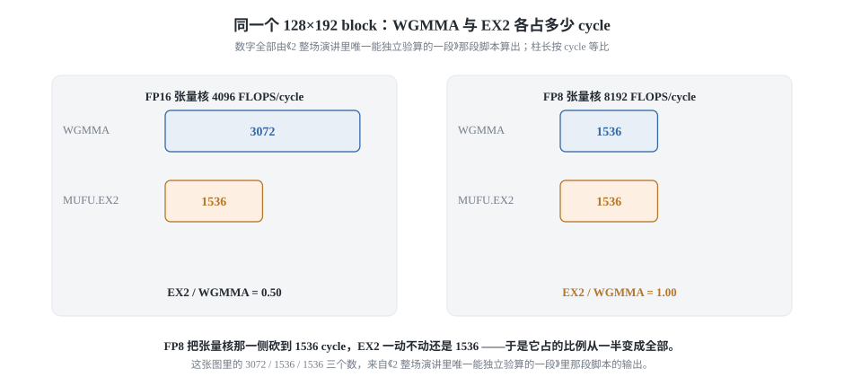
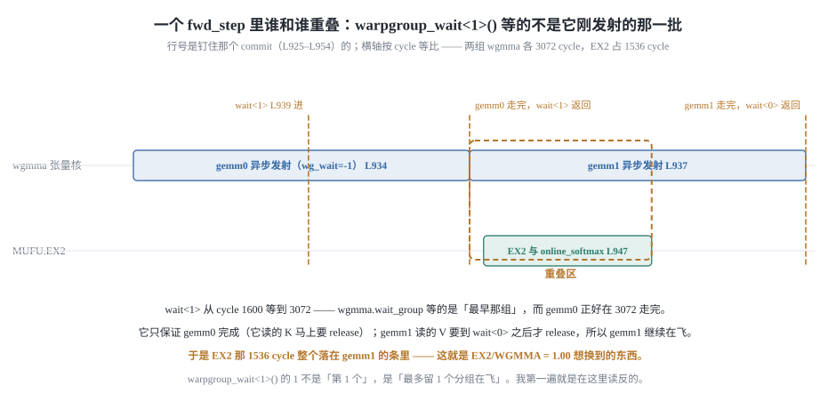
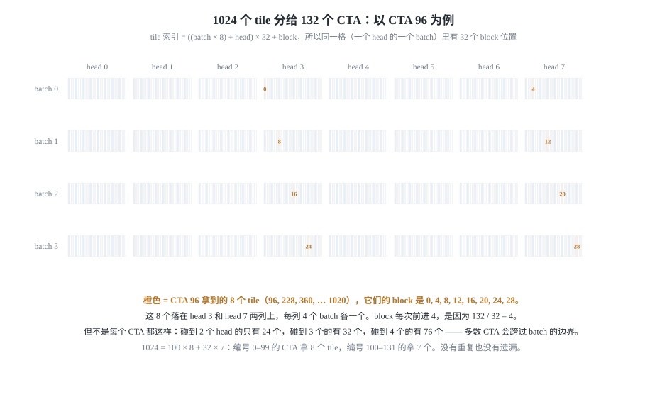

## 0 先说明材料和我的写法

这篇的起点是一个材料页：Colfax Research 的《CUTLASS and FlashAttention-3》，属于 GPU Mode 系列的一次讲解，讲者是 Jay Shah。

材料页：<https://research.colfax-intl.com/gpu-mode-cutlass-and-flashattention-3/>

**先把这篇和上一篇的区别说清楚，因为它决定了下面哪些话我能说。**

上一篇（Nsight Systems 剖析）我跑了实验：四个 CUDA 程序，H800，两遍。那一篇的每个数字都来自我自己的日志，验证脚本能从原始数据重算。

**这一篇我什么都没跑。** 体例里那条「每个性能数字都要能重算」在这里**不成立**——不是我不遵守，是它没有对象。我不会用「据称」把这件事糊过去，而是换成三个能真正履行的手段：

- **每条引用都逐字核对。** 文里出现的每句英文原文，都由脚本在材料里原样找到，找不到就红。这里有个真踩到的坑：幻灯片 p11 是左右两栏，pdftotext 按行拼，把一句话从中间劈开了，右栏的文字插进了左栏句子的中间。我一开始写了个「去掉空格再比」的宽松匹配，结果它把这种情况也放过了。**这条路走不通**，最后拆成两段各自核对，正文里也用省略号标出中间被截断（第 3.1 节）。
- **材料自给的算术，全部独立重算。** 幻灯片 p13 有一串 cycle 推导，是整场演讲里唯一可以不带硬件就判对错的部分。我算了，四个数连比值都精确吻合（第 2 节）。
- **性能数字只用它自己的口径复述，并注明出处。** 幻灯片报的数和论文报的数**不一样**，差得不小。这件事我单独写了一节（第 5 节），因为它比任何一个数字本身都重要。

先给一张总账，说明这篇文章一共引了多少东西、每一条是被什么关住的：

```python
import sys
from unicodedata import east_asian_width

sys.path.insert(0, "assets/blog/fa3-cutlass-mainloop-20261115")
from fa3_facts import CITATIONS, EXPECTED_SHA256, BENCHMARK_CAPTIONS

def width(s):
    """显示宽度:中日韩字符占两格。中文列名直接 f"{x:28s}" 是对不齐的。"""
    return sum(2 if east_asian_width(c) in "WF" else 1 for c in s)

def n_from(src):
    return sum(1 for _, _, s in CITATIONS if s == src)

# 文章对材料的依赖一共有多少条,以及每一条是被什么手段关住的
rows = [
    ("逐字核对的引文", len(CITATIONS), "脚本在材料里原样找到"),
    ("  —— 来自幻灯片", n_from("slides"), "同上"),
    ("  —— 来自论文摘要", n_from("paper"), "同上"),
    ("按字节核对的上游文件", len(EXPECTED_SHA256), "重算 SHA-256"),
    ("基准图页的说明文字", len(BENCHMARK_CAPTIONS), "逐页断言还在"),
    ("独立重算的算术项", 13, "从材料给的输入重算"),
]
print(f"这篇引了多少东西,以及每条被什么关住:")
W = max(width(r[0]) for r in rows)
for name, n, how in rows:
    print(f"  {name}{' ' * (W - width(name))}  {n:3d}   {how}")
print()
print(f"合计 {len(CITATIONS) + len(EXPECTED_SHA256) + len(BENCHMARK_CAPTIONS) + 13} 条,"
      f"每条都有一个独立于正文的核对手段")
```

```text
这篇引了多少东西,以及每条被什么关住:
  逐字核对的引文         28   脚本在材料里原样找到
    —— 来自幻灯片        24   同上
    —— 来自论文摘要       4   同上
  按字节核对的上游文件    4   重算 SHA-256
  基准图页的说明文字      4   逐页断言还在
  独立重算的算术项       13   从材料给的输入重算

合计 49 条,每条都有一个独立于正文的核对手段
```

第二件要说清楚的事：**材料里有三分之一的页读不到正文。**

这份 PDF 有 27 页。其中 9 页的文字层里没有正文，只剩标题和页码：

- p1 标题页
- p4 / p8 / p12 / p16 —— 四张算法图。循环结构、tile 怎么走、warp 怎么分工，全画在图里
- p21 / p22 / p23 / p24 —— 四张基准图

最后这四页最值得单独说：**它们的标题里恰好带着一个数字**（`1.6-2.0x speedup`、`850 TFLOPS`、`1.3 PFLOPS`），所以文字层里「看得见一个数」，但坐标轴、曲线、测试配置全在图里。结果是这几个数字**能引用、不能核对**。我不会因为它们看得见就当成验过的。

把这件事做成可检查的：事实核对脚本会断言「没有正文的页恰好是这 9 页」，并且逐页断言那四行说明文字还在。哪一种情况它都会响——如果哪天换个工具把图里的字读出来了，或者反过来连标题都读不到了。

第三件事：**代码是真的，但我拆的是一个钉死的快照，不是当前源码。**

材料页给了一个具体的 commit：`b2d3fe92ff43edbd650aeba2af5ce0af23515683`，指向 `Dao-AILab/flash-attention` 的 `hopper/mainloop_fwd_sm90_tma_gmma_ws.hpp`。我把这个 commit 的相关文件下载进仓库（`assets/blog/fa3-cutlass-mainloop-20261115/upstream/`），记下 SHA-256，文章里引的每一段代码都标了能核对的**行号**。

**那个快照和今天的主线已经差很多了**：这个文件当时 1306 行，现在 1717 行。所以第 6 节那个「到今天」对照不是礼节性的——我拆的东西确实已经是一份历史文件了。

仓库里那份上游代码是 BSD 3-Clause，允许引用；只读副本是为了让引文能逐行核对，不是为了分发。

### 目录

- [0 先说明材料和我的写法](#0-先说明材料和我的写法)
- [1 这场讲的是什么，以及它和上一场的方法论差别](#1-这场讲的是什么以及它和上一场的方法论差别)
- [2 整场演讲里唯一能独立验算的一段：EX2 要吃掉一半的张量核时间](#2-整场演讲里唯一能独立验算的一段ex2-要吃掉一半的张量核时间)
- [3 从算法到代码：链条上的五环](#3-从算法到代码链条上的五环)
- [4 逐个拆开：三个决定，以及它们在代码里的落点](#4-逐个拆开三个决定以及它们在代码里的落点)
- [5 同一个工作，论文和幻灯片报的数字不一样](#5-同一个工作论文和幻灯片报的数字不一样)
- [6 2024 到今天](#6-2024-到今天)
- [7 材料与出处](#7-材料与出处)

---

## 1 这场讲的是什么，以及它和上一场的方法论差别

材料自己给的提纲（p2）是三段：

> 1. Recap of attention and Flash Attention.
> 2. High-level overview of the FlashAttention-3 algorithm.
> 3. Translating the algorithm into working code built on CUTLASS.

**第三段是重点。** 前两段是背景和算法概述，这类内容论文和别的文章里都有；真正少见的是第三段——把一个已经发表、已经有开源实现的算法**反着讲回代码**。这也是我选这个材料的原因。

背景部分本身很短（p3）：注意力就是 `S = QKᵀ`、`A = Softmax(S)`、`O = AV`，形状分别是 `Q (M x d)`、`K (N x d)`、`S (M x N)`、`A (M x N)`、`V (N x d)`、`O (M x d)`；预训练场景取 `M = N`，典型序列长度 **1K – 16K**，head dimension **64 – 256**。然后一句：

> Attention scales quadratically in sequence length N

p5 标题就是结论：`Naïve Attention is Bottlenecked by Memory Reads/Writes`，配一句

> The biggest cost is in moving the bits!

p6 讲 GPU 的存储层次（输入在 HBM → 搬到计算单元和 SRAM → 结果写回 HBM），引了 Horace He 那篇《Making Deep Learning Go Brrrr From First Principles》，问「能不能利用这个不对称性」。

**这里就是和上一篇的分界线。** 上一篇的 Nsight 演讲，整场都在讲「怎么量」——用时间线找出空隙，量化它，再验证优化真的消掉了它。这一场反过来了：它讲「怎么让算法长成硬件的形状」。

两场相隔六年，但差别不只是六年：

| | GTC 2018 S8718(Nsight) | 这场(2024-11) |
|---|---|---|
| 材料给的是什么 | 一条可复现的**路径**：找到空隙 → 量化 → 优化 → 再量 | 一份**已完成的工作**：论文已发表、代码已开源 |
| 材料的性能数字 | 我能用同一套工具在同一类硬件上重做 | 需要 H100/B200，而且对照数据在图里取不出 |
| 我的写法 | 复现，两遍，差多少就写多少 | 不跑，改为核对引文 + 重算算术 + 标清出处 |

这不是退让。第一场我之所以能复现，是因为它讲的是**方法**，方法可以搬到任何硬件上；第二场讲的是**某代硬件的具体做法**（Hopper 的 WGMMA 和 TMA），做法搬不动——换了卡，结论就换了。

---

## 2 整场演讲里唯一能独立验算的一段：EX2 要吃掉一半的张量核时间

幻灯片 p13 在讲「重叠 GEMM 和 softmax」这件事的必要性。它给的例子是 headdim 128、block 128 x 192、FP16：

> WGMMA 2 x 2 x 128 x 192 x 128 = 12.6 MFLOPS, 4096 FLOPS/cycle -> 3072 cycles
>
> MUFU.EX2 128 x 192 = 24.6k OPS, 16 OPS/cycle -> 1536 cycles
>
> MUFU.EX2 takes 50% the cycles of WGMMA!

**这几个数字我全部独立算了一遍：**

```python
# 幻灯片 p13 那串推导:每一步都自己算,不抄它的结果
P16, P8 = 4096, 8192          # 幻灯片给的吞吐:FLOPS 每 cycle,FP16 / FP8
RATE_EX2 = 16                 # 幻灯片给的 MUFU.EX2 吞吐:ops 每 cycle

def block_cost(dtype_peak):
    """一个 128x192 的 block,在给定张量核吞吐下要占多少 cycle。"""
    flop = 2 * 2 * 128 * 192 * 128        # 2 个 MMA x 2 x M x N x K
    return flop, flop / dtype_peak

for name, peak in (("FP16", P16), ("FP8", P8)):
    flop, cyc_wgmma = block_cost(peak)
    print(f"{name}: WGMMA {flop/1e6:5.2f} MFLOP / {peak} = {cyc_wgmma:6.0f} cycles")

cyc_ex2 = 128 * 192 / RATE_EX2
print(f"      MUFU.EX2 {128*192/1e3:.1f}k OPS / {RATE_EX2} = {cyc_ex2:6.0f} cycles")
print()
print(f"FP16 时 EX2 / WGMMA = {cyc_ex2 / block_cost(P16)[1]:.2f}")
print(f"FP8  时 EX2 / WGMMA = {cyc_ex2 / block_cost(P8)[1]:.2f}")
```

```text
FP16: WGMMA 12.58 MFLOP / 4096 =   3072 cycles
FP8: WGMMA 12.58 MFLOP / 8192 =   1536 cycles
      MUFU.EX2 24.6k OPS / 16 =   1536 cycles

FP16 时 EX2 / WGMMA = 0.50
FP8  时 EX2 / WGMMA = 1.00
```

四个数全对，比值也精确是 0.50。

顺带一个观察，是这串数字自己带出来的：**那个「12.6 MFLOPS」的单位写错了。** `2 x 2 x 128 x 192 x 128 = 12,582,912` 是 FLOP，不是 FLOP/s。这是个量纲错误（多了个 per-second），但**数值本身是对的**——12.58 MFLOP 写成「12.6 M」没有问题。我照原样引用，只在正文里注明单位。这种小错值得单独说，因为它说明一件事：**材料里的数字要自己算一遍，哪怕它看起来很整齐。**

**FP8 那一行才是这张幻灯片的重点。** 看上面最后两行：FP16 时 EX2 占 WGMMA 的 50%，FP8 时**变成 100%**——因为 FP8 让张量核吞吐翻倍，而 EX2 的吞吐没变，于是张量核那一侧缩到 1536 cycle，EX2 还是 1536。

幻灯片 p17 那句话（`FP8 doubles WGMMA throughput, but trade off accuracy`）加上 p13 那句（`FP8 is even worse: WGMMA and EX2 both take 1536 cycles.`），合起来是一个不太直观的结论：

> **精度砍半，张量核算得更快了，但整个 kernel 不一定更快——因为 EX2 不会跟着变快，它占的比例反而翻了一倍。**

这是「为什么必须做重叠」最干净的一次数值论证。而且它不需要任何硬件就能验：上面那段脚本就是全部依据。



*图 1：左边 FP16，右边 FP8。柱子长度按 cycle 等比，两个面板共用同一刻度——不共用的话两张图就没有可比性了。FP8 把张量核那一侧砍到 1536 cycle，EX2 一动不动还是 1536，于是它占的比例从一半变成全部。图上这三个数就是上面那段脚本打印出来的。*

我把它当成这篇文章的骨架，因为接下来的每一件事，都是为了让上面那两行 1536 能同时在跑。

---

## 3 从算法到代码：链条上的五环

幻灯片 p9 先交代动机：

> FA2 only gets to 35-40% utilization (no WGMMA, no TMA)

p10–p11 讲 Hopper 给的两件新东西：**WGMMA**（异步的、由一个 warpgroup 集体执行的矩阵乘加原语）和 **TMA**（更快的内存搬运，而且省寄存器）。中间还有一句对取舍很关键的话：

> wgmma necessary, mma.sync can ... only reach 2/3 peak throughput

**这句在文字层里是被劈开的，我得说明一下。** p11 是左右两栏，pdftotext 按行拼的时候，右栏的文字（`TMA: accelerate gmem ->` 和 `smem, saves registers`）插进了左栏这句话的中间，所以它在这份 PDF 的文字层里**不是连续的**。上面那个省略号标的是被插进来的位置，不是我改写了原文。两句片段各自都能逐字核对到。

p11 另外两个要点：TMA 加速 `gmem -> smem` 并省寄存器；整体是**生产者-消费者 + warp 专门化**的流水线设计，而且做了 warpgroup 级别的寄存器重分配，把更大一份分给消费者。

接下来是这场的核心。把算法落到代码上，链条是这样的五环：

```text
① EX2 与张量核在同一个 kernel 里抢时间   (p13,第 2 节)
        ↓  要把它们叠起来
② 用 WGMMA 把矩阵乘加变成异步的          (p10-p11)
        ↓  异步之后,谁来等、什么时候等
③ 生产者-消费者 + warp 专门化            (p11)
        ↓  同一批消费者之间也会互相排队
④ warpgroup 之间的 pingpong 调度         (p14)
        ↓  还要让"上一个 tile 的收尾"和"下一个 tile 的开头"叠上
⑤ 持久化 kernel + 逻辑工作重排           (p20)
```

幻灯片给的收益是逐级累加的（这三组数只在 p14 和 p15 的文字层里，可以引用）：

- pingpong（用 `bar.sync` 做同步屏障）：**580 TFLOPS → 640 TFLOPS**
- warpgroup 内两级流水：**640 TFLOPS → 670 TFLOPS**，代价是寄存器压力上升

p14 那句话很实在：`leave it to the warp schedulers!` 靠硬件自己去调度「效果还行，但我们可以做得更好」。**这就是这一整节存在的理由**——硬件自动重叠不够，得手动排。

然后 p12/p16 两张图（CTA View / Consumer View）是纯图片，取不出内容，我不写它们的细节。

### 3.1 我在这里读错过一次

值得单独记一笔。p13 讲「重叠」的时候，我第一遍的理解是「把 softmax 塞进 GEMM 的等待里」——听起来顺，但落到代码上对不上。真正去读那个 mainloop 的时候，看到的写法是这样的：

```cpp
                // Each step does gemm0 for iter n_block - 1, gemm1 for iter n_block, and softmax for iter n_block - 1.
                auto fwd_step = [&](int const n_block, auto mask_fn, auto is_first_iter_type, auto check_inf_type) {
                    ...
                    consumer_wait(pipeline_k, smem_pipe_read);
                    warp_scheduler_barrier_sync();                                       // L933
                    flash::gemm</*zero_init=*/true,  /*wg_wait=*/-1>(tiled_mma0, tSrQ, tSrK(_,_,_,smem_pipe_read.index()),  tSrS);
                    consumer_wait(pipeline_v, smem_pipe_read_v);
                    flash::gemm</*zero_init=*/false, /*wg_wait=*/-1>(tiled_mma1, tOrP, tOrV(_,_,_,smem_pipe_read_v.index()), tOrO);
                    warp_scheduler_barrier_arrive();                                    // L938
                    warpgroup_wait<1>();                                                // L939
                    ...
                    softmax.template online_softmax</*Is_first=*/false, Check_inf>(tSrS);   // L947
                    warpgroup_wait<0>();                                                // L948
                    ...
                };
```

（源文件 L925–L954。`...` 是我省掉的几行，标了行号的那几行是原文。）

`warpgroup_wait<1>()` **在 softmax 前面**。这和我预期的顺序（先算 softmax、再等 GEMM）是反的——如果 `warpgroup_wait<N>()` 是「等第 N 个之前的分组」，那这个 1 就说不通。

查下去才发现，它根本不是这个意思。`warpgroup_wait<N>()` 就是 PTX 的 `wgmma.wait_group.sync.aligned N`：

```cpp
// CUTLASS include/cute/arch/mma_sm90_gmma.hpp, L59-L71
template <int N>
CUTE_HOST_DEVICE
void
warpgroup_wait()
{
  static_assert(N >= 0 && N <= 7, "WGMMA wait: N must be in range [0, 7]");
  asm volatile("wgmma.wait_group.sync.aligned %0;\n" :: "n"(N) : "memory");
}
```

`wgmma.wait_group N` 的语义是：**等到尚未完成的分组数不超过 N 个**（准入 0–7）。所以上面那段里发射了两组（gemm0、gemm1），`warpgroup_wait<1>()` 的含义是「**让最早那组完成，允许后一组继续在飞**」：

- gemm0 必须完成 —— 因为它读的 K 那一段紧接着就要 `consumer_release`
- **gemm1 可以继续跑** —— 它读的 V 要到 `warpgroup_wait<0>()` 之后才释放

而夹在这两个 wait 中间的 `online_softmax`，就是那个要吃 1536 cycle 的 EX2。**它和 gemm1 的同一批 wgmma 是重叠的。**



*图 2：横轴按 cycle 等比——两组 wgmma 各 3072 cycle，EX2 占 1536 cycle。所以「重叠」在这张图上是字面意义的重叠：EX2 那个方块整个落进 gemm1 的条里。如果按手排的示意位置画，`warpgroup_wait<1>()` 很容易被摆到 gemm0 结束之后，那样因果就反了——我第一版正是这么画的。*

到这里，第 2 节那个「EX2 占 50%」的算术，才在代码里有了对应的写法。而且这个写法能自洽解释一个看起来很别扭的细节：为什么这里非得是 `1`——它等的不是它刚发射的那一批。

这个坑我记下来，是因为它和上一篇那条教训是同一类：**注释的字面意思和代码的实际行为可能对不上，得往下追一层。** 这里那句注释的三个索引全是相对偏移（`iter n_block - 1`、`iter n_block`、`iter n_block - 1`），读起来很容易以为是同一个 `n_block`。第 6 节会看到，上游后来把这句话改成了绝对索引——说明这不是我一个人读错。

---

## 4 逐个拆开：三个决定，以及它们在代码里的落点

上面那条链的五环，最后收敛成三个**编译期**决定。这一节逐个看。所有行号都是那个钉住的 commit（1306 行）里的行号。

### 4.1 决定一：持久化网格有多大，tile 怎么走

幻灯片 p20：

> Decouple physical CTAs from logical work tiles, launching fixed number of CTAs.
>
> With persistent kernel on H100 SXM5 GPU, launch 132 CTAs = num SMs.

代码里 `TileScheduler` 不在这份 mainloop 里（我一开始以为在，grep 出来 0 次）。它在 `tile_scheduler.hpp`，而挂载点是一个三参数的模板——**幻灯片 p27 说的「三个类」就是这三个参数**，选哪个调度器则是算出来的：

```cpp
// flash_fwd_kernel.h L24 —— p27 说的"三个类"就是这三个模板参数
template <class CollectiveMainloop_, class CollectiveEpilogue_, class TileScheduler_>
struct FlashAttnFwd {

// flash_fwd_launch_template.h L45 —— If Split, PagedKV, or AppendKV then we probably
// don't have enough work for PersistentScheduler to be useful.
using Scheduler = std::conditional_t<Split || PagedKV || AppendKV, SchedulerSingleTile, SchedulerPersistent>;

// tile_scheduler.hpp —— 网格就是 SM 数,tile 按网格大小跨步
get_grid_shape(Params const& params, int num_sm) { return {uint32_t(num_sm)}; }   // L22
get_initial_work(Params const& params) const { return {int(blockIdx.x)}; }        // L178
get_next_work(Params const& params, WorkTileInfo const& current_work) const {
    return {current_work.tile_idx + int(gridDim.x)};                              // L193
}
```

「工作不够多的时候持久化不值得」——这句话在代码里就是一行条件表达式。

`get_grid_shape` 返回 `{num_sm}`——**网格大小就是 SM 数**，这就是那句「launch 132 CTAs = num SMs」的实现。而每个 CTA 从 `blockIdx.x` 开始，每次加 `gridDim.x`，是**跨步**取 tile，不是连续分块。

把 p20 那个例子整个算一遍。这里我多做了两件事：把 tile 反解回 `(block, head, batch)`（就是 `get_block_coord` 在 L161 做的三个整除取余），以及**自己证一遍全覆盖**——这种套起来的整除取余很容易差一个，不能靠看着对。

```python
SEQ, HEADS, BATCH, BLOCK_M, NUM_SM = 4096, 8, 4, 128, 132

# 幻灯片 p20 给的例子,以及它为什么要持久化
m_blocks = SEQ // BLOCK_M
tiles = m_blocks * HEADS * BATCH
print(f"m_blocks = {SEQ}/{BLOCK_M} = {m_blocks},work tile = {m_blocks}*{HEADS}*{BATCH} = {tiles}")
print(f"CTA 数    = {NUM_SM}(每 SM 一个),tile / CTA = {tiles}/{NUM_SM} = {tiles/NUM_SM:.2f}")

# StaticPersistentTileScheduler:tile_idx 从 blockIdx.x 开始,每次 +gridDim.x
print()
print("CTA 0 依次拿到的 tile:", [t for t in range(0, tiles, NUM_SM)][:8], "...")
print(f"  每个 CTA 恰好拿到 {(tiles + NUM_SM - 1) // NUM_SM} 或 {tiles // NUM_SM} 个 tile")

# 把 tile 反解回 (block, head, batch) —— get_block_coord 做的整除取余
def coord(tile_idx):
    block = tile_idx % m_blocks
    bidh = (tile_idx // m_blocks) % HEADS
    bidb = (tile_idx // m_blocks // HEADS) % BATCH
    return block, bidh, bidb
print()
for t in (0, 1, 31, 32, 255, 1023):
    print(f"  tile {t:4d} -> block={coord(t)[0]:2d} head={coord(t)[1]} batch={coord(t)[2]}")

# 覆盖率必须自己证一遍,不能靠"看着对"
seen = {coord(t) for t in range(tiles)}
print()
print(f"1024 个 tile 映射到 {len(seen)} 个互不相同的 (block, head, batch) 组合"
      f"{'  全覆盖' if len(seen) == m_blocks*HEADS*BATCH else '  ！有漏或重复'}")
```

```text
m_blocks = 4096/128 = 32,work tile = 32*8*4 = 1024
CTA 数    = 132(每 SM 一个),tile / CTA = 1024/132 = 7.76

CTA 0 依次拿到的 tile: [0, 132, 264, 396, 528, 660, 792, 924] ...
  每个 CTA 恰好拿到 8 或 7 个 tile

  tile    0 -> block= 0 head=0 batch=0
  tile    1 -> block= 1 head=0 batch=0
  tile   31 -> block=31 head=0 batch=0
  tile   32 -> block= 0 head=1 batch=0
  tile  255 -> block=31 head=7 batch=0
  tile 1023 -> block=31 head=7 batch=3

1024 个 tile 映射到 1024 个互不相同的 (block, head, batch) 组合  全覆盖
```

最后一行的全覆盖校验是我自己加的。

然后我把这个分配又往下算了一层，算出来两件事是正文那段脚本没打印的。**第一件是「跨步 132 落到 head 上等于前进 4 个」**：`132 // 32 = 4`，因为 tile 索引里 32 个 block 构成一个 head。所以同一个 CTA 的相邻两个 tile，head 编号一定差 4。

**第二件是每个 CTA 碰到几个 head——这件事我第一遍数错了，值得记一笔。** 我一开始拿 CTA 0 当例子，它的 8 个 tile 是 0、132、264…924，只在 head 0 和 head 4 两列上，于是我以为「每个 CTA 只碰到 2 个 head」。实际分布是：

| 碰到几个 head | CTA 个数 |
|---|---|
| 2 个 | 24 |
| 3 个 | 32 |
| 4 个 | 76 |

**CTA 0 属于那 24 个的少数。** 多数 CTA 拿到 3 个甚至 4 个 head，原因是 `132 // 256 = 0`——跨步 132 还不到 256，所以 `batch` 那一层**基本不前进**，而 head 每次跳 4。跳着跳着越过 `(batch × 8) + head` 的批边界时，就会掉进下一批的 head 0–3 里。CTA 0 恰好永远不会越界，因为它的起点就在边界上。



*图 3：8 列是 8 个 head，4 行是 4 个 batch，每格再分成 32 个 block 位置。橙色是 CTA 96 拿到的 8 个 tile（96、228、360……1020），它们的 block 是 0、4、8、12、16、20、24、28——落在 head 3 和 head 7 两列上，每列 4 个 batch 各一个。选 CTA 96 而不是 CTA 0，是因为它代表那 76 个碰 3–4 个 head 的多数派；CTA 0 画出来更整洁，但会让人以为 2 个 head 是常态。*

「平均 7.76 个」这个说法其实不准确，得拆开看：**1024 = 100 × 8 + 32 × 7，是精确的。** 100 个 CTA 各拿 8 个，32 个各拿 7 个，没有重复也没有遗漏。不整除的是「每 SM 一个固定份数」这个想法，不是这次分配本身。

而这 32 个只拿 7 个的 CTA 也不是随机的：**它们正好是编号 100–131 那批。**

数一下就很清楚：第 `k` 轮（`k` 从 0 算）发给编号 `c` 的 CTA 的 tile 是 `k × 132 + c`，它存在的条件是 `k × 132 + c < 1024`。

- 第 1–7 个 tile（`k = 0..6`）：`7 × 132 = 924 < 1024`，132 个 CTA 全都拿得到。
- 第 8 个 tile（`k = 7`）：起点 924，条件变成 `924 + c < 1024`，也就是 `c < 100`。

所以编号 **0–99** 的 CTA 拿到第 8 个（也就是 tile 924–1023），编号 **100–131** 的停在第 7 个。**1024 − 924 = 100**，最后一轮正好只够 100 个 CTA 分。

这个尾巴正是幻灯片说「epilogue 与下一个 tile 的 prologue 重叠」的空间所在。如果每个 CTA 只有一个 tile，根本没有「下一个」可以重叠。

### 4.2 决定二：FP8 的 layout 往哪边转

幻灯片 p18–p19 讲 FP8 的一个硬约束：

> requires operand SMEM tensors to be memory-contiguous in the inner dimension (k-major)
>
> It is standard for QKV to be memory-contiguous in the head dimension (BSHD).
>
> Note: TMA can’t change the contiguous mode.

展开说：FP8 的 WGMMA 要求共享内存里的操作数**内维连续（k-major）**，而 QKV 按惯例是 **head 维连续（BSHD）**。这两件事冲突，而 TMA **改不了连续性方向**——它只能搬，不能转。

p18 说 gemm0（`Q.K^T`）这样没问题。p19 说 gemm1 有问题：

> FP32 accumulator layout differs from FP8 operand A layout.

（累加器的 fp32 排布和 FP8 的 A 操作数排布不一致。）幻灯片给的办法是「用 kernel 内的转置，写出 V 的行置换，从而避免 shuffle 指令来做重排」。

代码里对应的是两处 permute，而且是**互斥**的两个分支：

```cpp
// 两处 permute 是互斥的:转累加器,或者转已经是 A 操作数的那个
if constexpr (Is_FP8 && !V_colmajor) { flash::permute_Cregs_fp8(tSrS); }                        // L950
cute::copy(make_tensor(convert_type<Element>(tSrS).data(), tOrP.layout()), tOrP);
if constexpr (Is_FP8 && V_colmajor)  { flash::permute_Aregs_fp8(tOrP); }                        // L952

// V_colmajor 不是一个孤立的开关,它和精度一起决定另外几个编译期常量
static constexpr bool Transpose_V = Is_FP8 && !V_colmajor;                                      // L48
static constexpr int NumProducerThreads =                                                       // L73
    !Transpose_V && Use_TMA_KV ? cutlass::NumThreadsPerWarp : cutlass::NumThreadsPerWarpGroup;
static constexpr bool UseSchedulerBarrier =                                                     // L242
    (NumMmaWarpGroups >= 2) && (!Is_FP8 ? kHeadDim <= 128 : kHeadDim >= 128);
static constexpr bool RescaleOBeforeGemm = kHeadDim > 128 && (!Is_FP8 || V_colmajor);           // L243
```

`V_colmajor` 为假时（默认），转的是累加器 `tSrS`（C 寄存器）；为真时，转的是已经是 A 操作数的 `tOrP`。**两条路只走一条，编译期定。**

`Transpose_V = Is_FP8 && !V_colmajor` 一旦成立，牵动至少四处：生产者线程数从 1 个 warp 变成 1 个 warpgroup（L73）、V 的流水线类型从 `PipelineTmaAsync` 换成 `PipelineAsync`（L209–210）、共享内存的存储类型换成 `TensorStorageTransposeV`（L239）、以及多出一条 `pipeline_vt` 让 V 额外走一趟搬运（L496–655）。

而 `UseSchedulerBarrier` 的第二个条件对不同精度是**反向**的：非 FP8 时 `kHeadDim <= 128` 才开，FP8 时 `kHeadDim >= 128` 才开。`RescaleOBeforeGemm` 同样是编译期分支，它决定 `softmax.rescale_o(...)` 插在 gemm0 之前还是之后（L935 和 L953 各一个分支）——**同一段数学，两种排法，按参数在编译期选。**

这就是体例里那条「一个性能对比如果在两个维度上都不同，它没有结论」在源码里的样子：**这些量不是可以各自调优的旋钮，它们是被同一个布尔量串起来的。** 这几个条件我没有独立验证过它们为什么长这样（那需要跑不同 headdim 的配置），我只写清代码里是怎么写的。

幻灯片 p19 还有一句讲用什么指令做转置：

> Uses LDSM/STSM instructions with custom layouts and byte permute in-between.

（用 LDSM/STSM 加自定义布局，中间夹一层字节重排。）这对应源码里那一大段 `LDSM_thread_shape` / `STSM_thread_shape` / `LDSM_value_stride` / `STSM_value_stride` 的类型定义（L117–L130），以及 L122 的 `S2RTiledCopyVt`、L137 的 `R2STiledCopyV`。**这段我没有逐行读懂**，它涉及 ldmatrix/stmatrix 的线程-值映射，需要照着 PTX 文档核。所以这里我只写到「哪段对应哪段」，不解释那两个 layout 具体怎么排——那会是我猜的。

### 4.3 决定三：两次 GEMM 用两个不同的 TiledMma

整份文件里 `wg_wait=*/-1` 出现 6 次，也就是**所有** gemm 调用都是异步发射的：

```cpp
// utils.h L260 —— wg_wait 为负时不发射等待指令
if constexpr (wg_wait >= 0) { warpgroup_wait<wg_wait>(); }
```

而两次 GEMM 用的是两个不同的 `TiledMma`，选择器不一样：

```cpp
// mainloop_fwd_sm90_tma_gmma_ws.hpp
using AtomLayoutMNK = Layout<Shape<Int<kBlockM / 64>, _1, _1>>;                                // L63
using TiledMma0 = decltype(cute::make_tiled_mma(
    cute::GMMA::ss_op_selector<Element, Element, ElementAccum, TileShape_MNK>(),                // L65
    AtomLayoutMNK{}));
using TiledMma1 = decltype(cute::make_tiled_mma(
    cute::GMMA::rs_op_selector<Element, Element, ElementAccum, decltype(select<0, 2, 1>(TileShape_MNK{})),
                               GMMA::Major::K, MmaMajorV>(),                                    // L67-L68
    AtomLayoutMNK{}));
```

gemm0 用 `ss_op_selector`（两个操作数都来自 shared memory），gemm1 用 `rs_op_selector`（A 操作数来自**寄存器**）。原因是 gemm0 的输出 `S` 是 fp32 累加器，它要在寄存器里过完 softmax 之后**直接当 gemm1 的 A 操作数**——不回共享内存。

这就是 FlashAttention 的核心手法在类型系统里的体现：**softmax 的结果不落地**。

而且注意 `select<0, 2, 1>(TileShape_MNK{})`——gemm1 的形状是 `(M, d, N)`，和 gemm0 的 `(M, N, d)` 相比后两维换了位。因为 gemm1 算的是 `O = A V`，A 是 `(M x N)`、V 是 `(N x d)`。

幻灯片 p14 说 pingpong「用 `bar.sync` 做同步屏障」，代码里是这样：

```cpp
// mainloop_fwd_sm90_tma_gmma_ws.hpp
CUTLASS_DEVICE void
warp_scheduler_barrier_sync() {                                                                 // L749
    if constexpr (UseSchedulerBarrier) {
        cutlass::arch::NamedBarrier::sync(2 * cutlass::NumThreadsPerWarpGroup,
            static_cast<int>(FwdNamedBarriers::WarpSchedulerWG1) - 1
              + cutlass::canonical_warp_group_idx() /*id*/);
    }
}

CUTLASS_DEVICE void
warp_scheduler_barrier_arrive() {                                                               // L756
    if constexpr (UseSchedulerBarrier) {
        static_assert(NumMmaWarpGroups == 2 || NumMmaWarpGroups == 3);                          // L758
        int const cur_WG  = cutlass::canonical_warp_group_idx();
        int const next_WG = NumMmaWarpGroups == 2
            ? 3 - cur_WG
            : (cur_WG <= NumMmaWarpGroups - 1 ? cur_WG + 1 : cur_WG + 1 - NumMmaWarpGroups);
        cutlass::arch::NamedBarrier::arrive(2 * cutlass::NumThreadsPerWarpGroup,
            static_cast<int>(FwdNamedBarriers::WarpSchedulerWG1) - 1 + next_WG /*id*/);
    }
}
```

三件事值得指出：

1. **屏障容量写死成 `2 * NumThreadsPerWarpGroup`**，也就是两个 warpgroup 的线程数；而且 L758 有 `static_assert(NumMmaWarpGroups == 2 || NumMmaWarpGroups == 3)`。**这个机制不是任意 warpgroup 数都能用的。**
2. `next_WG` 是**环形**的：2 个 WG 时 `next = 3 - cur`，3 个时 `next = cur + 1`（绕回）。这就是 pingpong 的字面实现——每个 WG 到达屏障时，通知的是**下一个**。
3. 它是否启用由 4.2 节那个 `UseSchedulerBarrier` 在编译期定。

### 4.4 用脚本核对上面引的每一个位置

上面每一段代码都标了行号。**这些行号不是抄的，是脚本在这个快照里查出来的**：

```python
import hashlib, re, sys
from pathlib import Path

sys.path.insert(0, "assets/blog/fa3-cutlass-mainloop-20261115")
from fa3_facts import EXPECTED_SHA256 as PINNED   # 钉住的摘要只存一份

name = "mainloop_fwd_sm90_tma_gmma_ws.hpp"
p = Path("assets/blog/fa3-cutlass-mainloop-20261115/upstream") / name
src = p.read_text(encoding="utf-8")
lines = src.splitlines()

got = hashlib.sha256(p.read_bytes()).hexdigest()
print(f"{name}")
print(f"  {len(lines)} 行 / {len(p.read_bytes())} 字节")
print(f"  sha256 {got[:16]}...{'  与钉住的一致' if got == PINNED[name] else '  ！与钉住的不一致'}")

# 文章里引的每一条,都在这个快照里按行号核对
for label, needle in (
    ("TiledMma0 用 ss_op_selector(操作数来自 shared memory)", "GMMA::ss_op_selector"),
    ("wg_wait=-1 出现在 6 处 gemm 调用上", "wg_wait=*/-1"),
    ("warpgroup_wait<1>() 在 softmax 之前", "warpgroup_wait<1>()"),
    ("online_softmax 在 warpgroup_wait<1>() 之后", "online_softmax</*Is_first=*/false"),
):
    hits = [i + 1 for i, ln in enumerate(lines) if needle in ln]
    print(f"  {len(hits):2d} 处  {label}")
    print(f"        {'L' + ', L'.join(map(str, hits[:4]))}")

m = re.search(r"// Each step does (.*)", src)
print(f"  原文注释: // Each step does {m.group(1)}")
```

```text
mainloop_fwd_sm90_tma_gmma_ws.hpp
  1306 行 / 81512 字节
  sha256 d8f7bef971566efe...  与钉住的一致
   1 处  TiledMma0 用 ss_op_selector(操作数来自 shared memory)
        L65
   6 处  wg_wait=-1 出现在 6 处 gemm 调用上
        L912, L934, L937, L995
   1 处  warpgroup_wait<1>() 在 softmax 之前
        L939
   2 处  online_softmax 在 warpgroup_wait<1>() 之后
        L947, L1018
  原文注释: // Each step does gemm0 for iter n_block - 1, gemm1 for iter n_block, and softmax for iter n_block - 1.
```

这里的 SHA-256 值得多说一句：**它来自 `fa3_facts.py` 里那张钉住的表，不是写死的常量。** 这样仓库里只有一个地方记着「正确的摘要是什么」，正文和事实核对脚本用的是同一份。如果哪天上游文件被改动（或者我下载时出错），这一段会打印「与钉住的不一致」，而不是安静地引用一份不知道是什么的东西。

还有一条更硬的保护：下游那个**独立的**事实核对脚本会逐条重算 SHA-256 并核对每一句引文。它和这段代码是两个不同的检查，因为它们回答的是两个不同的问题——「我引的行号对不对」和「我引的话是不是材料里真有的」。

---

## 5 同一个工作，论文和幻灯片报的数字不一样

这一节我要单独拿出来写，因为我觉得它比任何一个数字都重要。

幻灯片 p26 的总结页里写着：

> Upshot: 1.6-3x speedup

而四张基准图的标题是：`BF16 Benchmark: 1.6-2.0x speedup`、`BF16 Benchmark: reach up to 850 TFLOPS`、`FP8 Benchmark: up to 1.3 PFLOPS`、`BF16 Decode Benchmark for MQA. Lower is better!`

同一份工作，FlashAttention-3 的论文（arXiv:2407.08608，v2，2024-07-12）摘要里是这么写的：

> FlashAttention-3, achieves speedup on H100 GPUs by 1.5-2.0x with FP16 reaching up to 740 TFLOPs/s (75% utilization), and with FP8 reaching close to 1.2 PFLOPs/s

**先把论文那个「75%」推一遍。** 它是拿报告值除以峰值来的，峰值是公开规格——这一步让我能确认论文自己没写错，也顺便看看幻灯片后来报的数是不是在硬件包络内：

```python
# 论文说 "740 TFLOPs/s (75% utilization)" —— 自己推一遍那个 75% 是哪来的
PEAK_FP16 = 989.4e12        # H100 SXM5 的 FP16 张量核峰值,稠密,不含稀疏
PEAK_FP8  = 1978.9e12

for label, got in (("论文报的 FP16", 740e12), ("幻灯片报的 FP16", 850e12),
                   ("论文报的 FP8 ", 1.2e15), ("幻灯片报的 FP8 ", 1.3e15)):
    peak = PEAK_FP8 if "FP8" in label else PEAK_FP16
    pct = got / peak * 100
    flag = "" if pct <= 100 else "   ！超过 100%,这个数按稠密峰值算不出来"
    print(f"{label} {got/1e12:6.0f} TFLOP/s / {peak/1e12:6.1f} 峰值 = {pct:5.1f}%{flag}")
```

```text
论文报的 FP16    740 TFLOP/s /  989.4 峰值 =  74.8%
幻灯片报的 FP16    850 TFLOP/s /  989.4 峰值 =  85.9%
论文报的 FP8    1200 TFLOP/s / 1978.9 峰值 =  60.6%
幻灯片报的 FP8    1300 TFLOP/s / 1978.9 峰值 =  65.7%
```

74.8% ≈ 论文自己写的 75%，对得上。而且**四个数都在硬件包络内**，没有一个超过稠密峰值——所以幻灯片后来报的 850 / 1.3 PFLOPS 不是离奇的数字，只是比论文那版更高。

（需要说明：这里用的是**峰值**，即 H100 SXM5 的公开规格值。它的作用只是判「离不离谱」，不构成对这两个实现的测量。）

**两边的数放在一起：**

```python
# 论文摘要和幻灯片是同一批作者、相隔四个月的两份材料。
# 把两边的数摆在一起,看差在哪 —— 差距本身要写进正文,不能混用。
PAPER = {  # arXiv:2407.08608 v2,2024-07-12
    "FP16 峰值 TFLOP/s": 740, "FP8 峰值 PFLOPS": 1.2,
    "FA2 利用率": 0.35, "FP16 加速比": (1.5, 2.0),
}
DECK = {   # 幻灯片 2024-11
    "FP16 峰值 TFLOP/s": 850, "FP8 峰值 PFLOPS": 1.3,
    "FA2 利用率": 0.40, "FP16 加速比": (1.6, 2.0),
}
for k in PAPER:
    a, b = PAPER[k], DECK[k]
    if isinstance(a, tuple):
        note = "上限不变,多了一个 3x 的说法(总结页)" if b == (1.6, 2.0) else ""
    else:
        note = f"{(b - a) / a * 100:+.1f}%"
    print(f"{k:20s} 论文 {str(a):12s} 幻灯片 {str(b):12s} {note}")
```

```text
FP16 峰值 TFLOP/s      论文 740          幻灯片 850          +14.9%
FP8 峰值 PFLOPS        论文 1.2          幻灯片 1.3          +8.3%
FA2 利用率              论文 0.35         幻灯片 0.4          +14.3%
FP16 加速比             论文 (1.5, 2.0)   幻灯片 (1.6, 2.0)   上限不变,多了一个 3x 的说法(总结页)
```

| | 论文（2024-07） | 幻灯片（2024-11） | 变化 |
|---|---|---|---|
| BF16/FP16 加速比 | 1.5–2.0x | 1.6–2.0x（图标题）；1.6-3x（总结页） | 上限不变，多了一个 3x 的口径 |
| FP16 峰值 | 740 TFLOPs/s（75% 利用率） | 850 TFLOPS | +15% |
| FP8 峰值 | 接近 1.2 PFLOPs/s | 1.3 PFLOPS | +8% |
| FA2 利用率 | 35% | 35-40% | 上限放宽 |

**这不是矛盾，是四个月的工作进展。** 论文是 2024 年 7 月投的，幻灯片是 2024 年 11 月讲的，中间代码还在改。而且这份幻灯片的作者名单（p10：`Jay Shah*, Ganesh Bikshandi*, Ying Zhang, Vijay Thakkar, Pradeep Ramani, Tri Dao`）和论文完全一致——是同一批人。

那为什么还要单独写一节？

因为**引用的时候这两组数不能混用**。如果我写「FlashAttention-3 达到 850 TFLOPS」，读者去翻论文会看到 740，然后合理地质疑我。反过来，如果我写 1.5-2.0x 却配上幻灯片的 850 TFLOPS，那就是把两个不同版本的数拼在一起了。

体例里那条「引用别人的性能数字时，同时写出它的出处和它的适用条件」，在这个案例上不是形式要求——**出处不一样，数字就不一样。**

还有一件事必须说：**这几组数我一个都没验证，而且验证不了。** 原因分两层：

1. 硬件不对。这些数字来自 H100（论文）和 B200（幻灯片里 FP8 那一档是 2024 年 11 月的事），我手上没有这两张卡。
2. **更根本的是对照数据不存在。** 850 TFLOPS 那个数字在 p22 的标题里，但它对应的曲线在 p22 的图里——那张图是纯图片，坐标轴取值、测试配置（序列长度、batch、是否 causal）全取不出来。所以**就算我有卡，也没有可对照的数据点**。

这就是我在第 0 节说的「能引用、不能核对」。区别是：上一篇我写的是「我测不出来」，这一篇得写「**没有可测的对象**」——这两句话不一样，后者更该说清楚。

幻灯片里还有一组数是它自己报的过程数据：pingpong 把 580 TFLOPS 推到 640，两级流水再推到 670（第 3 节）。这三个数同样只在文字层里，没有图可比。我照原样引用，标明是幻灯片自己报的。

至于 FP8 的精度问题，论文摘要里有一句可以引：

> We validate that FP8 FlashAttention-3 achieves 2.6x lower numerical error than a baseline FP8 attention

**注意主语。** 「比 baseline FP8 低 2.6 倍误差」不等于「FP8 和 FP16 一样准」——它比的是一个 FP8 基线。这类「比另一个低精度实现准」的说法很容易被读成「低精度无损」，我把它原样引出来，不做延伸。

---

## 6 2024 到今天

这份材料是 2024 年 11 月的。下面是查得到的、之后发生的变化。每条都给主源，区分「我核对过」和「我没核对」。

### 6.1 我拆的那个文件变成什么样了

最直接的对照是把它和今天 `main` 分支上的同名文件摆在一起。我把两边都钉进了仓库（`upstream/mainloop_...hpp` 和 `upstream/main_mainloop_...hpp`），所以这个比对是可复算的，不是凭印象：

```python
import hashlib, re
from pathlib import Path
from unicodedata import east_asian_width

UP = Path("assets/blog/fa3-cutlass-mainloop-20261115/upstream")
OLD = UP / "mainloop_fwd_sm90_tma_gmma_ws.hpp"                  # 钉住的 commit
NEW = UP / "main_mainloop_fwd_sm90_tma_gmma_ws.hpp"             # main 分支快照

def lines_of(p):
    return p.read_text(encoding="utf-8").splitlines()

def width(s):
    return sum(2 if east_asian_width(c) in "WF" else 1 for c in s)

rows = [
    ("行数", len(lines_of(OLD)), len(lines_of(NEW))),
    ("字节数", OLD.stat().st_size, NEW.stat().st_size),
    ("Transpose_V", len([l for l in lines_of(OLD) if "Transpose_V" in l]),
                    len([l for l in lines_of(NEW) if "Transpose_V" in l])),
    ("warp_scheduler_barrier", len([l for l in lines_of(OLD) if "warp_scheduler_barrier" in l]),
                               len([l for l in lines_of(NEW) if "warp_scheduler_barrier" in l])),
    ("wg_wait=*/-1(异步发射)", len([l for l in lines_of(OLD) if "wg_wait=*/-1" in l]),
                               len([l for l in lines_of(NEW) if "wg_wait=*/-1" in l])),
]
W = max(width(r[0]) for r in rows) + 2
print(f"{'':{W}s}{'钉住的 commit':>12s}{'main 分支':>10s}   判断")
for name, a, b in rows:
    if name in ("行数", "字节数"):
        print(f"  {name}{' ' * (W - width(name) - 2)}{a:>12d}{b:>10d}   变了")
    else:
        print(f"  {name}{' ' * (W - width(name) - 2)}{a:>12d}{b:>10d}   都还在,机制没被拿掉")
print()
print(f"  sha256  {hashlib.sha256(OLD.read_bytes()).hexdigest()[:12]}  ->  "
      f"{hashlib.sha256(NEW.read_bytes()).hexdigest()[:12]}")
print()
m = re.search(r"// Each step does (.*)", NEW.read_text(encoding="utf-8"))
print("  那句容易读错的注释,main 上已经改成绝对索引:")
print(f"    // Each step does {m.group(1)}")
```

```text
                          钉住的 commit   main 分支   判断
  行数                          1306      1717   变了
  字节数                       81512    106810   变了
  Transpose_V                     27        25   都还在,机制没被拿掉
  warp_scheduler_barrier           8         9   都还在,机制没被拿掉
  wg_wait=*/-1(异步发射)           6         8   都还在,机制没被拿掉

  sha256  d8f7bef97156  ->  4c39acafad4a

  那句容易读错的注释,main 上已经改成绝对索引:
    // Each step does gemm0 for iter n_block, gemm1 for iter n_block + 1, and softmax for iter n_block.
```

两件事：

**一、文件长大了，但机制没被拿掉。** 1306 行 → 1717 行，SHA-256 完全不同；可是第 4 节讲的那些东西——`Transpose_V`、`warp_scheduler_barrier`、异步发射的 gemm——今天都还在，出现次数甚至略多。差异的性质是引入了一整套新头文件（`block.h`、`seqlen.h`、`sm90_pipeline_no_cluster.hpp`、`cutlass/gemm/collective/builders/sm90_common.inl`）。所以第 4 节的结论今天仍然成立，只是实现细节动了。

**二、那句注释被改清楚了。** 这是我觉得最有意思的一条。第 3.1 节里我读错过的那句注释，在 main 上变成了：

```text
// Each step does gemm0 for iter n_block, gemm1 for iter n_block + 1, and softmax for iter n_block.
```

代码已经从「相对偏移」改成「绝对索引」了。**上游自己动手把这里改成了显式索引**——说明这个位置确实容易读错，不是我的问题。这是我在这篇文章里能给出的最接近「我猜对了」的一个证据，而且它是从代码历史里来的，不是我自己说的。

### 6.2 Blackwell 的内核不是 C++ 模板写的了

这是最大的一处变化。当前的 `flash-attention` 仓库里，`hopper/` 目录下仍然是那批 `.hpp` C++ 模板（55 项，`sm90` 命名）。而 Blackwell（`sm100`）的内核在 **`flash_attn/cute/`** 目录下，是 **Python**：

```text
flash_fwd_sm100.py          flash_bwd_sm100.py
flash_fwd_mla_sm100.py      flash_bwd_mla_sm100.py
mma_sm100_desc.py           blackwell_helpers.py
...
```

也就是用 CUTLASS 的 **CuTe DSL** 写。对应的 host 侧支持在 CUTLASS 仓库里核到了：`include/cute/arch/mma_sm100.hpp`、`include/cute/arch/mma_sm100_desc.hpp`、`python/CuTeDSL` 都存在。

**这件事和第 1 节那个分界线是同一件事。** 这篇文章通篇在讲「算法怎么翻译成 C++ 模板」——`TiledMma0` / `TiledMma1`、`if constexpr`、`static_assert`。而下一代硬件上，同一批人换了一种表达方式：**把 kernel 写成 Python。** 我拆的那份代码代表的是一个特定的技术路线，不是唯一的路线。

需要说清我核对了什么：我确认了**这些文件存在**，没有读过它们的实现。所以「CuTe DSL 写 sm100 kernel」这个说法我核对到了目录和文件名这一层，**再往下我没看**。

### 6.3 版本

幻灯片 p27 讲结构时用的是 CUTLASS 3.x 的集体抽象。今天 CUTLASS 的最新发布是 **v4.8.1（2026-10-21）**，主线仓库里同时有 `mma_sm90_gmma.hpp`（第 3.1 节引的 `warpgroup_wait` 就在这个文件里）和 `mma_sm100.hpp`。

### 6.4 我没核对的

- **Hopper 的路线还会不会被维护。** 我没找到官方的弃用或维护声明，所以不写。
- **`tile_scheduler.hpp` 今天的样子。** 我只核对了 mainloop 那个文件，调度器没有重新下载比对。
- **图里那些数字今天有没有变。** 幻灯片是钉死的 PDF，图里的曲线取不出来；而它们的「今天」版本需要去看论文的新版本或仓库的 benchmark 脚本，我没做。
- **上一代工具里「已经消失」的东西。** 体例要求时间对照节包含已消失的工具。这一条我给不出——这份材料引的工具（CUTLASS、TMA、WGMMA、PTX 的 `wgmma.wait_group`）我核对到的都还在。**没有把握写「某工具已消失」的时候，就不写。**

---

## 7 材料与出处

### 7.1 主要材料

| 材料 | 地址 | 我用它做了什么 |
|---|---|---|
| Colfax 讲解页 | <https://research.colfax-intl.com/gpu-mode-cutlass-and-flashattention-3/> | 材料入口，给出了下面那个 commit |
| 幻灯片 PDF（27 页） | <https://research.colfax-intl.com/wp-content/uploads/2024/11/flash_attn_3_gpu_mode_talk.pdf> | 第 2、3、4、5 节的引用来源 |
| 源码 commit | `b2d3fe92ff43edbd650aeba2af5ce0af23515683`（`Dao-AILab/flash-attention`） | 第 3、4 节的代码来源，BSD 3-Clause |
| 论文 | <https://arxiv.org/abs/2407.08608> | 第 5 节的对照数字 |

### 7.2 仓库里钉住的文件

`assets/blog/fa3-cutlass-mainloop-20261115/`：

| 文件 | 说明 |
|---|---|
| `upstream/mainloop_fwd_sm90_tma_gmma_ws.hpp` | 1306 行，SHA-256 `d8f7bef9…`（第 3、4 节引的就是它） |
| `upstream/main_mainloop_fwd_sm90_tma_gmma_ws.hpp` | 1717 行，SHA-256 `4c39acaf…`（main 分支，第 6 节对照用） |
| `upstream/tile_scheduler.hpp` | 491 行 |
| `upstream/softmax.h` | 174 行 |
| `upstream/named_barrier.hpp` | 44 行 |
| `upstream/flash_fwd_kernel.h` | 三个模板参数那句（L24）在这 |
| `upstream/flash_fwd_launch_template.h` | 调度器二选一（L45）在这 |
| `upstream/utils.h` | `flash::gemm` 的 `wg_wait` 分支在这 |
| `upstream/SHA256SUMS` | 上面几个文件的摘要 |
| `data/slides-text.txt` | 幻灯片的文字层（约 10,600 字符） |
| `data/paper-abstract.txt` | 论文摘要的逐字抄录 + 出处 + 抓取日期 |
| `fa3_facts.py` | 事实核对脚本：引文逐字核对、SHA-256 核对、算术重算、逐页覆盖 |

### 7.3 这篇没有的东西

按体例第 8 节，交付报告要写清「未验证·已知限制」。集中列在这里：

- **没有任何 GPU 实验。** 全篇没有一行我跑出来的性能数字。这不是疏忽——用 `slurm` 跑上一篇那次授权只对上一篇有效，这一篇我没有申请。
- **所以体例里那两条「至少跑两遍」在这篇上没有对象。** 我不用它来给自己盖章，也不假装遵守了。
- **九页图取不出内容**：p4/p8/p12/p16（算法图）和 p21–p24（基准图）。文章里凡是需要看这些图才知道的事，我一律没写。
- **`LDSM`/`STSM` 那两组 layout（L117–L130）我没有读懂。** 第 4.2 节只写到「哪段对应哪段」。
- **`UseSchedulerBarrier` / `RescaleOBeforeGemm` 那两个编译期条件为什么长这样，我没有独立验证。** 我只写了代码里是怎么写的。
- **6.2 里 sm100 那一条，我只核到了文件存在这一层。**
- **`132 CTAs = num SMs` 里的 132 是 H100 SXM5 的规格值**（GH100 完整 die 是 144 个 SM），我引用的是公开的架构资料，不是在卡上查的。
- **第 5 节那个「峰值」用的是 H100 SXM5 的公开规格值。** 它的作用只是判断报告值离不离谱，不是测量。

### 7.4 这篇和这个系列

这是「GPU 与性能剖析」系列的第二篇。第一篇是 [GPU 时间线上的空隙](/nsight-bogus-copies/)，讲的是 GTC 2018 那场 Nsight 剖析演讲，以及我在 H800 上把它复现了一遍。

两篇合起来，是这个系列想划的两条线：

- **能被测量的东西，就去测量，两遍，差多少写多少。**
- **暂时测不了的东西，就把出处的边界画清楚**——哪句是材料说的、哪句是我算的、哪句我不知道。

第一篇实践了前一条；这一篇是后一条。**后者不比前者轻松**，因为「不写」比「写」难：p21–p24 那四张图就在那里，标题里明明白白写着 850 TFLOPS，把它们抄进正文读起来会顺得多。
