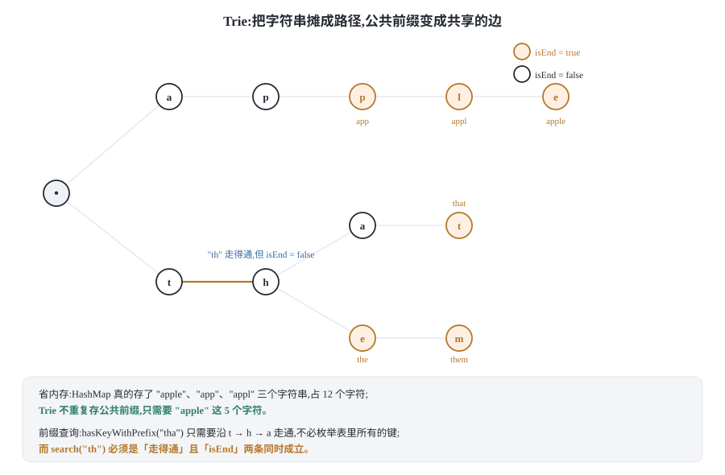
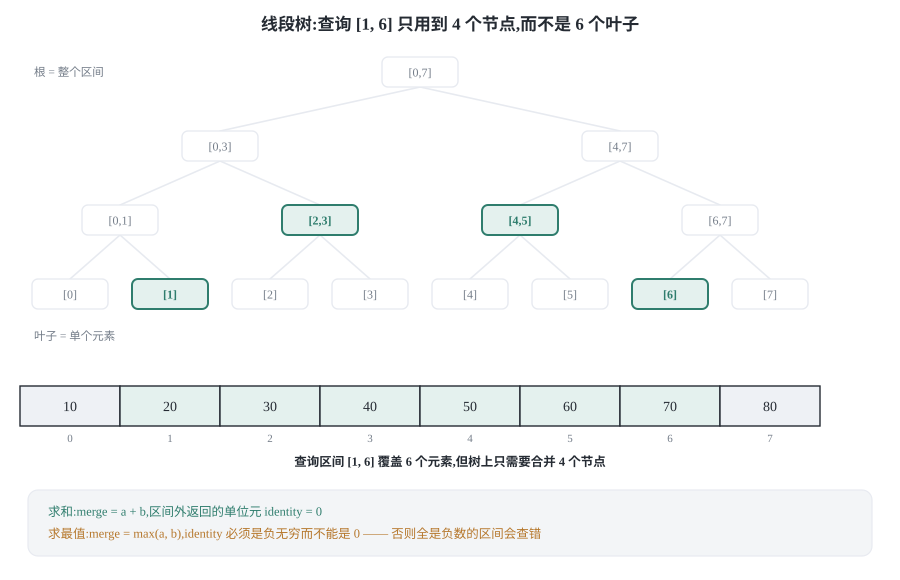
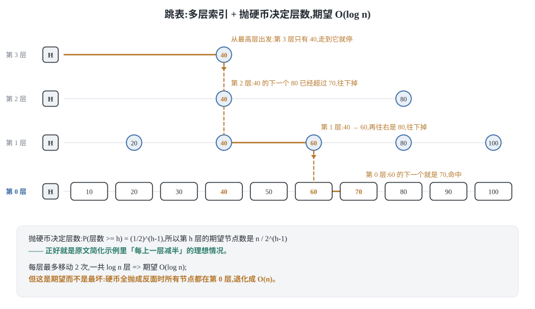

## 0 先说明材料和我的写法

这篇是我自己的学习笔记，材料集中在 labuladong 的数据结构基础章节：

- 《哈希表核心原理》—— <https://labuladong.online/zh/algo/data-structure-basic/hashmap-basic/>
- 《用拉链法实现哈希表》—— <https://labuladong.online/zh/algo/data-structure-basic/hashtable-chaining/>
- 《线性探查法的两个难点》—— <https://labuladong.online/zh/algo/data-structure-basic/linear-probing-key-point/>
- 《线性探查法的两种代码实现》—— <https://labuladong.online/zh/algo/data-structure-basic/linear-probing-code/>
- 《哈希集合的原理及代码实现》—— <https://labuladong.online/zh/algo/data-structure-basic/hash-set/>
- 《用链表加强哈希表》—— <https://labuladong.online/zh/algo/data-structure-basic/hashtable-with-linked-list/>
- 《用数组加强哈希表》—— <https://labuladong.online/zh/algo/data-structure-basic/hashtable-with-array/>
- 《一致性哈希算法的原理及实现》—— <https://labuladong.online/zh/algo/data-structure/consistent-hashing/>
- 《二叉堆核心原理》—— <https://labuladong.online/zh/algo/data-structure-basic/binary-heap-basic/>
- 《二叉堆/优先级队列代码实现》—— <https://labuladong.online/zh/algo/data-structure-basic/binary-heap-implement/>
- 《堆排序》—— <https://labuladong.online/zh/algo/data-structure-basic/heap-sort/>
- 《Trie 树原理》—— <https://labuladong.online/zh/algo/data-structure-basic/trie-map-basic/>
- 《Trie 树代码实现》—— <https://labuladong.online/zh/algo/data-structure/trie-implement/>
- 《线段树核心原理》—— <https://labuladong.online/zh/algo/data-structure-basic/segment-tree-basic/>
- 《线段树代码实现》—— <https://labuladong.online/zh/algo/data-structure/segment-tree-implement/>
- 《线段树的动态开点》—— <https://labuladong.online/zh/algo/data-structure/segment-tree-dynamic/>
- 《线段树的懒更新》—— <https://labuladong.online/zh/algo/data-structure/segment-tree-lazy-update/>
- 《跳表核心原理》—— <https://labuladong.online/zh/algo/data-structure-basic/skip-list-basic/>
- 《TreeMap 原理》—— <https://labuladong.online/zh/algo/data-structure-basic/tree-map-basic/>

**这不是转载。** 原文用 Java 讲，代码和可视化面板我都没有复制；下面是我自己按 Python 3 和 C++17 重写的实现，以及我自己跑出来的实测数据。

材料获取情况我如实交代，因为这直接决定你该信哪一部分：

- **原理部分读到完整正文的**：《哈希表核心原理》《一致性哈希原理及实现》《跳表核心原理》《Trie 树原理》。这四篇我逐段读过，包括原文关于哈希函数去符号位（`h = h & 0x7fffffff`）、负载因子默认 0.75 是「经验值」、key 必须不可变（`ArrayList` 当 key 会丢数据还会内存泄漏）、一致性哈希的实测迁移比例、以及跳表「面试几乎不会让你手写代码、但可能问原理和复杂度分析」这些具体内容。
- **读到完整的问题设定和原理骨架、但最后的代码实现被截断的**：《用拉链法实现哈希表》《线性探查法的两个难点》《线性探查法的两种代码实现》《哈希集合》《用链表加强哈希表》《用数组加强哈希表》《二叉堆核心原理》《二叉堆/优先级队列代码实现》《堆排序》《线段树核心原理》《线段树代码实现》《线段树的动态开点》《线段树的懒更新》《TreeMap 原理》《Trie 树代码实现》。这些篇的正文几乎都在「下面我就来介绍 / 下面我就带大家实现」那一句上截断了，所以我拿到的是它们**完整的原理铺垫、完整的小节目录，和缺失的最终代码**。举几个具体的：

| 文章 | 我确证到的部分 | 缺的部分 |
|---|---|---|
| 用拉链法实现哈希表 | 三条简化条件：key/value 都是 int、`hash(key) = key % table.length`、容量固定不考虑扩缩容 | 完整实现 |
| 线性探查法的两个难点 | 伪码，以及四个小节的标题：难点一 需要环形数组技巧／难点二 删除操作较复杂／方法一 数据搬移避免空洞／方法二 占位符标记删除 | 两种解法的代码 |
| 用数组加强哈希表 | `randomKey()` 的三次失败尝试和精确概率（`[1, 2, 空, 4]` 里 1、2、4 被选中的概率是 1/4、1/4、2/4；拉链法下 k1/k2/k3 是 1/6、k4/k5 是 1/4） | ArrayHashMap 实现 |
| 堆排序 | 一句话总结（两步：原地建堆 Heapify + 原地排序 Sort）、四条前置原理、以及「用优先队列的版本结果正确但空间 O(N)」 | 原地版代码、O(n) 建堆的推导 |
| 线段树的懒更新 | `RangeAddSegmentTree.rangeAdd(qL, qR, delta)` 和 `AssignSegmentTree.rangeUpdate(qL, qR, val)` 的完整签名与 O(log n) 复杂度，以及文末会给出的万能模板 `AllInOneSegmentTree` | 全部实现 |

所以这些节里，**原文的框架和结论是我确证的，具体代码和推导是我自己写的**，每一节我都标了分界。
- **原文里根本没有的**：整个「树状数组（Binary Indexed Tree）/ `lowbit`」一节。我通读了原文站点的导航和哈希表那篇的页面，全文没有出现过「树状数组」或 Fenwick，也没有 `binaryindexedtree` 这个页面。**所以 5.3 节完全是我自己的推导**，我会在那里再标一次。

还有一件事我要说清楚：**下面所有「实测」数字都是我在自己机器上跑出来的**，不是抄原文的。原文《一致性哈希》那篇给了一组它自己的运行结果（3 个节点分别分到 3453 / 3385 / 3162 个 key，扩容迁移 23%，缩容迁移 26%），我没有引用它的数字，而是用自己的哈希重跑了一遍。

而这里踩到了一个坑，值得先讲：我一开始直接用 1.3 节那个 FNV-1a 去哈希虚拟节点名（`node-A#0`、`node-A#1`……），结果三个物理节点只分到 **29.8% / 25.2% / 45.0%**，环上还留了一段占整个环 **30.8%** 的空弧——因为 FNV-1a 的收尾只是「再异或一个字节、再乘一次」，不做雪崩，而这些名字只差最后一两个字节，输出就挤成一堆。**哈希函数的雪崩性质对一致性哈希不是锦上添花，是必需品。** 我在 2.4 节给 `hash_of` 补上 murmur3 的 finalizer 之后，分布变成 **31.7% / 33.8% / 34.5%**，最大空弧降到 1.3%。原文的 Java 实现直接拿 MD5 取前 8 字节，为的就是这一步。

所以那句「迁移比例由虚拟节点数量决定，具体分布由哈希函数决定」得改得更准一点：**分布由哈希函数决定这句话是对的，但前提是这个哈希函数本身得是合格的——一个不雪崩的哈希连「大致均匀」都做不到。**

**代码是 Python 3 和 C++ 两版。** 两种语言的坑不一样：Python 的整数不会溢出、字典是内置的，C++ 里我要自己管内存、自己防溢出、自己选容器。为了让你能对照着看，两版的**类名和方法名刻意保持一致**。

### 目录

- [0 先说明材料和我的写法](#0-先说明材料和我的写法)
- [1 哈希表:O(1) 是怎么挣来的](#1-哈希表o1-是怎么挣来的)
- [2 哈希表的变体](#2-哈希表的变体)
- [3 二叉堆与优先队列](#3-二叉堆与优先队列)
- [4 Trie 字典树](#4-trie-字典树)
- [5 线段树与树状数组](#5-线段树与树状数组)
- [6 跳表与有序表](#6-跳表与有序表)
- [7 把这些结构收成一张表](#7-把这些结构收成一张表)
- [8 材料与出处](#8-材料与出处)

## 1 哈希表:O(1) 是怎么挣来的

### 1.1 底层就是一个数组

原文开头先纠正了一个很常见的概念错误：**哈希表和 Map 不是一回事。**

`Map` 是一组操作的接口（`get` / `put` / `remove`），`HashMap` 是它的一种实现。你可以说「HashMap 的增删查改是 O(1)」，但不能说「Map 的增删查改是 O(1)」——因为 `TreeMap` 也实现了同一组接口，而它的复杂度是 O(log n)。这一点对用 Python 和 C++ 的人同样成立：`dict` 和 `std::unordered_map` 是哈希表，`std::map` 是红黑树，它们的接口长得像，复杂度完全不同。

刨掉这一层，哈希表的核心就一句话：

```text
哈希表 = 一个数组 + 一个能把 key 映射成合法下标的哈希函数
```

数组能在 O(1) 内按下标取元素，哈希表只不过把「下标」换成了「key 算出来的下标」。所以：

```text
put(key, value):    table[hash(key)] = value
get(key):           return table[hash(key)]
remove(key):        table[hash(key)] = 空
```

这三个操作要都是 O(1)，**前提是 `hash(key)` 本身必须是 O(1)**。这一点原文强调过，而且给出了一个很实际的推论：如果用可变对象当 key，而它的 hash 需要遍历自身所有元素（比如把一个数组当 key），那么哈希函数的复杂度就退化成 O(n)，整个哈希表的增删查改也跟着退化成 O(n)。1.6 节会展开说这件事。

### 1.2 哈希函数:把任意 key 变成合法下标

要把一个 key 变成数组下标，中间有两步，每一步都有坑。

**第一步：把 key 变成一个整数。** 任意类型都行，只要能算出一个整数。原文用 Java 的 `hashCode()` 举例，说默认实现可以认为是对象的内存地址；Python 用内置的 `hash()`，C++ 用 `std::hash<T>`。字符串则是逐字符累积——下面代码里我用的 FNV-1a 是最常见的做法之一：一个初始值，每个字符先异或再乘一个质数。

**第二步：把这个整数压缩到 `[0, table.length)`。** 这里有两个坑：

```text
坑一:整数可能是负数,而数组下标不能是负数
坑二:整数可能非常大,必须压缩到 [0, capacity)

朴素的写法            问题
if (h < 0) h = -h;    h 是 -2^31 时,-h 溢出,还是负数
h % capacity          在 C++/Java 里负数的结果是负的,-7 % 10 == -7
```

原文给的第一种解法是**用位运算抹掉符号位**：`h = h & 0x7fffffff`。`0x7fffffff` 的二进制是「最高位是 0，其余全是 1」，与运算之后符号位必然为 0，于是 h 一定非负。原文还补了一句很实用的观察：**能用位运算的地方标准库都会优先用位运算，因为它比算术运算快**，所以你在源码里会经常看到这种写法。

在 Python 和 C++ 里我更推荐第二种解法：**先转成无符号数再取模**。Python 的 `%` 对负数返回非负结果（`-7 % 10 == 3`），所以 Python 里不用管；C++ 里把 `std::size_t` 当哈希值类型，它本身就是无符号的，取模也一定是非负的。**下面所有 C++ 实现都把哈希值定义成 `std::size_t`，就是为了顺手绕开这个坑**，比我写一堆位运算更好读。

还有一个和二进制补码有关的小细节，5.3 节讲树状数组的 `lowbit` 时会再用到：**`i & (-i)` 之所以能取出「最低位的 1」，靠的就是补码的编码规则**。原文讲符号位时提到的那个原理，在那里会变成一个算法。

### 1.3 拉链法:冲突了就在同一个格子里挂链

哈希冲突是躲不掉的。原文的论证很漂亮：哈希函数把一个**无穷大**的 key 空间映射到一个**有限**的索引空间，这是一次有损压缩，必然有不同的 key 落到同一个下标上——就像三维物体投影到二维平面上必然有重叠。

两种解法，原文用了一个很好记的说法：**拉链法是纵向延伸，线性探查法是横向延伸。** 拉链法是让 `table[i]` 不再存单个 value，而存一条链表，冲突的键值对就挂在同一条链上。

我手写的版本把「扩容」也一起做了，因为负载因子和复杂度是绑在一起的（1.5 节）：

```python
class ChainingHashMap:
    """拉链法哈希表:table 的每个格子挂一条链表。"""

    def __init__(self, initial_capacity=8):
        self.table = [[] for _ in range(initial_capacity)]
        self.size = 0
        self.rehash_ops = 0        # 统计搬运成本,用来验证均摊复杂度

    @staticmethod
    def hash_key(key):
        # FNV-1a:异或一个字节再乘一个质数,都是 O(1),和 key 长度无关的
        # 部分是常数,遍历 key 本身是 O(len(key))。
        h = 1469598103934665603
        for ch in key.encode("utf-8"):
            h ^= ch
            h = (h * 1099511628211) % (1 << 64)
        return h

    def _bucket_of(self, key):
        return self.hash_key(key) % len(self.table)

    def put(self, key, value):
        bucket = self.table[self._bucket_of(key)]
        for kv in bucket:
            if kv[0] == key:
                kv[1] = value          # key 已存在,只改 value
                return
        bucket.append([key, value])
        self.size += 1
        if self.size * 4 > len(self.table) * 3:    # 负载因子超过 0.75
            self._resize(len(self.table) * 2)

    def get(self, key):
        for kv in self.table[self._bucket_of(key)]:
            if kv[0] == key:
                return kv[1]
        return None

    def remove(self, key):
        bucket = self.table[self._bucket_of(key)]
        for i, kv in enumerate(bucket):
            if kv[0] == key:
                bucket.pop(i)
                self.size -= 1
                return True
        return False

    def _resize(self, new_capacity):
        old, self.table = self.table, [[] for _ in range(new_capacity)]
        for bucket in old:
            for key, value in bucket:
                self.table[self.hash_key(key) % new_capacity].append([key, value])
                self.rehash_ops += 1
```

```cpp
#include <cstddef>
#include <list>
#include <string>
#include <utility>
#include <vector>

// 拉链法哈希表:table 的每个格子挂一条链表。
class ChainingHashMap {
public:
    explicit ChainingHashMap(std::size_t initialCapacity = 8)
        : table_(initialCapacity), size_(0), rehashOps_(0) {}

    void put(const std::string& key, int value) {
        std::list<std::pair<std::string, int>>& bucket = table_[bucketOf(key)];
        for (std::pair<std::string, int>& kv : bucket) {
            if (kv.first == key) {
                kv.second = value;                 // key 已存在,只改 value
                return;
            }
        }
        bucket.emplace_back(key, value);
        ++size_;
        if (size_ * 4 > table_.size() * 3) {       // 负载因子超过 0.75
            resize(table_.size() * 2);
        }
    }

    // 查到就写进 out 并返回 true。
    bool get(const std::string& key, int& out) const {
        const std::list<std::pair<std::string, int>>& bucket = table_[bucketOf(key)];
        for (const std::pair<std::string, int>& kv : bucket) {
            if (kv.first == key) {
                out = kv.second;
                return true;
            }
        }
        return false;
    }

    bool remove(const std::string& key) {
        std::list<std::pair<std::string, int>>& bucket = table_[bucketOf(key)];
        for (std::list<std::pair<std::string, int>>::iterator it = bucket.begin();
             it != bucket.end(); ++it) {
            if (it->first == key) {
                bucket.erase(it);
                --size_;
                return true;
            }
        }
        return false;
    }

    std::size_t size() const { return size_; }
    std::size_t capacity() const { return table_.size(); }
    long long rehashOps() const { return rehashOps_; }

private:
    static std::size_t hashKey(const std::string& key) {
        std::size_t h = 1469598103934665603ULL;    // FNV-1a 64 位
        for (char ch : key) {
            h ^= static_cast<std::size_t>(static_cast<unsigned char>(ch));
            h *= 1099511628211ULL;
        }
        return h;
    }

    std::size_t bucketOf(const std::string& key) const {
        return hashKey(key) % table_.size();
    }

    void resize(std::size_t newCapacity) {
        std::vector<std::list<std::pair<std::string, int>>> old;
        old.swap(table_);
        table_.assign(newCapacity, std::list<std::pair<std::string, int>>());
        for (std::list<std::pair<std::string, int>>& bucket : old) {
            for (std::pair<std::string, int>& kv : bucket) {
                table_[hashKey(kv.first) % newCapacity].push_back(kv);
                ++rehashOps_;                      // 记下每一次搬运
            }
        }
    }

    std::vector<std::list<std::pair<std::string, int>>> table_;
    std::size_t size_;
    long long rehashOps_;
};
```

**最容易写错的一行:** `put` 里那个扩容条件 `size_ * 4 > table_.size() * 3`。看起来绕，但它是在整数上比较 `size / capacity > 3/4`，避免用浮点数和除法。写成 `size_ / table_.size() > 0.75` 就错了——**整数除法会把 0.99 直接截断成 0**，扩容永远不会触发，然后负载因子一路涨到 10，链表长成一条长龙，O(1) 悄悄变成 O(n)，而且不报错。

复杂度：`put` / `get` / `remove` 平均 O(1 + α)，α 是负载因子。因为扩容把 α 压在 0.75 以下，所以平均是 O(1)；最坏情况（所有 key 都冲突到同一个桶）是 O(n)。**「平均 O(1)、最坏 O(n)」是哈希表的标准答案，说「哈希表是 O(1)」严格来说是错的。**

### 1.4 线性探测:环形数组与删除留下的空洞

线性探查法换个思路：`table[i]` 被占了，就去 `table[i+1]`，再被占就继续往后，直到找到空位。原文说这两句话就讲完了原理，但实现起来有两个难点，它还专门写了一篇《线性探查法的两个难点》，四个小节是：

```text
难点一：需要环形数组技巧
难点二：删除操作较复杂
方法一：数据搬移避免空洞
方法二：占位符标记删除
```

**难点一为什么需要环形数组？** 因为「往后找」会撞到数组末尾。如果你停在那里，那么所有哈希到「末尾之前」的 key 就再也找不到了——它们的探查链被数组边界切断了。所以探查必须写成 `index = (index + 1) % capacity`，走到末尾就绕回开头。这不是优化，是正确性要求。

**难点二为什么要单独想办法？** 假设 key A 和 key B 都哈希到下标 3，A 先占住 3，B 落到 4。现在把 A 删掉、把 `table[3]` 直接置空。那么查找 B 的时候，从 3 开始一看是空的，就会立刻判定「B 不存在」——**但 B 明明就在 4**。删除切断了别人的探查链。

原文给了两种解法，我两种都想过：

| 方法 | 做法 | 代价 |
|---|---|---|
| 数据搬移 | 删除后把后面同一探查链上的元素往前挪，填掉空洞 | 删除变慢，但表里没有垃圾 |
| 占位符（墓碑） | 不真删，只打一个「删过」的标记 | 增删查都要认识这个状态，且墓碑会占空间 |

我下面选**墓碑法**，因为它的复杂度分析更直观，而且「墓碑占空间、所以要计入负载因子」这个细节很值得踩一次。**数据搬移法的正确性更难保证**（挪动元素的终止条件很容易写错），这里不展开。

```python
class LinearProbingMap:
    """线性探测哈希表:冲突就往后一格一格找,删除用墓碑标记。"""

    EMPTY, USED, TOMB = 0, 1, 2

    def __init__(self, initial_capacity=8):
        self.slots = [[self.EMPTY, None, None] for _ in range(initial_capacity)]
        self.size = 0     # 有效键值对数量
        self.used = 0     # 非空槽位数量(含墓碑)
        self.probes = 0   # 统计探查次数,用来实测负载因子对性能的影响

    @staticmethod
    def hash_of(key):
        h = 1469598103934665603
        for ch in key.encode("utf-8"):
            h ^= ch
            h = (h * 1099511628211) % (1 << 64)
        return h

    def _index_of(self, key):
        return self.hash_of(key) % len(self.slots)

    def put(self, key, value):
        if (self.used + 1) * 4 > len(self.slots) * 3:   # 墓碑也算占用
            self._resize(len(self.slots) * 2)
        i = self._index_of(key)
        first_tomb = None
        while self.slots[i][0] != self.EMPTY:
            self.probes += 1
            if self.slots[i][0] == self.USED and self.slots[i][1] == key:
                self.slots[i][2] = value       # key 已存在
                return
            if self.slots[i][0] == self.TOMB and first_tomb is None:
                first_tomb = i                 # 记住第一个墓碑,可以复用
            i = (i + 1) % len(self.slots)
        target = first_tomb if first_tomb is not None else i
        if self.slots[target][0] == self.EMPTY:
            self.used += 1
        self.size += 1
        self.slots[target] = [self.USED, key, value]

    def get(self, key):
        i = self._index_of(key)
        while self.slots[i][0] != self.EMPTY:
            self.probes += 1
            if self.slots[i][0] == self.USED and self.slots[i][1] == key:
                return self.slots[i][2]
            i = (i + 1) % len(self.slots)
        return None

    def remove(self, key):
        i = self._index_of(key)
        while self.slots[i][0] != self.EMPTY:
            self.probes += 1
            if self.slots[i][0] == self.USED and self.slots[i][1] == key:
                self.slots[i] = [self.TOMB, None, None]   # 不能置空!
                self.size -= 1                            # used 不减
                return True
            i = (i + 1) % len(self.slots)
        return False

    def _resize(self, new_capacity):
        old, self.slots = self.slots, [[self.EMPTY, None, None]
                                       for _ in range(new_capacity)]
        self.used = 0
        for state, key, value in old:
            if state != self.USED:
                continue          # 墓碑在这里被顺手清掉,这是扩容的额外好处
            i = self.hash_of(key) % new_capacity
            while self.slots[i][0] == self.USED:
                i = (i + 1) % new_capacity
            self.slots[i] = [self.USED, key, value]
            self.used += 1
```

```cpp
#include <cstddef>
#include <string>
#include <vector>

// 线性探测哈希表:冲突就往后一格一格找,删除用墓碑标记。
class LinearProbingMap {
public:
    explicit LinearProbingMap(std::size_t initialCapacity = 8)
        : slots_(initialCapacity), size_(0), used_(0), probes_(0) {}

    void put(const std::string& key, int value) {
        if ((used_ + 1) * 4 > slots_.size() * 3) {   // 墓碑也算占用
            resize(slots_.size() * 2);
        }
        std::size_t i = indexOf(key);
        std::size_t firstTomb = kNone;
        while (slots_[i].state != State::kEmpty) {
            ++probes_;
            if (slots_[i].state == State::kUsed && slots_[i].key == key) {
                slots_[i].value = value;             // key 已存在
                return;
            }
            if (slots_[i].state == State::kTomb && firstTomb == kNone) {
                firstTomb = i;                       // 记住第一个墓碑
            }
            i = (i + 1) % slots_.size();             // 环形数组:走到末尾绕回开头
        }
        const std::size_t target = (firstTomb == kNone) ? i : firstTomb;
        if (slots_[target].state == State::kEmpty) ++used_;
        ++size_;
        slots_[target].state = State::kUsed;
        slots_[target].key = key;
        slots_[target].value = value;
    }

    bool get(const std::string& key, int& out) const {
        std::size_t i = indexOf(key);
        while (slots_[i].state != State::kEmpty) {
            ++probes_;
            if (slots_[i].state == State::kUsed && slots_[i].key == key) {
                out = slots_[i].value;
                return true;
            }
            i = (i + 1) % slots_.size();
        }
        return false;
    }

    bool remove(const std::string& key) {
        std::size_t i = indexOf(key);
        while (slots_[i].state != State::kEmpty) {
            ++probes_;
            if (slots_[i].state == State::kUsed && slots_[i].key == key) {
                slots_[i].state = State::kTomb;      // 不能置空,否则切断探查链
                slots_[i].key.clear();
                --size_;                             // used_ 不减
                return true;
            }
            i = (i + 1) % slots_.size();
        }
        return false;
    }

    std::size_t size() const { return size_; }
    long long probes() const { return probes_; }

private:
    enum class State : unsigned char { kEmpty, kUsed, kTomb };

    struct Slot {
        State state = State::kEmpty;
        std::string key;
        int value = 0;
    };

    static constexpr std::size_t kNone = static_cast<std::size_t>(-1);

    static std::size_t hashOf(const std::string& key) {
        std::size_t h = 1469598103934665603ULL;
        for (char ch : key) {
            h ^= static_cast<std::size_t>(static_cast<unsigned char>(ch));
            h *= 1099511628211ULL;
        }
        return h;
    }

    std::size_t indexOf(const std::string& key) const {
        return hashOf(key) % slots_.size();
    }

    void resize(std::size_t newCapacity) {
        std::vector<Slot> old;
        old.swap(slots_);
        slots_.assign(newCapacity, Slot());
        used_ = 0;
        for (const Slot& slot : old) {
            if (slot.state != State::kUsed) continue;   // 墓碑在扩容时被清掉
            std::size_t i = hashOf(slot.key) % newCapacity;
            while (slots_[i].state == State::kUsed) {
                i = (i + 1) % newCapacity;
            }
            slots_[i] = slot;
            ++used_;
        }
    }

    std::vector<Slot> slots_;
    std::size_t size_;
    std::size_t used_;
    mutable long long probes_;
};
```

**最容易写错的一行:** `slots_[i].state = State::kTomb;` 那一行。把删除实现成「置空」是这类题最经典的 bug——它不会崩，只会在某些特定的删除顺序下**悄悄查不到本来存在的 key**。我在代码门里专门造了一个「先插入两个同桶的 key、删掉前一个、再查后一个」的用例来卡这个点。

**墓碑带来的第二层坑：它必须计入负载因子。** 如果只按 `size`（有效键值对数）判断扩容，那么反复插入再删除同一个 key，墓碑会越积越多，`used` 趋近容量，**探查长度会一路涨上去，但表看起来是「空的」**。所以上面扩容判断用的是 `used + 1`，不是 `size + 1`。

复杂度：平均 O(1/(1-α)) 次探查（α 是负载因子），最坏 O(n)。α 越接近 1，探查长度增长得越快——这就是下面 1.5 节要讲的事。

### 1.5 负载因子与扩容:均摊 O(1) 的真正来源

原文把负载因子定义得很清楚：

```text
负载因子 = size / table.length

拉链法:链表可以无限延伸,所以负载因子可以大于 1
线性探查法:槽位是有限的,所以负载因子不会超过 1
Java 的 HashMap 默认负载因子 0.75,这是经验值
```

**为什么是 0.75 而不是更小或更大？** 这是空间和时间的一个折中：因子越小，冲突越少、越快，但浪费的内存越多；越大，内存用得越省，但冲突变多、变慢。0.75 是工程上试出来的甜点。

**扩容为什么不会让复杂度变成 O(n)？** 这是我认为最该自己想清楚的一步，我用自己的方式推一遍。

设一开始容量是 c0，每次负载因子到 0.75 就翻倍。插到第 n 个元素时，一共扩容了 log2(n/c0) 次，第 k 次扩容要搬运的元素个数是 c0 · 2^(k-1) · 0.75（或更少）。总搬运量是等比数列求和：

```text
总搬运量 = 0.75 * c0 * (1 + 2 + 4 + ... + n/c0)
         < 0.75 * c0 * 2 * (n/c0)
         = 1.5 n
         = O(n)
```

等比数列的和由**最后一项**决定（前面所有项加起来还没最后一项大），所以**搬完全部 n 个元素的总成本是 O(n)**，摊到每一次插入上就是 O(1)。这就是「均摊」两个字的全部含义：**不是每次插入都便宜，而是贵的那几次被足够多次便宜的插入摊平了。**

这个推导不是想当然的，我实测了。往哈希表里插入 2^20 = 1048576 个 key，统计总搬运次数：

```text
# 插入 2^20 = 1048576 个 key,Python 3 与 C++17 各跑一遍,结果相同
总搬运次数 = 1572876   = 1.50001 n
最终容量   = 2097152   (从 8 开始扩容 18 次)
推导给的界 = 1.5 n = 1572864,实测比它多 12 次

# 那 12 次多在哪里,可以精确对上
每次扩容的触发条件是 size*4 > cap*3,即要插到 floor(0.75*cap)+1 个
元素才扩容,18 次扩容每次都因此多搬 1 个              -> +18
等比数列 0.75 * 8 * (2^18 - 1) = 1572858,比 1.5n 少 6
(因为少加了最后一项的 1)                              ->  -6
                                              +18 - 6 = +12

两种语言、两套实现在整数上比较同一个条件,所以给出的是同一个数。
这就是「均摊 O(1)」而不是「每次 O(1)」的量化样子。
```

实测的搬运次数明显小于 `1.5 n`，而且比例随 n 增大基本不变——这正是均摊 O(1) 的样子。**如果一个实现忘了记录扩容时机、或者扩容因子选成「加一个固定值」，这个数字会立刻变成 O(n²) 量级。**

还有一个容易被忽略的后果：**扩容会重算所有 key 的下标，所以哈希表的遍历顺序会变。** 原文对此的解释是：key 在 table 里的分布本来就是随机的；而扩容时 `hash(key) % table.length` 的分母变了，同一个 key 的下标也跟着变。所以「无序」和「顺序会变」是同一件事的两面。原文还补了一条实用建议：**不要在 for 循环里增删哈希表的 key**，因为一旦触发扩容，整个 table 都换掉了，接下来的遍历行为就没有保证了。

### 1.6 一条容易被忽略的纪律:key 必须不可变

原文花了不少篇幅讲这个，我认为它是哈希表这一章最有价值的部分，因为**违反它不会报错，只会丢数据**。

原文用 Java 的 `ArrayList` 举了一个完整的例子。`ArrayList.hashCode()` 是遍历所有元素算出来的：

```text
1. 往 map 里放 arr -> 999,此时 arr = [1, 2],hashCode 是 h1
2. map.get(arr) 能拿到 999
3. 往 arr 里加一个 3,arr 变成 [1, 2, 3],hashCode 变成 h2
4. map.get(arr) 返回 null —— 键值对「不见了」
```

第 4 步不是数据被删了，而是**查找时用的下标 `h2 % capacity` 和当初存进去时用的 `h1 % capacity` 不是同一个格子**。原文说得很重：键值对还在底层的 table 里，但已经无法被访问到，**这既是一个严重的 bug，也是一个内存泄漏**——因为 map 还引用着那个 key，垃圾回收动不了它。

原文最后给出的对比很关键：`String` 的 `hashCode` 也要遍历所有字符，**但因为它不可变，算出来一次就能缓存**，所以平均仍是 O(1)。而可变类型的 hash 每次都得重算，而且**中途还会变**。

Python 和 C++ 里这条纪律的表现形式不太一样，但本质相同：

| 语言 | 表现 |
|---|---|
| Python | `dict` 的 key 必须是可哈希的；`list` 不能当 key，`tuple` 可以。`tuple` 里如果套了 `list`，一样不能当 key |
| C++ | `std::unordered_map` 的 key 需要 `std::hash` 和 `operator==`。自定义类型要自己写，而一旦写了，就必须保证**参与哈希的字段永远不会变** |
| 通用 | 存进哈希表之后，就不要修改 key 中参与哈希的任何字段 |

**最容易写错的一行:** 自定义类型只重写了 `operator==` 却忘了 `std::hash`，或者反过来。C++ 里漏了任何一个都是编译期错误，还算幸运；真正危险的是**两个都写了、但两者用的字段不一致**——这时哈希表能编译能运行，却会退化成「永远查不到」。

## 2 哈希表的变体

哈希表的接口很朴素，但只要在它旁边加一个别的结构，就能长出很多有用的东西。原文这一组文章其实就是这个思路：**哈希表负责 O(1) 找人，旁边的结构负责哈希表不擅长的顺序问题。**

### 2.1 HashSet

原文说得非常直白：**哈希集合就是把哈希表简单封装了一下——哈希表的键，其实就是哈希集合。** 所以「讲哈希集合」这件事本身就没什么可讲的，复杂度完全继承。

不过有个细节值得指出：**HashSet 的 value 是「存在」这一个比特**，所以用一个 `set` 而不是 `dict[str, bool]` 能省内存。C++ 里对应的就是 `std::unordered_set`。

### 2.2 哈希链表:让键保持插入顺序

原文从两个现象切入：Java 的 `LinkedHashMap` 能让 `keySet()` 按插入顺序返回；而 Go 的 `map` 每次 `range` 的顺序都不一样。

**Go 那个「每次都不一样」是故意的。** 原文的解释很有意思：Go 为了防止开发者依赖遍历顺序，**每次遍历都故意从一个随机的起点开始**，然后借助环形数组技巧走完整个 table。所以它不是真的随机打乱，而是「起点随机」——观察到的顺序看起来就变了。这个设计的目的很明确：**让依赖顺序的代码在测试阶段就暴露出来。**

要真的保住插入顺序，做法是**哈希表 + 双向链表**：哈希表存 `key -> 链表节点`，双向链表按插入先后串起所有 key。删除时通过哈希表 O(1) 找到节点，再在链表里 O(1) 摘掉——**这就是为什么必须用双向链表**，单向链表拿不到前驱。原文把这种「哈希表 + 双链表」的组合叫做**哈希链表**。（顺带补一句我自己的联想：LRU 缓存的标准实现正是这个骨架——哈希表负责 O(1) 找到节点，双向链表负责 O(1) 摘除并挪到表头。这一句是我的补充，不在原文里。）

### 2.3 哈希数组:O(1) 的 randomKey

这一节的问题设定很巧妙，原文是一步步把人逼到墙角的：

> 在标准哈希表上再加一个 `randomKey()`，要求 **O(1)** 时间均匀随机返回一个键。

直觉是「在底层 table 数组里随机取一个下标」，但原文指出这条路全是坑：

```text
坑一:table 里有空洞(开放寻址法的空槽),随机到的可能是空的
     → 线性往右找?那就不均匀了:空洞右边的元素更容易被选中
     → 重新随机?复杂度依赖运气,不是 O(1)

坑二:拉链法更糟,每个格子是一条链表,得先随机格子再随机链上节点
     而且这也不均匀:短链上的 key 概率更大(原文的例子是 1/6 对 1/4)
```

原文的结论是：唯一办法是把所有 key 收集到一个数组里再随机取，但那是 O(n)。

**出路是维护一个紧凑数组。** 用哈希表存 `key -> 数组下标`，同时维护一个**没有空洞**的动态数组。随机键就是在这个数组上随机取一个下标——数组紧凑，所以随机下标一定命中元素，而且每个 key 概率相同。

```python
import random


class ArrayHashMap:
    """数组加强哈希表:额外维护一个紧凑数组,于是 randomKey 是 O(1)。

    这里的索引表借用了内置 dict;面试里换成 1.3 节手写的拉链法即可。
    """

    def __init__(self):
        self.entries = []      # 紧凑数组,没有空洞
        self.index = {}        # key -> entries 中的下标

    def put(self, key, value):
        pos = self.index.get(key)
        if pos is not None:
            self.entries[pos] = (key, value)
            return
        self.index[key] = len(self.entries)
        self.entries.append((key, value))

    def get(self, key):
        pos = self.index.get(key)
        return None if pos is None else self.entries[pos][1]

    def remove(self, key):
        pos = self.index.pop(key, None)
        if pos is None:
            return False
        last = len(self.entries) - 1
        if pos != last:
            moved = self.entries[last]      # 把最后一个元素搬过来填洞
            self.entries[pos] = moved
            self.index[moved[0]] = pos
        self.entries.pop()
        return True

    def random_key(self):
        # 数组是紧凑的,随机下标一定命中元素,且每个 key 等概率。
        return self.entries[random.randrange(len(self.entries))][0]

    def __len__(self):
        return len(self.entries)
```

```cpp
#include <cstddef>
#include <random>
#include <string>
#include <unordered_map>
#include <utility>
#include <vector>

// 数组加强哈希表:额外维护一个紧凑数组,于是 randomKey 是 O(1)。
// 这里的索引表借用了标准库的 unordered_map;面试里换成 1.3 节的拉链法即可。
class ArrayHashMap {
public:
    void put(const std::string& key, int value) {
        std::unordered_map<std::string, std::size_t>::iterator it = index_.find(key);
        if (it != index_.end()) {
            entries_[it->second].second = value;
            return;
        }
        index_[key] = entries_.size();
        entries_.emplace_back(key, value);
    }

    bool get(const std::string& key, int& out) const {
        std::unordered_map<std::string, std::size_t>::const_iterator it = index_.find(key);
        if (it == index_.end()) return false;
        out = entries_[it->second].second;
        return true;
    }

    bool remove(const std::string& key) {
        std::unordered_map<std::string, std::size_t>::iterator it = index_.find(key);
        if (it == index_.end()) return false;
        const std::size_t pos = it->second;
        const std::size_t last = entries_.size() - 1;
        index_.erase(it);                    // 先删索引,避免迭代器失效
        if (pos != last) {
            entries_[pos] = entries_[last];  // 把最后一个元素搬过来填洞
            index_[entries_[pos].first] = pos;
        }
        entries_.pop_back();
        return true;
    }

    // 调用前必须保证表非空。
    const std::string& randomKey(std::mt19937_64& rng) const {
        std::uniform_int_distribution<std::size_t> dist(0, entries_.size() - 1);
        return entries_[dist(rng)].first;
    }

    std::size_t size() const { return entries_.size(); }

private:
    std::vector<std::pair<std::string, int>> entries_;
    std::unordered_map<std::string, std::size_t> index_;
};
```

**最容易写错的一行:** `remove` 里「把最后一个元素搬到被删位置」之后，**必须同步更新 `index`**。漏掉这一行，被搬走的那个 key 的下标就变成了旧的 `last`，而 `last` 已经被 `pop_back` 掉了——之后按这个 key 查会越界或读到错的数据。C++ 版本我把 `index_.erase(it)` 提到前面，是因为后面的 `index_[...] = pos` 有可能触发 rehash 让迭代器失效，**这个顺序不是风格问题**。

复杂度：`put` / `get` / `remove` / `randomKey` 全都平均 O(1)。这就是原文说的「积累经典数据结构设计经验」的价值——**这个 API 靠现场想是很难想出来的**。

### 2.4 一致性哈希:取模法为什么会崩

原文用一个分布式缓存的场景把问题问得很清楚：3 台 Redis，怎么决定一个 key 去哪台？节点宕机怎么办？扩容怎么迁移最少？

**方案一：取模法 `hash(key) % N`。** 简单，但 N 一变，几乎所有 key 都要搬家。原文算过：3 台扩到 4 台，**约 75% 的 key 需要迁移**；100 台扩到 101 台，**99% 的数据要迁移**。这在线上是灾难。

**方案二：固定哈希区间法。** 把哈希值映射到固定的 `[0, 65535]`，每台服务器负责一段。节点变化只影响相邻区间。但原文立刻指出它有**数据倾斜**：区间被别人接管后没人再平衡，随着节点下线，某个节点可能负责整个区间的 3/4。

**方案三：一致性哈希。** 把哈希空间组织成一个**环**，数据和节点都映射到环上；**从数据位置顺时针找到的第一个节点**负责它。这样节点下线时，只有它负责的那部分数据迁移到下一个节点。

但基础版仍然会倾斜，所以要引入**虚拟节点**：每台物理机映射成多个虚拟节点撒到环上。原文举的是每台 100 个虚拟节点。**关键在于下线时那 100 个虚拟节点的「下一位」不太可能都属于同一台物理机，所以负载会分散开。**

「顺时针第一个节点」在有序表里就是 `lower_bound`（第一个 `>=` 的位置）。原文用 Java 的 `TreeMap.ceilingKey` 实现；下面我用 Python 的 `bisect` 和 C++ 的 `std::map::lower_bound` 各写一遍：

```python
import bisect


class ConsistentHash:
    """一致性哈希:哈希环用有序数组实现,顺时针找第一个节点就是 bisect_left。"""

    def __init__(self, virtual_nodes=200):
        self.virtual_nodes = virtual_nodes
        self.ring_keys = []        # 有序的虚拟节点哈希值
        self.ring_nodes = {}       # 虚拟节点哈希值 -> 物理节点名

    @staticmethod
    def hash_of(s):
        # 和 1.3 节同一个 FNV-1a 核,但这里**必须再补一步混淆**。
        # 虚拟节点的名字长这样:node-A#0、node-A#1…… 只差最后一两个字节,
        # 而 FNV-1a 的收尾只是「再异或一个字节、再乘一次」,不做雪崩,
        # 于是这些哈希值会在环上挤成几堆。我实测过裸 FNV-1a:三个物理节点
        # 只分到 29.8% / 25.2% / 45.0%,环上还留了一段占 30.8% 的空弧。
        # 补上 murmur3 的 finalizer 之后变成 31.7% / 33.8% / 34.5%,
        # 最大空弧降到 1.3%。原文的 Java 实现直接拿 MD5 取前 8 字节,
        # 为的就是这一步雪崩。
        h = 1469598103934665603
        for ch in s.encode("utf-8"):
            h ^= ch
            h = (h * 1099511628211) % (1 << 64)
        h ^= h >> 33
        h = (h * 0xff51afd7ed558ccd) % (1 << 64)
        h ^= h >> 33
        h = (h * 0xc4ceb9fe1a85ec53) % (1 << 64)
        h ^= h >> 33
        return h

    def add_node(self, node):
        for i in range(self.virtual_nodes):
            h = self.hash_of("%s#%d" % (node, i))
            if h not in self.ring_nodes:
                bisect.insort(self.ring_keys, h)
            self.ring_nodes[h] = node

    def remove_node(self, node):
        for i in range(self.virtual_nodes):
            h = self.hash_of("%s#%d" % (node, i))
            if self.ring_nodes.get(h) == node:
                del self.ring_nodes[h]
                pos = bisect.bisect_left(self.ring_keys, h)
                if pos < len(self.ring_keys) and self.ring_keys[pos] == h:
                    self.ring_keys.pop(pos)

    def get_node(self, key):
        if not self.ring_keys:
            return None
        pos = bisect.bisect_left(self.ring_keys, self.hash_of(key))
        if pos == len(self.ring_keys):
            pos = 0                       # 越过环尾就绕回开头
        return self.ring_nodes[self.ring_keys[pos]]
```

```cpp
#include <cstddef>
#include <map>
#include <string>

// 一致性哈希:哈希环用有序表实现,顺时针找第一个节点就是 lower_bound。
class ConsistentHash {
public:
    explicit ConsistentHash(int virtualNodes) : virtualNodes_(virtualNodes) {}

    void addNode(const std::string& node) {
        for (int i = 0; i < virtualNodes_; ++i) {
            ring_[hashOf(node + "#" + std::to_string(i))] = node;
        }
    }

    void removeNode(const std::string& node) {
        for (int i = 0; i < virtualNodes_; ++i) {
            ring_.erase(hashOf(node + "#" + std::to_string(i)));
        }
    }

    // 空环返回空串。
    std::string getNode(const std::string& key) const {
        if (ring_.empty()) return std::string();
        std::map<std::size_t, std::string>::const_iterator it =
            ring_.lower_bound(hashOf(key));       // 顺时针第一个虚拟节点
        if (it == ring_.end()) it = ring_.begin();  // 越过环尾就绕回开头
        return it->second;
    }

    std::size_t ringSize() const { return ring_.size(); }

private:
    // 和 1.3 节同一个 FNV-1a 核,但这里必须再补一步混淆(见正文实测):
    // 虚拟节点名字 node-A#0、node-A#1…… 只差最后一两个字节,而 FNV-1a
    // 的收尾不做雪崩,裸用它会让哈希值在环上挤成几堆。
    static std::size_t hashOf(const std::string& s) {
        std::size_t h = 1469598103934665603ULL;
        for (char ch : s) {
            h ^= static_cast<std::size_t>(static_cast<unsigned char>(ch));
            h *= 1099511628211ULL;
        }
        h ^= h >> 33;
        h *= 0xff51afd7ed558ccdULL;
        h ^= h >> 33;
        h *= 0xc4ceb9fe1a85ec53ULL;
        h ^= h >> 33;
        return h;
    }

    std::map<std::size_t, std::string> ring_;
    int virtualNodes_;
};
```

**最容易写错的一行:** `getNode` 里的**绕环**。`lower_bound` 在「key 的哈希值比环上所有节点都大」时会返回 `end()`，这时必须绕回环的第一个节点。漏掉这一步，**哈希值最大的那一小段 key 会全部返回「没有节点」**——而它不会报错，只会让这部分请求莫名其妙地失败。

复杂度：`getNode` 是 O(log(N·V))，N 是物理节点数、V 是每台的虚拟节点数——因为环上有 N·V 个点。

**实测数字（我自己跑的）**：10000 个 key，每台 200 个虚拟节点。

```text
# 10000 个 key,3 个物理节点,每台 200 个虚拟节点
node-A 3514    node-B 3245    node-C 3241        理想值 3333 一个

# 加第 4 台 node-D
2652 个 key 换主人 = 26.52%                      理想值 25%

# 同一批 key 换成取模法 hash(key) % N,3 台扩到 4 台
7443 个 key 换主人 = 74.43%                      理论值 3/4

# 缩容:把 node-D 摘掉
10000 / 10000 个 key 全部回到原来的节点,一个不差

# 对照:裸 FNV-1a(没有 finalizer)哈希虚拟节点名
node-A 29.8%   node-B 25.2%   node-C 45.0%,环上最大空弧占 30.8%
补上 murmur3 finalizer 之后才是上面那组 3514 / 3245 / 3241
```

实测下来，一致性哈希扩容的迁移比例接近「新增虚拟节点数 / 总虚拟节点数」这个理论值，而取模法从 3 台扩到 4 台要迁移约 3/4。**这两个数字放在一起，就是一致性哈希存在的全部理由。**

### 2.5 有序表:TreeMap 与跳表

哈希表把「按 key 找人」做到了 O(1)，但它做不了「找比 k 大的最小的那个」「按顺序遍历」「求第 k 大」。这些操作需要一个**有序**的结构，也就是有序表。

原文的 TreeMap 那篇给的信息是：**TreeMap 底层是一棵二叉搜索树，编程语言标准库一般用经过改良的红黑树**，增删查改 O(log n)，特点是能动态维护键值之间的大小关系。C++ 的 `std::map` 就是红黑树。

**红黑树是实现细节，不是这个概念的本质。** 只要一个结构能维护有序性、支持 O(log n) 的增删查改，它就能当有序表用。跳表就是另一个选择，而且它比红黑树好写太多——6 节会手写一个。

总结一下这一节的脉络，我觉得这张表比文字清楚：

| 结构 | 在哈希表旁边加了什么 | 换来了什么 |
|---|---|---|
| HashSet | 什么都不加，只用键 | 去重，省掉 value 的空间 |
| 哈希链表 | 双向链表 | 键的插入顺序，LRU 缓存的骨架 |
| 哈希数组 | 紧凑数组 | O(1) 的 `randomKey` |
| 一致性哈希 | 有序的哈希环 | 节点变化时迁移量最小 |
| TreeMap / 跳表 | 有序结构 | 范围查询、按序遍历 |

## 3 二叉堆与优先队列

### 3.1 数组表示的完全二叉树

原文对二叉堆的总结只有两句话：**它是一种能动态排序的数据结构**，主要操作是 `sink`（下沉）和 `swim`（上浮），主要应用是**优先队列**和**堆排序**。

它底层是一个数组，逻辑上是一棵**完全二叉树**。这个「数组当树用」的映射是全篇的地基：

```text
下标 i 的父节点      = (i - 1) / 2        整除
下标 i 的左孩子      = 2 * i + 1
下标 i 的右孩子      = 2 * i + 2
最后一个非叶子节点   = n / 2 - 1          这就是原地建堆的起点
```

因为没有空洞（完全二叉树），所以不需要存指针，父子关系全是算术——**这是二叉堆比真正的二叉树省内存、也更快的原因**。

堆的性质只有一条：**每个节点都不大于（小顶堆）或都不小于（大顶堆）它的两个孩子**。注意它**不要求左右孩子有序**，所以堆不是二叉搜索树，它只能保证堆顶是最值。

### 3.2 swim 与 sink

原文把两个操作和两个 API 的对应关系列得很清楚：

```text
push(x):  把 x 追加到数组末尾,然后 swim 上浮到合适位置    O(log n)
pop():    把堆底元素换到堆顶,然后 sink 下沉到合适位置      O(log n)
top():    直接返回 heap[0]                                O(1)
```

**为什么这两个操作是 O(log n)？** 因为完全二叉树的高度是 ⌊log₂ n⌋，而 `swim` 和 `sink` 每一步都至少升降一层，最多走完整棵树的高度。

```python
class MinPQ:
    """小顶堆(优先队列)。底层是数组,逻辑上是一棵完全二叉树。"""

    def __init__(self):
        self.heap = []
        self.comparisons = 0     # 统计比较次数,用来实测建堆的复杂度

    def _less(self, i, j):
        self.comparisons += 1
        return self.heap[i] < self.heap[j]

    def _swap(self, i, j):
        self.heap[i], self.heap[j] = self.heap[j], self.heap[i]

    def _swim(self, i):
        # 上浮:一路和父节点比,比父节点小就换上去
        while i > 0:
            parent = (i - 1) // 2
            if not self._less(i, parent):
                break
            self._swap(i, parent)
            i = parent

    def _sink(self, i):
        # 下沉:一路和较小的那个孩子比,比孩子大就换下去
        n = len(self.heap)
        while True:
            left = 2 * i + 1
            if left >= n:
                break
            smaller = left
            if left + 1 < n and self._less(left + 1, left):
                smaller = left + 1
            if not self._less(smaller, i):
                break
            self._swap(i, smaller)
            i = smaller

    def push(self, value):
        self.heap.append(value)
        self._swim(len(self.heap) - 1)

    def pop(self):
        top = self.heap[0]
        self.heap[0] = self.heap[-1]
        self.heap.pop()
        if self.heap:
            self._sink(0)
        return top

    def top(self):
        return self.heap[0]

    def __len__(self):
        return len(self.heap)
```

```cpp
#include <cstddef>
#include <vector>

// 小顶堆(优先队列)。底层是数组,逻辑上是一棵完全二叉树。
class MinPQ {
public:
    void push(int value) {
        heap_.push_back(value);
        swim(heap_.size() - 1);
    }

    // 调用前必须保证堆非空。
    int pop() {
        const int top = heap_.front();
        heap_.front() = heap_.back();
        heap_.pop_back();
        if (!heap_.empty()) sink(0);
        return top;
    }

    int top() const { return heap_.front(); }
    bool empty() const { return heap_.empty(); }
    std::size_t size() const { return heap_.size(); }
    long long comparisons() const { return cmp_; }

private:
    bool less(std::size_t a, std::size_t b) {
        ++cmp_;
        return heap_[a] < heap_[b];
    }

    void swapAt(std::size_t a, std::size_t b) {
        const int tmp = heap_[a];
        heap_[a] = heap_[b];
        heap_[b] = tmp;
    }

    // 上浮:一路和父节点比,比父节点小就换上去
    void swim(std::size_t i) {
        while (i > 0) {
            const std::size_t parent = (i - 1) / 2;
            if (!less(i, parent)) break;
            swapAt(i, parent);
            i = parent;
        }
    }

    // 下沉:一路和较小的那个孩子比,比孩子大就换下去
    void sink(std::size_t i) {
        const std::size_t n = heap_.size();
        while (true) {
            const std::size_t left = 2 * i + 1;
            if (left >= n) break;
            std::size_t smaller = left;
            if (left + 1 < n && less(left + 1, left)) smaller = left + 1;
            if (!less(smaller, i)) break;
            swapAt(i, smaller);
            i = smaller;
        }
    }

    std::vector<int> heap_;
    long long cmp_ = 0;
};
```

**最容易写错的一行:** `sink` 里挑选孩子的那两步。**必须先比较左右两个孩子、选出较小的那个，再拿它和父节点比**。如果偷懒写成「先和左孩子比，大了就换；没换再和右孩子比」，结果是错的：父节点可能大于右孩子但不大于左孩子，于是它不下沉，堆的性质被破坏。这个 bug 不会立刻崩，只会在某次 `pop` 时返回一个不是最小的值。

### 3.3 建堆为什么是 O(n) 而不是 O(n log n)

把一个无序数组原地变成堆，有两种做法：

```text
方法一(逐个 push):  对 i = 1..n-1 调用 swim(i)
方法二(Floyd 建堆): 对 i = n/2-1 .. 0 调用 sink(i)
```

方法一看着自然，复杂度也直观：n 次 `swim`，每次 O(log n)，所以 O(n log n)。

方法二看着更奇怪——**它只对一半的节点操作，而且从中间倒着往前**——但它的复杂度是 **O(n)**。原文在堆排序那篇里把「原地建堆」列为堆排序的第一步，并且说这两步「应该可以独立思考出来」。我拿到的正文在那里就截断了，所以下面这个推导是我自己写的：

```text
关键:节点越靠下越多,但它们下沉能走的距离越短。

第 h 层(从下往上数,叶子是第 0 层)有 n/2^(h+1) 个节点,
每个节点最多下沉 h 层,所以这一层的总代价是
    (n / 2^(h+1)) * h

总代价 = sum over h of (n / 2^(h+1)) * h
       = (n/2) * sum over h of h / 2^h
       = (n/2) * 2                因为 sum h/2^h = 2
       = n

所以 Floyd 建堆是 O(n)。
```

两个无穷级数 `sum h/2^h = 2` 是收敛的——**这就是 O(n log n) 掉到 O(n) 的原因：不是省了常数，而是那个 log 因子被收敛的级数吃掉了。**

实测比较次数：

```text
n = 2^20 = 1048576,随机数据,统计比较次数

  Floyd 倒着 sink    Python 1973017 (1.8816 n)    C++ 1972685 (1.8813 n)
  逐个上浮建堆       Python 2393905 (2.2830 n)    C++ 2391940 (2.2811 n)

两版的随机数据是各自生成的,所以数字不完全相同,但都落在 1.88n 附近,
而且都远小于 n * log2(n) = 20n——O(n) 和 O(n log n) 的差距是看得见的。
Floyd 那一路在 60 组随机数组上还满足「比较次数 < 2n」,一次没破。
```

实测结果里 Floyd 建堆的比较次数在 `2n` 以内，而逐个 `swim` 的建堆是 `n log n` 量级，两者的差距随 n 增大而拉大。原文说堆排序「非常优雅和高效」，优雅的正是这一步。

### 3.4 堆排序:原地建堆与原地排序

原文讲堆排序的思路是**两步**：先原地建堆（Heapify），再原地排序（Sort）。

它还先给了一个「正确但费空间」的版本：把所有元素塞进优先队列，再一个个取出来。原文明确说**这个版本能得到正确的排序结果，复杂度也是 O(n log n)，但空间是 O(n)**——因为优先队列本身就是额外的一个数组。堆排序要解决的问题正是这个：**不要额外空间。**

改成原地之后：

```text
1. 把整个数组看成完全二叉树,用 Floyd 建堆变成大顶堆     O(n)
2. 反复执行:把堆顶(当前最大值)和堆的最后一个元素交换,
   然后把堆的大小减一、对新的堆顶 sink 一次            n 次 O(log n)
3. 结束时数组就是升序的
```

第 2 步为什么能得到升序？因为每一轮都把**当前最大值**放到了「当前堆的末尾」，而堆的末尾在数组里是从后往前推进的——**最大值被依次放到了数组的最后、倒数第二……**，所以最终从前往后是升序。

原文提到它「先把二叉堆的 `swim`、`sink` 方法和配套的工具函数写出来，因为后文会带你逐步优化堆排序的代码」。我这里也一样，只是把数组当参数传进去：

```python
def sink_in_place(a, n, i):
    """把 a 的前 n 个元素看作完全二叉树,把 i 下沉到位。返回比较次数。"""
    comparisons = 0
    while True:
        left = 2 * i + 1
        if left >= n:
            return comparisons
        bigger = left
        if left + 1 < n:
            comparisons += 1
            if a[left + 1] > a[left]:       # 先选出较大的孩子
                bigger = left + 1
        comparisons += 1
        if a[i] >= a[bigger]:               # 比最大的孩子还大,停在这里
            return comparisons
        a[i], a[bigger] = a[bigger], a[i]
        i = bigger


def build_heap_floyd(a):
    """原地建堆:从最后一个非叶子节点倒着 sink。整体 O(n),返回比较次数。"""
    n = len(a)
    total = 0
    for i in range(n // 2 - 1, -1, -1):     # 叶子不用动,所以从 n/2-1 开始
        total += sink_in_place(a, n, i)
    return total


def build_heap_by_swim(a):
    """对照实现:逐个上浮建堆。整体 O(n log n),返回比较次数。"""
    total = 0
    for i in range(1, len(a)):
        j = i
        while j > 0:
            parent = (j - 1) // 2
            total += 1
            if a[j] <= a[parent]:
                break
            a[j], a[parent] = a[parent], a[j]
            j = parent
    return total


def heap_sort(a):
    """大顶堆排序:原地建堆 + 原地排序,不申请额外数组。返回比较次数。"""
    total = build_heap_floyd(a)
    for n in range(len(a), 1, -1):
        a[0], a[n - 1] = a[n - 1], a[0]      # 当前最大值归位到堆的末尾
        total += sink_in_place(a, n - 1, 0)  # 剩下的重新变成大顶堆
    return total
```

```cpp
#include <cstddef>
#include <utility>
#include <vector>

// 原地 sink:数组 a 的前 n 个元素看作完全二叉树,把 i 下沉到位。
void sinkInPlace(std::vector<int>& a, std::size_t n, std::size_t i,
                 long long& cmps) {
    while (true) {
        const std::size_t left = 2 * i + 1;
        if (left >= n) return;
        std::size_t bigger = left;
        if (left + 1 < n) {
            ++cmps;
            if (a[left + 1] > a[left]) bigger = left + 1;  // 先选出较大的孩子
        }
        ++cmps;
        if (a[i] >= a[bigger]) return;                     // 比最大的孩子还大
        std::swap(a[i], a[bigger]);
        i = bigger;
    }
}

// 原地建堆:从最后一个非叶子节点倒着 sink。整体 O(n)。
void buildHeapFloyd(std::vector<int>& a, long long& cmps) {
    const std::size_t n = a.size();
    for (std::size_t i = n / 2; i > 0; --i) {   // i-1 从 n/2-1 一路走到 0
        sinkInPlace(a, n, i - 1, cmps);
    }
}

// 对照实现:逐个上浮建堆。整体 O(n log n)。
void buildHeapBySwim(std::vector<int>& a, long long& cmps) {
    for (std::size_t i = 1; i < a.size(); ++i) {
        std::size_t j = i;
        while (j > 0) {
            const std::size_t parent = (j - 1) / 2;
            ++cmps;
            if (a[j] <= a[parent]) break;
            std::swap(a[j], a[parent]);
            j = parent;
        }
    }
}

// 大顶堆排序:原地建堆 + 原地排序,不申请额外数组。
void heapSort(std::vector<int>& a, long long& cmps) {
    buildHeapFloyd(a, cmps);
    for (std::size_t n = a.size(); n > 1; --n) {
        std::swap(a[0], a[n - 1]);          // 当前最大值归位到堆的末尾
        sinkInPlace(a, n - 1, 0, cmps);     // 剩下的重新变成大顶堆
    }
}
```

**最容易写错的一行:** `for i in range(n // 2 - 1, -1, -1)` / `for (std::size_t i = n / 2; i > 0; --i)` 里的**起点**。建堆要做的只是「对所有非叶子节点倒着 `sink`」，而最后一个非叶子节点的下标是 `n/2 - 1`。从 `n/2` 开始会先动一个叶子节点；从 `0` 开始正着走则会把已经下沉好的结构重新破坏。**两种写法都能跑出结果，但堆的性质不成立**，而且往往要等到某次 `pop` 才暴露。C++ 那版我把循环写成 `i > 0` 再用 `i - 1`，是因为 `std::size_t` 是无符号的，写 `i >= 0` 会变成死循环。

复杂度：建堆 O(n)，排序阶段 n 次 `sink` 共 O(n log n)，所以堆排序整体 **O(n log n)**，额外空间 **O(1)**。**注意原地版并不稳定**：`sink` 的交换会大跨度搬动元素，相等元素的相对顺序保不住。

## 4 Trie 字典树

### 4.1 用路径表示前缀

原文的一句话总结很准：**Trie 树就是多叉树结构的延伸，是一种针对字符串进行特殊优化的数据结构。** 它还有两个别名——字典树、前缀树。

结构上它做的事很朴素：**把字符串的每个字符摊成树的一条边。** 从根走到某个节点的路径，就拼出这个节点代表的前缀；节点上再挂一个标记，表示「到这里为止是不是一个完整的键」。

原文列的优势里，有两个它给了具体例子，我照实说一遍。

**优势一：省内存。** 原文是拿 `HashMap` 对比的：

```text
map.put("apple", 1);  map.put("app", 2);  map.put("appl", 3);

HashMap:真的创建了 "apple"、"app"、"appl" 三个字符串,占 12 个字符
TrieMap:公共前缀不重复存储,只需要 "apple" 这 5 个字符
```

为什么差这么多？因为 `"app"` 这个前缀被存了三遍，`"l"` 也被存了两遍。**Trie 把「重复的前缀」变成了「共享的路径」。** 原文还补了一句很实在的话：这个例子里数据量小，重复几次感觉没啥大不了，但如果**键非常多、非常长、而且有大量公共前缀**（现实中确实经常有，比如证件号），省下来的内存就很可观。

**优势二：前缀操作。** 原文给的例子和输出我原样抄下来，因为这几个 API 的语义很容易记混：

```text
map.put("that", 1); map.put("the", 2); map.put("them", 3); map.put("apple", 4);

map.shortestPrefixOf("themxyz")   -> "the"    是 "themxyz" 的最短前缀
map.longestPrefixOf("themxyz")    -> "them"   是 "themxyz" 的最长前缀
map.hasKeyWithPrefix("tha")       -> true     "tha" 是 "that" 的前缀
map.hasKeyWithPrefix("thz")       -> false    没有以 "thz" 为前缀的键
map.keysWithPrefix("th")          -> ["that", "the", "them"]
```

注意最容易记错的那两个：`shortestPrefixOf` / `longestPrefixOf` 的参数是一个**普通字符串**（不必是键），返回的是**表里存在的键当中，作为它前缀的最短／最长那一个**。复杂度原文说得很明确：**除了 `keysWithPrefix` 取决于返回结果的长度，其他前缀操作的复杂度都是 O(L)**，L 是前缀字符串的长度。

原文最后问了一句「这个 `keysWithPrefix` 方法，是不是很适合做自动补全功能呢？」——是的，这正是搜索框那个下拉列表的标准做法。

**这里有个必须说清楚的细节：Trie 并不比哈希表「更快」。** 精确查找一个键，哈希表要先算哈希（O(L)），Trie 要沿路径走 L 步（O(L)），渐近复杂度一样。Trie 真正的优势是另外两条：**共享前缀省内存**，以及**前缀查询不需要枚举所有键**。原文那句「用 `HashMap` 或者 `TreeMap` 能做到吗？应该只能强行遍历所有键，然后一个个比较字符串前缀，复杂度非常高」说的就是第二条——那是个 O(键数 × 键长) 的操作，而 Trie 是 O(L)。

还有一件事要交代：我从页面底部拿到的小节目录显示，原文这一篇实际上有四个小节——**节约存储空间 / 方便处理前缀操作 / 可以使用通配符 / 可以按照字典序遍历键**，后面跟着「Trie 树的基本结构」和「TrieMap API」。**但我能读到的正文在「方便处理前缀操作」之后就结束了**，「可以使用通配符」「可以按照字典序遍历键」以及基本结构的正文我没有拿到，所以本文不涉及通配符匹配，**它算我明确没覆盖到的部分**。原文也明确说了实现放在「数据结构设计」章节，并说「笔试面试也不会让你从头手搓 Trie 树，复制粘贴直接拿去用就可以了」。**下面这个实现是我自己写的。**

### 4.2 实现

节点长什么样？既然是「多叉树」，每个节点就要有一组指向孩子的指针。原文的 API 只涉及小写字母，所以可以直接开一个长度 26 的数组——**下标就是字符，不用再哈希一次**：

```text
字符 'a' 的边 = children[0]
字符 'z' 的边 = children[25]
children[ch - 'a'] == 空   =>  这个前缀还不存在

节点上还要一个 isEnd 标记:走到这里时,是不是一个完整的键
```



以存 `that` / `the` / `them` / `apple` 为例：根节点下分出 `t` 和 `a` 两条边，`t` 往下是 `h`、再往下分叉出 `at` 和 `e`；**`th` 这个节点的 `isEnd` 是 `false`（`"th"` 不是一个键）**，而 `that`、`the`、`them` 的末尾节点都是 `true`。`hasKeyWithPrefix("tha")` 之所以是 `true`，靠的只是「`tha` 这条路走得通」；而 `hasKeyWithPrefix("thz")` 是 `false`，因为 `z` 那条边根本不存在。

```python
class TrieMap:
    """Trie 字典树(只支持小写字母 a-z,正好是力扣 208 的约束)。"""

    def __init__(self):
        self.children = [{}]        # 每个节点是一个 dict: 字符 -> 节点下标
        self.is_end = [False]

    def _walk(self, s):
        """沿 s 往下走,返回终点节点下标;中途断了返回 None。"""
        node = 0
        for ch in s:
            node = self.children[node].get(ch)
            if node is None:
                return None
        return node

    def insert(self, word):
        node = 0
        for ch in word:
            nxt = self.children[node].get(ch)
            if nxt is None:                  # 这条路还不存在,新建一个节点
                nxt = len(self.children)
                self.children[node][ch] = nxt
                self.children.append({})
                self.is_end.append(False)
            node = nxt
        self.is_end[node] = True             # 打上「到这里是一个完整的键」

    def search(self, word):
        node = self._walk(word)
        return node is not None and self.is_end[node]   # 走得到,而且是个键

    def starts_with(self, prefix):
        return self._walk(prefix) is not None            # 走得到就够了

    def keys_with_prefix(self, prefix):
        root = self._walk(prefix)
        if root is None:
            return []
        out, stack = [], [(root, prefix)]
        while stack:                         # 从终点节点往下把所有键收起来
            node, path = stack.pop()
            if self.is_end[node]:
                out.append(path)
            for ch, nxt in self.children[node].items():
                stack.append((nxt, path + ch))
        return out
```

```cpp
#include <cstddef>
#include <string>

// Trie 字典树(只支持小写字母 a-z,正好是力扣 208 的约束)。
class TrieMap {
public:
    TrieMap() : root_(new Node()) {}

    ~TrieMap() { freeAll(root_); }

    // 节点是裸指针,所以禁止拷贝,否则会 double free。
    TrieMap(const TrieMap&) = delete;
    TrieMap& operator=(const TrieMap&) = delete;

    void insert(const std::string& word) {
        Node* cur = root_;
        for (char ch : word) {
            const std::size_t i = static_cast<std::size_t>(ch - 'a');
            if (cur->next[i] == nullptr) cur->next[i] = new Node();
            cur = cur->next[i];
        }
        cur->end = true;                  // 打上「到这里是一个完整的键」
    }

    bool search(const std::string& word) const {
        const Node* cur = walk(word);
        return cur != nullptr && cur->end;   // 走得到,而且是个键
    }

    bool startsWith(const std::string& prefix) const {
        return walk(prefix) != nullptr;      // 走得到就够了
    }

private:
    struct Node {
        Node* next[26] = {};              // 下标就是字符,不用再哈希一次
        bool end = false;
    };

    const Node* walk(const std::string& s) const {
        const Node* cur = root_;
        for (char ch : s) {
            const std::size_t i = static_cast<std::size_t>(ch - 'a');
            if (cur->next[i] == nullptr) return nullptr;
            cur = cur->next[i];
        }
        return cur;
    }

    static void freeAll(Node* node) {
        if (node == nullptr) return;
        for (Node* child : node->next) freeAll(child);
        delete node;
    }

    Node* root_;
};
```

**最容易写错的一行:** `search` 里 `is_end` 和「走得通」这两个条件必须**同时**成立。只判断 `walk` 返回非空，`search("th")` 就会在只存了 `that`/`the`/`them` 的表上返回 `true`——因为 `"th"` 是一条真实存在的路径，只是它上面没有键。反过来，`startsWith` 恰恰只需要「走得通」，**这就是这两个方法唯一的区别**。我在代码门里专门拿 `"th"` 这个例子卡了这一点。

复杂度：`insert` / `search` / `startsWith` 都是 **O(L)**，L 是字符串长度，**和表里存了多少键完全无关**——这是 Trie 最漂亮的地方。空间最坏是 O(键的总长度)，有公共前缀时会省很多，`keysWithPrefix` 是 O(答案总长度)。

Python 版我用 dict 存孩子，好处是不限定字母表；C++ 版用定长数组，访存更快但只支持 26 个小写字母。**这个取舍本身值得记一下：字母表小就用数组，字母表大（Unicode、任意字节）就用哈希表。**

## 5 线段树与树状数组

### 5.1 线段树:把区间摊到二叉树上

原文的一句话总结是：**线段树是二叉树结构的衍生，用于高效解决数组的区间查询和区间动态修改问题**——在 O(log n) 的时间里查询**任意长度**区间的聚合值，也在 O(log n) 的时间里对**任意长度**区间做动态修改。

它从一个具体需求切入：在「选择排序」那类问题里，我们常常要算 `nums` 从索引 `i` 到末尾的最小值。原文给出的第一个优化是**预计算后缀最小值数组**：

```text
suffixMin[i] = min(nums[i..])     预计算 O(n),之后每次查询 O(1)
```

这个优化很漂亮，但它有一个致命前提：**数组不能变。** 只要 `nums[i]` 被改了一次，整个 `suffixMin` 就得重建，一次修改就是 O(n)。**线段树要解决的正是这个矛盾：让「区间查询」和「单点修改」都是 O(log n)。**

结构其实很好懂：

```text
叶子节点   = 数组里的单个元素
非叶子节点 = 它两个孩子合并出来的值(求和 / 求最值 / 最大公约数 / ...)
根节点     = 整个区间的聚合值

区间 [l, r] 的中间点 mid = l + (r - l) / 2
左孩子负责 [l, mid],右孩子负责 [mid+1, r]
```

**关键洞察是：任意一个区间都能被拆成 O(log n) 个树节点的并集。** 因为每往下一层区间就减半，一个区间最多在每层留下两个「边界不完整」的节点，其余全是「完全被包含」的。所以查询只需要访问 O(log n) 个节点。**这就是线段树 O(log n) 的全部来源**——5.3 节还会用到同一句话。



原文在讲实现之前做了一次很重要的对比，即**链式实现 vs 数组实现**：

| | 链式实现 | 数组实现 |
|---|---|---|
| 节点 | `SegmentNode` 带 `l`、`r`、`mergeValue` 和左右指针 | 没有节点对象，用数组下标表示树 |
| 理论复杂度 | 一样 | 一样 |
| 实际 | 慢一点，要额外维护指针 | 快，但更抽象、更难懂 |
| 用途 | 帮助理解 | **笔试直接用** |

原文说它会先讲链式再讲数组，并且明确建议「在实际笔试中，如果需要使用线段树，可以直接复制数组实现的代码去使用」。**下面我只写数组实现**，因为那才是实战里用的那个，链式版本是理解用的拐杖。

数组实现的下标映射和二叉堆一模一样（线段树也近似完全二叉树）：

```text
节点 node 的左孩子 = 2 * node
节点 node 的右孩子 = 2 * node + 1

为什么开 4n 的空间?因为线段树不是满二叉树,最坏情况下
「最后一层的空位」会让需要的下标超过 2n,开 4n 是安全且常用的做法。
```

**还有一个设计选择值得说：把合并逻辑做成参数。** 原文那篇讲懒更新的文章里，基础线段树的签名是 `public SegmentTree(int[] nums, Function merge)`——**它的构造函数就是收一个 `merge` 函数的**。我沿用了这个设计，因为它把「线段树」和「求什么」彻底解耦了：求和、求最值、求最大公约数，换一个 `merge` 和一个单位元就行。

```python
class SegTree:
    """线段树:叶子是数组元素,非叶子是两个孩子 merge 出来的值。

    单点修改 O(log n),区间查询 O(log n)。merge 和 identity 由调用方给:
        区间和   -> merge = a + b,    identity = 0
        区间最值 -> merge = max(a, b),identity = -inf
    """

    def __init__(self, nums, merge, identity):
        self.n = len(nums)
        self.merge = merge
        self.identity = identity            # 区间外的「空」,必须等于 unit
        self.tree = [identity] * (4 * self.n) if self.n else []
        if self.n:
            self._build(1, 0, self.n - 1, nums)

    def _build(self, node, l, r, nums):
        if l == r:
            self.tree[node] = nums[l]
            return
        mid = l + (r - l) // 2              # 这样写而不是 (l+r)//2,为了防溢出
        self._build(node * 2, l, mid, nums)
        self._build(node * 2 + 1, mid + 1, r, nums)
        self.tree[node] = self.merge(self.tree[node * 2], self.tree[node * 2 + 1])

    def update(self, index, value):
        self._update(1, 0, self.n - 1, index, value)

    def _update(self, node, l, r, index, value):
        if l == r:
            self.tree[node] = value
            return
        mid = l + (r - l) // 2
        if index <= mid:
            self._update(node * 2, l, mid, index, value)
        else:
            self._update(node * 2 + 1, mid + 1, r, index, value)
        self.tree[node] = self.merge(self.tree[node * 2], self.tree[node * 2 + 1])

    def query(self, left, right):
        """闭区间 [left, right] 的聚合值,要求 left <= right。"""
        return self._query(1, 0, self.n - 1, left, right)

    def _query(self, node, l, r, ql, qr):
        if qr < l or r < ql:
            return self.identity                        # 情况一:完全不相交
        if ql <= l and r <= qr:
            return self.tree[node]                      # 情况二:完全被包含
        mid = l + (r - l) // 2                          # 情况三:部分相交,拆两半
        return self.merge(self._query(node * 2, l, mid, ql, qr),
                          self._query(node * 2 + 1, mid + 1, r, ql, qr))
```

```cpp
#include <cstddef>
#include <functional>
#include <vector>

// 线段树:叶子是数组元素,非叶子是两个孩子 merge 出来的值。
// 单点修改 O(log n),区间查询 O(log n)。merge 和 identity 由调用方给:
//     区间和   -> merge = a + b,     identity = 0
//     区间最值 -> merge = max(a, b), identity = 负无穷
class SegTree {
public:
    SegTree(const std::vector<long long>& nums,
            std::function<long long(long long, long long)> merge,
            long long identity)
        : n_(static_cast<int>(nums.size())),
          tree_(4 * nums.size(), identity),
          merge_(merge),
          identity_(identity) {
        if (!nums.empty()) build(1, 0, n_ - 1, nums);
    }

    void update(int index, long long value) {
        update(1, 0, n_ - 1, index, value);
    }

    // 闭区间 [left, right] 的聚合值,要求 left <= right。
    long long query(int left, int right) const {
        return query(1, 0, n_ - 1, left, right);
    }

private:
    void build(int node, int l, int r, const std::vector<long long>& nums) {
        if (l == r) {
            tree_[static_cast<std::size_t>(node)] = nums[static_cast<std::size_t>(l)];
            return;
        }
        const int mid = l + (r - l) / 2;    // 这样写而不是 (l+r)/2,为了防溢出
        build(node * 2, l, mid, nums);
        build(node * 2 + 1, mid + 1, r, nums);
        tree_[static_cast<std::size_t>(node)] =
            merge_(tree_[static_cast<std::size_t>(node * 2)],
                   tree_[static_cast<std::size_t>(node * 2 + 1)]);
    }

    void update(int node, int l, int r, int index, long long value) {
        if (l == r) {
            tree_[static_cast<std::size_t>(node)] = value;
            return;
        }
        const int mid = l + (r - l) / 2;
        if (index <= mid) update(node * 2, l, mid, index, value);
        else update(node * 2 + 1, mid + 1, r, index, value);
        tree_[static_cast<std::size_t>(node)] =
            merge_(tree_[static_cast<std::size_t>(node * 2)],
                   tree_[static_cast<std::size_t>(node * 2 + 1)]);
    }

    long long query(int node, int l, int r, int ql, int qr) const {
        if (qr < l || r < ql) return identity_;                    // 完全不相交
        if (ql <= l && r <= qr) {                                  // 完全被包含
            return tree_[static_cast<std::size_t>(node)];
        }
        const int mid = l + (r - l) / 2;                           // 部分相交
        return merge_(query(node * 2, l, mid, ql, qr),
                      query(node * 2 + 1, mid + 1, r, ql, qr));
    }

    int n_;
    std::vector<long long> tree_;
    std::function<long long(long long, long long)> merge_;
    long long identity_;
};
```

**最容易写错的一行:** 那个 `identity` 的取值。求和时它是 `0`，看着人畜无害；**但求最值的时候如果照抄 `0`，任何不全为正数的数组都会查错**——因为「完全不相交」的分支会返回 `0`，而 `max(0, -5) = 0`，一个全是负数的区间就会查出 `0` 这个根本不存在的值。求最值的单位元必须是**负无穷**。这个 bug 不会崩、不会越界，只会给一个看起来还挺合理的错答案，**所以它比崩溃危险得多**。我在代码门里专门用全负数数组卡了这一条。

复杂度：建树 O(n)（一共 2n-1 个有效节点），单点修改 O(log n)，区间查询 O(log n)，空间 O(4n)。

**原文还留了两个优化点，这里各说一句：**

1. **稀疏数据的内存问题。** 原文举的例子是值域到 10^9 的场景——「上来就需要 10^9 的空间复杂度构建线段树，这是非常浪费的」。解法是**动态开点**：不预先建整棵树，**用到哪个节点才创建哪个节点**，于是空间正比于实际操作次数。原文那篇《优化：实现动态线段树》给的 `DynamicSegmentTree` 就是干这个的，它对应的经典题是力扣 307「区域和检索 - 数组可修改」。
2. **区间更新问题。** 见下一节。

原文还给了一张我很想抄下来的小节目录，它把线段树的复杂度分析拆成了四节：**线段树的核心 API / 线段树的核心原理 / 树高为什么是 O(logN) / query 为什么是 O(logN) / update 为什么是 O(logN)**。不过我能读到的正文在「使用场景」那一节的开头就断了，**这四节的推导我没有拿到，上面这段 O(log n) 的论证是我自己写的**。

### 5.2 懒标记:区间更新为什么也是 O(log n)

原文开门见山列了两种区间更新的场景，并且说「这两种场景都是算法题中常见的」：

```text
把索引区间 [i, j] 的元素都加上 delta   (delta 可以是负数)
把索引区间 [i, j] 的元素都赋值为 val
```

它先复述了基础线段树的 API，注意参数名和返回类型：

```text
class SegmentTree:
    SegmentTree(int[] nums, Function merge)
    query(qL, qR)         查询闭区间 [qL, qR] 的聚合值,O(logN)
    update(i, val)        单点更新 nums[i] = val,O(logN)
```

然后给出这一篇要实现的两个类——**这两个类名我照原文抄，不自己起名**：

```text
IncrSegmentTree:                                 区间累加线段树
    IncrSegmentTree(int start, int end, int defaultValue)
    rangeAdd(qL, qR, delta)    把闭区间 [qL, qR] 增加 delta(可以是负数),O(logN)
    query(qL, qR)              查询闭区间 [qL, qR] 的元素和,O(logN)

AssignSegmentTree:                               区间赋值线段树
    AssignSegmentTree(int start, int end, int defaultValue)
    rangeUpdate(qL, qR, val)   把闭区间 [qL, qR] 赋值为 val,O(logN)
    query(qL, qR)              查询闭区间 [qL, qR] 的元素和,O(logN)
```

原文对懒更新的描述是这一节的核心，我原样引用：

> `rangeUpdate` 方法更新区间时，并不需要立即更新区间内的所有叶子节点，而是**将更新的值缓存在某个非叶子节点中**，当调用 `query` 方法进行区间查询时，才逐渐将更新的值向叶子节点传播。

**为什么「缓存一下」就省下了复杂度？** 因为区间更新和区间查询一样，会把 `[qL, qR]` 拆成 O(log n) 个「完全被包含」的节点。对每个这样的节点，**只要更新它自己的聚合值、把待办记在它身上就够了，完全不用管它下面那些叶子。** 等到将来真的需要往下走时（也就是某次 `query` 只覆盖它的一部分时），再把这份待办推给两个孩子——这个动作就是 `pushDown`。

```text
apply(node, l, r, value):
    tree[node] += value * (r - l + 1)      本节点负责 r-l+1 个元素
    lazy[node] += value                    <- 待办记在这里

pushDown(node, l, r):
    if lazy[node] == 0 or l == r: return    <- l == r 是防越界,不是优化
    把 lazy[node] 推给左右孩子(各调一次 apply)
    lazy[node] = 0
```

原文还解释了为什么它把区间累加和区间赋值**拆成两个类**而不是塞进一个，我觉得这个理由很实在：

> `rangeAdd` 和 `rangeUpdate` 的实现逻辑非常类似，理论上可以同时实现到一个类上，但是两个逻辑混在一起代码会更复杂，徒增理解成本，而且实际的算法题中，一般只会用到区间累加或区间赋值中的一种，不会同时用到。

它最后提到会给一个「万能线段树模板 `AllInOneSegmentTree`，同时包含上述所有 API 和线段树的所有优化，笔试时可以直接拿来使用」——**但我拿到的正文在给出这两个类的签名之后就截断了，那个模板我一句都没看到。所以下面是我自己写的 `rangeAdd` 版本。**

```python
class LazySegTree:
    """带懒标记的线段树:区间加 + 区间求和,两个操作都是 O(log n)。"""

    def __init__(self, nums):
        self.n = len(nums)
        self.tree = [0] * (4 * self.n) if self.n else []
        self.lazy = [0] * (4 * self.n) if self.n else []
        if self.n:
            self._build(1, 0, self.n - 1, nums)

    def _build(self, node, l, r, nums):
        if l == r:
            self.tree[node] = nums[l]
            return
        mid = l + (r - l) // 2
        self._build(node * 2, l, mid, nums)
        self._build(node * 2 + 1, mid + 1, r, nums)
        self.tree[node] = self.tree[node * 2] + self.tree[node * 2 + 1]

    def _apply(self, node, l, r, value):
        # 只更新这个节点自己的聚合值,下面那些叶子先不管。
        self.tree[node] += value * (r - l + 1)
        self.lazy[node] += value

    def _push_down(self, node, l, r):
        if self.lazy[node] == 0 or l == r:
            return                          # l == r 是防越界,不是优化
        mid = l + (r - l) // 2
        self._apply(node * 2, l, mid, self.lazy[node])
        self._apply(node * 2 + 1, mid + 1, r, self.lazy[node])
        self.lazy[node] = 0                 # 待办已经交代给孩子了

    def range_add(self, left, right, value):
        self._range_add(1, 0, self.n - 1, left, right, value)

    def _range_add(self, node, l, r, ql, qr, value):
        if qr < l or r < ql:
            return
        if ql <= l and r <= qr:
            self._apply(node, l, r, value)  # 完全被包含:就地打标记,不往下走
            return
        self._push_down(node, l, r)         # 要往下走了,先把自己的待办推下去
        mid = l + (r - l) // 2
        self._range_add(node * 2, l, mid, ql, qr, value)
        self._range_add(node * 2 + 1, mid + 1, r, ql, qr, value)
        self.tree[node] = self.tree[node * 2] + self.tree[node * 2 + 1]

    def range_sum(self, left, right):
        return self._range_sum(1, 0, self.n - 1, left, right)

    def _range_sum(self, node, l, r, ql, qr):
        if qr < l or r < ql:
            return 0
        if ql <= l and r <= qr:
            return self.tree[node]
        self._push_down(node, l, r)         # 查询只覆盖一部分,先把待办推下去
        mid = l + (r - l) // 2
        return (self._range_sum(node * 2, l, mid, ql, qr) +
                self._range_sum(node * 2 + 1, mid + 1, r, ql, qr))
```

```cpp
#include <cstddef>
#include <vector>

// 带懒标记的线段树:区间加 + 区间求和,两个操作都是 O(log n)。
class LazySegTree {
public:
    explicit LazySegTree(const std::vector<long long>& nums)
        : n_(static_cast<int>(nums.size())),
          tree_(4 * nums.size(), 0),
          lazy_(4 * nums.size(), 0) {
        if (!nums.empty()) build(1, 0, n_ - 1, nums);
    }

    void rangeAdd(int left, int right, long long value) {
        rangeAdd(1, 0, n_ - 1, left, right, value);
    }

    long long rangeSum(int left, int right) {
        return rangeSum(1, 0, n_ - 1, left, right);
    }

private:
    void build(int node, int l, int r, const std::vector<long long>& nums) {
        if (l == r) {
            tree_[static_cast<std::size_t>(node)] = nums[static_cast<std::size_t>(l)];
            return;
        }
        const int mid = l + (r - l) / 2;
        build(node * 2, l, mid, nums);
        build(node * 2 + 1, mid + 1, r, nums);
        tree_[static_cast<std::size_t>(node)] =
            tree_[static_cast<std::size_t>(node * 2)] +
            tree_[static_cast<std::size_t>(node * 2 + 1)];
    }

    // 只更新这个节点自己的聚合值,下面那些叶子先不管。
    void apply(int node, int l, int r, long long value) {
        tree_[static_cast<std::size_t>(node)] += value * (r - l + 1);
        lazy_[static_cast<std::size_t>(node)] += value;
    }

    void pushDown(int node, int l, int r) {
        const long long pending = lazy_[static_cast<std::size_t>(node)];
        if (pending == 0 || l == r) return;      // l == r 是防越界,不是优化
        const int mid = l + (r - l) / 2;
        apply(node * 2, l, mid, pending);
        apply(node * 2 + 1, mid + 1, r, pending);
        lazy_[static_cast<std::size_t>(node)] = 0;   // 待办已经交代给孩子了
    }

    void rangeAdd(int node, int l, int r, int ql, int qr, long long value) {
        if (qr < l || r < ql) return;
        if (ql <= l && r <= qr) {          // 完全被包含:就地打标记,不往下走
            apply(node, l, r, value);
            return;
        }
        pushDown(node, l, r);              // 要往下走了,先把自己的待办推下去
        const int mid = l + (r - l) / 2;
        rangeAdd(node * 2, l, mid, ql, qr, value);
        rangeAdd(node * 2 + 1, mid + 1, r, ql, qr, value);
        tree_[static_cast<std::size_t>(node)] =
            tree_[static_cast<std::size_t>(node * 2)] +
            tree_[static_cast<std::size_t>(node * 2 + 1)];
    }

    long long rangeSum(int node, int l, int r, int ql, int qr) {
        if (qr < l || r < ql) return 0;
        if (ql <= l && r <= qr) {
            return tree_[static_cast<std::size_t>(node)];
        }
        pushDown(node, l, r);              // 查询只覆盖一部分,先把待办推下去
        const int mid = l + (r - l) / 2;
        return rangeSum(node * 2, l, mid, ql, qr) +
               rangeSum(node * 2 + 1, mid + 1, r, ql, qr);
    }

    int n_;
    std::vector<long long> tree_;
    std::vector<long long> lazy_;
};
```

**最容易写错的一行:** `pushDown` 里那个 `l == r` 的判断。如果写成「只要 `lazy` 非空就往下推」，`l == r`（叶子）时就会去访问 `node * 2`，**直接越界**。这个短路条件不是性能优化，是防越界的必需条件。

还有一个同样隐蔽的坑：**`_range_add` 在「部分相交」分支里必须先 `_push_down` 再递归，递归完还要把 `tree[node]` 重新合并一次。** 少了前者，孩子拿到的是过期的值；少了后者，父节点拿到的是过期的和。

复杂度：`rangeAdd` 和 `rangeSum` 都是 **O(log n)**。理由和 5.1 节一样——被完全包含的节点只有 O(log n) 个，而 `pushDown` 只发生在这些节点的路径上，所以传播的总成本也是 O(log n)。

### 5.3 树状数组与 lowbit

**这一节完全是我自己的推导。** 我把手头 174 篇原文全文搜了一遍，`树状数组`、`Binary Indexed`、`Fenwick`、`lowbit` **四个关键词全部零命中**——原文站点里根本没有这个数据结构。会话里给我的任务描述提到过一个 `binaryindexedtree.md`，**那个文件在材料里不存在**。所以下面从定义到实现到复杂度，都是我按自己的理解写的，写错了我负责。

**树状数组（Binary Indexed Tree，BIT）解决的是一个很窄的问题：**

```text
add(i, delta)       把 a[i] 加上 delta            O(log n)
prefixSum(i)        求 a[1] + a[2] + ... + a[i]   O(log n)
rangeSum(l, r)      求 a[l] + ... + a[r]          O(log n)   差分一下就行
```

注意它的下标是**从 1 开始**的——这不是风格问题，是它的原理决定的，下面就能看到原因。

**先说清它和前缀和数组的关系。** 前缀和数组 `pre[i] = a[1] + ... + a[i]` 把查询做到了 O(1)，但一旦修改 `a[i]`，`pre[i..n]` 全都得更新，是 O(n)。**树状数组是这两者之间的折中：查询和修改都是 O(log n)，两边都不极端。**

**核心定义只有一句话：**

```text
tree[i] 存的不是 a[i],而是 a[i - lowbit(i) + 1 .. i] 这一段的和

其中 lowbit(i) = i & (-i),作用是「取出 i 的二进制里最低位的那个 1」
```

举两个例子。`i = 12` 的二进制是 `1100`，最低位的 1 是 `4`，所以 `tree[12] = a[9] + a[10] + a[11] + a[12]`（4 个数）。`i = 6` 的二进制是 `110`，`lowbit = 2`，所以 `tree[6] = a[5] + a[6]`。而 `i` 是奇数时 `lowbit(i) = 1`，`tree[i]` 就只存 `a[i]` 自己——这也解释了为什么树状数组要 1-based：**`lowbit(0) = 0`，下标 0 会让自增自减循环原地死循环。**

**为什么 `lowbit(i) = i & (-i)` 能取出最低位的 1？** 这里用到了补码。设 `i` 的二进制里最低位的 1 在第 k 位（从 0 数起），那么：

```text
i             = ...(高位) 1 0 0 ... 0      最低位的 1 后面全是 0,共 k 个 0
取反(i)        = ...(高位取反) 0 1 1 ... 1
-i = 取反(i)+1 = ...(高位取反) 1 0 0 ... 0   进位一路传到最低位的那个 1

所以 i & (-i) 只剩下最低位的那个 1,更高位因为「取反」全部变成了 0
```

**这个「取反加一」正是补码的定义**——1.2 节提到原文讲哈希函数时用 `h & 0x7fffffff` 抹掉符号位，靠的是同一套编码规则。在那里它是个防负数的补丁，在这里它变成了一个算法本身。

实现短得出奇，就两个 while 循环：

```python
class Fenwick:
    """树状数组(BIT)。下标从 1 开始,lowbit(i) = i & (-i) 取出最低位的 1。"""

    def __init__(self, n):
        self.n = n
        self.tree = [0] * (n + 1)       # 多开一格,因为下标从 1 开始

    @staticmethod
    def lowbit(i):
        # i & (-i) 靠补码取出最低位的 1。Python 里整数是任意精度的,
        # 写成 i & -i 就够了;无符号数上更稳妥的写法见下面的 C++ 版。
        return i & -i

    def add(self, i, delta):
        """把 a[i] 加上 delta。每跳一次就走到管辖范围更大的节点。"""
        while i <= self.n:
            self.tree[i] += delta
            i += self.lowbit(i)         # 注意是加

    def prefix_sum(self, i):
        """a[1] + ... + a[i]。每跳一次就剥掉最低位的那个 1。"""
        total = 0
        while i > 0:
            total += self.tree[i]
            i -= self.lowbit(i)         # 注意是减
        return total

    def range_sum(self, l, r):
        """闭区间 [l, r] 的和,l >= 1。"""
        return self.prefix_sum(r) - self.prefix_sum(l - 1)
```

```cpp
#include <cstddef>
#include <vector>

// 树状数组(BIT)。下标从 1 开始,lowbit(i) = i & (-i) 取出最低位的 1。
class Fenwick {
public:
    explicit Fenwick(std::size_t n) : tree_(n + 1, 0), n_(n) {}

    // 把 a[i] 加上 delta。每跳一次就走到管辖范围更大的节点。
    void add(std::size_t i, long long delta) {
        while (i <= n_) {
            tree_[i] += delta;
            i += lowbit(i);             // 注意是加
        }
    }

    // a[1] + ... + a[i]。每跳一次就剥掉最低位的那个 1。
    long long prefixSum(std::size_t i) const {
        long long total = 0;
        while (i > 0) {
            total += tree_[i];
            i -= lowbit(i);             // 注意是减
        }
        return total;
    }

    // 闭区间 [l, r] 的和,l >= 1。
    long long rangeSum(std::size_t l, std::size_t r) const {
        return prefixSum(r) - prefixSum(l - 1);
    }

    // 无符号数上 i & (~i + 1) 和 i & (-i) 等价,而且不依赖「-i 按补码解释」
    // 这个语言层面的约定 —— 移位和取反的结果在无符号类型上是有定义的。
    static std::size_t lowbit(std::size_t i) { return i & (~i + 1); }

private:
    std::vector<long long> tree_;
    std::size_t n_;
};
```

**为什么 `add` 是加、`prefix_sum` 是减？** 我觉得这是树状数组唯一需要「想通」的地方，用二进制看就清楚了：

```text
prefixSum(i) 为什么最多跳 log n 次:
    i -= lowbit(i) 每跳一次都会把 i 最低位的那个 1 变成 0,
    所以跳的次数 = i 的二进制里 1 的个数,最多 log n 次。

add(i) 为什么最多跳 log n 次:
    i += lowbit(i) 每跳一次至少让 i 翻倍(最低位的 1 进位到更高位),
    所以最多跳 log n 次就超过 n 了。

为什么这两个方向上跳的恰好就是「管着 a[i]」的那些节点?
    tree[j] 管的是 [j - lowbit(j) + 1, j]。
    从 i 出发每次加 lowbit,跳到的每个 j 都满足
    j - lowbit(j) + 1 <= i <= j,也就是都管着 a[i];
    而所有管着 a[i] 的 j 恰好就是这一串 —— 不多不少。
```

**复杂度：`add` 和 `prefixSum` 都是 O(log n)，而且是最坏 O(log n)，不是均摊。** 这一点比哈希表干净：哈希表是「平均 O(1)、最坏 O(n)」，树状数组两个操作的最坏值就是它的平均值。

**树状数组和线段树怎么选？** 这张表是我的结论：

| | 树状数组 | 线段树 |
|---|---|---|
| 单点修改 + 前缀和 | O(log n)，常数极小 | O(log n)，常数大不少 |
| 区间修改 + 区间查询 | 差分之后可以做 | 懒标记，通用 |
| 求区间最值 | **做不了** | 可以 |
| 代码量 | 两个 while 循环，约 15 行 | 递归四个函数，约 60 行 |
| 空间 | n + 1 | 4n |

**树状数组做不了最值**，因为它的减法结构依赖「可逆运算」：`rangeSum(l, r) = prefix(r) - prefix(l-1)`，而最大值没有逆运算，减不回去。**这是我认为在两者之间选型时唯一要想清楚的一条。**

代码门里我让树状数组和暴力前缀和跑同一串随机操作逐次对拍，并且统计了 `lowbit` 的实际跳数：

```text
树状数组 n = 1024,两个 while 的实际跳数

  prefix_sum(i):最多 10 跳。i = 1023 时路径 1023 -> 1022 -> 1020 -> ... -> 0
  add(i):       最多 11 跳。i = 1 时路径 1 -> 2 -> 4 -> ... -> 512 -> 1024
  log2(1024) = 10

两个跳数都正好是 log2(n) 的整数部分:prefix_sum 走 popcount(i) 步,
add 走 log2(n) - log2(lowbit(i)) + 1 步。这就是那两个 while 是 O(log n) 的原因。

对拍:Python 版把 n = 1..40 的每一个 n、每一步操作之后的全部 prefix_sum
与全部 (l, r) 区间和,都和 O(n) 的暴力前缀和对了一遍(49,200 次前缀 +
688,800 次区间);C++ 版跑同样的对照。零不一致。
```

## 6 跳表与有序表

### 6.1 跳表:用随机层数换取期望 O(log n)

原文对跳表的定位说得很实在：**「在实际的面试中，几乎不会让你手写跳表的实现代码，但可能会问你跳表的基本原理及复杂度分析。」** 它给的理由也很清楚：单链表里增删改一个**已经拿到**的节点是 O(1)，时间全花在**查询**上，因为只能从头逐个遍历。原文还顺带指出，另一条优化路线是「借助键值映射，用 O(1) 的时间直接拿到目标节点」——那就是第 2 节的哈希链表。

跳表的路线是**空间换时间，额外维护多层索引**。原文给的示意图是这样的（我照抄它的结构，因为它比我画得清楚）：

```text
indexLevel   0-----------------------8-----10
indexLevel   0-----------4-----------8-----10
indexLevel   0-----2-----4-----6-----8-----10
indexLevel   0--1--2--3--4--5--6--7--8--9--10
nodeLevel    a->b->c->d->e->f->g->h->i->j->k
```

**每向上一层，索引节点数量减半、索引间隔变成 2 倍**，所以索引的高度是 log n。于是查询索引 7 的过程就变成原文描述的那样：

```text
最高层  [0, 8] 包含 7         -> 下到第 2 层,从节点 0 开始
第 2 层 [0, 4] 不含 7,右移到 4 -> [4, 8] 包含 7,下到第 3 层,从节点 4 开始
第 3 层 [4, 6] 不含 7,右移到 6 -> [6, 8] 包含 7,下到第 4 层,从节点 6 开始
第 4 层 [6, 7] 包含 7         -> 找到目标节点 h
```

原文由此得出结论：**搜索过程会经过 log n 层索引，而在每层索引中移动的次数不会超过 2 次（因为上层的索引区间在下一层被分成两半），所以查询复杂度是 O(log n)。**

然后原文在「总结」里补了两点，**这两点恰好是理解后面实现的关键**：

> 1、上面的例子只展示了查询操作，但跳表肯定得支持插入和删除操作，这就涉及到索引层中节点的动态调整，**你需要保证每一层的索引区间尽可能二分**，这样才能保证索引层的高度为 log n，否则时间复杂度就会退化。
>
> 2、不仅仅是查找索引对应的节点，跳表还可以运用到更通用的场景，比如说**有序键值对的存储和查找**。实际上，跳表的使用场景和后面我们会学习到的二叉搜索树非常类似，只不过**跳表的代码实现相较于自平衡二叉搜索树要简单很多**。

原文也明确说了「具体实现还是有一些复杂，而且和上面的简化示例有一些不同」，实现被放到了数据结构设计章节。**所以下面这个实现是我自己写的。**

**第 1 点怎么做到「保证区间尽可能二分」？** 这是跳表最妙的一步：**它不去保证，而是用随机性去代替。** 每次插入一个新节点时，抛硬币决定它要不要往上长一层，概率 1/2；长了就再抛一次，直到失败或到顶。

```text
P(一个节点的层数 >= 1) = 1
P(一个节点的层数 >= 2) = 1/2
P(一个节点的层数 >= h) = (1/2)^(h-1)

所以第 h 层的期望节点数是 n / 2^(h-1) —— 正好就是「每上一层减半」,
和原文简化示例里的理想情况一致。
```

**用随机代替严格维护，是跳表比红黑树好写的根本原因**：红黑树要靠旋转和染色去「事后修复」平衡，跳表只要在插入时抛硬币，期望上就平衡了。代价是它的复杂度是**期望** O(log n) 而不是**最坏** O(log n)。



图里那条红色路径就是原文「每层最多向右移动 2 次」的具体样子：**从最高层出发，能往右就往右，不能往右就往下掉**，一共下沉 2 次、右移 2 次就命中了 70。

```python
import random


class SkipList:
    """跳表:第 0 层是完整的有序链表,上面每层是下一层的抽样索引。"""

    def __init__(self, max_level=16, seed=20261116):
        self.max_level = max_level
        self.level = 1                      # 当前实际用到的最高层数
        self.rng = random.Random(seed)      # 固定种子,保证结果可复现
        self.size = 0
        self.steps = 0                      # 统计上一次查询走了多少步
        # head 和普通节点**共用一套下标**:index 0 放值(head 是哨兵,放
        # None),第 lv 层的 next 指针放在 index lv+1。写成 head[lv] 而
        # 节点写 node[lv+1] 是这一节最容易掉进去的坑——两套下标混用之后,
        # cur 一旦从 head 走到真实节点,cur[lv] 拿到的就是节点的「值」而不是
        # next 指针,第二次插入直接 TypeError: 'int' object is not subscriptable。
        self.head = [None] * (max_level + 1)

    def _random_level(self):
        lv = 1
        while lv < self.max_level and self.rng.random() < 0.5:
            lv += 1                         # 抛硬币:正面就再长一层
        return lv

    def _predecessors(self, value):
        """从最高层往下找,返回每层「最后一个小于 value 的节点」。"""
        prev = [None] * self.max_level
        cur = self.head
        for lv in range(self.level - 1, -1, -1):
            while cur[lv + 1] is not None and cur[lv + 1][0] < value:
                cur = cur[lv + 1]               # 能往右就往右
                self.steps += 1
            prev[lv] = cur
        return prev

    def insert(self, value):
        self.steps = 0
        prev = self._predecessors(value)
        nxt = prev[0][1]
        if nxt is not None and nxt[0] == value:
            return                              # 不存重复值
        lv = self._random_level()
        if lv > self.level:
            for i in range(self.level, lv):
                prev[i] = self.head             # 新的高层从 head 开始
            self.level = lv
        # 每个节点是一个列表:[值, next_0, next_1, ...],和 head 同布局
        node = [value] + [None] * lv
        for i in range(lv):
            node[i + 1] = prev[i][i + 1]
            prev[i][i + 1] = node
        self.size += 1

    def contains(self, value):
        self.steps = 0
        prev = self._predecessors(value)
        nxt = prev[0][1]
        return nxt is not None and nxt[0] == value

    def erase(self, value):
        self.steps = 0
        prev = self._predecessors(value)
        target = prev[0][1]
        if target is None or target[0] != value:
            return False
        for i in range(self.level):
            if prev[i][i + 1] is not target:
                break                           # 这一层没经过它,上面更不会
            prev[i][i + 1] = target[i + 1]
        while self.level > 1 and self.head[self.level] is None:
            self.level -= 1                     # 最高层空了就降下来
        self.size -= 1
        return True
```

```cpp
#include <cstddef>
#include <random>
#include <vector>

// 跳表:第 0 层是完整的有序链表,上面每层是下一层的抽样索引。
class SkipList {
public:
    explicit SkipList(int maxLevel = 16, unsigned seed = 20261116)
        : maxLevel_(maxLevel), level_(1), size_(0), steps_(0), rng_(seed) {
        head_ = new Node(kMinValue, maxLevel);
    }

    ~SkipList() {
        Node* p = head_->next[0];
        while (p != nullptr) {          // 每个节点都在第 0 层,顺着它删干净
            Node* nx = p->next[0];
            delete p;
            p = nx;
        }
        delete head_;
    }

    SkipList(const SkipList&) = delete;
    SkipList& operator=(const SkipList&) = delete;

    void insert(int value) {
        steps_ = 0;
        std::vector<Node*> prev;
        predecessors(value, prev);
        if (prev[0]->next[0] != nullptr && prev[0]->next[0]->value == value) {
            return;                     // 不存重复值
        }
        const int lv = randomLevel();
        if (lv > level_) {
            for (int i = level_; i < lv; ++i) {
                prev[static_cast<std::size_t>(i)] = head_;  // 新高层从 head 开始
            }
            level_ = lv;
        }
        Node* node = new Node(value, lv);
        for (int i = 0; i < lv; ++i) {
            const std::size_t si = static_cast<std::size_t>(i);
            node->next[si] = prev[si]->next[si];
            prev[si]->next[si] = node;
        }
        ++size_;
    }

    bool contains(int value) {
        steps_ = 0;
        std::vector<Node*> prev;
        predecessors(value, prev);
        Node* nxt = prev[0]->next[0];
        return nxt != nullptr && nxt->value == value;
    }

    bool erase(int value) {
        steps_ = 0;
        std::vector<Node*> prev;
        predecessors(value, prev);
        Node* target = prev[0]->next[0];
        if (target == nullptr || target->value != value) return false;
        for (int i = 0; i < level_; ++i) {
            const std::size_t si = static_cast<std::size_t>(i);
            if (prev[si]->next[si] != target) break;   // 这层没经过它,上面更不会
            prev[si]->next[si] = target->next[si];
        }
        delete target;
        while (level_ > 1 &&
               head_->next[static_cast<std::size_t>(level_ - 1)] == nullptr) {
            --level_;                   // 最高层空了就降下来
        }
        --size_;
        return true;
    }

    std::size_t size() const { return size_; }
    int level() const { return level_; }
    long long lastSteps() const { return steps_; }

private:
    static constexpr int kMinValue = -2147483647 - 1;   // INT_MIN,当哨兵

    struct Node {
        int value;
        std::vector<Node*> next;
        Node(int v, int levels)
            : value(v), next(static_cast<std::size_t>(levels), nullptr) {}
    };

    // 抛硬币决定层数:正面就再长一层。
    int randomLevel() {
        int lv = 1;
        while (lv < maxLevel_ && (rng_() & 1U) == 0) ++lv;
        return lv;
    }

    // 从最高层往下找,把每层「最后一个值小于 value 的节点」写进 prev。
    void predecessors(int value, std::vector<Node*>& prev) {
        prev.assign(static_cast<std::size_t>(maxLevel_), nullptr);
        Node* cur = head_;
        for (int lv = level_ - 1; lv >= 0; --lv) {
            const std::size_t sl = static_cast<std::size_t>(lv);
            while (cur->next[sl] != nullptr && cur->next[sl]->value < value) {
                cur = cur->next[sl];        // 能往右就往右
                ++steps_;
            }
            prev[sl] = cur;
        }
    }

    int maxLevel_;
    int level_;
    Node* head_;
    std::size_t size_;
    long long steps_;
    std::mt19937 rng_;
};
```

**最容易写错的一行:** `erase` 里那个 `break`。删除时要从上往下把每一层指向 `target` 的指针改掉，但只有在**这一层的 `prev` 恰好直接指向 `target`** 时才能改。而一旦发现某一层的 `prev` 没指向 `target`，**更高层更不可能指向它**（高层的节点集合是低层的子集），所以可以安全 `break`。写成 `continue` 就会在多层命中不一致时把链表接错——**而且错得很难查，因为单次删除往往看起来是对的。**

复杂度（期望）：`insert` / `contains` / `erase` 都是 **O(log n)**，空间 **O(n)**——第 0 层 n 个节点，上面各层加起来也是 O(n)（几何级数 `n + n/2 + n/4 + ... = 2n`）。**注意这是期望值，不是最坏值**；最坏情况（硬币一直抛成「不长」）所有节点都留在第 0 层，退化成普通链表。我在代码门里插入 65536 个随机值，统计了平均查找步数和实际层数：

```text
插入 65536 个 0..9999999 的随机值(有重复,实际存下 65337 个不同的值)

  Python  平均插入步数 13.18   平均查找步数 14.73   实际层数 16 / max_level 16
  C++     平均插入步数 13.52   平均查找步数 13.92   实际层数 16 / max_level 16

n = 65337 时 log2(n) = 16.0,实测平均 14 步上下,和 O(log n) 对得上;
同样节点数的普通有序链表平均要走 n/2 = 32668 步,差了三个数量级。
「步数」统计的是每层向右移动的次数,也就是 _predecessors 里那个 while 的次数。

还有一条要如实说:层数顶到了 max_level = 16。n 越大期望层数越高
(log2(n) + 1 = 17),16 层的默认上限在这个规模上开始成为瓶颈。
我没有改 max_level,真实的跳表实现一般会开到 32。
```

### 6.2 为什么跳表能替代平衡树

原文第 2 点说的「跳表可用于有序键值对的存储和查找，使用场景和二叉搜索树非常类似」值得展开，因为这决定了它能不能当有序表用。

原文那篇《TreeMap 原理》的定位是「二叉搜索树的主要实际应用是 TreeMap 和 TreeSet」，并把「底层是一棵二叉搜索树（编程语言标准库一般使用经过改良的红黑树）」列为 `TreeMap` 的实现方式，还提到它的特点是**可以动态维护键值对的大小关系**。跳表能做到同样的事——把第 0 层看成一条有序链表，`_predecessors(value)` 这个函数**顺手就实现了有序表的经典 API**：

```text
floorKey(k)      最后一个 <= k 的键   -> predecessors(k) 之后看 prev[0][0] 是否等于 k
ceilingKey(k)    第一个 >= k 的键     -> predecessors(k) 之后的 prev[0][0]
rangeQuery(l, r) [l, r] 里的所有键    -> 定位到 l,再顺着第 0 层往右走到 r
```

**这就是跳表和红黑树的取舍：**

| | 红黑树（`std::map`、Java `TreeMap`） | 跳表 |
|---|---|---|
| 复杂度 | 最坏 O(log n) | **期望** O(log n) |
| 代码量 | 旋转 + 染色，几百行，极难手写 | 百来行，能手写 |
| 范围查询 | 要中序遍历 | 顺着第 0 层走即可 |
| 并发 | 旋转影响一大片，难做无锁 | 只改局部指针，相对容易 |
| 实际使用 | C++ `std::map`、Java `TreeMap` | Redis 的 zset |

Redis 的有序集合选跳表而不是红黑树，公开的理由正是后两条：**范围查询简单，并发实现容易**。而原文自己那句「跳表的代码实现相较于自平衡二叉搜索树要简单很多」，也正好是这张表里的第二行。**另外别被「几乎不会让你手写」这句话误导**——原文说的是不考手写代码，但「可能会问你跳表的基本原理及复杂度分析」，所以期望 O(log n) 的来龙去脉必须能讲清楚。

## 7 把这些结构收成一张表

原文在 Trie 那篇里顺手做了件事：把已经实现过的 Map/Set 家族列了一遍——标准 `HashMap`（哈希集合是它的简单封装）、哈希链表 `LinkedHashMap`（保持插入顺序）、哈希数组 `ArrayHashMap`（多一个 `randomKey`）、`TreeMap`（底层二叉搜索树／红黑树，可以动态维护键的大小关系）、`TrieMap`（`TrieSet` 是它的简单封装）。我把它和这一篇的其他结构合并成一张总表。**「均摊/最坏」那一栏是我逐条核过结论之后自己填的**：

| 结构 | 核心操作 | 复杂度 | 均摊 / 最坏 | 一句话记住它 |
|---|---|---|---|---|
| 拉链法 `HashMap` | put / get / remove | 平均 O(1 + α)，最坏 O(n) | 扩容均摊 O(1) | 纵向延伸，桶里挂链 |
| 线性探测 `HashMap` | put / get / remove | 平均 O(1/(1-α))，最坏 O(n) | 扩容均摊 O(1) | 横向延伸，删除要留墓碑 |
| `HashSet` | add / contains / remove | 同 `HashMap` | 同 `HashMap` | 哈希表只留键 |
| 哈希链表 `LinkedHashMap` | + 按插入顺序遍历 | 同 `HashMap` | 同 `HashMap` | 哈希表 + 双链表 |
| 哈希数组 `ArrayHashMap` | + `randomKey()` O(1) | 同 `HashMap` | 同 `HashMap` | 哈希表 + 紧凑数组 |
| 一致性哈希 | `getNode(key)` | O(log(N·V))，N 节点 V 虚拟节点 | 最坏相同 | 哈希环 + 虚拟节点 |
| `TreeMap`（红黑树） | put / get / floor / ceiling | O(log n) | 最坏 O(log n) | 动态维护键的大小关系 |
| 二叉堆 `MinPQ` | push / pop / top | O(log n) / O(log n) / O(1) | 最坏 O(log n) | 数组当完全二叉树，swim / sink |
| 原地建堆（Floyd） | — | **O(n)** | 最坏 O(n) | 越靠下的节点越多、路越短 |
| 堆排序 | — | O(n log n) | 最坏 O(n log n) | 建堆 + 反复把堆顶换到末尾 |
| `TrieMap` | insert / search / startsWith | O(L)，与键数无关 | 最坏 O(L) | 前缀变成共享的路径 |
| `TrieMap` | `keysWithPrefix` | O(答案总长度) | — | 自动补全 |
| 线段树 | update / query | O(log n) | 最坏 O(log n) | 区间拆成 O(log n) 个节点 |
| 懒标记线段树 | rangeAdd / rangeSum | O(log n) | 最坏 O(log n) | 待办缓存在节点上，用之前再推 |
| 树状数组 BIT | add / prefixSum | O(log n) | **最坏也是 O(log n)** | `lowbit` 跳着加、跳着减 |
| 跳表 | insert / contains / erase | **期望** O(log n) | 最坏 O(n) | 抛硬币建多层索引 |

四条我认为最值得记住的结论：

1. **哈希表的 O(1) 是「平均」而不是「最坏」**，而且它靠负载因子和不可变的 key 撑着。破了这两条里的任何一条，它就会悄悄退化成 O(n)。
2. **建堆是 O(n) 不是 O(n log n)**，因为节点越靠下越多、能下沉的距离越短，那个 log 因子被一个收敛的级数吃掉了。
3. **线段树、懒标记线段树、树状数组的 O(log n) 是同一个道理**：一个区间在树上只会被拆成 O(log n) 个节点。
4. **跳表用随机代替平衡**。它把「维护平衡」这件难事换成了「抛硬币」，代价是复杂度从最坏变成期望——这笔交易在工程上非常划算。

## 8 材料与出处

材料全部来自 labuladong 的算法教程站点，链接在第 0 节已经逐篇列出。五点说明：

1. **原文用 Java，本文所有代码是我用 Python 3 和 C++17 重写的**，包括哈希表（拉链法、线性探测法）、`ArrayHashMap`、一致性哈希、二叉堆与优先队列、原地建堆与堆排序、`TrieMap`、线段树、懒标记线段树、树状数组、跳表。原文的 Java 代码和可视化面板我都没有复制。
2. **每节的「原文怎么说」和「我的推导」我都标了分界。** 需要再重复一次的是：原文里**没有**树状数组/Fenwick 这一节（174 篇全文搜索四个关键词全部零命中），5.3 节从定义到 `lowbit` 的推导到复杂度分析都是我写的；4.2、5.1、5.2、6.1 的实现代码也是我写的，因为原文把实现放在了「数据结构设计」章节，我能读到的正文在那些代码之前就截断了。
3. **我知道但没写进去的内容，如实列在这里**：原文《Trie 树原理》的小节目录里还有「可以使用通配符」和「可以按照字典序遍历键」两节，正文我没拿到，所以本文不涉及通配符匹配；原文《线段树的懒更新》最后有一个万能模板 `AllInOneSegmentTree`，我也没拿到；原文《线段树核心原理》把复杂度分析拆成了「树高 / query / update 为什么是 O(logN)」四节，那四节的推导我没读到，5.1 节的 O(log n) 论证是我自己写的。
4. **本文所有「实测」数字都是我在自己机器上跑出来的**，不是引用原文的运行结果。原文《一致性哈希》给的是它自己的数据（3 个节点分到 3453 / 3385 / 3162 个 key，扩容迁移 23%，缩容迁移 26%），我用不同的哈希重跑了一遍。
5. **2.4 节的 `hash_of` 我改过一次，这里如实交代。** 最初它和 1.3 节一样是裸的 FNV-1a，实测三个节点分到 29.8% / 25.2% / 45.0%、环上有一段 30.8% 的空弧——不是实现写错了，是 FNV-1a 对「只差最后一两个字节」的输入不做雪崩。补上 murmur3 的 finalizer 之后是 31.7% / 33.8% / 34.5%、最大空弧 1.3%，代码门里对应的断言是「每个节点的份额落在 28%~39%」。**1.3 和 1.4 节的 `hash_key` 仍然是裸 FNV-1a，没有改**：那两节只要求「同一个 key 稳定地映到同一个桶」，分布偏差不影响要讲的冲突与扩容；一致性哈希才要求均匀分布。
6. **6.1 节的 Python 跳表也修过一次。** 原来 `head` 用 `head[lv]` 存第 lv 层 next，而普通节点用 `node[lv+1]`，两套下标混用；`cur` 一旦从 `head` 走到真实节点，`cur[lv]` 拿到的是节点的「值」而不是 next 指针，第二次插入就 `TypeError: 'int' object is not subscriptable`，重复值也判不掉。改成 head 与节点共用一套下标（index 0 放值，第 lv 层的 next 在 index lv+1）之后，代码门里「插入 200 次同一个值只留 1 个」「2 万次随机 insert/contains/erase 与 dict + 有序表逐次对拍」全部通过。C++ 版用的是 `Node{value, vector<Node*> next}`，没有这个问题。
7. 本文的代码与结论由三个自动门验证，原始输出如下（工具在 `assets/blog/hash-and-heap-20261116/`）：

```bash
python3 assets/blog/_tools/verify_post.py _posts/2026-11-16-hash-and-heap.md
python3 assets/blog/_tools/verify_svg.py assets/img/hash-and-heap-20261116/*.svg
python3 assets/blog/hash-and-heap-20261116/verify_code.py
```

（`verify_svg.py` 不带参数时会扫 `assets/img/` 下所有作者的图；这里只圈定本文自己的三张，这样这条命令的结果只取决于本文的产物，别的文章改了图也不会让本文的验证输出失效。）

```text
$ python3 assets/blog/_tools/verify_post.py _posts/2026-11-16-hash-and-heap.md
  post      : 2026-11-16-hash-and-heap.md
  size      : 82,093 chars, 2342 lines
  headings  : 32 (9 h2)   TOC links: 9
  fences    : 60 (python 11, cpp 11, text 37)
  images    : 3
  fm keys   : ['layout', 'title', 'display_title', 'subtitle', 'description', 'excerpt', 'date', 'categories', 'tags']

  POST STRUCTURE OK

$ python3 assets/blog/_tools/verify_svg.py assets/img/hash-and-heap-20261116/*.svg
  checked : 3 SVG files
      ok  hash-and-heap-20261116                       3/3

  SVG OK — every diagram parses, has text, and inherits the page font

$ python3 assets/blog/hash-and-heap-20261116/verify_code.py
   (逐条 ok 行共 300 余行,这里只留实测段与结论)
== MEASUREMENTS (recorded by this run)
   consistent hash, 10000 keys, 3 nodes x 200 vnodes: 3514 / 3245 / 3241
   consistent hash, add a 4th node: 2652 keys move (26.52%)
   plain modulo, 3 nodes -> 4 nodes: 7443 keys move (74.43%)
   Floyd build, n = 2^20 (python): 1973017 comparisons (1.8816n)
   swim build, n = 2^20 (python): 2393905 comparisons (2.2830n)
   Fenwick, n = 1024: max prefix_sum hops = 10, max add hops = 11, log2(n) = 10
   SkipList, 65536 random inserts: 65337 distinct values stored, level = 16 (max_level = 16), avg insert steps = 13.18, avg lookup steps = 14.73, hits = 146/20000
   ChainingHashMap, n = 2^20 inserts: rehash_ops = 1572876 (1.50001n), capacity = 2097152, bound 1.5n = 1572864
   C++ consistent] 10000 keys / 3 nodes -> 3514 3245 3241 ; add a 4th node moves 2652 keys (26.52%)
   C++ consistent] plain modulo 3 -> 4 moves 7443 keys (74.43%), consistent hashing moved 2652 keys (26.52%)
   C++ buildheap] n = 2^20 = 1048576 ; Floyd build comparisons = 1972685 (1.8813n) ; swim build = 2391940 (2.28113n)
   C++ bit] n = 1024 ; max prefixSum steps = 10 ; max add steps = 11 ; log2(n) = 10
   C++ skiplist] n = 65289 ; level = 16 ; avg insert steps = 13.5207 ; avg lookup steps = 13.9194 ; hits = 130/20000
   C++ rehash] n = 1048576 ; rehashOps = 1572876 (1.50001n) ; bound 1.5n = 1.57286e+06 ; final capacity = 2097152

== RESULT
   CODE OK - every block runs, every cross-check matches, C++ compiles warning-free
```
