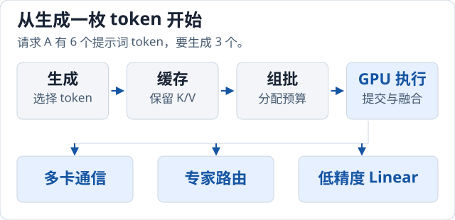

假设请求 A 的提示词已经被分成 6 个 token，要求再生成 3 个。生成第一个 token 后，请求 B 带着 4 个 token 到达。如果你在写一个推理引擎，这时有三个具体问题。A 的前 6 个位置还要再算一遍吗？B 能不能在 A 结束前进入 GPU？同一批 token 到了 GPU，为什么还要看 kernel、显存和通信？

这组笔记会用同一条请求走完这几个决策。数字可以手算，用来核对机制。

先看一次最简单的生成。把 6 个位置全部送进模型，从最后一个位置的 logits 选出下一个 token。再生成一个的时候，无缓存的实现要重新前向 7 个位置。这是理解 KV Cache 的起点。切到有缓存的实现，第二轮只要前向新增的一个位置，它仍要读取历史 K/V。

B 到达后，问题从“单条请求怎么算”变成“本轮 GPU 给谁用”。调度器选择 A 的一个 decode token，再给 B 分配若干 prefill token。算子的输入就来自这个选择。接下来，融合改变中间张量怎么读写，CUDA Graph 改变 CPU 怎么提交一串 GPU 操作。

读到这里可以分两条路。多卡篇跟踪参数、激活和请求分别分到哪里。MoE 篇跟踪 token 怎么找到专家，并补充混合模型为什么需要同时保存分页 KV 和递归状态。最后把 Linear 独立拿出来，沿量化、打包、加载和 GEMM 看低精度权重如何真正参与计算。

## 阅读顺序

1. [自回归生成](/llm-inference-01-autoregressive/)：找出每轮真正参与前向的 token。
2. [KV Cache 与分页](/llm-inference-02-kv-cache/)：手算 token 的物理地址，解释前缀如何复用。
3. [连续组批与分块 Prefill](/llm-inference-03-scheduler/)：跟着 A 和 B 分配每轮 token 预算。
4. [算子融合与 CUDA Graph](/llm-inference-04-kernels-graphs/)：在时间线上区分 kernel、显存读写和 CPU 提交。
5. [TP、PP、DP](/llm-inference-05-parallel/)：从一组可手算的矩阵理解切分和跨卡通信。
6. [MoE、专家并行与混合注意力](/llm-inference-06-moe-hybrid/)：跟着 token 走到专家，再把输出送回原位置。
7. [FP8、NVFP4 与后端](/llm-inference-07-quantization/)：从一个量化块追到实际的 GEMM 和服务指标。

每篇的例子都是为解释机制构造的。图里写的是位置数、字节数或示意事件，性能结论应回到同配置的实测。分页与调度可以从论文对读。 [PagedAttention](https://arxiv.org/abs/2309.06180)、[SARATHI](https://arxiv.org/abs/2308.16369)

---

[下一篇 · 自回归生成](/llm-inference-01-autoregressive/)
