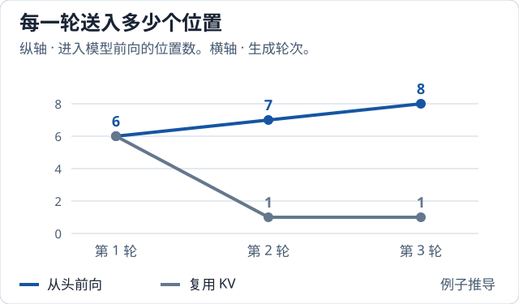

输入一段文字，模型返回第一个 token。第二个 token 得等第一个选出来，因为它也是第二轮的输入。这个依赖决定了生成循环的基本形状。先沿着循环走三步，就能看清无缓存的推理为什么会重复计算。

## 从 6 个 token 开始

设请求 A 的提示词分成 6 个 token，记为 P₁ 到 P₆。A 需要继续生成 3 个 token。为方便计数，假定生成过程中没有遇到结束符，上下文也有足够空间。以下数字由这个例子直接推得。

第一轮，分词器把输入变成 token ID，推理引擎准备每个位置的编号。6 个位置一起进入模型，经过词嵌入和各层计算，得到 6 行隐藏表示。词表投影取最后一行，把它变成整个词表的一组分数，也就是 logits。采样器根据分数选出第一个新 token，记作 a₁。贪心采样会直接选分数最高的一项。

第二轮，输入变成 P₁…P₆、a₁。这时最后一个位置是 a₁，投影的是这一行的隐藏表示，由它来预测 a₂。第三轮再把 a₂ 接进去，用最后一行预测 a₃。

## 为什么只取最后一行，仍会重算前缀

设 H 是每个位置的隐藏维度，V 是词表大小。本例只有一条序列，第一轮的输入 ID 形状为 [1, 6]，模型给出 [1, 6, H]。切取最后一行得到 [1, 1, H]，再投影到 [1, 1, V]，最终送给采样器的分数形状是 [1, V]。

切片发生在模型前向之后。第二轮仍处理前 6 个位置，第三轮再处理它们一次。三轮的模型输入累计是 6 + 7 + 8 = 21 个位置，其中提示词的 6 个位置各经过模型三次。21 是前向输入位置数。实际 GPU 时间还要看注意力访问范围、算子实现和硬件。自回归生成的缓存机制可参阅 [Transformers 的 KV cache 文档](https://huggingface.co/docs/transformers/main/en/cache_explanation)。

还可以数一层、一个注意力头里的有效查询和键配对。第一轮的位置 1 只看自己，位置 2 能看前两个，位置 6 能看全部 6 个。因此这轮有效配对数是 1 + 2 + ⋯ + 6 = 21，第二轮是 28，第三轮是 36。这里的 21 与上段恰好相同，单位分别是配对和位置。理解这一点后，看到性能报告时就能问清计数来自哪一层。

生成循环还要把 ID 解码给用户。某些字符需要多个 token 才能完整解码，流式输出可能因此把几个新 token 合成一段文字。记录生成长度时，应数实际生成的 token ID。

下一篇提前保留已经算出的 K、V，再沿着同一条请求看输入如何从 6、7、8 变成 6、1、1。

可从 Qwen3 的模型前向与词表投影对照这条链路。 [Transformers v4.57.1 源码](https://github.com/huggingface/transformers/blob/v4.57.1/src/transformers/models/qwen3/modeling_qwen3.py#L429-L495)

---

[系列导读](/llm-inference-00-overview/) · [下一篇 · KV Cache 与分页](/llm-inference-02-kv-cache/)
