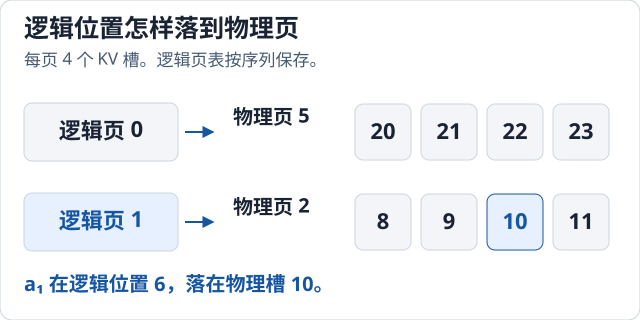

请求 A 的提示词有 6 个 token，需要生成 a₁、a₂、a₃。已经选出 a₁ 时，前 6 个位置经过了各层的因果注意力。每个位置只能看自己和更早的 token，所以后面出现 a₁ 不会改变这些位置已算出的 K（键）和 V（值）。只要把每一层的 K、V 保存下来，后续就能直接取用。参阅 [Transformers 的 KV cache 文档](https://huggingface.co/docs/transformers/main/en/cache_explanation)。



## 输入变成 6、1、1

Prefill（提示词预填充）送入全部 6 个位置，把它们的 K、V 写入缓存，并预测 a₁。第二轮只把 a₁ 送入模型。逐层算出 a₁ 的 Q（查询）、K、V，把新 K、V 接入缓存，再用 a₁ 的 Q 读取当前 7 个位置的 K、V，得到预测 a₂ 所需的隐藏表示。第三轮只送入 a₂，读取范围增至 8 个位置。

三轮共向模型送入 6 + 1 + 1 = 8 个位置。注意力访问长度仍分别有 6、7、8 个位置，第二轮和第三轮各有一个查询。上下文越长，逐步解码要访问的历史缓存也越多。沿用上一篇的一层、一个头的计数，第一轮有 21 对有效的查询和键。第二轮用 a₁ 的 Q 对应 7 个键，第三轮用 a₂ 的 Q 对应 8 个键，共 36 对。无缓存时三轮共计算 21 + 28 + 36 = 85 对。这两个数描述的是注意力关系，实际耗时还受缓存读写量影响。

## 页表如何定位逻辑位置 6

缓存会随着生成增长。如果每条请求都要求一整段连续显存，扩容就可能需要找一个更大的区域并搬移已有数据。分页把缓存拆成固定大小的物理页。每条请求保存一张页表，记录自己的逻辑页依次放在哪些物理页。读写时用这张表还原请求自己的位置顺序。参阅 [PagedAttention 论文](https://arxiv.org/abs/2309.06180)。

用每页 4 个位置演算。从 0 编号，假设 A 的逻辑页 0 在物理页 5，逻辑页 1 在物理页 2。提示词占用了逻辑位置 0 到 5。a₁ 对应逻辑位置 6。6 除以 4 的整数商是 1，说明它位于逻辑页 1。余数是 2，所以应写到物理页 2 的第 2 个偏移，展平后是 2 × 4 + 2 = 10 号槽位。


同一请求的缓存复用发生在每一轮解码。跨请求还可以做前缀复用。比如 B 的 4 个提示词 token 恰好和 A 的前 4 个一致，且 A 的第一页已发布到索引并仍在缓存池内，B 可以引用这一页。要生成 B 的第一个新 token，模型依然需要得到 B 的最后一个位置对应的分数。只存了 K、V 时，完整命中仍可以用最后一个输入位置做一次前向，得到这个分数。

到这里，一条请求已经能增量生成。下一篇让 B 在 A 生成 a₁ 之后到达，看看同一次调度如何安排 A 的解码和 B 的提示词。

## 跟着代码读一次 KV 写入与取回

请求 A 已用 6 个提示词 token 预测出 a₁。模型下一轮只处理 a₁，却要在每一层取回位置 0～5 的历史 K/V，并把位置 6 自己的 K/V 接进去。把这件事拆成四块读。以下是原创伪代码，特意采用先收集再计算的后端，方便沿着数组下标检查。

```python
position = 6
logical_page, offset = divmod(position, 4)
physical_page = request_pages[logical_page]
kv_pool[layer, physical_page, offset] = (new_key, new_value)

keys, values = gather_prefix(kv_pool, layer, request_pages, stop=7)
result = attend(new_query, keys, values)
```

**序列状态。** 页表 `request_pages = [5, 2]` 归这个请求使用，表示逻辑页 0、1 分别落在物理页 5、2。逻辑位置是模型理解 token 顺序用的编号。页表内的编号用来寻找设备内存。同一条请求每层使用相同的页编号，数据仍按层分别保存。

**写入位置。** 将 6 除以每页 4 个槽，商 1 指向页表的第二项，余数 2 指向物理页的第三槽。若把页维度和页内位置维度展平，槽号是 2 × 4 + 2 = 10。模型从 a₁ 新算出 Q、K、V，只有 K/V 继续在缓存里保存。位置编码仍使用逻辑位置 6。

**读取历史。** `gather_prefix` 按逻辑顺序取前 7 个位置。对于这份页表，要读物理槽 20、21、22、23、8、9、10，最后的槽 11 还没有有效内容。收集后，当前查询访问 7 对 K/V。用页表组织 KV 内存也可以配合能够直接消费页表的 attention kernel，省去显式构造连续历史张量。 [PagedAttention 论文](https://arxiv.org/abs/2309.06180)

**页管理与前缀索引。** 页管理器挑选空闲块或回收可释放的缓存块，记录每块还被多少请求引用。假如 B 的 4 个提示词 token 正好等于 A 的开头，并且那一页已发布到索引且仍可使用，B 可引用物理页 5。命中页表解决的是 K/V 的复用，生成 B 的首个输出 token 还需要末位置的 logits。生产实现的缓存匹配和槽位分配分别可以从两个入口读起。 [vLLM v0.10.2 缓存命中](https://github.com/vllm-project/vllm/blob/v0.10.2/vllm/v1/core/kv_cache_manager.py#L153-L191)、[槽位分配](https://github.com/vllm-project/vllm/blob/v0.10.2/vllm/v1/core/kv_cache_manager.py#L192)

---

[系列导读](/llm-inference-00-overview/) · [上一篇 · 自回归生成](/llm-inference-01-autoregressive/) · [下一篇 · 连续组批与分块 Prefill](/llm-inference-03-scheduler/)
