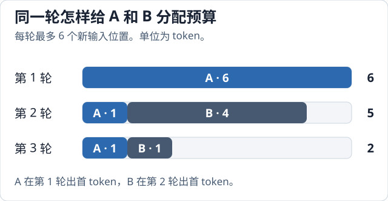

A 已经生成 a₁，还剩 a₂、a₃。此时 B 到达，要先处理 4 个提示词 token。如果批次要一直等到 A 完成才换人，B 的首 token 至少多等 A 剩下的两次解码。连续批处理（continuous batching）把排队决策移到每个生成步的边界，允许在下一轮重新选择请求。参阅 [Orca 论文及作者报告](https://www.usenix.org/conference/osdi22/presentation/yu)。



## 给每一轮设一个 token 预算

假设每轮最多处理 6 个输入 token，同时可以容纳两条序列，KV 页有余量，B 无前缀命中。第一轮用满预算，处理 A 的 6 个提示词位置，选出 a₁。B 进队后，第二轮为 A 安排 1 个解码输入 token，也就是 a₁，再给 B 安排 4 个预填充 token。这一轮最后，A 得到 a₂，B 刚得到自己的第一个新 token b₁。第三轮可以让 A、B 各送入 1 个解码位置，分别预测 a₃、b₂。这里假设 B 至少需要两个输出 token。


现在只改一个条件，把每轮预算降到 4。A 先处理提示词的前 4 个位置，再用下一轮处理剩下 2 个位置，生成 a₁。B 到达后，A 先占 1 个解码位置，B 本轮只能预填充 3 个提示词位置。等到下一轮处理 B 最后 1 个提示词位置，才得到 b₁。每轮预算数的是送入模型的 token。预填充只做完一部分时，这些位置先写入 KV cache，B 的输出计数保持为 0。

## 调度轮次和模型前向是两个观察点

“同一轮里安排 A 和 B”描述的是 scheduler 的决定。要知道实际启动几次模型前向，还要看执行器如何打包这两个任务。一种做法是把多个单 token 解码任务组成一个 batch，再把提示词预填充交给自己的前向入口。采用统一的输入布局与注意力元数据后，也可以进一步把两类任务送进同一条前向路径。即使都给 A 和 B 安排一个解码位置，它们的历史长度依然不同。第三轮的 A 输入 a₂，注意力上下文是 8 个位置。B 输入 b₁，注意力上下文是 5 个位置。同一个 batch 要为两条请求分别保留长度和页表。

评估时可以同时记录每轮的实际输入 token 数、每轮用时、首 token 延迟（TTFT）和后续 token 间隔（ITL）。上例的 1 + 4 = 5 只说明第二轮处理了 5 个输入位置。两类任务分别要读取多少 KV、启动几次前向、最终等了多久，需要沿着执行时间线追踪。

下一篇继续沿着执行器走，专门看注意力后端和 CUDA Graph 如何改变这些步骤在 GPU 上的执行。

## 一轮调度经过哪些模块

假设 A 已经生成 a₁，这时 B 到达。沿用每轮 6 个输入 token 的预算，B 需要预填充 4 个位置，且它没有命中前缀缓存。下面的原创伪代码选择了分别执行 decode 和 prefill 的写法，便于观察两批数据什么时候进入模型。

```python
pending.add(request_b)
plan = scheduler.choose(active, pending, token_limit=6)
decode_ids = runner.decode(plan.decode)
prefill_ids = [runner.prefill(chunk) for chunk in plan.prefill]
scheduler.commit(plan, decode_ids, prefill_ids)
```

**请求状态。** `pending` 持有等候或尚未完成其它 prefill 分块的请求，`active` 持有可以继续推进的序列。每条请求保留 token ID、已经处理的位置数、采样参数与 KV 页表。A 刚采出 a₁ 时，序列已有 7 个 ID，已经写进缓存的仍是前 6 个。这个差额指出了 decode 本轮该处理哪个位置。

**调度和缓存。** `choose` 让 A 的 decode 先占 1 个预算，给 B 分出 4 个位置。KV 管理器还要确认这 5 个位置有块可写。若 A 刚好跨到新页，分配不成功就需要调整安排。预算为 6 的意思是至多处理 6 个输入位置，第二轮实际用掉 5 个。把预算压到 4 后，A 占 1，B 当轮只能推进 3 个位置，下一轮处理 B 的末位置才产生 b₁。 [vLLM 分块 Prefill 说明](https://docs.vllm.ai/en/v0.10.2/configuration/optimization.html#chunked-prefill)

**前向输入。** Runner 将 A 的新 token a₁ 整理成 [1, 1] 的 ID 张量，并传入 A 的逻辑位置、槽位和历史长度。B 的 4 个提示词位置组成 [1, 4] 的 ID 张量。若下一轮安排两条请求一起 decode，ID 张量可以是 [2, 1]，两个请求依然各带一份独立页表和历史长度。读到“混合调度”时，可以继续检查 Runner 是否真的把两类请求放进同一次 forward。

**结果提交。** `commit` 推进已计算位置计数，完成 prompt 的 B 才登记首个输出 token，A 则追加 a₂。B 如果还剩一块 prompt，先保留这次进度。请求达到生成长度或 EOS 后，生命周期进入结束分支，归还页引用和输出 token。生产代码可对照运行队列、剩余预算、槽位申请和结果提交的衔接。 [vLLM v0.10.2 调度入口](https://github.com/vllm-project/vllm/blob/v0.10.2/vllm/v1/core/sched/scheduler.py#L177-L224)、[执行结果回写](https://github.com/vllm-project/vllm/blob/v0.10.2/vllm/v1/core/sched/scheduler.py#L862)

---

[系列导读](/llm-inference-00-overview/) · [上一篇 · KV Cache 与分页](/llm-inference-02-kv-cache/) · [下一篇 · 算子融合与 CUDA Graph](/llm-inference-04-kernels-graphs/)
