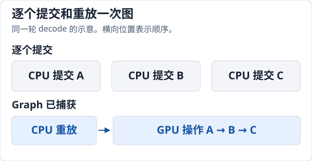

请求 A 输入 6 个 token，最多生成 3 个。整个 prompt 的前向先给出第 1 个新 token。随后两个 decode 步分别输入上一步生成的 token，得到第 2、3 个。来到 decode，每步的新输入只有一行，但这行数据要经过多层 Attention、MLP 和最后的词表投影。GPU 每次算得少时，算子提交间隔和张量搬运就容易出现在时间线上。

## 减少中间结果的读写

拿门控 MLP 的逐元素部分举例。某个位置的 gate 是 2，up 是 3。gate 经过 SiLU 得到约 1.762，跟 up 相乘得到约 5.285。拆成两个 kernel 时，激活结果可以先写回显存，再由乘法 kernel 读入。融合实现可让线程算完 SiLU 就直接乘，省去显式中间张量的一次写、一次读。以 4096 个 BF16 元素为例，这份中间张量占 8192 字节，写加读的名义数据量是 16 KiB。实际 HBM 流量要看缓存命中和 kernel 实现。

Attention 也有类似的问题。FlashAttention 按块读入 Q、K、V 并更新 softmax 所需的统计量，减少对显存的读写。分页 KV 解决的是历史 K、V 放在哪里，FlashAttention 解决的是执行时怎么读和计算。遇到一个同时使用两者的实现，可以沿着页表查数据从哪个地址来，再沿着 kernel 查数据怎样进入计算。[FlashAttention 论文](https://arxiv.org/abs/2205.14135)

## 让同一批 GPU 操作能够重放

如果只有 A 在 decode，本轮就有 1 个请求。再加两个活跃请求，模型每步接受 3 行输入。假设引擎只捕获了大小 1、2、4 的图，这一步可以装进 4 行缓冲区，最后只取前 3 行输出。下一步把新的 token ID 写入相同地址，重放时便能处理新输入。第 4 行需要按实现的规则做掩码或隔离，避免写到有效的 KV 位置。

CUDA Graph 把一组 GPU 操作和依赖提前录下来，重放可以减少 CPU 逐个提交的开销。融合把多个计算放进一个 kernel，两者可以同时使用。要看它们各自的收益，固定权重、输入、并发和采样方式，先比较 GPU 时间线上的提交间隔，再看稳态每 token 延迟。[NVIDIA CUDA Graphs 文档](https://docs.nvidia.com/cuda/cuda-programming-guide/04-special-topics/cuda-graphs.html)

有些引擎还会让下一轮 decode 直接使用仍在 GPU 上的采样结果，让 CPU 同时处理上一轮的结果。A 生成第 1 个 token 后，后两轮仍然按 token 依赖先后执行。能重叠的是 CPU 与 GPU 各自的工作。碰到请求结束、队列变化或需要重新准备缓存时，要核对哪里会重新等待。本文的字节数、批大小与时序均为推演。

静态缓冲区、固定地址和重放如何配合，可对照 PyTorch 的 CUDA Graph 示例。 [PyTorch 2.8 CUDA 文档](https://docs.pytorch.org/docs/2.8/notes/cuda.html#cuda-graphs)

---

[系列导读](/llm-inference-00-overview/) · [上一篇 · 连续组批与分块 Prefill](/llm-inference-03-scheduler/) · [下一篇 · TP、PP、DP](/llm-inference-05-parallel/)
