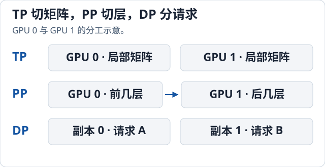

还是请求 A，输入 6 个 token，生成 3 个。单卡上每个 token 要过完整模型。换成两张卡，可以让它们一起算每一层，也可以各算一段层，还可以把 A 全交给一张卡，另一张卡服务请求 B。每一种安排需要传输的数据都不同。



## 张量并行切一层

先拿 A 某个 token 的激活做一次手算。输入行向量是 [2, 3]，权重矩阵按输出维乘输入维存放，两行分别是 [1, 4] 和 [2, 1]。整层的输出是 [14, 7]。

沿输出维切，卡 0 拿第一行权重，卡 1 拿第二行。两张卡都读完整输入，各得到 [14] 和 [7]。如果下一层需要完整向量，按维度拼接即可，通信对应 AllGather。沿输入维切，卡 0 负责输入的 2，得到 [2, 4]，卡 1 负责输入的 3，得到 [12, 3]。两张卡各得到一个完整形状的部分和，用 AllReduce 按元素相加，还原 [14, 7]。有 bias 时，可以在归约完成后加一次。[Megatron-LM 论文](https://arxiv.org/abs/1909.08053) · [NCCL 集合通信文档](https://docs.nvidia.com/deeplearning/nccl/user-guide/docs/usage/collectives.html)


一次输出切分之后，如果下一层正好只需本卡的那段激活，中间的拼接可以省下来。检查通信时要跟着相邻两层的数据走，先判断谁需要完整张量，再数 collective。

## 流水线并行切层，数据并行切请求

假设模型 4 层，流水线并行让卡 0 算前两层，卡 1 算后两层。A 的 prefill 先过卡 0，再把中间激活交给卡 1。每轮 decode 同样要跨 stage。若边界传两块 [6, 4096] 的 BF16 张量，这次逻辑传输量是 2 × 6 × 4,096 × 2 = 98,304 字节，也就是 96 KiB。单行 decode 对应 16 KiB。消息数、互联带宽和等待时间还要从时间线读。

数据并行让两个副本都保留完整模型。A 可以一直由副本 0 执行，B 走副本 1。每个副本各自排队，保存各自的 KV。假设 TP=2、PP=1、DP=2，总共要 4 张 GPU。A 由其中一个副本的两张卡共同计算，B 可以由另两张负责。比较这些安排时，记录 A 的延迟和所有请求的总输出吞吐，两项指标回答的是不同问题。本文的数字是逻辑数据量和代数验算。

## 读代码时先标出哪一维被切开

仍用请求 A 的一行激活 `x = [2, 3]`。用矩阵乘表达时，两个输出分别是 `2 × 1 + 3 × 4` 和 `2 × 2 + 3 × 1`。下面的原创纯 Python 示例可以直接运行。最后一行在本机模拟 AllReduce SUM 的结果，用来核对分片代数。

```python
x = [2, 3]                         # 输入特征 0、1
weight = [[1, 4], [2, 1]]          # 每行对应一个输出特征

output_shards = [
    sum(x_i * w_i for x_i, w_i in zip(x, weight[rank]))
    for rank in range(2)
]
partials = [
    [x[rank] * out_row[rank] for out_row in weight]
    for rank in range(2)
]
reduced = [sum(column) for column in zip(*partials)]

assert output_shards == reduced == [14, 7]
```

- **Column Parallel Linear**。上半段让每张卡读完整输入，只算自己负责的输出特征。输出分片是 `[14]` 和 `[7]`。下一层需要完整输出时，再按 rank 顺序拼起来。源码可以先看权重加载沿哪一维切，再看 `gather_output` 如何控制前向是否 AllGather。 [vLLM v0.10.2 的 ColumnParallelLinear](https://github.com/vllm-project/vllm/blob/v0.10.2/vllm/model_executor/layers/linear.py#L371)
- **Row Parallel Linear**。下半段按输入特征切。第 0 张卡得到部分和 `[2, 4]`，第 1 张卡得到 `[12, 3]`。每张卡都能给两个输出贡献一部分，跨卡应用 AllReduce SUM 后两张卡都拿到 `[14, 7]`。接到门控 MLP 时，前面的 gate 和 up 投影可以留下本地中间分片，激活也逐元素在本地做，最后在 down projection 归约。源码里的 `input_is_parallel` 表示输入是否已经切好。 [vLLM v0.10.2 的 RowParallelLinear](https://github.com/vllm-project/vllm/blob/v0.10.2/vllm/model_executor/layers/linear.py#L1161)、[NCCL 集合通信语义](https://docs.nvidia.com/deeplearning/nccl/user-guide/docs/usage/collectives.html)
- **流水线 stage 与数据副本**。PP 让每个 stage 持有一段层。首 stage 从 token ID 得到 hidden states，后续 stage 消费上游发来的中间张量，末 stage 完成最后计算。查模型代码时先找 stage 的起始、结束层，再看 stage 边界究竟发了哪些张量。DP 的分流发生在请求层。把 A 交给副本 0、B 交给副本 1 时，两者各管各自的请求队列和 KV。若每份副本内部还有 TP，同一个副本的 ranks 一起处理 A。 [公开 vLLM 的并行策略说明](https://docs.vllm.ai/en/v0.10.2/configuration/optimization.html#parallelism-strategies)

再从输出端读一次 TP。若词表轴也被切了，任意 rank 的局部分数只覆盖一段 token ID。比如卡 0 的最高分为 1.2，对应 ID 4，卡 1 的最高分为 2.0，对应 ID 12。贪心只要交换每卡的最高分和对应的全局 ID，结果就是 12。需要在全词表上做概率过滤时，则要检查程序在哪里聚合所需分数。读这两条路径时，先确认归并的数据是完整 logits、每卡候选，还是已经选出的 token ID。

源码阅读时可以给每个中间张量标上「局部输出」「部分和」或「已经完整」。这样能直接从消费者判断下一步该用拼接、按元素求和，还是只把张量发送给下一 stage。

---

[系列导读](/llm-inference-00-overview/) · [上一篇 · 算子融合与 CUDA Graph](/llm-inference-04-kernels-graphs/) · [下一篇 · MoE、专家并行与混合注意力](/llm-inference-06-moe-hybrid/)
