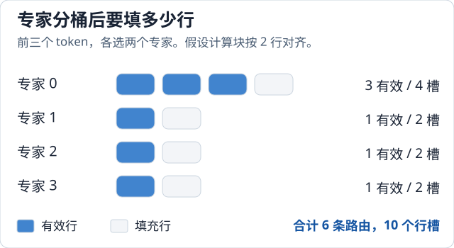

请求 A 输入 6 个 token，prefill 让 6 行激活进入一层模型。稠密 MLP 给每一行用同一套权重。换成 Top-2 的 MoE，每一行要去两个专家，6 行激活就产生 12 份专家任务。Attention 仍然面对这 6 个 token 的顺序。MoE 可以临时按专家重排，完成后要把结果还给原 token。[稀疏门控 MoE 论文](https://arxiv.org/abs/1701.06538)

## 从路由算到输出

假设 A 的前 3 个 token 分别路由给专家 [0, 1]、[0, 2]、[0, 3]。只看这三行，专家 0 得到 3 份任务，另外三个各 1 份。若用每组 2 行的计算块，四个专家分别需要 2、1、1、1 个块。于是 6 份有效任务占用 10 个行槽，空出来的 4 个行槽需要由实现屏蔽。这个手算解释了为什么路由分布和 tile 大小会影响有效工作量。

第一个 token 的两个路由权重假定为 0.75 和 0.25。若两个专家输出的同一维分别是 2 和 6，那么合并后的该维是 0.75 × 2 + 0.25 × 6 = 3。Grouped GEMM 负责让同一轮 GPU 执行处理多组情况各异的矩阵乘。路由权重和原始 token 下标还得保留，供最后的加权归并使用。

每张卡只持有部分专家时，还要把任务交给权重所在的 rank。假设专家 0、1 在卡 0，专家 2、3 在卡 1，且三个 token 都来自卡 0，那么第一个 token 的两份任务都在卡 0 可处理，第二个 token 的一份任务要到卡 1。分发之后还有回收结果，否则原 token 无法完成求和。专家数均分只保证权重数量接近，单轮被选中的任务可能仍集中到一张卡。[NCCL AlltoAll 文档](https://docs.nvidia.com/deeplearning/nccl/user-guide/docs/usage/collectives.html#alltoall)

## 混合注意力还会改变缓存

加入 Gated DeltaNet 以后，模型里可以同时有全注意力层和递归层。全注意力层按 token 保存 K、V。递归层处理当前 token 后更新序列自己的状态。假设 A 从 6 个输入 token 走到最后一个 decode 前向，逻辑历史从 6 增到 8。全注意力层已处理的 KV 行随之从 6 行增至 8 行，递归层仍占 A 的一个状态槽，内容在每轮更新。物理页可能提前预留，状态槽也可能按最大并发预分配，实际显存要查分配策略。本文的行槽占用和专家负载来自手算。 [Gated DeltaNet 论文](https://arxiv.org/abs/2412.06464)

用公开的 Qwen3-Coder-Next 对照一下。它有 48 层，每组 3 层 Gated DeltaNet 和 1 层 Gated Attention，所以只有 12 层需要这里说的全注意力 KV。每层 2 个 KV heads，每头 256 个元素。假设整个模型的这部分 KV 都按 BF16 存，每逻辑 token 的 K/V 为 12 层 × 2（K 和 V）× 2 heads × 256 元素 × 2 字节 = 24 KiB。这个数字只覆盖全注意力的有效 KV 数据，另外要计算页预留和递归层状态。 [Qwen3-Coder-Next 官方模型卡](https://huggingface.co/Qwen/Qwen3-Coder-Next)

---

[系列导读](/llm-inference-00-overview/) · [上一篇 · TP、PP、DP](/llm-inference-05-parallel/) · [下一篇 · FP8、NVFP4 与后端](/llm-inference-07-quantization/)
