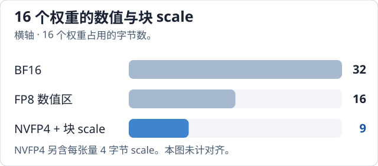

A 在 decode 时只送入一个新 token。对某个 Linear 来说，这一轮可能只收到一行激活，却仍需要用上大量权重。一种可行的思路是把权重用更低位宽存起来，再让支持该格式的 GEMM 直接消费。这条路径要从一个块的字节账开始看。

## 先给 16 个权重算账

假设权重沿输入通道排成连续的一维块，每块 16 个元素。BF16 每个占 2 字节，16 个共 32 字节。FP8 的数值区共 16 字节，所用缩放粒度决定额外开销。NVFP4 的数值是 E2M1，两个值能打包成 1 字节。16 个值占 8 字节，加一个 1 字节的 E4M3 块 scale，共 9 字节。NVFP4 还有张量级 FP32 scale，图里单列，实际文件还应检查对齐与元数据。 [NVIDIA cuDNN Block Scaling](https://docs.nvidia.com/cudnn/operations/BlockScaling/)、[Transformer Engine NVFP4](https://docs.nvidia.com/deeplearning/transformer-engine/features/low_precision_training/nvfp4/nvfp4.html)

如果张量有 1,024 个元素，刚好分成 64 块，这个存储模型下 BF16 占 2,048 字节，NVFP4 占 64 × 9 + 4 = 580 字节。这个算式可以在实际 checkpoint 的权重、块 scale 和全局 scale 三项上逐一核对。FP8 每元素 8 位，常见编码有 E4M3 和 E5M2，两者用不同的指数位数交换动态范围和精度。 [FP8 Formats for Deep Learning](https://arxiv.org/abs/2209.05433)

## 让 scale 参与乘加

把 scale 定义成恢复数值时使用的乘数。假设一个权重的 FP4 编码值是 2，块 scale 是 0.5，张量 scale 是 1.25，恢复后的权重约为 2 × 0.5 × 1.25 = 1.25。同一块里的其他权重共享后两个乘数。用这个过程理解 Linear 时，先看权重和激活从哪儿取，再看 scale 如何与 K 维分块对应。块在内存里排错了，即便反量化公式正确，kernel 也会用错 scale。

FP8 也有多种 scale 粒度。一种实现是每个输出通道给权重一份 scale，每个 token 给输入激活一份 scale。前者随权重保存，后者可以在 forward 时根据当前激活计算。A 的 decode 如果每次只进一个 token，动态缩放和打包仍然有开销，收益需要结合实际 kernel 路径测量。 [Transformer Engine FP8 与 FP4 入门](https://docs.nvidia.com/deeplearning/transformer-engine/examples/fp8_primer.html)

## 把导出和运行接起来

做 PTQ 时，先在配置里确定量化哪些层和张量，再用代表性输入校准需要校准的量，随后导出 packed 权重和 scale。服务端加载后，逐项检查权重格式、激活格式、块大小、布局和设备能力，确认命中的 GEMM。以 ModelOpt 为例，配置和导出工具解决的是产物怎么生成，运行时还要有相应的 loader 和 kernel。 [ModelOpt 量化指南](https://nvidia.github.io/Model-Optimizer/guides/_pytorch_quantization.html)

验收时先核对实际文件和加载峰值，再用固定输入比较数值，最后做同请求的延迟和吞吐对照。单卡 dense Linear 的通过记录覆盖的是那条输入和后端路径。涉及 MoE 时还要追到每张卡的专家布局和 grouped GEMM，服务指标要重新在真实请求路径上测。

---

[系列导读](/llm-inference-00-overview/) · [上一篇 · MoE、专家并行与混合注意力](/llm-inference-06-moe-hybrid/)
