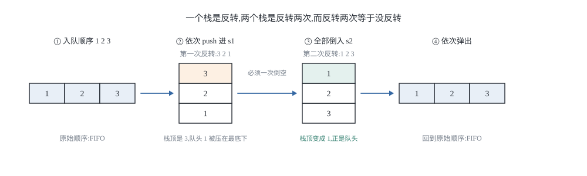
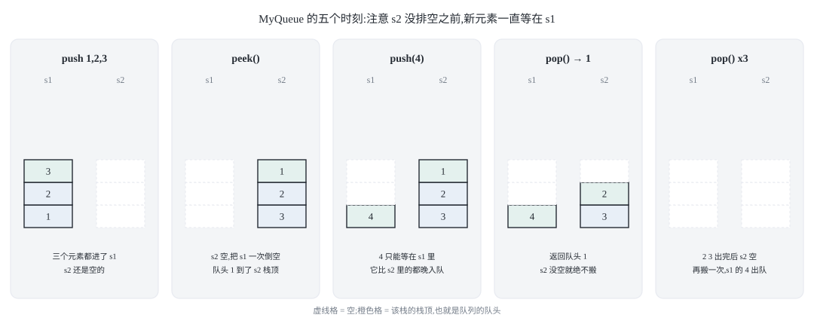
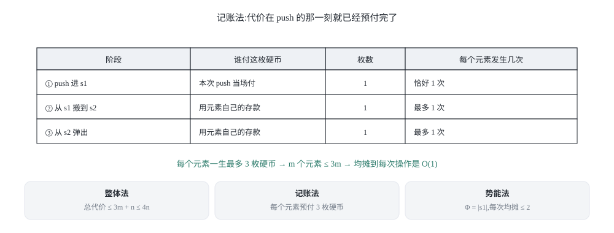
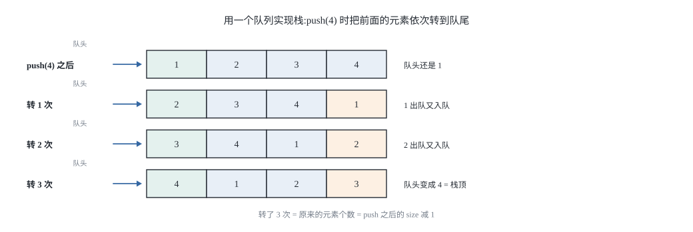
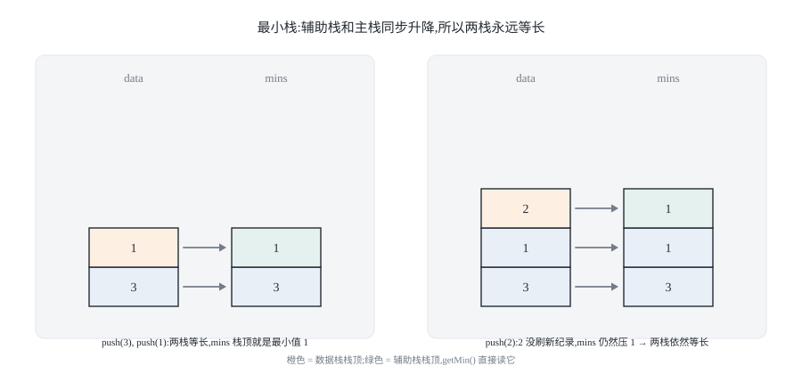
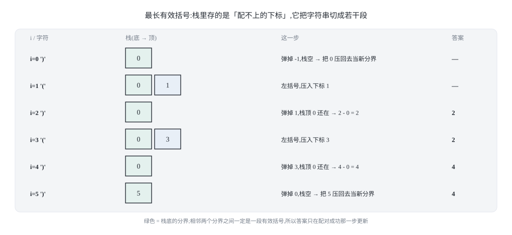

## 0 先说明材料和我的写法

这篇是我自己的学习笔记，主线是「用栈实现队列、用队列实现栈」，也就是力扣 232 和 225 这两道设计题；后半篇（第 5 到第 7 节）顺着这条线把同源的栈设计题、括号类和循环队列也收了进来。主要材料来自 labuladong 的四篇教程：

- 《队列实现栈以及栈实现队列》—— <https://labuladong.online/zh/algo/data-structure/stack-queue/>
- 《队列/栈基本原理》—— <https://labuladong.online/zh/algo/data-structure-basic/queue-stack-basic/>
- 《用数组实现队列/栈》—— <https://labuladong.online/zh/algo/data-structure-basic/array-queue-stack/>
- 《双端队列（Deque）原理及实现》—— <https://labuladong.online/zh/algo/data-structure-basic/deque-implement/>

先说材料实际取到的程度，免得你以为我读了比我真读到的更多的东西：

- 第一篇（这篇的主线）的**讲解文字我完整取到了**，但它的**代码块在静态页面里是断的**：每段代码都在 `while (...) s.peek()` 这一类的条件判断中间截断，后半段没有落在页面上。所以本文的代码是我按它的讲解重新写的——**思路忠于原文，代码是我自己的**。
- 中间两篇是基础知识章节，正文取到，用来支撑第 1 节对队列/栈本身的讨论；它们的代码块同样有截断，我没有引用。
- 至于《栈的经典习题》和《括号类问题汇总》，我**只取到标题和侧边栏目录**（能看到 71 / 143 / 150 / 394 / 155 这些题号，以及「括号类问题汇总」这个小节名），正文没取到；《括号类问题汇总》那一篇甚至连题号列表都没落在抓取结果里。所以第 5 节的最小栈和验证栈序列、第 6 节的括号题（20 / 32）、第 7 节的循环队列（622）**全部是我自己的推导**，没有对照过原文。

还有一句每次都值得说：**教程原文是 Java 写的**，本系列一律给 **Python 3 和 C++ 两版**，而且是我自己重新实现的，不是从原文抄的。两种语言并排写有实打实的理由——第 4 节会看到，Python 的 `deque` 和 C++ 的 `std::queue` 在「把队尾元素转到队头」这件事上的写法差异，正好对应两种不同的复杂度取舍。

这篇的重点可能和你预期的不一样。**用两个栈拼出一个队列，核心代码只有十来行；真正的考点是复杂度怎么描述。**「均摊 O(1)」这四个字里藏着一个极易被含糊过去的区别：它是**对任意操作序列都成立的最坏情况保证**，而不是「大部分情况下很快」。前者可以证明，后者只是一种感觉。第 3 节我用三种推法把这件事算干净。

### 目录

- [0 先说明材料和我的写法](#0-先说明材料和我的写法)
- [1 队列与栈:受限是特性,不是缺陷](#1-队列与栈受限是特性不是缺陷)
- [2 用两个栈实现队列:反转两次](#2-用两个栈实现队列反转两次)
- [3 均摊 O(1) 的三种推法与它不是平均快](#3-均摊-o1-的三种推法与它不是平均快)
- [4 用一个队列实现栈:队头就是栈顶](#4-用一个队列实现栈队头就是栈顶)
- [5 同源的两道栈设计题](#5-同源的两道栈设计题)
- [6 括号类问题:从「有效括号」到「最长有效」](#6-括号类问题从有效括号到最长有效)
- [7 循环队列:队列自己的设计题](#7-循环队列队列自己的设计题)
- [8 把这几个套路收成一张表](#8-把这几个套路收成一张表)
- [9 材料与出处](#9-材料与出处)

## 1 队列与栈:受限是特性,不是缺陷

### 1.1 一句话区分

队列和栈都是**操作受限的线性表**。队列只允许一端进、另一端出（FIFO，先进先出）；栈只允许同一端进出（LIFO，后进先出）。底层无非数组或链表，上面套一层只暴露部分 API 的壳。

顺带把双端队列（Deque）的位置摆正，因为它是理解前两者的坐标系：Deque 把两端的进出权限都打开，一共四种操作（`addFirst` / `addLast` / `removeFirst` / `removeLast`），于是

- 只允许一端进出 → 栈
- 一端进、另一端出 → 队列

所以很多语言的标准库里只有 Deque 而没有单独的 Stack/Queue 实现——它俩都是特例。C++ 的 `std::stack` 和 `std::queue` 默认就是套在 `std::deque` 外面的适配器；Python 连栈都没有单独的类型，习惯上直接拿 `list` 当栈用，拿 `collections.deque` 当队列用。

「受限」经常被当成缺点，其实恰好相反。当一条数据通路上只允许一种顺序时，很多本来要靠额外状态才能描述的问题就自动变得可推理了：括号匹配要的是「最近的左括号」，表达式求值要的是「最近的未完成运算符」，DFS 要的是「最近发现但还没处理完的节点」。这些顺序需求如果用一个普通数组加游标手工维护，代码里会到处是边界判断；换成一个只允许一种进出的结构，**顺序本身就变成了类型的一部分**。

### 1.2 什么叫「一种结构模拟另一种」

在动手之前，先把「模拟」这个词定死，否则很容易糊过去。

> 只允许使用结构 A 的 API（push / pop / peek / empty），如果还能实现出结构 B 的全部 API，并且**对外行为完全一致**——每次调用返回什么、什么时候为空——那就说 **A 能模拟 B**。

这个定义里有两条容易被忽略的要求：

**第一，正确性要对所有操作序列成立。** 包括那些在真实业务里几乎不会出现的序列。测试时随手跑几万次随机操作是不够的，因为随机序列很难触发「栈底元素要跨越一整批新元素先出队」这种边角情况；必须专门构造。

**第二，模拟必须是渐近有效的。** 任何两种线性结构都能互相模拟——把所有元素倒进一个数组，随便你怎么取——但那是作弊。真正的看点是：**用 A 实现 B 的时候，能不能不把复杂度搞坏。** 这也是为什么接下来一遍又一遍地去数「每个元素被搬了几次」：常数不重要，重要的是它和 n 成不成正比。

## 2 用两个栈实现队列:反转两次

力扣第 232 题「用栈实现队列」要求实现 `push` / `pop` / `peek` / `empty` 四个 API，底层只准用栈。这就是上一节说的「模拟」：输入是栈的四个基本操作，输出是一个 FIFO 队列。

### 2.1 为什么两个栈能模拟队列

先把最核心的一句话放出来：**一个栈的作用是反转，两个栈就是反转两次，而反转两次等于没反转。**



把入队顺序写成 a₁,a₂,…,aₙ，把这句话摊开成具体动作：

1. 依次 push 进 s1。此时 s1 从栈顶到栈底是 aₙ,…,a₂,a₁——**第一次反转**。
2. 把 s1 全部倒入 s2。倒入时是「弹出 s1 栈顶、压入 s2 栈顶」，所以最早弹出的 aₙ 最先压进 s2，最后弹出的 a₁ 最后压进 s2。于是 s2 从栈顶到栈底是 a₁,a₂,…,aₙ——**第二次反转**。
3. 现在从 s2 弹栈的顺序就是 a₁,a₂,…,aₙ，和入队顺序一字不差。**反转两次抵消了。**

这里有**两个必须说清的细节**，它们才是这道题真正的难点。

**细节一：为什么必须把 s1 倒空，而不是倒一半？**

因为「反转」这件事只在整个序列上成立。倒一半的话，s2 里是 aₙ,…,a_{k+1}，s1 里还压着 a_k,…,a₁，两段各自都是「先进后出」，但拼起来既不满足 FIFO 也不满足 LIFO——顺序被切碎在两个地方了。所以搬运动作必须是**原子的**：要么一次把 s1 掏空，要么干脆不搬。

**细节二：倒完之后，为什么可以继续往 s1 里 push 新元素，而不破坏顺序？**

这是我认为整道题最值得想的一步。设 s2 里已经有 a₁,…,a_k 在等着出队，此时又 push 进来一个 b。b 能直接插到 s2 的栈顶去吗？不能。因为 **b 比 a₁,…,a_k 都晚入队，FIFO 要求它必须比这 k 个元素都晚出队**。它想插队只有一种可能：s2 的栈顶恰好就是它该待的位置——而 s2 的栈顶永远是「最早入队、还没出队的那个」，也就是队头。b 是队尾，位置正好相反。

所以 b 只能老老实实待在 s1 里，直到 s2 排空为止。然后 s1 里积压的这批元素被一次性倒进 s2，进行下一次反转。**「s2 不空就不搬」不是一句性能优化，它就是正确性本身。**



### 2.2 实现

**Python 3**:

```python
class MyQueue:
    def __init__(self):
        self._in = []      # 只进不出：push 都到这里
        self._out = []     # 只出不进：pop / peek 都从这里

    def push(self, x: int) -> None:
        self._in.append(x)

    def _shift(self) -> None:
        # 只在 _out 空的时候搬，而且要一次把 _in 搬空
        if not self._out:
            while self._in:
                self._out.append(self._in.pop())

    def pop(self) -> int:
        self._shift()              # 先保证 _out 非空
        return self._out.pop()

    def peek(self) -> int:
        self._shift()
        return self._out[-1]

    def empty(self) -> bool:
        return not self._in and not self._out
```

**C++**:

```cpp
#include <stack>

class MyQueue {
private:
    std::stack<int> in_, out_;

    void shift() {
        // 只在 out_ 空的时候搬，而且要一次把 in_ 搬空
        if (out_.empty()) {
            while (!in_.empty()) {
                out_.push(in_.top());
                in_.pop();
            }
        }
    }

public:
    void push(int x) { in_.push(x); }

    int pop() {
        shift();
        int v = out_.top();
        out_.pop();
        return v;
    }

    int peek() { shift(); return out_.top(); }

    bool empty() const { return in_.empty() && out_.empty(); }
};
```

### 2.3 最容易写错的一行

**最容易写错的一行:**

```text
if (out_.empty()) { ... }
```

这个判断的条件必须落在 **`out_` 为空**上。两种写法都会错：

- 写成 `while (!in_.empty())` 而**不判断 `out_`**：如果 `out_` 里还有旧元素，新搬进来的一批会被压在它们上面。此时 `out_` 的栈顶变成「较晚入队的元素」，队头被埋到下面去了，顺序直接乱掉。
- 判断成 `in_.empty()` 才搬：方向反了，该搬的时候不搬，`pop` 直接对空栈取栈顶。

顺带一个 C++ 与 Python 的差异：`empty()` 在 C++ 里我标了 `const`。这不是装饰——力扣的 C++ 判题代码常常拿到 `const MyQueue&`，没写 `const` 会编译失败。Python 没有这一层，所以只有写 C++ 的人才会撞上。

## 3 均摊 O(1) 的三种推法与它不是平均快

### 3.1 先看最坏情况:它确实是 O(n)

`push` 和 `empty` 显然都是 O(1)。会出事的是 `peek` 和 `pop`——它们可能触发 `_shift` 里的那个 while 循环。

准确地说：如果在调用 `peek`/`pop` 的那一刻，`_in` 里有 k 个元素而 `_out` 恰好为空，那么这一次调用要搬 k 个元素，代价是 **Θ(k)**，最坏 **O(n)**。

**这不是理论上的坏运气。**「push 进 n 个元素，然后 pop 一次」是一个再普通不过的序列，而且它**必然**触发一次 n 级的搬运。所以任何声称「这个队列的 pop 是 O(1)」的说法都是错的——如果你只被允许说一个界，那么正确的界是 **pop 的最坏时间复杂度 O(n)**。

### 3.2 再看均摊:三种推法

但如果说「pop 是 O(n)」就完事，那也丢了这道题最重要的东西。正确的完整表述是：

> 单次 `pop` / `peek` 的最坏时间复杂度是 **O(n)**；而任意 n 次操作的总代价是 **O(n)**，所以**均摊**每次操作是 **O(1)**。

下面用三种推法把这个界算出来。三种推法结论一致，但视角不同，值得都过一遍——面试里被追问「为什么是均摊 O(1)」时，能换一种说法讲，比背结论稳得多。



**推法一：整体法。** 不要盯住某一次操作，盯住**每个元素的一生**。一个元素从进队到出队，参与的搬运工作只有三种，而且每种最多一次：

| 阶段 | 发生次数 |
|---|---|
| 被 push 进 `_in` | 恰好 1 次 |
| 从 `_in` 搬到 `_out`（一次 pop + 一次 push） | 最多 1 次 |
| 从 `_out` 弹出 | 最多 1 次 |

所以每个元素最多贡献 3 个单位的工作量。m 个元素总共不超过 3m 个单位；再加上 n 次 API 调用各自的固定开销 n，总代价 ≤ 3m + n ≤ 4n。**总代价和操作次数成正比，均摊到每次就是常数。**

**推法二：记账法。** 把「常数」具体化成硬币。规定每次 `push` 交 3 枚硬币：

- 1 枚当场花掉，付自己的入栈；
- 1 枚存进这个元素自己的户头，将来付「从 `_in` 搬到 `_out`」；
- 1 枚也存着，将来付「从 `_out` 弹出」。

搬运真正发生时，钱从户头里扣，**不需要再额外收费**。因为每个元素最多被搬一次、最多被弹一次，所以它存下的钱永远够用，账户不会透支。于是每次 `push` 的均摊代价是 3 枚硬币 = O(1)，`pop`/`peek` 触发搬运时也不再产生额外摊销——**所有代价在 `push` 的时候就已经预付掉了。**

**推法三：势能法。** 这是最紧凑的一种。定义势能函数

```text
Φ = _in 中元素的个数
```

一开始 Φ = 0，而且 Φ 永远非负。然后逐个操作算「均摊代价 = 实际代价 + ΔΦ」：

- `push`：实际代价 1（一次压栈），Φ 增加 1，均摊代价 = 1 + 1 = **2**。
- `peek`/`pop` 未触发搬运：实际代价 1，Φ 不变，均摊代价 = **1**。
- `peek`/`pop` 触发搬运 k 个：实际代价 k + 1（k 次搬运加一次弹出），Φ 减少 k，均摊代价 = (k + 1) − k = **1**。

每次操作的均摊代价都不超过 2，所以任意 n 次操作的总实际代价 ≤ 2n ——**均摊 O(1)**。

三种推法给出的常数不同（4 / 3 / 2），这不矛盾：它们都在证同一个渐近结论，常数差异只说明势能法把「每个元素只搬一次」这条事实用得最精确。

### 3.3 别把「均摊」读成「平均」

这一段是这篇最想讲的部分。

**均摊 O(1) 是一个确定性命题**，它说的是：对**任意**操作序列，n 次操作的总代价 ≤ c·n。

它**不是**在说「大部分情况下很快」，也**不是**在说「随机输入下期望很快」。这两件事都不是它的内容：

- 「大部分情况下很快」是一种频率直觉。可对手完全可以专门挑那个触发搬运的序列——上面说的「push n 次再 pop 一次」就是。均摊界照样成立，因为**那次 O(n) 早就被前面 n 次 O(1) 的 `push` 预付掉了**。代价没有消失，只是被平摊了。
- 「期望很快」需要一个输入分布假设，那是**平均复杂度**（average-case）。换一个输入分布，结论就可能变。均摊复杂度不需要任何分布假设——**这也是它比平均复杂度强的地方**。

还有一个必须说清的限制：**均摊界不能「下放」成单次界**。均摊 O(1) 明确允许个别操作是 O(n)。这意味着：

1. 在延迟敏感的场景里（实时控制、音视频流水线、任何有单次超时预算的地方），一次 O(n) 的搬运就是一次真实的毛刺，均摊界不会替你兜住它。
2. 反过来，「我测了一万次随机操作，平均很快」**推不出**均摊 O(1)，因为随机序列几乎撞不上那个最坏构造。

如果确实要去掉这个毛刺，出路有三条：一是**增量搬运**——每次操作只从 `_in` 往 `_out` 挪一个元素，最坏情况立刻变成 O(1)，代价是每次操作都多了一次搬运开销（均摊界不变，常数变大）；二是**换底层结构**，用环形数组或双端队列，但那就不是「用栈实现队列」了；三是接受这个毛刺——绝大多数在线判题和业务代码都属于这一类。

## 4 用一个队列实现栈:队头就是栈顶

力扣第 225 题反过来：只准用队列，实现 `push` / `pop` / `top` / `empty`。这次思路比双栈直白得多，但也更贵。

### 4.1 核心思路:把新元素转到队头

队列只能从队头取元素，而栈要从栈顶取——栈顶就是队尾。所以出路只有一个：**在 push 的时候动手脚，让队尾元素变成队头元素。**

做法是把队列当成一个环来转：新元素入队之后，把它前面的元素依次「取出来再放回队尾」。转完一圈，新元素就浮到了队头。



以队里已有 [1,2,3]（队头是 1）、现在 push 4 为例：

1. 4 入队 → [1,2,3,4]
2. 1 出队再入队 → [2,3,4,1]
3. 2 出队再入队 → [3,4,1,2]
4. 3 出队再入队 → [4,1,2,3]，队头是 4

转了 3 次（等于原来的元素个数），队头就是刚 push 进来的 4，也就是栈顶。**这同时建立了一条贯穿始终的不变式：队列的队头永远是栈顶。**

有了这条不变式，`pop` / `top` 都退化成一次普通的出队/看队头，天然 O(1)。这是一个**用 push 的代价换 pop 的代价**的设计——和双栈实现队列正好相反，后者是把代价压在 `peek`/`pop` 上。

**Python 3**:

```python
from collections import deque

class MyStack:
    def __init__(self):
        self._q = deque()

    def push(self, x: int) -> None:
        self._q.append(x)
        # 把新元素之前的所有元素依次转到队尾，新元素就浮到了队头
        for _ in range(len(self._q) - 1):
            self._q.append(self._q.popleft())

    def pop(self) -> int:
        return self._q.popleft()      # 队头就是栈顶

    def top(self) -> int:
        return self._q[0]

    def empty(self) -> bool:
        return not self._q
```

**C++**:

```cpp
#include <queue>

class MyStack {
private:
    std::queue<int> q_;

public:
    void push(int x) {
        q_.push(x);
        // 把新元素之前的所有元素依次转到队尾，新元素就浮到了队头
        int n = static_cast<int>(q_.size()) - 1;
        for (int i = 0; i < n; i++) {
            q_.push(q_.front());
            q_.pop();
        }
    }

    int pop() {
        int v = q_.front();           // 队头就是栈顶
        q_.pop();
        return v;
    }

    int top() { return q_.front(); }

    bool empty() const { return q_.empty(); }
};
```

**最容易写错的一行:** `int n = static_cast<int>(q_.size()) - 1;`

转圈次数是**原来的元素个数**，也就是 `push` 之后的 `size() - 1`。这里有两个坑：

- **必须在 `push` 之后取 `size()`**。如果在 `push` 之前取，就少转一次，新元素会停在队尾而不是队头，`pop` 直接返回错误的元素。
- **`size()` 返回无符号类型**。C++ 里 `q_.size()` 是 `size_t`，`q_.size() - 1` 在队列为空时（`push` 之后 `size()` 至少是 1，所以这里安全，但如果你把 `size()` 的取值挪到别处就会出事）会下溢成一个巨大的数，循环跑到天荒地老。写成 `static_cast<int>(q_.size()) - 1` 先转成有符号再减，是个便宜又稳妥的习惯。

### 4.2 另一条路:两个队列,一个当备份

同一个问题还有第二个解法，用两个队列。它的好处是思路更直白：**要让新元素排到最前面，就先把它单独放进备份队列，再把旧队列的元素全部接在它后面。**

**Python 3**:

```python
from collections import deque

class MyStackTwoQueues:
    def __init__(self):
        self._q = deque()        # 主队列：队头永远是栈顶
        self._backup = deque()   # 备份队列：push 时临时用

    def push(self, x: int) -> None:
        self._backup.append(x)                     # 新元素先进备份队列
        while self._q:                             # 旧元素全部排到它后面
            self._backup.append(self._q.popleft())
        self._q, self._backup = self._backup, self._q   # 交换两个队列

    def pop(self) -> int:
        return self._q.popleft()

    def top(self) -> int:
        return self._q[0]

    def empty(self) -> bool:
        return not self._q
```

**C++**:

```cpp
#include <queue>
#include <algorithm>

class MyStackTwoQueues {
private:
    std::queue<int> q_, backup_;

public:
    void push(int x) {
        backup_.push(x);                   // 新元素先进备份队列
        while (!q_.empty()) {              // 旧元素全部排到它后面
            backup_.push(q_.front());
            q_.pop();
        }
        std::swap(q_, backup_);            // 交换两个队列
    }

    int pop() {
        int v = q_.front();
        q_.pop();
        return v;
    }

    int top() { return q_.front(); }

    bool empty() const { return q_.empty(); }
};
```

两个队列的版本和单队列的版本复杂度**完全一样**：`push` 都是 Θ(n)（单队列转 n−1 次，双队列搬 n 次），`pop` 都是 O(1)。它没有更快，只是更符合「用一个辅助结构把元素重新排一遍」这个常见套路，读起来更直白。

顺带一句 C++ 的实现细节：`std::swap(q_, backup_)` 交换的是两个 `std::queue` 的**内部容器**，是常数时间，不会逐个搬元素。Python 那行的 `self._q, self._backup = self._backup, self._q` 同理，交换的是两个名字的指向。**如果这里写成「把 `backup` 里所有元素逐个倒回 `q`」，整个 `push` 就从 Θ(n) 退化成 Θ(n) 里的每个元素再走一遍——多出一整个数量级的常数，而且毫无意义。**

### 4.3 这两个实现诚实吗

把话说完整：

- **一个队列实现栈**：`push` 最坏 Θ(n)，`pop`/`top`/`empty` O(1)。**而且这里的 Θ(n) 不能靠均摊洗掉**——因为每一次 `push` 都要转 n−1 次，不是「偶尔一次」。n 次 `push` 的总代价是 Θ(n²)，均摊每次就是 **Θ(n)**。这是它和双栈实现队列的本质区别：后者的搬运只在 `_out` 排空时发生一次，前者每次都发生。
- **两个队列实现栈**：同上，`push` 最坏 Θ(n)，均摊也是 Θ(n)。
- 空间上，单队列版本是 O(n)（队列里就是全部元素），双队列版本仍是 O(n)（两个队列的元素总数等于元素个数，因为旧元素是被**搬走**而不是被复制）。

把这两个结构和第 2 节的双栈队列放在一起看，这道题的设计空间就清楚了：**你要么把代价压在「插入端」，要么压在「取出端」，但压在插入端时如果每次都要动全部元素，均摊也救不了你。**

## 5 同源的两道栈设计题

这两道题不在我取到的原文里（见第 0 节），是我顺着「用辅助结构维护额外信息」这条线自己补的。它们和前面的双栈队列共享同一个动作：**在压栈/出栈的同时，用一个额外的结构记住某个统计量。**

### 5.1 最小栈:让辅助栈和主栈同一步调

力扣第 155 题「最小栈」要求 `push` / `pop` / `top` / `getMin` 全部 O(1)。麻烦在于：`getMin` 要的是**当前栈内元素**的最小值，而 `pop` 会改变这个集合。用「记住一个全局最小值」的做法，一旦最小值被弹走，你就得重新扫一遍栈。

解法是**再开一个栈，和主栈同步升降**，专门存「截止到当前位置的前缀最小值」。



**Python 3**:

```python
class MinStack:
    def __init__(self):
        self._data = []   # 数据栈
        self._mins = []   # 辅助栈：_mins[i] 是 _data[0..i] 的最小值

    def push(self, x: int) -> None:
        self._data.append(x)
        # 更小的新值就压自己，否则把当前最小值再压一遍
        self._mins.append(x if not self._mins else min(x, self._mins[-1]))

    def pop(self) -> None:
        self._data.pop()
        self._mins.pop()          # 两个栈必须同步弹出

    def top(self) -> int:
        return self._data[-1]

    def getMin(self) -> int:
        return self._mins[-1]     # 辅助栈栈顶就是当前最小值
```

**C++**:

```cpp
#include <vector>
#include <algorithm>

class MinStack {
private:
    std::vector<int> data_, mins_;

public:
    void push(int x) {
        data_.push_back(x);
        // 更小的新值就压自己，否则把当前最小值再压一遍
        mins_.push_back(mins_.empty() ? x : std::min(x, mins_.back()));
    }

    void pop() {
        data_.pop_back();
        mins_.pop_back();         // 两个栈必须同步弹出
    }

    int top() const { return data_.back(); }

    int getMin() const { return mins_.back(); }

    bool empty() const { return data_.empty(); }
};
```

**最容易写错的一行:**

```text
self._mins.append(x if not self._mins else min(x, self._mins[-1]))
```

关键在于**必须给每个元素都压一个最小值，包括那些并没有刷新纪录的元素**。判断条件写错成「只有 `x` 更小才压」的话，两个栈的长度就会不一致：`pop` 时一旦弹掉的不是最值，辅助栈的栈顶就和主栈对不上号了。写成「把当前最小值再压一遍」之后，两个栈**长度永远相等**，`pop` 就是同步弹一下，不需要任何额外判断。这也解释了为什么这个方案的空间是 O(n) 而不是 O(1)：它用 n 个槽位换掉了「重新扫描」这件事。

（如果想省空间，可以把辅助栈改成「只记录刷新纪录的时刻和值」，弹出时判断当前下标是否命中记录点，空间能降到最坏 O(n)、常见情况更少。但代码复杂度上去了，面试里通常不值。）

### 5.2 验证栈序列:把「可能」变成一次模拟

力扣第 946 题「验证栈序列」给两个数组 `pushed` 和 `popped`，问存不存在一种入栈/出栈的交错顺序，使得出栈序列恰好是 `popped`。

关键洞察是：**不需要搜索所有交错方式**。因为 `pushed` 的顺序是给定的，任何合法的交错都必须**按 `pushed` 的顺序依次入栈**，唯一的自由度是「什么时候出栈」。而「什么时候出栈」有一个贪心答案——**只要栈顶等于出栈序列当前需要的元素，就立刻弹掉，绝不拖延**。

为什么贪心是对的？因为栈顶元素此刻不弹，它上面的位置就空不出来，后面任何元素都不可能先于它出栈；而它又恰好是出栈序列要的下一个——拖延只会让机会溜走，不会有任何好处。

**Python 3**:

```python
def validateStackSequences(pushed: list, popped: list) -> bool:
    if len(pushed) != len(popped):
        return False
    st = []
    j = 0                          # popped 中下一个该被弹出的元素下标
    for x in pushed:
        st.append(x)               # 按 pushed 的顺序入栈
        while st and j < len(popped) and st[-1] == popped[j]:
            st.pop()               # 栈顶正是需要的，立刻弹掉
            j += 1
    return not st                  # 全部弹空才算合法
```

**C++**:

```cpp
#include <vector>

bool validateStackSequences(const std::vector<int>& pushed,
                           const std::vector<int>& popped) {
    if (pushed.size() != popped.size()) return false;
    std::vector<int> st;
    std::size_t j = 0;             // popped 中下一个该被弹出的元素下标
    for (int x : pushed) {
        st.push_back(x);           // 按 pushed 的顺序入栈
        while (!st.empty() && j < popped.size() && st.back() == popped[j]) {
            st.pop_back();         // 栈顶正是需要的，立刻弹掉
            j++;
        }
    }
    return st.empty();             // 全部弹空才算合法
}
```

**最容易写错的一行:**

```text
while st and j < len(popped) and st[-1] == popped[j]:
```

`j < len(popped)` 这个条件严格来说是**冗余的**——如果 `j` 已经走到 `popped` 末尾，说明所有元素都已成功弹出，此时 `st` 必然是空的，第一个条件 `st` 就先短路了。很多写法干脆省掉它。我保留它有两个理由：一是**它让「不会越界」这件事从推理变成显然**，读代码的人不必先在脑子里证一遍；二是这道题的实际输入不保证 `len(pushed) == len(popped)`，如果只靠短路的巧合，一旦哪天你在循环里多加了一句修改 `st` 的逻辑，越界就会静悄悄地回来。**能用一个显式条件换掉一段隐式推理，通常都是划算的。**

边界情况其实不复杂，但每一条都得对上：两个数组都为空 → 合法（返回真）；长度不等 → 直接假；`pushed` 严格递增、`popped` 也是同一顺序 → 合法（全部先入栈再出栈）；`popped` 是 `pushed` 的逆序 → 合法（边入边出）；`pushed = [1,2,3]`、`popped = [3,1,2]` → 非法（3 出栈时，1 被 2 压着，1 不可能先于 2 出去）。

## 6 括号类问题:从「有效括号」到「最长有效」

### 6.1 有效括号只问一件事

力扣第 20 题「有效的括号」给一个只含 `()[]{}` 的字符串，问它是否合法：每个右括号都要和**它左边最近的、还没被配掉的左括号**是同一类。

「最近的那个还没配掉的左括号」——这句话就是栈顶的定义。所以这题不需要任何额外结构，一个栈、一次扫描：

**Python 3**:

```python
def is_valid_brackets(s: str) -> bool:
    pairs = {")": "(", "]": "[", "}": "{"}
    st = []                        # 只装左括号，栈顶就是「最近的那个」
    for ch in s:
        if ch in "([{":
            st.append(ch)
        else:
            if not st or st[-1] != pairs.get(ch):
                return False       # 没有左括号可配，或者配错了对象
            st.pop()
    return not st                  # 还剩没配上的左括号 -> 非法
```

**C++**:

```cpp
#include <string>
#include <vector>

static bool is_open_bracket(char ch) {
    return ch == '(' || ch == '[' || ch == '{';
}

// 右括号必须和栈顶的左括号是同一类
static bool brackets_match(char open, char close) {
    return (open == '(' && close == ')') || (open == '[' && close == ']') ||
           (open == '{' && close == '}');
}

bool isValidBrackets(const std::string& s) {
    std::vector<char> st;          // 只装左括号，栈顶就是「最近的那个」
    for (char ch : s) {
        if (is_open_bracket(ch)) {
            st.push_back(ch);
        } else {
            if (st.empty() || !brackets_match(st.back(), ch)) return false;
            st.pop_back();
        }
    }
    return st.empty();             // 还剩没配上的左括号 -> 非法
}
```

三个判断一个都不能少：**遇到右括号时栈不能空**（空了说明它左边没有可配的左括号）、**栈顶必须是同一类**、**扫完栈必须空**。

> 输入里混进别的字符怎么办：上面两个版本都会把非左括号的字符当右括号处理，于是直接判非法。力扣第 20 题的输入只有括号，所以这样写是对的；如果输入可能混入别的字符，得先分类再判断，不能靠这个巧合。

### 6.2 最长有效括号:栈里存的是「配不上的下标」

力扣第 32 题「最长有效括号」把问题升了一级：字符串可能只有一部分合法，问**最长的合法子串有多长**。

结构没变，还是那个栈，但栈里存的东西要换一次。**只存左括号不够用了**：要算「有多长」，就得知道一段合法子串从哪里开始，而一段合法子串的起点，恰好是**上一个配不上的位置**。于是：

- 遇到 `(`，把它的下标压进栈——它有可能配得上，先留着。
- 遇到 `)`，先弹一次（假设它和栈顶那个左括号配成了一对），再看栈是否为空：
  - 栈空了：说明这个 `)` 根本没有对象可配，**它就是新的分界**，把它的下标压回去。
  - 栈不空：栈顶就是「上一个配不上的位置」，`i - 栈顶` 就是**以 `i` 结尾的最长有效长度**。
- 一开始先压一个 `-1` 当虚拟分界，代表「字符串开头之前」。

拿 `s = )()())` 走一遍：

```text
i=0 ')' : 弹掉 -1 -> 栈空,把 0 压回去当新分界     栈 = [0]        答案 —
i=1 '(' : 左括号,压入下标 1                       栈 = [0, 1]     答案 —
i=2 ')' : 弹掉 1,栈顶 0 还在 -> 长度 2 - 0 = 2    栈 = [0]        答案 2
i=3 '(' : 左括号,压入下标 3                       栈 = [0, 3]     答案 2
i=4 ')' : 弹掉 3,栈顶 0 还在 -> 长度 4 - 0 = 4    栈 = [0]        答案 4
i=5 ')' : 弹掉 0 -> 栈空,把 5 压回去当新分界      栈 = [5]        答案 4
```

答案是 4（子串 `()()`）。

**Python 3**:

```python
def longest_valid_parentheses(s: str) -> int:
    st = [-1]                      # 栈底哨兵：字符串开头之前的虚拟分界
    best = 0
    for i, ch in enumerate(s):
        if ch == "(":
            st.append(i)           # 左括号先留着，它有可能配得上
        else:
            st.pop()               # 先假设它和栈顶的左括号配成了一对
            if not st:
                st.append(i)       # 没有对象可配 -> 它自己就是新的分界
            else:
                best = max(best, i - st[-1])
    return best
```

**C++**:

```cpp
#include <algorithm>
#include <string>
#include <vector>

int longestValidParentheses(const std::string& s) {
    std::vector<int> st{-1};       // 栈底哨兵：字符串开头之前的虚拟分界
    int best = 0;
    for (int i = 0; i < static_cast<int>(s.size()); ++i) {
        if (s[static_cast<std::size_t>(i)] == '(') {
            st.push_back(i);       // 左括号先留着，它有可能配得上
        } else {
            st.pop_back();         // 先假设它和栈顶的左括号配成了一对
            if (st.empty()) {
                st.push_back(i);   // 没有对象可配 -> 它自己就是新的分界
            } else {
                best = std::max(best, i - st.back());
            }
        }
    }
    return best;
}
```



同一个思路还能再升一级：力扣第 921 题「使括号有效的最少添加」问「补几个括号才能合法」，扫描时记下「配不上的右括号个数」与「扫完之后剩下的左括号个数」，两者之和就是答案。第 32 题也可以改用动态规划，`dp[i]` 表示「以 `i` 结尾的最长有效长度」，转移要分 `s[i-1] == '('` 和 `s[i-1] == ')'` 两种情况。这两条路我都没写成代码——本文只保留一条能讲透的栈解法。

### 6.3 最容易写错的一行

**最容易写错的一行:**

```text
st = [-1]
```

它和第 6.2 节里那句 `st.append(i)` 是配套的，缺一个都会错：

- **少了哨兵 `-1`**：栈底没有参照物。字符串从头就是 `(`、要到很后面才配上时，`i - st[-1]` 会作用在空栈上；而更早撞上的是第一个配不掉的 `)`，`st.pop()` 直接对空表弹。
- **忘了把配不上的 `)` 的下标压回去**：这个分界就丢了。比如 `s = )()`，i=0 的 `)` 是分界；如果它没被记下来，i=2 配对成功时栈已经空了，长度算不出来，答案会从 2 变成 0。
- **反过来，栈里只存左括号字符**：那就只知道「有没有多余的左括号」，不知道「从哪儿开始算长度」——这道题和单调队列那篇一样，**要长度就必须存下标**。

一句话总结这节的递进：**第 20 题问「整串合不合法」，栈里存左括号就够；第 32 题问「哪一段最长」，栈里就得存下标，而且要把「配不上的位置」一起留下来当分界。**

## 7 循环队列:队列自己的设计题

### 7.1 三个操作都要 O(1)

前面几节的队列都是「用别的结构拼出来的」，力扣第 622 题「设计循环队列」要求反过来：**自己实现一个固定容量的队列**，入队、出队、判空、判满、取队首、取队尾全部 O(1)，而且**不许扩容**。

用普通数组直接做有两个坑：

1. 出队时如果整体前移，单次就是 O(n)；
2. 用 `head` / `tail` 两个游标绕圈的话，「队空」和「队满」会让两个游标落在**同一种相对位置**上——`head == tail` 既可能是空，也可能是满，光看游标分不出来。

两条出路：**牺牲一个空位**（让数组最多只装 `cap - 1` 个元素，于是 `tail + 1 == head` 就表示满），或者**额外记一个 `size`**（空是 `size == 0`，满是 `size == cap`，两个游标再无歧义）。我用第二种：多花一个整数，换来「空 / 满」判据一眼可见，容量也不浪费。

### 7.2 实现

**Python 3**:

```python
class MyCircularQueue:
    def __init__(self, k: int):
        self._buf = [0] * k        # 固定容量，从头到尾不扩容
        self._cap = k
        self._head = 0             # 队头所在下标
        self._size = 0             # 元素个数：空和满靠它区分

    def enQueue(self, value: int) -> bool:
        if self.isFull():
            return False
        self._buf[(self._head + self._size) % self._cap] = value
        self._size += 1
        return True

    def deQueue(self) -> bool:
        if self.isEmpty():
            return False
        self._head = (self._head + 1) % self._cap
        self._size -= 1
        return True

    def Front(self) -> int:
        return -1 if self.isEmpty() else self._buf[self._head]

    def Rear(self) -> int:
        if self.isEmpty():
            return -1
        return self._buf[(self._head + self._size - 1) % self._cap]

    def isEmpty(self) -> bool:
        return self._size == 0

    def isFull(self) -> bool:
        return self._size == self._cap
```

**C++**:

```cpp
#include <vector>

class MyCircularQueue {
private:
    std::vector<int> buf_;
    int cap_;
    int head_;                     // 队头所在下标
    int size_;                     // 元素个数：空和满靠它区分

public:
    explicit MyCircularQueue(int k) : buf_(k, 0), cap_(k), head_(0), size_(0) {}

    bool enQueue(int value) {
        if (isFull()) return false;
        buf_[(head_ + size_) % cap_] = value;
        size_ += 1;
        return true;
    }

    bool deQueue() {
        if (isEmpty()) return false;
        head_ = (head_ + 1) % cap_;
        size_ -= 1;
        return true;
    }

    int Front() const { return isEmpty() ? -1 : buf_[head_]; }

    int Rear() const {
        return isEmpty() ? -1 : buf_[(head_ + size_ - 1) % cap_];
    }

    bool isEmpty() const { return size_ == 0; }

    bool isFull() const { return size_ == cap_; }
};
```

注意这里**没有单独的 `tail` 游标**：队尾下标由 `(head + size) % cap` 推出来。少维护一个变量，就少一个「忘记同步更新」的机会。

`k = 1` 是这道题最容易忽略的边界：容量只有一格时，绕圈的取模看起来像在原地打转，但 `size` 会把空和满分得清清楚楚。力扣的约束是 `1 <= k <= 1000`，所以 `k = 0` 不会出现；真遇到 `k = 0`，取模会除零，必须另外处理。

### 7.3 最容易写错的一行

**最容易写错的一行:**

```text
buf_[(head_ + size_) % cap_] = value;
```

队尾位置必须用 **`head + size`** 推，而不是复用上一次留下的 `tail`。这一行写错的表现很隐蔽：小规模手测可能全过，只有绕满一整圈、`head` 重新回到 0 附近之后才露出错位。

`Rear()` 里的 `(head_ + size_ - 1) % cap_` 是同一个式子减一：队尾是**最后一个元素**的下标，而 `(head + size) % cap` 指向的是**下一个空位**。一个式子两个语义，差一就是错。

## 8 把这几个套路收成一张表

| 题目 | 底层结构 | 关键不变式 | 单次最坏 | 均摊 | 最容易错的那一行 |
|---|---|---|---|---|---|
| 232 用栈实现队列 | 两个栈 `_in` / `_out` | `_out` 非空时它的栈顶就是队头 | pop/peek O(n) | **O(1)** | `if (_out.empty())` 判断错了对象 |
| 225 用一个队列实现栈 | 一个队列 + 旋转 | 队头永远是栈顶 | push Θ(n) | **Θ(n)**（洗不掉） | `size() - 1` 在 push 之前取，或忽略无符号下溢 |
| 225 用两个队列实现栈 | 主队列 + 备份队列 | 队头永远是栈顶 | push Θ(n) | **Θ(n)** | 把备份队列逐个倒回主队列，常数翻倍 |
| 155 最小栈 | 数据栈 + 同步辅助栈 | 两栈等长，辅助栈顶 = 前缀最小值 | 全 O(1) | O(1) | 只在新值更小时才压辅助栈，导致两栈不等长 |
| 946 验证栈序列 | 一个栈 + 贪心 | 栈顶等于目标就立刻弹 | O(n) | O(1) | 漏掉 `j < len(popped)`，靠短路兜底 |
| 20 有效的括号 | 一个栈（存左括号） | 栈顶 = 最近一个还没配掉的左括号 | O(n) | O(1) | 遇到右括号时忘了先判栈空 |
| 32 最长有效括号 | 一个栈（存下标 + 哨兵 `-1`） | 栈里每个下标都是「配不上的位置」，相邻分界之间才是有效段 | O(n) | O(1) | 忘了把配不上的 `)` 的下标压回去 |
| 622 设计循环队列 | 固定数组 + `head` + `size` | 队尾 = `(head + size) % cap`，空 / 满由 `size` 区分 | 全 O(1) | O(1) | 复用旧 `tail` 游标，或 `Rear()` 的 `-1` 偏移写错 |

如果要我只留一句话：**「用 A 实现 B」这类题的答案，永远是把 A 的某个性质用两次（反转 / 旋转 / 同步推进），而它的复杂度分析永远要分两层说——单次最坏是多少，以及它能不能被均摊掉。** 上面八行里，只有第 232 题的 Θ(n) 能均摊掉，因为它的搬运是「攒够一批才做一次」；第 225 题的两种写法每次 push 都要动全部元素，均摊也救不回来。这就是「均摊 O(1)」与「均摊 Θ(n)」的分界线，也是这篇最想让你带走的第一条判断标准。

第二条判断标准在第 6、7 节：括号题和循环队列题连 Θ(n) 都没有，每个元素只进出一次，全部操作都是 O(1)。于是考点从「复杂度怎么摊」换成了**「结构里到底该记什么」**——第 20 题记左括号就够，第 32 题必须记下标并把「配不上的位置」留下来当分界，第 622 题必须多记一个 `size` 才能把「空」和「满」分开。**同一副栈（或数组），换个要回答的问题，就得换个记法。**

## 9 材料与出处

这篇的素材来自 labuladong 的教程，建议直接去读原文——双栈实现队列那一段的图解比文字更直观：

- 《队列实现栈以及栈实现队列》 <https://labuladong.online/zh/algo/data-structure/stack-queue/>
  本文第 2、4 节的主线来自这篇。它的讲解文字我完整取到了，但代码块在静态页面里被截断（停在 `while (...) s.peek()` 这类条件中间），所以本文代码是我按讲解重写的。
- 《队列/栈基本原理》 <https://labuladong.online/zh/algo/data-structure-basic/queue-stack-basic/>
  第 1 节「操作受限」的说法和队列/栈的基本 API 来自这篇。
- 《用数组实现队列/栈》 <https://labuladong.online/zh/algo/data-structure-basic/array-queue-stack/>
  《双端队列（Deque）原理及实现》 <https://labuladong.online/zh/algo/data-structure-basic/deque-implement/>
  第 1 节里 Deque 与栈/队列的关系、以及「用环形数组实现队列」的说法来自这两篇。
- 《栈的经典习题》 <https://labuladong.online/zh/algo/problem-set/stack/>
  《括号类问题汇总》——**这两篇我只取到标题和侧边栏目录**（能看到 71 / 143 / 150 / 394 / 155 的题号和「括号类问题汇总」这个小节名），括号类那一篇的正文和题号都没取到。所以第 5 节的最小栈与验证栈序列、第 6 节的 20 / 32、第 7 节的 622 都是我的**自行推导**，没有对照过原文；这几道题的解法组织（包括「栈里该存什么」这条主线）也是我自己写的。

第 2 节到第 7 节用到的题目链接：

| 题号 | 题目 | 链接 |
|---|---|---|
| 232 | 用栈实现队列 | <https://leetcode.cn/problems/implement-queue-using-stacks/> |
| 225 | 用队列实现栈 | <https://leetcode.cn/problems/implement-stack-using-queues/> |
| 155 | 最小栈 | <https://leetcode.cn/problems/min-stack/> |
| 946 | 验证栈序列 | <https://leetcode.cn/problems/validate-stack-sequences/> |
| 20 | 有效的括号 | <https://leetcode.cn/problems/valid-parentheses/> |
| 32 | 最长有效括号 | <https://leetcode.cn/problems/longest-valid-parentheses/> |
| 622 | 设计循环队列 | <https://leetcode.cn/problems/design-circular-queue/> |

最后再强调一次本文的立场：**这不是转载，也不是翻译。** 原文的可视化面板和动图是那套教程最有价值的部分，我这里复现不了，所以 6 张示意图都是我自己用 SVG 画的；原文用 Java，本文所有代码是我用 Python 3 和 C++ 重新实现的。第 3 节对均摊复杂度的三种推法、以及「均摊不等于平均」这一段，是我自己组织的——原文只给出了「最坏 O(N)、均摊 O(1)」的结论和一句直觉解释，没有展开证明。
