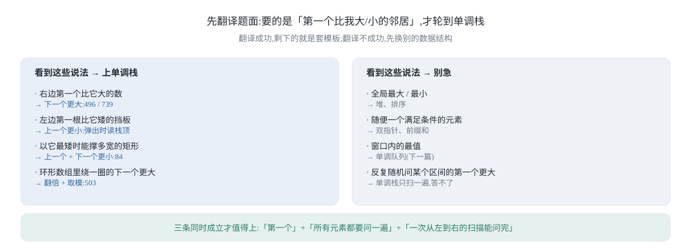
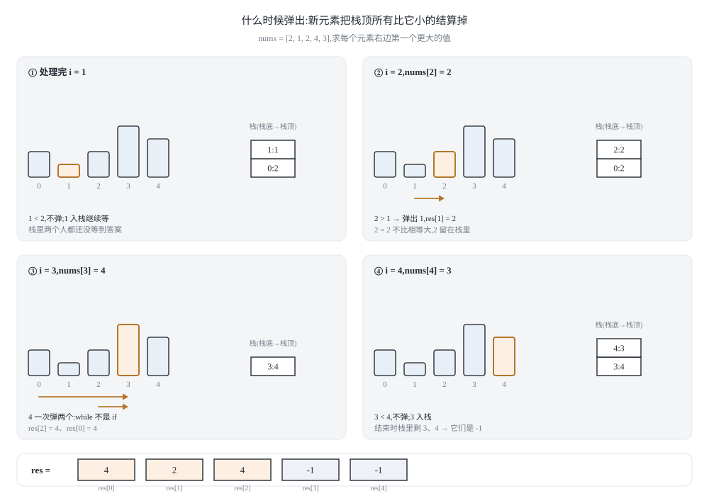
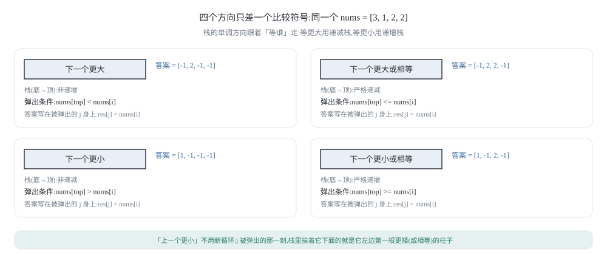
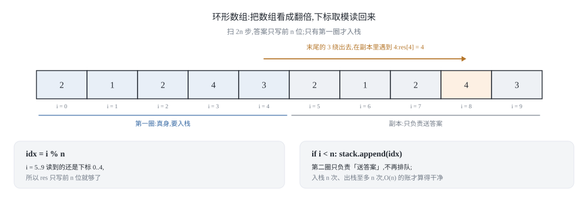
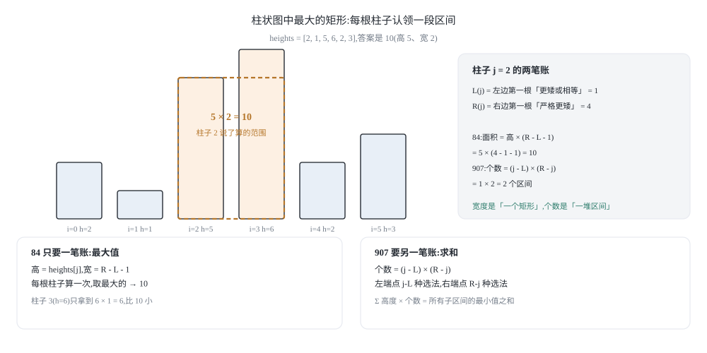
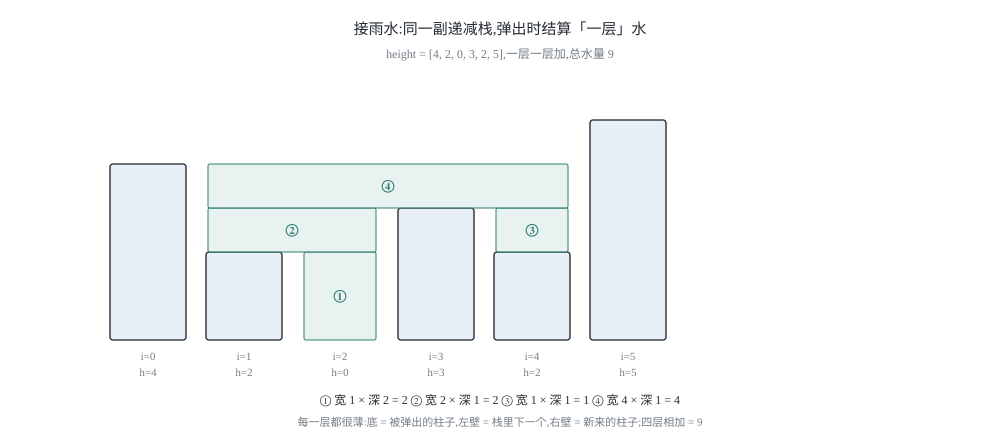

## 0 先说明材料和我的写法

这篇是我自己的学习笔记，主题是单调栈：从一个十来行的模板出发，讲到四个方向、环形数组、柱状图中最大的矩形（力扣 84）和接雨水（力扣 42）的单调栈解法。材料来自 labuladong 的三篇教程：

- 《单调栈算法模板解决三道例题》—— <https://labuladong.online/zh/algo/data-structure/monotonic-stack/>
- 《单调栈的几种变体及经典习题》—— <https://labuladong.online/zh/algo/problem-set/monotonic-stack/>
- 《如何高效解决接雨水问题》—— <https://labuladong.online/zh/algo/frequency-interview/trapping-rain-water/>

先把材料取到的程度说清楚：

- 第一篇是主线，**讲解文字我完整取到了**：递减栈求下一个更大元素的模板、496 借用哈希表查表、739 在栈里存下标算天数、503 用双倍长度加取模模拟环形数组。但它的**代码块在静态页面里是断的**，每段都在 `while (!s.isEmpty() && s.peek() ...)` 这一类的条件判断中间被截断，后半段没有落在页面上。所以本文的代码是我按它的讲解重新写的——**思路忠于原文，代码是我自己的**。
- 第二篇我只取到**小标题和侧边栏题号**（901 股票价格跨度、402 移掉 K 位数字、316 去除重复字母、853 车队、581 最短无序连续子数组、84 柱状图中最大的矩形），正文没取到。所以第 3 节的四个方向对照、第 5 节的柱状图、第 6 节的接雨水，**都是我自己的推导**，没有对照过原文。
- 第三篇讲接雨水，但我只取到第一小节「核心思路」：每个位置能存的水由 `min(l_max, r_max) - height[i]` 决定。后面「备忘录优化」和「双指针解法」两节没取到。而且原文讲的是**双指针**，没有单调栈解法——第 6 节我用单调栈把这道题重做一遍，并说明两种解法为什么算出同一个数。

照例说明：**教程原文是 Java 写的**，本系列一律给 **Python 3 和 C++ 两版**，都是我自己重新实现的。

最后说清这篇的重点。单调栈的模板短到可以背下来，但**背下来没有用**——难的是拿到题之后判断「这道题该不该上单调栈」。所以第 1 节先讲信号，把题面语言翻译成结构语言；第 2 节把模板推一遍，重点解释**为什么每个元素只进栈出栈一次就得到 O(n)**；第 3 节讲两个最容易被含糊过去的细节：**栈里存下标还是存值**，以及**四个方向分别对应哪个比较符号**。

### 目录

- [0 先说明材料和我的写法](#0-先说明材料和我的写法)
- [1 什么信号出现时该想到单调栈](#1-什么信号出现时该想到单调栈)
- [2 模板:用一个递减栈等结算](#2-模板用一个递减栈等结算)
- [3 存下标还是存值,以及四个方向](#3-存下标还是存值以及四个方向)
- [4 环形数组:把地板接成天花板](#4-环形数组把地板接成天花板)
- [5 柱状图中最大的矩形:单调栈在数区间](#5-柱状图中最大的矩形单调栈在数区间)
- [6 接雨水:同一副栈,换一个结算式](#6-接雨水同一副栈换一个结算式)
- [7 把这几个套路收成一张表](#7-把这几个套路收成一张表)
- [8 材料与出处](#8-材料与出处)

## 1 什么信号出现时该想到单调栈

### 1.1 信号的三种说法

单调栈处理的题目有一个共同的形状：**题目关心的是「第一个」比自己大或小的邻居，而且要问遍所有元素。** 落到题面上有三种常见说法。

1. **下一个更大/更小元素**：对每个 `i`，找它右边第一个比它大的元素（496、503）。每日温度（739）看起来在问「还要等几天」，但找的仍然是右边第一个更暖的日子，只是把「值」换成了「下标的距离」。
2. **上一个更大/更小元素**：对每个 `i`，找它左边第一个比它小的元素。这个要求常常藏在别的题面里，比如「左边第一根比我矮的挡板」「上一次价格更低的那天」。
3. **以某个元素为最值（或最短板）的区间**：不直接问邻居，而是问「有多少个区间把它当最小值」，或者「把它当最矮的柱子能撑起多大的矩形」（84）。这类题面看着不像单调栈，但只要能拆成「左边第一个更矮 + 右边第一个更矮」，它就变成前两类的组合。

反过来，**不该**上单调栈的信号也说清楚：

- 问的是**全局**最大或最小，而不是「第一个」——那是堆或排序的活。
- 问的是**任意一个**满足条件的元素，不要求「第一个」——双指针、前缀和通常更省事。
- 问的是**窗口内**的最值——那是单调队列，下一篇讲。
- 需要反复随机地问「某个区间里第一个更大的元素」——单调栈只做一次从左到右的扫描，回答不了这种反复询问。

压缩成一句判据：**「第一个比我大/小」+「所有元素都要问一遍」+「从左到右扫一遍就能扫完」，三条同时成立，单调栈就值得上。**



### 1.2 暴力为什么慢:重复比较的都是「矮个子」

先看最朴素的写法：对每个 `i` 往右扫，遇到第一个更大的就停下，把这个数写进答案。它的毛病不是「扫得远」，而是**同一个元素被反复比较**。

拿一个最坏情况 `nums = [5, 4, 3, 2, 1]` 数一数。这个数组里每个元素的右边都没有比它大的数，所以每次扫描都要走到数组末尾：

| 起点 `i` | 值 | 这次扫描比较了谁 | 比较次数 |
|---|---|---|---|
| 0 | 5 | 4, 3, 2, 1 | 4 |
| 1 | 4 | 3, 2, 1 | 3 |
| 2 | 3 | 2, 1 | 2 |
| 3 | 2 | 1 | 1 |
| 4 | 1 | 没人可比 | 0 |

一共 10 次比较，也就是 `n(n-1)/2`。注意被比较最多的是谁：**值 1 被 5、4、3、2 各扫过一次**，值 2 被扫过两次……越矮的元素被问得越多。原因很简单：**每个元素都在替别人重复回答同一个只跟自己有关的问题**——「我是你右边第一个更大的吗」。5 想知道答案，其实并不需要 4、3、2 逐个回答，它只需要知道「谁第一个超过我」。

单调栈换一种组织方式：不让提问的人去扫，而是**让还在等答案的元素自己排队**。栈里存的不是「已经解决的人」，而是「还没等到答案的人」。新元素 `x` 到来时，它一次性回答栈里所有比它矮的人——对这些人来说，`x` 就是右边第一个比它们大的元素，答案已经落定，再往右的元素不可能改变它。回答完，这些人出栈，永远不需要再被后面的元素看见。

于是 n 个元素总共只做了两件事：各自进栈一次，各自出栈至多一次。**这就是 O(n) 的全部来源**，第 2.3 节会把它写成可以数的账。

### 1.3 一句话:被挡住的元素没有用

为什么比 `x` 矮的人可以直接扔掉，而不是留着以后再用？因为他们被 `x` 挡住了。

把数组竖起来看：`x` 站在自己的位置上往左边看，能看见的只有一串**高度递减**的轮廓，比 `x` 矮的人全被 `x` 挡在身后。而任何在 `x` 右边、还想找「左边第一个更小元素」的人，视线先撞上的是 `x`，因为 `x` 更靠右。如果 `x` 比它小，答案就是 `x`；如果 `x` 比它大，那连 `x` 都不够小，被 `x` 挡住的那些矮个子更不可能成为答案。**被挡住的元素，对右边来的任何人都不再有用。**

所以栈里留下的恰好是「从当前位置往左看的可见轮廓」，而轮廓天然是单调的：求下一个更大元素时，栈底到栈顶**递减**；求下一个更小元素时，栈底到栈顶**递增**。这就是「单调栈」这个名字的来历——它并不是先造出一个单调的结构再去解题，而是**解题过程本身把不单调的元素挤了出去**。

下一节把这句话写成代码，并回答两个必须回答的问题：为什么每个元素只进出一次，以及为什么很多人把栈里的**值**换成**下标**。

## 2 模板:用一个递减栈等结算

模板题先摆清楚：给一个数组 `nums`，返回一个等长数组，其中第 `i` 位是 `nums[i]` 右边**第一个比它大的值**；右边没有更大的就填 `-1`。比如 `[2,1,2,4,3]` 的答案是 `[4,2,4,-1,-1]`。

我先把**正着扫**的写法给出来。原文的模板是倒着扫的，两种都对；选正着扫是因为它的思路就是上一节说的「等结算」——第 5 节的柱状图和第 6 节的接雨水都是从这一版直接长出来的，而倒着扫的版本我没法顺手改成那两道题。倒着扫放在 2.2 对比。

### 2.1 正着扫:谁在等,谁结算

```python
def next_greater_element(nums):
    """每个元素右边第一个比它大的值,没有就填 -1。"""
    n = len(nums)
    res = [-1] * n
    stack = []                       # 只存下标,它们对应的值从栈底到栈顶递减
    for i in range(n):
        while stack and nums[stack[-1]] < nums[i]:
            j = stack.pop()          # j 等到了答案:右边第一个更大的就是 nums[i]
            res[j] = nums[i]
        stack.append(i)              # 自己入栈,继续等
    return res
```

```cpp
#include <vector>

std::vector<int> next_greater_element(const std::vector<int>& nums) {
    int n = static_cast<int>(nums.size());
    std::vector<int> res(n, -1);
    std::vector<int> st;                       // 只存下标
    for (int i = 0; i < n; ++i) {
        while (!st.empty() && nums[st.back()] < nums[i]) {
            res[st.back()] = nums[i];
            st.pop_back();
        }
        st.push_back(i);
    }
    return res;
}
```

四句话把这个循环讲完：

- `stack` 里装的是「还没等到答案的下标」，从栈底到栈顶，它们对应的值**递减**。递减不是刻意维护的，而是 1.3 节那条不变量的自然结果：比栈顶矮的人已经被挡住了。
- 新元素 `nums[i]` 进门之前，先把栈顶所有比它小的结算掉。`nums[stack[-1]] < nums[i]` 说明 `i` 就是那个「右边第一个更大」，于是把答案写回被弹出者的位置。
- 必须是 `while` 而不是 `if`：一个新高个儿可能一次回答好几个人。
- `for` 循环结束时还留在栈里的人，右边没有更大的，`res` 里保留初始值 `-1`。

C++ 侧用 `std::vector` 当栈。单调栈只在尾部进出，`vector` 的 `push_back` / `pop_back` / `back` 正好够用，比 `std::stack` 少一层适配器；更重要的是你随时能读 `nums[st.back()]`，而 `std::stack` 的 `top()` 只给你值，反而要多绕一步。

拿 `[2,1,2,4,3]` 走一遍，每一步的栈内容（从左到右是栈底到栈顶）：

| `i` | `nums[i]` | 进门时弹掉了谁 | `res` 的变化 | 栈（栈底→栈顶） |
|---|---|---|---|---|
| 0 | 2 | — | 不变 | [0] |
| 1 | 1 | — | 不变 | [0, 1] |
| 2 | 2 | 弹 1（1 < 2） | `res[1] = 2` | [0, 2] |
| 3 | 4 | 弹 2（2 < 4）、弹 0（2 < 4） | `res[2] = 4`，`res[0] = 4` | [3] |
| 4 | 3 | — | 不变 | [3, 4] |

结束后 `res = [4,2,4,-1,-1]`，栈里剩 `[3, 4]` 两个下标，它们右边都没有更大的，保持 `-1`。



### 2.2 倒着扫:原文的写法

倒着扫的版本把思路反过来：**先把右边的候选答案排好队，再看左边的人能不能用上它们。**

```python
def next_greater_element_backward(nums):
    """同一个问题,从右往左扫:栈里放的是「右边还看得见的候选值」。"""
    n = len(nums)
    res = [-1] * n
    stack = []                       # 存值,从栈底到栈顶严格递减
    for i in range(n - 1, -1, -1):
        while stack and stack[-1] <= nums[i]:
            stack.pop()              # 不够大,而且比 nums[i] 矮的都被它挡住了
        res[i] = stack[-1] if stack else -1
        stack.append(nums[i])
    return res
```

```cpp
#include <vector>

std::vector<int> next_greater_element_backward(const std::vector<int>& nums) {
    int n = static_cast<int>(nums.size());
    std::vector<int> res(n, -1);
    std::vector<int> st;                       // 存值
    for (int i = n - 1; i >= 0; --i) {
        while (!st.empty() && st.back() <= nums[i]) {
            st.pop_back();
        }
        res[i] = st.empty() ? -1 : st.back();
        st.push_back(nums[i]);
    }
    return res;
}
```

两个版本一对比，有两个细节值得盯住：

- **比较符号不一样，方向也不一样。** 正着扫是「等待者小于新来者就结算」，写 `nums[stack[-1]] < nums[i]`；倒着扫是「候选者不大于我，就对我没用」，写 `stack[-1] <= nums[i]`。一个用 `<`，一个用 `<=`，两边算出的却是同一个答案（都是**严格更大**）。这不是笔误，而是两种视角的自然结果：正着扫时比较的是「等待者的值」和「新来的值」，相等意味着没有严格更大，所以不结算；倒着扫时比较的是「候选答案」和「我自己」，候选和我相等同样不够格，所以要扔掉。第 3.2 节会把这件事收成一张表。
- **正着扫必须存下标，倒着扫可以只存值。** 正着扫在结算时要知道「被结算的是谁」，才能把答案写回它自己的位置；倒着扫的答案当场写在 `res[i]` 上，栈只负责给出「右边第一个更大的值」，存值就够了。但如果题目要的不是值而是**距离**（739 的隔几天）或**宽度**（84 的矩形宽度），倒着扫也得换成存下标——3.1 节展开。

### 2.3 为什么每个元素只进出一次

现在数账，把 O(n) 算出来而不是背下来。

- **入栈**：`for` 循环每轮无条件 `push` 一次，n 个元素一共入栈 **n 次**。
- **出栈**：`pop` 只发生在 `while` 里，而能弹出的只有「此前入栈过的下标」，弹出之后再也不会回来。所以整个循环里出栈总次数**至多 n 次**。
- **比较**：`while` 的每一次条件判断要么紧接着一次出栈，要么条件为假直接结束；前者已经被出栈次数封顶，后者每轮最多一次。所以比较次数 ≤ 出栈次数 + n ≤ 2n。
- 合计 ≤ `n + n + 2n = 4n` 次基本操作，**O(n)**，与数组内容无关。

有一处容易被含糊过去：**某一次 `i` 的 `while` 循环确实可能很长。** 比如 `[1,2,3,4,5]` 的最后一位会一次性把前四个全弹掉。所以「每次操作 O(1)」这句话是不对的，正确的说法是「总代价 O(n)，均摊到每个元素 O(1)」——和上一篇《栈与队列互模拟》里双栈队列的均摊 O(1) 是同一类论证（聚合法：先数总账，再摊到每个元素头上）。

那为什么很多人觉得这里是「普通 O(n)」而不是「均摊」？因为**最坏的那一次没有留下后遗症**：双栈队列里一次搬运会让后续若干次 `pop` 变得很快，单调栈里一次长 `while` 只是把以前攒下的等待者一次性清空，两者对总账的影响是一样的。区别只在叙事：双栈队列的均摊界容易被人误读成「大部分情况下很快」，所以要专门澄清；单调栈的长 `while` 一眼就能看出「弹出去的人不会再回来」，误会少一些。

### 2.4 496:把答案记成一张表

力扣 496「下一个更大元素 I」给了两个数组：`nums1` 是 `nums2` 的子集，且两个数组都没有重复元素；要求对 `nums1` 里的每个数，给出它在 `nums2` 中对应位置的下一个更大元素。把 `nums2` 的答案整体算一遍，再建一张「值 → 答案」的表，题目就退化成查表。

```python
def next_greater_element_i(nums1, nums2):
    """496:先对 nums2 套模板,再按值查表。"""
    greater = next_greater_element(nums2)            # 复用 2.1 的模板
    table = {v: g for v, g in zip(nums2, greater)}   # 元素互不相同,值可以直接当键
    return [table[v] for v in nums1]
```

```cpp
#include <unordered_map>
#include <vector>

std::vector<int> next_greater_element_i(const std::vector<int>& nums1,
                                        const std::vector<int>& nums2) {
    std::vector<int> greater = next_greater_element(nums2);   // 复用 2.1 的模板
    std::unordered_map<int, int> table;
    table.reserve(nums2.size() * 2);                          // 免得中途 rehash
    for (std::size_t i = 0; i < nums2.size(); ++i) {
        table[nums2[i]] = greater[i];
    }
    std::vector<int> res;
    res.reserve(nums1.size());
    for (int v : nums1) {
        res.push_back(table[v]);
    }
    return res;
}
```

这里「元素互不相同」是关键。**如果数组有重复元素，就不能用值当键**：两个相同的 2 位置不同，下一个更大元素可能一个是 4、另一个是 -1，而哈希表里一个键只能存一个答案。这时候要么存下标（`值 → 位置列表`），要么干脆让答案跟着位置走，也就是第 3.1 节的做法。复杂度上，模板 O(n) 加建表 O(n) 加查表 O(m)，总共 O(n + m)。

### 2.5 最容易写错的一行

**最容易写错的一行:** `while stack and nums[stack[-1]] < nums[i]:`

这一行里有三处坑，每一处都能让答案静默出错（不报错，只是数值不对）：

1. `while` 写成 `if`。一个新高个儿可以一次回答好几个人，写成 `if` 只会结算栈顶那一个，剩下的等待者永远等不到答案。
2. 比较写成了 `stack[-1] < nums[i]`。栈里存的是下标，直接比下标等于拿位置比大小，跟题目要的「值更大」毫无关系。作为对照，2.2 节倒着扫的那一版才是真的在比值，因为它栈里放的确实是值。
3. 严格小于写成 `<=`。题目要的是**严格更大**，相等不算。用 `[2,2,2]` 试一下：正确的答案是 `[-1,-1,-1]`；如果写成 `nums[stack[-1]] <= nums[i]`，第一个 2 会被第二个 2 结算成 `res[0] = 2`，答案变成 `[2,2,-1]`。三个元素全相等的数组是最省事的「照妖镜」，写完模板顺手试一下。

## 3 存下标还是存值,以及四个方向

### 3.1 存下标还是存值

第 2 节的两版代码给出了不同的答案（正着扫存下标，倒着扫存值），这不是风格差异，而是**取决于答案长什么样**：

| 题目问的是 | 栈里必须放 | 原因 |
|---|---|---|
| 右边第一个更大的**值** | 下标或值都行 | 答案当场写在 `res[i]`，栈只负责提供值 |
| 把答案写回**被弹出者**的位置（正着扫） | **下标** | 得知道被结算的是谁 |
| 下一个更大的元素**隔了多远**（739 每日温度） | **下标** | 答案是 `i - j`，值本身算不出距离 |
| 某个元素撑起的**区间宽度**（84 柱状图） | **下标** | 宽度是下标之差，而值在弹出后就丢了 |

第三行值得单独点出来：739 的答案数组里存的是「还要等几天」，如果栈里存温度，你根本不知道那一天是第几天，距离就无从算起。**一旦答案里出现「距离」「宽度」「个数」这类和位置有关的量，栈里就只能放下标**；反过来，如果只是要一个值，而且用的是倒着扫的写法，存值能让代码短一点。

还有一个 C++ 侧的实际理由：`std::vector<int>` 存下标时可以直接写 `nums[st.back()]`，需要值的时候一条语句就取到；如果存值，想回头知道它在哪，就没有回头路了。

### 3.2 四个方向与比较符号

「下一个更大元素」只是四个方向中的一个。把正着扫的模板当骨架，改两处就能覆盖全部四个方向：**弹出条件里的比较符号**，以及**栈的单调方向**。

| 目标 | 栈（栈底→栈顶） | 弹出条件（正着扫） | 答案写给谁 |
|---|---|---|---|
| 下一个更大（严格） | 非递增 | `nums[stack[-1]] < nums[i]` | 被弹出的 `j`：`res[j] = nums[i]` |
| 下一个更小（严格） | 非递减 | `nums[stack[-1]] > nums[i]` | 被弹出的 `j`：`res[j] = nums[i]` |
| 下一个更大或相等 | 严格递减 | `nums[stack[-1]] <= nums[i]` | 被弹出的 `j`：`res[j] = nums[i]` |
| 下一个更小或相等 | 严格递增 | `nums[stack[-1]] >= nums[i]` | 被弹出的 `j`：`res[j] = nums[i]` |
| 上一个更小（或相等） | 非递减 | 同「下一个更小」 | **弹栈那一刻的栈顶**：它是 `j` 左边第一个比它矮的 |

最后一行是这份表里最值钱的一条：**「上一个」不需要新的循环。** 一个元素 `j` 被弹出时，栈里挨着它下面的那个元素，恰好就是「`j` 左边第一个比它更小或相等的元素」——因为所有比它矮的、挡不住的，都在更早的时候被弹掉了。第 5 节的柱状图和第 6 节的接雨水都要用这一条来拿左边界。

四句话记完这张表：

1. **「下一个 X」在弹出时写答案**：新元素结算等待者。
2. **「上一个 X」在弹出时读栈顶**：等待者出栈时，栈里剩下的邻居就是左边第一个。
3. **严格与非严格只差一个 `=`**，但它决定了相等元素谁说了算；写错这个 `=`，答案会在有重复值的用例上出错（第 5 节会看到这个 `=` 直接决定「每个区间只被算一次」）。
4. **栈的单调方向跟着「等谁」走**：等更大的人用递减栈，等更小的人用递增栈。



### 3.3 下一个更小元素:把栈反过来

把 2.1 的模板改一个符号，就是「下一个更小元素」——下面是 Python 和 C++ 两版，注意比较符号和 2.1 正好相反，栈的单调方向也相反：

```python
def next_smaller_element(nums):
    """每个元素右边第一个比它小的值,没有就填 -1。"""
    n = len(nums)
    res = [-1] * n
    stack = []                       # 栈里对应的值从栈底到栈顶非递减
    for i in range(n):
        while stack and nums[stack[-1]] > nums[i]:
            j = stack.pop()          # 右边第一个更小的就是 nums[i]
            res[j] = nums[i]
        stack.append(i)
    return res
```

```cpp
#include <vector>

std::vector<int> next_smaller_element(const std::vector<int>& nums) {
    int n = static_cast<int>(nums.size());
    std::vector<int> res(n, -1);
    std::vector<int> st;                       // 栈里对应的值非递减
    for (int i = 0; i < n; ++i) {
        while (!st.empty() && nums[st.back()] > nums[i]) {
            res[st.back()] = nums[i];
            st.pop_back();
        }
        st.push_back(i);
    }
    return res;
}
```

这个方向在题面上常常换一身衣服出现，比如力扣 1475「商品折扣后的最终价格」问的是「右边第一个价格**小于或等于**它的商品」，那就是把弹出条件写成 `>=`；力扣 901「股票价格跨度」问的是「左边连续多少天的价格都**不超过**今天」，用的是「上一个更大」配上相等也弹掉。**看到「第一个」「不超过」「连续多少天」这类词，先试着把它们翻译成这张表里的某一行**，翻译成功基本就写完了。

### 3.4 最容易写错的一行

**最容易写错的一行:** `while stack and nums[stack[-1]] > nums[i]:`

求「下一个更小」时把它写成 `<` 是最常见的复制粘贴事故——从 2.1 拷过来的模板忘了改方向，代码照样跑，答案全错，而且不报任何错。两个自检办法：

- **看答案的大小关系。** 求「更小」，那答案只要不是 `-1` 就必须**严格小于**元素本身；一旦某个答案比 `nums[i]` 还大，符号一定反了。拿 `[3,1,2]` 试：正确结果是 `[1,-1,-1]`；如果写成 `<`，会得到 `[-1,2,-1]`——其中 `res[1] = 2` 比 `nums[1] = 1` 还大，一眼就能看出它答的其实是「下一个更大」。
- **看栈里剩下的东西是不是单调的。** 这段代码跑完之后，栈里留下的下标对应的值一定是**非递减**的（从栈底到栈顶）；如果打印出来发现递减，同样说明比较符号写反了。

顺带说明：`[3,1,2]` 这种「先降后升」的三元素数组是验证所有方向的最小用例——它同时含有「有答案」和「没答案」两种位置，而且方向写反时答案会明显违反大小关系。写完任何一版模板，先用它过一遍。

## 4 环形数组:把地板接成天花板

力扣 503「下一个更大元素 II」把数组首尾接了起来：最后几个元素的答案可以出现在数组开头。比如 `[2,1,2,4,3]` 的答案从第 2 节的 `[4,2,4,-1,-1]` 变成 `[4,2,4,-1,4]`——末尾那个 3 绕一圈之后找到了开头的 4。

### 4.1 双倍数组与取模

处理环形数组的通用套路是**把数组看成翻倍的长度**：位置 `i` 的答案如果绕回来了，那它在翻倍数组里的位置就是 `i + n`。于是只要在长度 `2n` 的序列上跑一遍模板，再只取前 `n` 个答案。

```python
def next_greater_elements(nums):
    """503:环形数组,每个元素的下一个更大元素(绕一圈也算)。"""
    n = len(nums)
    res = [-1] * n
    stack = []
    for i in range(2 * n):
        idx = i % n                      # 取模:第二圈就是第一圈的重播
        while stack and nums[stack[-1]] < nums[idx]:
            j = stack.pop()
            res[j] = nums[idx]
        if i < n:                        # 只有第一圈才排队
            stack.append(idx)
    return res
```

```cpp
#include <vector>

std::vector<int> next_greater_elements(const std::vector<int>& nums) {
    int n = static_cast<int>(nums.size());
    std::vector<int> res(n, -1);
    std::vector<int> st;
    for (int i = 0; i < 2 * n; ++i) {
        int idx = i % n;                       // 取模模拟翻倍
        while (!st.empty() && nums[st.back()] < nums[idx]) {
            res[st.back()] = nums[idx];
            st.pop_back();
        }
        if (i < n) {                           // 只有第一圈才排队
            st.push_back(idx);
        }
    }
    return res;
}
```

`2n` 为什么够？环上从 `i` 出发，除自己以外最多走 `n-1` 步就能看遍所有元素；所以在翻倍数组里，`i` 的答案（如果有）必定落在 `i+1` 到 `i+n-1` 之间，而这一段完全落在 `[0, 2n-1]` 里。扫满 `2n` 步，谁该有答案都已经有答案了。

原文的版本扫的是 `2n-1` 步，也对：最后一圈的最后一次迭代对应下标 `n-1`，而它的作用是「用 `nums[n-1]` 去回答还在等的人」——可 `n-1` 这个位置在第一圈就已经出现过一次，凡是被它能回答的人，第一圈就结算完了。我写 `2n` 是因为「翻倍」这个说法和代码能直接对上，多出来的那一次只是空转一圈。



### 4.2 为什么只 push 前 n 个

`if i < n: stack.append(idx)` 这一行不是优化，而是语义：

- **每个下标只需要排一次队。** 翻倍数组里位置 `i` 和 `i + n` 是同一个元素的两次出场，排队两次会让「入栈 n 次、出栈至多 n 次」这条账作废。
- **第二圈的任务只是送答案。** 第一圈结束时还在栈里的人，都是「右边一圈之内没等到更大元素」的人；第二圈重播开头那些位置，就是为了把答案送到他们手里。送答案的人是「当前元素」，不需要再入队。

对比一下「老老实实造一个 `2n` 长的数组」的写法：那样要额外 O(n) 空间，还得小心索引换算——算出来的「距离」是翻倍数组里的距离，而 739 那类题要的是原数组里的天数。取模写法把「翻倍」留在脑子里，只在需要的地方取一次模，索引始终是原数组的索引。

### 4.3 最容易写错的一行

**最容易写错的一行:** `idx = i % n`

`for` 里用的是 `i`，但所有查表、比较、入栈都必须用 `idx`。这行代码里三种写法都真实存在过：

- 忘了取模，直接用 `nums[i]`：`i` 一旦越过 `n-1` 就越界。Python 会抛 `IndexError`（还算幸运），C++ 是静默的越界读——`nums[i]` 读到垃圾值，答案错得毫无规律。
- 取模写在了比较里，却把 `i` 压进了栈：`stack` 里存的就不是原数组下标了，`res[j]` 会写错位置。
- 比较写成 `nums[stack[-1]] < nums[i]`（漏了 `idx`）：同样是越界访问，因为 `i` 最大到 `2n-1`。

一个便宜的检查：这段代码跑完后 `stack` 里的每个值都应该落在 `[0, n-1]` 内。用 `[2,1,2,4,3]` 跑一遍，正确结果是 `[4,2,4,-1,4]`，末尾那个 4 正是绕回来的答案；如果末尾得到 `-1`，说明第二圈没生效。

## 5 柱状图中最大的矩形:单调栈在数区间

力扣 84「柱状图中最大的矩形」给一个数组表示柱状图（每根柱子宽 1），求能勾勒出的最大矩形面积。`[2,1,5,6,2,3]` 的答案是 10（取高 5、宽 2 的那块）。

### 5.1 枚举「最矮的那根柱子」

这道题的正着做很别扭：矩形的宽和高都在变。换个角度——**任何一块极大矩形的「高」，一定等于它覆盖范围内某根柱子的高度**，否则把矩形长高一点也还是合法的。再进一步：取覆盖范围内**最矮**的那根柱子，它的高度就是矩形的上限，而矩形能铺多宽，取决于这根柱子往左右各能延伸多远：**延伸到第一根比它更矮的柱子为止**。

于是问题被拆成两问：对每根柱子 `j`，

- 左边第一根比它矮的柱子在哪儿？
- 右边第一根比它矮的柱子在哪儿？

这正是 3.2 节那张表里的一行——「上一个更小」和「下一个更小」。而且第 3.2 节已经说过：「上一个更小」不需要额外的循环，**在柱子出栈的那一刻，栈里挨着它下面的那根就是**。

### 5.2 区间贡献:每根柱子负责哪些区间

为了让「为什么每根柱子只结算一次」这件事看得见，我把区间本身记下来，而不是只记最大面积：



```python
def bar_spans(heights):
    """每根柱子作为「最左的最矮柱」负责的区间,返回 (左端, 右端, 下标)。"""
    n = len(heights)
    spans = []
    stack = []                       # 非递减栈:高度从栈底到栈顶非递减
    for i in range(n + 1):
        cur = heights[i] if i < n else -1  # 末尾补一根 -1 高的虚拟柱,逼所有人出栈
        while stack and heights[stack[-1]] > cur:
            j = stack.pop()
            left = stack[-1] if stack else -1
            spans.append((left + 1, i - 1, j))
        if i < n:
            stack.append(i)
    return spans


def largest_rectangle_area(heights):
    """84:每根柱子负责一段区间,答案就是这些矩形里最大的那个。"""
    best = 0
    for left, right, j in bar_spans(heights):
        best = max(best, heights[j] * (right - left + 1))
    return best
```

```cpp
#include <algorithm>
#include <vector>

struct Span {
    int left;
    int right;
    int index;
};

std::vector<Span> bar_spans(const std::vector<int>& heights) {
    int n = static_cast<int>(heights.size());
    std::vector<Span> spans;
    std::vector<int> st;                       // 非递减栈
    for (int i = 0; i <= n; ++i) {
        int cur = (i < n) ? heights[i] : -1;   // 末尾补一根虚拟柱
        while (!st.empty() && heights[st.back()] > cur) {
            int j = st.back();
            st.pop_back();
            int left = st.empty() ? -1 : st.back();
            spans.push_back(Span{left + 1, i - 1, j});
        }
        if (i < n) {
            st.push_back(i);
        }
    }
    return spans;
}

int largest_rectangle_area(const std::vector<int>& heights) {
    int best = 0;
    for (const Span& s : bar_spans(heights)) {
        int width = s.right - s.left + 1;
        best = std::max(best, heights[s.index] * width);
    }
    return best;
}
```

这套写法里有两条不变量，值得单独写出来：

1. **弹出条件用的是严格 `>`**：`heights[stack[-1]] > cur`。也就是说，栈里允许出现相等的高度，弹出时只清算「严格更高」的那些。正因为如此，柱子 `j` 下面压着的那根，是它左边**第一根「更矮或相等」**的柱子。
2. **于是每根柱子 `j` 负责的区间是唯一的**：左端 = 「左边第一根更矮或相等的柱子」的右邻，右端 = 「右边第一根严格更矮的柱子」的左邻。在这段区间里，`j` 是**最靠左的最矮柱**。而任意一个区间里的最左最矮柱只有一根，所以**每个区间恰好被算在某一根柱子的账上**，不重不漏。

第 2 条就是所谓「区间贡献」：把「枚举所有区间」换成「让每根柱子认领自己负责的区间」。这里有个很容易混淆的地方，值得用记号说清楚。记

- `L(j)` = 柱子 `j` 左边第一根「更矮或相等」的柱子的位置（没有就是 `-1`）；
- `R(j)` = 柱子 `j` 右边第一根「严格更矮」的柱子的位置（没有就是 `n`）。

这两个数就是 `bar_spans` 里那个 `(left, right)`。有了它们，柱子 `j` 手上有**两笔不同的账**，题目的问法决定你要哪一笔：

| 这笔账问的是 | 公式 | 谁需要它 |
|---|---|---|
| 以 `j` 为最矮柱的**最大矩形** | `heights[j] × (R(j) - L(j) - 1)` | 84 柱状图（取所有柱子里最大的那个） |
| 以 `j` 为**最左最矮柱**的**区间个数** | `(j - L(j)) × (R(j) - j)` | 907 子数组的最小值之和（求和要用个数） |

第一行是「最长能铺多宽」：`L` 和 `R` 是两堵墙，墙之间（不含墙）就是 `j` 说了算的范围。第二行是「有多少个区间归它管」，它是两个独立选择的**乘积**——左端点可以在 `L(j)+1` 到 `j` 之间任选（一共 `j - L(j)` 种），右端点可以在 `j` 到 `R(j)-1` 之间任选（一共 `R(j) - j` 种），两组选择自由组合，每一个组合都是一个以 `j` 为最左最矮柱的区间。**注意它不是宽度**：宽度只是其中最长的那个区间，而个数要把左右两段独立地数一遍。

第二行的乘积凑出来一个恒等式：**所有区间的最小值之和，等于每根柱子的「高度 × 它负责的区间个数」之和。** 拿两个例子验一下：

- `[2,2,2]`：`L = [-1, 0, 1]`，`R = [3, 3, 3]`，个数是 `1×3 = 3`、`1×2 = 2`、`1×1 = 1`，按高度 2 加权得 `2×3 + 2×2 + 2×1 = 12`；逐个区间取最小值再求和也是 `2 × 6 = 12`。
- `[2,1,2]`：柱 0 的 `L = -1`、`R = 1`，个数 `1×1 = 1`，贡献 `2`；柱 1 的 `L = -1`、`R = 3`，个数 `2×2 = 4`，贡献 `4`；柱 2 的 `L = 1`、`R = 3`，个数 `1×1 = 1`，贡献 `2`；合计 8。逐个区间求最小值：`2, 1, 2, 1, 1, 1`，和也是 8。

恒等式成立的原因是「每个区间的最左最矮柱只有一根」——六个区间被三根柱子分完，不重不漏。把这句话写成代码就是力扣 907：

```python
def sum_of_subarray_mins(arr):
    """907:每根柱子作为「最左最矮柱」负责 (j-L)×(R-j) 个区间。"""
    mod = 10 ** 9 + 7
    n = len(arr)
    total = 0
    stack = []
    for i in range(n + 1):
        cur = arr[i] if i < n else -1
        while stack and arr[stack[-1]] > cur:
            j = stack.pop()
            left = stack[-1] if stack else -1
            total += arr[j] * (j - left) * (i - j)   # 个数是左右两段的乘积
        if i < n:
            stack.append(i)
    return total % mod
```

```cpp
#include <vector>

int sum_of_subarray_mins(const std::vector<int>& arr) {
    const long long mod = 1000000007LL;
    int n = static_cast<int>(arr.size());
    long long total = 0;
    std::vector<int> st;
    for (int i = 0; i <= n; ++i) {
        int cur = (i < n) ? arr[i] : -1;
        while (!st.empty() && arr[st.back()] > cur) {
            int j = st.back();
            st.pop_back();
            int left = st.empty() ? -1 : st.back();
            long long count = static_cast<long long>(j - left) * (i - j);
            total = (total + arr[j] * count) % mod;
        }
        if (i < n) {
            st.push_back(i);
        }
    }
    return static_cast<int>(total);
}
```

对比一下 84 和 907 的代码：骨架一模一样（同一副非递减栈，同一个弹出条件 `>`），只有结算那一行不同——84 用 `heights[j] * (i - left - 1)`，907 用 `arr[j] * (j - left) * (i - j)`。**「宽度」和「个数」是两笔账，别把宽度当成个数用。**

再回到平局规则上。看代码里的弹出条件 `heights[stack[-1]] > cur`（严格 `>`）：栈里保留相等的高度，于是柱子 `j` 在左边第一根「更矮或相等」处停下，它是区间的**最左**最矮柱。如果改成 `>=`，相等也被弹掉，柱子就变成区间的**最右**最矮柱：

- `>`（严格弹出）：`L` 是「上一更矮或相等」，`R` 是「下一严格更矮」→ `j` 是最左最矮柱。
- `>=`（非严格弹出）：`L` 是「上一严格更矮」，`R` 是「下一更矮或相等」→ `j` 是最右最矮柱。

两种规则各自都是合法的划分（每个区间有唯一的最左最矮柱，也有唯一的最右最矮柱），所以**只取最大值**的 84 用哪一种都对；但**求和**的 907 必须前后一致——`L` 取自哪一种规则，`R` 就必须取自同一种，混用会重复计数或漏算。我在这一节统一用「最左最矮」。另外，改规则时别忘了 84 里那根左边的 0 高度哨兵：`>=` 会让它自己把自己弹掉，见 5.4 节。

### 5.3 哨兵:把两个边界判断收进数组

`bar_spans` 里有两处别扭：末尾要额外跑一次 `i = n`，以及 `left = stack[-1] if stack else -1` 这个三元表达式。常见的收尾办法是在数组**两头各补一根 0 高度的哨兵**：

```python
def largest_rectangle_area_fast(heights):
    """84 的常见写法:两头各补一根 0 高的哨兵,省掉边界判断。"""
    h = [0] + list(heights) + [0]
    stack = []                       # 存下标,h 从栈底到栈顶非递减
    best = 0
    for i, cur in enumerate(h):
        while stack and h[stack[-1]] > cur:
            j = stack.pop()
            left = stack[-1]             # 左哨兵高度 0,永远不会被弹出
            best = max(best, h[j] * (i - left - 1))
        stack.append(i)
    return best
```

```cpp
#include <algorithm>
#include <vector>

int largest_rectangle_area_fast(const std::vector<int>& heights) {
    std::vector<int> h;
    h.reserve(heights.size() + 2);
    h.push_back(0);
    h.insert(h.end(), heights.begin(), heights.end());
    h.push_back(0);
    std::vector<int> st;
    int best = 0;
    for (int i = 0; i < static_cast<int>(h.size()); ++i) {
        while (!st.empty() && h[st.back()] > h[i]) {
            int j = st.back();
            st.pop_back();
            int left = st.back();              // 左哨兵保证栈非空
            best = std::max(best, h[j] * (i - left - 1));
        }
        st.push_back(i);
    }
    return best;
}
```

两根哨兵各管一件事：

- **左边的 0** 保证 `pop` 之后栈里一定还有东西，于是不需要 `if stack` 判断（`h[0] = 0` 永远不会被弹掉，因为没有比 0 更矮的高度）。
- **右边的 0** 保证所有柱子都会被结算：它比谁都矮，循环走到末尾时会把栈里剩下的全部弹空，于是不需要在循环外面补一段收尾代码。

宽度公式从「左端 + 右端」变成了「`i - left - 1`」：因为 `left` 是「更矮或相等」的那根柱子的位置，`i` 是「严格更矮」的那根柱子的位置，两堵墙之间才是这根柱子真正管得着的范围，`- 1` 去掉的是墙自己。**这里最容易少写那个 `- 1`**：写宽了会把别处的柱子算进来，答案偏大，而且偏得不多，测试用例不容易抓到。

### 5.4 最容易写错的一行

**最容易写错的一行:** `int left = st.back();` ／ `left = stack[-1]`

它紧跟在 `st.pop_back()` 后面，写的时候非常容易顺手写成「弹之前看一眼」——也就是把 `left` 取成被弹出的 `j` 自己。这样 `i - left - 1` 会变成 `i - j - 1`，宽度只剩右边那一半，答案系统性偏小。区分办法是记住这两个名字的含义：**`j` 是正在被结算的柱子（要弹出去），`left` 是它左边那堵墙（弹完之后才露出来）**。这一步的物理图像是「拔掉一根柱子，露出它左边下一个挡板」。

另外两个坑：

- **少了右哨兵**（或 `bar_spans` 里少了末尾那次 `i = n`）：最后一根柱子永远不出栈，`[1,2,3]` 会算成 3 而不是 4。
- **左哨兵配 `>=` 比较**：左哨兵高度是 0，只有 `>` 才保证它不被弹掉（`0 >= 0` 会让哨兵自己出去）；一旦哨兵被弹掉，`st.back()` 在空栈上就是未定义行为。C++ 里它可能读到垃圾内存继续跑，Python 会抛 `IndexError`。

## 6 接雨水:同一副栈,换一个结算式

力扣 42「接雨水」给同样的柱状图，问下雨之后能接多少水。`[0,1,0,2,1,0,1,3,2,1,2,1]` 的答案是 6，`[4,2,0,3,2,5]` 的答案是 9。

### 6.1 凹槽是一层一层填出来的

原文取到的那一节给了一个很好用的核心思路：位置 `i` 能存的水，等于 `min(l_max, r_max) - height[i]`，其中 `l_max` / `r_max` 是它左右两侧的最高柱子。这句话是「横着看」——每个位置各自算一根水柱的高度。

单调栈给的是「竖着看」的同一件事：**水是一层一层积起来的**。当新来一根比栈顶高的柱子时，栈顶那根就成了某个凹槽的**底**，栈顶下面那根是凹槽的**左壁**，新来的这根是**右壁**。这一层水的宽度是两壁之间的距离，深度是「较矮的那堵壁」减去底的高度——和 `min(l_max, r_max) - height[i]` 是同一句话，只不过 `l_max` 换成了左壁、`r_max` 换成了右壁。

```python
def trap(height):
    """42:单调栈解法,一层一层结算凹槽里的水。"""
    water = 0
    stack = []                       # 存下标,高度从栈底到栈顶递减
    for i, cur in enumerate(height):
        while stack and height[stack[-1]] < cur:
            bottom = stack.pop()         # 凹槽的底
            if not stack:
                break                    # 左边没有壁,这层接不住水
            left = stack[-1]             # 凹槽的左壁
            width = i - left - 1
            depth = min(height[left], cur) - height[bottom]
            water += width * depth
        stack.append(i)
    return water
```

```cpp
#include <algorithm>
#include <vector>

int trap(const std::vector<int>& height) {
    int water = 0;
    std::vector<int> st;                       // 存下标,高度递减
    for (int i = 0; i < static_cast<int>(height.size()); ++i) {
        while (!st.empty() && height[st.back()] < height[i]) {
            int bottom = st.back();
            st.pop_back();
            if (st.empty()) {
                break;                         // 左边没有壁
            }
            int left = st.back();
            int width = i - left - 1;
            int depth = std::min(height[left], height[i]) - height[bottom];
            water += width * depth;
        }
        st.push_back(i);
    }
    return water;
}
```

拿 `[4,2,0,3,2,5]` 走一遍，会看到水确实是分层加的：

| 新来的柱子 | 结算的凹槽 | 宽 | 深 | 这一层的水 |
|---|---|---|---|---|
| `i=3`，高 3 | 底 `i=2`（高 0），左壁 `i=1`（高 2） | 1 | `min(2,3) - 0 = 2` | 2 |
| `i=3`，高 3 | 底 `i=1`（高 2），左壁 `i=0`（高 4） | 2 | `min(4,3) - 2 = 1` | 2 |
| `i=5`，高 5 | 底 `i=4`（高 2），左壁 `i=3`（高 3） | 1 | `min(3,5) - 2 = 1` | 1 |
| `i=5`，高 5 | 底 `i=3`（高 3），左壁 `i=0`（高 4） | 4 | `min(4,5) - 3 = 1` | 4 |

四层加起来 9，和题目给的答案一致。注意第二行和第四行：**同一段区间被算了两次**，但算的是不同的层——这就是「横向水柱」和「纵向分层」的关系，两者相加的总量相同。



### 6.2 和柱状图的对照

同一副递减栈，84 和 42 的差别只有三处：

| | 84 柱状图中最大的矩形 | 42 接雨水 |
|---|---|---|
| 结算对象 | 被弹出的柱子 `j` 本身 | 被弹出的柱子 `j` 当**凹槽的底** |
| 宽度 | `i - left - 1`（左边界是「更矮或相等」，右边界是「严格更矮」） | `i - left - 1`（左壁、右壁都是「严格更高」） |
| 高度 / 深度 | `heights[j]`（矩形高就是柱高） | `min(height[left], cur) - height[bottom]`（还要减掉底） |
| 每根柱子 | 恰好结算一次 | 最多当一次底，但同一段区间可以在不同层里重复出现 |

复杂度都是 O(n)，理由和 2.3 节一模一样：每个下标入栈一次、出栈至多一次。42 还有一套「左右各扫一遍求 `l_max` / `r_max`」的备忘录解法，以及把两个指针从两端往中间走的双指针解法（原文讲的就是后者），空间能做到 O(1)；单调栈这版额外用了 O(n) 的栈，好处是**一次扫描同时拿到左右两个边界**，而且和第 5 节的柱状图共用同一套思维。

### 6.3 最容易写错的一行

**最容易写错的一行:** `if not stack: break`

弹出「底」之后，如果栈空了，说明这根柱子左边**没有比它更高的壁**，这一层根本积不住水，必须立刻停下。漏掉这个判断，下一行 `left = stack[-1]` 就会在空栈上取值：Python 抛 `IndexError`，C++ 是未定义行为（通常读到垃圾内存，然后 `depth` 变成负数，答案莫名其妙地变小）。用 `[2,1,3]` 试一下：正确结果是 1（只有 `min(2,3) - 1 = 1` 那一层），如果漏了判断，会在 `i=2` 把 `i=1` 弹出后再去读空的栈。

另外两处细节：

- `depth = min(height[left], cur) - height[bottom]` 里的 `min` 不能省。写成 `cur - height[bottom]` 会在「左壁比右壁矮」时高估水量，最小的用例是 `[2,1,3]`：正确答案 1，写成 `cur - height[bottom]` 会得到 2。
- 弹出条件用的是 `<`（严格），不是 `<=`。这里和 §5 的选择相反，是因为两者要的东西不同：84 要「严格更矮」当边界，42 要「严格更高」当壁；两处都写严格，是为了让相等高度的柱子不会互相结算（一排等高的柱子之间是不积水的）。

## 7 把这几个套路收成一张表

| 题面信号 | 栈里存什么 | 栈（栈底→栈顶） | 弹出条件 | 答案在哪里算 |
|---|---|---|---|---|
| 下一个更大（496、739） | 下标 | 非递增 | `nums[top] < nums[i]` | 被弹出的 `j`：`res[j] = nums[i]` |
| 下一个更大或相等 | 下标 | 严格递减 | `nums[top] <= nums[i]` | 被弹出的 `j`：`res[j] = nums[i]` |
| 下一个更小（1475 用「或相等」） | 下标 | 非递减 | `nums[top] > nums[i]` | 被弹出的 `j`：`res[j] = nums[i]` |
| 上一个更小或相等（84 的左边界） | 下标 | 非递减 | 同上一行 | 弹栈后的栈顶 `left` |
| 环形数组（503） | 下标 | 非递增 | `nums[top] < nums[i % n]` | 被弹出的 `j`，只写前 `n` 位 |
| 凹槽积水（42） | 下标 | 递减 | `height[top] < height[i]` | 被弹出的 `j` 当底，`min(左壁, 右壁) - 底` |

配套的三条规律：

1. **求更大用递减栈，求更小用递增栈。** 栈的方向不是设出来的，是「被挡住的元素出局」的自然结果。
2. **「下一个」在弹出时写答案，「上一个」在弹出时读栈顶。** 这两件事发生在同一行 `pop` 的左右两侧，所以一次扫描能同时拿到两个方向的答案（84 就是这样同时得到左右边界的）。
3. **严格与非严格只差一个 `=`，但它决定平局归谁。** 一旦题目的答案涉及「区间」「个数」，就必须固定平局规则并前后一致；只求最大值时两种规则都对，混用一定错。

识别清单（拿到新题时按顺序问自己）：

- 题目要的是「第一个比我大/小的邻居」吗？不是的话，先考虑堆、排序、双指针。
- 要的是「值」「距离」还是「区间」？「距离」和「区间」意味着栈里必须存下标。
- 每个元素需要问「左边」还是「右边」，还是两边都要？两边都要就用同一副栈在弹出时读栈顶。
- 数组是不是环形的？是的话把扫描长度翻倍、下标取模。
- 相等元素怎么算？先把平局规则写下来，再决定用 `<` 还是 `<=`。

## 8 材料与出处

这篇基于 labuladong 的三篇教程：

- 《单调栈算法模板解决三道例题》 <https://labuladong.online/zh/algo/data-structure/monotonic-stack/>
  第 2 节的问题设定、496 借用哈希表、739 用下标算距离、503 用「翻倍 + 取模」处理环形数组，都来自这篇；第 2.2 节倒着扫的写法也是它的模板形式。它的**讲解文字我完整取到，但静态页面里的代码块在 `while` 条件中间被截断**，所以本文所有代码是我按讲解重写的。
- 《单调栈的几种变体及经典习题》 <https://labuladong.online/zh/algo/problem-set/monotonic-stack/>
  **只取到小标题和侧边栏题号**（901 股票价格跨度、402 移掉 K 位数字、316 去除重复字母、853 车队、581 最短无序连续子数组、84 柱状图中最大的矩形）。第 3 节的四方向对照表、第 5 节的柱状图、第 6 节的接雨水都是我自己的推导，没有对照过原文。
- 《如何高效解决接雨水问题》 <https://labuladong.online/zh/algo/frequency-interview/trapping-rain-water/>
  **只取到第一小节「核心思路」**（每个位置的水量由 `min(l_max, r_max) - height[i]` 决定）；「备忘录优化」和「双指针解法」两节没有取到。原文讲的是双指针，没有单调栈解法——第 6 节是我用单调栈把这道题重做一遍，并说明两种视角为什么给出同一个数。

题目链接：

| 题号 | 题目 | 链接 |
|---|---|---|
| 496 | 下一个更大元素 I | <https://leetcode.cn/problems/next-greater-element-i/> |
| 503 | 下一个更大元素 II | <https://leetcode.cn/problems/next-greater-element-ii/> |
| 739 | 每日温度 | <https://leetcode.cn/problems/daily-temperatures/> |
| 84 | 柱状图中最大的矩形 | <https://leetcode.cn/problems/largest-rectangle-in-histogram/> |
| 42 | 接雨水 | <https://leetcode.cn/problems/trapping-rain-water/> |
| 1475 | 商品折扣后的最终价格 | <https://leetcode.cn/problems/final-prices-with-a-special-discount-in-a-shop/> |
| 901 | 股票价格跨度 | <https://leetcode.cn/problems/online-stock-span/> |

最后交代立场：**这不是转载，也不是翻译。** 原文的可视化面板是那套教程最有价值的部分，我这里复现不了，所以 6 张示意图都是我自己用 SVG 画的；原文用 Java，本文所有代码是我用 Python 3 和 C++ 重新实现的。第 1 节的信号判据、第 3 节的四方向对照表与「平局规则」、第 5 节的区间贡献归账、第 6 节的单调栈解法，以及第 7 节的两张表，都是我自己组织的。


