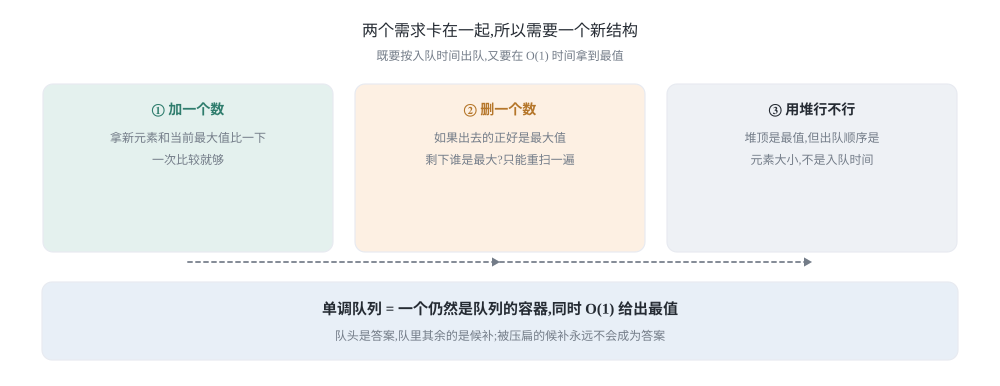
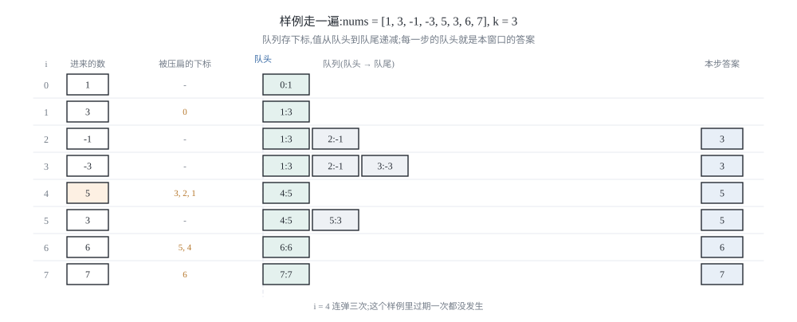
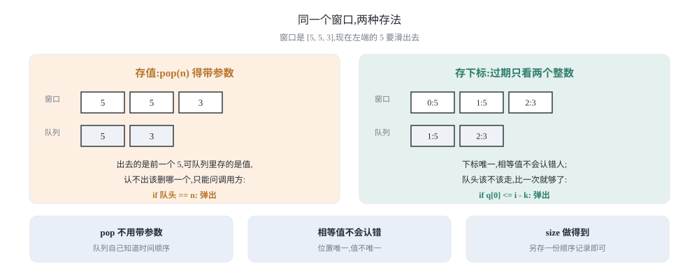
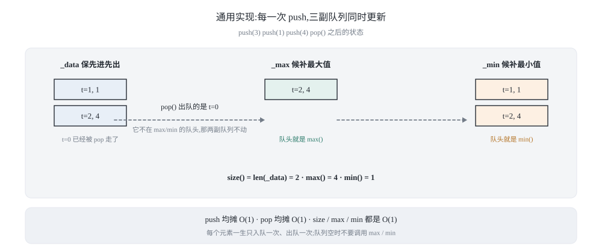
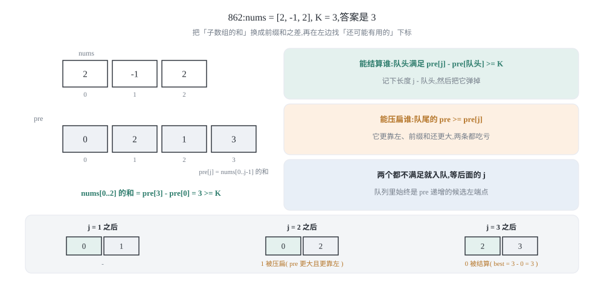

## 0 先说明材料和我的写法

这篇是我自己的学习笔记，主题是单调队列：从「窗口最值」这个具体需求出发，推出一个十来行的模板，再把原文留的三个思考题做成一个通用实现，最后用它解法四道题。材料来自 labuladong 的两篇教程：

- 《单调队列结构解决滑动窗口问题》—— <https://labuladong.online/zh/algo/data-structure/monotonic-queue/>
- 《单调队列的通用实现及经典习题》—— <https://labuladong.online/zh/algo/problem-set/monotonic-queue/>

先把材料取到的程度说清楚：

- 第一篇是主线，**讲解文字我完整取到了**：为什么「加元素容易、删元素难」、为什么优先级队列（二叉堆）不合适、单调队列的三个 API、push 时把队尾比自己小的元素全部删掉（原文用「体重大的把前面体重不足的压扁」打比方）、均摊复杂度的两种说法，以及文末的三个思考题。但它的**代码块在静态页面里是断的**，几乎每段都在条件判断中间被截断（页面上只剩下 `for (int i = 0; i` 这种半句）。所以本文的代码是我按它的讲解重新写的——**思路忠于原文，代码是我自己的**。
- 第二篇我只取到**小标题和侧边栏题号**（通用实现；单调队列 + 滑动窗口：1438、862；单调队列 + 环形数组：918；单调队列 + 动态规划（选学）：1696），正文只留下一句泛型的说明。所以第 4 节的通用实现、第 5 到第 8 节的四道题，**都是我自己的推导**，没有对照过原文。
- 第一篇的题单里还挂着 LCR 184「设计自助结算系统」。**我没有做这道题**：它要先过期的元素带的是时间戳，而不是「窗口长度」，过期判断得另写一套。第 9 节的表里我标了它，但代码里没有。
- 另外，**滑动窗口这个框架本身不是这篇的主题**。这个系列另有一篇专门讲它（右指针扩、左指针缩、什么时候能缩），这篇只讲那个框架处理不了的一类窗口——**窗口最值**，以及为了它长出来的数据结构。

照例说明：**教程原文是 Java 写的**，本系列一律给 **Python 3 和 C++ 两版**，都是我自己重新实现的。Python 用 `collections.deque`，C++ 用 `std::deque`，都是双端队列。

这篇的重点放在三件事上：第 2 节把模板推一遍，并且**把「每个元素只进出一次」这句话变成可以数的账**；第 3 节讲清**队列里为什么必须存下标**——原文把「pop 要带参数」留成思考题，答案就在这里；第 4 节把三个思考题一次做完，得到一个能复用的类。

### 目录

- [0 先说明材料和我的写法](#0-先说明材料和我的写法)
- [1 窗口最值:两个指针处理不了的那一类](#1-窗口最值两个指针处理不了的那一类)
- [2 模板:239 滑动窗口最大值](#2-模板239-滑动窗口最大值)
- [3 队列里存下标,不存值](#3-队列里存下标不存值)
- [4 通用实现:一个类顶四个需求](#4-通用实现一个类顶四个需求)
- [5 1438:窗口里同时要最大和最小](#5-1438窗口里同时要最大和最小)
- [6 862:前缀和加单调队列](#6-862前缀和加单调队列)
- [7 918:环形数组上的同一副队列](#7-918环形数组上的同一副队列)
- [8 选学:1696 跳跃游戏 VI](#8-选学1696-跳跃游戏-vi)
- [9 把这几个套路收成一张表](#9-把这几个套路收成一张表)
- [10 材料与出处](#10-材料与出处)

## 1 窗口最值:两个指针处理不了的那一类

### 1.1 加元素容易,删元素难

先把需求写具体。有一个长度固定为 `k` 的窗口在数组上从左往右滑，每一步都要知道窗口里的最大值。

假如现在窗口里是 `[1, 3, -1]`，最大值是 3。接下来：

- **加一个数**：进来 `-3`，拿它和当前最大值 3 比一下，3 更大，所以新最大值还是 3。一次比较就够。
- **删一个数**：如果窗口左端滑出去的是 3，剩下的 `[3, -1, -3]` 里的最大值是多少？没人知道——只能把窗口里剩下的元素重扫一遍。

这就是这道缝：**加元素是增量的，删元素不是。** 滑动窗口那套「右指针扩、左指针缩」的框架之所以好用，是因为它每一步都能只看「刚进来的那个」和「刚出去的那个」就更新答案（和、个数、字符计数都满足这个性质）。而「最大值」不满足：被删掉的那个元素有可能正是当前答案，它一走，答案就得重新算。

如果每个窗口都重扫一遍，`n - k + 1` 个窗口、每个扫 `k` 个元素，就是 O(nk)。题目要的是 O(n)，所以差的那点东西必须存下来——**得留着「万一最大值走了，谁能顶上」的候选**。



### 1.2 为什么不用堆

「动态找最值」这件事本身有个专业工具：优先级队列（二叉堆），堆顶就是最值，插入和删除堆顶都是 O(log k)。那为什么不直接用一个大小为 `k` 的最大堆？

有两个原因，第二个才是致命的：

1. **堆不知道「该删谁」。** 窗口左端滑出去的是一个**特定位置**上的元素，而堆里只有值（或者值加一个位置标记）。想让它在 O(log k) 时间里删掉指定的那个元素，得额外维护「元素 → 堆内位置」的反向索引（可索引堆），写起来比单调队列长得多。
2. **堆的出队顺序是大小顺序，不是入队顺序。** 单调队列要维护的是一个**队列**：先进先出，左端出去的那个元素必须正好是 `k` 步之前进来的那个。堆是按值排序的，队头永远是最值，你没法让它「按时间出队」。原文把这一点说得很直接：优先级队列满足不了标准队列结构「先进先出」的时间顺序。

换句话说，这里要的不是「一个能快速取最值的容器」，而是「**一个仍然是队列的容器，同时能快速取最值**」。时间顺序不能丢，因为丢掉了就没法知道该在什么时候把谁请出去。

（还有一个更省事的办法：既然只要最大值，为什么不在窗口里维护 `k` 个元素的**有序性**，用平衡树？那确实是 O(log k)，但代码量和常数都上去了。单调队列的价值在于：它把这件事压到了均摊 O(1)。）

### 1.3 两个需求卡在一起

把上面的结论拼起来，就是单调队列的全部动机：

> 既要保持**先进先出**的时间顺序，又要在 O(1) 时间拿到最值，还要能在两端增删——所以底层用双端队列，并且用「压扁」的规则让它保持单调。

「压扁」的规则是这一节唯一需要记住的东西：

> **新元素进来时，把队尾所有比它小（或相等）的元素全部删掉，再把自己挂到队尾。**

为什么可以删？因为这些元素**永远不可能成为答案了**：它们比新元素小，又比新元素更早过期。新元素在队列里多待一步，它们少待一步，所以「它们当最大值」的每一个时刻，新元素都在场上并且更大。既然永远轮不到它们，留着只是浪费比较。

这条推理里有两个前提，缺一不可：**（a）新元素不比它们小；（b）新元素活得更久。** 后面第 3 节会看到，为了让「活得更久」这件事可判断，队列里存的就不能是值，而是**位置**。

## 2 模板:239 滑动窗口最大值

### 2.1 三个动作

力扣 239 的题面就是第 1 节的需求：给数组 `nums` 和正整数 `k`，返回每个长度为 `k` 的窗口里的最大值，一共 `n - k + 1` 个答案。

用单调队列解，整段骨架只有三个动作：

```text
for i in 0 .. n-1:
    1) 压扁: while 队尾的值 <= nums[i]: 弹掉队尾
    2) 入队: 把 i 挂到队尾
    3) 过期: if 队头已经滑出窗口: 弹掉队头
    4) 记录: 如果窗口已经满了, 队头的值就是答案
```

第 3 步用 `if` 就够（窗口一步只滑一格，最多只有一个下标掉出去），第 1 步必须用 `while`（一次可能压扁好几个候补）。看起来第 1 步的 `while` 会很长，但**每个下标最多被压扁弹掉一次、最多被过期弹掉一次**，两个位置在整个循环里合计不超过 `2n` 次弹出——这就是 O(n) 的全部来源，第 2.5 节把账记清楚。

### 2.2 队列的形状

先说清队列里元素的大小关系。上面第 1 步的规则保证了：

> **队列里存的下标，它们对应的值从队头到队尾单调递减。**

于是队头就是整个窗口的最大值——因为窗口里所有元素要么在队列里（按值递减），要么在某个时刻被压扁了（说明它当时就被一个更大、又活得更久的元素挤掉了）。

这里有个容易搞混的地方：**队列里存的元素是「窗口的子集」，不是「窗口的全部」**。队头是答案，队里其余的都是「万一队头过期了，可能顶上的候补」。窗口里有几个元素，队列里最多就有几个；通常更少。

### 2.3 存下标的实现

直接给两版实现。注意 `k` 是窗口长度，窗口是 `[i - k + 1, i]`。

```python
from collections import deque


def max_sliding_window(nums, k):
    """每个长度为 k 的窗口里的最大值,返回 n - k + 1 个数。"""
    q = deque()                              # 只存下标,它们对应的值从队头到队尾递减
    res = []
    for i, x in enumerate(nums):
        while q and nums[q[-1]] <= x:        # 压扁:队尾比新元素小的都没用了
            q.pop()
        q.append(i)                          # 新元素入队,继续当候补
        if q[0] <= i - k:                    # 过期:队头已经滑出窗口左边
            q.popleft()
        if i >= k - 1:                       # 窗口满了,队头就是最大值
            res.append(nums[q[0]])
    return res
```

```cpp
#include <deque>
#include <vector>

std::vector<int> max_sliding_window(const std::vector<int>& nums, int k) {
    std::deque<int> q;                       // 只存下标,它们对应的值从队头到队尾递减
    std::vector<int> res;
    for (int i = 0; i < static_cast<int>(nums.size()); ++i) {
        while (!q.empty() && nums[q.back()] <= nums[i]) {
            q.pop_back();
        }
        q.push_back(i);
        if (q.front() <= i - k) {
            q.pop_front();
        }
        if (i >= k - 1) {
            res.push_back(nums[q.front()]);
        }
    }
    return res;
}
```

三行的顺序值得停一下：**先压扁、再入队、后过期**。先压扁是因为新元素要先把自己的候补清干净；后过期是因为「队头」必须在压扁之后才确定（压扁可能直接把队头弹掉）。把入队放在过期之前，还能让「过期时队列一定非空」这件事成立——毕竟刚进去的 `i` 不可能过期。

### 2.4 走一遍官方样例

样例是 `nums = [1, 3, -1, -3, 5, 3, 6, 7]`，`k = 3`，答案是 `[3, 3, 5, 5, 6, 7]`。

| `i` | 进来的数 | 被压扁的 | 队列（下标:值） | 窗口 | 本步答案 |
|---|---|---|---|---|---|
| 0 | 1 | — | `0:1` | `[1]` | — |
| 1 | 3 | `0` | `1:3` | `[1, 3]` | — |
| 2 | -1 | — | `1:3, 2:-1` | `[1, 3, -1]` | 3 |
| 3 | -3 | — | `1:3, 2:-1, 3:-3` | `[3, -1, -3]` | 3 |
| 4 | 5 | `3, 2, 1` | `4:5` | `[-1, -3, 5]` | 5 |
| 5 | 3 | — | `4:5, 5:3` | `[-3, 5, 3]` | 5 |
| 6 | 6 | `5, 4` | `6:6` | `[5, 3, 6]` | 6 |
| 7 | 7 | `6` | `7:7` | `[3, 6, 7]` | 7 |

三处值得看：

- **`i = 4` 那一步连弹三次**（下标 3、2、1 依次出队）。这就是「一次 while 可能很长」的来源，也是第 2.5 节要数账的地方。
- **这个样例里过期一次都没发生**：最大值一直待在窗口里，队头从来没滑出去过。所以「过期判断」不能靠这个样例验证——它得单独测（比如 `nums = [3, 1, 2], k = 2`，第 7 步时队头下标 0 正好过期，答案是 `[3, 2]`；把这一步写错，输出就会变成 `[3, 3]`）。
- `i = 2` 时队头是 3（下标 1），它在窗口 `[1, 3, -1]` 里；`i = 3` 时窗口换成 `[3, -1, -3]`，队头还是 3。**队头没变不代表窗口没变**，只是最大值恰好还在。



### 2.5 为什么每个元素只进出一次

很多讲法到这里就说「`push` 均摊 O(1)，所以整体 O(n)」，但没把账记给你看。这里记一次。

给每个下标记两笔账：

- **压扁弹掉**：下标 `j` 在 `j` 入队之后，只可能被**某个比它大的元素**弹出一次；弹出之后它就再也不会回到队列里（它不会二次入队）。所以整个循环里，「压扁弹掉」的总次数 ≤ 入队次数 = `n`。
- **过期弹掉**：每个下标只在「`q[0] <= i - k`」成立的那一步被弹掉一次，弹掉之后也不会回来。所以「过期弹掉」的总次数 ≤ `n`。

于是队列上的全部操作是：`n` 次入队、最多 `n` 次压扁弹出、最多 `n` 次过期弹出，再加上每步常数次比较和读队头。整个算法 O(n)，额外空间就是队列的长度，也就是 O(k)（队列是窗口的子集）。

这条账还有个更省事的看法：**同一个下标，一生只入队一次、出队一次。** 把「每个元素的一生」当成两枚硬币付掉，所有 while 循环加起来就是 O(n)，不用管单次 while 有多长。

顺便说清一个容易误解的点：`push` 的**最坏**时间复杂度确实是 O(k)（比如单调递减的数组，新元素一来就把整个队列清空）。但算法分析要的是整个循环的总量，而不是单步的最坏值——如果每步都按最坏值算，就会误判成 O(nk)。

### 2.6 最容易写错的一行

**最容易写错的一行:** `if q[0] <= i - k:`

窗口是 `[i - k + 1, i]`，所以队头下标小于 `i - k + 1`（也就是小于等于 `i - k`）才算过期。写成 `q[0] < i - k + 1`、`q[0] <= i - k + 1`、或者干脆 `q[0] < i - k`，都会把「刚刚好在窗口最左边」的那个元素提前赶走，于是答案变小。判据只有一句话：**当前窗口的左边界是 `i - k + 1`，队列里的下标必须 `>= i - k + 1`。**

## 3 队列里存下标,不存值

### 3.1 存值版本的三个麻烦

原文给的 API 是这样的（这是它的签名，不是我的实现）：

```text
class MonotonicQueue:
    void push(int n)     # 队尾加入元素 n
    int max()            # 返回队列中的最大值
    void pop(int n)      # 队头元素如果是 n,删除它
```

注意 `pop` 带了一个参数 `n`，而且注释写的是「**如果**队头是 `n`，才删」。原文自己把这一点留成了思考题：这个设计「不那么优雅，而且有悖于标准队列的 API」。为什么它不得不这样？

因为**队列里存的是值，而值会认错人**。窗口左端滑出去的可能是值 `5`，但队列里可能同时有好几个 `5`，甚至滑出去的那个 `5` 早就被压扁了（不在队列里），队头那个 `5` 是窗口里另一个位置上的。存值版本只能「看队头是不是这个值，是就删」，于是：

1. **pop 需要参数**，调用方每次都得把「正要滑出窗口的那个元素」传给队列，队列自己完全不知道时间。
2. **相等值会认错**。窗口里有两个 `5`，滑出去的是前一个，但队列无法区分，只能删掉队头那个——如果它们恰好都在队列里，这就把活着的那个删了。
3. **size 也做不了**。原文的第 3 个思考题问的就是这个：底层队列里的元素个数并不等于「队列里还有多少个元素」，因为 push 会顺手删掉一堆。

三个麻烦的根都是同一个：**存值丢掉了「位置」这个信息**。而位置恰好是过期判断、先进先出、计数三件事都需要的。

### 3.2 过期判断只用两个整数

把队列里存的东西从「值」换成「下标」，三个麻烦一起消失：

- **过期判断**变成 `q[0] <= i - k`：只比较两个整数，队列自己知道谁该走，`pop` 不需要参数。
- **相等值不再混淆**：即使两个下标的值都是 `5`，它们的下标不同，谁过期一目了然。
- **`size` 有办法做**：队列里存的是位置，「谁还在」就是可数的——第 4 节用一份额外的顺序记录把个数记下来；存值版本连这个都无从下手，因为 push 会顺手删掉一堆。

代价是每次要用值的时候多一次 `nums[q[0]]` 的间接访问。在数组题里这个代价可以忽略；**在没有数组可以索引的地方**（比如第 4 节那个通用类，元素是一个个 push 进来的），就自己给每个元素发一个递增的编号当「位置」。



### 3.3 相等元素:为什么队尾用 `<=`

§2.3 里压扁的条件是 `nums[q[-1]] <= x`，用到了 `<=`。这个等号值得单独解释，因为本系列讲单调栈的那一篇里，取舍刚好相反。

在**窗口**这种结构里，相等时应该**弹掉旧的、留下新的**：

- 假设窗口里有三个相等的 `5`，队里只留一个最靠右的（最新的）就够了。
- 因为最新的那个**最晚过期**：它在窗口里待的时间最长。「哪个 5 是答案」这件事不影响答案的值，但影响答案**还能撑多久**——留着最新的，队头不会因为过期而被提前赶走。
- 单调栈就没有这个理由（栈里没有「过期」），所以栈那里 `<=` 还是 `<` 完全由「平局归谁」决定。

一句话：**窗口里的相等元素，留最新的；栈里的相等元素，看题目要哪一边。**

### 3.4 最容易写错的一行

**最容易写错的一行:** `while q and nums[q[-1]] <= x:`

这里真正容易写错的是**两个条件都不能少**。少了 `q and`，空队列时会 `q[-1]` 报错（C++ 里是访问空 `deque` 的 `back()`，未定义行为）；把 `<=` 写成 `<` 答案仍然是对的（过期判断会兜住），但队列里会白留一串相等的值，队列长度往 `k` 靠，比较次数和内存都变差。**能证明「留着没用」的元素，一个都不要留。**

## 4 通用实现:一个类顶四个需求

### 4.1 原文留的三个思考题

第一篇的末尾留了三个问题，它们正好定义了「一个能用的单调队列」该有的样子：

1. 能不能再加一个 `min`，在 O(1) 时间给出队列里的最小值？
2. `pop` 带参数不优雅，能不能改成标准队列的 API（不带参数、先进先出）？
3. 能不能实现 `size`，返回队列里元素的个数？

原文还给了一段通用实现的签名（`push / pop / size / max / min`）。下面这份实现是我按这三个要求写的。

### 4.2 三副队列的分工

核心设计只有一句话：**每 push 一个元素，就给它发一个递增的编号 `t`**，这个编号就是「位置」，于是第 3 节的所有好处都能拿到了。

- `_data`：`(t, 值)`，按入队顺序排。它负责**先进先出**和**计数**。
- `_max`：候补最大值，值从队头到队尾**递减**，`max()` 读队头。
- `_min`：候补最小值，值从队头到队尾**递增**，`min()` 读队头。

`pop()` 出队时，拿 `_data` 队头的编号 `t` 去问 `_max` 和 `_min`：**如果队头的编号正好是 `t`，它才需要跟着出队**；否则说明它早就被压扁了，什么都不用做。这一步就是第 3 节说的「用位置认人」。

```python
from collections import deque


class MonotonicQueue:
    """既能按先进先出出队,又能在 O(1) 时间给出最值。"""

    def __init__(self):
        self._data = deque()                 # 所有元素:(编号, 值),按入队顺序
        self._max = deque()                  # 候补最大值:(编号, 值),值递减
        self._min = deque()                  # 候补最小值:(编号, 值),值递增
        self._seq = 0                        # 下一个要发的编号

    def push(self, x):
        t = self._seq
        self._seq += 1
        self._data.append((t, x))
        while self._max and self._max[-1][1] <= x:   # 队尾比我小的候补都没用了
            self._max.pop()
        self._max.append((t, x))
        while self._min and self._min[-1][1] >= x:   # 队尾比我大的候补都没用了
            self._min.pop()
        self._min.append((t, x))

    def pop(self):
        t, x = self._data.popleft()
        if self._max[0][0] == t:             # 队头正好是它,才跟着出队
            self._max.popleft()
        if self._min[0][0] == t:
            self._min.popleft()
        return x

    def size(self):
        return len(self._data)

    def max(self):
        return self._max[0][1]

    def min(self):
        return self._min[0][1]
```

```cpp
#include <cstddef>
#include <deque>
#include <utility>

template <typename T>
class MonotonicQueue {
public:
    void push(const T& x) {
        long long t = seq_++;
        data_.push_back(std::make_pair(t, x));
        while (!max_.empty() && max_.back().second <= x) {
            max_.pop_back();
        }
        max_.push_back(std::make_pair(t, x));
        while (!min_.empty() && min_.back().second >= x) {
            min_.pop_back();
        }
        min_.push_back(std::make_pair(t, x));
    }

    T pop() {
        std::pair<long long, T> front = data_.front();
        data_.pop_front();
        if (max_.front().first == front.first) {
            max_.pop_front();
        }
        if (min_.front().first == front.first) {
            min_.pop_front();
        }
        return front.second;
    }

    std::size_t size() const { return data_.size(); }
    const T& max() const { return max_.front().second; }
    const T& min() const { return min_.front().second; }

private:
    std::deque<std::pair<long long, T> > data_, max_, min_;
    long long seq_ = 0;
};
```

（C++ 这份用了模板，因为原文的通用实现本来就要求元素可比较。`max()` 和 `min()` 里直接读了 `front()`，**调用之前必须先确认队列非空**，这一点和 `std::priority_queue` 一样；Python 那份同理。）

### 4.3 谁在什么时候出队

把出队的三条路径列清楚，这个类就不会用错了：

| 路径 | 由谁触发 | 出队的是谁 | 次数上界 |
|---|---|---|---|
| 压扁 | `push` 里的两个 while | 队尾那些「更小且更早」的候补 | 每个元素最多一次 |
| 过期（数组题） | 主循环里的 `q[0] <= i - k` | 队头 | 每个元素最多一次 |
| 先进先出（本类） | `pop()` | `_data` 的队头，同时可能带走 `_max`/`_min` 的队头 | 每次 `pop()` 一次 |

三条路径合起来仍然是「**每个元素一生进一次、出一次**」，所以 `push`、`pop` 都是均摊 O(1)。空间上，`_data` 存了所有还在队列里的元素，是 O(size)；`_max` 和 `_min` 各不超过 `_data` 的长度。用在滑动窗口上（窗口长度 `k`），三者都不超过 `k`，也就是 O(k)。



对比一下第 3.1 节那个存值的简陋版：它省掉了 `_data`，代价是 API 残缺（pop 带参数、没有 size）。**这份通用实现多花的是一份 O(size) 的顺序记录，换来的是一个真正的队列。**

### 4.4 最容易写错的一行

**最容易写错的一行:** `if self._max[0][0] == t:`

`pop()` 里判断的是**编号相等**，不是值相等。写成 `if self._max[0][1] == x:` 就会退回到第 3.1 节的老毛病——两个相等值的情况下认错人。编号是唯一的，值不是。

## 5 1438:窗口里同时要最大和最小

### 5.1 为什么这道题非它不可

力扣 1438「绝对差不超过限制的最长连续子数组」：给数组和 `limit`，求最长的连续子数组，使得其中**最大值与最小值之差**不超过 `limit`。

这道题是一个典型的滑动窗口：右端一直扩，一旦窗口里的 `max - min > limit`，就把左端往右缩，直到重新合法；每一步的窗口长度取最大值。

但注意它要的是**两个**最值：既要窗口最大值，又要窗口最小值，而且窗口左端还要能按时间缩。这就是第 1 节那道缝的加强版：

- 用两个堆？可以，但要在堆里按位置删除元素，还得处理「堆顶已经出窗口了」的惰性删除，代码立刻变得很长。
- 用第 4 节的类？`push` 扩窗口、`pop` 缩窗口、`max()` 和 `min()` 就是判据，**一个类正好对上三个动作**。这就是「通用实现」值得写的原因。

注意窗口的形状和 239 不同：239 的窗口长度固定为 `k`，这里的窗口长度是**答案**（合法就继续扩，不合法才缩）。单调队列不关心窗口多长，它只关心「谁过期了」——所以同一副结构两边都能用。

### 5.2 代码

```python
def longest_subarray(nums, limit):
    """最长的连续子数组,其中最大值与最小值之差不超过 limit。"""
    q = MonotonicQueue()
    left = 0
    best = 0
    for right, x in enumerate(nums):
        q.push(x)                            # 右端扩:新元素进队
        while q.max() - q.min() > limit:      # 超限了,只能把左端请出去
            q.pop()
            left += 1
        best = max(best, right - left + 1)    # 此刻的窗口一定合法
    return best
```

```cpp
#include <algorithm>
#include <vector>

int longest_subarray(const std::vector<int>& nums, int limit) {
    MonotonicQueue<int> q;
    int left = 0;
    int best = 0;
    for (int right = 0; right < static_cast<int>(nums.size()); ++right) {
        q.push(nums[static_cast<std::size_t>(right)]);
        while (q.max() - q.min() > limit) {
            q.pop();
            ++left;
        }
        best = std::max(best, right - left + 1);
    }
    return best;
}
```

样例：`nums = [8, 2, 4, 7]`，`limit = 4`，答案是 2（`[8]`、`[2, 4]`、`[2, 4, 7]`？第三个的极差是 5，超了；所以最长的是 `[2, 4]` 或者 `[4, 7]`，长度 2）。再看 `nums = [10, 1, 2, 4, 7, 2]`，`limit = 5`，答案是 4（`[1, 2, 4, 7]` 的极差是 6，超了；`[2, 4, 7, 2]` 的极差是 5，合法）。

复杂度：每个元素进队一次、出队一次，`max()` 和 `min()` 都是 O(1)，所以整体 O(n)，空间 O(k)，`k` 是答案的长度。

### 5.3 最容易写错的一行

**最容易写错的一行:** `while q.max() - q.min() > limit:`

两点：**（a）是 `while` 不是 `if`**——缩一次可能还不够，得缩到合法为止（比如 `nums = [1, 100, 2]`、`limit = 3`，只缩一次还剩 `[100, 2]`，差 98）。（b）比较的是 `max - min` 和 `limit`，**不是窗口长度和 `limit`**；这里的条件说的是「窗口里的状态」，不是「窗口的大小」。

## 6 862:前缀和加单调队列

### 6.1 把「和至少为 K」翻译成前缀和

力扣 862「和至少为 K 的最短子数组」：数组里可能有负数，求和 ≥ `K` 的**最短**非空连续子数组的长度，没有就返回 -1。

求「连续子数组的和」，第一反应应该是前缀和：记 `pre[j] = nums[0] + ... + nums[j-1]`（`pre[0] = 0`），那么子数组 `nums[i..j-1]` 的和就是 `pre[j] - pre[i]`。题目要求：

> 找一对 `i < j`，使 `pre[j] - pre[i] >= K`，并且 `j - i` 最小。

如果数组全是正数，`pre` 是递增的，两个指针就能做（那正是滑动窗口框架那一篇里的 209 题）。**但这里有负数**，`pre` 不再单调，「左指针不回退」的性质就没了。于是问题变成：

> 对每个右端点 `j`，在它左边找一个 `i`，使 `pre[i] <= pre[j] - K`，并且 `i` 尽量靠右（这样 `j - i` 最小）。

「左边那些 `pre[i]` 里，谁还有用？」——这正是单调队列要回答的：

- 如果两个下标 `i1 < i2` 满足 `pre[i1] >= pre[i2]`，那么 `i1` **永远没用了**：它比 `i2` 更靠左（距离更大），前缀和还更大（更不容易满足 `pre[j] - pre[i] >= K`）。两条理由都指向同一结论：**留 `i2` 就够了**。
- 所以队列里存的下标，它们的 `pre` 值必须是**递增**的（否则队尾那个会被新来的挤掉）。

于是三个动作和 239 一模一样，只是「压扁」的条件换成了 `pre` 的比较：

1. **结算**：如果队头的 `i` 满足 `pre[j] - pre[i] >= K`，那它就是一个合法答案；记下长度 `j - i`，然后**把它弹掉**（它对后面更大的 `j` 只会给出更长的子数组，不可能更好）。
2. **压扁**：把队尾那些 `pre >= pre[j]` 的下标弹掉。
3. **入队**：把 `j` 挂到队尾。

```python
from collections import deque


def shortest_subarray(nums, k):
    """和至少为 k 的最短非空连续子数组长度,没有就返回 -1。"""
    n = len(nums)
    pre = [0] * (n + 1)                      # pre[j] = nums[0..j-1] 的和
    for i, x in enumerate(nums):
        pre[i + 1] = pre[i] + x
    q = deque()                              # 存下标,它们的 pre 值从队头到队尾递增
    q.append(0)
    best = n + 1                             # n + 1 表示「还没有答案」
    for j in range(1, n + 1):
        while q and pre[j] - pre[q[0]] >= k:     # 队头满足条件:记一笔,然后它就没用了
            best = min(best, j - q.popleft())
        while q and pre[q[-1]] >= pre[j]:        # 队尾的 pre 比我还大,它不可能是更好的左端
            q.pop()
        q.append(j)
    return best if best <= n else -1
```

```cpp
#include <algorithm>
#include <deque>
#include <vector>

int shortest_subarray(const std::vector<int>& nums, int k) {
    int n = static_cast<int>(nums.size());
    std::vector<long long> pre(static_cast<std::size_t>(n) + 1, 0);
    for (int i = 0; i < n; ++i) {
        pre[static_cast<std::size_t>(i) + 1] =
            pre[static_cast<std::size_t>(i)] + nums[static_cast<std::size_t>(i)];
    }
    std::deque<int> q;                       // 存下标,它们的 pre 值从队头到队尾递增
    q.push_back(0);
    int best = n + 1;
    for (int j = 1; j <= n; ++j) {
        while (!q.empty() &&
               pre[static_cast<std::size_t>(j)] - pre[static_cast<std::size_t>(q.front())] >= k) {
            best = std::min(best, j - q.front());
            q.pop_front();
        }
        while (!q.empty() &&
               pre[static_cast<std::size_t>(q.back())] >= pre[static_cast<std::size_t>(j)]) {
            q.pop_back();
        }
        q.push_back(j);
    }
    return best <= n ? best : -1;
}
```

样例：`nums = [1]`、`k = 1` → 1；`nums = [1, 2]`、`k = 4` → -1；`nums = [2, -1, 2]`、`k = 3` → 3；`nums = [1, 2, 3, 4]`、`k = 6` → 2（`[3, 4]` 就够了）。

复杂度：`j` 从 1 走到 `n`，每个下标入队一次；两条 while 各自最多把每个下标弹掉一次，所以 O(n)，空间 O(n)（前缀和数组加队列）。

### 6.2 两个 while 的顺序不能换

上面代码里，**结算的 while 必须排在压扁的 while 前面**。理由很具体：

- 结算时要拿 `q[0]` 去和 `pre[j]` 比。如果先压扁，而 `j` 的 `pre` 恰好把队头挤掉了，这个本来可以结算的 `i` 就丢了——它可能正是最短的那一段。
- 压扁淘汰的是「对**将来**的 `j` 没用的左端」；结算用的是「对**现在**这个 `j` 有用的左端」。先结清现在的账，再淘汰将来的候补。

### 6.3 最容易写错的一行

**最容易写错的一行:** `while q and pre[j] - pre[q[0]] >= k:`

两个坑：**（a）`pre` 的下标是 `j` 不是 `j - 1`。** 前缀和数组长度是 `n + 1`，`pre[j]` 表示前 `j` 个数之和，`nums[i..j-1]` 的和是 `pre[j] - pre[i]`。写成 `pre[j - 1] - pre[i]` 会把最后进来的那个数漏掉。**（b）是 `>= k` 不是 `> k`。** 「至少为 K」包含等于。



## 7 918:环形数组上的同一副队列

### 7.1 环形就是翻倍加长度限制

力扣 918「环形子数组的最大和」：数组首尾相接，求和最大的非空连续子数组，长度不能超过 `n`（超过了就重复取元素了，没有意义）。

这道题和上一篇（单调栈）里的 503 是同一招：**把数组接在自己的尾巴上，看成一条长度为 `2n` 的带子**。环形上的一段连续子数组，就对应带子上的一段连续区间，长度不超过 `n`。

再用前缀和把「区间和」变成「两个前缀和相减」：在带子的前缀和数组 `P` 上（`P[j] = nums[0..j-1]` 的和，下标绕回），要最大化 `P[j] - P[i]`，其中 `0 <= i < j <= 2n` 且 `j - i <= n`。

固定右端 `j`，就是要**在 `[j - n, j - 1]` 这个滑动窗口里找 `P[i]` 的最小值**——又是一道滑动窗口最值题，只不过这次要的是**最小**值。于是队列形状从「递减」翻成「递增」：

1. **过期**：队头下标 `< j - n` 就弹掉（它已经超出长度限制）。
2. **结算**：`P[j] - P[q[0]]` 就是以 `j` 结尾的最优区间和，取最大值。
3. **压扁**：队尾那些 `P >= P[j]` 的下标弹掉，因为 `j` 比它们更靠右、前缀和还更小。
4. **入队**：把 `j` 挂到队尾。

### 7.2 代码

```python
from collections import deque


def max_subarray_sum_circular(nums):
    """环形数组的最大子数组和,长度不超过 n。"""
    n = len(nums)
    if n == 0:
        return 0
    pre = [0] * (2 * n + 1)                  # 翻倍数组的前缀和:P[j] - P[i] 就是一段连续和
    for j in range(2 * n):
        pre[j + 1] = pre[j] + nums[j % n]
    q = deque()                              # 存下标,它们的 pre 值从队头到队尾递增
    q.append(0)
    best = nums[0]
    for j in range(1, 2 * n + 1):
        while q and q[0] < j - n:            # 左端离得太远:超过 n 个元素就不是子数组了
            q.popleft()
        best = max(best, pre[j] - pre[q[0]])     # 队头就是窗口里最小的 P
        while q and pre[q[-1]] >= pre[j]:        # 队尾的 P 比我还大,没用了
            q.pop()
        q.append(j)
    return best
```

```cpp
#include <algorithm>
#include <deque>
#include <vector>

long long max_subarray_sum_circular(const std::vector<int>& nums) {
    int n = static_cast<int>(nums.size());
    if (n == 0) {
        return 0;
    }
    std::vector<long long> pre(static_cast<std::size_t>(2 * n) + 1, 0);
    for (int j = 0; j < 2 * n; ++j) {
        pre[static_cast<std::size_t>(j) + 1] =
            pre[static_cast<std::size_t>(j)] + nums[static_cast<std::size_t>(j % n)];
    }
    std::deque<int> q;                       // 存下标,它们的 pre 值从队头到队尾递增
    q.push_back(0);
    long long best = nums[0];
    for (int j = 1; j <= 2 * n; ++j) {
        while (!q.empty() && q.front() < j - n) {
            q.pop_front();
        }
        best = std::max(best, pre[static_cast<std::size_t>(j)] -
                                 pre[static_cast<std::size_t>(q.front())]);
        while (!q.empty() && pre[static_cast<std::size_t>(q.back())] >=
                                 pre[static_cast<std::size_t>(j)]) {
            q.pop_back();
        }
        q.push_back(j);
    }
    return best;
}
```

样例：`[1, -2, 3, -2]` → 3；`[5, -3, 5]` → 10（把首尾两个 5 接起来）；`[-3, -2, -3]` → -2（全是负数时不能取空数组）；`[2, -1, 2]` → 4（取下标 2 和 0 的两个 2）。

复杂度：扫描长度是 `2n`，每个下标进队一次出队一次，所以 O(n)，空间 O(n)。

### 7.3 和 Kadane 的对照

这道题更常见的解法是 Kadane 变形：答案要么是**不跨越接缝**的最大子数组和（Kadane 直接算），要么是**跨越接缝**的，也就是 `总和 - 最小子数组和`；两者取最大。全是负数时要特判（此时最小子数组就是整个数组，`总和 - 最小` 会得到 0，而空数组是不允许的）。

两种解法算的是同一个数，但看法完全不同：

- Kadane 用「**补集**」的眼光：跨越接缝的那一段，等价于「把中间一段最小的扔掉」。
- 单调队列用「**枚举右端点 + 窗口最值**」的眼光：长度受限，所以窗口最小前缀和。

两者都对，但单调队列这一路不需要特判负数——因为它的窗口长度限制天然排除了空数组，`j - i >= 1` 永远成立（`i` 最多到 `j - 1`）。这个「不用讨论边界情况」的好处，是通用结构常有的红利。

### 7.4 最容易写错的一行

**最容易写错的一行:** `while q and q[0] < j - n:`

过期条件是「`i >= j - n`」，所以弹掉的是 `< j - n` 的下标。写成 `q[0] <= j - n` 会把长度正好为 `n` 的那一段（整个数组绕一圈）也排除掉；写成 `q[0] < j - 2 * n` 则完全不过期，会算出「长度超过 `n`、元素被重复使用」的假答案。**长度限制是靠这一行守住的。**

## 8 选学:1696 跳跃游戏 VI

### 8.1 状态转移里的「前 k 步最大值」

力扣 1696「跳跃游戏 VI」：从下标 0 出发，每次最多往前跳 `k` 步，跳到下标 `n - 1`，把路上经过的所有数字加起来（包括起点和终点），求最大得分。

这是动态规划：`dp[i]` 表示「跳到 `i` 时能拿到的最大分数」，那么

> `dp[i] = nums[i] + max(dp[j])`，其中 `j` 取遍 `[i - k, i - 1]`。

于是第 `i` 步需要的是「**滑动窗口 `[i - k, i - 1]` 里的最大值**」——又是同一件事，只不过窗口里装的不是原数组，而是 `dp` 值。这正好说明单调队列是一个**通用工具**：

| 用在哪 | 窗口里是什么 | 压扁条件 | 过期条件 |
|---|---|---|---|
| 239 | `nums` 的值 | `nums[队尾] <= nums[i]` | `q[0] <= i - k` |
| 1438 | 窗口元素（要 max 和 min） | `<=`（递减）／`>=`（递增） | 由 `pop()` 按先进先出 |
| 862 | 前缀和 `pre` | `pre[队尾] >= pre[j]` | 队头结算后主动弹掉 |
| 918 | 前缀和 `pre`（要最小） | `pre[队尾] >= pre[j]` | `q[0] < j - n` |
| 1696 | `dp` 的值 | `dp[队尾] <= dp[i]` | `q[0] < i - k` |

一眼就能看出：**变的是「谁被压扁」，不变的是「队头是答案」。**

### 8.2 代码

```python
from collections import deque


def max_result(nums, k):
    """每次最多跳 k 步,从下标 0 跳到最后一个下标的最大得分。"""
    n = len(nums)
    if n == 0:
        return 0
    dp = [0] * n                             # dp[i] = 跳到 i 时的最大得分
    dp[0] = nums[0]
    q = deque([0])                           # 存下标,它们的 dp 值从队头到队尾递减
    for i in range(1, n):
        while q and q[0] < i - k:            # 只能从前 k 个位置之一跳过来
            q.popleft()
        dp[i] = dp[q[0]] + nums[i]           # 队头就是前 k 个位置里的最大 dp
        while q and dp[q[-1]] <= dp[i]:      # 队尾的 dp 不如我,它更早过期又更小
            q.pop()
        q.append(i)
    return dp[-1]
```

```cpp
#include <deque>
#include <vector>

int max_result(const std::vector<int>& nums, int k) {
    int n = static_cast<int>(nums.size());
    if (n == 0) {
        return 0;
    }
    std::vector<long long> dp(static_cast<std::size_t>(n), 0);
    dp[0] = nums[0];
    std::deque<int> q;                       // 存下标,它们的 dp 值从队头到队尾递减
    q.push_back(0);
    for (int i = 1; i < n; ++i) {
        while (!q.empty() && q.front() < i - k) {
            q.pop_front();
        }
        dp[static_cast<std::size_t>(i)] = dp[static_cast<std::size_t>(q.front())] +
                                          nums[static_cast<std::size_t>(i)];
        while (!q.empty() &&
               dp[static_cast<std::size_t>(q.back())] <= dp[static_cast<std::size_t>(i)]) {
            q.pop_back();
        }
        q.push_back(i);
    }
    return static_cast<int>(dp[static_cast<std::size_t>(n - 1)]);
}
```

样例：`nums = [1, -1, -2, 4, -7, 3]`、`k = 2` → 7；`nums = [10, -5, -2, 4, 0, 3]`、`k = 3` → 17；`nums = [1, -5, -20, 4, -1, 3, -6, -3]`、`k = 2` → 0。

复杂度：DP 有 `n` 个状态，每个状态的转移被单调队列压到均摊 O(1)，所以 O(n) 时间、O(n) 空间（`dp` 数组）。不用单调队列的话，每个状态要扫前 `k` 个，是 O(nk)。

### 8.3 最容易写错的一行

**最容易写错的一行:** `while q and q[0] < i - k:`

`dp[i]` 只能从 `[i - k, i - 1]` 里挑，所以过期的判定是 `< i - k`。写成 `<= i - k` 就把「正好跳 `k` 步」的那个位置排除了，答案会偏小。另外注意这里的窗口是**左闭右开**的：`i` 自己还没入队，所以 `q` 里天然只有 `[0, i - 1]`，不需要额外排除 `i`。

## 9 把这几个套路收成一张表

| 题号 | 要什么 | 队列（队头→队尾） | 压扁条件 | 过期条件 | 答案读哪里 |
|---|---|---|---|---|---|
| 239 | 定长窗口最大值 | 下标，值递减 | `nums[队尾] <= nums[i]` | `q[0] <= i - k` | 队头的值 |
| 1438 | 最长窗口，极差 ≤ limit | 两副队列，值递减／递增 | `<=` ／ `>=` | `pop()` 按先进先出 | `max() - min()` |
| 862 | 最短窗口，和 ≥ K | 下标，`pre` 递增 | `pre[队尾] >= pre[j]` | 结算后弹队头 | `pre[j] - pre[队头]` |
| 918 | 环形最大和，长度 ≤ n | 下标，`pre` 递增 | `pre[队尾] >= pre[j]` | `q[0] < j - n` | 同上（取最大） |
| 1696 | 前 k 步最大 dp | 下标，`dp` 递减 | `dp[队尾] <= dp[i]` | `q[0] < i - k` | 队头的 dp |
| LCR 184 | 带时间戳过期的最大值 | 下标，值递减 | `<=` | **时间戳过期（我没做）** | 队头的值 |

配套的四条规律：

1. **要最大值就用递减队列，要最小值就用递增队列。** 和单调栈一样，方向不是设出来的，是「被压扁的元素出局」的自然结果。
2. **队列里存下标，不存值。** 过期判断、先进先出、计数三件事都要「位置」；存值版本只能让调用方把位置传进来（原文那个 `pop(int n)`）。
3. **相等时留新的。** 窗口里的相等元素，新的更晚过期，所以压扁条件用 `<=`（求最大）或 `>=`（求最小）。这一点和单调栈里「平局归谁」的取舍不是一回事。
4. **压扁和过期都是「每个元素最多一次」。** O(n) 的全部理由就在这里；单看一次 push 的 while 最坏是 O(k)，不要被它吓到。

识别清单（拿到新题时按顺序问自己）：

- 题目要的答案，是不是**某个窗口（定长或变长）里的最值**？
- 这个窗口会不会**从左端删元素**？会的话，堆就不好用了（除非上可索引堆）。
- 窗口里要的是最大值、最小值，还是两个都要？两个都要就用第 4 节那个类。
- 「谁被压扁」的条件是什么？写出「新元素比队尾更好，而且活得更久」这句话，条件自然就出来了。
- 过期条件怎么写？把窗口写成闭区间 `[L, R]`，然后要求队列里的下标 `>= L`。
- 有没有负数、有没有环形、长度有没有上限？这三件事决定了前缀和怎么用、过期条件里有没有 `2n`。

## 10 材料与出处

这篇基于 labuladong 的两篇教程：

- 《单调队列结构解决滑动窗口问题》 <https://labuladong.online/zh/algo/data-structure/monotonic-queue/>
  第 1 节的问题设定（加元素容易、删元素难）、「优先级队列满足不了先进先出」的论证、第 3.1 节那个 `push / max / pop(n)` 的 API、第 4.1 节的三个思考题、第 2.4 节用的官方样例 `[1, 3, -1, -3, 5, 3, 6, 7]`（答案 `[3, 3, 5, 5, 6, 7]`），以及「体重大的把前面体重不足的压扁」这个比方，都来自这篇。它的**讲解文字我完整取到，但代码块在静态页面里被截断了**（多数断在条件判断中间），所以本文所有代码是我按讲解重写的。第 2.4 节的走表、第 2.5 节的两笔账、第 3.2 与 3.3 节关于存下标和 `<=` 的讨论，都是我自己组织的。
- 《单调队列的通用实现及经典习题》 <https://labuladong.online/zh/algo/problem-set/monotonic-queue/>
  **只取到小标题和侧边栏题号**（1438、862、918、1696），正文只剩一句泛型说明。第 4 节的通用实现、第 5 到第 8 节四道题的解法与复杂度，都是我自己的推导，没有对照过原文。原文的「单调队列 + 动态规划」一节标了「选学」，我按这个标记把 1696 放在第 8 节。
- 第一篇题单里的 **LCR 184「设计自助结算系统」我没有做**：它的过期依据是时间戳而不是窗口长度，需要另写一套过期判断（第 9 节表里已注明）。所以这篇的「通用实现」是按「先进先出 + 最大/最小」设计的，不覆盖时间戳过期。

题目链接：

| 题号 | 题目 | 链接 |
|---|---|---|
| 239 | 滑动窗口最大值 | <https://leetcode.cn/problems/sliding-window-maximum/> |
| 1438 | 绝对差不超过限制的最长连续子数组 | <https://leetcode.cn/problems/longest-continuous-subarray-with-absolute-diff-less-than-or-equal-to-limit/> |
| 862 | 和至少为 K 的最短子数组 | <https://leetcode.cn/problems/shortest-subarray-with-sum-at-least-k/> |
| 918 | 环形子数组的最大和 | <https://leetcode.cn/problems/maximum-sum-circular-subarray/> |
| 1696 | 跳跃游戏 VI | <https://leetcode.cn/problems/jump-game-vi/> |

最后交代立场：**这不是转载，也不是翻译。** 原文的可视化面板和 Java 代码我这里复现不了，所以 5 张示意图都是我自己用 SVG 画的，代码是我用 Python 3 和 C++ 重新实现的。第 2 节的走表与两笔账、第 3 节的三个理由、第 4 节的通用实现与出队路径表、第 6.2 节两个 while 的顺序论证、第 7.3 节与 Kadane 的对照，以及第 9 节的两张表，都是我自己写的。文中的示例数字全部来自我实际跑过的代码：样例、边界（`k = 1`、`k = n`、全相等、严格递增递减、空数组、全负数）以及和暴力解的随机对拍都在同一份验证脚本里跑过。
