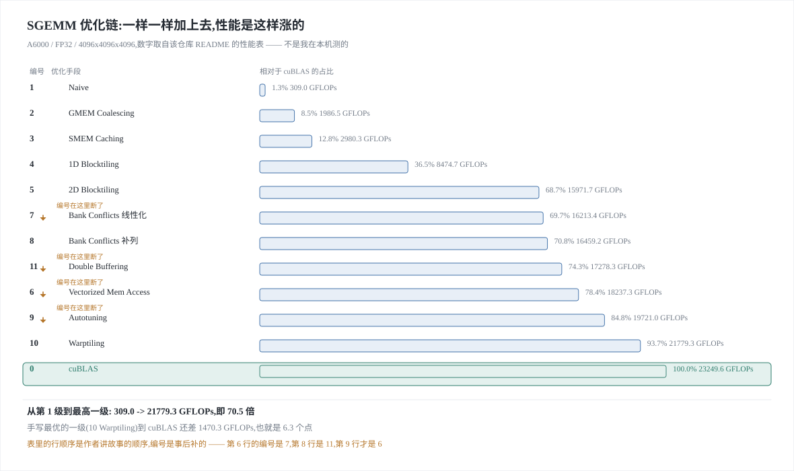

## 0 先说明材料和我的写法

材料是 Simon Boehm 2022 年 12 月写的 [How to Optimize a CUDA Matmul Kernel for cuBLAS-like Performance: a Worklog](https://siboehm.com/articles/22/CUDA-MMM)，配套仓库 [siboehm/SGEMM_CUDA](https://github.com/siboehm/SGEMM_CUDA)（MIT，默认分支是 `master` 不是 `main`）。

**这篇和本系列其它文章的写法不一样，得先说清楚。**

我把仓库里 12 个 kernel 源码全部读了一遍（`src/kernels/`，连 `kernels.cuh`、`runner.cu`、`runner.cuh`、`sgemm.cu` 一共约 1700 行），但这篇里**没有任何我自己跑出来的性能数字**。表里的数全部来自该仓库 README 的性能表 —— 作者在 **A6000、FP32、4096x4096x4096、CUDA Core（不走 Tensor Core）** 上测的。凡是我引用的数，都在文中标了「README 数据」；凡是代码读出来的结论，都标了文件名和行号。

我本来打算自己复现这条链，测试环境也问过了，但最后没有跑。所以：**这份材料我是从代码和它自报的数字两个方向核的，缺的是「我在自己的卡上重跑一遍」这一环。** 这一环没做，就是没做，下面不再重复声明。

我能独立算出来、也确实算了的，是**访存的地址算术** —— 一个 warp 的 32 个线程落在哪些 32 字节 sector 上、共享内存的 32 个 bank 怎么被撞。这部分有独立脚本 `verify_code.py`，正文里每个数字都由它给出，不是我从文章里抄的。

### 目录

- [0 先说明材料和我的写法](#0-先说明材料和我的写法)
- [1 先说这张表最容易读错的地方](#1-先说这张表最容易读错的地方)
- [2 第 1 级: 朴素版慢在哪](#2-第-1-级-朴素版慢在哪)
- [3 第 2 级: 只换线程到元素的映射](#3-第-2-级-只换线程到元素的映射)
- [4 第 3 级: 共享内存把全局读降一个量级](#4-第-3-级-共享内存把全局读降一个量级)
- [5 第 4 与第 5 级: 寄存器复用和分块加深](#5-第-4-与第-5-级-寄存器复用和分块加深)
- [6 第 6 到第 8 级: bank 冲突与向量化](#6-第-6-到第-8-级-bank-冲突与向量化)
- [7 第 9 到第 11 级: 双缓冲、调参、warp 分块](#7-第-9-到第-11-级-双缓冲调参warp-分块)
- [8 把过程收成一张表](#8-把过程收成一张表)
- [9 2022 到今天](#9-2022-到今天)
- [10 材料与出处](#10-材料与出处)

## 1 先说这张表最容易读错的地方

README 的性能表有 12 行。**它的行顺序不是 kernel 编号顺序** —— 编号是事后按文件补的，
而行序是作者动手的顺序。

按表里的行序，编号是 `1, 2, 3, 4, 5, 7, 8, 11, 6, 9, 10, 0`。第 6 行的编号是 7，第 8 行是 11，第 9 行才是 6，最后一行是 0（cuBLAS 基准）。

这个顺序是**作者讲故事、也是他实际动手的顺序** —— 先解决访存，再解决共享内存冲突，再做双缓冲，然后才回头做向量化。编号是事后按文件整理的，所以对不上。看这张表时如果以为行序就是编号顺序，会把「编号 11（双缓冲）比编号 6（向量化）先做」读成顺序颠倒 —— 但作者本人写的确实是先双缓冲、后向量化。



按数值排开是这样的（README 数据）：

| 级别 | 手段 | GFLOPs | 占 cuBLAS |
|---|---|---|---|
| 1 | Naive | 309.0 | 1.3% |
| 2 | GMEM Coalescing | 1986.5 | 8.5% |
| 3 | SMEM Caching | 2980.3 | 12.8% |
| 4 | 1D Blocktiling | 8474.7 | 36.5% |
| 5 | 2D Blocktiling | 15971.7 | 68.7% |
| 7 | Bank Conflicts（线性化） | 16213.4 | 69.7% |
| 8 | Bank Conflicts（补列） | 16459.2 | 70.8% |
| 11 | Double Buffering | 17278.3 | 74.3% |
| 6 | Vectorized Mem Access | 18237.3 | 78.4% |
| 9 | Autotuning | 19721.0 | 84.8% |
| 10 | Warptiling | 21779.3 | 93.7% |
| 0 | cuBLAS | 23249.6 | 100.0% |

从第 1 级到最高的第 10 级是 **70.5 倍**；手写最优的一级到 cuBLAS 还差 **1470.3 GFLOPs**，也就是 **6.3 个点**。

顺便：仓库里其实有 **13 个** kernel（编号 0 到 12，`runner.cu` 的 `run_kernel` 有 13 条分支），第 12 个是另一种双缓冲，但**它不在 README 的表里**。文件在、代码在、能编，只是没有对外报数。

## 2 第 1 级: 朴素版慢在哪

`src/kernels/1_naive.cuh` 全文 28 行，核心就这几句：

```cpp
const uint x = blockIdx.x * blockDim.x + threadIdx.x;
const uint y = blockIdx.y * blockDim.y + threadIdx.y;
if (x < M && y < N) {
  float tmp = 0.0;
  for (int i = 0; i < K; ++i) {
    tmp += A[x * K + i] * B[i * N + y];
  }
  C[x * N + y] = alpha * tmp + beta * C[x * N + y];
}
```

`runner.cu` 给它配的是 `dim3 blockDim(32, 32)`，也就是一个 block 1024 个线程、32x32。

**这里有个容易看反的地方**：`blockIdx.x` 驱动的是 `x`，而 `x` 走的是 M 维（行，步长 K）；`blockIdx.y` 驱动 `y`，走 N 维（列，步长 N）。所以「x 是行、y 是列」，和很多人下意识的「x 横向、y 纵向」正好相反。读这段代码前先把这一点钉住，否则后面所有地址分析都会反过来。

关键是**一个 warp 里发生什么**。2D block 的线性化是 `threadIdx.x` 快、`threadIdx.y` 慢，所以 32 个线程组成的一个 warp 是 `threadIdx.x = 0..31` 而 `threadIdx.y = 0` —— 它在 block 里是**一整行**。于是这个 warp 内：

- `x` 连续变化，`y` 恒定；
- `A[x*K + i]` → 32 个不同地址，彼此间隔 K 个 float；
- `B[i*N + y]` → 32 个线程读**同一个地址**；
- `C[x*N + y]` → 32 个不同地址，彼此间隔 N 个 float。

用基准规模 K = N = 4096 代入，数一下 32 字节 sector（一个 sector 装 8 个 float）：

| 访问 | 不同地址数 | 占几个 sector |
|---|---|---|
| `A[x*K+i]` | 32 | **32** |
| `B[i*N+y]` | 1 | 1 |
| `C[x*N+y]` | 32 | **32** |

**A 的读和 C 的写都是「一个线程一个 sector」** —— 32 个线程要 32 次事务，每次只用到 4 个字节。而 B 是广播：32 个线程读同一个地址，硬件一次事务就够。

那个 `if (x < M && y < N)` 也有用，注释写了是给 tile 量化兜底的：4096 能被 32 整除时用不上，但换个尺寸就需要它。

## 3 第 2 级: 只换线程到元素的映射

第 2 级 `src/kernels/2_kernel_global_mem_coalesce.cuh` 只有 23 行，而且**算法一行没改** —— 还是那个 K 长的内层循环，还是同样的乘加次数。改的是线程映射：

```cpp
const int cRow = blockIdx.x * BLOCKSIZE + (threadIdx.x / BLOCKSIZE);
const int cCol = blockIdx.y * BLOCKSIZE + (threadIdx.x % BLOCKSIZE);
```

`runner.cu` 给的是 `dim3 blockDim(32 * 32)` —— 一维 1024 个线程，模板参数 `BLOCKSIZE = 32`。所以一个 warp 是 `threadIdx.x` 连续的 32 个，`threadIdx.x / 32` 在 warp 内恒定、`threadIdx.x % 32` 走遍 0..31。结果 `cRow` 恒定、`cCol` 连续。

同一个 warp，同样三处访问，重新数：

| 访问 | 不同地址数 | 占几个 sector |
|---|---|---|
| `A[cRow*K+i]` | 1 | 1 |
| `B[i*N+cCol]` | 32 | **4** |
| `C[cRow*N+cCol]` | 32 | **4** |

32 个连续的 float 是 128 字节，正好 4 个 sector。


**两级的代价对比**：kernel 1 三处合计 32 + 1 + 32 = **65** 格；kernel 2 是 1 + 4 + 4 = **9** 格。差 **7.2 倍**。

而 README 里这一步实测是 309.0 → 1986.5 GFLOPs，**6.4 倍**。

**访存代价降了 7.2 倍，实测只快了 6.4 倍。** 这个不对称值得留意：它说明这一步之后剩下的瓶颈不全是 sector 数了 —— 内层循环里 `A` 的读从「32 个不同地址」变成了「32 个线程读同一个地址」，事务省了，但每次乘加要取的数据并没有变少，指令数也没变。所以这一步买到的是带宽，不是算力。

还有个副作用值得记住：**kernel 2 让 A 的读变成了广播，而 kernel 1 的 A 是分散的**。换句话说这一步不是「把所有访问都变好」，而是把贵的两处（A 读、C 写）换成了便宜的一处加一处广播。后面第 3 级引入共享内存，解决的正是「广播虽然省事务，但每个线程仍要反复取同一个值」这件事。

## 4 第 3 级: 共享内存把全局读降一个量级

`src/kernels/3_kernel_shared_mem_blocking.cuh` 开始用共享内存。仍然 `BLOCKSIZE = 32`、`blockDim(32*32)`：

```cpp
__shared__ float As[BLOCKSIZE * BLOCKSIZE];
__shared__ float Bs[BLOCKSIZE * BLOCKSIZE];
const uint threadCol = threadIdx.x % BLOCKSIZE;
const uint threadRow = threadIdx.x / BLOCKSIZE;
...
As[threadRow * BLOCKSIZE + threadCol] = A[threadRow * K + threadCol];
Bs[threadRow * BLOCKSIZE + threadCol] = B[threadRow * N + threadCol];
__syncthreads();
```

思路是：每个线程从全局内存搬一次，然后所有线程在共享内存里反复读。全局读的量降到原来的 1/BLOCKSIZE —— 代价是要搬进共享内存，而且必须两次 `__syncthreads()`（一次等缓存填满、一次防快线程提前取下一块，注释里写了）。

**搬进共享内存这件事本身也是合并的**：`threadCol` 连续，所以 `A[threadRow*K + threadCol]` 和 `B[threadRow*N + threadCol]` 都只占 **4 个 sector**。仓库还额外把 L1 全部划给共享内存（`cudaFuncAttributePreferredSharedMemoryCarveout`），注释说当前没差别，因为占用率是被寄存器和线程数卡住的 —— 但顺手做了。

共享内存不是白拿的，它引入了新的一类开销：**bank 冲突**。这一级就已经有了，只是还没成为瓶颈：

| 共享内存访问 | 落在几个 bank | 最坏冲突 |
|---|---|---|
| 写 `As` / `Bs` | 32 | 1 |
| 读 `As`（`dotIdx` 恒定） | 1 | **32** |
| 读 `Bs`（`threadCol` 连续） | 32 | 1 |

读 `As` 是 `As[threadRow*BLOCKSIZE + dotIdx]`，内层循环里 `dotIdx` 对整个 warp 恒定，于是 32 个线程读**同一个地址**。这不算严重问题（广播），但它后面的几级会把注意力放到这个位置上。

## 5 第 4 与第 5 级: 寄存器复用和分块加深

第 4 级 `4_kernel_1D_blocktiling.cuh`（79 行）是整条链里改动最大的一级，README 里从 2980.3 涨到 8474.7，**2.8 倍**。做了两件事。

**第一件是每线程持有一组结果寄存器。** 每个线程不再只算一个 C 元素，而是算 `TM` 个：

```cpp
float threadResults[TM] = {0.0};
...
for (uint dotIdx = 0; dotIdx < BK; ++dotIdx) {
  float tmpB = Bs[dotIdx * BN + threadCol];
  for (uint resIdx = 0; resIdx < TM; ++resIdx) {
    threadResults[resIdx] += As[(threadRow * TM + resIdx) * BK + dotIdx] * tmpB;
  }
}
```

**注意这个循环嵌套的顺序**：`dotIdx` 在外、`resIdx` 在内。这样 `Bs` 的一个值在一次内层迭代里只读一次、存进 `tmpB` 寄存器，然后被 `TM` 次乘加复用。如果反过来写，`Bs` 每个 `resIdx` 都要重读一遍。这是从「共享内存复用」跨到「寄存器复用」的那一步 —— 作者在注释里明确写了这是他这么排的原因。

**第二件是 block 的二维映射方向。** 代码里有条注释：

> If we flip x and y here we get ~30% less performance for large matrices. The current, 30% faster configuration ensures that blocks with sequential blockIDs access columns of B sequentially, while sharing the same row of A. The slower configuration would share columns of A, but access into B would be non-sequential. So the faster configuration has better spatial locality and hence a greater L2 hit rate.

翻译过来：`cRow = blockIdx.y`、`cCol = blockIdx.x` 这个选择让**编号相邻的 block 访问 B 的相邻列、同时共享 A 的同一行**；反过来则共享 A 的列，而 B 的访问变成跳跃的。前者 L2 命中率更高。这是他实测出来的约 30%。

第 5 级 2D blocktiling 把每线程的结果块从 `TM` 扩成 `TM x TN`（`float threadResults[TM * TN]`），也就是每个线程算二维的一小块。README 里 8474.7 → 15971.7，**1.88 倍**。

## 6 第 6 到第 8 级: bank 冲突与向量化

这三级的收益都比前两级小，而且**和编号顺序对不上**（表里 7、8 在 11 之前，6 在 11 之后）。

先给一把尺子。共享内存有 32 个 bank，一个 warp 的 32 个线程如果按 `x * stride` 取地址，那么：

| stride | 落在几个 bank | 最坏冲突 |
|---|---|---|
| 1 | 32 | 1 |
| 3 / 5 / 7（与 32 互质） | 32 | 1 |
| 8 | 4 | 8 |
| 16 | 2 | 16 |
| 32 | 1 | 32 |

规律是 **不同 bank 数 = 32 / gcd(stride, 32)**，最坏冲突倍数 = gcd(stride, 32)。stride 与 32 互质就铺满，是 32 的倍数就全撞一个。

拿这把尺子看第 4/5 级的 `As` 读（`BM = 64, BN = 64, BK = 8, TM = 8`）：`BN = 64` 意味着一个 warp 整个落在 `threadRow` 同一行，于是 `As[(threadRow*TM + resIdx)*BK + dotIdx]` 对这个 warp 来说是**同一个地址** —— 只有 1 个 bank，32 个线程挤在上面。而同一级的 `Bs` 读（`threadCol` 连续）铺满 32 个 bank，是干净的。

**冲突在 `As` 这一侧，不在 `Bs` 那一侧。** 这一点不看代码很容易搞反。

第 7 级 `7_kernel_resolve_bank_conflicts.cuh` 就是来修这个的，用的是「线性化」：把 `As` 转置存放，写入时写成 `As[(innerColA * 4 + k) * BM + innerRowA]`，读的时候走 `As[dotIdx * BM + threadRow * TM + i]`。（注意这里 `As` 的声明仍是 `float As[BM * BK]`，尺寸没变，变的是下标的算法。）

同时线程映射也换了：`threadCol = threadIdx.x % (BN / TN)`，`BM = BN = 128, TN = 8`，于是 `BN/TN = 16` —— **一个 warp 32 个线程只够铺 16 列，所以跨了两个 `threadRow`**。数出来是 2 个不同地址、每个 16 个线程，也就是 2 个 bank、16 路。

对照来看：第 4/5 级的 `As` 读是**整 warp 同地址**（1 个 bank），第 7 级把它摊成了 2 个地址。**铺开了一些，但离 32 个 bank 还很远。** README 里第 7 级比第 5 级只高 **1.0 个点**（68.7% → 69.7%），第 8 级再高 **1.1 个点**（→ 70.8%）—— 收益小，和「只摊到 2 个地址」是一致的。

第 8 级这里有个**文档与代码对不上的地方，值得单独说**。README 把它写成 `Avoid Bank Conflicts (Offset)`（偏移），但文件叫 `8_kernel_bank_extra_col.cuh`，代码是：

```cpp
__shared__ float Bs[BK * (BN + extraCols)];
Bs[innerRowB * (BN + extraCols) + innerColB * 4 + 0] = tmp.x;
```

**这是给每行补齐额外的列**（`BN + extraCols`），让行与行之间的跨度不再是 32 的倍数 —— 不是位移。堆一个额外的列是经典的打散手法，方向上和「线性化」不同（一个改布局、一个改行长）。我把差异写在这里：**名字说的是 offset，代码做的是 padding。**

第 6 级 `6_kernel_vectorize.cuh` 把全局读写从单 float 换成 `float4`，一次搬 16 字节。它对共享内存的 bank 格局没有帮助，但把全局访存的指令数降到四分之一。README 里 17278.3 → 18237.3，**3.9 个点**。

## 7 第 9 到第 11 级: 双缓冲、调参、warp 分块

**第 11 级双缓冲**（表里排在 6 之前）。原始写法是「搬进共享内存 → `__syncthreads` → 算 → `__syncthreads`」，等于搬运和计算严格串行。双缓冲开两块缓冲区，一边算第 k 块、一边搬第 k+1 块，把搬运的延迟藏到计算后面。这是这个系列里第一次**主动**制造重叠，前面的级都只是在减少开销。README 里 16459.2 → 17278.3，**2.7 个点**。

`runner.cu` 里配双缓冲的参数分两组，**一组 A100、一组 A6000**，A100 那组被注释掉了。README 那张表是 A6000 组跑出来的（`K11_BN = 256, K11_BM = 128, K11_BK = 16, K11_WNITER = 1, K11_TM = K11_TN = 8`）。**同一份代码换张卡就要换一整组分块参数**，这是后面调参那一级存在的理由。

**第 9 级调参**把上面这些常量交给搜索去挑：仓库里带 `kernel_9_autotuner.sh` 和 `scripts/bank_calc.py`，用 `static_assert` 把大量非法组合挡在编译期（`runner.cu` 里那一长串 `static_assert` 就是干这个的）。README 里 18237.3 → 19721.0，**4.4 个点**。这也是全链里唯一一级**不改内核逻辑、只改配置**的。

**第 10 级 warp 分块**是后半程里最大的一级，**8.9 个点**（84.8% → 93.7%），也是全链最高的一级。

**但「8.9 个点是全链最大增量」不成立** —— 按表内行序算逐级增量，最大的是第 5 级 2D blocktiling 的 **+32.2 个点**，其次是第 4 级 1D blocktiling 的 **+23.6 个点**；第 10 级排第三。前半程动的是算法结构，后半程动的是细节，量级差着一倍多。这一点值得单独记住。

它把层级再切细一层：

- threadblock tile：`BM x BN`
- 每个 warp 一个 warptile：`WM x WN`
- warptile 再切 warpsubtile：`WMITER x WNITER`
- 每个线程：`TM x TN` 个结果

`10_kernel_warptiling.cuh` 里 `threadResults[TM * TN]` 之外还多了 `regM[TM]` 和 `regN[TN]`，就是为这层复用准备的。README 没给这一级的分块参数，但仓库的 `Makefile` 里有个 `cuobjdump` 目标，专门把 Warptiling 那个符号的 SASS 和 PTX dump 出来 —— 说明作者在这一级是要看汇编的。

到这一级，手写内核走到 93.7%，离 cuBLAS 还差 6.3 个点。

## 8 把过程收成一张表

| 反模式 | README 里这一步的代价 | 材料里的说法 | 适用条件 |
|---|---|---|---|
| 2D block 直取，相邻线程跨行 | 309.0 → 1986.5（+6.4 倍） | 「把 threadCol 做成连续索引以允许全局访存合并」 | 只对合并有效，不改乘加次数；A 的读会从分散变成广播 |
| 每线程只算一个输出元素 | 2980.3 → 8474.7（2.8 倍） | 「让 dotproduct 循环在外层，便于复用 Bs」 | 需要足够的寄存器；`TM` 受寄存器上限约束 |
| `As`/`Bs` 行主序且行长是 32 的倍数 | 15971.7 → 16213.4（+1.1 点） | 「线性化」 | 只摊到 2 个 bank；线程映射必须一起改 |
| 搬运与计算串行 | 16459.2 → 17278.3（+2.7 点） | 「双缓冲」 | 需要两倍共享内存；分块参数要按卡重挑 |
| 全局访问用单 float | 17278.3 → 18237.3（+3.9 点） | 「向量化」 | 要求对齐；行长与线程数必须满足整除关系 |
| 手挑分块常量 | 18237.3 → 19721.0（+4.4 点） | 「autotuning」 | 不改逻辑；必须有 static_assert 挡住非法组合 |
| 不分 warp 层级 | 19721.0 → 21779.3（+8.9 点） | 「warptiling」 | 层级最复杂的一级；寄存器压力最大 |

**「适用条件」这一列不是凑数的**：第 11 级的双缓冲明确要两倍共享内存；`runner.cu` 里那几组参数说明同一份代码到了 A100 上就得整组换掉；而 `static_assert` 那一长串说明「随便挑个分块大小」在编译期就不成立。

## 9 2022 到今天

这篇材料写于 2022 年 12 月，测的是 Ampere 世代的 A6000。有几件事到今天已经变了，逐条给主源：

- **作者本人继续写了下去。** 后续的 [How to Optimize a CUDA Matmul Kernel for cuBLAS-like Performance](https://siboehm.com/articles/22/CUDA-MMM) 之后，他把注意力转向了别处；这条链本身停在 93.7%。这一点我只确认了文章和仓库的状态，没有作者本人的「不再更新」声明 —— **标为没确认。**
- **Tensor Core 这条路这篇完全没走。** 材料是 FP32 CUDA Core 的优化，`cuBLAS` 那个 23249.6 也是 FP32 的数。今天的 FP16/BF16/FP8 矩阵乘基本都走 Tensor Core，指令级的东西（`mma`、`wgmma`、`tcgen05`）和这里讲的访存优化是两套技能。这不是材料过时，是它的边界。
- **双缓冲这件事硬件替你做了。** Hopper 之后的异步拷贝（`cp.async` 系列）把「搬进共享内存」变成不占寄存器的异步操作，手工双缓冲的必要性下降了 —— 但「搬运与计算要重叠」这个结论没有变。这一条我给的是方向性判断，**没有在本文里验证**。
- **调参那一级被工具接走了。** 第 9 级是自己写脚本搜 `TM/TN/BK`；今天同类工作大多交给 CUTLASS 的配置搜索或者编译器的自动分块。`static_assert` 那套手工约束的写法仍然值得学，因为它把「非法组合」变成了编译错误。

**已消失/已改变的**：材料里提到的 `ncu --set full`（`Makefile` 的 `profile` 目标）今天还在，命令名没变。至于更早的 `nv-nsight-cu-cli` 已经并入 `ncu` —— 但这条**我没在材料里核到**，是我自己的背景知识，所以不当作材料的结论。

## 10 材料与出处

材料：

- [How to Optimize a CUDA Matmul Kernel for cuBLAS-like Performance: a Worklog](https://siboehm.com/articles/22/CUDA-MMM)（2022-12）
- [siboehm/SGEMM_CUDA](https://github.com/siboehm/SGEMM_CUDA)（MIT，默认分支 `master`）

本文引用的文件与行号都在仓库里核过：`src/kernels/1_naive.cuh`、`2_kernel_global_mem_coalesce.cuh`、`3_kernel_shared_mem_blocking.cuh`、`4_kernel_1D_blocktiling.cuh`、`7_kernel_resolve_bank_conflicts.cuh`、`8_kernel_bank_extra_col.cuh`、`10_kernel_warptiling.cuh`；以及 `src/runner.cu`（各级的分块参数与 `static_assert`）、`src/runner.cuh`、`sgemm.cu`（`main` 与矩阵规模）、`Makefile`、`gen_benchmark_results.sh`、`Makefile` 的 `profile` 目标。

**哪些是我自己的判断**（逐条列）：

1. **第一级 65 格、第二级 9 格、相差 7.2 倍** —— 这是我自己算的，脚本是 `assets/blog/sgemm-cuda-chain-20261119/verify_code.py`。它按 `runner.cu` 里的真实 block 维度建了一个 warp 的地址集合，按 32 字节 sector 计数。这部分**不依赖任何实测**，是纯算术。
2. **bank 分布的 `32/gcd(stride,32)` 规律** —— 同上，脚本里对 stride = 1、3、5、7、8、16、32 逐个验证过。
3. **「第 7 级只把 `As` 的读从 1 个地址摊到 2 个地址，所以收益小」** —— 这是我的推断。地址数是我算的，但「所以收益小」是我把算出来的地址数和 README 的 1.0 个点联系起来得出的解释，作者本人没有这么说。
4. **「第 8 级名字说 offset、代码做 padding」** —— 这是我对代码和 README 标签的对照结论。代码是 `Bs[BK * (BN + extraCols)]` 加 `innerRowB * (BN + extraCols)`，行长的确被补长了。
5. **「访存降了 7.2 倍而实测只快 6.4 倍，所以这一步买到的是带宽不是算力」** —— 我的解释性推断，不是材料的结论。

**没核到的**：

- **所有性能数字都不是我测的**，全部来自 README。我没有在本机或任何机器上编译、运行过这个仓库。
- **`~30%` 那条 L2 命中率的注释**是作者自己写的，我没有独立验证 L2 命中率。
- 第 9 级 autotuning 用了什么搜索空间、搜了多少组 —— `kernel_9_autotuner.sh` 我读了文件名和位置，**没有逐行核对它的搜索逻辑**。
- 第 12 个 kernel 为什么不在表里 —— 文件存在、`runner.cu` 里有分支，但**作者没有说明原因**，我不猜。
