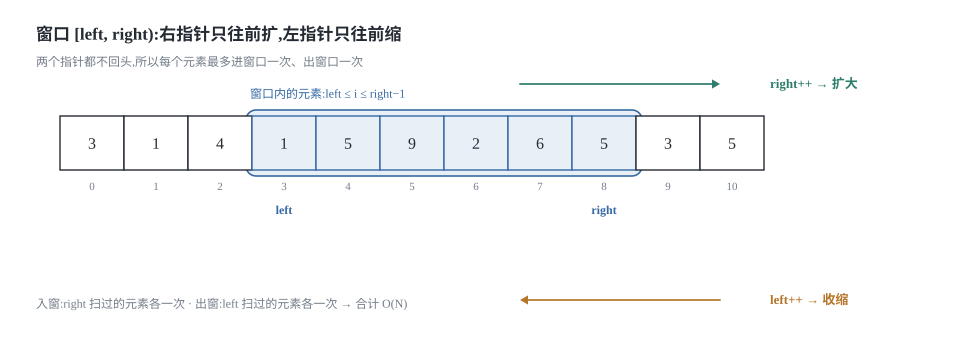
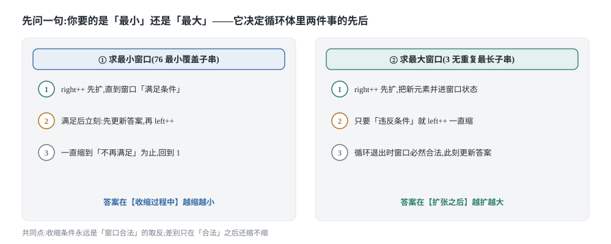
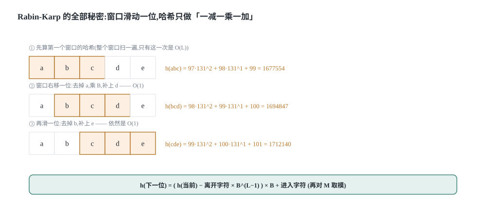
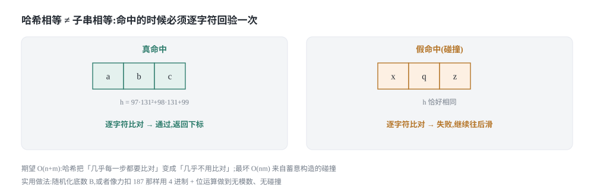

## 0 先说明材料和我的写法

这篇是我自己的学习笔记，材料来自 labuladong 的三篇教程：

- 《滑动窗口算法核心代码模板》—— <https://labuladong.online/zh/algo/essential-technique/sliding-window-framework/>
- 《滑动窗口算法经典习题》—— <https://labuladong.online/zh/algo/problem-set/sliding-window/>
- 《滑动窗口延伸：Rabin Karp 字符匹配算法》—— <https://labuladong.online/zh/algo/practice-in-action/rabinkarp/>

需要先把三件事说清楚。

**第一，这不是转载，也不是翻译。** 原文最有价值的部分是它的算法可视化面板——每道题都能点击 `while (right < s.length)` 那一行，一步一步看窗口怎么滑动。那个我复现不了，所以我用 5 张自己画的 SVG 顶替，把窗口的伸缩和哈希的滚动画成静态图。图的脚本在仓库里，不是手改的 SVG。

**第二，代码是 Python 3 和 C++ 两版，不是原文的语言。** 教程原文用 Java 写，我按自己的习惯重新实现了一遍，所以这些片段是我写的。两种语言并排给出是有原因的：滚动哈希那一步要把 `(hash - x) % M` 写对，而 Python 和 C++ 对负数取模的行为不一样，这件事直接决定那一行能不能照抄——第 4.4 节会具体说。

**第三，三篇材料的完整度不一样，这个必须坦白。** 我实际取到的东西是：

| 材料 | 我取到的内容 | 对本文的影响 |
|---|---|---|
| 滑动窗口核心代码模板 | 正文完整（四道题面、解题顺序、O(N) 的解释、"左闭右开"的理由） | 第 1、2 节与原文可逐条对照 |
| 滑动窗口经典习题 | 只有 7 道题的**题号列表**（1658 / 713 / 1004 / 424 / 219 / 209 / 395），正文是客户端渲染的，没抓到 | 第 3.2 节之后全是我自己的推导 |
| Rabin-Karp 字符匹配 | 只有两个小标题（「高效寻找重复子序列」「Rabin-Karp 算法」）和两个题号（187 / 28） | **第 4 节整节是我自己从"字符串转数字"推下来的** |

也就是说：第 1、2 节里凡是引用原文的地方我都核对过；从第 3.2 节起（含 209 和 713 两道题）以及整个第 4 节都是我的推导，我没有逐字对照过原文，措辞用词都是我的。对照原文时请以原文为准。

### 目录

- [0 先说明材料和我的写法](#0-先说明材料和我的写法)
- [1 滑动窗口:右指针负责扩,左指针负责缩](#1-滑动窗口右指针负责扩左指针负责缩)
- [2 一个模板,四道题](#2-一个模板四道题)
- [3 收缩条件必须和窗口里的状态严格对应](#3-收缩条件必须和窗口里的状态严格对应)
- [4 Rabin-Karp:把子串滚成一个整数](#4-rabin-karp把子串滚成一个整数)
- [5 把这几个套路收成一张表](#5-把这几个套路收成一张表)
- [6 材料与出处](#6-材料与出处)

## 1 滑动窗口:右指针负责扩,左指针负责缩

### 1.1 窗口是什么:一个左闭右开区间

滑动窗口可以归到快慢双指针里：一快一慢两个指针前后相随，中间夹着的那一段就是窗口。它主要用来解**子数组 / 子串**问题，也就是"找出满足某个条件的最长或最短的连续一段"。

原文把窗口定义为**左闭右开的 `[left, right)`**，这个选择值得解释一下，因为它决定了后面所有边界判断写不写 `±1`。



原文给的理由是：如果两端都开，`right` 往右挪一位之后开区间 `(0, 1)` 里仍然没有元素；如果两端都闭，初始区间 `[0, 0]` 就已经含了一个元素。这两种情况都会给边界处理带来不必要的麻烦。左闭右开正好卡在中间：

```text
left = right = 0   →  [0, 0)   空窗口，一个元素都没有
right += 1         →  [0, 1)   恰好含 a[0]，一个元素
窗口长度            =  right - left          （不用 ±1）
窗口内容            =  a[left .. right-1]    （不用 -1）
```

我自己的记法是：**左闭右开让"空窗口"和"长度 = right − left"这两件事同时成立**。换成另外两种区间，这两件事里必然有一件要加修正项，而修正项一多，`while` 条件就写不对了。

### 1.2 为什么两个指针都不回头

框架长这样（这是伪码，不是某一门语言）：

```text
left = right = 0
while right < n:
    把 s[right] 并进窗口状态     # 扩：right 前进
    right += 1
    while 窗口该收缩了:
        从窗口状态里移出 s[left]  # 缩：left 前进
        left += 1
    更新答案
```

外层 `while` 里套了内层 `while`，看起来是嵌套循环，为什么是 O(N)？原文的解释是：**指针 `left`、`right` 的值只增不减，所以每个元素只会进窗口一次、再出窗口一次**，不会反复进出，所以总操作数和数组长度成正比。

我把这个论证写严一点，因为"看起来是两层循环"这件事劝退过很多人：

```text
right 的增量      : 0 → n，一共 n 步
left  的增量      : 0 → 某个 ≤ n 的值，一共 ≤ n 步
内层 while 的总次数 = left 的总增量 ≤ n     （它每转一圈 left 就 +1）

总操作数 = n（外层） + ≤ n（内层） ≤ 2n      →  O(n)
```

关键在于内层循环的**总**次数而不是单次次数。某一轮 `right` 可能让内层转很多圈，但那些圈数会从后面某轮的额度里扣掉。这正是均摊分析的典型形态。

对照暴力解法：枚举所有子数组是

```text
Σ(i=0..n-1) (n - i) = n + (n-1) + ... + 1 = n(n+1)/2 = O(n²)
```

原文说暴力解法的那个 `j` **会回退**，所以某些元素会进入和离开窗口多次——这句话是上面这个均摊论证的另一面。

### 1.3 它不穷举:真正让它成立的是单调性

原文里有一句话我觉得是全篇最重要的，但容易被读过去：

> 为啥滑动窗口能在 O(N) 的时间穷举子数组？这个问题本身就是错误的，滑动窗口并不能穷举出所有子串。

也就是说，**滑动窗口是"聪明地穷举"——它跳过了大量根本不需要看的子数组**。跳过的依据是什么？原文把它归到"对穷举过程进行剪枝优化"，但没有把剪枝的判据写出来。下面这段是我自己的补充。

设 `P(left, right)` 表示"窗口 `[left, right)` 满足题目条件"。滑动窗口能用的**前提**是：`P` 对窗口的包含关系是单调的，也就是

```text
固定 right，让 left 变小（窗口变大）：P 只能从「假」变「真」，或者一直是真
固定 right，让 left 变大（窗口变小）：P 只能从「真」变「假」，或者一直是假
```

一旦有了这条单调性，"对每个 `right`，满足 `P` 的那些 `left`"就必然是一段连续区间，而且它的边界随 `right` 增大也只往一个方向移动。于是可以用一个**只前进的 `left`** 去追踪那个边界——这就是 O(N) 的来源，也是为什么**不能用滑动窗口的题目，一定是 `P` 不单调的题目**。

我按这个判据把常见的滑动窗口题分成两类，这个分类是本文后面所有"什么时候缩"的依据：

| 窗口变大会怎样 | 满足条件的 `left` 长什么样 | 题目 | 想要的答案 |
|---|---|---|---|
| 更容易满足（单调递增） | 一个**后缀** `left ≥ L(right)` | 76 最小覆盖子串、209 长度最小的子数组 | 最小的那个合法窗口 |
| 更容易违反（单调递减） | 一个**前缀** `left ≤ R(right)` | 3 最长无重复子串、713 乘积小于 K | 最大的那个合法窗口 |

这两类题在代码上的差别只有一处：**内层 `while` 收缩之后要不要立刻记录答案**。第一类要（"满足"是稀有状态，抓住它），第二类不要（收缩完才合法，要在收缩之后记录）。原文对 76 和 3 分别说了这一点，但没有把它们对立起来讲；我认为这正是大家写这两道题时"能背出代码却不知道为什么"的根源。

## 2 一个模板,四道题

### 2.1 默写模板之前,先回答三个问题

原文给了四条思路（不断扩 `right` 直到满足 → 停止扩、开始缩 `left` 直到不再满足 → 每缩一次更新一轮结果 → 重复直到 `right` 到头），然后把它压成一套框架，并且说：**遇到子串/子数组问题，你只需要回答三个问题**：

1. 什么时候应该移动 `right` 扩大窗口？窗口加入字符时，应该更新哪些数据？
2. 什么时候窗口应该暂停扩大，开始移动 `left` 缩小窗口？从窗口移出字符时，应该更新哪些数据？
3. 什么时候应该更新结果？

框架里留了两处 `...`，就是给你填"加入 / 移出"这两组对称操作的地方。原文特意强调这两处操作**是完全对称的**——这一点很重要，它意味着你只要把"加入"写对，"移出"就是把同一个判断反着写一遍。



把第 1.3 节的两类问题代进去，三个问题的答案就变成了固定套路：

| | 求最小窗口（76 / 209） | 求最大窗口（3 / 713） |
|---|---|---|
| 什么时候扩 | 一直扩，没有额外条件 | 一直扩，没有额外条件 |
| 什么时候缩 | **窗口满足条件时**就缩 | **窗口违反条件时**才缩 |
| 什么时候记答案 | 每次缩之前（缩的过程中窗口一直合法） | 缩完之后（缩完必然合法） |

### 2.2 力扣 76 最小覆盖子串

题面：给 `s` 和 `t`，返回 `s` 中涵盖 `t` 所有字符的最小子串；不存在返回 `""`。注意 `t` 里可能有重复字符，窗口里对应字符的数量必须**不少于** `t` 里的数量。

原文的思路是：先不断扩 `right` 直到窗口覆盖了 `t`（这一步相当于找一个**可行解**），然后不断缩 `left` 去**优化这个可行解**，直到窗口不再覆盖 `t`。原文把它比作毛毛虫，一伸一缩往右爬——「滑动窗口」这个名字就是这么来的。

状态怎么设计？两个计数器：`need` 记 `t` 里每个字符要几个，`window` 记窗口里每个字符现在有几个。再加一个 `valid`——**"已经凑够数量的字符种数"**。原文说 `valid` 和 `need` 的键数相同时窗口就完全覆盖了 `t`。


Python 3：

```python
from collections import defaultdict


def minWindow(s: str, t: str) -> str:
    if not t:
        return ""                     # 力扣约束保证 t 非空,这里写死是为了让边界行为确定

    need = defaultdict(int)           # t 里每个字符要几个
    for ch in t:
        need[ch] += 1
    window = defaultdict(int)         # 窗口里每个字符现在有几个
    left = right = 0
    valid = 0                         # 已经「凑够数量」的字符种数
    start, length = 0, float("inf")   # 最优解的起点和长度

    while right < len(s):
        c = s[right]                  # c 即将进入窗口
        right += 1
        if c in need:
            window[c] += 1
            if window[c] == need[c]:  # 刚好在这一步凑够
                valid += 1

        while valid == len(need):     # 窗口已覆盖 t:先记答案,再缩
            if right - left < length:
                start, length = left, right - left
            d = s[left]               # d 即将离开窗口
            left += 1
            if d in need:
                if window[d] == need[d]:   # 离开之前刚好是「够」的状态
                    valid -= 1
                window[d] -= 1

    return "" if length == float("inf") else s[start:start + length]
```

C++：

```cpp
#include <string>
#include <unordered_map>
#include <climits>

std::string minWindow(std::string s, std::string t) {
    if (t.empty()) return "";

    std::unordered_map<char, int> need, window;
    for (char c : t) need[c]++;
    int left = 0, right = 0, valid = 0;
    int start = 0, len = INT_MAX;

    while (right < static_cast<int>(s.size())) {
        char c = s[right];
        right++;
        if (need.count(c)) {
            window[c]++;
            if (window[c] == need[c]) valid++;
        }
        while (valid == static_cast<int>(need.size())) {
            if (right - left < len) {
                start = left;
                len = right - left;
            }
            char d = s[left];
            left++;
            if (need.count(d)) {
                if (window[d] == need[d]) valid--;
                window[d]--;
            }
        }
    }
    return len == INT_MAX ? std::string() : s.substr(start, len);
}
```

**最容易写错的一行：** `if window[c] == need[c]: valid += 1` 里的等号。这里必须是**恰好相等**，不能写成 `>=`。原因在缩窗口那一侧：`window[c]` 可能曾经超过 `need[c]`（比如窗口里有 3 个 `A`，而 `t` 只要 1 个），缩窗口时把一个 `A` 移出去，`window[A]` 从 3 变成 2——此时剩余的 `A` 仍然够用，`valid` 不该变。只有当 `window[c]` 从"刚好够"变成"不够"的那一步，`valid` 才应该减一。用等号，`valid` 的加减就精确落在**跨过等号的那一刻**，两侧各自一次，正好配平。

如果写成 `>=`：`window[A]` 从 1 变成 2 时又会 `valid += 1`，同一个字符被数了两次，`valid` 就会超过 `len(need)`，`while valid == len(need)` 直接失效——窗口再也不缩，答案是错的，而且不一定报错，只是结果不对。这种错最难查。

复杂度：外层 `right` 走 n 步，内层总共最多走 n 步，所以时间 **O(n + m)**（m 是 `t` 的长度，用来建 `need`）。空间是两张哈希表，键数不超过字符集大小 Σ，所以是 **O(Σ)**——和 n、m 都无关。原文的进阶问题问"能否在 o(m+n) 时间内解决"，答案是这道题的下界就是 O(m+n)：`t` 的每个字符至少要读一遍。

### 2.3 力扣 567 字符串的排列

题面：给 `s1` 和 `s2`，判断 `s2` 是否包含 `s1` 的某个排列作为子串。原文的提醒是——**`s1` 可以含重复字符**，所以这题没那么简单。其实它跟 76 是同一件事：在 `s2` 里找一个长度等于 `len(s1)`、且字符计数与 `s1` 一致的窗口。

和 76 的差别只有两处，都是原文点出来的：

1. 收缩的时机变了：**窗口大小大于等于 `t.length()` 时**就该缩了，因为排列的长度必须相等。
2. `valid == need.size()` 时不用记账，直接 `return True`。

原文还给了一个小优化：这道题维护的是**定长窗口**，每次向前滑只会移出一个字符，所以内层 `while` 完全可以改成 `if`，效果一样。这一点值得记住，因为它说明"内层用 `while` 还是 `if`"不是风格问题，而是由**每轮最多需要缩几步**决定的。

Python 3：

```python
from collections import defaultdict


def checkInclusion(t: str, s: str) -> bool:
    if not t:
        return True          # 空串是任何串的子串(力扣约束里 s1 非空,这里写全)

    need = defaultdict(int)
    for ch in t:
        need[ch] += 1
    window = defaultdict(int)
    left = right = 0
    valid = 0

    while right < len(s):
        c = s[right]
        right += 1
        if c in need:
            window[c] += 1
            if window[c] == need[c]:
                valid += 1

        while right - left >= len(t):     # 定长窗口:一到 t 的长度就开缩
            if valid == len(need):
                return True
            d = s[left]
            left += 1
            if d in need:
                if window[d] == need[d]:
                    valid -= 1
                window[d] -= 1

    return False
```

C++：

```cpp
#include <string>
#include <unordered_map>

bool checkInclusion(std::string t, std::string s) {
    if (t.empty()) return true;
    if (t.size() > s.size()) return false;

    std::unordered_map<char, int> need, window;
    for (char c : t) need[c]++;
    int left = 0, right = 0, valid = 0;
    const int m = static_cast<int>(t.size());

    while (right < static_cast<int>(s.size())) {
        char c = s[right];
        right++;
        if (need.count(c)) {
            window[c]++;
            if (window[c] == need[c]) valid++;
        }
        while (right - left >= m) {
            if (valid == static_cast<int>(need.size())) return true;
            char d = s[left];
            left++;
            if (need.count(d)) {
                if (window[d] == need[d]) valid--;
                window[d]--;
            }
        }
    }
    return false;
}
```

### 2.4 力扣 438 找到字符串中所有字母异位词

题面：找出 `s` 中所有 `p` 的异位词子串，返回起始索引。原文的吐槽很到位——"字母异位词"听起来高级，其实就是排列。所以这题跟 567 是同一份代码，只是把 `return True` 换成了**把 `left` 塞进结果列表**。

Python 3：

```python
from collections import defaultdict


def findAnagrams(s: str, t: str) -> list:
    res = []
    if not t:
        return list(range(len(s) + 1))   # 空模式串在 0..n 每个位置都成立

    need = defaultdict(int)
    for ch in t:
        need[ch] += 1
    window = defaultdict(int)
    left = right = 0
    valid = 0

    while right < len(s):
        c = s[right]
        right += 1
        if c in need:
            window[c] += 1
            if window[c] == need[c]:
                valid += 1

        while right - left >= len(t):
            if valid == len(need):
                res.append(left)
            d = s[left]
            left += 1
            if d in need:
                if window[d] == need[d]:
                    valid -= 1
                window[d] -= 1

    return res
```

C++：

```cpp
#include <string>
#include <vector>
#include <unordered_map>

std::vector<int> findAnagrams(std::string s, std::string t) {
    std::vector<int> res;
    if (t.empty()) {
        for (int i = 0; i <= static_cast<int>(s.size()); i++) res.push_back(i);
        return res;
    }
    if (t.size() > s.size()) return res;

    std::unordered_map<char, int> need, window;
    for (char c : t) need[c]++;
    int left = 0, right = 0, valid = 0;
    const int m = static_cast<int>(t.size());

    while (right < static_cast<int>(s.size())) {
        char c = s[right];
        right++;
        if (need.count(c)) {
            window[c]++;
            if (window[c] == need[c]) valid++;
        }
        while (right - left >= m) {
            if (valid == static_cast<int>(need.size())) res.push_back(left);
            char d = s[left];
            left++;
            if (need.count(d)) {
                if (window[d] == need[d]) valid--;
                window[d]--;
            }
        }
    }
    return res;
}
```

注意 `res.append(left)` 的位置：它必须在**移出 `s[left]` 之前**，因为此刻窗口正好是 `[left, right)` 且长度恰好等于 `len(t)`。挪到 `left += 1` 之后写，记下来的就是下一个窗口的起点了。

### 2.5 力扣 3 最长无重复子串

这题终于不是纯套模板了，但反而更简单——原文的说法是"连 `need` 和 `valid` 都不需要"。因为条件是"窗口内无重复"，所以我们只需要一个计数器 `window`，当 `window[c] > 1` 时说明刚进来的 `c` 撞上了窗口里已有的同一个字符，该缩了。

**答案在哪里更新，这题和前面三题相反。** 原文把这个道理讲得很清楚：收缩的 `while` 条件是"存在重复元素"，也就是说**收缩完成之后窗口必然无重复**，所以要在收缩**之后**更新 `res`。前面 76 是在收缩**之前**更新（那时窗口刚满足条件）。这一前一后，正是第 1.3 节那张表里"求最小"和"求最大"的分界。

Python 3：

```python
from collections import defaultdict


def lengthOfLongestSubstring(s: str) -> int:
    window = defaultdict(int)
    left = right = 0
    res = 0

    while right < len(s):
        c = s[right]
        right += 1
        window[c] += 1
        while window[c] > 1:        # 只可能是刚进来的这个字符重复
            d = s[left]
            left += 1
            window[d] -= 1
        res = max(res, right - left)   # 缩完了,此刻窗口必然无重复

    return res
```

C++：

```cpp
#include <string>
#include <unordered_map>
#include <algorithm>

int lengthOfLongestSubstring(std::string s) {
    std::unordered_map<char, int> window;
    int left = 0, right = 0, res = 0;

    while (right < static_cast<int>(s.size())) {
        char c = s[right];
        right++;
        window[c]++;
        while (window[c] > 1) {
            window[s[left]]--;
            left++;
        }
        res = std::max(res, right - left);
    }
    return res;
}
```

**最容易写错的一行：** 内层用的是 `while (window[c] > 1)` 而不是 `if`。虽然直觉上"新进来一个字符最多制造一处重复、缩一步就够了"，但这只在"缩的那一步恰好把重复消掉"时成立——如果 `left` 位置的字符不是重复的那个字符，缩一步是没用的，`window[c]` 仍然是 2。`while` 保证缩到合法为止；写成 `if`，像 `"abba"` 这样的输入就会给出错误答案（把 `"bba"` 当成无重复窗口，答案 3，而正确答案是 2）。这个坑我在测试用例里专门留了一条。

复杂度：`right` 和 `left` 各走 n 步 → **O(n)**；空间 O(Σ)，Σ 是字符集大小。

## 3 收缩条件必须和窗口里的状态严格对应

### 3.1 收缩条件不是"窗口大小",是"窗口状态"

四道题写下来，最容易产生的错觉是：收缩由某个**长度**阈值触发。567 和 438 确实是（`right - left >= len(t)`），但那是因为题目条件本身就是"长度必须相等"。76 和 3 的收缩条件分别是 `valid == len(need)` 和 `window[c] > 1`——**都是窗口内部状态的函数，跟长度没有直接关系**。

这就是"收缩条件必须和窗口里的状态严格对应"这句话的意思：你在扩窗口时往 `window`/`valid`/`total`/`prod` 里写进去什么，收缩条件就必须能从这些量里读出来。如果收缩条件用了某个你没在扩窗口时维护的量，那它一定不对——因为窗口移动时那个量不会更新。

两条我在自己写的时候总结出来的检查规则：

1. **对称性检查**：扩的时候对 `x` 做了什么，缩的时候就要对同一个 `x` 做反操作，而且**顺序要反**（"先判断再减"对应"先判断再加"）。76 里扩是 `window[c] += 1; if window[c] == need[c]: valid += 1`（先加后判），缩是 `if window[d] == need[d]: valid -= 1; window[d] -= 1`（先判后减）——看着不对称，其实是同一件事在时间轴上的镜像。
2. **边界检查**：凡是 `valid`/`total` 这类"聚合量"，都要问自己"它在窗口为空时是多少"。空窗口 `valid = 0`、`total = 0`、`prod = 1`——这三个初值如果写错，`while` 条件会在第一轮就把整个数组缩完。

### 3.2 力扣 209 长度最小的子数组

这是《滑动窗口算法经典习题》里列出的 7 道题之一（题号 209）。给一个正整数数组和一个 `target`，返回和大于等于 `target` 的最短子数组长度，不存在返回 0。

它属于"求最小"那一类：条件 `total >= target` 对窗口包含关系单调递增，所以**一旦满足就立刻缩**，并且要在缩之前记录答案。窗口状态只需要一个 `total`，不需要哈希表。

**注意这题没有 `need` 也没有 `valid`**——因为条件是"和"，而和是可以在 O(1) 时间内减回去的量。这印证了原文那句话：窗口里放什么数据结构，取决于题目要维护什么。

Python 3：

```python
def minSubArrayLen(target: int, nums: list) -> int:
    left = right = 0
    total = 0                     # 空窗口的和是 0
    res = float("inf")

    while right < len(nums):
        total += nums[right]
        right += 1
        while total >= target:    # 满足就缩,缩之前先记答案
            res = min(res, right - left)
            total -= nums[left]
            left += 1

    return 0 if res == float("inf") else int(res)
```

C++：

```cpp
#include <vector>
#include <algorithm>
#include <climits>

int minSubArrayLen(int target, std::vector<int>& nums) {
    int left = 0, right = 0, total = 0;
    int res = INT_MAX;

    while (right < static_cast<int>(nums.size())) {
        total += nums[right];
        right++;
        while (total >= target) {
            res = std::min(res, right - left);
            total -= nums[left];
            left++;
        }
    }
    return res == INT_MAX ? 0 : res;
}
```

### 3.3 力扣 713 乘积小于 K 的子数组

同属那 7 道题（题号 713）。给正整数数组 `nums` 和整数 `k`，返回乘积严格小于 `k` 的**连续子数组的个数**。

这题的价值在于它展示了一个新东西：**答案不是"窗口长度"，而是要用窗口长度去数数**。窗口里维护的是乘积 `prod`；`prod >= k` 时收缩，缩完之后窗口 `[left, right)` 就是一个"以 `right-1` 结尾的最长合法窗口"。

关键的计数论证：既然窗口是**最长**的合法窗口，那么以 `right-1` 结尾的合法子数组，其左端点可以取 `left, left+1, ..., right-1` 中任意一个——一共 `right - left` 个。所有以 `right-1` 结尾的子数组都被这一轮数完了，而且每个子数组只在它右端点被扫到的那一轮被数一次，所以不重不漏。

**边界：`k <= 1` 要直接返回 0。** 因为数组里全是正整数，任何子数组的乘积都至少是 1，不可能严格小于 1。这一行如果省掉，`while prod >= k` 会把 `left` 推到 `right` 之外，紧接着 `nums[left]` 越界（Python 里是 `prod //= nums[left]` 抛 `IndexError`）。

Python 3：

```python
def numSubarrayProductLessThanK(nums: list, k: int) -> int:
    if k <= 1:
        return 0                  # 全是正整数,乘积不可能小于 1
    left = right = 0
    prod = 1                      # 空窗口的乘积是 1(乘法的单位元)
    res = 0

    while right < len(nums):
        prod *= nums[right]
        right += 1
        while prod >= k:          # 违反条件就缩
            prod //= nums[left]
            left += 1
        res += right - left       # 以 right-1 结尾的合法左端点个数

    return res
```

C++：

```cpp
#include <vector>

int numSubarrayProductLessThanK(std::vector<int>& nums, int k) {
    if (k <= 1) return 0;
    long long prod = 1;
    int left = 0, right = 0, res = 0;

    while (right < static_cast<int>(nums.size())) {
        prod *= nums[right];
        right++;
        while (prod >= k) {
            prod /= nums[left];
            left++;
        }
        res += right - left;
    }
    return res;
}
```

C++ 这里 `prod` 用 `long long` 是有意的：`int` 在 k 接近 `INT_MAX`、数组又很长时会溢出成负数，而负数永远 `< k`，`while` 就不再收缩了，答案会**偏大**——这种溢出不会崩溃，只会静静给错答案。Python 的整数是任意精度的，不会有这个问题。

### 3.4 剩下 5 道题的判断思路

《滑动窗口算法经典习题》一共列了 7 道：1658、713、1004、424、219、209、395。上面完整写了两道（209、713），剩下 5 道我没有取到原文正文，所以这里只写"用第 1.3 节的判据怎么判断"，不贴代码——**这部分是我自己的分析**：

| 题号 | 题目 | 窗口状态 | 属于哪一类 | 收缩条件 |
|---|---|---|---|---|
| 1658 | 将 x 减到 0 的最小操作数 | 首尾之外那段的**和** | 求最小 | 反过来做：求"和 = total − x 的最长子数组" |
| 1004 | 最大连续 1 的个数 III | 窗口内 **0 的个数** | 求最大 | `zeros > k` |
| 424 | 替换后的最长重复字符 | 窗口内**出现次数最多的字符的频次** | 求最大 | `窗口长 − maxFreq > k` |
| 219 | 存在重复元素 II | 窗口内元素**下标** | 求最大（长度 ≤ k+1） | `right − left > k` |
| 395 | 至少有 K 个重复字符的最长子串 | 每种字符的频次 | **都不属于** | 见下 |

1658 值得单独说一句：它表面上不是"子数组问题"（操作在首尾两端），但**取反**之后就是——从两端删掉最少个数、使剩下的和等于 `total − x`，等价于在中间找一个和等于 `total − x` 的**最长**子数组。"两端"和"中间"的这种互换是滑动窗口题里很常见的一步变形。

395 是那个反例，值得标出来：它的条件"每种出现过的字符都至少出现 k 次"**对窗口不单调**。以 k = 2 为例，窗口从 `"aab"` 扩到 `"aabb"` 时，`b` 的频次从 1 涨到 2，条件由假变真；再扩到 `"aabbc"` 时，`c` 是窗口里从没出现过的新字符、频次只有 1，条件又由真变假。**扩窗口既能让条件变真，也能让它变假**，第 1.3 节那条单调性前提被破坏了，所以 395 用不了滑动窗口。（它的标准解法是**分治**：按出现次数不足 k 的字符把字符串切开。）这正是那条判据的用途——**遇到新题先验证单调性，不单调就别硬套滑动窗口。**

## 4 Rabin-Karp:把子串滚成一个整数

### 4.1 从"字符串转数字"开始

这一节和前面三节不同——我只取到了原文的两个小标题和两个题号，正文没抓到，所以**下面是从"怎么把一个字符串变成数字"开始自己推的**，不是原文的表述。

原文的切入点是：给你一个字符串形式的正整数，怎么把它转成数字？就是小学竖式那套：

```text
"8264" → 8 → 8×10+2=82 → 82×10+6=826 → 826×10+4=8264

写成循环:
number = 0
for 每一位 d:
    number = number * 10 + d
```

把它一般化：把**进制**从 10 换成一个底数 `B`，把"每一位"从一个十进制数字换成**一个字符的编码**，那么任意字符串都能被映射成一个整数。这就是字符串哈希的最朴素形态：

```text
H("abc") = ord('a')·B² + ord('b')·B + ord('c')
```

因为每一步都是 `h = h * B + c`，所以从左往右扫一遍就能算出来，代价 O(L)（L 是串长）。

**为什么这能加速匹配？** 因为"两个字符串是否相等"被换成了"两个整数是否相等"，后者是一步比较。于是可以这样：先把模式串 `pattern` 的哈希算出来（O(m)），再在文本串里**逐个窗口**算哈希并比较。如果每个窗口都从头算哈希，那还是 O(nm)，跟暴力没区别——所以必须解决"怎么不重算"。

### 4.2 滚动哈希:窗口滑动一位,哈希只做三步



设窗口长度固定为 L。把窗口停在 `i` 时的哈希记为 `h(i)`：

```text
h(i) = s[i]·B^(L-1) + s[i+1]·B^(L-2) + ... + s[i+L-1]·B^0
```

现在窗口往右滑一位，把 `h(i+1)` 展开：

```text
h(i+1) = s[i+1]·B^(L-1) + s[i+2]·B^(L-2) + ... + s[i+L]·B^0
```

对比 `h(i)`，可以看到除了首尾两项，中间全部相同：

```text
h(i)   = s[i]·B^(L-1) + [ s[i+1]·B^(L-2) + ... + s[i+L-1]·B^0 ]
h(i+1) =                 [ s[i+1]·B^(L-1) + ... + s[i+L-1]·B^1 ] + s[i+L]·B^0
```

方括号里的东西差一个因子 `B`。把 `h(i)` 里最老的那一项减掉、剩下的整体乘 `B`、再补上最新的字符，就得到 `h(i+1)`：

```text
h(i+1) = ( h(i) − s[i]·B^(L-1) ) × B + s[i+L]
```

**这就是滚动哈希的全部内容：一减、一乘、一加，都是 O(1)。** 所以从窗口 `i` 到窗口 `i+1` 的代价是常数，扫完整个文本就是 O(n)。配上预处理 O(m)，整体 **O(n + m)**。

这里的 `B^(L-1)` 只需要算一次然后复用——如果每个窗口都重新 `pow`，又把 O(1) 变成了 O(log L)。

### 4.3 取模、碰撞和"必须回验"

真实的哈希不能让它无限长大，所以要取模。取模之后两个**不同**的字符串可能得到**同一个**哈希值，这叫碰撞。



处理方式是：**哈希相等时，再逐字符比一次**。这一步不只是为了正确性，也是复杂度分析的一部分：

- 如果哈希不等 → 一定不是目标，跳过，O(1)。
- 如果哈希相等 → 真命中就返回；假碰撞就再比 m 个字符，然后继续。

所以期望时间是 O(n + m)（哈希把"几乎每一步都要比对"变成了"几乎不用比对"），而**最坏情况 O(nm)**——当攻击者能蓄意构造大量碰撞时（比如故意选一组字符串让它们模 M 同余），每次滑动都要回验 m 个字符。原文把 Rabin-Karp 归到"经典算法"里讲，我认为它最值得学的一点就是这个结构：**用一个廉价的必要条件和一次昂贵的精确验证组合起来**，平均很快、最坏不保证。判别式跟 KMP 恰好相反：KMP 有严格的最坏 O(n+m)，代价是理解 next 数组；Rabin-Karp 好懂、好写、好推广到二维和多个模式串，代价是最坏情况会退化。

实用上压碰撞概率的办法有三种：底数 `B` 取一个大于字符集大小的质数、模数 `M` 取一个大质数（常见的是 10⁹+7 或 2⁶¹−1）、以及**随机化 `B`**——让攻击者猜不到你的底数。

### 4.4 力扣 28 找出字符串中第一个匹配项的下标

题面：给 `haystack` 和 `needle`，返回 `needle` 在 `haystack` 中第一次出现的下标，不存在返回 −1。这就是滚动哈希最直接的应用。

Python 3：

```python
def strStr(text: str, pattern: str) -> int:
    n, m = len(text), len(pattern)
    if m == 0:
        return 0                      # 空模式串在位置 0 就匹配
    if m > n:
        return -1

    B, M = 131, 1000000007            # 底数和模数都取质数
    power = pow(B, m - 1, M)          # B^(m-1),只算一次

    hp = 0                            # 模式串的哈希
    for ch in pattern:
        hp = (hp * B + ord(ch)) % M
    ht = 0                            # 第一个窗口的哈希
    for i in range(m):
        ht = (ht * B + ord(text[i])) % M
    if ht == hp and text[:m] == pattern:
        return 0

    for i in range(m, n):
        # 一减、一乘、一加:窗口从 [i-m, i) 滑到 [i-m+1, i+1)
        ht = (ht - ord(text[i - m]) * power) % M
        ht = (ht * B + ord(text[i])) % M
        if ht == hp and text[i - m + 1:i + 1] == pattern:
            return i - m + 1
    return -1
```

C++：

```cpp
#include <string>

int strStr(std::string text, std::string pattern) {
    const int n = static_cast<int>(text.size());
    const int m = static_cast<int>(pattern.size());
    if (m == 0) return 0;
    if (m > n) return -1;

    const long long B = 131, M = 1000000007LL;
    long long power = 1;
    for (int i = 0; i < m - 1; i++) power = power * B % M;

    long long hp = 0, ht = 0;
    for (int i = 0; i < m; i++) {
        hp = (hp * B + static_cast<unsigned char>(pattern[i])) % M;
        ht = (ht * B + static_cast<unsigned char>(text[i])) % M;
    }
    if (ht == hp && text.compare(0, m, pattern) == 0) return 0;

    for (int i = m; i < n; i++) {
        ht = (ht - static_cast<unsigned char>(text[i - m]) * power % M + M) % M;
        ht = (ht * B + static_cast<unsigned char>(text[i])) % M;
        if (ht == hp && text.compare(i - m + 1, m, pattern) == 0) return i - m + 1;
    }
    return -1;
}
```

**最容易写错的一行：** C++ 里的 `+ M`。

```text
Python:  (ht - x) % M          →  结果永远在 [0, M)
C++   :  (ht - x) % M          →  结果可能在 (−M, 0]，是负数！
```

C++ 的 `%` 是**截断取模**（余数符号跟着被除数走），Python 的 `%` 是**向下取模**（余数符号跟着除数走）。所以 Python 那一行可以直接写，C++ 必须先 `+ M` 把结果掰回非负。如果不加，`ht` 会变成负数，之后的 `ht * B` 继续是负数，`ht == hp` 几乎永远不成立——程序**不会报错**，只会漏掉匹配，返回 −1。这是本文里我最想标出来的一处语言差异。

顺带一个 C++ 的隐患：`static_cast<unsigned char>` 不能省。`char` 在大多数平台上是有符号的，遇到非 ASCII 字节会变成负的编码值，哈希就跟 Python 的 `ord()` 对不上了。Python 这边 `ord()` 永远返回正的码点，没有这个问题。

### 4.5 力扣 187 重复的 DNA 序列:一个可以做到零碰撞的特例

题面：给一个 DNA 串（只含 `A` `C` `G` `T`），找出所有**长度恰好为 10** 且出现次数**超过一次**的子串。

它跟第 4.4 节是同一个滚动哈希，只是把字符集从"任意字符"缩到 4 个字母，于是有两件事变得非常漂亮：

**第一，编码。** 4 个字母可以用 2 个 bit 表示：`A=0, C=1, G=2, T=3`。长度 10 的窗口就是 10 × 2 = 20 bit。

**第二，也是关键：不需要取模，且不可能碰撞。** 20 bit 能表示 2²⁰ = 1048576 种不同的值，而长度 10 的 DNA 串恰好有 4¹⁰ = 2²⁰ = 1048576 种。**两边一样多**，所以这个映射是**双射**——不同的子串必然对应不同的整数，哈希相等就等价于子串相等，第 4.3 节那次"必须回验"在这里可以合法地省掉。

滚动更新也因此变成纯粹的位运算，连 `B^(L-1)` 的乘法都不用：

```text
h = (h << 2) | code(新字符)      # 左移 2 位腾出空间,把新字符塞进去
h = h & 0xFFFFF                 # 0xFFFFF = 2^20 - 1,只保低 20 位
```

第二行的 `& 0xFFFFF` 就是把最老那个字符挤出去——它等价于第 4.2 节公式里的"减去 `s[i]·B^(L-1)`"，只不过在二进制下"减去最高位"就是"截断最高位"。

Python 3：

```python
def findRepeatedDnaSequences(s: str) -> list:
    n = len(s)
    if n < 10:
        return []

    code = {"A": 0, "C": 1, "G": 2, "T": 3}
    h = 0
    for i in range(10):
        h = (h << 2) | code[s[i]]        # 第一个窗口,20 bit

    first = {h: 0}                       # 哈希 -> 第一次出现的起始下标
    res, dup = [], set()
    for i in range(10, n):
        h = ((h << 2) | code[s[i]]) & 0xFFFFF   # 滑出最老的字符
        start = i - 9
        if h in first:
            if h not in dup:             # 出现三次也只报一次
                dup.add(h)
                res.append(s[start:start + 10])
        else:
            first[h] = start
    return res
```

C++：

```cpp
#include <string>
#include <vector>
#include <unordered_map>
#include <unordered_set>

std::vector<std::string> findRepeatedDnaSequences(std::string s) {
    std::vector<std::string> res;
    const int n = static_cast<int>(s.size());
    if (n < 10) return res;

    auto code = [](char c) -> int {
        if (c == 'A') return 0;
        if (c == 'C') return 1;
        if (c == 'G') return 2;
        return 3;                        // 'T'
    };

    int h = 0;
    for (int i = 0; i < 10; i++) h = (h << 2) | code(s[i]);

    std::unordered_map<int, int> first;
    std::unordered_set<int> dup;
    first[h] = 0;
    for (int i = 10; i < n; i++) {
        h = ((h << 2) | code(s[i])) & 0xFFFFF;
        const int start = i - 9;
        if (first.count(h)) {
            if (!dup.count(h)) {
                dup.insert(h);
                res.push_back(s.substr(start, 10));
            }
        } else {
            first[h] = start;
        }
    }
    return res;
}
```

复杂度：扫一遍 O(n)，哈希表里最多放 O(n) 个键 → 时间 O(n)、空间 O(n)。和"把所有长度 10 的子串扔进哈希表"的朴素做法相比，省下来的是每次构造子串的 O(10)——10 是常数，所以两者的渐进复杂度其实一样。**这题用滚动哈希的价值不在渐进复杂度，而在常数**：位运算和整数比较比构造字符串快得多。这一点我不想含糊过去，因为很多题解会把它说成"从 O(10n) 优化到 O(n)"，那只是把常数从 10 变成 1。

最后补一句定位：原文把 Rabin-Karp 放在《滑动窗口延伸》这个标题下，我觉得这个定位很准——**窗口状态是一个数的时候，滑动窗口就变成了滚动哈希**。第 76 题维护的是字符计数表，第 187 题维护的是一个 20 bit 的整数，两者的框架一模一样。

## 5 把这几个套路收成一张表

| 题号 | 窗口里维护什么 | 什么时候缩 | 什么时候记答案 | 时间 |
|---|---|---|---|---|
| 76 最小覆盖子串 | `need` / `window` / `valid` | `valid == len(need)` | 缩**之前** | O(n+m) |
| 567 字符串的排列 | 同上 | `right-left >= len(t)` | 命中即返回 | O(n+m) |
| 438 找所有异位词 | 同上 | `right-left >= len(t)` | 缩之前，记 `left` | O(n+m) |
| 3 最长无重复子串 | `window` 一个表 | `window[c] > 1` | 缩**之后** | O(n) |
| 209 长度最小的子数组 | `total` 一个数 | `total >= target` | 缩之前 | O(n) |
| 713 乘积小于 K | `prod` 一个数 | `prod >= k` | 缩之后，累加 `right-left` | O(n) |
| 28 字符串匹配 | 滚动哈希一个数 | —（定长窗口，不用缩） | 哈希命中后回验 | 期望 O(n+m)，最坏 O(nm) |
| 187 重复 DNA 序列 | 20 bit 整数 | —（定长窗口） | 哈希重复时收集 | O(n) |

如果要我只留三句话：

1. **先验证单调性。** 窗口变大时条件只会单向变化，才能用滑动窗口；不单调（395）就换分治。
2. **收缩条件必须是窗口状态的函数**，不能是长度阈值——除非题目条件本身就是长度（567/438）。扩窗口时维护了哪些量，收缩条件就只能用那些量。
3. **记录答案的位置由"哪一类"决定**：求最小在缩之前记（合法状态稀缺），求最大在缩之后记（缩完才合法）。76 和 3 的差别就在这一前一后。

## 6 材料与出处

这篇的三篇材料都在 labuladong 的站点上，建议直接读原文——那里的可视化面板对理解窗口的伸缩过程帮助很大，尤其是 76 和 3 两道：

- 《滑动窗口算法核心代码模板》
  <https://labuladong.online/zh/algo/essential-technique/sliding-window-framework/>
  覆盖：滑动窗口框架概览、最小覆盖子串、字符串排列、找所有字母异位词、最长无重复子串。
- 《滑动窗口算法经典习题》
  <https://labuladong.online/zh/algo/problem-set/sliding-window/>
  列出的 7 道题：1658、713、1004、424、219、209、395。本文完整写了两道（209、713）。
- 《滑动窗口延伸：Rabin Karp 字符匹配算法》
  <https://labuladong.online/zh/algo/practice-in-action/rabinkarp/>
  覆盖：高效寻找重复子序列、Rabin-Karp 算法。涉及题号 187、28。

本文引用的题目：

| 题号 | 题目 | 链接 |
|---|---|---|
| 3 | 无重复字符的最长子串 | <https://leetcode.cn/problems/longest-substring-without-repeating-characters/> |
| 28 | 找出字符串中第一个匹配项的下标 | <https://leetcode.cn/problems/find-the-index-of-the-first-occurrence-in-a-string/> |
| 76 | 最小覆盖子串 | <https://leetcode.cn/problems/minimum-window-substring/> |
| 187 | 重复的 DNA 序列 | <https://leetcode.cn/problems/repeated-dna-sequences/> |
| 209 | 长度最小的子数组 | <https://leetcode.cn/problems/minimum-size-subarray-sum/> |
| 438 | 找到字符串中所有字母异位词 | <https://leetcode.cn/problems/find-all-anagrams-in-a-string/> |
| 567 | 字符串的排列 | <https://leetcode.cn/problems/permutation-in-string/> |
| 713 | 乘积小于 K 的子数组 | <https://leetcode.cn/problems/subarray-product-less-than-k/> |

再次说明出处边界：

- 第 1、2 节的框架、左闭右开区间的理由、O(N) 的均摊解释、"三个问题"、以及四道题的解题顺序，都来自《滑动窗口算法核心代码模板》的正文，我核对过。
- 第 1.3 节的**单调性判据**、第 3.1 节的两条检查规则、209 与 713 两道题的解法、以及第 3.4 节那张表**是我自己的推导**，原文没有这些表述。
- **第 4 节整节是我自己从"字符串转数字"推下来的**。Rabin-Karp 那篇我只取到了两个小标题和两个题号，没有正文可对照，所以滚动哈希的公式推导、碰撞分析、以及 187 的"双射所以零碰撞"论证都是我写的。
- 本文的 16 个代码块（8 道题各给 Python 3 和 C++ 两版）都是我自己写的实现，不是原文的 Java 代码。5 张示意图是用仓库里的 `svgkit.py` 脚本生成的，脚本在 `assets/blog/sliding-window-20261120/make_figs.py`。
