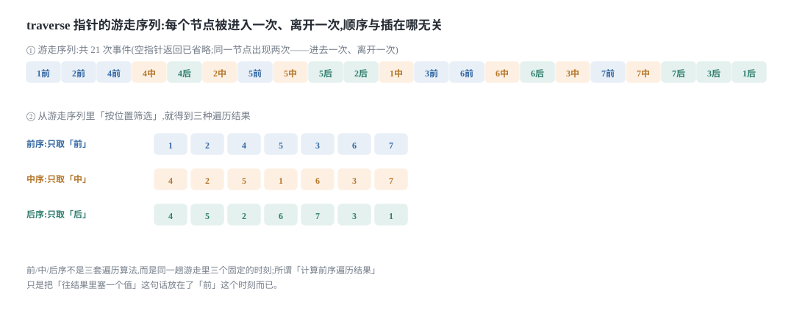
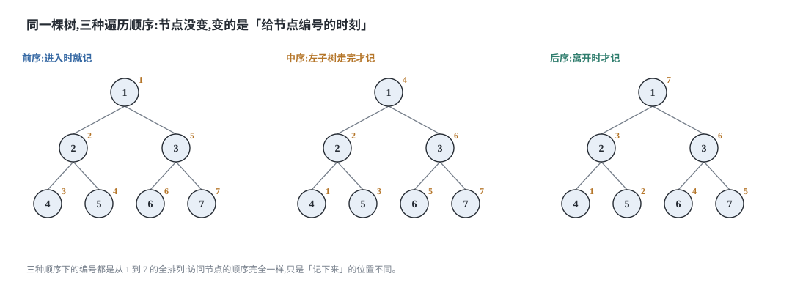
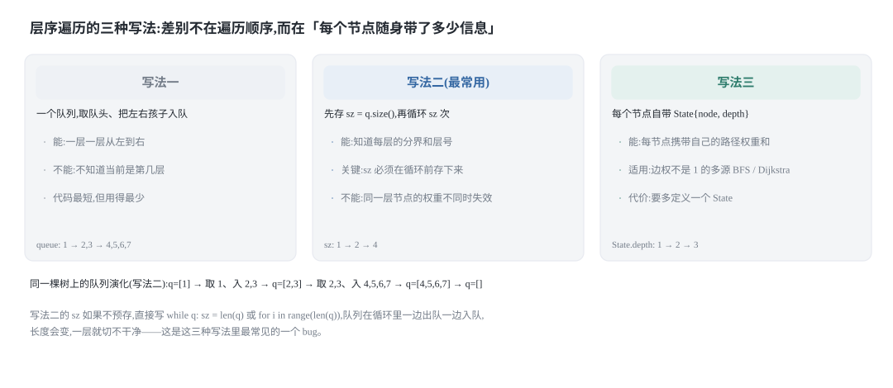
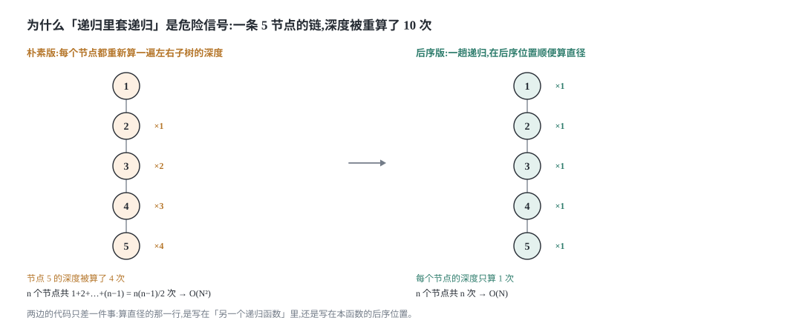
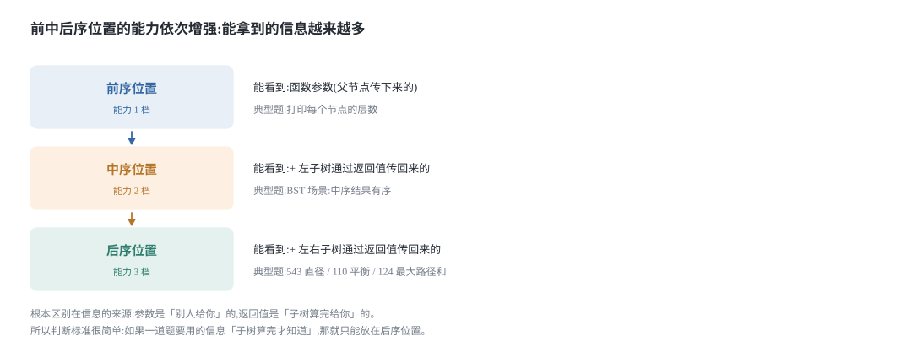

## 0 先说明材料和我的写法

这篇是我自己的学习笔记，材料来自 labuladong 的四篇教程和三个习题集：

- 《二叉树系列算法核心纲领》—— <https://labuladong.online/zh/algo/essential-technique/binary-tree-summary/>
- 《二叉树的递归/层序遍历》—— <https://labuladong.online/zh/algo/data-structure-basic/binary-tree-traverse-basic/>
- 《二叉树基础及常见类型》—— <https://labuladong.online/zh/algo/data-structure-basic/binary-tree-basic/>
- 《二叉树递归专项练习·本章导读》—— <https://labuladong.online/zh/algo/intro/binary-tree-practice/>
- 《用「遍历」思维解题》—— <https://labuladong.online/zh/algo/problem-set/binary-tree-traverse-i/>
- 《用「分解问题」思维解题》—— <https://labuladong.online/zh/algo/problem-set/binary-tree-divide-i/>
- 《利用后序位置解题》—— <https://labuladong.online/zh/algo/problem-set/binary-tree-post-order-i/>

先把材料的完整度摊开讲，因为这直接决定你该信哪一部分：

| 材料 | 我取到了什么 | 哪些是我写的 |
| --- | --- | --- |
| 二叉树系列算法核心纲领 | 全文 840 行，含两种思维模式、后序位置的特殊之处、动归/回溯/DFS 的着眼点对比 | 引用原文的地方我都核对过 |
| 二叉树的递归/层序遍历 | 全文，含递归框架、前中后序位置、层序三种写法、`traverseFlip` 这个反例 | 引用原文的地方我都核对过 |
| 二叉树基础及常见类型 | 全文，含四种树的名字与定义、中英文术语差异、三种实现方式 | 引用原文的地方我都核对过 |
| 三个习题集 | 只有**章节小标题和题号**，每题正文是客户端渲染的，没抓到 | 第 7 节那张分类表按原文小标题原样整理；每题的具体解法是我自己的 |
| 二叉树心法（思路篇） | 只有三个小标题和题号（226 / 116 / 114） | 这三道属于「花式变换」，我留给下一篇，本篇不写 |

有三件事必须讲清楚：

**第一，图的 5 张示意图都是我自己用 SVG 画的。** 原文有可视化面板，能一格一格地看着指针在树上移动，那是这套教程最有价值的部分，而我复现不了。所以本文里的图是我按自己的理解重画的，画的是结论，不是那个可以交互的过程。

**第二，代码是 Python 3 和 C++ 两版，不是原文的语言。** 教程原文用 Java 写，我按自己的习惯重新实现了一遍。两种语言并排给是有原因的：后序遍历要靠返回值把子树的信息传上来，而"返回值"这件事在两种语言里各有各的坑（Python 的闭包要写 `nonlocal`，C++ 的递归辅助函数要么用 `std::function` 要么用引用参数把结果带出来），第 4 节会具体说。

**第三，本文的主线是我自己选的。** 原纲领篇把「两种思维模式」放在最前面讲，我把它挪到了第 4 节——因为我觉得先看清"代码写在哪一步"这个物理事实，再去谈"该用哪种思维"会顺很多。所以本文的顺序是：结构 → 遍历框架 → 层序 → 两种思维 → 后序位置 → 更大的视角 → 习题。

### 目录

- [0 先说明材料和我的写法](#0-先说明材料和我的写法)
- [1 二叉树的结构:先分清这四种树](#1-二叉树的结构先分清这四种树)
- [2 递归遍历框架:顺序是固定的,变的是写代码的位置](#2-递归遍历框架顺序是固定的变的是写代码的位置)
- [3 层序遍历的三种写法](#3-层序遍历的三种写法)
- [4 两种思维模式:遍历还是分解问题](#4-两种思维模式遍历还是分解问题)
- [5 后序位置最强:它能拿到子树传回来的信息](#5-后序位置最强它能拿到子树传回来的信息)
- [6 一个视角看动归,回溯和 DFS](#6-一个视角看动归回溯和-dfs)
- [7 二叉树习题汇总:按思维模式分类](#7-二叉树习题汇总按思维模式分类)
- [8 把这几个套路收成一张表](#8-把这几个套路收成一张表)
- [9 材料与出处](#9-材料与出处)

## 1 二叉树的结构:先分清这四种树

### 1.1 四个容易混的名字

二叉树的算法题里有一批术语是直接写在题面里的，看不懂就无从下手。原文列的这四个必须分清：

| 名字 | 定义 | 节点数与高度的关系 |
| --- | --- | --- |
| 满二叉树 | 每一层的节点都是满的，整棵树像一个正三角形 | 高度 h 时节点数恒为 `2^h − 1` |
| 完全二叉树 | 每一层紧凑靠左排列，且除最后一层外每层都是满的 | 高度 h 时节点数在 `2^(h−1)` 到 `2^h − 1` 之间 |
| 高度平衡二叉树 | **每个**节点的左右子树高度差不超过 1（不只是根节点） | N 个节点时高度是 O(log N) |
| 自平衡二叉树 | 增删节点时靠旋转调整结构，让高度**始终**保持平衡 | 红黑树是最经典的实现 |

满二叉树和完全二叉树的关系要单独记一下：**满二叉树是一种特殊的完全二叉树**，反过来不成立。而完全二叉树有一条不太容易自己发现的性质，原文特意点出来了：

> 完全二叉树的左右子树中，**至少有一棵是满二叉树**。

这条性质下一篇推导"完全二叉树的节点个数为什么能到 O(log²N)"的时候是全部的依据，这里先记下来。

高度平衡二叉树那个 O(log N) 也值得记：它意味着树高是节点数的对数。一旦树很不平衡、退化成一个"每一层只有一个节点"的长链，它就等同于单链表，增删查改全都退化成 O(N)。自平衡二叉树存在的意义就是不让这件事发生。

### 1.2 中英文定义的那点区别

这一条纯粹是防坑用的：**中文的「满二叉树」对应的英文不是 Full Binary Tree，而是 Perfect Binary Tree。**

| 中文 | 英文 | 含义 |
| --- | --- | --- |
| 完全二叉树 | Complete Binary Tree | 完全一致，没问题 |
| 满二叉树 | **Perfect** Binary Tree | 每层都满 |
| （无常用对应） | Full Binary Tree | 每个节点的孩子数只能是 0 或 2 |

`Complete` 这个中文译名倒是和英文一致的，容易出问题的只有 `满`。看英文题解或者 Wikipedia 的时候留意一下就行，定义本身没什么难的。

### 1.3 三种实现方式:链式、数组、邻接表

原文说链式存储是"最常见的"，言下之意是还有别的。这里补全：

1. **链式存储**——每个节点存 `val`、`left`、`right` 三个字段。力扣给你的输入和你要提交的代码都是这种。
2. **数组存储**——只对完全二叉树好用，因为下标关系是干净的：下标 `i` 的左右孩子是 `2i+1` 和 `2i+2`，父节点是 `(i−1)//2`。二叉堆和线段树就是这么存的，不需要真的建链式节点。
3. **邻接表**——哈希表，键是父节点 id，值是子节点 id 列表。这其实是多叉树的存法，图论那一章里它就叫邻接表。

还有第四种"隐式的树"：递归函数的调用栈本身就是一棵树，可视化面板画出来的那棵递归树就是它。这个视角在第 6 节讲动归/回溯/DFS 的时候会用上。

### 1.4 本文用的节点定义和建树函数

后面所有代码都基于这个节点定义。为了能直接跑，我把力扣的层序数组建树函数也一起给了——力扣的 `TreeNode` 定义只给你节点，不给建树。

Python 3：

```python
from collections import deque


class TreeNode:
    def __init__(self, val=0, left=None, right=None):
        self.val = val
        self.left = left
        self.right = right


def build_tree(values):
    """按力扣的层序数组建树,None 表示这个位置没有节点。

    数组里下标 i 的节点,子节点是 2i+1 和 2i+2;但父节点为空时,
    它在数组里的"坑位"仍然要占,子节点不能往前挤 —— 这是最容易写错的地方。
    """
    if not values or values[0] is None:
        return None
    root = TreeNode(values[0])
    q = deque([root])
    i = 1
    while q and i < len(values):
        node = q.popleft()
        if i < len(values):
            v = values[i]
            i += 1
            if v is not None:
                node.left = TreeNode(v)
                q.append(node.left)
        if i < len(values):
            v = values[i]
            i += 1
            if v is not None:
                node.right = TreeNode(v)
                q.append(node.right)
    return root
```

C++：

```cpp
#include <climits>
#include <queue>
#include <vector>

// 力扣的二叉树节点定义
struct TreeNode {
    int val;
    TreeNode* left;
    TreeNode* right;
    explicit TreeNode(int x) : val(x), left(nullptr), right(nullptr) {}
};

// 建树用的空位标记:NUL 表示这个位置没有节点
const int NUL = INT_MIN;

// 按力扣的层序数组建树。规则和上面 Python 版完全一致。
TreeNode* buildTree(const std::vector<int>& values) {
    if (values.empty() || values[0] == NUL) return nullptr;
    TreeNode* root = new TreeNode(values[0]);
    std::queue<TreeNode*> q;
    q.push(root);
    std::size_t i = 1;
    while (!q.empty() && i < values.size()) {
        TreeNode* node = q.front();
        q.pop();
        if (i < values.size()) {
            int v = values[i++];
            if (v != NUL) {
                node->left = new TreeNode(v);
                q.push(node->left);
            }
        }
        if (i < values.size()) {
            int v = values[i++];
            if (v != NUL) {
                node->right = new TreeNode(v);
                q.push(node->right);
            }
        }
    }
    return root;
}
```

本文所有例子都用同一棵 7 节点的满二叉树，层序数组是 `[1, 2, 3, 4, 5, 6, 7]`：

```text
        1
      /   \
     2     3
    / \   / \
   4   5 6   7
```

## 2 递归遍历框架:顺序是固定的,变的是写代码的位置

### 2.1 traverse 就是一个在树上游走的指针

递归遍历二叉树的框架短到可以背下来：

```text
// 二叉树的递归遍历框架
void traverse(TreeNode root) {
    if (root == null) {
        return;
    }
    traverse(root.left);
    traverse(root.right);
}
```

原文对这段代码的解释我觉得比教科书好：**把 `traverse` 理解成一个在二叉树结构上游走的指针**。它的走法是——一直往左子节点走，直到遇到空指针走不动了，才退回一步去尝试右子节点；右子树也走完了，就再退回上一层。

这也解释了为什么二叉树一般用递归遍历而不用 `for` 循环：二叉树本质是二叉链表，没有数组那样的线性下标，没法用单个下标迭代。

原文还给了一个我原来没想过的判定，值得抄下来：

> **递归遍历节点的顺序，仅取决于左右子节点的递归调用顺序，与其他代码无关。**

也就是说，只要 `traverse(root.left)` 写在 `traverse(root.right)` 前面，你在这个函数里插一万行代码，指针在树上的移动顺序都不会变。原文用 `traverseFlip` 这个反例来验证这句话——把两次递归的顺序倒过来：

```text
// 修改标准的二叉树遍历框架
void traverseFlip(TreeNode root) {
    if (root == null) {
        return;
    }
    // 反过来,先递归遍历右子树,再递归遍历左子树
    traverseFlip(root.right);
    traverseFlip(root.left);
}
```

`traverseFlip` 一样能遍历到所有节点，只是顺序和标准框架镜像对称。所以"先左后右"是一个约定，不是必然。



上图第 ① 行是那棵 7 节点满二叉树上的完整游走序列，共 21 次事件，每个节点出现两次：进去一次、离开一次。第 ② 行是从这条序列里"按位置筛选"——只取标着「前」的那些、只取「中」的那些、只取「后」的那些，就分别得到前序、中序、后序的结果。

### 2.2 前中后序位置的执行时机

既然游走的顺序是固定的，那前中后序的差别只可能来自一件事：**你把代码插在了哪一步**。

| 位置 | 执行时机 | 一句话概括 |
| --- | --- | --- |
| 前序位置 | 刚进入一个节点，两个子节点还一个都没碰 | 进来就做 |
| 中序位置 | 左子树整个遍历完了，右子树还没开始 | 左边走完做 |
| 后序位置 | 左右子树都遍历完了，马上要离开这个节点 | 走之前做 |

原文用了一组对比来解释这个差别的**后果**。给一棵二叉树，问两个问题：

1. 把根节点看作第 1 层，打印每个节点所在的层数。
2. 打印每个节点的左右子树各有多少个节点。

第一个问题用前序位置就够了——"这个节点在第几层"是**从根一路走下来顺带就知道的**，用递归函数的参数往下传：

```text
// 二叉树遍历函数
void traverse(TreeNode root, int level) {
    if (root == null) {
        return;
    }
    // 前序位置
    printf("节点 %s 在第 %d 层", root.val, level);
    traverse(root.left, level + 1);
    traverse(root.right, level + 1);
}
```

<p></p>

```text
// 定义:输入一棵二叉树,返回这棵二叉树的节点总数
int count(TreeNode root) {
    if (root == null) {
        return 0;
    }
    int leftCount = count(root.left);
    int rightCount = count(root.right);
    // 后序位置
    printf("节点 %s 的左子树有 %d 个节点,右子树有 %d 个节点",
           root, leftCount, rightCount);
    return leftCount + rightCount + 1;
}
```

第二个问题就做不到了："以这个节点为根的子树有多少个节点"**必须把整棵子树走完才数得清**，只能靠递归函数的返回值把结果传上来，而返回值只有到了后序位置才拿得到。

这两个小问题把整篇的核心判据讲完了：**信息的来源决定代码的位置。**

### 2.3 一次递归同时收集三种顺序

把这件事写成代码，就是下面这个函数。它只用一趟递归，同时把三种顺序收齐——三个 `append` 分别在三个位置上：

Python 3：

```python
def threeOrders(root):
    """一趟递归同时收集前中后序:三个 append 分别在三个位置上。"""
    pre, ino, post = [], [], []

    def traverse(node):
        if node is None:
            return
        pre.append(node.val)            # 前序位置:刚进入
        traverse(node.left)
        ino.append(node.val)            # 中序位置:左子树走完
        traverse(node.right)
        post.append(node.val)           # 后序位置:即将离开

    traverse(root)
    return pre, ino, post
```

C++：

```cpp
#include <vector>

// 一趟递归同时收集前中后序:三个 push_back 分别在三个位置上。
void threeOrders(TreeNode* root, std::vector<int>& pre,
                 std::vector<int>& in, std::vector<int>& post) {
    if (root == nullptr) return;
    pre.push_back(root->val);        // 前序位置:刚进入
    threeOrders(root->left, pre, in, post);
    in.push_back(root->val);         // 中序位置:左子树走完
    threeOrders(root->right, pre, in, post);
    post.push_back(root->val);       // 后序位置:即将离开
}
```

在那棵满二叉树上跑，结果是：

```text
前序: 1 2 4 5 3 6 7
中序: 4 2 5 1 6 3 7
后序: 4 5 2 6 7 3 1
```



图里三个小树是同一棵树，橙色的小数字是"第几个被记下来"。三组编号都是 1 到 7 的全排列——**访问的物理顺序完全一样，只是记账的时刻不同**。

**最容易写错的一行:** 后序那一行的位置。

```text
    traverse(node.right);
    post.append(node.val);          # 必须在 traverse(node.right) 之后
```

后序位置的定义是"左右子树都走完了"，所以它必须在**两次**递归调用之后。写成 `traverse(node.left)` 和 `traverse(node.right)` 中间，那就不是后序而是中序了——代码能跑、结果也不报错，只是顺序悄悄变成了另一种，这类 bug 最难查。

### 2.4 力扣 144:同一道题的两种写法

第 2.3 节那个 `threeOrders` 用的是「遍历」的思维：一个辅助递归函数 + 一个外部变量。但力扣 144 的签名是 `preorderTraversal(root)`，它自己就能返回前序结果，能不能不用任何辅助函数和外部变量？

可以。依据是原文点出的那个分解式：

```text
一棵树的前序遍历 = 根节点的值 + 左子树的前序遍历 + 右子树的前序遍历
```

这正好是"原问题的答案 = 子问题的答案组合起来"的形式，也就是「分解问题」的思维。

先看「遍历」的写法，Python 3 和 C++：

```python
def preorderTraversal(root):
    """遍历思路:辅助函数 + 外部变量。"""
    res = []

    def traverse(node):
        if node is None:
            return
        res.append(node.val)
        traverse(node.left)
        traverse(node.right)

    traverse(root)
    return res
```

```cpp
#include <vector>

void preTraverse(TreeNode* node, std::vector<int>& res) {
    if (node == nullptr) return;
    res.push_back(node->val);
    preTraverse(node->left, res);
    preTraverse(node->right, res);
}

std::vector<int> preorderTraversal(TreeNode* root) {
    std::vector<int> res;
    preTraverse(root, res);
    return res;
}
```

再看「分解问题」的写法——不用辅助函数，不用外部变量，只用题目给的函数自己递归：

```python
def preorderDivide(root):
    """分解问题思路:只用题目给的函数自己递归,靠返回值拼答案。"""
    if root is None:
        return []
    return [root.val] + preorderDivide(root.left) + preorderDivide(root.right)
```

```cpp
#include <vector>

std::vector<int> preorderDivide(TreeNode* root) {
    if (root == nullptr) return {};
    std::vector<int> res;
    res.push_back(root->val);
    for (int v : preorderDivide(root->left)) res.push_back(v);
    for (int v : preorderDivide(root->right)) res.push_back(v);
    return res;
}
```

第二份代码明显更短，但**复杂度变差了**，这一点原文特意提醒过。Python 里 `list + list` 要新建一个列表并复制两边全部元素，C++ 里那两个 `for` 循环同理。设树有 N 个节点：

- 根节点这一层的拼接要复制 N 个元素；
- 下一层两个子树的拼接合计复制 N−1 个元素；
- 再下一层合计复制 N−3 个……

最坏情况是**退化成一条链**（每层只有一个节点），这时第 k 层要复制 N−k 个元素，总数是

```text
Σ(k=0..N-1) (N−k) = N + (N−1) + … + 1 = N(N+1)/2 = O(N²)
```

· 时间：分解问题版最坏 O(N²)，遍历版 O(N)（每个节点恰好进一次 `res`）。
· 空间：两者都是 O(H)，H 是树高；最坏（链）O(N)，平均（平衡）O(log N)。

所以"更短的代码"和"更好的代码"在这里是两回事。原文说这个解法"不常见"的两个原因——复杂度依赖语言特性、教科书没这么教过——我认同第一个，第二个我觉得已经不是问题了，力扣题解里这个写法很常见。

## 3 层序遍历的三种写法

### 3.1 三种写法的区别不在顺序,在信息量

原文一句话总结得很准：**二叉树只有递归遍历和层序遍历这两种，再无其他。** 递归遍历衍生出 DFS 类算法，层序遍历衍生出 BFS 类算法。

层序遍历的三种写法，遍历出来的顺序是一模一样的，区别只在"每个节点随身带了多少信息"：



- **写法一**：一个队列，取队头、把左右孩子入队。能一层一层从左到右输出，但**不知道当前是第几层**。题目不关心层号时够用，代码最短。
- **写法二**：进每一层之前先存下 `sz = q.size()`，然后循环恰好 `sz` 次。这样就把"这一层"切出来了，层号、层内下标都能拿到。**最常用。**
- **写法三**：每个节点自带一个 `State{node, depth}`（或者更一般的"从起点到这里的路径权重和"）。用在边权不是 1 的场景，也就是多源 BFS 和 Dijkstra。代价是要多定义一个结构体。

原文的措辞是"非必要的话，用写法二就够了"，因为 `State` 类的样板代码麻烦。这一点我同意——但值得知道写法三存在，否则遇到"边权不同"的最短路问题时，会卡在"为什么我的 BFS 出的不是最短路"上。

### 3.2 写法二的完整实现

```python
def levelOrder(root):
    """层序遍历:返回 [[第0层], [第1层], ...]。"""
    res = []
    if root is None:
        return res
    q = deque([root])
    while q:
        sz = len(q)                     # 必须在这一层开始前存下来
        level = []
        for _ in range(sz):
            node = q.popleft()
            level.append(node.val)
            if node.left is not None:
                q.append(node.left)
            if node.right is not None:
                q.append(node.right)
        res.append(level)
    return res
```

```cpp
#include <queue>
#include <vector>

std::vector<std::vector<int>> levelOrder(TreeNode* root) {
    std::vector<std::vector<int>> res;
    if (root == nullptr) return res;
    std::queue<TreeNode*> q;
    q.push(root);
    while (!q.empty()) {
        int sz = static_cast<int>(q.size());   // 必须在这一层开始前存下来
        std::vector<int> level;
        for (int i = 0; i < sz; ++i) {
            TreeNode* node = q.front();
            q.pop();
            level.push_back(node->val);
            if (node->left != nullptr) q.push(node->left);
            if (node->right != nullptr) q.push(node->right);
        }
        res.push_back(level);
    }
    return res;
}
```

**最容易写错的一行:** `sz = len(q)` 这一行必须在 `for` 循环**外面**。

```text
    while q:
        for _ in range(len(q)):         # 错:len(q) 每轮都重新求值
```

队列在循环里一边出队一边入队，长度一直在变。写成 `for _ in range(len(q))` 或者 `while len(q) > 0`，你切出来的"一层"就混进了下一层的节点，输出会变成一层套一层。这是这三种写法里最常见的一个 bug，而且错了之后输出**看起来还挺像**层序遍历的，不容易一眼发现。

复杂度：每个节点恰好入队一次、出队一次，循环体内的操作是 O(1)，所以时间 O(N)；队列和结果之外没有额外空间，队列最多同时装一层（完全二叉树是 `⌈N/2⌉` 个），空间 O(N)（如果只算队列本身则是 O(N) 最坏、O(log N) 平均意义上的树宽）。

### 3.3 力扣 199:右视图

层序遍历的框架稍微改一下就能解 199「二叉树的右视图」——每一层只看最右边那个节点：

```python
def rightSideView(root):
    """层序遍历的框架,每层只留最后一个节点。"""
    res = []
    if root is None:
        return res
    q = deque([root])
    while q:
        sz = len(q)
        for i in range(sz):
            node = q.popleft()
            if i == sz - 1:             # 这一层的最后一个,就是右视图要的
                res.append(node.val)
            if node.left is not None:
                q.append(node.left)
            if node.right is not None:
                q.append(node.right)
    return res
```

```cpp
#include <queue>
#include <vector>

std::vector<int> rightSideView(TreeNode* root) {
    std::vector<int> res;
    if (root == nullptr) return res;
    std::queue<TreeNode*> q;
    q.push(root);
    while (!q.empty()) {
        int sz = static_cast<int>(q.size());
        for (int i = 0; i < sz; ++i) {
            TreeNode* node = q.front();
            q.pop();
            if (i == sz - 1) res.push_back(node->val);   // 这一层最后一个
            if (node->left != nullptr) q.push(node->left);
            if (node->right != nullptr) q.push(node->right);
        }
    }
    return res;
}
```

顺便说一个问题：右视图也可以"从右边先遍历、每层只记第一个遇到的节点"来做，那样还能顺便练一下把递归遍历顺序倒过来（第 2.1 节的 `traverseFlip`）。两种写法都能过，用层序更直观。

## 4 两种思维模式:遍历还是分解问题

### 4.1 纲领:两条路

原文把二叉树题的解法收敛成两条：

> **1、遍历的思维模式**：能不能通过遍历一遍二叉树得到答案？如果可以，用一个 `traverse` 函数配合外部变量来实现。
>
> **2、分解问题的思维模式**：能不能定义一个递归函数，通过子问题（子树）的答案推导出原问题的答案？如果可以，写出这个递归函数的定义，并充分利用这个函数的返回值。

原文还强调，无论哪条路，都必须回答同一个问题：

> 如果单独抽出一个二叉树节点，**它需要做什么事情？需要在什么时候（前/中/后序位置）做？** 其他的节点不用你操心，递归函数会帮你在所有节点上执行相同的操作。

后面那句是递归思维的核心。我一开始总觉得"递归函数会帮我在所有节点上执行相同操作"这句话有点玄，后来发现它的意思是：**你只需要保证"对单个节点做的事"是对的**，其余由数学归纳法兜底。

### 4.2 力扣 104:最大深度的两份代码

拿力扣 104「二叉树的最大深度」把两条路各走一遍。

**遍历思路**：走遍每个节点，记录当前深度，在叶子节点处更新答案。深度靠**参数**往下传：

```python
def maxDepthTraverse(root):
    """遍历思路:一个游走指针 + 一个外部变量,层数靠参数传下去。"""
    res = 0

    def traverse(node, depth):
        nonlocal res
        if node is None:
            return
        if node.left is None and node.right is None:
            res = max(res, depth)       # 走到叶子了,当前深度就是一个候选答案
        traverse(node.left, depth + 1)
        traverse(node.right, depth + 1)

    traverse(root, 1)
    return res


def maxDepthDivide(root):
    """分解问题思路:整棵树的深度 = 1 + 左右子树深度的较大者。"""
    if root is None:
        return 0
    return 1 + max(maxDepthDivide(root.left), maxDepthDivide(root.right))
```

```cpp
#include <algorithm>

// 遍历思路:层数靠参数往下传,答案用引用参数带出来
void depthTraverse(TreeNode* node, int depth, int& res) {
    if (node == nullptr) return;
    if (node->left == nullptr && node->right == nullptr)
        res = std::max(res, depth);
    depthTraverse(node->left, depth + 1, res);
    depthTraverse(node->right, depth + 1, res);
}

int maxDepthTraverse(TreeNode* root) {
    int res = 0;
    depthTraverse(root, 1, res);
    return res;
}

// 分解问题思路:靠返回值
int maxDepthDivide(TreeNode* root) {
    if (root == nullptr) return 0;
    return 1 + std::max(maxDepthDivide(root->left), maxDepthDivide(root->right));
}
```

两份代码都对，都是 O(N) 时间、O(H) 空间。原文对分解问题版的点评值得记住：

> 这个思路正确的核心在于，你确实可以通过子树的最大深度推导出原树的深度，所以当然要首先利用递归函数的定义算出左右子树的最大深度，然后推出原树的最大深度，**主要逻辑自然放在后序位置**。

注意最后半句——"主要逻辑自然放在后序位置"。这不是巧合：**只要你走的是分解问题这条路，主逻辑就必然在后序位置**，因为返回值只有到后序才拿得到。

### 4.3 怎么选:一个可操作的判据

原纲领篇给的是"先问能不能遍历、再问能不能分解"。这个顺序我不太用——我的判据更直接：

| 你要做的事 | 选哪条路 | 代码长什么样 |
| --- | --- | --- |
| 答案和**路径**有关（从根到某处的路径、节点间的边） | 遍历 | `traverse(node, 携带状态)` + 外部变量 |
| 答案能从**子树**推出来（深度、节点数、是否满足某性质） | 分解问题 | `def f(node) -> 返回值`，主逻辑在后序位置 |
| 答案要**同时**用到"父节点传下来的"和"子树返回的" | 分解问题 + 参数 | 两者都带 |

第三条对应的是"同时利用父节点和子树的信息"那一类题（968 监控二叉树、979 在二叉树中分配硬币、1373 二叉搜索子树的最大键值和），它们是这个系列里最难的，第 7 节会列出来。

### 4.4 递归里套递归是危险信号

原文在讲 543「二叉树的直径」时给了一个非常有用的信号。先说清楚"直径"是什么：任意两个节点之间路径的**边数**，最长的那条不一定穿过根节点。

关键洞察是原文给的这一句：

> 每一条二叉树的「直径」长度，就是一个节点的左右子树的最大深度之和。

于是最直接的想法就是：遍历每个节点，对每个节点算它的左右子树最大深度，取最大值。代码如下——用一个 `depth` 函数算深度，再在 `traverse` 里对每个节点调用它：

```python
def diameterNaive(root):
    """朴素版:遍历每个节点,对每个节点单独调用一次 depth —— 递归里套了递归。"""
    best = 0

    def depth(node):
        if node is None:
            return 0
        return 1 + max(depth(node.left), depth(node.right))

    def traverse(node):
        nonlocal best
        if node is None:
            return
        best = max(best, depth(node.left) + depth(node.right))
        traverse(node.left)
        traverse(node.right)

    traverse(root)
    return best


def diameterOfBinaryTree(root):
    """同一件事,但把算直径塞进 depth 的后序位置 —— 一趟遍历。"""
    best = 0

    def depth(node):
        nonlocal best
        if node is None:
            return 0
        left = depth(node.left)
        right = depth(node.right)
        best = max(best, left + right)  # 后序位置:左右深度都拿到了
        return 1 + max(left, right)

    depth(root)
    return best
```

```cpp
#include <algorithm>

// 朴素版:遍历每个节点,对每个节点单独调用一次 treeDepth
int treeDepth(TreeNode* node) {
    if (node == nullptr) return 0;
    return 1 + std::max(treeDepth(node->left), treeDepth(node->right));
}

void diameterTraverse(TreeNode* node, int& best) {
    if (node == nullptr) return;
    best = std::max(best, treeDepth(node->left) + treeDepth(node->right));
    diameterTraverse(node->left, best);
    diameterTraverse(node->right, best);
}

int diameterNaive(TreeNode* root) {
    int best = 0;
    diameterTraverse(root, best);
    return best;
}

// 后序版:一趟递归,在后序位置顺便算直径
int diameterPass(TreeNode* node, int& best) {
    if (node == nullptr) return 0;
    int left = diameterPass(node->left, best);
    int right = diameterPass(node->right, best);
    best = std::max(best, left + right);   // 后序位置:左右深度都拿到了
    return 1 + std::max(left, right);
}

int diameterOfBinaryTree(TreeNode* root) {
    int best = 0;
    diameterPass(root, best);
    return best;
}
```

两份代码都对，但复杂度差了整整一个量级。



上图左边是一条 5 节点的链（`1→2→3→4→5`，每个节点只有左孩子）。朴素版里 `depth` 会被反复调用：`traverse(1)` 调 `depth(2)` 会一路走完 `2,3,4,5`；`traverse(2)` 又调 `depth(3)` 重走 `3,4,5`；以此类推。节点 `k` 的深度被计算的次数是 `k−1`：

- 节点 2 被算 1 次，节点 3 被算 2 次，节点 4 被算 3 次，节点 5 被算 4 次；
- 总数 `1 + 2 + 3 + 4 = 10`；N 个节点的链上是 `1 + 2 + … + (N−1) = N(N−1)/2`。

所以朴素版的最坏时间复杂度是 **O(N²)**，而右边那种"把算直径的逻辑放进 `depth` 的后序位置"的写法，每个节点的深度只算一次，是 **O(N)**。原文对此的总结很精炼：

> **一旦你发现题目和子树有关，那大概率要给函数设置合理的定义和返回值，在后序位置写代码了。**
>
> 反过来，如果你写出了类似一开始的那种递归套递归的解法，大概率也需要反思是不是可以通过后序遍历优化了。

**最容易写错的一行:** 后序版里那两行的顺序。

```text
        left = depth(node.left)
        right = depth(node.right)
        best = max(best, left + right)   # 必须在这两行之后,且用原始返回值
```

`best` 的更新必须放在两次递归**之后**，因为要用到它们各自的返回值。另外注意这里用的是 `left` 和 `right` 的**原始值**，没有做 `max(..., 0)` 的截断——这和下一节 124 的做法正好相反，124 必须截断。两题长得像，这一处不能照抄。

## 5 后序位置最强:它能拿到子树传回来的信息

### 5.1 能力递增:三档

原文有一句我印象很深的话，把前中后序放到了同一个尺度上比较：

> 划重点：仔细观察，前中后序位置的代码，**能力依次增强**。
>
> - 前序位置的代码只能从函数参数中获取父节点传递来的数据。
> - 中序位置的代码不仅可以获取参数数据，还可以获取到左子树通过函数返回值传递回来的数据。
> - 后序位置的代码最强，不仅可以获取参数数据，还可以同时获取到左右子树通过函数返回值传递回来的数据。



这个"能力递增"的说法不是修辞，是可以推出来的：**能力 = 能拿到哪些数据**。参数是别人给你的，返回值是子树算完给你的；中序位置时左子树算完了、右子树还没开始，所以只能拿到左边那一份；后序位置时两边都算完了，所以两份都能拿到。

原文还顺手解释了中序位置为什么特殊，以及为什么多叉树没有中序：

> 中序位置主要用在 BST 场景中，你完全可以把 BST 的中序遍历认为是遍历有序数组。

多叉树没有中序，是因为二叉树每个节点只有"左"和"右"两个孩子，进入节点之后只切换一次（从左切到右）；多叉树有 k 个孩子，就有 k−1 个切换点，没有一个天然的"中间"。这个理由原文没展开，是我自己补的——如果你看到别的说法，以你的为准。

### 5.2 力扣 110:平衡二叉树

力扣 110 判断一棵树是不是高度平衡的。按照上一节的判据，它显然是"答案能从子树推出来"的类型：**以某个节点为根的子树高度**就是子树算完才知道的，所以要放在后序位置。

直白的做法是每个节点都调一次算高度的函数（又是递归套递归，O(N²)）。用后序位置优化之后是 O(N)：

```python
def isBalanced(root):
    """后序:返回值是子树高度;一旦发现不平衡就返回 -1 提前短路。"""
    def height(node):
        if node is None:
            return 0
        left = height(node.left)
        if left == -1:                  # 左子树已经不平衡了,不用再算右边
            return -1
        right = height(node.right)
        if right == -1:
            return -1
        if abs(left - right) > 1:
            return -1
        return 1 + max(left, right)

    return height(root) != -1
```

```cpp
#include <algorithm>
#include <cstdlib>

// 返回子树高度;发现不平衡就返回 -1 提前短路。
int balancedHeight(TreeNode* node) {
    if (node == nullptr) return 0;
    int left = balancedHeight(node->left);
    if (left == -1) return -1;          // 左子树已经不平衡了,不用再算右边
    int right = balancedHeight(node->right);
    if (right == -1) return -1;
    if (std::abs(left - right) > 1) return -1;
    return 1 + std::max(left, right);
}

bool isBalanced(TreeNode* root) {
    return balancedHeight(root) != -1;
}
```

**最容易写错的一行:** `-1` 这个哨兵值的含义。

```text
        if abs(left - right) > 1:
            return -1                   # 代表"已经发现不平衡",不是"高度是 -1"
```

`-1` 在这里是"错误码"而不是"高度"，所以每一层拿到它都要**立刻往上抛**，不能再参与 `abs` 和 `max` 的运算。写成 `if abs(left - right) > 1: return 0` 或者忘了那两个 `if ... return -1` 短路，就会得到错误答案。这类"用特殊值表示失败"的写法能省一趟遍历，但要求你想清楚这个特殊值会不会和合法返回值撞车——这里合法高度都是非负的，所以 `-1` 是安全的。

复杂度：每个节点恰好被访问一次，时间 O(N)；递归深度是树高 H，空间 O(H)。

### 5.3 力扣 124:最大路径和

124「二叉树中的最大路径和」是后序位置的典型题，也是"能力最强"这一档的样板。它比 543 多了一层：543 的每条边权重是 1，124 的每个节点带自己的 `val`，而且 `val` 可以是负数。

设 `gain(node)` 表示**以 `node` 为起点、一路向下走**能得到的最大和。那么对于 `node` 这个"拐点"：

- 答案候选 = `node.val + 左子树的最大 gain + 右子树的最大 gain`（两条边都用上，路径在这里拐弯）；
- 但要往上传（给 `node` 的父节点用）时，路径**不能同时走两边**，只能选更大的一边，所以返回值是 `node.val + max(左 gain, 右 gain)`。

这两个式子不一样，是这题最容易写错的地方。完整实现：

```python
def maxPathSum(root):
    """后序:返回「以 node 为起点一路向下」的最大单边和;顺手用两边拼答案。"""
    best = float("-inf")

    def gain(node):
        nonlocal best
        if node is None:
            return 0
        left = max(gain(node.left), 0)      # 负贡献直接不要
        right = max(gain(node.right), 0)
        best = max(best, node.val + left + right)   # 路径在这个节点拐弯
        return node.val + max(left, right)          # 往上传只能选一边

    gain(root)
    return best
```

```cpp
#include <algorithm>
#include <climits>

// 返回「以 node 为起点一路向下」的最大单边和;顺手用两边拼答案。
int gain(TreeNode* node, int& best) {
    if (node == nullptr) return 0;
    int left = std::max(gain(node->left, best), 0);    // 负贡献直接不要
    int right = std::max(gain(node->right, best), 0);
    best = std::max(best, node->val + left + right);   // 路径在这个节点拐弯
    return node->val + std::max(left, right);          // 往上传只能选一边
}

int maxPathSum(TreeNode* root) {
    int best = INT_MIN;
    gain(root, best);
    return best;
}
```

**最容易写错的一行:** 两个式子不能混。

```text
        best = max(best, node.val + left + right)   # 更新答案:两边都要
        return node.val + max(left, right)          # 往上传:只能选一边
```

把第二行写成 `return node.val + left + right`，就等于让路径在每一层都拐弯，最后算出来的是一条"折线"而不是简单路径，答案是错的。反过来把第一行写成 `max(左, 右)` 就漏掉了真正的拐点。

还有两处细节：

- `max(gain(child), 0)` 那个**截断不能省**。子树的最大单边和是负数时，最优做法是根本不走那一侧（当作空路径，贡献 0）。注意这和 543 不同：543 那里没有截断，因为它算的是边数，深度天然非负。
- `best` 的初值必须是负无穷（C++ 里 `INT_MIN`），不能是 0。因为节点值可以全是负数，这时答案是一个负数，初值 0 会让结果永远偏大。

复杂度：每个节点访问一次，时间 O(N)；空间 O(H)。

### 5.4 对照:力扣 257 所有路径

最后一题是反例，用来确认判据是双向的。力扣 257「二叉树的所有路径」要求输出所有从根到叶子的路径。

它和前面三道不一样：答案是**一条条从根到叶子的路径**，关心的是**节点之间的边**，而不是子树算出来的某个数。按照 4.3 那张表，这类题应该用「遍历」的思维，并且要在递归过程中维护一个"当前路径"变量——而维护它的方式就是**做选择、撤销选择**：

```python
def binaryTreePaths(root):
    """树枝问题:用遍历思路,靠做选择 / 撤销选择维护当前路径。"""
    res = []
    path = []

    def traverse(node):
        if node is None:
            return
        path.append(str(node.val))          # 做选择
        if node.left is None and node.right is None:
            res.append("->".join(path))     # 到叶子了,当前路径就是一个答案
        traverse(node.left)
        traverse(node.right)
        path.pop()                          # 撤销选择

    traverse(root)
    return res
```

```cpp
#include <string>
#include <vector>

void pathTraverse(TreeNode* node, std::vector<std::string>& path,
                  std::vector<std::string>& res) {
    if (node == nullptr) return;
    path.push_back(std::to_string(node->val));      // 做选择
    if (node->left == nullptr && node->right == nullptr) {
        std::string joined;
        for (std::size_t i = 0; i < path.size(); ++i) {
            if (i > 0) joined += "->";
            joined += path[i];
        }
        res.push_back(joined);                      // 到叶子了
    }
    pathTraverse(node->left, path, res);
    pathTraverse(node->right, path, res);
    path.pop_back();                                // 撤销选择
}

std::vector<std::string> binaryTreePaths(TreeNode* root) {
    std::vector<std::string> res;
    std::vector<std::string> path;
    pathTraverse(root, path, res);
    return res;
}
```

**最容易写错的一行:** `path.pop()` 的位置。

```text
        traverse(node.left)
        traverse(node.right)
        path.pop()                      # 必须在两次递归都结束之后
```

`pop` 必须在这两行之后，和 `append` 严格对称：进来时加一个，离开时去掉一个，这样 `path` 在任何时刻都恰好是"从根到当前节点"的那条路径。写在两次递归中间，右子树看到的就是被污染过的路径。

另外这一行还藏着一个跨语言的坑：**Python 的 `list` 叫 `pop()`，C++ 的 `std::vector` 叫 `pop_back()`**。我第一版 C++ 代码就是照着 Python 敲的 `path.pop()`，编译器直接报 `no member named 'pop' in 'std::vector<std::string>'`——这个错误好在编译期就被抓住了，敲错 `pop_front` 之类的才更危险。

这题也顺便回答了第 6.2 节要讲的问题：为什么"做选择/撤销选择"在二叉树版本里是写在**节点上**的，而不是写在"树枝"上——第 6.2 节会说清楚。

复杂度：每个节点访问一次，时间 O(N)；但**输出本身**可能很大——最坏情况（一条链）每条路径的长度是 O(N)，把路径拼成字符串是 O(N)，空间 O(N²)。原文强调过这一点。

## 6 一个视角看动归,回溯和 DFS

### 6.1 三个算法的着眼点

这一节是原文最"纲领"的部分，它把几种看起来完全不搭界的算法放到了同一棵树上。核心是这一句：

> 动归/DFS/回溯算法都可以看做二叉树问题的扩展，只是它们的关注点不同：
>
> - 动态规划算法属于**分解问题**（分治）的思路，它的关注点在整棵「**子树**」。
> - 回溯算法属于**遍历**的思路，它的关注点在节点间的「**树枝**」。
> - DFS 算法属于**遍历**的思路，它的关注点在单个「**节点**」。

原文用三个例子来佐证：

**例一（动归看子树）**——数节点个数的 `count` 函数，着眼点是整棵子树：`return count(root.left) + count(root.right) + 1`。这就是分解问题，和斐波那契的 `fib(n) = fib(n-1) + fib(n-2)` 是同一个形状。

**例二（回溯看树枝）**——打印"从节点 A 进入节点 B"和"从节点 B 回到节点 A"，着眼点是移动的**过程本身**，也就是节点之间的那些边。推广到多叉树的 `for (child : root.children)`，就是回溯算法框架。

**例三（DFS 看节点）**——把每个节点的值加一，着眼点是**单个节点**上做了什么。岛屿问题里的 `grid[i][j] = 0` 是同一个道理：关注的是每个格子（节点）本身被标记成了什么。

这个三分法我觉得比"三种算法"的记法有用得多，因为它解释了**为什么它们的代码会长成那样**。

### 6.2 做选择、撤销选择写在 for 里面还是外面

由上一节可以推出一件具体的事。原文用"把「做选择」「撤销选择」放在 `for` 循环外面还是里面"来区分 DFS 和回溯：

```text
// DFS:选择放在 for 循环外面 —— 关注的是节点
void dfs(Node root) {
    if (root == null) return;
    // 做选择
    print("enter node %s", root);
    for (Node child : root.children) {
        dfs(child);
    }
    // 撤销选择
    print("leave node %s", root);
}

// 回溯:选择放在 for 循环里面 —— 关注的是树枝
void backtrack(Node root) {
    if (root == null) return;
    for (Node child : root.children) {
        // 做选择
        print("I'm on the branch from %s to %s", root, child);
        backtrack(child);
        // 撤销选择
        print("I'll leave the branch from %s to %s", child, root);
    }
}
```

原文对此的解释很直接："你回溯算法必须把「做选择」和「撤销选择」的逻辑放在 `for` 循环里面，否则怎么拿到「树枝」的两个端点？"

这段"外面/里面"的区分在**二叉树**上会退化成一个特例：二叉树没有 `for` 循环，只有两次固定的递归调用，所以"树枝的两个端点"天然就是 `node` 和它的左/右孩子——第 5.4 节 257 里那个 `path.append` / `path.pop` 写在节点层面（相当于"for 循环外面"的 DFS 写法），走的就是这个形状。

如果把 257 推广到"每个节点有任意多个孩子"，要让 `path` 记录"从根到叶的路径"，`append`/`pop` 依然是在循环外做（因为路径关心的是节点序列）；但如果你要记录的是"经过了哪些边"，就得挪到循环里。这就是原文那句话在二叉树上的具体含义。

## 7 二叉树习题汇总:按思维模式分类

原文的专项练习有 100 多道题，分在三篇习题集里。我能取到的只有**小标题和题号**（正文是客户端渲染的，没抓到），所以下面只做分类整理——每一题的**分类归属来自原文的小标题**，而"该用哪条路"的注解是我自己加的。具体解法我没有取到原文，不在这里贴代码。

### 7.1 用「遍历」思维解题

原文的导语是：如果让你在二叉树的「树枝」上做文章，用遍历的思维模式比较自然；在某些节点上做文章、或者把遍历框架和其他技巧结合的题，也离不开遍历。

| 分组 | 题目 |
| --- | --- |
| 在「树枝」上做文章 | 257 二叉树的所有路径、129 求根节点到叶节点数字之和、199 二叉树的右视图 |
| 在节点上做文章 | 404 左叶子之和、993 二叉树的堂兄弟节点、1448 统计二叉树中好节点的数目 |
| 结合其他算法技巧 | 437 路径总和 III、513 找树左下角的值、386 字典序排数、572 另一棵树的子树 |

### 7.2 用「分解问题」思维解题

原文的导语是：构造问题一般都用分解问题的思维（经典构造题在原书的构造篇里）；除此之外，**比较两棵子树**、**寻找不从根节点出发的「树枝」**这两类题也适合分解问题。

| 分组 | 题目 |
| --- | --- |
| 分解成子树之间的问题 | 100 相同的树、101 对称二叉树、951 翻转等价二叉树 |
| 不从根节点出发的「树枝」 | 124 二叉树中的最大路径和 |
| 更多练习 | 331 验证二叉树的前序序列化、1110 删点成林 |

注意最后那个分组里的"更多练习"，原文没有给它们归到某一类，所以我也不硬塞。

### 7.3 利用后序位置解题

原文的导语解释了这一类的识别信号，和第 4.4 节讲的是同一件事：

> 有些题目，你按照拍脑袋的方式去做，可能发现需要在递归代码中调用其他递归函数计算子树的信息。一般来说，出现这种情况时你可以考虑用后序遍历的思维方式来优化算法。

| 分组 | 题目 |
| --- | --- |
| 用后序位置传递子树信息 | 110 平衡二叉树、814 二叉树剪枝、1325 删除给定值的叶子节点 |
| 在基础函数的后序位置加代码 | 687 最长同值路径、865 具有所有最深节点的最小子树、1026 节点与其祖先之间的最大差值、1339 分裂二叉树的最大乘积 |
| 同时利用父节点和子树的信息 | 968 监控二叉树、979 在二叉树中分配硬币、1373 二叉搜索子树的最大键值和 |

原文说这最后一组"会同时用到父节点和子树的信息"，也就是第 4.3 节表里的第三种情况——**参数和返回值都要用**。这是整个系列的难度上限，我建议放在这一章最后再啃。

三张表合计 23 道题（去重后）。另外 226 / 116 / 114 三道（翻转二叉树、填充节点的下一个右侧节点指针、二叉树展开为链表）属于「花式变换」，我留给下一篇。

## 8 把这几个套路收成一张表

把这篇讲的东西收成一张表。这张表不是我抄的，是看完上面几篇之后自己整理的——**判据那一列是我加的**，用它基本能反推出每道题该用哪种写法。

| 问题特征 | 用哪条路 | 代码位置 | 代表题 | 判据 |
| --- | --- | --- | --- | --- |
| 输出遍历序列 | 两种都行 | 看名字 | 144 / 94 / 145 | 遍历版 O(N)，分解版最坏 O(N²) |
| 按层处理，要层号 | 层序遍历（写法二） | 循环里 | 102 / 199 | `sz` 必须预存 |
| 每层节点权重不同 | 层序遍历（写法三） | `State` 字段 | 多源 BFS | 边权不是 1 |
| 答案 = 根 + 左右子树答案组合 | 分解问题 | 后序 | 104 / 100 / 101 | 返回值就能拼出答案 |
| 路径在某个节点拐弯 | 分解问题 | 后序 | 543 / 124 | 左右子树信息都要 |
| 需要对子树整体做判断 | 分解问题 | 后序 | 110 / 814 / 1325 | 子树算完才知道 |
| 同时用父节点和子树信息 | 分解问题 + 参数 | 两者都带 | 968 / 979 / 1373 | 参数和返回值都要 |
| 输出从根到叶的路径 | 遍历 | 节点上做选择 | 257 / 129 | 关心节点间的边 |
| 答案和路径上的前缀/后缀和有关 | 遍历 + 哈希表 | 前序 + 回溯 | 437 | 需要路径上的历史信息 |

最后用三句话收尾：

1. **递归遍历访问节点的顺序是固定的**，前中后序不是三套算法，而是同一趟游走里的三个时刻。你要选的只是"把哪件事放在哪个时刻"。
2. **位置由信息的来源决定**：参数是父节点给的，返回值是子树算完给的。要用的信息"子树算完才知道"，就只能放在后序位置。
3. **出现"递归里套递归"就该警惕**——那通常意味着你在前序位置试图获取子树信息（543 的朴素版）；改成让递归函数带返回值、在后序位置做，往往能从 O(N²) 降到 O(N)。

## 9 材料与出处

本文的材料来源：

- 《二叉树系列算法核心纲领》—— <https://labuladong.online/zh/algo/essential-technique/binary-tree-summary/>
  第 2.2 节的两个小问题（打印层数 / 打印子树节点数）、第 5.1 节的"能力依次增强"、第 6 节的三分法、第 4.4 节"每一条直径都是一个节点的左右子树最大深度之和"及其"递归套递归"的警告，都出自这篇。
- 《二叉树的递归/层序遍历》—— <https://labuladong.online/zh/algo/data-structure-basic/binary-tree-traverse-basic/>
  第 2.1 节的 `traverseFlip` 和"遍历顺序仅取决于左右递归调用的顺序"，第 3 节的层序三种写法，都出自这篇。
- 《二叉树基础及常见类型》—— <https://labuladong.online/zh/algo/data-structure-basic/binary-tree-basic/>
  第 1.1 节的四种树，第 1.2 节的中英文术语差异（满二叉树 = Perfect Binary Tree），第 1.3 节的三种实现方式，都出自这篇。
- 《二叉树递归专项练习·本章导读》—— <https://labuladong.online/zh/algo/intro/binary-tree-practice/>
- 《用「遍历」思维解题》—— <https://labuladong.online/zh/algo/problem-set/binary-tree-traverse-i/>
- 《用「分解问题」思维解题》—— <https://labuladong.online/zh/algo/problem-set/binary-tree-divide-i/>
- 《利用后序位置解题》—— <https://labuladong.online/zh/algo/problem-set/binary-tree-post-order-i/>

本文涉及的力扣题目（10 道，每一道都给了完整代码）：

- [104. 二叉树的最大深度](https://leetcode.cn/problems/maximum-depth-of-binary-tree/)
- [144. 二叉树的前序遍历](https://leetcode.cn/problems/binary-tree-preorder-traversal/)
- [199. 二叉树的右视图](https://leetcode.cn/problems/binary-tree-right-side-view/)
- [257. 二叉树的所有路径](https://leetcode.cn/problems/binary-tree-paths/)
- [543. 二叉树的直径](https://leetcode.cn/problems/diameter-of-binary-tree/)
- [102. 二叉树的层序遍历](https://leetcode.cn/problems/binary-tree-level-order-traversal/)
- [110. 平衡二叉树](https://leetcode.cn/problems/balanced-binary-tree/)
- [124. 二叉树中的最大路径和](https://leetcode.cn/problems/binary-tree-maximum-path-sum/)
- [94. 二叉树的中序遍历](https://leetcode.cn/problems/binary-tree-inorder-traversal/)
- [145. 二叉树的后序遍历](https://leetcode.cn/problems/binary-tree-postorder-traversal/)

出处边界的声明，和开头那张表对应：

- **第 7 节那三张习题分类表**，分组和小标题来自原文的三篇习题集，题号也是原文列的；"该用哪条路"那一列和 7.3 末尾的难度判断是我自己加的。这三篇的正文我没有取到，所以第 7 节不提供任何题的代码。
- **第 1.1 节"多叉树为什么没有中序"、第 2.2 节和 5.1 节里我用来解释"能力递增"的那段推理、第 3.3 节 199 的"从右边先遍历"写法、第 4.3 节那张判据表、第 5.2/5.3/5.4 节里我加的"最容易写错的一行"、以及第 8 节那张归纳表，都是我自己的**推导和整理**，原文没有这些表述。
- 本文 22 个代码块（11 道题各给 Python 3 和 C++ 两版，另含节点定义与建树函数）都是我自己写的实现，原文是 Java。建树函数按力扣的层序数组格式写，`None` / `NUL` 表示空位。
- 所有代码都在本地跑过：Python 3 侧逐块语法检查并整体执行，C++ 侧用 `g++ -std=c++17 -Wall -Wextra -O1` 编译（零警告）后运行，两侧用同一批固定用例和随机对照暴力解核对。
