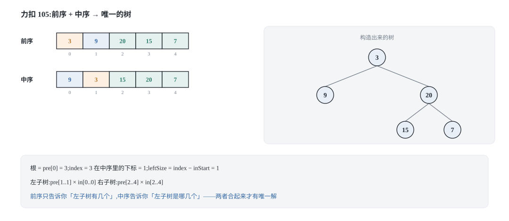
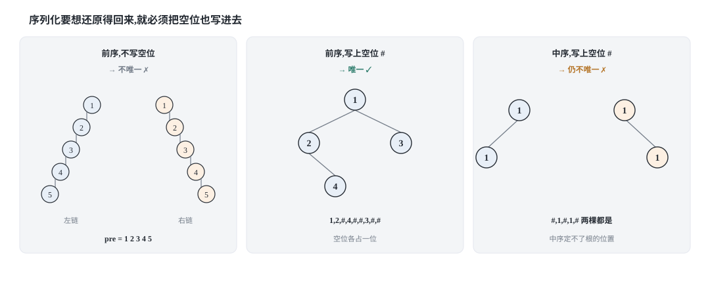
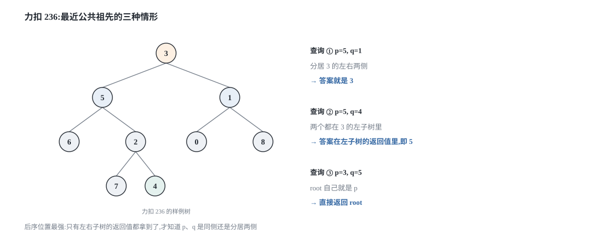
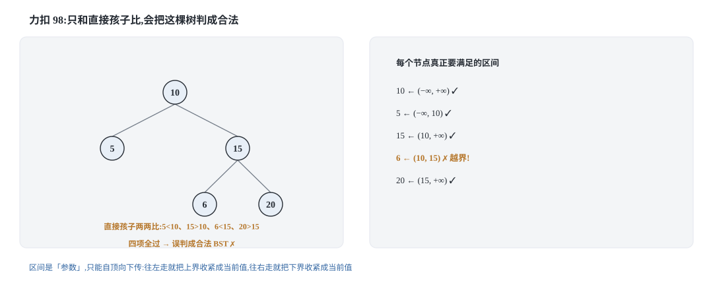
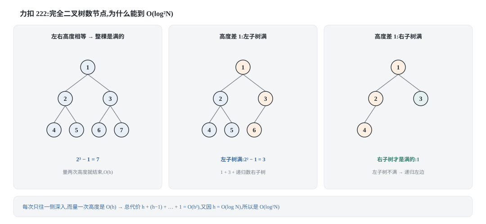
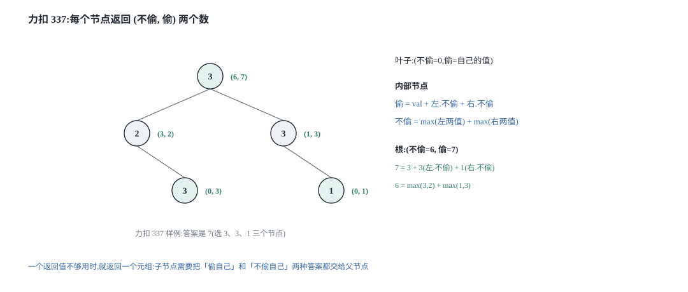

## 0 先说明材料和我的写法

这篇是我自己的学习笔记，材料来自 labuladong 的九篇教程：

- 《二叉树心法（构造篇）》—— <https://labuladong.online/zh/algo/data-structure/binary-tree-part2/>
- 《二叉树心法（序列化篇）》—— <https://labuladong.online/zh/algo/data-structure/serialize-and-deserialize-binary-tree/>
- 《二叉树心法（思路篇）》—— <https://labuladong.online/zh/algo/data-structure/binary-tree-part1/>
- 《二叉树心法（后序篇）》—— <https://labuladong.online/zh/algo/data-structure/binary-tree-part3/>
- 《二叉搜索树心法（特性篇）》—— <https://labuladong.online/zh/algo/data-structure/bst-part1/>
- 《二叉搜索树心法（基操篇）》—— <https://labuladong.online/zh/algo/data-structure/bst-part2/>
- 《二叉搜索树心法（构造篇）》—— <https://labuladong.online/zh/algo/data-structure/bst-part3/>
- 《拓展：最近公共祖先系列解题框架》—— <https://labuladong.online/zh/algo/practice-in-action/lowest-common-ancestor-summary/>
- 《拓展：如何计算完全二叉树的节点数》—— <https://labuladong.online/zh/algo/data-structure/count-complete-tree-nodes/>

上一批材料我只拿到了一部分正文，所以先把完整度摊开讲，因为这直接决定你该信哪一部分：

| 材料 | 我取到了什么 | 哪些是我补的 |
| --- | --- | --- |
| 二叉树心法（构造篇） | 全文，含 654 最大二叉树、105 前序+中序、106 中序+后序、889 前序+后序的完整推导 | 引用原文的地方我都核对过 |
| 二叉树心法（序列化篇） | 全文，含「什么样的序列化结果能唯一还原」的四条结论、前序/后序/中序/层序四种解法的思路 | 代码是我按思路重写的 |
| 二叉树心法（思路篇） | 只有三个小节标题和题号（226 / 116 / 114） | 这三道题的解法、`next` 指针的跨层连接、拍平的尾指针设计都是我自己的 |
| 二叉树心法（后序篇） | 只有小节标题和题号（652 寻找重复的子树） | 本篇不写 652 |
| 二叉搜索树心法（特性篇） | 全文，含「BST 的中序遍历有序」这条核心性质、230 与 538 两道题 | 代码是我按思路重写的 |
| 二叉搜索树心法（基操篇） | 全文，含 98 验证 BST 的「只比直接孩子会错」、700 搜索、701 插入、450 删除的三种情况 | 引用原文的地方我都核对过 |
| 二叉搜索树心法（构造篇） | 只有小节标题和题号（96 / 95 不同的二叉搜索树） | 本篇不写 96/95 |
| 最近公共祖先系列 | 只有小节标题和题号（236 / 1676 / 1644 / 235 / 1650） | 236、235、1650 的解法，以及**倍增版 LCA** 全部是我自己写的推导与代码 |
| 完全二叉树的节点数 | 只有小节标题（一、思路分析 / 二、复杂度分析）和「复杂度应该是 O(log N × log N)」这一句结论 | **整节推导（两条引理、递推式、反例）都是我自己补的** |

有三件事必须先讲清楚：

**第一，6 张示意图都是我自己用 SVG 画的。** 原文有可视化面板，能看到指针一格一格地动，那是这套教程最有价值的部分，我复现不了。所以本文的图是我按自己的理解重画的，画的是结论，不是那个可交互的过程。

**第二，代码是 Python 3 和 C++ 两版，不是原文的语言。** 教程原文用 Java 写，我按自己的习惯重新实现了一遍。两种语言并排给是有原因的：这一批题恰好踩在两种语言差异最大的几个点上——C++ 的 `std::function` 才能写递归 lambda、`long long` 边界和 `INT_MIN` 的坑、`std::swap` 与手写交换的区别，第 4、6 节会具体说。

**第三，有几节是我自己的推导，原文只给了结论。** 最典型的是第 5 节「完全二叉树的节点个数」：原文只说复杂度是 O(log²N)，没给出为什么。我从「完全二叉树的最后一层从左往右填」这条定义出发，把两条引理和递推式补完了，并且给了一个反例说明为什么不能简单地说「左子树一定是满的」。第 8 节的树形 DP、第 3 节的倍增 LCA 同理。

### 目录

- [0 先说明材料和我的写法](#0-先说明材料和我的写法)
- [1 构造类问题:根定了,左右子树的区间也就定了](#1-构造类问题根定了左右子树的区间也就定了)
- [2 序列化与反序列化:空位到底算不算信息](#2-序列化与反序列化空位到底算不算信息)
- [3 最近公共祖先:从一次递归到倍增表](#3-最近公共祖先从一次递归到倍增表)
- [4 BST 的特性与操作:中序有序加一套增删查改](#4-bst-的特性与操作中序有序加一套增删查改)
- [5 完全二叉树的节点个数:O(log n * log n) 是怎么推出来的](#5-完全二叉树的节点个数olog-n--log-n-是怎么推出来的)
- [6 花式变换:翻转、拍平、连接 next](#6-花式变换翻转拍平连接-next)
- [7 子树判断与合并二叉树](#7-子树判断与合并二叉树)
- [8 二叉树的拓展:归并思想与树形 DP](#8-二叉树的拓展归并思想与树形-dp)
- [9 把这几个套路收成一张表](#9-把这几个套路收成一张表)
- [10 材料与出处](#10-材料与出处)

上一篇《[二叉树遍历框架](/binary-tree/)》的结论是：递归遍历访问节点的顺序是固定的，真正的自由度在于你把代码写在哪一步（前序 / 中序 / 后序位置），而三个位置的能力依次增强。

这一篇要处理的，是那个框架**拦不住**的一批题。它们不是「换个位置写代码」就能解决的，而是要在递归函数的**形状**上做手脚。整篇其实只有两个旋钮：

1. **参数**：往递归函数里多塞一个东西，让它知道「我这一段应该满足什么约束」。构造类塞的是索引区间，验证 BST 塞的是上下界，序列化塞的是「我读到第几个 token 了」。
2. **返回值**：让递归函数多返回一点东西。完全二叉树计数返回「这棵子树是不是满的」，打家劫舍 III 返回一个二元组，拍平返回「这棵子树拍平后的尾巴在哪」。

后面每一节，我都标出它拧的是哪个旋钮。

---

## 1 构造类问题:根定了,左右子树的区间也就定了

**这一节拧的旋钮是「参数」。**

### 1.1 为什么构造问题一定是「分解问题」

先回到上一篇的两种思维模式：

- **遍历**：走一遍树，用外部变量收集答案。
- **分解问题**：定义好递归函数的返回值，用子问题的答案拼出原问题的答案。

构造类问题只能用后者，而且理由非常直白：**你要造出一棵树，就必须先造出它的根，再造出它的左右子树**，而「造一棵子树」和「造整棵树」是同一件事。用式子写出来就是：

```text
构造整棵树 = 造出根节点 + 构造左子树 + 构造右子树
```

「造出根节点」这一步，在 105（前序 + 中序）里就是取 `preorder` 的第一个元素；在 106（中序 + 后序）里就是取 `postorder` 的最后一个元素。「构造左右子树」这一步，就是把两个数组各切成两半，分别递归。

所以整道题的难点不在递归，而在**切分**：怎么从两个遍历序列里，准确地切出左子树的那一段和右子树的那一段。

### 1.2 力扣 105:前序 + 中序

先把两份序列的长相摆出来。下面这棵树的：

```text
        3
       / \
      9  20
         / \
        15  7

前序 preorder  = [3, 9, 20, 15, 7]
中序 inorder   = [9, 3, 15, 20, 7]
```



切分规则只有三条，但必须背下来的是**第三条**：

1. `preorder` 的第一个元素是根，记作 `root_val`。
2. 在中序里找到 `root_val` 的位置 `index`。中序的顺序是「左子树、根、右子树」，所以 `inorder[in_lo .. index-1]` 是左子树的中序，`inorder[index+1 .. in_hi]` 是右子树的中序。
3. **左子树的节点个数 `left_size = index - in_lo`**。这个数字一旦拿到，`preorder` 的切法就定了：根的后面紧跟 `left_size` 个元素，那一段就是左子树的前序，再往后的就是右子树的前序。

第 3 条为什么成立？因为前序遍历的顺序是「根、左子树、右子树」，左子树的所有节点在 `preorder` 里必然是紧跟在根后面、连续的一段，而它的长度就等于左子树的节点个数——这个数字只有中序能告诉你。这就是「前序 + 中序」必须配对的原因：**前序负责告诉你左子树有几个，中序负责告诉你左子树是哪几个。**

```python
from typing import List, Optional


class TreeNode:
    def __init__(self, val=0, left=None, right=None):
        self.val = val
        self.left = left
        self.right = right


def buildTreePreIn(preorder: List[int], inorder: List[int]) -> Optional[TreeNode]:
    # 值到下标的映射只建一次,递归里不再线性查找,否则总复杂度会退化
    pos = {v: i for i, v in enumerate(inorder)}

    def build(pre_lo: int, pre_hi: int, in_lo: int, in_hi: int) -> Optional[TreeNode]:
        if pre_lo > pre_hi:              # 区间为空,说明这棵子树不存在
            return None
        root_val = preorder[pre_lo]      # 前序区间的第一个就是根
        index = pos[root_val]            # 根在中序里的位置
        left_size = index - in_lo        # 左子树有几个节点,这是唯一的自由度
        root = TreeNode(root_val)
        root.left = build(pre_lo + 1, pre_lo + left_size, in_lo, index - 1)
        root.right = build(pre_lo + left_size + 1, pre_hi, index + 1, in_hi)
        return root

    if not preorder:
        return None
    return build(0, len(preorder) - 1, 0, len(inorder) - 1)
```

```cpp
#include <vector>
#include <unordered_map>
#include <functional>

struct TreeNode {
    int val;
    TreeNode *left;
    TreeNode *right;
    explicit TreeNode(int v = 0) : val(v), left(nullptr), right(nullptr) {}
};

TreeNode *buildTreePreIn(std::vector<int> &preorder, std::vector<int> &inorder) {
    if (preorder.empty()) return nullptr;

    std::unordered_map<int, int> pos;
    for (int i = 0; i < static_cast<int>(inorder.size()); ++i) pos[inorder[i]] = i;

    // C++ 的 lambda 想递归调用自己,必须先有个名字,所以用 std::function 接住
    std::function<TreeNode *(int, int, int, int)> build =
        [&](int preLo, int preHi, int inLo, int inHi) -> TreeNode * {
        if (preLo > preHi) return nullptr;
        int rootVal = preorder[preLo];
        int index = pos[rootVal];
        int leftSize = index - inLo;
        TreeNode *root = new TreeNode(rootVal);
        root->left = build(preLo + 1, preLo + leftSize, inLo, index - 1);
        root->right = build(preLo + leftSize + 1, preHi, index + 1, inHi);
        return root;
    };
    return build(0, static_cast<int>(preorder.size()) - 1, 0,
                 static_cast<int>(inorder.size()) - 1);
}
```

**最容易写错的一行:** `int leftSize = index - inLo;` 不是 `index`。中序区间不一定从 0 开始，写成 `index` 在左子树上还能碰巧对（因为 `inLo` 是 0），一进右子树就全错。两个语言里我都见过这个错——它不会崩，只会造出一棵长得不对的树。

**复杂度推导。** 递归函数每次处理一个节点（区间长度决定它是谁的孩子），一共 N 个节点；区间切分本身是 O(1)（`pos` 查表），`pos` 的建立是 O(N)。所以：

```text
T(N) = T(left_size) + T(N - 1 - left_size) + O(1)
     = O(N)                                  # 每个节点恰好被「造」一次
```

空间上递归深度等于树高，最坏（退化成链）是 O(N)，另外 `pos` 占 O(N)。

C++ 和 Python 在这里有一个不大不小的差异：Python 的嵌套函数能直接读外层的 `pos`（闭包），C++ 的 lambda 必须用 `std::function` 才能递归调用自己，或者干脆写成一个带默认参数的普通函数。**用 `std::function` 有额外代价**——它是一次类型擦除的间接调用，常数比普通递归大；N 很大的时候可以换成显式栈，但面试里 `std::function` 是标准写法，够用。

### 1.3 力扣 106:中序 + 后序

换成后序，切分规则要跟着变，但逻辑完全对称：

1. `postorder` 的**最后**一个元素是根。
2. 在中序里找到它的位置 `index`，同样切出左子树的中序和右子树的中序。
3. `left_size = index - in_lo` 依然成立，但后序的切法是：**左子树的后序在区间的前半段**，右子树的后序在「左子树那一段」和「根」之间。

```text
        3
       / \
      9  20
         / \
        15  7

中序 inorder   = [9, 3, 15, 20, 7]
后序 postorder = [9, 15, 7, 20, 3]
```

根的 3 在 `postorder` 的末尾。`left_size = 1`，所以左子树的后序是 `[9]`，右子树的后序是 `[15, 7, 20]`。

```python
def buildTreeInPost(inorder: List[int], postorder: List[int]) -> Optional[TreeNode]:
    pos = {v: i for i, v in enumerate(inorder)}

    def build(in_lo: int, in_hi: int, post_lo: int, post_hi: int) -> Optional[TreeNode]:
        if in_lo > in_hi:
            return None
        root_val = postorder[post_hi]    # 后序区间的最后一个才是根
        index = pos[root_val]
        left_size = index - in_lo
        root = TreeNode(root_val)
        # 左子树占后序区间的前 left_size 个,右子树夹在它和根之间
        root.left = build(in_lo, index - 1, post_lo, post_lo + left_size - 1)
        root.right = build(index + 1, in_hi, post_lo + left_size, post_hi - 1)
        return root

    if not inorder:
        return None
    return build(0, len(inorder) - 1, 0, len(postorder) - 1)
```

```cpp
TreeNode *buildTreeInPost(std::vector<int> &inorder, std::vector<int> &postorder) {
    if (inorder.empty()) return nullptr;

    std::unordered_map<int, int> pos;
    for (int i = 0; i < static_cast<int>(inorder.size()); ++i) pos[inorder[i]] = i;

    std::function<TreeNode *(int, int, int, int)> build =
        [&](int inLo, int inHi, int postLo, int postHi) -> TreeNode * {
        if (inLo > inHi) return nullptr;
        int rootVal = postorder[postHi];
        int index = pos[rootVal];
        int leftSize = index - inLo;
        TreeNode *root = new TreeNode(rootVal);
        root->left = build(inLo, index - 1, postLo, postLo + leftSize - 1);
        root->right = build(index + 1, inHi, postLo + leftSize, postHi - 1);
        return root;
    };
    return build(0, static_cast<int>(inorder.size()) - 1, 0,
                 static_cast<int>(postorder.size()) - 1);
}
```

**最容易写错的一行:** 右子树的后序上界是 `postHi - 1`，不是 `postHi`。`postorder[postHi]` 是根，已经被用掉了，再把它划进右子树就会多切一个节点——然后你会得到一棵多出一个叶子的树，而递归不会报错。

**复杂度推导。** 和 105 完全相同，每个节点被造一次：`T(N) = T(left_size) + T(N-1-left_size) + O(1) = O(N)`。

### 1.4 前序 + 后序为什么不行,值重复为什么不行

这两件事都值得单独说，因为 105 和 106 里那两个 `pos` 查表和「前序第二个就是左子树的根」这两个动作，都建立在同一个前提上。

**第一个问题：只给前序 + 后序，能唯一还原吗？答案是（值不重复的前提下）不能。**

按构造篇的推导，前序 + 后序的切分代码里必然有这么一行：把前序区间的第二个元素当成左子树的根。问题在于，**左子树有可能是空的**——这时候前序的第二个元素其实是右子树的根。代码无法区分这两种情况，于是同一对序列可以对应结构不同的树。

最小的反例是两棵两个节点的树：

```text
树 A:1 只有左孩子 2        树 B:1 只有右孩子 2
前序 = [1, 2]              前序 = [1, 2]
后序 = [2, 1]              后序 = [2, 1]
```

两份序列完全一样，树却不一样。所以「前序 + 后序」这条路是堵死的（除非序列里带上空位标记，见下一节）。

**第二个问题：为什么所有构造题的题目描述里都写着「值互不相同」？**

因为构造的过程里，有两处依赖「值能唯一定位一个节点」：

1. `pos[root_val]` 必须能唯一确定根在中序里的位置。如果中序是 `[2, 2, 2]`，`pos[2]` 只能是某一个下标，但根到底是哪一个 2，序列本身没有提供信息。
2. 前序 + 后序那版里，`pos[preorder[pre_lo + 1]]` 用来判断左子树的边界，值重复时同样无从判断。

这不是「实现上的小瑕疵」，而是**信息不足**：中序序列里的位置信息，是靠「值 → 唯一位置」这个映射才被利用起来的。值一旦重复，映射就退化成多对一，原来那份「我这一段长度是多少」的信息就丢了。举一个具体的例子：

```text
中序 = [2, 2, 2]   前序 = [2, 2, 2]

可能 1:根是第一个 2,左子树空,右子树两个 2
可能 2:根是第二个 2,左右各一个 2
可能 3:根是第三个 2,左子树两个 2,右子树空
```

三棵结构不同的树都满足这两份序列。所以「值不重复」不是出题人偷懒，是这道题有唯一解的**必要条件**。

顺带一提，值重复的情况下想做这道题也不是完全没办法（用「区间长度 + 中序遍历的稳定顺序」双重约束可以构造出唯一解），但那已经不是在还原原来的那棵树了，面试不会考。

---

## 2 序列化与反序列化:空位到底算不算信息

**这一节拧的还是「参数」**，只不过这次参数不再是区间下标，而是「我读到序列的第几个 token 了」。

### 2.1 先想清楚:什么样的序列化结果能唯一还原

序列化的本质是**把一棵二维的树压成一维的字符串**，反序列化是反过来。所以第一个要回答的问题不是「怎么写代码」，而是「压完之后信息够不够」。

结论可以列成一张表（前提：节点的值互不相同）：

| 序列里有没有空位标记 | 给了几种遍历顺序 | 能不能唯一还原 | 原因 |
| --- | --- | --- | --- |
| 没有 | 一种（前序/中序/后序任意） | 不能 | 同一份序列对应多棵树 |
| 没有 | 前序 + 中序 | 能 | 前序给根，中序给左右子树的划分 |
| 没有 | 后序 + 中序 | 能 | 同上，根从后序末尾取 |
| 没有 | 前序 + 后序 | 不能 | 左子树是否为空无法判断 |
| **有** | 前序 | 能 | 空位把「子树不存在」也编码进去了 |
| **有** | 后序 | 能 | 同上 |
| **有** | 中序 | **仍然不能** | 根在中序里的位置无法确定 |
| **有** | 层序 | 能 | 同上，空位补全了每一层 |



「带了空位就唯一」这件事，直觉上很好接受：空位标记让「树」和「序列」之间变成了一一对应。但为什么**中序即使带了空位也不行**？这是这张表里最反直觉的一格。

原因还是那个：中序的顺序是「左子树、根、右子树」，**根本身的位置是最后一个才知道的**，你从序列开头读起，根本不知道当前这个片段是左子树还是已经翻过了根。一个最小的反例是两棵节点值都是 1 的两节点树：

```text
树 A:根 1,只有左孩子 1        树 B:根 1,只有右孩子 1
带空位的中序 = [#, 1, #, 1, #]   带空位的中序 = [#, 1, #, 1, #]
```

一模一样。所以中序这条路上，空位补不回「根在哪」这个信息。

**这里有个和前文的呼应值得记一下：** 第 1.4 节里说「前序 + 后序」不行，是因为无法判断左子树是否为空；而这里说「前序带空位」就可行，是因为空位把那个判断直接写进了序列。**同一个信息缺口，可以用「多给一种遍历」来补，也可以用「把空位写进去」来补。**

### 2.2 力扣 297:前序 + 空位标记

按上面的结论，最省事的写法是「前序 + `#` 表示空位」。序列化就是一篇前序遍历，只是在 `node == None` 的时候不要 `return`，而是往字符串里写一个 `#`。

```python
SEP = ","
NULL = "#"


def serialize(root: Optional[TreeNode]) -> str:
    out: List[str] = []

    def go(node: Optional[TreeNode]) -> None:
        if node is None:
            out.append(NULL)              # 空位也要占一个位置
            return
        out.append(str(node.val))         # 前序位置
        go(node.left)
        go(node.right)

    go(root)
    return SEP.join(out)


def deserialize(data: str) -> Optional[TreeNode]:
    tokens = data.split(SEP)
    idx = 0                               # 用下标推进,不要用 pop(0)

    def go() -> Optional[TreeNode]:
        nonlocal idx
        tok = tokens[idx]
        idx += 1                          # 先消耗一个 token,再决定往哪走
        if tok == NULL:
            return None
        node = TreeNode(int(tok))         # 前序位置:先造根
        node.left = go()                  # 再照着同一份序列造左子树
        node.right = go()                 # 再造右子树
        return node

    return go()
```

```cpp
#include <string>
#include <vector>
#include <functional>

std::string serialize(TreeNode *root) {
    std::string out;
    std::function<void(TreeNode *)> go = [&](TreeNode *node) {
        if (node == nullptr) {
            out += "#,";
            return;
        }
        out += std::to_string(node->val) + ",";
        go(node->left);
        go(node->right);
    };
    go(root);
    if (!out.empty()) out.pop_back();     // 去掉末尾多出来的那个逗号
    return out;
}

TreeNode *deserialize(const std::string &data) {
    std::vector<std::string> tokens;
    std::string cur;
    for (char ch : data) {
        if (ch == ',') { tokens.push_back(cur); cur.clear(); }
        else cur += ch;
    }
    tokens.push_back(cur);

    std::size_t idx = 0;
    std::function<TreeNode *()> go = [&]() -> TreeNode * {
        const std::string tok = tokens[idx++];   // 先消耗
        if (tok == "#") return nullptr;
        TreeNode *node = new TreeNode(std::stoi(tok));
        node->left = go();
        node->right = go();
        return node;
    };
    return go();
}
```

**最容易写错的一行:** 反序列化里 `idx += 1` 必须在两个递归调用**之前**。如果写成「先递归左子树、再递归右子树、最后 `idx += 1`」，左右子树会读到同一个 token，序列会被反复消费到越界——而且在小样例上有可能碰巧「看起来对」，因为这时的树是左倾的。

还有两个跨语言的差异：

- **不要用 `tokens.pop(0)`。** Python 的 `list.pop(0)` 是 O(N)（后面所有元素都要前移），N 个 token 就变成 O(N²)。用下标推进是 O(1)。C++ 里我干脆先手工切分成 `vector<string>` 再按下标取。
- **分隔符的选择。** 用逗号做分隔符时，节点值本身不能包含逗号，所以只能序列化整数。真实场景里往往用 JSON，或者像教程原文说的那样「以某种特定格式组织数据，使得数据可以独立于编程语言」——这里的重点是「格式自洽」，`serialize` 和 `deserialize` 配对就行。

**复杂度推导。** 两边都是每个节点访问一次，`serialize` 是 O(N) 次字符串拼接；Python 里 `SEP.join(out)` 只做一次拼接，是 O(N)。`deserialize` 是 O(N) 次下标推进，每个 token 处理一次，也是 O(N)。空间上序列长度是 `2N + 1` 个 token（N 个节点 + N+1 个空位），所以字符串长度 O(N)。**注意这个 2N+1**：空位标记让序列变长了将近一倍，这就是「唯一还原」的价格。

### 2.3 另外三种解法,以及它们各自的坑

同一个思路换遍历顺序就能得到另外三种写法，但每种都要注意一件事：

**后序 + 空位。** 序列化时把 `#`/值写在后序位置，反序列化时**必须从后往前读**，并且先构造右子树再构造左子树（后序是「左、右、根」，倒过来就是「根、右、左」）。写的时候很容易忘了这个颠倒，然后得到一棵左右镜像的树——它自己序列化回去还是同一份字符串，所以光靠「序列化再反序列化」是测不出来的。

**层序 + 空位。** 序列化用队列逐层扫，空节点也入队并写 `#`。反序列化用一个队列存「已经造出来、但还没接上孩子的节点」，每个节点消费两个 token。它的好处是序列对人眼友好（能看出树的形状），坏处是空位数量比前序更多。

**中序 + 空位。** 前面已经证明了它做不到唯一还原，所以这条路直接放弃。

所以我最终选的是**前序 + 空位**：代码最短，序列化是天然的前序遍历，反序列化也天然是前序构造（先根、再左、再右），和第 1 节的「构造类问题」是同一个套路——只不过这里的「切分」不需要中序帮忙，因为空位已经把区间边界标出来了。
---

## 3 最近公共祖先:从一次递归到倍增表

**这一节拧的旋钮是「返回值」**：递归函数要往上报的不再是一个数字，而是「我这棵子树里找到了什么」。

最近公共祖先（Lowest Common Ancestor，LCA）在真实工程里很常见：`git rebase` 判断两条分支有没有冲突，第一步就是找出两个 commit 的 LCA。这一节从「只查一次」讲到「查很多次」。

### 3.1 力扣 236:普通二叉树上的 LCA

先明确递归函数的**定义**（这一步比写代码重要）：

> `f(root, p, q)`：在以 `root` 为根的子树里找 `p` 和 `q`。如果两个都找到了，返回它们的 LCA；如果只找到一个，返回找到的那个；一个都没找到，返回 `null`。

有了这个定义，代码几乎是照着念出来的：

```python
def lowestCommonAncestor(root: Optional[TreeNode], p: TreeNode,
                         q: TreeNode) -> Optional[TreeNode]:
    if root is None or root is p or root is q:
        return root                    # 空树,或者 root 自己就是目标之一
    left = lowestCommonAncestor(root.left, p, q)
    right = lowestCommonAncestor(root.right, p, q)
    if left is not None and right is not None:
        return root                    # 一边找到一个,root 就是分岔点
    # 只有一个返回值非空,说明两个目标都在同一侧,把它继续往上报
    return left if left is not None else right
```

```cpp
TreeNode *lowestCommonAncestor(TreeNode *root, TreeNode *p, TreeNode *q) {
    if (root == nullptr || root == p || root == q) return root;
    TreeNode *left = lowestCommonAncestor(root->left, p, q);
    TreeNode *right = lowestCommonAncestor(root->right, p, q);
    if (left != nullptr && right != nullptr) return root;
    return left != nullptr ? left : right;
}
```



**为什么必须在后序位置做？** 因为「两个目标是不是分居两侧」这个判断，必须等左右子树的结果都回来才知道。前序位置你只知道「我是不是 p 或 q」，中序位置只知道「左子树查完了」，都不足以做判断。这是上一篇「后序位置能力最强」的又一个实例，但这次它多了一个新东西：**返回值承担了「报告」的职责**，而不只是一个计算结果。

**最容易写错的一行:** 最后一行不能写成 `if left: return left; return right;`。这样写的话，当 `left` 和 `right` 都非空（两个目标分居两侧，答案就是 `root`）时会提前返回左子树的结果，答案是错的。**先判「都非空」，再判「哪个非空」**，顺序反了不报错，只是答案错。

三个细节：

- **比较必须比「节点身份」，不能比「值」。** 上面用的是 `root is p`（身份），C++ 用的是 `root == p`（指针相等）。如果写成 `root.val == p.val`，树里有重复值的时候会匹配到错误的节点。这一点和第 1.4 节的「值重复」是同一件事的两面。
- **力扣 236 保证了 `p`、`q` 一定在树里**，所以上面的代码不用处理「找不到」。一旦题目改成「p、q 可能不存在」（力扣 1644）或者「要在若干个节点里找 LCA」（力扣 1676），
  「只找到一个」和「两个都找到」就必须能区分开——通常的做法是让返回值多带一个标记，或者先各自搜一遍确认存在性。这正是「返回值不够用」的例子，第 8 节会看到更彻底的版本。
- **复杂度推导。** 每个节点最多被访问一次（不管找没找到，都会往下走），所以时间 O(N)；递归深度等于树高 h，空间 O(h)，最坏（退化成链）O(N)。这个算法只回答**一次**查询就很划算，但如果要回答很多次查询，每次 O(N) 就太慢了——这就是 3.4 节存在的理由。

### 3.2 力扣 235:BST 版,LCA 可以一次走到底

如果这棵树是二叉搜索树，上面那套递归就是浪费——BST 的「左小右大」直接告诉了你答案在哪一侧。

从根开始走，每一步只有三种情况：

1. `p`、`q` 的值**都小于**当前节点：两个都在左子树里，往左走。
2. `p`、`q` 的值**都大于**当前节点：两个都在右子树里，往右走。
3. 否则（一个大一个小，或者其中之一就是当前节点）：当前节点就是**分岔点**，也就是 LCA，停。

第 3 条为什么一定成立？如果 `p.val < node.val < q.val`，那么 `p` 在左子树、`q` 在右子树，`node` 是它们能碰到的最低的共同祖先（再往下走只能进一侧，另一侧就丢了）。如果 `p.val == node.val`，那么 `node` 本身就是 `p`，而 `q` 在它的某棵子树里，所以 `node` 是 LCA。

```python
def lowestCommonAncestorBST(root: TreeNode, p: TreeNode, q: TreeNode) -> TreeNode:
    node = root
    while node is not None:
        if p.val < node.val and q.val < node.val:
            node = node.left           # 两个都比当前节点小,答案在左边
        elif p.val > node.val and q.val > node.val:
            node = node.right          # 两个都比当前节点大,答案在右边
        else:
            return node                # 一大一小,或者其中之一就是它
    return root
```

```cpp
TreeNode *lowestCommonAncestorBST(TreeNode *root, TreeNode *p, TreeNode *q) {
    TreeNode *node = root;
    while (node != nullptr) {
        if (p->val < node->val && q->val < node->val) {
            node = node->left;
        } else if (p->val > node->val && q->val > node->val) {
            node = node->right;
        } else {
            return node;
        }
    }
    return root;
}
```

**最容易写错的一行:** 两个比较都要用**严格**不等号。如果写成 `p.val <= node.val && q.val <= node.val`，当 `q` 恰好就是当前节点时（`q.val == node.val`）会被误判成「两个都在左边」，然后一头扎进左子树，再也找不到答案。

**复杂度推导。** 每走一步就下降一层，且不会再回头，所以时间 O(h)；空间 O(1)（迭代写的，没有递归栈）。对比 3.1 的 O(N)：**BST 的额外结构（有序性）直接换来了效率**，这也是第 4 节的主线。

### 3.3 力扣 1650:如果每个节点带 parent 指针

力扣 1650 的输入不是根节点，而是直接给你 `p` 和 `q`，每个节点自带 `parent` 指针。这时候你**看不到根**（可以顺着 parent 找到，但那要多走一趟），标准解法是两个指针一起往上爬：

> 两个指针分别从 `p` 和 `q` 出发往上走。谁的 `parent` 变成空了（走到了根），就把它瞬移到对方的起点继续走。它们必然在 LCA 相遇。

```python
class PNode:
    def __init__(self, val: int = 0):
        self.val = val
        self.left: Optional["PNode"] = None
        self.right: Optional["PNode"] = None
        self.parent: Optional["PNode"] = None


def lowestCommonAncestorParent(a: PNode, b: PNode) -> Optional[PNode]:
    x, y = a, b
    while x is not y:
        # 走到根(parent 为空)就换到对方的起点,两边走过的总长度相同
        x = x.parent if x.parent is not None else b
        y = y.parent if y.parent is not None else a
    return x
```

```cpp
struct PNode {
    int val;
    PNode *left;
    PNode *right;
    PNode *parent;
    explicit PNode(int v = 0)
        : val(v), left(nullptr), right(nullptr), parent(nullptr) {}
};

PNode *lowestCommonAncestorParent(PNode *a, PNode *b) {
    PNode *x = a;
    PNode *y = b;
    while (x != y) {
        x = (x->parent != nullptr) ? x->parent : b;
        y = (y->parent != nullptr) ? y->parent : a;
    }
    return x;
}
```

**为什么一定会相遇？** 设 `p` 的深度是 `a`，`q` 的深度是 `b`，LCA 的深度是 `c`（深度从 0 数起）。

- 指针 `x` 从 `p` 出发，走 `a` 步到根，然后瞬移到 `q`，再从 `q` 走 `b - c` 步到 LCA。总共 `a + b - c` 步。
- 指针 `y` 从 `q` 出发，走 `b` 步到根，瞬移到 `p`，再从 `p` 走 `a - c` 步到 LCA。也是 `a + b - c` 步。

两边走的步数一样，而且走的都是「先到自己那侧的上行路径，再走对方那侧的上行路径」，这两条路径的公共部分恰好从 LCA 开始。所以它们会在第 `a + b - c` 步同时到达 LCA，循环条件 `x is not y` 在那一刻失效，返回 `x`。这个技巧和「两个链表求交点」（力扣 160）是同一个 `a + c + b == b + c + a`。

**最容易写错的一行:** `x = x.parent if x.parent is not None else b` 里的 `else b` 很容易顺手写成 `else None`。写成 `None` 的话，两个指针各自走到根就都变成 `None`，循环直接结束并返回 `None`——空指针异常是没有的，只是答案永远是「没有公共祖先」，而且在小样例上（`p`、`q` 深度相同）看起来可能碰巧对。

**复杂度推导。** 两个指针各走 `a + b - c ≤ a + b` 步，而 `a + b` 不超过 2h，所以时间 O(h)，空间 O(1)。比 3.1 的 O(N) 好，因为这里不需要遍历整棵树。

### 3.4 倍增表:把单次查询压到 O(log N)

前面三个版本的共同问题是：**每次查询都要重新走一遍**。如果要在同一棵树上回答 M 次 LCA 查询，总代价是 O(M·h) 或 O(M·N)。倍增（binary lifting）的思路是**先用 O(N log N) 预处理出一张「往上跳 2^k 步会到哪」的表**，之后每次查询只要 O(log N)。

表的定义很朴素：

```text
up[0][v] = v 的父亲
up[k][v] = up[k-1][ up[k-1][v] ]      # 往上跳 2^k 步 = 先跳 2^(k-1) 步,再跳 2^(k-1) 步
```

`k` 只要取到 `log₂N`，因为任何不超过 N 的步数都能用二进制拆成若干个 2 的幂之和。查询分两步：

1. **对齐深度**：把深的那个节点用二进制拆分往上跳 `depth 差` 步，让两个节点同层。
2. **一起跳**：从最大的 `k` 往小试，如果 `up[k][p] != up[k][q]`，说明跳 2^k 步还**没有**越过 LCA，那就跳。循环结束后 `p`、`q` 是 LCA 的两个孩子，`up[0][p]` 就是答案。

```python
def lcaBinaryLifting(root: Optional[TreeNode], p: TreeNode,
                     q: TreeNode) -> Optional[TreeNode]:
    if root is None:
        return None

    parent: dict = {}
    depth: dict = {}
    order: List[TreeNode] = []

    def walk(node: Optional[TreeNode], par: Optional[TreeNode], d: int) -> None:
        if node is None:
            return
        parent[node] = par
        depth[node] = d
        order.append(node)                # 顺便给每个节点一个整数编号
        walk(node.left, node, d + 1)
        walk(node.right, node, d + 1)

    walk(root, None, 0)
    n = len(order)
    idx = {v: i for i, v in enumerate(order)}
    LOG = 1
    while (1 << LOG) <= n:
        LOG += 1

    # up[k][i] = 编号 i 的节点往上跳 2^k 步到哪个编号,-1 表示跳过了根
    up = [[-1] * n for _ in range(LOG)]
    for i in range(n):
        up[0][i] = idx[parent[order[i]]] if parent[order[i]] is not None else -1
    for k in range(1, LOG):
        for i in range(n):
            mid = up[k - 1][i]
            up[k][i] = -1 if mid == -1 else up[k - 1][mid]

    def jump(v: int, steps: int) -> int:
        k = 0
        while steps and v != -1:
            if steps & 1:
                v = up[k][v]
            steps >>= 1
            k += 1
        return v

    a, b = idx[p], idx[q]
    if depth[order[a]] < depth[order[b]]:
        a, b = b, a
    a = jump(a, depth[order[a]] - depth[order[b]])    # 第一步:对齐深度
    if a == b:
        return order[a]                               # 一个是另一个的祖先
    for k in range(LOG - 1, -1, -1):                  # 第二步:从大步长往小步长试
        if up[k][a] != up[k][b]:
            a, b = up[k][a], up[k][b]
    return order[up[0][a]]                            # 再走一步才是 LCA
```

```cpp
#include <utility>

TreeNode *lcaBinaryLifting(TreeNode *root, TreeNode *p, TreeNode *q) {
    if (root == nullptr) return nullptr;

    std::unordered_map<TreeNode *, TreeNode *> par;
    std::unordered_map<TreeNode *, int> dep;
    std::vector<TreeNode *> order;

    std::function<void(TreeNode *, TreeNode *, int)> walk =
        [&](TreeNode *node, TreeNode *parent, int d) {
        if (node == nullptr) return;
        par[node] = parent;
        dep[node] = d;
        order.push_back(node);
        walk(node->left, node, d + 1);
        walk(node->right, node, d + 1);
    };
    walk(root, nullptr, 0);

    int n = static_cast<int>(order.size());
    std::unordered_map<TreeNode *, int> id;
    for (int i = 0; i < n; ++i) id[order[i]] = i;

    int LOG = 1;
    while ((1 << LOG) <= n) ++LOG;

    std::vector<std::vector<int>> up(LOG, std::vector<int>(n, -1));
    for (int i = 0; i < n; ++i) {
        TreeNode *parent = par[order[i]];
        up[0][i] = (parent != nullptr) ? id[parent] : -1;
    }
    for (int k = 1; k < LOG; ++k) {
        for (int i = 0; i < n; ++i) {
            int mid = up[k - 1][i];
            up[k][i] = (mid == -1) ? -1 : up[k - 1][mid];
        }
    }

    auto jump = [&](int v, int steps) {
        for (int k = 0; steps != 0 && v != -1; ++k, steps >>= 1) {
            if (steps & 1) v = up[k][v];
        }
        return v;
    };

    int a = id[p];
    int b = id[q];
    if (dep[order[a]] < dep[order[b]]) std::swap(a, b);
    a = jump(a, dep[order[a]] - dep[order[b]]);
    if (a == b) return order[a];
    for (int k = LOG - 1; k >= 0; --k) {
        if (up[k][a] != up[k][b]) {
            a = up[k][a];
            b = up[k][b];
        }
    }
    return order[up[0][a]];
}
```

**最容易写错的一行:** 第二步的循环条件是 `up[k][a] != up[k][b]`——**不相等才跳**。这样跳完停在 LCA 的**两个孩子**上，所以最后必须再补一步 `up[0][a]`。如果条件写成相等才跳，或者最后忘了补那一步，返回的会是 LCA 的孩子，而不是 LCA 本身。

还有两个坑：

- **深度对齐之后必须先判 `a == b`。** 如果 `p` 本来就是 `q` 的祖先，对齐完两个编号相等，此时如果继续走第二步的循环，`up[k][a] == up[k][b]` 恒成立，循环一次都不跳，最后返回 `up[0][a]`，那就往上多走了一步，答案是错的。
- **`up` 表里存的是「编号」不是节点指针。** 用 `unordered_map<TreeNode*, int>` 做映射是为了让 `up` 能用连续内存的二维数组，缓存友好。C++ 里如果直接拿 `unordered_map<TreeNode*, int>` 当 `up`，常数会大很多。

**复杂度推导。**

```text
预处理:walk 一遍 O(N),建表两重循环 LOG × N = O(N log N)   时间、空间都是 O(N log N)
单次查询:对齐深度 O(log N) + 一起跳 O(log N) = O(log N)
M 次查询:O(N log N + M log N)
```

什么时候值得用倍增？看 `M` 和 `N` 的关系：如果 `M = 1`，3.1 的递归版 O(N) 更简单；如果 `M` 和 `N` 同量级（比如树上路径统计），倍增的 `O(N log N)` 比 `O(M·N)` 好得多。这个取舍和「前缀和」是同一类思路：**把重复计算的部分预先算好存起来。**

---

## 4 BST 的特性与操作:中序有序加一套增删查改

二叉搜索树（Binary Search Tree，BST）的定义就两条：

1. 对任意节点 `node`，左子树里所有节点的值都**小于** `node.val`，右子树里所有节点的值都**大于** `node.val`。
2. 左右子树本身也都是 BST。

但要拿它做题，靠的是第三条性质——它不是定义，是**推论**：

> **BST 的中序遍历结果是严格递增的。**

为什么？中序的顺序是「左子树、根、右子树」，而 BST 保证了「左子树的值 < 根 < 右子树的值」，所以中序序列天然有序。反过来，这个性质可以当定义用：**任意一棵树，如果它的中序序列严格递增，它就是 BST。**

这一节剩下的内容都是这条性质的推论：第 K 小 = 中序第 K 个；累加树 = 反中序；验证 BST = 检查中序严格递增。最后是查、插、删——围绕 BST 最常考的三个操作。

### 4.1 中序有序的两个直接应用

**力扣 230「二叉搜索树中第 K 小的元素」**：既然是中序第 K 个，那就中序遍历到第 K 个就停。用**迭代版**（显式栈）而不是递归版，因为迭代版能在数到第 K 个的时候直接 `return`，而递归版如果要提前退出，得靠异常或者给每层都加判断。

**力扣 538「把二叉搜索树转换为累加树」**：每个节点的新值 = 原树中所有「大于等于它」的值之和。中序是从小到大，那我们**反着中序**走（先右、再根、再左，也就是从大到小），一路累加就行。

```python
def kthSmallest(root: Optional[TreeNode], k: int) -> int:
    stack: List[TreeNode] = []
    node = root
    while stack or node is not None:
        while node is not None:           # 一路向左,把还没访问的祖先压栈
            stack.append(node)
            node = node.left
        node = stack.pop()                # 弹出来的就是当前最小的未访问节点
        k -= 1
        if k == 0:
            return node.val               # 数到第 k 个,直接停
        node = node.right
    return -1                             # k 比节点数还大,题目保证不会发生


def convertBST(root: Optional[TreeNode]) -> Optional[TreeNode]:
    total = 0

    def go(node: Optional[TreeNode]) -> None:
        nonlocal total
        if node is None:
            return
        go(node.right)                    # 反中序:先右后左,先处理"比我大的"
        total += node.val                 # total 现在是"所有 >= 当前值"的和
        node.val = total
        go(node.left)

    go(root)
    return root
```

```cpp
int kthSmallest(TreeNode *root, int k) {
    std::vector<TreeNode *> stack;
    TreeNode *node = root;
    while (!stack.empty() || node != nullptr) {
        while (node != nullptr) {
            stack.push_back(node);
            node = node->left;
        }
        node = stack.back();
        stack.pop_back();
        if (--k == 0) return node->val;
        node = node->right;
    }
    return -1;
}

TreeNode *convertBST(TreeNode *root) {
    int total = 0;
    std::function<void(TreeNode *)> go = [&](TreeNode *node) {
        if (node == nullptr) return;
        go(node->right);
        total += node->val;
        node->val = total;
        go(node->left);
    };
    go(root);
    return root;
}
```

**最容易写错的一行:** `convertBST` 里必须先递归**右**子树再递归左子树。写成正常中序（先左后右）的话，`total` 累加的就变成了「所有小于等于当前值」的和，得到的是一棵「前缀和树」，而且它同样是一棵合法 BST，所以你看代码不会觉得哪里不对——只有把结果打印出来才发现全反了。

**复杂度推导。**

- `kthSmallest`：进栈最多 h 次（一条左链），每个节点出栈一次、最多 k 次，所以时间 O(h + k)，空间 O(h)。最坏（树退化成链且 k = N）是 O(N)。
- `convertBST`：每个节点访问一次，时间 O(N)；递归深度 O(h)，空间 O(h)。

Python 和 C++ 在这里的唯一差异是 `nonlocal`：Python 的嵌套函数想改外层的 `total` 必须声明 `nonlocal`，否则会创建一个新的局部变量，计数永远不增长。C++ 的 lambda 用 `[&]` 按引用捕获就没这个问题。

### 4.2 力扣 98:验证 BST,坑在「只比直接孩子」

先看一个很多人都掉进去的写法：对每个节点，只检查它和直接孩子的大小关系。

```text
        10
       /  \
      5    15
          /  \
         6    20      这棵树合法吗?
```

逐条检查直接孩子：`5 < 10` ✓、`15 > 10` ✓、`6 < 15` ✓、`20 > 15` ✓。四项全过，看起来合法。

**但它不是 BST。** 因为 6 在 10 的**右子树**里，而右子树的**所有**节点都必须大于 10，`6 < 10`，已经违反了。可 6 只是 15 的孩子，它根本「看不到」10 定下的约束——**约束必须从祖先一路传下来，而不是只和父亲比一次。**



所以递归函数要多带两个参数：`(low, high)`，表示「以 `node` 为根的子树里，所有值必须落在开区间 `(low, high)` 里」。往左走时上界收紧成当前值，往右走时下界收紧成当前值。

```python
def isValidBST(root: Optional[TreeNode]) -> bool:
    def check(node: Optional[TreeNode], low: float, high: float) -> bool:
        if node is None:
            return True
        if not (low < node.val < high):            # 两个边界都是开区间
            return False
        # 往左:上界收紧成自己;往右:下界收紧成自己
        return (check(node.left, low, node.val)
                and check(node.right, node.val, high))

    return check(root, float("-inf"), float("inf"))
```

```cpp
#include <climits>

bool isValidBST(TreeNode *root) {
    std::function<bool(TreeNode *, long long, long long)> check =
        [&](TreeNode *node, long long low, long long high) -> bool {
        if (node == nullptr) return true;
        if (!(low < node->val && node->val < high)) return false;
        return check(node->left, low, node->val) &&
               check(node->right, node->val, high);
    };
    // 用 long long 而不是 int:如果节点值恰好等于 INT_MIN,INT_MIN < val 会直接失败
    return check(root, LLONG_MIN, LLONG_MAX);
}
```

**最容易写错的一行:** 判断必须是**严格**不等式 `low < val < high`（`low <= val` 或 `val >= high` 都会把含重复值、本该非法的树判成合法）。而边界类型必须比节点值的类型**宽**——这是 C++ 独有的坑：如果写成 `check(root, INT_MIN, INT_MAX)`，当某个节点的值正好是 `INT_MIN` 时，`INT_MIN < INT_MIN` 为假，一棵合法 BST 会被判成非法。Python 没有这个问题，因为 `float("-inf")` 比任何整数都小。

**换一条路：用中序。** 既然「BST ⟺ 中序严格递增」，那也可以中序遍历，一边走一边检查当前值是否大于前一个值。这个写法的好处是**不需要边界参数**，也就不会碰到上面那个整数极值的坑；坏处是要多存一个「上一个值」（C++ 里可以用节点指针代替整数，彻底避开极值问题）。

**复杂度推导。** 两种写法都是每个节点访问一次，时间 O(N)；空间是递归深度 O(h)，最坏 O(N)。这里没有「提前退出能变快」的余地：即使第一个节点就违规，最坏情况（合法树）也必须把所有节点看完——**判定问题的最坏情况代价就是输入规模**。

### 4.3 力扣 700 + 701:BST 里的「找」和「改」

对数据结构的操作无非「遍历 + 访问」：遍历是**找**，访问是**改**。

**找**（力扣 700）：从根往下，比当前节点小就往左，大就往右，一次排除一半，不需要两边都递归。

**改**（力扣 701 插入）：一路找到空位，在那里挂上新节点，然后**把修改过的子树接回父节点**。

```python
def searchBST(root: Optional[TreeNode], target: int) -> Optional[TreeNode]:
    node = root
    while node is not None:
        if target == node.val:
            return node
        node = node.left if target < node.val else node.right    # 只走一边
    return None


def insertIntoBST(root: Optional[TreeNode], val: int) -> TreeNode:
    if root is None:
        return TreeNode(val)                    # 找到空位,新节点就挂在这
    if val < root.val:
        root.left = insertIntoBST(root.left, val)     # 改结构,必须接住返回值
    elif val > root.val:
        root.right = insertIntoBST(root.right, val)
    return root
```

```cpp
TreeNode *searchBST(TreeNode *root, int target) {
    TreeNode *node = root;
    while (node != nullptr) {
        if (target == node->val) return node;
        node = (target < node->val) ? node->left : node->right;
    }
    return nullptr;
}

TreeNode *insertIntoBST(TreeNode *root, int val) {
    if (root == nullptr) return new TreeNode(val);
    if (val < root->val) {
        root->left = insertIntoBST(root->left, val);
    } else if (val > root->val) {
        root->right = insertIntoBST(root->right, val);
    }
    return root;
}
```

**最容易写错的一行:** 插入的递归调用必须写成 `root->left = insertIntoBST(root->left, val)`，**把返回值接住**。只写 `insertIntoBST(root->left, val);` 的话，新节点是被 `new` 出来了，但没有任何指针指向它，函数返回后它就丢了——而代码不会报错，只会「插了个寂寞」。这条规则对 4.4 的删除、第 6 节的翻转和拍平同样适用：**凡是会改变树形的递归，返回值都要接住。**

**复杂度推导。** 两个操作都是从根走到某个位置，不再回头，所以时间 O(h)、空间 O(h)（插入是递归，最坏链状是 O(N)）。这里能一次只走一边，正是 BST 的价值所在——同样的操作在普通二叉树上必须是 O(N)。

### 4.4 力扣 450:删除一个节点,以及「不要改 val」

删除是 BST 操作里最麻烦的一个。先把「找」的框架摆好，难点在「找到了怎么办」。

找到要删的节点 A 之后，分三种情况：

- **情况 1：A 是叶子。** 直接删掉，返回 `null`。
- **情况 2：A 只有一个孩子。** 让这个孩子顶上来，返回它。
- **情况 3：A 有两个孩子。** 为了不破坏 BST 的性质，必须找一个「能接替 A」的节点：**右子树里的最小节点**（也就是 A 的中序后继），或者左子树里的最大节点（中序前驱）。用前者：把后继从它原来的位置摘下来，让它接管 A 的左右子树，再返回它。

```text
删除 [5,3,6,2,4,null,7] 里的 3(情况 3,取中序后继 4):

      5                 5
     / \               / \
    3   6     -->     4   6
   / \   \           /     \
  2   4   7         2       7
```

```python
def deleteNode(root: Optional[TreeNode], key: int) -> Optional[TreeNode]:
    if root is None:
        return None
    if key < root.val:
        root.left = deleteNode(root.left, key)
    elif key > root.val:
        root.right = deleteNode(root.right, key)
    else:
        # 情况 1 和情况 2 合并:至多一个孩子,直接让孩子顶上来
        if root.left is None:
            return root.right
        if root.right is None:
            return root.left
        # 情况 3:两个孩子。用右子树的最小节点(中序后继)接替自己
        nxt = root.right
        while nxt.left is not None:
            nxt = nxt.left
        # 第一步:先把后继从右子树里摘掉
        root.right = deleteNode(root.right, nxt.val)
        # 第二步:让后继接管 root 的两棵子树。它没有左孩子,所以这一步是安全的
        nxt.left = root.left
        nxt.right = root.right
        return nxt                       # 返回新根,交给上一层接住
    return root
```

```cpp
TreeNode *deleteNode(TreeNode *root, int key) {
    if (root == nullptr) return nullptr;
    if (key < root->val) {
        root->left = deleteNode(root->left, key);
    } else if (key > root->val) {
        root->right = deleteNode(root->right, key);
    } else {
        if (root->left == nullptr) return root->right;
        if (root->right == nullptr) return root->left;
        TreeNode *nxt = root->right;
        while (nxt->left != nullptr) nxt = nxt->left;
        root->right = deleteNode(root->right, nxt->val);   // 先摘掉后继
        nxt->left = root->left;                            // 再让它接管
        nxt->right = root->right;
        return nxt;
    }
    return root;
}
```

**最容易写错的一行:** 情况 3 里两行赋值的**顺序不能反**。必须先把后继从右子树里摘掉（`root.right = deleteNode(root.right, nxt.val)`），再执行 `nxt.right = root.right`。反过来的话，`nxt` 会变成自己的后代，树里出现环——这份代码在递归返回之后不会崩，但在别人下一次遍历这棵树时会无限递归。

还有一个设计上的取舍值得单独讲：

```text
方案 A(改值):找到后继 nxt,直接 root.val = nxt.val,然后去右子树里删掉 nxt
方案 B(换指针):找到后继 nxt,把 nxt 整个节点挪到 root 的位置,返回 nxt
```

力扣上方案 A 更短，但**真实工程里应该用方案 B**。原因和算法无关：BST 里存的「值」在真实场景中往往是用户自定义的复杂结构（一个订单、一条记录），而 BST 本身只是个索引工具。让「树的结构操作」去改写「用户的数据」，等于把索引和数据耦合在一起；一旦有别的地方持有那个节点的引用（比如一个哈希表把 key 映射到节点），改值就会让那些引用指向错误的数据。方案 B 只动指针，节点的身份不变。

**复杂度推导。** 整个过程是从根往下走一条路径：找到 `key` 是 O(h)；情况 3 里找后继是沿着右子树一路向左，最多 O(h)；递归删除后继又是一条向下的路径，O(h)。所以总时间 O(h)。注意**没有**「O(h) + O(h) = O(h²)」的问题，因为这几段路径是接续的，不是嵌套的——找后继的那条路径和删后继的那条路径加起来也不会超过 2h。空间是递归深度 O(h)。

---

## 5 完全二叉树的节点个数:O(log n * log n) 是怎么推出来的

**这一节拧的旋钮是「返回值」**：递归函数返回的节点数，被用来判断「这棵子树是不是满的」。

力扣 222 给你一棵**完全二叉树**，让你数节点个数。如果不管「完全」这个条件，随手写一个遍历：

```text
countNodes(root) = root == null ? 0 : 1 + countNodes(root.left) + countNodes(root.right)
```

这个写法是 O(N)，完全正确，但浪费了题目给的条件。**「完全二叉树」这个限制一定是有用的，否则题目不会特意这么出。** 目标复杂度是 O(log²n)。

这一节把推导补完整。原文只给了「复杂度是 O(log N × log N)」这个结论，下面两条引理、递推式和反例都是我自己补的。

### 5.1 先把定义摆清楚

```text
满二叉树(perfect):每一层的节点都填满。h 层的满二叉树有 2^h − 1 个节点。
完全二叉树(complete):前 h−1 层全满,第 h 层从左往右连续填,填到哪算哪。
```

「从左往右连续填」这五个字是本节所有推导的唯一依据。它带来两个立刻能用的结论：

- 一棵完全二叉树，**最左边那条路径一定走到最后一层**（因为最后一层至少有 1 个节点，而它一定在最左边）。
- 一棵完全二叉树，**最右边那条路径要么也走到最后一层（说明最后一层满了，整棵是满二叉树），要么停在倒数第二层**。不可能出现「右边比左边短两层以上」的情况。

### 5.2 两条引理

**引理 1.** 设完全二叉树高 `h` 层。记 `hl` = 从根一路向左能走的层数，`hr` = 从根一路向右能走的层数，则 `hl = h`，且 `hr ∈ {h−1, h}`。

证明：前 `h−1` 层全满，所以最左路径至少能走到第 `h−1` 层；第 `h` 层至少有 1 个节点，而第 `h` 层最左边的那个节点就在最左路径上，所以 `hl = h`。最右路径要走到第 `h` 层，前提是第 `h` 层最右边那个位置也被填上了，而按「从左往右连续填」，这只可能是最后一层已经填满——也就是整棵树是满二叉树。∎

引理 1 直接给出算法的**终止条件**：`hl == hr` ⟺ 这棵子树是满二叉树 ⟺ 节点数是 `2^hl − 1`，一行算完，不用递归。

**引理 2（关键）.** 若 `hl ≠ hr`（也就是最后一层没填满），则根的**左右子树中至少有一棵是满二叉树**。

证明：设原树高 `h` 层，最后一层有 `k` 个节点。因为是从左往右连续填的，所以 `k` 可以是 `0` 到 `2^(h−1)` 之间的任何值；`hl ≠ hr` 说明最后一层没满，即 `k < 2^(h−1)`。

把最后一层平均分成左右两半：左半边的 `2^(h−2)` 个位置属于左子树，右半边的属于右子树。于是：

- 左子树在最后一层有 `min(k, 2^(h−2))` 个节点；
- 右子树在最后一层有 `max(0, k − 2^(h−2))` 个节点。

而左右子树在**更高**的那些层（原树第 2 到第 h−1 层）都是全满的，所以：

- 左子树是满二叉树 ⟺ 它在最后一层也满了 ⟺ `k ≥ 2^(h−2)`；
- 右子树是满二叉树 ⟺ 它根本没有最后一层 ⟺ `k ≤ 2^(h−2)`。

这两个条件一个要求 `k ≥ 2^(h−2)`，一个要求 `k ≤ 2^(h−2)`，**它们的并集覆盖了所有可能的 `k`**（`k = 2^(h−2)` 时两边同时满足，两棵子树都是满的）。所以至少有一棵是满的。∎

### 5.3 代码

引理 2 就是算法的全部：`hl == hr` 就直接算，否则递归下去——但**递归的时候不需要知道哪边是满的**，因为满的那边进去之后会在第一行就返回。

```python
def leftLevels(node: Optional[TreeNode]) -> int:
    h = 0
    while node is not None:               # 一路向左,数层数
        h += 1
        node = node.left
    return h


def rightLevels(node: Optional[TreeNode]) -> int:
    h = 0
    while node is not None:               # 一路向右,数层数
        h += 1
        node = node.right
    return h


def countNodes(root: Optional[TreeNode]) -> int:
    if root is None:
        return 0
    hl = leftLevels(root)
    hr = rightLevels(root)
    if hl == hr:                          # 引理 1:满二叉树,一行算完
        return (1 << hl) - 1
    # 引理 2:至少有一棵子树是满的,它进去后会立刻返回
    return 1 + countNodes(root.left) + countNodes(root.right)
```

```cpp
int leftLevels(TreeNode *node) {
    int h = 0;
    while (node != nullptr) {
        ++h;
        node = node->left;
    }
    return h;
}

int rightLevels(TreeNode *node) {
    int h = 0;
    while (node != nullptr) {
        ++h;
        node = node->right;
    }
    return h;
}

int countNodes(TreeNode *root) {
    if (root == nullptr) return 0;
    int hl = leftLevels(root);
    int hr = rightLevels(root);
    if (hl == hr) return (1 << hl) - 1;
    return 1 + countNodes(root->left) + countNodes(root->right);
}
```

**最容易写错的一行:** `(1 << hl) - 1`，`hl` 是**层数**（从 1 数起），所以是 `2^hl − 1`。写成 `(1 << (hl - 1)) - 1` 会少算一整层——而且因为只在「子树恰好是满二叉树」的时候才走到这一行，一棵完全二叉树里往往有多个这样的子树，最后的结果会小一截，不是小 1。

**这段代码最容易被误读的地方：** 最后一行看起来递归了左右两边，好像要变成 O(N)。但引理 2 保证了至少有一边是满的，而满的那边进去以后第一步就 `hl == hr` 返回了，**不会产生更深的递归**。真正往下深入的只有一侧。下面的推导就是把这件事算清楚。

### 5.4 O(log n * log n) 的完整推导

记 `T(h)` 为一棵高 `h` 层的完全二叉树调用 `countNodes` 的总代价。

**第一步：单次调用的固定开销是 O(h)。**

`leftLevels` 和 `rightLevels` 各走一条路径到底，代价 2h，也就是 O(h)。如果 `hl == hr`，整个调用到此结束：`T(h) = O(h)`。

**第二步：需要递归时，只有一侧会继续深入。**

`hl ≠ hr` 时，由引理 2：

- 满的那棵子树：进去后 `hl == hr` 立刻成立，只花 O(h) 量高度就返回，**它是一个叶子级的子问题，不再展开**；
- 不满的那棵子树：高度至多 `h−1`，它才是真正的子问题 `T(h−1)`。

于是 `hl ≠ hr` 时：

```text
T(h) = O(h)        ← 量两次高度
     + O(h)        ← 满的那棵子树,进去量完高度就返回
     + T(h−1)      ← 不满的那棵子树,规模降一层
     = T(h−1) + O(h)
```

**第三步：展开递推式。**

```text
T(h) = T(h−1) + c·h
     = T(h−2) + c·(h−1) + c·h
     = …
     = c·(h + (h−1) + (h−2) + … + 1)
     = c·h(h+1)/2
     = O(h²)
```

**第四步：把 h 换成 N。**

完全二叉树高 `h` 层时，前 `h−1` 层是满的，所以

```text
N ≥ 1 + 2 + 4 + … + 2^(h−2) = 2^(h−1) − 1 + 1 = 2^(h−1)
```

也就是 `h ≤ log₂N + 1`，即 `h = O(log N)`。

**结论：**

```text
T = O(h²) = O(log²N)    ∎
```

和朴素做法的对比值得单独看一眼。完全二叉树的 `N` 大约是 `2^h`，所以：

```text
朴素遍历:O(N) = O(2^h)
这个算法:O(log²N) = O(h²)
```

在 `N = 10⁶`（h ≈ 20）时，朴素做法是一百万次操作量级，这个算法是四百次量级。**题目给的「完全二叉树」这个条件，换来的就是这种量级的差距。**

### 5.5 一个反例:「左子树一定是满的」是错的

网上不少版本的讲解会简化成一句话：「左右高度不等时，左子树一定是满二叉树，直接算 `2^(h−1) − 1`，然后只递归右边。」**这句话是错的**，按它写出来的代码会算错。反例就是下面这棵只有 4 个节点的完全二叉树：

```text
        1
       / \
      2   3
     /
    4

hl(1) = 3   (1 → 2 → 4)
hr(1) = 2   (1 → 3)
左右高度不等,所以应该有一棵子树是满的 —— 是哪一棵?

左子树(2 为根,含 4):只有 2 个节点,而 2 层的满二叉树应该有 3 个 → 不满
右子树(3 为根):只有 1 个节点 → 满
```

满的是**右**子树，不是左子树。如果按那句错话写成 `(1 << (hl - 1)) + countNodes(root.right)`，得到的答案是 `4 + 1 = 5`，而正确答案是 `4`。



回头对照引理 2 就很清楚了：`k`（最后一层的节点数）落在哪一半，决定了是哪边满：

- `k ≥ 2^(h−2)`（最后一层已经铺过了中线）→ **左**子树满；
- `k ≤ 2^(h−2)`（最后一层还没铺到中线）→ **右**子树满。

上面这棵树 `h = 3`、`k = 1`，中线是 `2^(h−2) = 2`，`k = 1 < 2`，所以是右子树满。5.3 的代码之所以不需要判断哪边满，正是因为它把这个分支交给了「满的那边会在第一行返回」这件事去处理——**少写一个判断，也少一个出错的地方。**
---

## 6 花式变换:翻转、拍平、连接 next

这一节的三个操作都不改变节点的值，只改变**指针的指向**。它们最考验的是「返回值要不要多带点东西」这个旋钮：翻转不需要，拍平需要，连接 `next` 则是干脆换了一个遍历的维度。

### 6.1 力扣 226:翻转二叉树,两种思维模式各写一遍

翻转二叉树的定义很直观：把每个节点的左右孩子交换。上一篇讲过两种思维模式，这一题恰好两种情况都能写。

**遍历思维**：写一个 `traverse` 函数走遍每个节点，在每个节点上做「交换左右孩子」这个动作。动作写在**前序位置**（进去就换），交换完再递归两棵子树。

**分解问题思维**：定义「翻转以 `root` 为根的子树，返回新的根」。先把左右子树各自翻转好，再交换。

```python
def invertTreeTraverse(root: Optional[TreeNode]) -> Optional[TreeNode]:
    def go(node: Optional[TreeNode]) -> None:
        if node is None:
            return
        node.left, node.right = node.right, node.left    # 前序位置:进去就换
        go(node.left)                                    # 两棵子树都要走
        go(node.right)

    go(root)
    return root


def invertTreeDivide(root: Optional[TreeNode]) -> Optional[TreeNode]:
    if root is None:
        return None
    left = invertTreeDivide(root.left)       # 先把左子树整体翻好
    right = invertTreeDivide(root.right)     # 再把右子树整体翻好
    root.left, root.right = right, left      # 最后交换这两棵已经翻好的子树
    return root
```

```cpp
TreeNode *invertTreeTraverse(TreeNode *root) {
    std::function<void(TreeNode *)> go = [&](TreeNode *node) {
        if (node == nullptr) return;
        std::swap(node->left, node->right);
        go(node->left);
        go(node->right);
    };
    go(root);
    return root;
}

TreeNode *invertTreeDivide(TreeNode *root) {
    if (root == nullptr) return nullptr;
    TreeNode *left = invertTreeDivide(root->left);
    TreeNode *right = invertTreeDivide(root->right);
    root->left = right;
    root->right = left;
    return root;
}
```

**最容易写错的一行:** 交换必须用「同时赋值」或 `std::swap`。手写成两句的话：

```text
root->left = root->right;      // 左子树被覆盖,丢了
root->right = root->left;      // 现在 root->left 是原来的右子树,等于没换
```

交换完两棵子树都指向原来的右子树，**整棵左子树被丢掉了**（还会内存泄漏）。Python 里的元组赋值 `node.left, node.right = node.right, node.left` 是先算右边再一起赋值，不会有这个问题；C++ 里要用 `std::swap`。

**复杂度推导。** 遍历版每个节点访问一次，时间 O(N)；分解版每个节点也访问一次，时间同样是 O(N)。空间都是递归深度 O(h)，最坏（链状树）O(N)。

### 6.2 力扣 114:拍平成链表,返回值要多带一个「尾巴」

题目要求把二叉树**原地**拍平成一条链表：`right` 指针串起所有节点，顺序是前序遍历的顺序，`left` 指针全部置空。

「原地」两个字决定了这道题的难点——不能新建节点，只能重新接指针。拍平一棵子树的时候，需要做三件事：

1. 把左子树拍平，得到一条链；把右子树也拍平，得到另一条链；
2. 把「左子树那条链的**尾巴**」接到「右子树那条链的头」；
3. 把整条左链挪到右边，并把 `left` 置空。

问题在于第 2 步：**我需要知道左链的尾巴在哪。** 有两种拿法：

- 每次都从头遍历一遍左链去找尾巴 → 链状树上会退化成 O(N²)；
- 让递归函数**把尾巴作为返回值报上来** → 每个节点只做 O(1) 的收尾工作，总时间 O(N)。

这就是「返回值」旋钮：递归函数的返回值，从「无意义的 void」变成了「这棵子树拍平之后的尾节点」。

```python
def flatten(root: Optional[TreeNode]) -> None:
    def go(node: Optional[TreeNode]) -> Optional[TreeNode]:
        """把 node 这棵子树拍平,返回拍平后的尾节点。"""
        if node is None:
            return None
        left_tail = go(node.left)         # 先把左子树拍平,拿到它的尾巴
        right_tail = go(node.right)       # 右子树同理
        if left_tail is not None:         # 有左子树才需要挪
            left_tail.right = node.right  # 左链的尾巴接上原来的右子树
            node.right = node.left        # 左子树整体挪到右边
            node.left = None              # 题目要求左指针全部置空
        # 新的尾巴:有右链就是右链的尾,否则是左链的尾,再否则是自己
        if right_tail is not None:
            return right_tail
        if left_tail is not None:
            return left_tail
        return node

    go(root)
```

```cpp
TreeNode *flattenHelper(TreeNode *node) {
    if (node == nullptr) return nullptr;
    TreeNode *leftTail = flattenHelper(node->left);
    TreeNode *rightTail = flattenHelper(node->right);
    if (leftTail != nullptr) {
        leftTail->right = node->right;    // 先接尾巴
        node->right = node->left;         // 再把左链挪过来
        node->left = nullptr;             // 最后置空(顺序:先接后挪,不能提前置空)
    }
    if (rightTail != nullptr) return rightTail;
    if (leftTail != nullptr) return leftTail;
    return node;
}

void flatten(TreeNode *root) { flattenHelper(root); }
```

**最容易写错的一行:** `node->left = nullptr` 不能忘，而且它的**位置**也有讲究：必须在 `node->right = node->left` **之后**。写成先置空再挪，`node->left` 已经变成 `nullptr`，整棵左子树就丢了。而如果只是漏掉置空这一行，你顺着 `right` 走一遍会发现顺序完全正确——**只有力扣的判题器（或者另一个把 `left` 也走一遍的遍历）才会告诉你错了**。

**复杂度推导。** 每个节点进入 `go` 一次，内部只做常数次指针操作：`T(N) = T(left) + T(right) + O(1) = O(N)`。空间是递归深度 O(h)。对比「每次遍历找尾巴」的写法：链状树上每个节点的左子树都要走一遍，`T(N) = T(N−1) + O(N) = O(N²)`——**这就是把尾巴当返回值报上来的收益**。

### 6.3 力扣 116:按层连接 next 指针,把树当链表用

题目给一棵**满二叉树**，每个节点多一个 `next` 指针，要求把它指向「同一层的下一个节点」，最后一列的节点指向 `null`。

常规做法是层序遍历 + 一个队列，空间 O(N)。但题目既然特意给了 `next` 指针，那就应该用起来：**同一层的节点已经被 `next` 串成了一条链表**，于是遍历一层根本不需要队列——顺着 `next` 走就行。而「下一层的第一个节点」总是当前层第一个节点的左孩子。这样空间降到 O(1)。

```python
class NNode:
    def __init__(self, val: int = 0):
        self.val = val
        self.left: Optional["NNode"] = None
        self.right: Optional["NNode"] = None
        self.next: Optional["NNode"] = None


def connect(root: Optional[NNode]) -> Optional[NNode]:
    if root is None:
        return None
    node = root
    while node.left is not None:            # 逐层往下,处理的是"下一层的孩子"
        head = node
        while head is not None:             # 顺着 next 走完当前这一层
            head.left.next = head.right     # 同一个父亲的两个孩子先连起来
            if head.next is not None:       # 跨父亲的那一条边
                head.right.next = head.next.left
            head = head.next
        node = node.left                    # 下一层的第一个节点
    return root
```

```cpp
struct NNode {
    int val;
    NNode *left;
    NNode *right;
    NNode *next;
    explicit NNode(int v = 0)
        : val(v), left(nullptr), right(nullptr), next(nullptr) {}
};

NNode *connect(NNode *root) {
    if (root == nullptr) return nullptr;
    NNode *node = root;
    while (node->left != nullptr) {
        NNode *head = node;
        while (head != nullptr) {
            head->left->next = head->right;
            if (head->next != nullptr) {
                head->right->next = head->next->left;
            }
            head = head->next;
        }
        node = node->left;
    }
    return root;
}
```

**最容易写错的一行:** `head->right->next = head->next->left` 里的 `head->next->left`。这一行连的是「我右边那个孩子」→「隔壁节点的**左**孩子」，写成 `head->next->right` 就跳过了隔壁的左孩子，下一层的链表会漏掉一半的节点。另外，这一行必须在 `head->next != nullptr` 的保护下执行，否则最后一列的节点会解引用空指针（C++ 直接崩，Python 抛 `AttributeError`）。

三个细节：

- **为什么只有「同一个父亲」和「跨一个父亲」两种情况？** 因为满二叉树的每一层是连续铺满的，任意相邻的两个节点，要么是同一个父亲的两个孩子，要么是相邻两个父亲的「右孩子 → 左孩子」。穷举完了，没有第三种。
- **外层循环的条件是 `node.left is not None`**，不是 `node is not None`。因为我们要处理的是「下一层的孩子」，最后一行（叶子层）的孩子不存在，循环自然结束。
- **力扣 117 是这一题的一般版本**（树不一定是满的）。这时「下一层的第一个节点总是当前层第一个节点的左孩子」这条就不成立了，需要在内层循环里额外找「下一层第一个非空孩子」。思路完全一样，只是多一个 `while` 找起点。

**复杂度推导。** 每个节点恰好被内层循环访问一次（作为 `head`），每次做常数次指针操作，所以时间 O(N)。空间只有几个临时指针，O(1)——**这就是用 `next` 指针代替队列的收益**：普通层序遍历需要 O(N) 的队列空间（最后一层可能占一半节点）。

---

## 7 子树判断与合并二叉树

这一节的两道题都是**同时走两棵树**，所以都是「归并式」的递归：每一步同时看两棵树的同一个位置，再分别往左右递归。第 8 节会把这个形状和归并排序对上。

### 7.1 力扣 572:另一棵树的子树

题目：判断 `sub` 是不是 `root` 的某棵子树（要求结构和值**完全相同**）。

最直接的分解：

> `isSubtree(root, sub)` = 「`root` 和 `sub` 完全一样」或者「`sub` 是 `root.left` 的子树」或者「`sub` 是 `root.right` 的子树」

前一项要另一个函数 `isSameTree`，后两项是递归。这个「或者」的写法，就是上一篇说的「分解问题」——每一层只负责自己那一点判断。

```python
def isSameTree(a: Optional[TreeNode], b: Optional[TreeNode]) -> bool:
    if a is None and b is None:
        return True
    if a is None or b is None:
        return False                       # 一个空一个不空,结构不同
    return (a.val == b.val
            and isSameTree(a.left, b.left)
            and isSameTree(a.right, b.right))


def isSubtree(root: Optional[TreeNode], sub: Optional[TreeNode]) -> bool:
    if sub is None:
        return True                        # 约定:空树是任何树的子树
    if root is None:
        return False
    if isSameTree(root, sub):
        return True
    return isSubtree(root.left, sub) or isSubtree(root.right, sub)
```

```cpp
bool isSameTree(TreeNode *a, TreeNode *b) {
    if (a == nullptr && b == nullptr) return true;
    if (a == nullptr || b == nullptr) return false;
    return a->val == b->val && isSameTree(a->left, b->left) &&
           isSameTree(a->right, b->right);
}

bool isSubtree(TreeNode *root, TreeNode *sub) {
    if (sub == nullptr) return true;
    if (root == nullptr) return false;
    if (isSameTree(root, sub)) return true;
    return isSubtree(root->left, sub) || isSubtree(root->right, sub);
}
```

**最容易写错的一行:** `isSameTree` 里「一个空一个不空」必须单独判，而且必须返回 `false`。只写 `if (a == nullptr || b == nullptr) return true;`（把两种情况合并成一句）会让任意结构都「相同」——包括「`a` 是空、`b` 有一整棵子树」这种明显不同的情况。

关于 `isSubtree(root, None) = true` 这个约定：空树（没有任何节点）确实是任何树的子树，而且 `isSameTree` 也认为两个 `None` 相同，两处保持一致。力扣 572 保证两个输入都非空，所以这个约定不影响过题，但它让递归的边界自洽。

**复杂度推导。** 最坏情况是「`root` 上每个节点都跑一次 `isSameTree`，每次都几乎比完 `sub` 的整棵子树」：

```text
T(N, M) = N 次 isSameTree,每次 O(M)
        = O(N × M)          N = root 的节点数, M = sub 的节点数
```

`O(N×M)` 的最坏情况是真实存在的：`root` 是一条全是 `1` 的链、`sub` 也是一条全是 `1` 的链，那么链上每个位置都会比到最后一刻才发现不匹配。

**更快的做法（和第 1、2 节串起来）：** 把两棵树都用「前序 + 空位」序列化（第 2 节的 `serialize`），然后判断「`sub` 的序列是不是 `root` 的序列的子串」。子串匹配可以用第一篇《[滑动窗口](/sliding-window/)》里的 Rabin-Karp 做滚动哈希，均摊 O(N + M)。这里必须提醒一句：**空位标记不能省**，否则 `[1,2]` 和 `[1,null,2]` 的序列会撞在一起，判断出假的子树关系——这正是第 2 节那张表里说的「没有空位就不唯一」。

### 7.2 力扣 617:合并二叉树

题目：把两棵树重叠成一个新树——位置重叠的节点值相加，位置只在一棵树里存在的节点直接保留。

分解问题的递归定义非常自然：

> `merge(a, b)`：如果 `a` 不存在，答案是 `b` 这棵子树；如果 `b` 不存在，答案是 `a`；否则把值相加，再递归合并左右子树。

**「如果 `a` 不存在，答案是 `b`」这句话就是整道题的灵魂。** 它一下子处理了「一边比另一边深」的所有情况，不需要任何特殊判断。

```python
def mergeTrees(a: Optional[TreeNode], b: Optional[TreeNode]) -> Optional[TreeNode]:
    if a is None:
        return b                       # 一边没有,另一边整棵接过来
    if b is None:
        return a
    a.val += b.val                     # 都在:值相加
    a.left = mergeTrees(a.left, b.left)
    a.right = mergeTrees(a.right, b.right)
    return a                           # 复用 a 的节点,不新建
```

```cpp
TreeNode *mergeTrees(TreeNode *a, TreeNode *b) {
    if (a == nullptr) return b;
    if (b == nullptr) return a;
    a->val += b->val;
    a->left = mergeTrees(a->left, b->left);
    a->right = mergeTrees(a->right, b->right);
    return a;
}
```

**最容易写错的一行:** `if (a == nullptr) return b;` 返回的是**对方节点的指针**，不是新建的节点。也就是说合并后的树和输入树**共享节点**：`mergeTrees` 会直接改写 `a` 的值，而 `b` 里那些「只在一棵树里存在」的节点会被原样挂进结果里。如果调用方之后还要用原来的两棵树，必须先深拷贝。想避免这种耦合，就把 `a.val += b.val` 改成 `new TreeNode(a.val + b.val)`（力扣上两种都能过，但语义不同）。

**复杂度推导。** 递归只在「`a`、`b` 都不为空」的位置继续往下，一边为空就立刻返回，所以：

```text
两个都非空的调用次数 ≤ min(N, M)
每次这样的调用最多产生 2 个子调用(其中至少一个是"一边为空"的立即返回)
T = O(min(N, M))            与两棵树重叠部分的节点数成正比
```

空间是递归深度 O(h)，`h` 取两棵树高度的较小值。

---

## 8 二叉树的拓展:归并思想与树形 DP

### 8.1 归并思想:二叉树是分治的通用形状

第 7 节的两道题都是「同时走两棵树」，这个形状其实就是**归并**。把它放大到排序，就是归并排序：

```text
归并排序的递归树(对 [4, 1, 3, 2] 排序):

                [4, 1, 3, 2]
               /            \
          [4, 1]            [3, 2]
         /      \          /      \
       [4]      [1]      [3]      [2]
         \      /          \      /
          [1, 4]            [2, 3]      ← 后序位置:合并两个有序段
               \            /
                [1, 2, 3, 4]
```

三个观察：

1. **递归树的形状就是一棵二叉树。** 每个「分」的动作是一次递归调用，每个节点代表一个子问题。
2. **合并（merge）发生在后序位置。** 必须先有两个子问题的结果，才能合并——和 `lowestCommonAncestor` 必须等左右子树的结果回来才能判断，是同一件事。
3. **复杂度里的 `log N` 就是树高。** `T(N) = 2T(N/2) + O(N)` 展开一层是 `2·(N/2) + O(N) = O(N)`，一共展开 `log N` 层（树高），所以 `T(N) = O(N log N)`。

所以「分治」和「二叉树的分解问题思维」是同一件事的两种说法：**`merge` 是后序位置的动作,`partition` 是往左右子树递归的参数**。第 1 节的构造题（前序定根、中序切区间）、第 7 节的合并和子树判断，都是这个形状。

### 8.2 力扣 337:打家劫舍 III,返回值扩成一个二元组

题目：一棵二叉树，每个节点上有一个金额。不能偷相邻的节点（有边相连的父子不能同时偷），求能偷到的最大金额。

**先说朴素递归为什么不行。** 最直接的分解是：

```text
rob(root) = max( root.val + rob(root.left.left) + rob(root.left.right)
                            + rob(root.right.left) + rob(root.right.right),   ← 偷 root
                 rob(root.left) + rob(root.right) )                           ← 不偷 root
```

这个式子是**对的**，但代价是重复计算：`rob(root.left)` 和 `rob(root.left.left)` 里的子问题会重叠，每个节点会被它的父亲和祖父分别算一遍。设 `R(h)` 是高度 h 的满二叉树上的调用次数，一次根调用会产生 2 个高度 `h−1` 的子问题（不偷根的分支）和 4 个高度 `h−2` 的子问题（偷根的分支），所以：

```text
R(h) = 2R(h−1) + 4R(h−2) + O(1)

特征方程 x² = 2x + 4  →  x = 1 + √5 ≈ 3.236
R(h) = Θ(3.236^h)

而 N = 2^h − 1,所以 3.236^h = N^(log₂3.236) ≈ N^1.69
```

也就是**大约 N^1.7 次调用**——不是 O(N)。修法有两条：加记忆化（`memo[node] = rob(node)`），或者干脆**换一个递归定义**。

**二元组定义法。** 把返回值从「一个数」扩成一个二元组：

> `go(node)` 返回 `(不偷 node 时,node 这棵子树能偷到的最大值, 偷 node 时,node 这棵子树能偷到的最大值)`。

为什么需要两个数？因为「`node` 能不能偷」不由 `node` 的子树决定，而由**它的父亲**决定——这是「父节点的决策约束子节点」的典型结构，和 4.2 节验证 BST 时「祖先的约束要传给后代」是同一类问题。返回值里必须同时带上「偷」和「不偷」两种前提下的答案，父亲才能选。

转移就很清楚了：

```text
take(node) = node.val + skip(左) + skip(右)          偷了自己,两个孩子只能不偷
skip(node) = max(偷左, 不偷左) + max(偷右, 不偷右)      自己不偷,孩子各自最优
```

```python
def rob(root: Optional[TreeNode]) -> int:
    def go(node: Optional[TreeNode]):
        """返回 (不偷 node 时的最大值, 偷 node 时的最大值)。"""
        if node is None:
            return 0, 0
        l_skip, l_take = go(node.left)
        r_skip, r_take = go(node.right)
        take = node.val + l_skip + r_skip               # 偷自己,孩子只能不偷
        skip = max(l_skip, l_take) + max(r_skip, r_take)
        return skip, take

    return max(go(root))
```

```cpp
#include <algorithm>
#include <utility>

std::pair<int, int> robHelper(TreeNode *node) {   // (不偷, 偷)
    if (node == nullptr) return {0, 0};
    std::pair<int, int> l = robHelper(node->left);
    std::pair<int, int> r = robHelper(node->right);
    int take = node->val + l.first + r.first;     // 偷自己,孩子只能不偷
    int skip = std::max(l.first, l.second) + std::max(r.first, r.second);
    return {skip, take};
}

int rob(TreeNode *root) {
    std::pair<int, int> res = robHelper(root);
    return std::max(res.first, res.second);
}
```

**最容易写错的一行:** `take` 里用的是孩子的**不偷**值（`l.first`/`r.first`），`skip` 里用的是孩子两个值的**最大值**。把 `take` 写成 `node.val + std::max(l.first, l.second) + std::max(r.first, r.second)`，就等于允许父节点和子节点同时被偷——样例 `[3,2,3,null,3,null,1]` 的答案会从 7 变成 10。



**复杂度推导。**

```text
每个节点进入 go 一次,内部常数次运算:
    T(N) = T(left) + T(right) + O(1) = O(N)
空间:递归深度 = 树高 h,即 O(h);最坏(链状树)O(N)
```

注意**没有**记忆化也已经是 O(N)：因为每个节点只被它的父亲调用一次，不存在「被两条路径各算一遍」的情况——**二元组把重复计算从根上消灭了**。这和动态规划的「状态设计好了，递推就是 O(状态数)」是同一个道理：`(不偷, 偷)` 就是这一题的状态。

顺带提一句，两道打家劫舍的关系值得记一下：

- 力扣 198（一排房子）的状态是「前 i 间能偷多少」，是**一维序列上的 DP**；
- 力扣 337（这题）的状态是「以某节点为根的子树里，偷/不偷根分别能偷多少」，是**树上的 DP**，状态跟着节点走。

树形 DP 的通用模板就是：**在后序位置算状态，返回值往上带。** 父节点的状态由子节点的状态组合出来——和第 5 节的 `countNodes` 用返回值判断「满不满」是同一个套路，只不过这里的返回值更复杂一点。

---

## 9 把这几个套路收成一张表

17 道题按「拧的是哪个旋钮」分类整理：

| 题号 | 题目 | 拧的旋钮 | 一句话的关键 | 时间 / 空间 |
| --- | --- | --- | --- | --- |
| 105 | 从前序与中序构造二叉树 | 参数:索引区间 | `leftSize = index - inLo`,前序区间靠它切 | O(N) / O(h) |
| 106 | 从中序与后序构造二叉树 | 参数:索引区间 | 根在后序末尾,右子树的右界是 `postHi - 1` | O(N) / O(h) |
| 297 | 二叉树的序列化与反序列化 | 参数:读到的位置 | 空位写进序列才唯一;中序带了空位也不行 | O(N) / O(N) |
| 236 | 二叉树的最近公共祖先 | 返回值:报告找到了谁 | 左右都非空时 `root` 才是答案,必须先判这个 | O(N) / O(h) |
| 235 | BST 的最近公共祖先 | 利用 BST 有序性 | 严格不等号,剩下的 `else` 就是答案 | O(h) / O(1) |
| 1650 | 带 parent 指针的 LCA | 利用 parent 指针 | 走到根就换到对方起点,两边步数相同 | O(h) / O(1) |
| 倍增 LCA | 多次查询的 LCA | 预处理换查询 | `up[k][v]` 表;最后要补一步 `up[0]` | 预处理 O(N log N),查询 O(log N) |
| 230 | BST 中第 K 小的元素 | 中序有序 | 迭代中序,数到第 K 个就返回 | O(h + k) / O(h) |
| 538 | 把 BST 转换为累加树 | 反中序 | 先右后左,`total` 才累的是「更大的」 | O(N) / O(h) |
| 98 | 验证二叉搜索树 | 参数:上下界 | 上下界是开区间;`INT_MIN` 做边界会误判 | O(N) / O(h) |
| 700 | BST 中的搜索 | 利用 BST 有序性 | 一次只走一边,不用两边递归 | O(h) / O(1) |
| 701 | BST 中的插入 | 返回值:接住新子树 | 必须写 `root->left = insert(...)` | O(h) / O(h) |
| 450 | 删除 BST 中的节点 | 返回值:接住新根 | 先摘后继再接管,顺序反了会成环 | O(h) / O(h) |
| 222 | 完全二叉树的节点个数 | 返回值:满不满 | 至少一棵子树是满的,它在第一行就返回 | O(log²N) / O(log N) |
| 226 | 翻转二叉树 | 纯指针变换 | 用 `std::swap`,手写两句会丢子树 | O(N) / O(h) |
| 114 | 二叉树展开为链表 | 返回值:尾指针 | 尾指针报上来;`left = None` 别忘 | O(N) / O(h) |
| 116 | 填充每个节点的下一个右侧指针 | 换一个遍历维度 | 顺着 `next` 走一层,省掉队列 | O(N) / O(1) |
| 572 | 另一棵树的子树 | 同时走两棵树 | `isSameTree` 里「一空一不空」要返回 false | O(N×M) / O(h) |
| 617 | 合并二叉树 | 同时走两棵树 | 一边空就整棵接过来 | O(min(N,M)) / O(h) |
| 337 | 打家劫舍 III | 返回值:二元组 | `take` 用孩子的不偷值;朴素递归是 N^1.7 | O(N) / O(h) |

再把「旋钮」本身收成一张速查表：

| 你遇到的问题 | 该拧哪个旋钮 | 典型特征 |
| --- | --- | --- |
| 递归函数不知道「我这一段应该满足什么约束」 | **加参数** | 构造题（索引区间）、验证 BST（上下界）、序列化（读到第几个） |
| 递归函数拿到了子树的结果，但信息不够用 | **加返回值** | 需要「尾指针」（114）、需要「偷/不偷」两种前提（337）、需要「满不满」（222）、需要「找到了谁」（236） |
| 需要在递归过程中改结构（插入、删除、翻转、拍平） | **返回值 + 接住** | 凡是会改变树形的递归，`root.left = f(root.left)` 这种写法一个都不能少 |
| 每次查询都要重走一遍，太慢 | **预处理成表** | 倍增 LCA、前缀和、记忆化：把重复计算的部分先算好 |
| 遍历顺序本身可以换 | **换个维度** | 反中序（538）、顺着 `next` 走（116）、前序 + 空位（297） |

最后，这一篇和上一篇的关系可以压成一句话：**上一篇说「把代码写在哪一步」决定能力上限，这一篇说「在参数和返回值上做文章」决定信息够不够。** 位置、参数、返回值——二叉树题的三个旋钮，就这么多。

---

## 10 材料与出处

原文（labuladong 的算法教程）：

- 《二叉树心法（构造篇）》—— <https://labuladong.online/zh/algo/data-structure/binary-tree-part2/>
- 《二叉树心法（序列化篇）》—— <https://labuladong.online/zh/algo/data-structure/serialize-and-deserialize-binary-tree/>
- 《二叉树心法（思路篇）》—— <https://labuladong.online/zh/algo/data-structure/binary-tree-part1/>
- 《二叉树心法（后序篇）》—— <https://labuladong.online/zh/algo/data-structure/binary-tree-part3/>
- 《二叉搜索树心法（特性篇）》—— <https://labuladong.online/zh/algo/data-structure/bst-part1/>
- 《二叉搜索树心法（基操篇）》—— <https://labuladong.online/zh/algo/data-structure/bst-part2/>
- 《二叉搜索树心法（构造篇）》—— <https://labuladong.online/zh/algo/data-structure/bst-part3/>
- 《拓展：最近公共祖先系列解题框架》—— <https://labuladong.online/zh/algo/practice-in-action/lowest-common-ancestor-summary/>
- 《拓展：如何计算完全二叉树的节点数》—— <https://labuladong.online/zh/algo/data-structure/count-complete-tree-nodes/>

系列里的其他篇：

- 《[二叉树遍历框架](/binary-tree/)》—— 上一篇，前中后序位置的执行时机与能力递增
- 《[滑动窗口与 Rabin-Karp](/sliding-window/)》—— 第 7.1 节提到的子串匹配
- 《[算法面试速通](/interview-algo-speedrun/)》—— 系列导读

**哪些是我自己的推导，哪些来自原文**（这一节请务必看清楚）：

| 内容 | 来源 |
| --- | --- |
| 构造类问题的区间切分方法、前序 + 后序不唯一的结论 | 原文有完整推导，我核对过 |
| 序列化的唯一性表格（哪种组合能唯一还原） | 原文有完整结论，我整理成了表并补了中序的反例说明 |
| 236 / 235 / 1650 的解法框架 | 原文只给了题号，解法是我自己写的 |
| **倍增（binary lifting）版的 LCA** | **原文没有，从表的定义到复杂度推导都是我写的** |
| 230 / 538 / 98 / 700 / 701 / 450 的解法 | 原文有思路，代码是我按 Python 3 / C++ 重写的；450 的「先摘后继再接管」顺序说明和方案 A/B 的工程取舍是我的补充 |
| **第 5 节 O(log²n) 的完整推导（两条引理、递推式、`[1,2,3,4]` 反例）** | **原文只有「复杂度是 O(log N × log N)」这一句结论，推导和反例都是我补的** |
| 226 / 114 / 116 的解法与尾指针设计 | 原文只有题号，解法和 114 的 `O(N²)` 对比都是我自己写的 |
| 572 / 617 的解法与复杂度推导 | 原文只有题号，都是我自己的 |
| **337 的树形 DP 与朴素递归 `N^1.7` 的推导** | **原文正文没抓到，二元组定义、转移式、特征方程都是我写的** |
| 归并排序递归树与二叉树分解问题的对应 | 我自己的整理 |

**未验证项**（诚实交代）：

- 所有代码都在本仓库的测试脚本里跑过（Python 3 与 C++17 对拍，含空树、单节点、退化链、随机树），但**没有在力扣的判题器上提交过**。力扣的边界条件（比如 297 对 `deserialize` 输入格式的要求、1650 的 `parent` 指针是否可能指向已删除节点）以题面为准。
- 图是我自己画的 SVG，画的是结论不是交互过程；`<text>` 里的下标和公式用的是 Unicode 字符（比如 `log²n` 里的上标 2），在极少数老浏览器上可能字形不同。
- 第 5 节的复杂度是**上界**推导：`T(h) = T(h−1) + O(h)` 得到 `O(h²)`。实际运行时常数比这个小（满的那棵子树只走一条路径），但量级就是这个。
