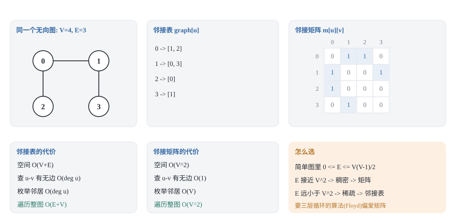
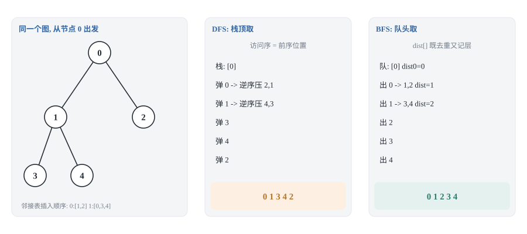
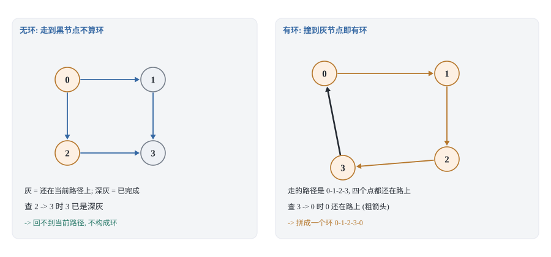
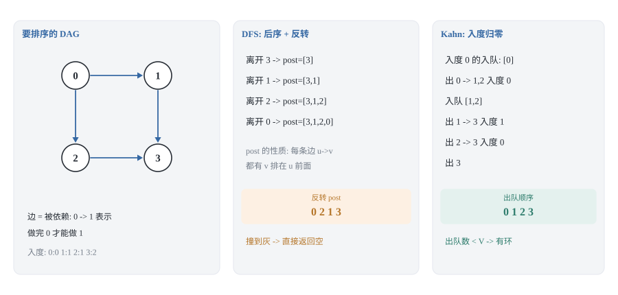
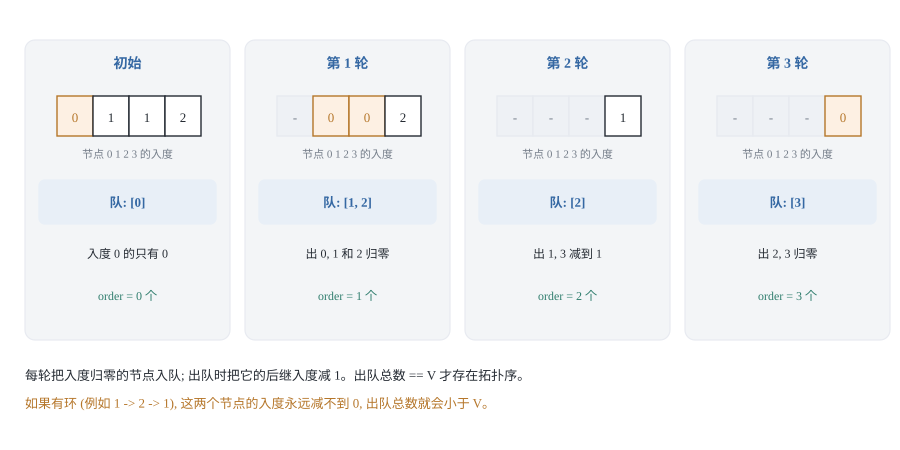
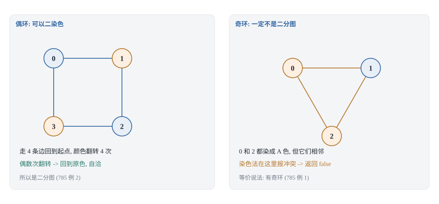
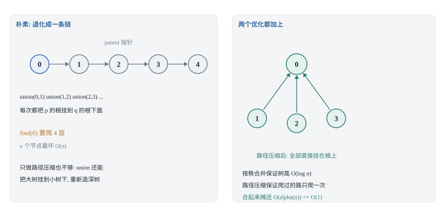
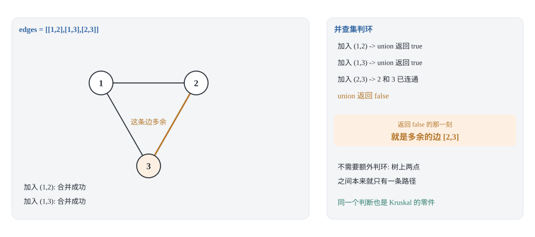

## 0 先说明材料和我的写法

这篇是我自己的学习笔记，对应 labuladong 教程里「图结构基础及算法概览」和「经典图算法」两个板块的六篇：

- 《图结构的通用代码实现》—— <https://labuladong.online/zh/algo/data-structure-basic/graph-basic/>
- 《图结构的 DFS/BFS 遍历》—— <https://labuladong.online/zh/algo/data-structure-basic/graph-traverse-basic/>
- 《环检测算法》—— <https://labuladong.online/zh/algo/data-structure/cycle-detection/>
- 《拓扑排序算法》—— <https://labuladong.online/zh/algo/data-structure/topological-sort/>
- 《二分图判定算法》—— <https://labuladong.online/zh/algo/data-structure/bipartite-graph/>
- 《Union Find 并查集原理》与《Union-Find 并查集算法》—— <https://labuladong.online/zh/algo/data-structure-basic/union-find-basic/>、<https://labuladong.online/zh/algo/data-structure/union-find/>

需要讲清楚的是：**这不是转载，也不是翻译**。原文有能交互的可视化面板，那是这套教程最有价值的部分，我这里复现不了。所以下面每一节我都会先讲「这个套路为什么成立」，再给实现——这是这一系列和原教程的主要区别。所有示意图都是我自己用 SVG 画的。

**素材情况。** 这几篇我都读到了正文。其中有几处原文自己就说到了取舍，值得先记下来：图遍历一节把三种场景并列成四个小标题——遍历所有节点（`visited` 数组）、遍历所有边（二维 `visited` 数组）、遍历所有路径（`onPath` 数组），并且明确说了「遍历节点和边时在前序位置标记，遍历路径时在前序标记、后序撤销」；环检测一节先给了一个「只记录路径、不记录访问过」的版本，指出它会超时，再引入 `visited` 优化；拓扑排序一节说明了「后序反转」这个结论，还特意回应了一个常见困惑——网上有的写法不反转，是因为那些人建图时把边的方向定义反了；并查集原理一节则把「为什么需要并查集」推了一遍：只用邻接表的话，`connected` 只能靠遍历，最坏是 O(V+E)，而这正是并查集要换掉的东西。

有一处要提前说明：**《图结构的通用代码实现》这一篇我只拿到标题、一句话总结和它的小标题目录，正文代码没拿到**。所以第 1.2 节的三个约定是我自己定的，不来自原文。

另外提前说明本篇的范围：环检测、拓扑排序、并查集这三件事在原文里是**分成好几篇**讲的，我这里把它们合成一篇，是因为它们共用同一套前置知识（建图 + 遍历 + 标记），而且内在联系很近——拓扑排序的 DFS 版和环检测本来就是同一份代码。

**代码是 Python 3 和 C++ 两版**，不是原文的语言。教程原文用 Java，我按自己的习惯重新实现了一遍，所以这些片段是我写的、不是从原文抄的；不过每道题的**算法骨架忠于原文**，方便你对照着读。两种语言并排给出，因为它们的坑不一样——比如第 2.2 节 DFS 的迭代写法，Python 和 C++ 要用完全不同的容器和判重时机，那是只有把两种语言都写一遍才会撞上的地方。

C++ 代码块里我没有写 `#include`，也没有写 `using namespace std;`——力扣的提交框会替你包好这些，我自己的测试脚本里也包了（需要 `<vector>` `<queue>` `<string>` `<algorithm>`）。这样代码块本身短一点，对照着读更方便。

这篇的一条主线是：**图题的难点很少在算法本身，而在「图存在哪里」和「标记怎么打」这两件事上**。第 1 节讲存储，第 2 节讲标记，后面四节都是这两件事的直接推论。

### 目录

- [0 先说明材料和我的写法](#0-先说明材料和我的写法)
- [1 图的存储: 先决定图放在哪](#1-图的存储-先决定图放在哪)
- [2 遍历: visited 管去重, onPath 管记路](#2-遍历-visited-管去重-onpath-管记路)
- [3 环检测与拓扑排序: 后序反转与入度归零](#3-环检测与拓扑排序-后序反转与入度归零)
- [4 二分图判定: 染色法就是一次遍历](#4-二分图判定-染色法就是一次遍历)
- [5 并查集: 用摊还换掉每次遍历](#5-并查集-用摊还换掉每次遍历)
- [6 并查集能解的三类题](#6-并查集能解的三类题)
- [7 把这五个套路收成一张表](#7-把这五个套路收成一张表)
- [8 材料与出处](#8-材料与出处)

## 1 图的存储: 先决定图放在哪

### 1.1 两种存法，两种代价

图有两种标准存法，它们不是「新旧」关系，而是把代价放在了不同的地方。



**邻接表**：`graph[u]` 是一个列表，装着 `u` 的所有邻居。空间是 **O(V+E)**——每个节点占一个表头，每条边占一个表项（无向图占两个）。

**邻接矩阵**：`matrix[u][v]` 存 `u→v` 这条边的信息。空间是 **O(V²)**，跟边数无关。

把代价列出来看：

| 操作 | 邻接表 | 邻接矩阵 |
|---|---|---|
| 空间 | O(V+E) | O(V²) |
| 查 `u→v` 有没有边 | O(deg(u)) | O(1) |
| 枚举 `u` 的所有邻居 | O(deg(u)) | O(V) |
| 加一条边 | O(1) | O(1) |
| 遍历整张图 | O(E+V) | O(V²) |

选法的判断标准很简单：**数一下 E 和 V² 哪个大**。

这里 E 的上界是可以算的：我们讨论的图默认是**简单图**，也就是没有自环边、也没有多重边（同一对节点之间只有一条边）。在简单图里，每个节点最多和其余 V−1 个节点相连，而无向图的每条边被两个端点各算一次，所以

```text
0 <= E <= V(V-1)/2 ≈ V²
```

E 接近 V² 的叫**稠密图**，E 远小于 V² 的叫**稀疏图**。这就是「稠密还是稀疏」这个说法的准确含义——它说的不是「看起来连得多不多」，而是「E 和 V² 的比值」。

于是选法就清楚了：稀疏图用邻接表，稠密图用矩阵（此时两者空间同级，但矩阵的 O(1) 查边更划算）。

还有第三个判据，在后面的文章里会反复出现：**有些算法天生就想要矩阵**。Floyd 最短路和传递闭包就是在矩阵上做三层循环的，用邻接表反而别扭；反过来，Kruskal 最小生成树只关心边的列表，连邻接表都不需要。

### 1.2 三个必须先定下来的约定

建图本身只有几行，但下面三件事不先定好，后面每一行代码都要返工。

**第一，有向还是无向。** 无向图的「边」在存储上就是两条方向相反的有向边——原文里有一句话说得比我好：「你可以把无向图理解成『双向图』，实际上我们在用代码实现图结构的时候就是这么做的」。这一条看起来是废话，但它决定了后面很多算法的适用范围：入度、拓扑排序、环检测只对有向图有意义，二分图和并查集则主要用在无向图上。

**第二，下标从 0 还是从 1 开始。** 力扣的图题里两种都有：`n` 个节点的题一般给 `0..n-1`，而《冗余连接》这类题给的是 `1..n`。我的习惯是**统一转成 0 下标**，只在读入和输出的时候做一次加减一。这样中间所有代码不用再想「这个数组该开 n 还是 n+1」；代价是要记住在边界处换算，第 6.2 节我会用「多开一个位置」的办法绕开它。

**第三，边上带不带权。** 带权图把「邻居」从 `v` 升级成 `(v, w)`。本文所有算法都不关心权重，但为了下一篇文章（最短路与生成树）能直接复用同一个建图函数，我这里就按带权写，不带权时权重默认给 1。

### 1.3 建图

边列表 `edges` 里每个元素是 `(u, v, w)`。Python 版本我允许两元组和三元组混用，权重缺省为 1：

**Python 3**:

```python
def build_graph(n: int, edges: list, directed: bool = False) -> list:
    """边列表 -> 邻接表。graph[u] = [(邻居, 权重), ...]"""
    graph = [[] for _ in range(n)]
    for e in edges:
        u, v = e[0], e[1]
        w = e[2] if len(e) > 2 else 1      # 不带权就当权重 1
        graph[u].append((v, w))
        if not directed:
            graph[v].append((u, w))        # 无向图 = 两条方向相反的有向边
    return graph
```

**C++**:

```cpp
vector<vector<pair<int, int>>> buildGraph(int n,
                                          const vector<array<int, 3>>& edges,
                                          bool directed) {
    vector<vector<pair<int, int>>> graph(n);
    for (const auto& e : edges) {
        int u = e[0], v = e[1], w = e[2];
        graph[u].push_back({v, w});
        if (!directed) graph[v].push_back({u, w});   // 无向图加两次
    }
    return graph;
}
```

**最容易写错的一行:** `if not directed: graph[v].append((u, w))`。漏掉它，无向图就变成了「只能顺着输入方向走」的有向图。这个错很难在单点上暴露——如果测试数据刚好是一条从 0 出发的链，答案还是对的；只有当路径需要「逆着某条边的输入方向」走时才会错。

顺带一个 C++ 细节：`vector<vector<pair<int,int>>>` 是 `pair` 里套模板，老版本编译器要写成 `vector<vector<pair<int,int> > >`（中间留空格）。C++11 之后不用了，但读别人代码时会见到。

## 2 遍历: visited 管去重, onPath 管记路

### 2.1 图的遍历框架

图的遍历和二叉树的前序/层序遍历是同一个东西，只是「下一个要访问的节点」不再由 `left`/`right` 决定，而是由邻接表决定：

```text
void traverse(节点 u):
    标记 u 已经访问
    处理 u（前序位置）
    for 每个邻居 v of u:
        if v 没访问过:
            traverse(v)
    收尾 u（后序位置）
```

就这三行骨架。DFS 和 BFS 的区别只在「下一个节点从哪里取」：DFS 从栈顶取（递归就是系统栈），BFS 从队头取。

### 2.2 DFS 与 BFS



一个必须记住的点：**图不一定连通**，所以真正的入口是一个套在外面的循环，每个还没访问过的节点都当一次起点。漏掉这个循环，第二个连通分量就永远访问不到。

**Python 3**（DFS，递归版）:

```python
def dfs(graph: list, start: int, visited: list, order: list) -> None:
    visited[start] = True
    order.append(start)                    # 前序位置：进入节点时记录
    for nxt, _ in graph[start]:
        if not visited[nxt]:
            dfs(graph, nxt, visited, order)
```

**C++**:

```cpp
void dfs(const vector<vector<pair<int, int>>>& graph, int start,
         vector<char>& visited, vector<int>& order) {
    visited[start] = 1;
    order.push_back(start);                // 前序位置
    for (const auto& edge : graph[start]) {
        int nxt = edge.first;
        if (!visited[nxt]) dfs(graph, nxt, visited, order);
    }
}
```

递归版有个现实问题：链状图（比如一万个节点排成一条线）会让递归深度到一万，Python 默认递归上限是 1000，直接 `RecursionError`；C++ 则是爆栈。所以迭代版值得单独记一遍。迭代版的坑在于**同一个节点可能被重复入栈**——入栈时判重是不够的，因为邻居是在入栈后才被标记的：

**Python 3**（DFS，迭代版）:

```python
def dfs_iterative(graph: list, start: int) -> list:
    order, visited = [], [False] * len(graph)
    stack = [start]
    while stack:
        u = stack.pop()
        if visited[u]:                     # 可能重复入栈，出栈时再判一次
            continue
        visited[u] = True
        order.append(u)
        for nxt, _ in graph[u]:
            if not visited[nxt]:
                stack.append(nxt)
    return order
```

**C++**:

```cpp
vector<int> dfsIterative(const vector<vector<pair<int, int>>>& graph, int start) {
    vector<int> order;
    vector<char> visited(graph.size(), 0);
    vector<int> stack = {start};
    while (!stack.empty()) {
        int u = stack.back();
        stack.pop_back();
        if (visited[u]) continue;          // 出栈时才判重
        visited[u] = 1;
        order.push_back(u);
        for (const auto& edge : graph[u]) {
            if (!visited[edge.first]) stack.push_back(edge.first);
        }
    }
    return order;
}
```

**容易踩的一点:** 迭代 DFS 得到的顺序和递归 DFS **不一样**。递归版处理完一个邻居才轮到下一个；迭代版把所有邻居一次性压栈，于是最后压进去的最先出栈。两者都是合法的 DFS 序（都满足「一条路走到黑」的直觉），但如果你拿它们的结果去做逐元素对比的断言，会失败。我的测试脚本里对迭代版的检查是「访问到的节点集合相同、且没有重复」，不是「顺序相同」。

BFS 的代码更短，而且顺手把「到起点的层数」也算了：

**Python 3**（BFS，层序）:

```python
def bfs_levels(graph: list, start: int) -> list:
    dist = [-1] * len(graph)               # 既当 visited，又当层号
    dist[start] = 0
    queue, head = [start], 0               # head 当队头，避免 list.pop(0) 的 O(n)
    while head < len(queue):
        u = queue[head]
        head += 1
        for nxt, _ in graph[u]:
            if dist[nxt] == -1:            # 第一次访问就是最少边数
                dist[nxt] = dist[u] + 1
                queue.append(nxt)
    return dist
```

**C++**:

```cpp
vector<int> bfsLevels(const vector<vector<pair<int, int>>>& graph, int start) {
    vector<int> dist(graph.size(), -1);    // -1 同时表示「还没访问」
    dist[start] = 0;
    queue<int> q;
    q.push(start);
    while (!q.empty()) {
        int u = q.front();
        q.pop();
        for (const auto& edge : graph[u]) {
            if (dist[edge.first] == -1) {
                dist[edge.first] = dist[u] + 1;
                q.push(edge.first);
            }
        }
    }
    return dist;
}
```

Python 这里我用了一个 `head` 下标当队头，而不是 `queue.pop(0)`。原因很实际：`list.pop(0)` 要把后面所有元素前移，单次是 O(n)，整个 BFS 就退化成 O(V²)。想写得更直白就用 `collections.deque` 的 `popleft()`。C++ 的 `queue<int>` 本身就是环形缓冲，没有这个问题。

### 2.3 复杂度为什么是 O(E+V)，而不是 O(V)

原文给的是 O(E+V)，并且解释了「为什么不是 O(V)」，这一点值得记牢，因为它是后面所有图算法的复杂度基准。

推导分两步：

1. **每个节点最多被访问一次。** `visited` 数组保证进入一个节点后，它的所有邻居都不会再递归它。所以节点的处理次数是 O(V)。
2. **每条边最多被检查两次。** 「检查」发生在某个节点枚举自己邻居的时候。在邻接表里，节点 `u` 枚举的是 `graph[u]`，这条语句总共执行的次数是所有节点度数之和，也就是 **2E**（无向图）或 **E**（有向图）。

两者相加就是 O(E+V)。

至于「为什么树是 O(N) 而图是 O(E+V)」：树的遍历也要算边，只是树有 E = V−1，于是 O(V+E) = O(2V−1) = O(V)，把 E 藏起来了。图没有 E 和 V 的关系，两个量都得留着。

原文还提到一个反面例子，我也抄下来：**用二维 `visited[u][v]` 数组去遍历所有边**（也就是把「走过了 u→v 这条边」也记下来）的做法，时间复杂度是 O(E+V²)、空间 O(V²)。原因是每到一个节点都要扫描一遍长度为 V 的 `visited[u]` 数组来挑没走过的边，这个扫描把 V 引了进来。它换来的是「每条边只走一次」，只有枚举路径这类需求才值得。

### 2.4 三种标记，三种用途


这是我认为整篇里最值得单独画一张图的地方。原文的小标题把「遍历所有节点」「遍历所有边」「遍历所有路径」并排列出来，三者用的标记其实是三个不同的东西：

| 标记 | 生命周期 | 解决什么 | 何时清除 |
|---|---|---|---|
| `visited[u]` | 进入时置位，**永不撤销** | 每个节点只处理一次 | 不清除 |
| `onPath[u]` | 进入时置位，离开时清除 | 记录「当前递归路径上有谁」 | 离开节点时清除 |
| `visited[u][v]` | 走过这条边时置位 | 每条边只走一次 | 按需回溯清除 |

区别的本质是：`visited` 回答「我来过这里吗」，`onPath` 回答「我**现在**站在这里吗」。

- 只要「来过」就够的场景（可达性、连通分量、最短路）用 `visited`。
- 需要「沿当前这条路还能不能走回去」的场景（判环、枚举所有路径）用 `onPath`。第 3 节的环检测和这里的模板其实就是同一件事：**「在当前路径上」就是 `onPath` 为真**。
- 需要「每条边恰好走一次」的场景（欧拉路径、无向图枚举路径）才需要给边打标记，因为同一条边来回走会立刻产生一个长度为 2 的假环。

原文对前两者的用法有一句话总结得很准：「遍历图的『节点』和『边』时，需要 `visited` 数组在**前序位置**做标记；遍历图的『路径』时，需要 `onPath` 数组在**前序位置**标记节点、在**后序位置**撤销标记。」位置不是随便放的：前序位置对应「进入这个节点」，后序位置对应「离开这个节点」——撤销必须发生在离开时，因为「在当前路径上」这个状态随着离开就结束了。

最后交代一下二维 `visited` 的归宿：原文说它「并不是一个很高效的实现方式」，主要出现在计算欧拉路径的场景里，而且后面讲 Hierholzer 算法时会给出一个避免二维数组的优化。我会在下一篇讲欧拉路径时回到这里。

### 2.5 两种 `visited` 写法，别被写法骗了

原文在二分图那一节里专门提了一个写法差异，我觉得值得单独记一笔，因为它解释了后面第 4 节代码为什么长成那样。

同样是 DFS 遍历，`visited` 的判断可以放在两个地方：

```text
写法 A（判断在函数开头）:      写法 B（判断在递归之前）:
void traverse(v):              void traverse(v):
    if visited[v]: return          visited[v] = true
    visited[v] = true              for neighbor in neighbors(v):
    for neighbor in ...:               if not visited[neighbor]:
        traverse(neighbor)                 traverse(neighbor)
```

两种写法都对，但**它们对调用者的要求不一样**：写法 B 里 `visited[v] = true` 是函数的第一句，没有开头的判断兜底，所以**调用 `traverse(v)` 之前必须自己保证 `visited[v]` 是 `false`**。写法 A 就没这个约束，代价是每次调用都多一次判断。

为什么在二分图这里要提这件事？因为二分图的染色逻辑天然长成写法 B 的形状：一边遍历一边染色，遇到没访问过的邻居就染成相反色再递归，遇到访问过的邻居就比较颜色。用写法 A 也能写，但要在「发现已访问」那个分支里区分「这是父节点回边」和「这是真的颜色冲突」，反而更绕。所以第 4 节的代码我按写法 B 的思路组织。

## 3 环检测与拓扑排序: 后序反转与入度归零

### 3.1 有向图环检测: 两种「访问过」要分开

判环的关键是分清两种「访问过」：**正在这条路径上**和**已经彻底处理完**。



- **白色**：还没碰过。
- **灰色**：在当前递归栈上，也就是 `onPath` 为真。
- **黑色**：自己和自己的所有后继都处理完了，也就是 `visited` 为真且不在 `onPath` 上。

**遇到灰色邻居 = 有环。** 为什么？灰色意味着这个邻居此刻正站在从起点到当前节点的这条路径上，而当前节点又能走回它——两条路径拼起来就是一个环。

**遇到黑色邻居不算环。** 黑色意味着它的整棵子树已经确认无环，从当前节点走到它，再从它出发是回不到当前路径的。

原文用的是 `onPath` 和 `visited` **两个布尔数组**：`onPath[s]` 为真就是灰色，`visited[s]` 为真且 `onPath[s]` 为假就是黑色。我下面把两者合并成一个 `color` 数组写，只是为了让「灰/黑」这个区分在代码里显式一点，省掉一个数组。**两种写法完全等价**，你按哪种顺手就用哪种。

#### 为什么只记 `onPath` 会超时

原文先给了一个只记 `onPath` 的版本，并且点明了它会超时。这个失败案例比正确代码更值得看，因为它解释了 `visited` 到底省掉了什么。

假设以节点 2 为起点遍历，发现从 2 出发的所有路径都没有环。现在另一个节点 5 有一条指向 2 的边，于是以 5 为起点遍历时又会走到 2——问题是：**还需要重新遍历 2 的所有可达路径吗？**

不需要。第一次遍历 2 没找到环，第二次也不可能找到。原因在于「从 2 出发有没有环」是**节点的性质，不是路径的性质**：它只取决于 2 的后继子图，和「我是从谁走到 2 的」无关。所以第一次算完就可以把它记成黑色（`visited = true`），以后再遇到直接跳过。

只记 `onPath` 的话，同一个节点的后继子图会被反复展开。在最坏情况（一条链上每个点都指向后面所有点）下，展开次数是节点数的指数级——这就是超时的来源。加上 `visited` 之后，把「已确认无环的子图」永久标记下来，每个节点最多被展开一次，复杂度回到 O(E+V)。

**这是我在这几个题里最喜欢的一个例子**：同一个标记（`visited`）在别处只是「去过」，在这里它的含义被精确成了「**从这个节点出发已经确认不可能有环**」。理解了这个含义，才知道为什么它能剪枝。

#### 还有一个进阶问题

原文留了一个很好的追问：如果要返回环上具体的节点，而不仅仅是判断有没有环，怎么办？

你可能觉得 `onPath` 为真的节点就是环上的节点——**不对**。`onPath` 记录的是「当前整条递归路径」，环可能只占其中一段。原文给的例子很能说明问题：路径是 `[0,4,5,9,8,7,6]`，这时又遇到了节点 5，那么环只是 `[5,9,8,7,6]` 这一段，前面的 `0,4` 不在环上。

做法是在 `onPath` 之外再维护一个**栈**，按遍历顺序压入节点；当发现某个节点已经在 `onPath` 上时，从栈里从那个节点开始往上的部分就是环。这比只记一个布尔要精确，代价是多一个 O(V) 的栈。

**Python 3**:

```python
WHITE, GRAY, BLACK = 0, 1, 2               # 白 = 没碰过，灰 = 在当前路径上，黑 = 已完成

def has_cycle_directed(graph: list) -> bool:
    color = [WHITE] * len(graph)

    def visit(u: int) -> bool:
        color[u] = GRAY                    # 进入：挂到 onPath 上
        for nxt, _ in graph[u]:
            if color[nxt] == GRAY:         # 撞到当前路径上的节点 -> 有环
                return True
            if color[nxt] == WHITE and visit(nxt):
                return True
        color[u] = BLACK                   # 离开：摘下来，之后不会再产生环
        return False

    for s in range(len(graph)):            # 图可以不连通，每个点都要当一次起点
        if color[s] == WHITE and visit(s):
            return True
    return False
```

**C++**:

```cpp
bool visitForCycle(const vector<vector<pair<int, int>>>& graph, int u,
                   vector<int>& color) {
    color[u] = 1;                          // 1 = 在当前递归路径上
    for (const auto& edge : graph[u]) {
        int nxt = edge.first;
        if (color[nxt] == 1) return true;  // 撞到灰色 -> 有环
        if (color[nxt] == 0 && visitForCycle(graph, nxt, color)) return true;
    }
    color[u] = 2;                          // 2 = 已完成
    return false;
}

bool hasCycleDirected(const vector<vector<pair<int, int>>>& graph) {
    vector<int> color(graph.size(), 0);
    for (size_t s = 0; s < graph.size(); ++s) {
        if (color[s] == 0 && visitForCycle(graph, static_cast<int>(s), color)) {
            return true;
        }
    }
    return false;
}
```

**最容易写错的一行:** `color[u] = BLACK` 放在循环**外面**。放进循环里（每处理一个邻居就置黑）就等于把「当前路径」的语义丢掉了，判环立刻失效。Python 的嵌套函数写法里这一行缩进层级特别容易看错，我是把它单独写成一行并加注释的。

C++ 这里我没有用 lambda 递归，而是抽成了一个独立函数。原因是 C++ 的 lambda 要递归得先声明 `function<bool(int)>` 再捕获自己，多一层间接；`std::function` 还有调用开销。这类「带状态的递归」在 C++ 里写成辅助函数 + 显式传参更省事——代价是多一个参数要传，但可读性反而更好。

### 3.2 拓扑排序（DFS 版本）

拓扑排序要解决的问题是：给一个有向无环图的所有节点排一个序，使得每条边 `u→v` 都满足「`u` 排在 `v` 前面」。典型场景是课程表（力扣 207 / 210）：先修课必须排在后修课前面。

DFS 版的做法是**在后序位置记录，最后整体反转**。



为什么是后序 + 反转？把「后序位置」的含义说清楚就够了：`u` 被追加进 `post` 的那一刻，**它的所有后继都已经在 `post` 里了**（因为 DFS 回到 `u` 之前一定已经把它的子树走完了）。所以 `post` 满足的性质是「每条边 `u→v` 都有 `v` 排在 `u` 前面」——这正好是拓扑序的反向。整体 `reverse` 一次，就得到拓扑序。

原文还点出了一个很实际的困惑，我照抄结论：**你在网上能搜到「不用反转」的版本，那是因为对方建图时把边的方向定义反了**。原文建图时边的方向是「被依赖」关系——`graph[from].add(to)` 表示「做完 `from` 才能做 `to`」，符合直觉；如果把边反过来定义为「依赖」（`to → from`），整张图的箭头全部反向，后序结果也就正好是要的拓扑序，不用再 `reverse`。

这件事的教训是：**「后序要不要反转」不是算法性质，而是约定问题**，取决于你的边指向「依赖我的」还是「我依赖的」。看别人的代码时先确认这一点，比死记「要反转」有用得多。本文后面统一采用原文的约定：**边指向「被依赖者」，所以要反转**。

原文另外专门澄清了一点，我觉得值得抄下来：「你千万不要认为后序遍历反转的结果等同于前序遍历结果」。两者在二叉树上看起来像，但对图来说完全不是一回事——前序位置在进入节点时执行，那时它的后继一个都没处理，体现不出「依赖」；只有后序位置才满足「后继全部处理完」这个条件。所以拓扑排序必须是后序，换任何别的遍历顺序都不行。

**Python 3**:

```python
def topo_sort_dfs(graph: list) -> list:
    color = [WHITE] * len(graph)
    post = []                              # 后序：离开节点时才追加

    def visit(u: int) -> bool:
        color[u] = GRAY
        for nxt, _ in graph[u]:
            if color[nxt] == GRAY:
                return False               # 有环，拓扑序不存在
            if color[nxt] == WHITE and not visit(nxt):
                return False
        color[u] = BLACK
        post.append(u)                     # 后序位置：此刻后继都已在 post 里
        return True

    for s in range(len(graph)):
        if color[s] == WHITE and not visit(s):
            return []
    post.reverse()                         # 反过来才是拓扑序
    return post
```

**C++**:

```cpp
bool visitForPost(const vector<vector<pair<int, int>>>& graph, int u,
                  vector<int>& color, vector<int>& post) {
    color[u] = 1;
    for (const auto& edge : graph[u]) {
        int nxt = edge.first;
        if (color[nxt] == 1) return false;
        if (color[nxt] == 0 && !visitForPost(graph, nxt, color, post)) return false;
    }
    color[u] = 2;
    post.push_back(u);                     // 后序位置
    return true;
}

vector<int> topoSortDfs(const vector<vector<pair<int, int>>>& graph) {
    vector<int> color(graph.size(), 0), post;
    for (size_t s = 0; s < graph.size(); ++s) {
        if (color[s] == 0 &&
            !visitForPost(graph, static_cast<int>(s), color, post)) {
            return {};                     // 有环
        }
    }
    reverse(post.begin(), post.end());     // 后序反转
    return post;
}
```

**这里有个反直觉的点:** 用 0/1/2 之外的任何「只记真假」的标记都会错。拓扑排序的 DFS 版和 3.1 的判环共用同一套三色标记，不是巧合——**拓扑排序顺便就判了环**：只要 DFS 过程中撞到灰色，就说明不存在拓扑序，直接返回空。

### 3.3 拓扑排序（BFS 版本，Kahn 算法）

Kahn 算法的思路完全不同，它维护一张**入度表**：

1. 数出每个节点的入度。
2. 把所有入度为 0 的节点入队。
3. 每次出队一个节点 `u`，把它加进结果，然后「删掉」`u` 的所有出边——也就是把每个后继的入度减 1；减到 0 就入队。
4. 如果出队的节点数少于 V，说明有环。

第 4 步的正确性很好理解：入度永远不为 0 的节点，说明它总有一个前驱「没被处理」；如果图是无环的，一定存在一个入度为 0 的节点（沿着前驱往回走不可能无限走，否则就绕出环了），把这个节点删掉之后剩下的图仍然无环，于是归纳下去一定能把所有点删完。反过来，环上的点互相当前驱，入度永远减不到 0。



**Python 3**:

```python
def topo_sort_kahn(graph: list) -> list:
    indeg = [0] * len(graph)
    for u in range(len(graph)):
        for nxt, _ in graph[u]:
            indeg[nxt] += 1                # 入度只对有向图有意义
    queue = [u for u in range(len(graph)) if indeg[u] == 0]
    head, order = 0, []
    while head < len(queue):
        u = queue[head]
        head += 1
        order.append(u)
        for nxt, _ in graph[u]:
            indeg[nxt] -= 1                # 等价于删掉边 u -> nxt
            if indeg[nxt] == 0:            # 入度归零才能入队
                queue.append(nxt)
    return order if len(order) == len(graph) else []   # 出队数不足 = 有环
```

**C++**:

```cpp
vector<int> topoSortKahn(const vector<vector<pair<int, int>>>& graph) {
    vector<int> indeg(graph.size(), 0);
    for (size_t u = 0; u < graph.size(); ++u) {
        for (const auto& edge : graph[u]) indeg[edge.first] += 1;
    }
    queue<int> q;
    for (size_t u = 0; u < graph.size(); ++u) {
        if (indeg[u] == 0) q.push(static_cast<int>(u));
    }
    vector<int> order;
    while (!q.empty()) {
        int u = q.front();
        q.pop();
        order.push_back(u);
        for (const auto& edge : graph[u]) {
            int nxt = edge.first;
            if (--indeg[nxt] == 0) q.push(nxt);
        }
    }
    if (order.size() != graph.size()) return {};   // 出队数不足 = 有环
    return order;
}
```

**最容易写错的一行:** `if indeg[nxt] == 0: queue.append(nxt)`。这里必须是「减完之后等于 0」，不是「入度小于等于 0」，也不该在减之前判断。如果图里有多重边（同一对节点之间两条边），入度会一次减到负数，用 `<= 0` 就会把同一个节点重复入队，结果里出现重复节点。

### 3.4 两种写法怎么选

| | DFS 版 | Kahn 版 |
|---|---|---|
| 遍历方式 | 递归（可以用显式栈改写成迭代） | 迭代，队列 |
| 额外空间 | 递归栈 O(V) | 入度表 + 队列 O(V) |
| 顺带判环 | 是（撞灰色） | 是（数出队个数） |
| 结果顺序 | 后序反转，**不唯一** | 出队顺序，**不唯一** |
| 想要字典序最小 | 需要额外处理 | 把队列换成小根堆即可 |
| 深图风险 | 递归深度 = V，可能爆栈 | 无 |
| 复杂度 | O(E+V) | O(E+V) |

两个结论：

1. **两者复杂度相同，输出都可能不唯一。** 所以「和标准答案不一样」不等于错——判断一个拓扑序对不对，只需要检查「每条边 u→v 都有 u 出现在 v 前面」。原文在 210 题的例子里就摆明了这一点：输入 `prerequisites = [[1,0],[2,0],[3,1],[3,2]]`，课程 3 要求先修完 1 和 2，而 1、2 又都要求先修完 0，所以 `[0,1,2,3]` 和 `[0,2,1,3]` 都是正确答案。**我的测试脚本就是按这个标准写的：不比对顺序，只验证「是一个排列」+「每条边都满足前后关系」。**
2. **要字典序最小就选 Kahn。** 把 `queue` 换成优先队列（Python 的 `heapq`、C++ 的 `priority_queue`），每次取编号最小的入度 0 节点，得到的就是字典序最小的拓扑序。这一点在力扣 210 的某些变体题里是必须的。

原文对两版的评价是「相对而言 BFS 解法从代码实现上看更简洁一些，但 DFS 解法有助于你进一步理解递归遍历数据结构的奥义」，并且因此把 DFS 版放在前面讲。我的建议是**两个都记**：DFS 版让你真正理解「后序」这个位置的含义，Kahn 版在工程里更常用（没有栈溢出风险，而且改一行就能支持字典序）。

## 4 二分图判定: 染色法就是一次遍历

### 4.1 什么是二分图

二分图（bipartite graph）的定义是：能把顶点集分成两个互不相交的集合 A、B，使得**每条边的两个端点分别落在 A 和 B 里**。换句话说，同一条边不能两端同色。

等价的刻画是本文用得上的那个：**一个图是二分图，当且仅当它没有长度为奇数的环**（奇环）。

为什么奇环一定破坏二分性？绕着环走一圈，每走一条边颜色必须翻转。走 k 条边回到起点，颜色翻转了 k 次。要回到原来的颜色，k 必须是偶数。所以奇数长度的环一定会要求起点「既是 A 又是 B」，矛盾。

这也解释了为什么偶环没问题：偶数次翻转之后颜色回到原样，自洽。

原文给的力扣题号是 785（判断二分图）和 886（可能的二分法）。886 是同一个判定换了层皮：`dislikes` 关系要求两人不能同组，等价于「把边看成不能同色」。

### 4.2 染色法

判定算法就是一次遍历，把「相邻点必须异色」当成约束传播下去：



**Python 3**:

```python
def is_bipartite(graph: list) -> bool:
    color = [-1] * len(graph)              # -1 未染色，0/1 是两种颜色
    for s in range(len(graph)):            # 图可以不连通，每个分量都要染
        if color[s] != -1:
            continue
        color[s] = 0
        queue, head = [s], 0
        while head < len(queue):
            u = queue[head]
            head += 1
            for nxt, _ in graph[u]:
                if color[nxt] == -1:
                    color[nxt] = color[u] ^ 1        # 异色
                    queue.append(nxt)
                elif color[nxt] == color[u]:
                    return False                     # 同色相邻 -> 有奇环
    return True
```

**C++**:

```cpp
bool isBipartite(const vector<vector<pair<int, int>>>& graph) {
    vector<int> color(graph.size(), -1);
    for (size_t s = 0; s < graph.size(); ++s) {
        if (color[s] != -1) continue;
        color[s] = 0;
        queue<int> q;
        q.push(static_cast<int>(s));
        while (!q.empty()) {
            int u = q.front();
            q.pop();
            for (const auto& edge : graph[u]) {
                int nxt = edge.first;
                if (color[nxt] == -1) {
                    color[nxt] = color[u] ^ 1;   // 异色
                    q.push(nxt);
                } else if (color[nxt] == color[u]) {
                    return false;                // 同色相邻 -> 有奇环
                }
            }
        }
    }
    return true;
}
```

**最容易写错的一行:** 外层那个 `for s in range(len(graph))`。二分图的判定是**每个连通分量单独判**，全图是二分图当且仅当每个分量都是。只从 0 号点染一遍，第二个分量里藏着的三角形就被漏掉了。这和 2.2 里遍历必须套外层循环是同一件事——**「图可以不连通」是图论代码里出现频率最高的坑**。

几个边界：

- **单节点、空图**：是二分图（没有边可以违反约束）。
- **自环**：不是二分图。自环是长度为 1 的奇环。在染色法里，自环会让 `color[u] == color[u]` 成立，直接被抓住。
- **重边**：不影响结论，两条平行的边构成偶环（长度 2）。
- **孤立点**：随便染哪个颜色都行。

我用 `color[u] ^ 1` 来翻转颜色，前提是颜色取值恰好是 0/1。如果换成 1/2，就得写 `3 - color[u]`。这行没什么技术含量，但它是这类代码里最常见的笔误来源，所以我倾向于用 0/1 加异或。

## 5 并查集: 用摊还换掉每次遍历

### 5.1 为什么不直接用 BFS 做连通性

前面几节的所有算法都有一个共同前提：**图已经建好了**。但如果问题只关心「两个点连不连通」和「一共有几个连通块」这两件事呢？

原文把动机推得很清楚，我复述一遍，因为它是理解后面所有优化的前提。假设我们只有邻接表，要支持三个操作：

- `union(p, q)`：加一条无向边。这个在邻接表上就是 O(1)。
- `connected(p, q)`：判断两点是否连通。注意「连通」不是「相邻」——它有**传递性**：`p` 连 `q`、`q` 连 `r`，那么 `p` 连 `r`。查邻接表只能判断「直接相连」，处理不了传递关系。所以只能从 `p` 出发做一次 DFS/BFS，看能不能走到 `q`，最坏是 **O(V+E)**。
- `count()`：返回连通分量个数。更麻烦，得遍历整张图把所有节点分类到不同分量里再统计，也是 **O(V+E)**。

原文用了一个 10 节点、逐步连线的例子说明这件事：一开始 10 个节点谁也不连，有 10 个连通分量；`union(0,1)` 之后分量降到 9；再 `union(1,2)`，`0,1,2` 三者连通，`connected(0,2)` 要返回 `true`，分量变成 8。要每次都答对，BFS 方案就得每次重算。

问题的形状是：**查询次数多、图还在变，而每次查询都重新遍历一遍太贵**。而这三个操作的目标复杂度，原文一开始就写在了接口注释里——初始化 O(n)、`union` O(1)、`connected` O(1)、`count` O(1)。并查集的思路就是换个表示法：不用邻接表，只用一个数组，把「连通块」组织成一片森林，让每次合并和查询都只爬几条边。

定位由此很清楚：**只增不删的连通性问题**。它不支持删边，也不回答路径，换来的就是 5.2 节那两个优化带来的近乎常数时间。

### 5.2 从朴素实现到两个优化



朴素并查集就是一个 `parent` 数组，`parent[x]` 指向 `x` 的父亲，根节点指向自己：

- `find(x)`：沿着 `parent` 往上走直到根。
- `union(p, q)`：把 `p` 的根挂到 `q` 的根下面。

它可以跑，但会退化。考虑按 `(0,1), (1,2), (2,3), ...` 的顺序合并，如果每次都是「把 `p` 的根挂到 `q` 的根下面」，就长成了一条链，`find(n)` 要爬 n 层，单次查询 O(n)。原文把这个退化过程做成了可视化面板，说它「最终多叉树几乎退化成单链表，导致算法效率降低」——就是这件事。

两个优化各治一半的病。原文把前者叫**平衡性优化**、后者叫**路径压缩**，名字不同但就是这两件事：

**优化一：按秩合并（平衡性优化）。** 合并时不要随便挂，而是把**矮的树挂到高的树下面**。这样树高不会超过 O(log n)——因为在一次合并里，「被挂过去」的那棵树中的每个节点，它所在子树的大小至少翻了一倍，而大小最多翻 log n 次。

「秩」怎么维护？两种常见做法：

- **按大小合并（union by size）**：额外维护每个根所在树的节点数，把小树挂到大树下面。我下面实现用的是这个。
- **按秩合并（union by rank）**：额外维护每个根的高度上界，把矮的挂到高的下面；两棵树一样高时，新根的高度加一。

两者的 O(log n) 保证是一样的，选哪个都行。我选按大小，因为 `size` 顺手还能用来算别的东西，而且不需要为「高度相等」写特殊分支。

**优化二：路径压缩（path compression）。** 在 `find` 的时候顺手把沿途所有节点直接挂到根上。于是这条链只会被完整爬一次，之后就全是 O(1)。

#### 为什么两个一起用才接近常数

这是本节最值得说清楚的一点：**单独任何一个优化都到不了 O(α(n))**。原文的分节顺序（动态连通性 → 基本思路 → 平衡性优化 → 路径压缩）正好对应这个论证的两个失败中间态：

- **只做路径压缩**：单次 `find` 之后那条路径确实被压平了，但 `union` 仍然可能把大树挂到小树下面，重新造出深的树。摊还下来是 O(log n)。
- **只做按秩合并**：树高被压到了 O(log n)，但**每一次** `find` 都得规规矩矩爬 log n 层，而且爬完就白爬，下一次还要重爬。复杂度还是 O(log n)。
- **两个都做**：路径压缩负责「把爬过的路压平」，按秩合并负责「不造出新的深树」。两者配合，才把摊还复杂度降到 **O(α(n))**。

α 是反阿克曼函数。α(n) 在 n 小于 10^600 的时候都不超过 4——也就是说在实际能遇到的任何输入下，它就是一个不超过 4 的常数。**这是个我直接引用的结论，不是本文的推导**：完整的摊还分析（Tarjan 1975）超出了这篇的范围，原文也只是把目标定在 O(1) 而没有展开证明。我只需要记住两件事：可以当 O(1) 用，以及**少一个优化都不行**。

### 5.3 实现

**Python 3**:

```python
class UnionFind:
    def __init__(self, n: int):
        self.parent = list(range(n))       # 初始化：每个节点自成一棵树
        self.size = [1] * n                # 只在根节点上有意义
        self.count = n                     # 连通分量个数

    def find(self, x: int) -> int:
        root = x
        while self.parent[root] != root:   # 第一趟：找到根
            root = self.parent[root]
        while self.parent[x] != root:      # 第二趟：沿途全部挂到根上
            self.parent[x], x = root, self.parent[x]
        return root

    def union(self, p: int, q: int) -> bool:
        rp, rq = self.find(p), self.find(q)
        if rp == rq:
            return False                   # 本来就连通，这次合并什么也没做
        if self.size[rp] < self.size[rq]:
            rp, rq = rq, rp                # 小树挂到大树下面
        self.parent[rq] = rp
        self.size[rp] += self.size[rq]
        self.count -= 1
        return True

    def connected(self, p: int, q: int) -> bool:
        return self.find(p) == self.find(q)
```

**C++**:

```cpp
class UnionFind {
public:
    explicit UnionFind(int n) : parent_(n), size_(n, 1), count_(n) {
        for (int i = 0; i < n; ++i) parent_[i] = i;
    }

    int find(int x) {
        int root = x;
        while (parent_[root] != root) root = parent_[root];   // 找根
        while (parent_[x] != root) {                          // 路径压缩
            int nxt = parent_[x];
            parent_[x] = root;
            x = nxt;
        }
        return root;
    }

    bool unite(int p, int q) {
        int rp = find(p), rq = find(q);
        if (rp == rq) return false;
        if (size_[rp] < size_[rq]) { int t = rp; rp = rq; rq = t; }  // 按大小合并
        parent_[rq] = rp;
        size_[rp] += size_[rq];
        --count_;
        return true;
    }

    bool connected(int p, int q) { return find(p) == find(q); }
    int count() const { return count_; }

private:
    vector<int> parent_, size_;
    int count_;
};
```

**最容易写错的一行:** `union` 里必须先 `find` 出两个**根**再比较：`rp, rq = self.find(p), self.find(q)`。写成 `if p == q: return False` 是错的——`p` 和 `q` 是两个不同的节点，但它们完全可能已经在同一个集合里。这个错误在小数据上很难发现，因为只要输入里没有「重复合并同一对」的用例，结果看起来就是对的。我的测试脚本里专门放了「对同一对节点合并两次，第二次必须返回 false 且 `count` 不变」这一条。

Python 的路径压缩我写成两趟循环而不是递归：

```text
parent[x], x = root, parent[x]
```

这一行的右边会先整体求值，所以取到的是**旧的** `parent[x]`，赋值顺序不影响结果。用递归写 `self.parent[x] = self.find(self.parent[x])` 更短，但深链上可能递归过深，我不想为了短两行留个隐患。

还有一点：`size` 数组只在**根**上有意义。合并之后非根节点的 `size` 是过期数据，不要去读它——按大小合并只需要比较两个根的大小。

## 6 并查集能解的三类题

### 6.1 连通分量计数

最直接的应用：初始时 n 个节点各自是一个分量，每成功合并一次，分量数减一。

**Python 3**:

```python
def count_components(n: int, edges: list) -> int:
    uf = UnionFind(n)
    for u, v in edges:
        uf.union(u, v)                     # 合并成功一次，分量数就减一
    return uf.count
```

**C++**:

```cpp
int countComponents(int n, const vector<pair<int, int>>& edges) {
    UnionFind uf(n);
    for (const auto& e : edges) uf.unite(e.first, e.second);
    return uf.count();
}
```

力扣 547（省份数量）就是这个形状，只是边要从邻接矩阵里读出来。对比一下用 BFS 的做法：每次查询都要重建 `visited` 并遍历一个分量，整体 O(E+V)；并查集是 O(E·α)，而且能一边读边一边合并，不需要先把整张图存下来。

### 6.2 冗余连接: 用「加边前是否已连通」判环

力扣 684：给一个 n 个节点、n 条边的图，它是一棵树多了一条边，要求找出这条多余的边。

用并查集做几乎是白送的：**按输入顺序加边，如果某条边的两个端点已经连通，那这条边就是多余的**。因为树上任意两点之间只有一条路径，再加一条边必然成环，而这条新边就是这个环上唯一「多余」的那条。



**Python 3**:

```python
def find_redundant_connection(edges: list) -> list:
    n = len(edges)                         # n 条边、n 个节点，编号 1..n
    uf = UnionFind(n + 1)                  # 多开一个位置，省掉下标换算
    for u, v in edges:
        if not uf.union(u, v):             # 两端已经连通 -> 这条边多余
            return [u, v]
    return []
```

**C++**:

```cpp
vector<int> findRedundantConnection(const vector<pair<int, int>>& edges) {
    int n = static_cast<int>(edges.size());
    UnionFind uf(n + 1);                   // 节点编号 1..n
    for (const auto& e : edges) {
        if (!uf.unite(e.first, e.second)) return {e.first, e.second};
    }
    return {};
}
```

这里的 `union` 返回值派上了用场：它同时承担了「合并」和「这两个点原来连通吗」两个语义。我特意让它**不抛异常、不打印，只用返回值表达结果**——这是这类结构能被复用的关键。如果 `union` 返回 `void`，调用方就得先 `connected` 再 `union`，白白多一次 `find`。

### 6.3 等式方程的可满足性

力扣 990：给一组形如 `"a==b"` / `"a!=b"` 的方程，判断是否存在一种变量赋值让它们全部成立。

思路是分两轮：

1. **第一轮只处理 `==`**，把所有相等关系合并成连通块。
2. **第二轮检查每个 `!=`**：如果它两端的变量已经在同一个连通块里，就矛盾了。

顺序不能颠倒。如果一边读一边判，那么 `["a==b", "b!=a"]` 里先读到的 `==` 还没把 `b` 合进来，等到检查 `b!=a` 时会以为没问题——但它其实在第一轮结束后就矛盾了。

**Python 3**:

```python
def equations_possible(equations: list) -> bool:
    uf = UnionFind(26)                     # 变量只有单个小写字母
    for eq in equations:                   # 第一轮：只合并相等关系
        if eq[1] == "=":
            uf.union(ord(eq[0]) - ord("a"), ord(eq[3]) - ord("a"))
    for eq in equations:                   # 第二轮：检查不等关系
        if eq[1] == "!" and uf.connected(ord(eq[0]) - ord("a"),
                                         ord(eq[3]) - ord("a")):
            return False                   # 既要相等又要不等 -> 矛盾
    return True
```

**C++**:

```cpp
bool equationsPossible(const vector<string>& equations) {
    UnionFind uf(26);                      // 'a'..'z'
    for (const string& eq : equations) {   // 第一轮
        if (eq[1] == '=') uf.unite(eq[0] - 'a', eq[3] - 'a');
    }
    for (const string& eq : equations) {   // 第二轮
        if (eq[1] == '!' && uf.connected(eq[0] - 'a', eq[3] - 'a')) {
            return false;
        }
    }
    return true;
}
```

**最容易写错的一行:** `if eq[1] == "="` 和 `if eq[1] == "!"` 用的是**下标 1**，判断的是运算符的第一个字符。方程格式固定为 4 个字符，所以另一个变量在下标 3。这两个下标写反了程序照样能跑，只是把 `a` 和 `b` 认成了别的变量，输出一堆似是而非的结果。

### 6.4 一个技巧: 把「行列」当成节点

原文的并查集习题列表里有一道我觉得很能说明并查集威力的题：力扣 947「移除最多的同行或同列石头」。

题意是给一堆石头的坐标 `(x, y)`，如果同一行或同一列上有别的石头，就可以把这块石头移除，问最多能移除几块。

关键的一步是**换个视角建图**：把每个 `x` 坐标看成一个节点，把每个 `y` 坐标也看成一个节点，一块坐标为 `(x, y)` 的石头就是连接 `x` 和 `y` 的一条边。这样同一行或同一列上的石头，自然就落进了同一个连通分量。

于是结论很简单：**一个连通分量里最后必然能剩下恰好一块石头**，所以答案就是「石头总数 − 连通分量个数」。而连通分量个数正是并查集的 `count()`（用之前要先把两个坐标空间错开，比如把 `y` 加上一个偏移量，避免行号和列号撞在同一个节点上）。

这道题值得记住的不是答案，而是**「并查集里的节点不一定是题目里的实体」**——它可以是任何你需要判断等价关系的东西。原文列的其他几道题（323 无向图中连通分量的数目、547 省份数量、130 被围绕的区域、1361 验证二叉树）也都是这个套路，其中 130 还需要一个「虚拟节点」把边界上的 `O` 全部连起来。

### 6.5 预告: 它还是 Kruskal 的零件

并查集最著名的用途其实在下一篇文章里：**Kruskal 最小生成树**。它的算法是「把所有边按权重排序，从小到大依次尝试加入，如果加入后不成环就保留」。

「加入后会不会成环」这个问题，用并查集回答只需要一次 `union` 的返回值——和 6.2 的冗余连接是同一个判断。所以我先把并查集写扎实，下一篇直接拿来用。

## 7 把这五个套路收成一张表

| 问题 | 用什么 | 复杂度 | 最容易错的那一行 |
|---|---|---|---|
| 图的存储 | 稀疏用邻接表、稠密用矩阵 | O(V+E) / O(V²) 空间 | 无向图忘了加反向边 |
| 遍历所有节点 | `visited` + 外层循环遍历所有起点 | O(E+V) | 漏掉外层循环，非连通图只走了一个分量 |
| 遍历所有边 | 二维 `visited[u][v]`，标记放在 for 循环内 | O(E+V²)，空间 O(V²) | 标记写在 for 外面（一条边有两个端点） |
| 遍历所有路径 | `onPath`，前序标记、后序撤销 | 指数级（路径本身是指数多的） | 撤销语句没写，或者写在了错误的缩进层级 |
| 有向图判环 | `onPath` + `visited`（即三色标记），撞灰即有环 | O(E+V) | 只记 `onPath` 不记 `visited`，会指数级超时 |
| 拓扑排序（DFS） | 后序记录 + 整体反转 | O(E+V) | 忘了 `reverse`，或者建图方向反过来后以为不用反转 |
| 拓扑排序（Kahn） | 入度表 + 队列，数出队个数 | O(E+V) | 入度减到 0 才入队，写成 `<= 0` 会重入队 |
| 二分图判定 | 染色法 BFS/DFS，相邻异色 | O(E+V) | 漏掉外层循环，非连通图只染了一个分量 |
| 连通性 / 连通分量 | 并查集：路径压缩 + 按秩合并 | O(α(n)) 摊还 | 比较 `p`、`q` 而不是 `find(p)`、`find(q)` |
| 冗余连接 / Kruskal 判环 | 并查集 `union` 的返回值 | O(E·α(n)) | 把返回 `false` 当异常处理，而不是当答案 |
| 等式方程 | 先合并所有 `==`，再检查 `!=` | O(n·α(26)) | 两轮顺序颠倒 |

如果只留一句话：**图题里先问「图可以不连通吗」，再问「这个标记要不要撤销」。** 前者决定了你写不写外层循环，后者决定了你用 `visited` 还是 `onPath`（以及要不要清理）。这两问能挡掉我在这几个题上踩的大部分坑。

## 8 材料与出处

这篇的素材来自 labuladong 教程的以下页面，建议直接读原文（原文有配套的算法可视化面板，那是文字替代不了的）：

| 页面 | 链接 | 我从这一篇里用到的东西 |
|---|---|---|
| 图论中的基本术语 | <https://labuladong.online/zh/algo/data-structure-basic/graph-terminology/> | 简单图无自环/无重边、E ≤ V(V−1)/2、稠密与稀疏的定义 |
| 图结构的通用代码实现 | <https://labuladong.online/zh/algo/data-structure-basic/graph-basic/> | 「图是多叉树的延伸」这个总纲；正文代码未取到，1.2 节的三个约定是我自定的 |
| 图结构的 DFS/BFS 遍历 | <https://labuladong.online/zh/algo/data-structure-basic/graph-traverse-basic/> | 四种场景的划分；前序标记/后序撤销；O(E+V) 及其与树的对比；二维 `visited` 的 O(E+V²) 与「标记要放进 for 循环」 |
| 环检测算法 | <https://labuladong.online/zh/algo/data-structure/cycle-detection/> | 只记 `onPath` 为何超时、`visited` 剪掉的是什么；`onPath` 为真的节点未必都在环上；BFS 版靠 `indegree` 起 `visited` 的作用 |
| 拓扑排序算法 | <https://labuladong.online/zh/algo/data-structure/topological-sort/> | 「逆后序」这个结论；后序为什么体现依赖；建图方向反过来就可以不反转；BFS 遍历顺序即拓扑序 |
| 二分图判定算法 | <https://labuladong.online/zh/algo/data-structure/bipartite-graph/> | 双色问题的提法；`visited` 判断放函数开头 vs 放递归之前；电影/演员的例子；785 的两个输入例子 |
| Union Find 并查集原理 | <https://labuladong.online/zh/algo/data-structure-basic/union-find-basic/> | 动态连通性与三性质；只用邻接表时 `connected`/`count` 都是 O(V+E)；目标复杂度；「平衡性优化」与「路径压缩」两个优化 |
| Union-Find 并查集算法 | <https://labuladong.online/zh/algo/data-structure/union-find/> | 动态连通性的例子（10 节点、逐步连线、分量 10→9→8）；分节结构（基本思路 / 平衡性优化 / 路径压缩） |
| 并查集经典习题 | <https://labuladong.online/zh/algo/problem-set/union-find/> | 习题清单：323、130、990、547、1361、947 |

涉及的力扣题（加 ★ 的是原文明确列出的）：

| 题号 | 题目 | 链接 |
|---|---|---|
| 130 ★ | 被围绕的区域 | <https://leetcode.cn/problems/surrounded-regions/> |
| 207 ★ | 课程表 | <https://leetcode.cn/problems/course-schedule/> |
| 210 ★ | 课程表 II | <https://leetcode.cn/problems/course-schedule-ii/> |
| 323 ★ | 无向图中连通分量的数目 | <https://leetcode.cn/problems/number-of-connected-components-in-an-undirected-graph/> |
| 547 ★ | 省份数量 | <https://leetcode.cn/problems/number-of-provinces/> |
| 684 | 冗余连接 | <https://leetcode.cn/problems/redundant-connection/> |
| 785 ★ | 判断二分图 | <https://leetcode.cn/problems/is-graph-bipartite/> |
| 797 ★ | 所有可能的路径 | <https://leetcode.cn/problems/all-paths-from-source-to-target/> |
| 886 ★ | 可能的二分法 | <https://leetcode.cn/problems/possible-bipartition/> |
| 947 ★ | 移除最多的同行或同列石头 | <https://leetcode.cn/problems/most-stones-removed-with-same-row-or-column/> |
| 990 ★ | 等式方程的可满足性 | <https://leetcode.cn/problems/satisfiability-of-equality-equations/> |
| 1361 ★ | 验证二叉树 | <https://leetcode.cn/problems/validate-binary-tree-nodes/> |

**来源边界。** 上面这几篇的正文我都读到了，也正因为如此，我在正文里指出的几处原文细节是可信的：四种遍历场景的划分（2.4 节）、只记 `onPath` 会超时（3.1 节）、建图方向决定要不要反转（3.2 节）、`visited` 判断位置影响调用方式（2.5 节）、只用邻接表时 `connected` 和 `count` 都是 O(V+E)（5.1 节）。

但也有两件事要交代清楚：

1. **这些抽取文本是截断的。** 每篇末尾都能看到该页完整的目录，而正文只抽到了一部分。比如图遍历那一篇的目录里有「同时使用 `visited` 和 `onPath` 数组」「完全不用 `visited` 和 `onPath` 数组」「广度优先搜索（BFS）写法一/二/三」，这些正文我都没读到；并查集原理那篇的「并查集的核心原理」「可视化并查集的实现及优化」也没读到代码。所以**如果我写的和原文某处冲突，以原文为准**。
2. **所有代码、示意图和推导的锅都是我的。** 原文用 Java，这里是 Python 3 + C++ 的双版实现，都是我自己写的。只有下面这些结论是原文给的（或属教科书常识），其余推导——尤其是「三色标记为什么能判环」「后序反转为什么给出拓扑序」「Kahn 数出队个数为什么等价于判环」「为什么单独一个优化都到不了 O(α(n))」——都是我自己组织的：O(E+V) 及其与树的对比、二维 `visited` 版的 O(E+V²)/O(V²)、并查集四个操作的目标复杂度、α(n) ≤ 4 可当常数（Tarjan 1975，原文未展开证明）、简单图的 E ≤ V(V−1)/2。
