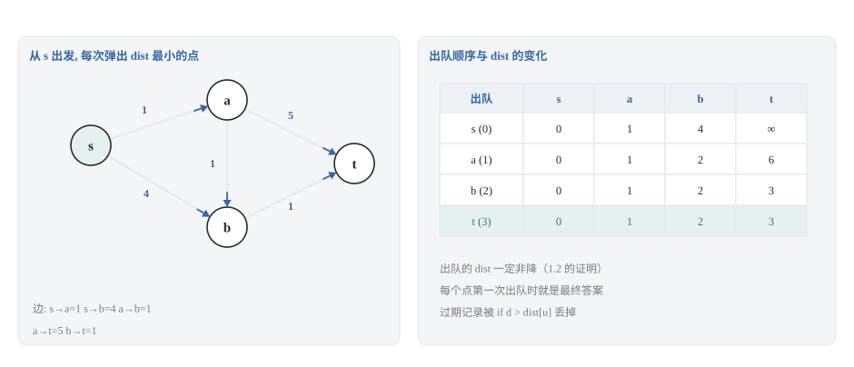
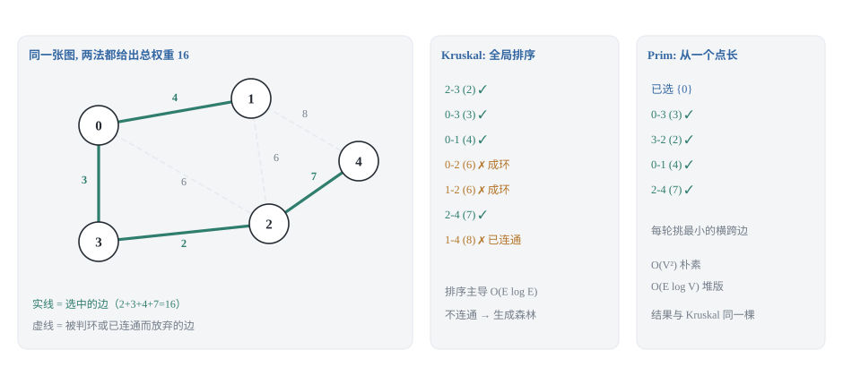

## 0 先说明材料和我的写法

这篇是我自己的学习笔记，对应 labuladong 教程里「图结构基础及算法概览」和「经典图算法」两个板块的八篇：

- 《图结构最短路径算法概览》—— <https://labuladong.online/zh/algo/data-structure-basic/graph-shortest-path/>
- 《Dijkstra 算法核心原理及实现》与《Dijkstra 拓展:带限制的最短路问题》—— <https://labuladong.online/zh/algo/data-structure/dijkstra/>、<https://labuladong.online/zh/algo/data-structure/dijkstra-follow-up/>
- 《多源最短路径:Floyd 算法》—— <https://labuladong.online/zh/algo/data-structure/floyd/>
- 《A* 算法核心原理及实现》—— <https://labuladong.online/zh/algo/data-structure/a-star/>
- 《最小生成树算法概览》《Kruskal 最小生成树算法》《Prim 最小生成树算法》—— <https://labuladong.online/zh/algo/data-structure-basic/graph-minimum-spanning-tree/>、<https://labuladong.online/zh/algo/data-structure/kruskal/>、<https://labuladong.online/zh/algo/data-structure/prim/>
- 《欧拉图和一笔画游戏》《Hierholzer 算法寻找欧拉路径》—— <https://labuladong.online/zh/algo/data-structure-basic/eulerian-graph/>、<https://labuladong.online/zh/algo/data-structure/eulerian-graph-hierholzer/>

**这不是转载，也不是翻译。** 原文最值钱的是每个算法配套的交互式可视化面板，我这里复现不了。所以下面每一节我都先讲「这个套路为什么成立」，再给实现——这是这一系列和原教程的主要区别。所有示意图都是我自己用 SVG 画的。

**先说素材的边界，因为这一篇的边界比上一篇更要紧。** 这一批页面的抽取文本**截断得比上一篇厉害**，我必须把话说在前面：

1. **《图结构最短路径算法概览》是完整读到的**，而且它信息量很大。单源/点对点/多源三类问题的划分、负权边为什么不行的那个例子（`s->a = 3`、`s->b = 4`、`b->a = -10`）、以及「负权重环让最短路问题失去意义」这些结论都来自它。
2. **《Dijkstra 算法核心原理及实现》只读到了开头**：一句话总结、与 BFS 的两处差别、以及它的小标题目录（代码 / 与 BFS 的关键区别 / 复杂度分析 / 点对点优化 / 总结）。**Dijkstra 的代码和它的正确性证明我都没拿到**，第 1.2 节的证明是我自己写的，写的是「非负权到底用在哪一步」，不是复述原文。
3. **《Floyd 算法》只读到了 `dp[i][j]` 的定义、base case、以及「三层循环就是状态转移」这一句**，正文代码本身在抽取时就断在 `for (int i = 0; i` 了。它的目录里有「三维 `dp` 数组」「空间压缩」两节，正文没读到，所以第 3.3 节的三维→二维推导是我自己补的。
4. **《A* 算法》读到了核心思想那一段就断了**（页面正好停在「我们定义三个量」），`f = g + h` 这套记号是教科书写法，不是从原文抄的。
5. **Prim、Kruskal、Hierholzer 三篇的代码都没拿到**，只有一句话总结和目录。唯一例外是欧拉路径的**判定条件**：无向图看度数、有向图看入度出度的那四条，原文写全了，我直接引用。
6. 《最小生成树算法概览》读得比较完整，生成树的定义（含所有顶点、V−1 条边、连通无环）、`2 + 3 + 5 = 10` 那个例子、以及「Kruskal 排序后用并查集」「Prim 由 Dijkstra 拓展」这些说法都来自它。

所以：**凡是我说「原文提到」的，都能在上面的链接里找到出处；凡是推导、代码、示意图的锅，都是我的。** 如果我写的和原文某处冲突，以原文为准。

另一件事：**代码是 Python 3 和 C++ 两版，不是原文的语言。** 原文用 Java，我按自己的习惯重新实现了一遍，这些片段是我写的、不是抄的。两种语言并排给出，因为它们的坑不一样——最容易撞上的一个在第 1.4 节：Python 的 `heapq` 天生是最小堆，C++ 的 `priority_queue` 天生是**最大堆**，少写一个比较器不报错，但答案全错。

C++ 代码块里我没有写 `#include`，也没有写 `using namespace std;`——力扣的提交框会替你包好，我自己的测试脚本里也包了（需要 `<vector>` `<queue>` `<string>` `<algorithm>` `<functional>`）。代码块本身因此短一点，对照着读更方便。

**和上一篇的分工。** 建图（邻接表/邻接矩阵）、DFS/BFS 遍历框架、`visited` 的用法、并查集、拓扑排序都在《图论基础与连通性》那篇里讲过了，这篇不重复。这里只用到上一篇的两个结论：一是**邻接表的输入约定**（`graph[u]` 是 `u` 的所有出边，每条边写成 `(邻居, 权重)`），二是**并查集**（第 4 节的 Kruskal 要用，我会给一个只保留必要操作的最小版本，并说明它来自上一篇）。这一篇讲的是**边上有权重之后**才出现的问题：怎么在加权图上求最小代价、怎么把所有点连起来而总代价最小、以及怎么不重复地走完所有边。

### 目录

- [0 先说明材料和我的写法](#0-先说明材料和我的写法)
- [1 Dijkstra:把 BFS 的队列换成优先队列](#1-dijkstra把-bfs-的队列换成优先队列)
- [2 Bellman-Ford:松弛 V-1 轮,再多跑一轮查负环](#2-bellman-ford松弛-v-1-轮再多跑一轮查负环)
- [3 Floyd:把中转点写成一层 DP](#3-floyd把中转点写成一层-dp)
- [4 最小生成树:Prim 与 Kruskal 依据同一条定理](#4-最小生成树prim-与-kruskal-依据同一条定理)
- [5 A*:给 Dijkstra 加一个朝终点的下界估计](#5-a给-dijkstra-加一个朝终点的下界估计)
- [6 欧拉路径:Hierholzer 的逆后序插入](#6-欧拉路径hierholzer-的逆后序插入)
- [7 把这六套算法收成一张选型表](#7-把这六套算法收成一张选型表)
- [8 材料与出处](#8-材料与出处)


## 1 Dijkstra:把 BFS 的队列换成优先队列

### 1.1 从 BFS 到 Dijkstra,只改两个地方

原文对这个算法的归纳很干脆：**Dijkstra 的本质是标准 BFS 算法 + 贪心思想**，它和 BFS 的差别只有两处——

1. 标准 BFS 用普通队列，Dijkstra 用优先级队列，让离起点更近的节点优先出队；
2. 标准 BFS 用 `visited` 数组保证不会死循环，Dijkstra 换成一个 `distTo` 数组，既防死循环，又记录起点到每个节点的最短路径。

这个归纳是对的，但光记住这两条会变成背模板。我想先把「为什么只改这两处就够」讲清楚。

BFS 在无权图上正确的真正原因，不是「用了队列」，而是**队列保证了出队顺序按边的条数从小到大**：所有 1 步能到的点排在所有 2 步能到的点前面。于是第一次碰到某个点时，用的边数就是最少的边数，这个点就可以定下来了。换句话说，队列只是实现「按代价从小到大出队」的一种手段——而它的代价就是步数。

到了加权图上，「步数少」不再等于「代价小」：一条 1 步的边可能权重 100，一条 3 步的路径可能总共才 6。于是第一处改动就是把「按步数出队」换成「按当前已知代价出队」——把队列换成优先级队列，键是 `distTo[u]`。

第二处改动的原因更微妙。`visited` 在无权图里能成立，是因为「第一次碰到就是最优」；在加权图上这个前提没了：一个节点可能先被一条贵路径碰到（比如代价 100），后面才被一条便宜路径碰到（代价 6）。所以不能用「碰过就再也不碰」来剪枝。取而代之的是 `distTo`：记下**目前已知的**从起点到每个节点的最小代价，只有当一条新路径能把这个值改小时才继续往外扩散。它同样能防止死循环——因为每次入队都严格改小某个 `distTo`，而每个 `distTo` 只能被改小有限次。

顺带就把上一篇那个问题接上了：**如果所有边的权重都是 1，Dijkstra 的优先级队列会退化成先进先出，它就是 BFS。** 这也是原文说「边权全是 1 时用 Dijkstra 反而更慢」的原因，第 5 节讲 A* 时会用到这个结论。

### 1.2 为什么「出队即最终」一定要边权非负

Dijkstra 里最反直觉的一步是：节点 `u` 从优先级队列里出来的时候，算法就直接宣布 `distTo[u]` 是最终答案，以后再也不改它（朴素版里对应 `done[u] = True`）。凭什么？

下面这个证明是我自己写的，它有一个好处：能精确指出「非负权」到底用在哪一步。

> 假设算法运行到某一刻，已经确定的节点集合是 `S`（它们的 `distTo` 都等于真实最短距离，归纳假设），现在从**还没确定**的节点里挑出了 `distTo` 最小的那个 `u`。取任意一条从起点 `src` 到 `u` 的路径 `P`，沿着 `P` 走，设 `x` 是路上**最后一个**属于 `S` 的节点，`y` 是它的下一个节点。那么 `y` 不在 `S` 里。
>
> 逐句读三个不等式：
>
> 1. `distTo[y] ≤ distTo[x] + w(x, y)`。因为 `x` 被确定的那一刻，我们把 `x` 的所有出边都松弛过一遍，其中就包括 `x -> y`。
> 2. `distTo[x] + w(x, y)` 正好是 `P` 从 `src` 到 `y` 的**前缀长度**；而 `P` 的剩余部分（`y` 到 `u`）长度 ≥ 0，所以**前缀长度 ≤ `P` 的总长度**。这一步用的就是所有边权非负。
> 3. `distTo[u] ≤ distTo[y]`，因为 `u` 是所有未确定节点里 `distTo` 最小的，而 `y` 未确定。
>
> 串起来就是 `distTo[u] ≤ 前缀长度 ≤ |P|`。而 `distTo[u]` 本身对应某条真实路径的长度，不可能比真正的最短路径 `|P|` 更小，所以两边只能相等：`distTo[u] = |P|`。

**非负权只用在第 2 步。** 一旦 `P` 的剩余部分含负权边，「前缀不短于整条路」就不成立了，整个链条断掉。原文给了一个最小的反例，我把它画进了第 2 张图：

```text
s -> a  权重 3
s -> b  权重 4
b -> a  权重 -10

只看 s 的出边,Dijkstra 会先确定 a 的距离是 3(它比 4 小)。
但 s -> b -> a 的权重和是 4 + (-10) = -6,比 3 还小 —— a 被锁死的那个 3 是错的。
```


原文对这个失效原因的表述很值得抄下来（这是结论，不是表述）：**贪心算法假设「随着经过的边的数量增加，路径权重和一定不会减少」,而负权重边的出现打破了这个假设。** 我自己那句「前缀不短于整条路」说的就是同一件事——前者是直觉版本，后者是它在证明里的位置。

这里必须补一个我自己跑到才发现、差点写错的细节：**上面这个反例锁死的是 1.3 的朴素版，不是 1.4 的堆版。**

- 1.3 朴素版有 `done[u] = True` 那一行，`a` 以 3 出队时就被标记成「已确定」，之后 `b` 把 `a` 松弛成 `-6` 也会被 `if not done[v]` 挡在外面——**返回 3，错的**。
- 1.4 堆版为了紧凑只维护了「过期记录」判断，**没有额外的 `done`**：`b` 出队时把 `a` 重新压成 `-6`，`a` 第二次出队时 `distTo[a]` 已经被改小，最后它给出的 `-6` **反而是对的**。

也就是说那个堆版在**没有负环**的图上会退化成「优先队列版的松弛」，侥幸收敛到正确答案。这个侥幸不能依赖，两个理由：

1. **`dst` 提前退出那一行会立刻让它出错。** 调 `dijkstra(graph, 0, dst=a)` 时，`a` 先以 3 出队，`if u == dst: break` 当场返回 3，而真实答案是 `-6`——同一份代码、同一张图，只因为多传了一个参数就从「对」变成「错」。
2. **图里一旦有负环，它连停都不停。** 每绕一圈都有更小的记录入队，堆永远不空。

所以第 2 节的意义不只是「负权边要换算法」，还有一句更实用的：**别拿「它在这个例子上跑对了」来论证 Dijkstra 能处理负权。** 这几个数字（朴素版 3、`dst` 版 3、完整堆版 `-6`、Bellman-Ford `-6`）都在 `verify_code.py` 里断言过。

还有一件事要提前分清楚，它和「负权边」不是一回事：

- **负权边**只是让 Dijkstra/A* 失效，Bellman-Ford 和 Floyd 照样能算；
- **负权环**（环上权重和小于 0）则是让最短路问题**本身失去意义**——你可以绕着这个环转任意多圈，路径权重和一路减下去，没有下界。原文的说法是「如果图中存在负权重环，最短路径问题就没有意义了」。

所以拿到一张带负权边的图，第一件事是查有没有负环，这正是第 2 节 Bellman-Ford 的活。

### 1.3 朴素版:每轮线性扫描,O(V * V)

先给最朴素的版本。它没有堆，每轮就是扫一遍所有还没确定的节点，挑 `distTo` 最小的那个。

```python
def dijkstra_dense(graph: list, src: int) -> list:
    """朴素版 O(V^2)。graph[u] = [(邻居, 权重), ...]"""
    INF = float("inf")
    n = len(graph)
    dist = [INF] * n
    done = [False] * n                 # True = 已经确定最短距离
    dist[src] = 0
    for _ in range(n):                 # 最多 n 轮，每轮确定一个节点
        u = -1
        for v in range(n):             # 线性扫描找最小的 dist
            if not done[v] and (u == -1 or dist[v] < dist[u]):
                u = v
        if u == -1 or dist[u] == INF:
            break                      # 剩下的点都从 src 到不了
        done[u] = True                 # 出队即最终，这一步靠 1.2 的证明兜底
        for nxt, w in graph[u]:
            if done[nxt]:
                continue                   # 已经定稿的点不再改——1.2 那个反例就死在这一行
            if dist[u] + w < dist[nxt]:    # 松弛：绕道 u 会不会更近
                dist[nxt] = dist[u] + w
    return dist
```

```cpp
vector<long long> dijkstraDense(const vector<vector<pair<int, int>>>& graph,
                                int src) {
    const long long INF = (1LL << 60);
    int n = static_cast<int>(graph.size());
    vector<long long> dist(n, INF);
    vector<char> done(n, 0);
    dist[src] = 0;
    for (int round = 0; round < n; ++round) {
        int u = -1;
        for (int v = 0; v < n; ++v) {   // 线性扫描找最小的 dist
            if (!done[v] && (u == -1 || dist[v] < dist[u])) u = v;
        }
        if (u == -1 || dist[u] == INF) break;   // 剩下的点都到不了
        done[u] = 1;
        for (const auto& e : graph[u]) {
            if (done[e.first]) continue;        // 定稿的点不再改（1.2 的反例）
            long long nd = dist[u] + e.second;  // 松弛
            if (nd < dist[e.first]) dist[e.first] = nd;
        }
    }
    return dist;
}
```

**复杂度推导。** 外层最多 `V` 轮；每轮找最小值是 `O(V)`，所以找最小这一项一共是 `O(V²)`；内层的松弛加起来正好把每条边看了一遍，是 `O(E)`。因为 `E ≤ V²`，总时间是 `O(V² + E) = O(V²)`，空间是 `O(V)` 的 `dist` 加 `done`。

**什么时候用它。** 稠密图。`E` 接近 `V²` 的时候，`O(V²)` 比堆版的 `O(E log V)` 好——代进 `V = 2000`：朴素版约 4×10⁶ 次基本操作，堆版要做约 2×10⁶ 次入队、每次 `log` 一下就是两千万次量级的比较。所以别默认「堆优化一定更好」，它优化掉的是「找最小值」这一项（从 `O(V)` 降到 `O(log V)`），代价是每个节点都要维护堆；**边多的时候，扫描一遍数组比维护堆便宜**。

**最容易写错的一行:**

```python
if u == -1 or dist[u] == INF:
```

两个判断缺一不可：`u == -1` 防的是「所有节点都已确定」时 `dist[-1]` 取到最后一个元素的错（Python 的负下标不会报错，只会给你一个莫名其妙的结果——这是这门语言特有的坑）；`dist[u] == INF` 防的是「剩下的节点全都不可达」时白白继续循环。C++ 那边 `u == -1` 会直接越界，所以我把两个判断合在了一行里，两边逻辑保持一致。

### 1.4 堆优化版:每条边最多触发一次入队,O(E log V)

朴素版的瓶颈是「找最小值要扫一遍」。换成小顶堆之后，这一步是 `O(log V)`。

```python
import heapq

def dijkstra(graph: list, src: int, dst: int = -1):
    """堆优化版 O(E log V)。返回 (dist, parent)；dst >= 0 时提前结束。"""
    INF = float("inf")
    n = len(graph)
    dist = [INF] * n
    parent = [-1] * n                  # 最短路径树上每个点的前驱
    dist[src] = 0
    pq = [(0, src)]                    # heapq 天生是小顶堆，不用额外指定
    while pq:
        d, u = heapq.heappop(pq)
        if d > dist[u]:
            continue                   # 过期记录：这个点已经被更短的路径重新入队过
        if u == dst:
            break                      # 点对点：dst 一出队就已经是最终答案
        for nxt, w in graph[u]:
            if d + w < dist[nxt]:
                dist[nxt] = d + w
                parent[nxt] = u        # 记下这次松弛用的前驱，会被更优的覆盖
                heapq.heappush(pq, (dist[nxt], nxt))
    return dist, parent
```

```cpp
pair<vector<long long>, vector<int>> dijkstra(
        const vector<vector<pair<int, int>>>& graph, int src, int dst = -1) {
    const long long INF = (1LL << 60);
    int n = static_cast<int>(graph.size());
    vector<long long> dist(n, INF);
    vector<int> parent(n, -1);
    using Item = pair<long long, int>;                  // (距离, 节点)
    priority_queue<Item, vector<Item>, greater<Item>> pq;  // 默认是最大堆！
    dist[src] = 0;
    pq.push({0, src});
    while (!pq.empty()) {
        Item cur = pq.top();
        pq.pop();
        long long d = cur.first;
        int u = cur.second;
        if (d > dist[u]) continue;     // 过期记录
        if (u == dst) break;           // 点对点：dst 出队即最终答案
        for (const auto& e : graph[u]) {
            long long nd = d + e.second;
            if (nd < dist[e.first]) {
                dist[e.first] = nd;
                parent[e.first] = u;
                pq.push({nd, e.first});
            }
        }
    }
    return {dist, parent};
}
```

**最容易写错的一行:**

```cpp
priority_queue<Item, vector<Item>, greater<Item>> pq;
```

把 `greater<Item>` 去掉，代码照样编译、照样跑，**但 `priority_queue` 默认是最大堆**，出队的永远是当前 `dist` 最大的节点，Dijkstra 立刻退化成随机乱走——错得悄无声息。Python 那边没有这个问题（`heapq` 是最小堆），所以这个坑只有把 C++ 也写一遍才会撞上，这也是这个系列每道题都给两版的原因之一。

顺带说一下 Python 侧真正容易踩的坑：`heapq` 在元组第一项相等时会去比较第二项。这里第二项是 `int` 节点编号，比较得动，所以没事；但如果你往堆里塞的是自定义对象（比如原文 Java 版里那个 `State` 类），Python 会直接抛 `TypeError`。要避免的话就在元组中间插一个自增序号。C++ 的 `greater<Item>` 也会比较第二项，但 `pair` 的比较是编译期就有的，不会运行时爆炸——同一个设计，两种语言的失败方式完全不同。

**复杂度推导。** 关键在「入队次数」上：每次成功松弛才会 `push` 一次，而每条边 `(u, v)` 最多被松弛一次（`u` 一旦确定，它的出边就只扫一遍），所以 `push` 的总次数是 `O(E)`，出队次数不会超过入队次数，也是 `O(E)`。每次堆操作 `O(log E)`。总时间 `O((V + E) log E)`；对连通图 `E ≥ V - 1`，可以写成更常见的 `O(E log V)`——因为 `E ≤ V²` 时有 `log E ≤ 2 log V`。空间是 `O(V + E)`：`dist`/`parent` 是 `O(V)`，堆里最多堆着 `O(E)` 条过期记录。

**为什么允许过期记录留在堆里？** 因为一个节点的 `dist` 可能被改小多次，而 Python 的 `heapq` 根本不支持「修改堆中某个元素的键」（C++ 的 `priority_queue` 也不支持 `decrease-key`）。与其自己去实现一套可改键的堆，不如让旧记录留着，出队时用 `if d > dist[u]: continue` 跳过——**多花的只是堆里多存几条记录的空间，换来的是代码短一半**。这也是「惰性删除」这个套路最常见的一处应用。



### 1.5 点对点与路径还原

**点对点。** 如果只需要 `src` 到某一个 `dst` 的最短距离，就把单源算法跑一半：**`dst` 一出队就返回**，因为按 1.2 的证明，此时 `distTo[dst]` 已经是最终答案，后面那些点不必再管。这是原文明确提过的优化——「点对点最短路径问题可以视为单源最短路径问题的特例，当算出到达 `dst` 的最短路径时提前结束算法」。至于专门为点对点设计的算法（A*），第 5 节讲。

**路径还原。** 想输出路径而不只是距离，就要在松弛成功时记下前驱：

```text
graph: 0 -> [(1, 1), (2, 4)]   1 -> [(2, 2), (3, 5)]   2 -> [(3, 1)]

dist:   [0, 1, 3, 4]
parent: [-1, 0, 1, 2]

回溯 dst = 3:3 -> parent[3] = 2 -> parent[2] = 1 -> parent[1] = 0 -> parent[0] = -1
走到 -1 停下,把走过的节点反过来读:0 -> 1 -> 2 -> 3,总权重 1 + 2 + 1 = 4
```

有一个细节：`parent[u]` 记的是**最后一次让 `distTo[u]` 变小的那条路径上的前驱**，也就是说它会被更好的路径覆盖掉——这不是 bug，正是我们要的，因为最后留下来的必然是最优路径树上的那条边。回溯是一次 `O(V)` 的走链，加上反转，还是 `O(V)`。

最后一个方向性的提醒：`distTo` 这个一维数组只能表达「起点到每个点的最短距离」。如果问题多一个约束——比如原文《Dijkstra 拓展》里讲的「最短路径最多不能超过 k 条边」——一个 `distTo` 就不够用了，得把状态从「节点」升成「节点 + 已经用了几条边」，`distTo` 也跟着升成二维。原文的做法是给每个节点的 `State` 对象加字段，我的做法是在堆里多存一维。这一类题（比如力扣 787「K 站中转内最便宜的航班」）第 2 节还会遇到一次，那时用 Bellman-Ford 的「轮数」来看会清楚得多。

## 2 Bellman-Ford:松弛 V-1 轮,再多跑一轮查负环

### 2.1 干脆不锁定了

Dijkstra 的整套正确性押在「出队即锁定」上，而 1.2 已经证明这个锁定需要非负权。Bellman-Ford 换了一条完全不同的路：**它不锁定任何节点**。

它的做法朴素到有点笨：把图中所有的边松弛一遍，算作一轮；然后重复 `V - 1` 轮。所谓「松弛」，就是那一句 `if distTo[u] + w < distTo[v]: distTo[v] = distTo[u] + w`——**如果从 u 绕一下能让 v 的距离更小，就改掉 v 的距离**。

它凭什么对？关键是一个不变量，我把它写清楚：

> **第 k 轮结束后，`distTo[v]` 等于「从 src 到 v、最多用 k 条边」的所有路径里最小的权重和。**

`k = 0` 时它显然成立：`src` 到自己是 0 条边、权重 0，其余节点没有路径、是无穷。递推就是代码里那层循环：

```text
D_k(v) = min( D_{k-1}(v),  min over 所有边 (u, v) 的  D_{k-1}(u) + w(u, v) )
                     ↑ 不动，保留上一轮的值     ↑ 或者再走一条边过来
```

代码里的 `if distTo[u] + w < distTo[v]` 正好同时表达了这两项：改小了就是走了「再一条边」那一支，没改小就是保留了旧值。

**为什么 `V - 1` 轮就够。** 因为最短路径总可以取成**简单路径**（不重复经过节点）：

- 如果路径上有一个环，这个环的权重和只可能是三种情况：**大于 0**，把环删掉路径更短，说明原来那条不是最短；**等于 0**，删掉之后一样短，还是最短路径；**小于 0**，那是个负权环，最短路问题本身就没有意义了。
- 所以只要问题有意义，它就有一条不含重复节点的最短路径，而含 `V` 个节点的简单路径最多 `V - 1` 条边。
- 代入不变量：第 `V - 1` 轮结束后，`distTo` 已经覆盖了「最多 `V - 1` 条边」的全部路径，也就覆盖了真正的最短路。

**这里有一个容易被人忽略的细节：代码里我并没有保存「上一轮的 `distTo` 快照」。** 同一轮里，一个节点被改小之后，它的出边马上就会用新的值去改别人——这等于让一轮里串联着往前推进了好几条边，不变量里那个「最多 k 条边」的界就不严格了。那它会不会算错？不会。因为还有另一个不变量管着：

> **`distTo[v]` 永远等于某条真实存在的路径的权重。**

这条由归纳直接得到：初始时 `distTo[src] = 0` 对应「一条边都不走」这条路径，其余是无穷（没有路径）；每次赋值 `distTo[v] = distTo[u] + w` 都是把「到 u 的那条真实路径」再接上一条真实的边。既然它对应的是**某条真实路径**，它就永远不可能小于真正的最短路。

于是两边一夹：`distTo[v] ≥ 真实最短路`（刚刚这条），同时 `distTo[v] ≤ D_k(v)`（原地更新只会更快），而 `D_{V-1}(v) = 真实最短路`。`V - 1` 轮之后只能取等号——**原地更新只影响「某一轮多做了一些事」，不影响最终答案**。

**复杂度。** 外层 `V - 1` 轮，每轮把所有边看一遍，是 `O(V·E)`；空间只要 `distTo`，`O(V)`。和 Dijkstra 的 `O(E log V)` 比，Bellman-Ford 明显更慢——慢在「每一轮都把所有的边看一遍，而绝大多数边那一轮并不会引起任何改进」。

原地更新那个性质顺便给了我们一个便宜的优化：**如果某一轮里一次改进都没发生，说明已经收敛，后面几轮纯属白跑，可以直接停。** 这不会让人漏掉负环，原因见 2.3。

**为什么负权在这里不是问题。** 回头看 1.2 的证明，Dijkstra 唯一用到「非负」的地方是「前缀不短于整条路」。Bellman-Ford 从头到尾没用过这句话——它只用了「一条路径的权重 = 它前缀的权重 + 最后那条边的权重」，这对任意权重的边都成立。这就是为什么它能处理负权边。

### 2.2 代码:V-1 轮松弛,加一轮查验

```python
def bellman_ford(graph: list, src: int):
    """返回 (dist, 是否存在从 src 可达的负权环)。graph[u] = [(邻居, 权重), ...]"""
    INF = float("inf")
    n = len(graph)
    dist = [INF] * n
    dist[src] = 0
    for _ in range(n - 1):                 # V-1 轮就够，理由见 2.1
        changed = False
        for u in range(n):
            if dist[u] == INF:             # 到不了的点，松弛不出任何东西
                continue
            for nxt, w in graph[u]:
                if dist[u] + w < dist[nxt]:
                    dist[nxt] = dist[u] + w
                    changed = True
        if not changed:
            break                          # 已经收敛，剩下的轮数是白跑
    for u in range(n):                     # 第 V 轮：还能改小就有负环
        if dist[u] == INF:
            continue
        for nxt, w in graph[u]:
            if dist[u] + w < dist[nxt]:
                return dist, True
    return dist, False
```

```cpp
pair<vector<long long>, bool> bellmanFord(
        const vector<vector<pair<int, int>>>& graph, int src) {
    const long long INF = (1LL << 60);
    int n = static_cast<int>(graph.size());
    vector<long long> dist(n, INF);
    dist[src] = 0;
    for (int round = 0; round < n - 1; ++round) {   // V-1 轮就够
        bool changed = false;
        for (int u = 0; u < n; ++u) {
            if (dist[u] == INF) continue;           // 到不了的点
            for (const auto& e : graph[u]) {
                long long nd = dist[u] + e.second;
                if (nd < dist[e.first]) {
                    dist[e.first] = nd;
                    changed = true;
                }
            }
        }
        if (!changed) break;                        // 已经收敛
    }
    for (int u = 0; u < n; ++u) {                   // 第 V 轮：查验
        if (dist[u] == INF) continue;
        for (const auto& e : graph[u]) {
            if (dist[u] + e.second < dist[e.first]) return {dist, true};
        }
    }
    return {dist, false};
}
```

**最容易写错的一行:**

```text
Python:  if dist[u] + w < dist[nxt]:        # 必须严格小于
C++:     if (nd < dist[e.first]) {          # 必须严格小于

写成 <= 会怎样：权重为 0 的环被反复走 —— 值没变小，但 "这一轮有没有改进"
一直被置为真，提前退出的优化彻底失效，O(V·E) 里的 V 就实打实跑满。
```

必须是**严格小于**。更糟的是在 SPFA 里（2.4 节），`<=` 会让入队次数计数据涨，把一个没有负环的图误判成有负环——**那是错误答案，不是慢一点**。

### 2.3 第 V 轮凭什么能查出负环

这一节我想把两个方向都证明掉，因为很多写法只讲了一半。

**方向一：有负环，就一定查得出来。**

反证。假设第 `V` 轮一条边都改进不了，也就是说对**每一条**边 `(u, v)` 都有：

```text
distTo[u] + w(u, v)  >=  distTo[v]
```

现在取一个负权环，把它每条边的这个不等式**全部加起来**。环上每个节点恰好有一条出边、一条入边，所以右边的 `distTo` 每个节点各出现一次，左边的 `distTo` 也各出现一次——两边正好抵消。剩下的就是：

```text
环上所有边的权重和  >=  0
```

这和「负权环」矛盾。所以只要环是负的，就**一定**存在可以被改进的边，算法永远不会在那个环面前「停下来」。

注意这个论证用到的前提是「环上的节点 `distTo` 是有限值」，也就是说这个负权环必须**从 src 可达**。src 到不了的负环不影响 src 的最短路，检测不到它是对的——这一点和第 1 节「不可达的点距离是无穷」是同一件事。

**方向二：没有负环，第 V 轮什么也查不出来。**

这就是 2.1 的结论：第 `V - 1` 轮结束时 `distTo` 已经是最终答案，第 `V` 轮自然一条边都改不动。所以「多跑一轮」不会误报。

两个方向合起来：**第 V 轮还能松弛出改进 ⟺ 存在从 src 可达的负权环。** 这也顺便回答了 2.1 留的那个问题——提前退出不会漏掉负环，因为如果真有负环，某一轮就永远不可能「一次改进都没有」。

### 2.4 SPFA:用队列把白跑的轮数省掉

2.1 已经指出 Bellman-Ford 慢在哪：**一轮里只有那些「上一轮 `distTo` 被改小过」的节点，它们的出边才可能引起新的改进**，其余边的松弛全是白看的。

那就把「被改小过的节点」记下来，只松弛它们的出边。用一个队列来存这些节点，就是原文说的**基于队列的 Bellman-Ford 算法**，也就是通常说的 SPFA。原文对它的定性是：本质也是 BFS 遍历的拓展，能处理负权重边，但效率比 Dijkstra 低。

```python
from collections import deque

def spfa(graph: list, src: int):
    """队列版 Bellman-Ford。返回 (dist, 是否存在从 src 可达的负权环)。"""
    INF = float("inf")
    n = len(graph)
    dist = [INF] * n
    dist[src] = 0
    in_queue = [False] * n                 # 队列里是否已经有它，避免重复入队
    enqueued = [0] * n                     # 入队次数，用来判负环
    q = deque([src])
    in_queue[src] = True
    enqueued[src] = 1
    while q:
        u = q.popleft()
        in_queue[u] = False
        for nxt, w in graph[u]:
            if dist[u] + w < dist[nxt]:
                dist[nxt] = dist[u] + w
                if not in_queue[nxt]:
                    in_queue[nxt] = True
                    q.append(nxt)
                    enqueued[nxt] += 1
                    if enqueued[nxt] >= n:  # 一个点被改进 n 次 = 有负环
                        return dist, True
    return dist, False
```

```cpp
pair<vector<long long>, bool> spfa(
        const vector<vector<pair<int, int>>>& graph, int src) {
    const long long INF = (1LL << 60);
    int n = static_cast<int>(graph.size());
    vector<long long> dist(n, INF);
    vector<char> inQueue(n, 0);
    vector<int> enqueued(n, 0);
    queue<int> q;
    dist[src] = 0;
    q.push(src);
    inQueue[src] = 1;
    enqueued[src] = 1;
    while (!q.empty()) {
        int u = q.front();
        q.pop();
        inQueue[u] = 0;
        for (const auto& e : graph[u]) {
            long long nd = dist[u] + e.second;
            if (nd < dist[e.first]) {
                dist[e.first] = nd;
                if (!inQueue[e.first]) {
                    inQueue[e.first] = 1;
                    q.push(e.first);
                    if (++enqueued[e.first] >= n) return {dist, true};
                }
            }
        }
    }
    return {dist, false};
}
```

**关于负环判据的诚实说明。** 「某个点入队次数达到 `V` 就是有负环」是流传很广的写法，我要把它的两个方向分开讲：

- **不会漏报**，这一半是 2.3 证的：有负环时队列永远不会空，某个点会被反复改进，计数一定涨上去。
- **不会误报**，这一半我只能给你**实测**，不给证明：我用同一套随机图跑了 9,062 个（图, 起点）组合，全是**没有负环**的图，阈值 `enqueued >= V` 一次都没有被触发，`spfa` 报出来的「有负环」也一次都没出现（真值用 Bellman-Ford 的第 `V` 轮单独算过）。这个实验就在本篇的测试脚本 `verify_code.py` 里，你可以自己复跑。我倾向于把 `V` 这个阈值理解成 Bellman-Ford 那个「`V - 1` 轮」结论在队列版上的影子：轮数上界是 `V - 1`，入队次数的上界也就落在同一个量级。
- 顺带把 2.2 里 `<=` 的坑再点一次：**严格小于**。改成 `<=`，零权环会把入队计数推过阈值，好好的图被判成有负环。

**复杂度。** SPFA 平均情况下快得多（每个点平均入队次数是个小常数），但**最坏情况仍然是 `O(V·E)`**——构造一张能把队列反复填满的图并不难，竞赛里专门有卡 SPFA 的数据。所以原文那句「效率比 Dijkstra 低」要理解成：Dijkstra 有一个 `O(E log V)` 的硬保证，SPFA 没有。**有负权才用它，没有负权就用 Dijkstra。**

顺带把实测的耗时代价也交代一下：同一批 9,062 个（图, 起点）组合上，SPFA 一共 6.3 ms，Bellman-Ford 8.9 ms——**只快 1.4 倍**，因为这些图很小（`V ≤ 8`），队列那点常数开销占了上风。规模上去以后差距才会拉开（`V·E` 对 `V·E` 但常数小得多），但「最坏仍是 `O(V·E)`」这条不变。

### 2.5 一个具体的应用:轮数就是「边数上限」

回到 1.5 留下的那个尾巴。力扣 787「K 站中转内最便宜的航班」要求路径最多经过 `K` 个中转站，也就是**最多 `K + 1` 条边**。而 Bellman-Ford 的不变量 `D_k` 说的正是「最多用 `k` 条边」——所以这道题本质上就是「跑 `K + 1` 轮 Bellman-Ford，别跑满 `V - 1` 轮」。

这里有一个真实的坑，而且它正好是 2.1 那个「原地更新」的另一面：

```text
题目要的是「最多 K+1 条边」，所以每一轮必须只推进一条边。
但原地更新会让同一轮里串联推进好几条边 —— 相当于偷偷把边数上限放宽了。

所以做 787 这类题时，每一轮必须先用上一轮的 dist 做一份快照（snapshot），
本轮所有松弛都读快照、写新数组。这和「标准 Bellman-Ford 不需要快照」
并不矛盾：标准版只关心最终收敛值，而 787 关心的是「恰好第 k 轮的中间结果」。
```

一句话：**标准 Bellman-Ford 里快照可有可无（只是让某一轮多做点事），带边数限制的题目里快照是必须的。**

## 3 Floyd:把中转点写成一层 DP

### 3.1 三类问题,和「每个点跑一遍 Dijkstra」比一比

原文把最短路径问题分成三类，这个分类值得先记住，因为它是第 7 节那张选型表的骨架：

| 类型 | 问的是什么 | 代表算法 |
| --- | --- | --- |
| 单源 | 一个起点到其他所有点的距离 | Dijkstra、Bellman-Ford |
| 点对点 | 一个起点到一个终点 | Dijkstra 提前结束、A\* |
| 多源 | 任意两点之间的距离 | Floyd |

「多源」这一类，原文有一句话说得很实在：**理论上，对所有节点都调用一次单源最短路径算法，就可以得到多源最短路径的解**——但要权衡图的特点和复杂度。这个权衡我算一遍：

- **对每个点跑一次堆版 Dijkstra**：`V × O(E log V) = O(V·E log V)`。稠密图里 `E ≈ V²`，得到 `O(V³ log V)`；稀疏图里 `E ≈ V`，得到 `O(V² log V)`。
- **Floyd**：`O(V³)` 时间，`O(V²)` 空间（下面 3.2 会推）。

所以：**稠密图上 Floyd 比「跑 V 遍 Dijkstra」快了整整一个 `log`**；但稀疏图上反过来，`O(V² log V)` 好过 `O(V³)`。也就是说「多源就该用 Floyd」这句话并不绝对——不过 Floyd 有两个别的好处让它经常更划算：代码只有三层循环十几行，而且**天然支持负权边**。原文的定性是：Dijkstra 和 A\* 不能处理含负权边的图，Floyd 和 Bellman-Ford 可以，其中 Bellman-Ford 常被用来检测负权环。

### 3.2 那个「三层循环」到底在转什么

原文给的定义很干净：`dp[i][j]` 是节点 `i` 到节点 `j` 的最短路径权重；base case 是 `dp[i][i] = 0`、直接相邻的写成边权、不相邻写成正无穷；而且原文明确说了——**状态转移方程就是三层嵌套 for 循环的部分**，时间 `O(n³)`，空间 `O(n²)`。

「就是三层循环」这句其实值得展开，因为光看代码看不出它是怎么来的；而看懂之后，3.3 那个「循环顺序为什么不能换」就是一句话的事。

设 `f_k[i][j]` 表示「**只允许用前 `k` 个节点当中转点**」时 `i` 到 `j` 的最短路径权重。那么：

- `f_0[i][j]`：一个中转点都不许用，所以要么 `i` 直接连到 `j`，要么根本没有路径——**这正好就是 base case**。
- 从 `f_{k-1}` 推到 `f_k`，对每一对 `(i, j)` 只有两种可能：
  1. **不用节点 `k` 当中转**：答案就是 `f_{k-1}[i][j]`；
  2. **用节点 `k` 当中转**：路径长成 `i → … → k → … → j`，两段各自只用到前 `k - 1` 个节点（`k` 自己经过一次就够了），所以是 `f_{k-1}[i][k] + f_{k-1}[k][j]`。

合起来就是那行状态转移：

```text
f_k[i][j] = min( f_{k-1}[i][j],  f_{k-1}[i][k] + f_{k-1}[k][j] )
                   ↑ 不用 k            ↑ 用 k 当中转
```

最终答案是 `f_V[i][j]`（允许所有节点当中转）。于是最外层那句 `for k in range(n)` 的真实含义是**一层一层地放开中转点**，内层的 `i`、`j` 只负责在这一层里把所有点对更新一遍。

**空间是怎么从三维压到二维的。** `f_k` 这一维被原地更新压掉了，理由是 `f_k[i][j]` 只依赖 `f_{k-1}` 的三个位置：同一个格子、第 `i` 行第 `k` 列、第 `k` 行第 `j` 列。而后两个位置**本来就不会被第 `k` 轮改变**——因为它们各自也在做同一件事：

```text
dp[i][k] = min( f_{k-1}[i][k],  f_{k-1}[i][k] + f_{k-1}[k][k] )
                                  ↑ f_{k-1}[k][k] = 0，自己到自己不走边
```

所以 `dp[i][k]` 读出来还是 `f_{k-1}[i][k]`，`dp[k][j]` 同理。**原地更新读到的永远是「上一层」的值，不会写坏。** 这个论证还顺手告诉我们它什么时候会失效：一旦 `dp[k][k] < 0`（也就是节点 `k` 踩在负环上），上面那个「不会被改变」的等式不再成立，压缩的论证就崩了——这正是 3.5 用对角线检测负环的原理。

### 3.3 k 为什么必须在最外层

这是三层循环里唯一一个真会写错、而且**不报错、只是算错**的地方。两种写法：

```text
正确:  for k: for i: for j:   dist[i][j] = min(dist[i][j], dist[i][k] + dist[k][j])
错误:  for i: for j: for k:   dist[i][j] = min(dist[i][j], dist[i][k] + dist[k][j])
```

从 3.2 的 DP 视角看，这件事一眼就清楚了：**`k` 就是 DP 的「阶段」**。第 `k` 轮结束之后，我们才拥有「中转点只用了前 `k` 个」这个阶段的完整结果，而算第 `k` 阶段需要且只需要第 `k - 1` 阶段。把 `k` 塞进最内层等于把阶段的顺序打乱：每个点对 `(i, j)` 只有一次机会去「拼一次」，而它用来拼的那两个量 `dist[i][k]`、`dist[k][j]` 在同一趟里可能还没算出来。

空口说没用，我给一个最小反例。四个点连成一个有向环，是测试脚本里跑出来的：

```text
0 -> 1  权重 4
1 -> 2  权重 3
2 -> 3  权重 4
3 -> 0  权重 2

正确顺序(k 在外层):  dist[1][0] = 9       (1 -> 2 -> 3 -> 0)
错误顺序(k 在内层):  dist[1][0] = 无穷大   ← 它找不到这条 3 条边的路
```

错误那版为什么找不到？处理 `(i, j) = (1, 0)` 时它需要一个**两跳**的中间量：要么 `dist[1][3]`，要么 `dist[2][0]`。而 `dist[1][3]` 要等 `i = 1` 这一行走到 `j = 3` 才可能被算出来，`dist[2][0]` 要等 `i = 2` 那一行——**两个都比 `(1, 0)` 晚**。于是必需的两跳量一个都还没就位，这条三跳的路就永远拼不出来。`k` 在最外层时，顺序保证的正是「两跳的量先攒够，再攒三跳的」：第 0 轮放开节点 0 之后，所有「中转只用 0」的路径就位；第 1 轮放开节点 1 之后，「中转只用 0、1」的路径就位……**层数是一轮一轮攒出来的，而错误顺序只给了一次机会。**

下面两段代码我都放进测试脚本跑了，反例是脚本里断言出来的，不是我手算的。先是正确版本：

```python
def floyd(n: int, edges: list) -> list:
    """返回 n x n 的最短路径矩阵。edges = [(u, v, w), ...]，重边留最小。"""
    INF = float("inf")
    dist = [[INF] * n for _ in range(n)]
    for i in range(n):
        dist[i][i] = 0                 # base case：自己到自己，不走边
    for u, v, w in edges:
        if w < dist[u][v]:             # 重边只留最小的那条
            dist[u][v] = w
    for k in range(n):                 # 中转点必须在最外层，见 3.3
        for i in range(n):
            if dist[i][k] == INF:      # i 到不了 k，这一层对它没意义
                continue
            for j in range(n):
                if dist[i][k] + dist[k][j] < dist[i][j]:
                    dist[i][j] = dist[i][k] + dist[k][j]
    return dist
```

```cpp
vector<vector<long long>> floyd(int n, const vector<array<int, 3>>& edges) {
    const long long INF = (1LL << 60);   // 两个 INF 相加也不会溢出 long long
    vector<vector<long long>> dist(n, vector<long long>(n, INF));
    for (int i = 0; i < n; ++i) dist[i][i] = 0;
    for (const auto& e : edges) {
        if (e[2] < dist[e[0]][e[1]]) dist[e[0]][e[1]] = e[2];
    }
    for (int k = 0; k < n; ++k) {        // 中转点在最外层
        for (int i = 0; i < n; ++i) {
            if (dist[i][k] == INF) continue;
            for (int j = 0; j < n; ++j) {
                long long nd = dist[i][k] + dist[k][j];
                if (nd < dist[i][j]) dist[i][j] = nd;
            }
        }
    }
    return dist;
}
```

然后是错误版本。**它唯一的价值就是让你认出来自己写错了**，别抄：

```python
def floyd_wrong_order(n: int, edges: list) -> list:
    """演示用：把 (i, j) 放外层、k 塞进最内层会算错。上面的反例就是这么抓到的。"""
    INF = float("inf")
    dist = [[INF] * n for _ in range(n)]
    for i in range(n):
        dist[i][i] = 0
    for u, v, w in edges:
        if w < dist[u][v]:
            dist[u][v] = w
    for i in range(n):                 # 阶段被塞进最内层，DP 就散了
        for j in range(n):
            for k in range(n):
                if dist[i][k] + dist[k][j] < dist[i][j]:
                    dist[i][j] = dist[i][k] + dist[k][j]
    return dist
```

```cpp
vector<vector<long long>> floydWrongOrder(int n, const vector<array<int, 3>>& edges) {
    const long long INF = (1LL << 60);
    vector<vector<long long>> dist(n, vector<long long>(n, INF));
    for (int i = 0; i < n; ++i) dist[i][i] = 0;
    for (const auto& e : edges) {
        if (e[2] < dist[e[0]][e[1]]) dist[e[0]][e[1]] = e[2];
    }
    for (int i = 0; i < n; ++i) {        // 错误示范：k 被挤到最内层
        for (int j = 0; j < n; ++j) {
            for (int k = 0; k < n; ++k) {
                long long nd = dist[i][k] + dist[k][j];
                if (nd < dist[i][j]) dist[i][j] = nd;
            }
        }
    }
    return dist;
}
```

**最容易写错的一行:**

```text
for k in range(n):          # Python：这一行必须在最外层
for (int k = 0; k < n; ++k) # C++：同上

挪到内层：代码照样编译、小样例说不定还能过，只是在大图上悄悄给你无穷大。
```


### 3.4 负环检测,和一道多源例题

Floyd 跑完之后，**看对角线**：如果存在 `dist[i][i] < 0`，说明节点 `i` 踩在一个负权环上。（这一条是我自己加的——原文只说了「Bellman-Ford 常用来检测负权重环」，但它同样适用于 Floyd，而且更省事：不用多跑一轮，跑完看一眼对角线就行。）要注意的是，一旦真有负环，Floyd 对**受这个环影响的那些点对**给出的值就不可信了，因为 3.2 的压缩论证已经崩了；所以负环要么先用 §2 的 Bellman-Ford 查掉，要么就用对角线当报警器。

原文配的例题是力扣 1334「阈值距离内邻居最少的城市」：给定 `n` 个城市、若干条带权无向边和一个阈值 `distanceThreshold`，要求找出「距离不超过阈值的邻居城市数量最少」的那个城市。这就是典型的多源场景——用 Floyd 把 `n × n` 的距离矩阵一次算出来，再对每个城市数一遍「距离 ≤ 阈值 且不是自己」的个数，取最小的那个（并列时取编号最大的，这是题目要求）。Floyd 在这里还有一个额外的好处：无向边只要 `dist[u][v] = dist[v][u] = w` 存两遍就行，不用真的建双向邻接表。

还有一道点对点的题原文也提到了：力扣 787「K 站中转内最便宜的航班」本来是个 DP 题，用 Floyd 也能做（多一层「跳数」维度）；不过 §2.5 已经说明它更适合用「限定轮数的 Bellman-Ford」来看，那里就不重复了。

## 4 最小生成树:Prim 与 Kruskal 依据同一条定理

### 4.1 先把「生成树」要什么说清楚

原文的定义：给定一个**无向连通图** `G`，它的生成树是 `G` 的一个子图，包含 `G` 中的所有顶点，并且是一棵树（无环连通图）。换句话说生成树有三个特性：

- 包含原图中的**所有**顶点；
- 边的数量恰好是 `V - 1` 条；
- 连通且无环。

一个图可以有很多棵不同的生成树；如果图是加权图，那么**边权总和最小的那棵叫最小生成树**。原文举的例子是一棵总权重 `2 + 3 + 5 = 10` 的树，并指出没有别的生成树能得到更小的权重和。原文给的应用场景是修路：节点是城市，边是公路，边权是造价，要求把所有城市连起来且总造价最小——这就是最小生成树问题。

有三件事原文没提，但对做题很要紧，我补在这里：

1. **图必须连通**。不连通的时候不存在生成树，只能求「最小生成森林」——每个连通分量各求一棵最小生成树。**Kruskal 天然就给出这个结果**（4.4 的代码里我让它顺手返回「是否连通」）；Prim 要多写一句「长不动了就换个还没进树的点重新开始」，否则只会算出起点那一棵——4.3 的代码里有这一句，它也是两个算法唯一的结构差别。
2. **负权边完全没问题**。最小生成树不挑权重正负，Kruskal 和 Prim 都照常工作。这和最短路的处境完全不同——**唯一能让 MST 算法失效的情况是「不存在」**。
3. **最小生成树和最短路径不是一回事**，这是最容易混的一点。看这个三角形：

```text
A - B  权重 4
B - C  权重 4
A - C  权重 5

最小生成树 = {A-B, B-C}，总权重 8        ← A-C 这条边被排除掉了
但 A 到 C 的最短路径是直接走 A-C，权重 5   ← 它不在最小生成树里
```

最小生成树只保证**总和**最小，不保证树上任意两点之间的路径是它们之间的最短路。顺带一个真正成立的性质是「瓶颈最优」：树上两点之间那条路径上**最大的边**，是所有连通这两点的路径里最大的边最小的那个（这是最小生成树最有用的性质之一，网络流和瓶颈路问题里常用）。

### 4.2 切分定理:两种算法共用的一条依据

原文在 Prim 那一篇的目录里有「切分定理」和「算法的正确性」两节，但正文没抽到。我把这条定理和它的证明补在这里，因为**它一次就解释了 Prim 和 Kruskal 为什么都对**——两个算法看起来完全不同，依据是同一条。

先定义两个词：

- **切分**：把顶点集分成两部分，`S` 和剩下的 `V - S`。
- **横跨边**：一端在 `S` 里、另一端不在 `S` 里的边。

> **切分定理：对于任意一个切分，权重最小的那条横跨边，一定属于某棵最小生成树。**

证明用**交换论证**（这是我写的，不是原文的）：

1. 设 `e` 是当前切分下权重最小的横跨边，`T` 是任意一棵最小生成树。
2. 如果 `e` 已经在 `T` 里，那就完了。
3. 如果 `e` 不在 `T` 里：把 `e` 加进 `T`，会得到一个环。这个环从 `S` 出发、跨到 `V - S`、最后还要跨回来，**穿越切分的次数一定是偶数**，所以环上除了 `e` 之外，必定还有另一条横跨边 `f`。
4. 由 `e` 的最小性，`w(e) ≤ w(f)`。现在做交换：`T' = T - f + e`。`T'` 还是一棵生成树（去掉环上一条边、加上环上另一条边，连通性和无环性都保持），而它的权重是 `w(T) - w(f) + w(e) ≤ w(T)`。
5. 但 `T` 已经是最小生成树了，所以只能取等号：`T'` 也是一棵最小生成树，**而且它包含 `e`**。

**两种算法都是「不停地用这条定理」。** 关键是把不变量说清楚：

> 维护一个已选边集 `A`，**始终保证存在某棵最小生成树包含 `A` 里所有边**。

每一步都用上面的交换论证往 `A` 里加一条边（第 3、4 步保证：只要 `A ⊆ T`，就能找到另一棵最小生成树 `T'` 同时包含 `A` 和新加的 `e`），于是不变量一直成立，走到 `V - 1` 条边时就得到了一棵最小生成树。两个算法的区别**只在于「切分怎么选」**：

- **Prim**：切分固定为「已经选中的点集」和「其余的点」。所以每步要做的就是——在已选点集和未选点集之间，找权重最小的一条边。这正好解释了原文说的「Prim 的本质是 BFS + 贪心，一边排序一边组装」，也解释了为什么它和 Dijkstra 的代码几乎一样。
- **Kruskal**：切分由「已选边集诱导出的连通分量」决定。每步是——按权重从小到大看一条边，如果它的两端**不在同一个连通分量里**，就选它。而「不在同一个连通分量里」正好可以用并查集 `O(α(V))` 判掉，这就是原文说的「先排序，再借助并查集判断是否形成环」。

### 4.3 Prim:把 Dijkstra 的松弛换一个含义

原文对这个算法的归纳是：**只需要对 Dijkstra 算法稍作修改，即可得到 Prim 算法**；本质是 BFS + 贪心，一边排序一边组装，相当于 Kruskal「先排序后组装」的动态过程。

「只改几行」到底改的是哪一行？把 §1.3 那个朴素 Dijkstra 和下面的 Prim 并排看，差别只有一处，但含义完全不同：

| | Dijkstra | Prim |
| --- | --- | --- |
| `dist[u]` 的含义 | 起点到 `u` 的**路径总长** | `u` 到**已选点集**的最小一条边的权重 |
| 松弛怎么写 | `dist[u] + w`（接上这条边） | `min(key[u], w)`（只关心这一条边） |
| 起点初始化 | `dist[src] = 0` | 任意点 `key[start] = 0` 都行 |

**一句话:最短路是「累加」，最小生成树是「取最小的一条边」。** 所以 Dijkstra 里那个 `dist[u] + w` 到 Prim 里变成了 `min(key[u], w)`——这就是全部差别。

```python
def prim(graph: list):
    """朴素 Prim，O(V^2)。graph[u] = [(邻居, 权重), ...]，无向图两边都要存。
    返回 (最小生成树总权重, 是否连通)。不连通时给的是最小生成森林的权重。"""
    INF = float("inf")
    n = len(graph)
    if n == 0:
        return 0, True                 # 空图：空森林，平凡地算「连通」
    key = [INF] * n                    # key[u] = u 到已选点集的最小边权
    in_mst = [False] * n
    key[0] = 0                         # 从 0 号点开始长，起点选谁都一样
    total = 0
    trees = 1                          # 已经开了几棵树：不连通就会 > 1
    for _ in range(n):
        u = -1
        for v in range(n):             # 找最小的 key，和 Dijkstra 一样
            if not in_mst[v] and (u == -1 or key[v] < key[u]):
                u = v
        if u == -1:
            break
        if key[u] == INF:              # 剩下的点长不过去：另起一棵树
            key[u] = 0                 # 这就是 Prim 版的「最小生成森林」
            trees += 1
        in_mst[u] = True               # 这一步等价于「选了这条横跨边」
        total += key[u]
        for nxt, w in graph[u]:
            if not in_mst[nxt] and w < key[nxt]:   # 只和这一条边的权重比
                key[nxt] = w
    return total, trees == 1
```

```cpp
pair<long long, bool> prim(const vector<vector<pair<int, int>>>& graph) {
    const long long INF = (1LL << 60);
    int n = static_cast<int>(graph.size());
    if (n == 0) return {0, true};
    vector<long long> key(n, INF);
    vector<char> inMst(n, 0);
    key[0] = 0;
    long long total = 0;
    int trees = 1;                          // 已经开了几棵树
    for (int round = 0; round < n; ++round) {
        int u = -1;
        for (int v = 0; v < n; ++v) {
            if (!inMst[v] && (u == -1 || key[v] < key[u])) u = v;
        }
        if (u == -1) break;
        if (key[u] == INF) {                // 图不连通：另起一棵树
            key[u] = 0;
            ++trees;
        }
        inMst[u] = 1;
        total += key[u];
        for (const auto& e : graph[u]) {
            if (!inMst[e.first] && e.second < key[e.first]) key[e.first] = e.second;
        }
    }
    return {total, trees == 1};
}
```

**复杂度。** 朴素版和朴素 Dijkstra 一模一样：外层 `V` 轮，每轮线性扫描 `O(V)` 找最小，松弛所有出边合计 `O(E)`，总 `O(V² + E) = O(V²)`，空间 `O(V)`。**堆优化版的改法和 Dijkstra 也一模一样**：把「线性扫描找最小」换成优先队列，`O(E log V)`——区别只是堆里比较的键从「到起点的总长」变成「到已选点集的最小边权」。所以**稠密图用朴素 `O(V²)`，稀疏图用堆 `O(E log V)`**，这个取舍和 1.3、1.4 完全平行。

**最容易写错的一行:**

```text
Python:  if not in_mst[nxt] and w < key[nxt]:
C++:     if (!inMst[e.first] && e.second < key[e.first])

那个 not in_mst[nxt] 不能省。省掉之后，已经在生成树里的点会被「重新拉进来」，
key 值被覆盖、total 里重复累加 —— 结果偏大，而且没有任何报错。
（Dijkstra 那边不需要这个判断，因为它的 dist 只会越走越大，不会被覆盖。）
```

### 4.4 Kruskal:排序 + 并查集判环

原文对它的归纳是：**本质是贪心思想，先排序，再借助并查集判断是否形成环**，而且强调「关键是要熟悉并查集算法」。

并查集的原理上一篇讲完了（`find`、`union`、路径压缩、按大小合并），这里**不重讲**，只给一个够 Kruskal 用的最小版本，和 `kruskal` 放在同一个代码块里：

```python
class DSU:
    """并查集的最小版本，只留 Kruskal 需要的两个操作：原理见《图论基础与连通性》那篇。"""

    def __init__(self, n: int):
        self.parent = list(range(n))
        self.size = [1] * n
        self.count = n                 # 当前连通分量个数

    def find(self, x: int) -> int:
        while self.parent[x] != x:
            self.parent[x] = self.parent[self.parent[x]]   # 隔代压缩
            x = self.parent[x]
        return x

    def union(self, a: int, b: int) -> bool:
        ra, rb = self.find(a), self.find(b)
        if ra == rb:
            return False               # 已经在同一个分量里：这条边会成环
        if self.size[ra] < self.size[rb]:
            ra, rb = rb, ra            # 按大小合并，小的挂到大的下面
        self.parent[rb] = ra
        self.size[ra] += self.size[rb]
        self.count -= 1
        return True


def kruskal(n: int, edges: list):
    """edges = [(w, u, v), ...]。返回 (总权重, 选中的边, 是否连通)。"""
    dsu = DSU(n)
    total = 0
    chosen = []
    for w, u, v in sorted(edges):      # 先排序，这是 Kruskal 的第一步
        if dsu.union(u, v):            # 这一步同时在「判环」和「合并」
            total += w
            chosen.append((u, v, w))
            if len(chosen) == n - 1:   # 已经是一棵树，剩下的边不用看了
                break
    return total, chosen, dsu.count == 1
```

```cpp
struct DSU {
    vector<int> parent, sz;
    int count;
    explicit DSU(int n) : parent(n), sz(n, 1), count(n) {
        for (int i = 0; i < n; ++i) parent[i] = i;
    }
    int find(int x) {
        while (parent[x] != x) {           // 隔代压缩
            parent[x] = parent[parent[x]];
            x = parent[x];
        }
        return x;
    }
    bool unite(int a, int b) {
        int ra = find(a), rb = find(b);
        if (ra == rb) return false;        // 已经连通：这条边会成环
        if (sz[ra] < sz[rb]) swap(ra, rb);
        parent[rb] = ra;
        sz[ra] += sz[rb];
        --count;
        return true;
    }
};

pair<long long, bool> kruskal(int n, vector<array<int, 3>> edges) {  // {w, u, v}
    sort(edges.begin(), edges.end());      // 先按权重排序，权重相同按 u、v 排，结果确定
    DSU dsu(n);
    long long total = 0;
    int picked = 0;
    for (const auto& e : edges) {
        if (dsu.unite(e[1], e[2])) {
            total += e[0];
            if (++picked == n - 1) break;
        }
    }
    return {total, dsu.count == 1};
}
```

**为什么「排序 + 判环」就一定对？** 用 4.2 的不变量套一遍就清楚了。设 `A` 是当前已选的边集，切分取「`e = (u, v)` 中 `u` 所在的那个连通分量」和「其余」。要证明 `e` 是这个切分下权重最小的横跨边：

- 所有比 `e` 轻的边都已经在处理 `e` 之前看过一遍了（因为我们是按权重从小到大看的）。
- 一条更轻的边 `f` 如果横跨当前这个切分：它在被看的时候，两端要么**不在**同一个分量里——那它当时就被选中了，于是现在两端在同一个分量里（分量只会合并），就不可能横跨；要么当时**就在**同一个分量里——那它们现在还在同一个分量里，也不可能横跨。两种都矛盾。
- 所以没有更轻的边横跨这个切分，`e` 就是最小的横跨边。由切分定理，`e` 属于某棵最小生成树，可以加进 `A`。

**复杂度。** 排序是 `O(E log E)`，之后每条边做一次并查集操作，`O(E·α(V))`——`α` 是反阿克曼函数，实际上是个小常数。所以总时间由排序主导：`O(E log E)`。空间 `O(V + E)`，注意**它必须把所有边存下来排序**，这是它和 Prim 的一个实际差别（Prim 的朴素版只要邻接表，`O(V)` 额外空间）。



### 4.5 两个算法怎么选

| | Prim（朴素） | Prim（堆） | Kruskal |
| --- | --- | --- | --- |
| 时间 | `O(V²)` | `O(E log V)` | `O(E log E)` |
| 空间 | `O(V)`（不用存边表） | `O(V + E)` | `O(V + E)`（必须先存下所有边排序） |
| 适合 | 稠密图 | 稀疏图 | 稀疏图 |
| 不连通图 | 要额外判断 | 要额外判断 | 天然给出最小生成森林 |

选法很直接：**边少（稀疏）用 Kruskal 或堆版 Prim；点少边多（稠密）用朴素 Prim。** 如果输入本来就是「一堆边」而不是邻接表，Kruskal 更省事，因为它只需要边表和并查集，不需要建图。

原文在 Kruskal 和 Prim 两篇里配的例题是同一批，我记一下方便对照：力扣 1135「最低成本联通所有城市」、力扣 1584「连接所有点的最小费用」、以及 Graph Valid Tree（以图判树）。最后那道题值得单独说一句：判断「`n` 个点、若干条边」是不是一棵树，只要两条——**恰好 `n - 1` 条边**且**连通**（用并查集判），比建图遍历简单得多。

最后提一句原文里的好玩应用：最小生成树算法稍微改造一下就能用来**生成随机迷宫**。原文的观察是两种算法的「生长过程」完全不同——Kruskal 是从图中的多个位置同时冒出随机路径，最后连成一片；Prim 是先全都当成障碍物，然后从一个起点向外扩展。两者的差别，正好就是 4.2 里「切分怎么选」的差别。

## 5 A*:给 Dijkstra 加一个朝终点的下界估计

### 5.1 它要解决的是「网格上的点对点」

原文对 A\* 的定性是：**主要用于解决二维网格中的点对点最短路径问题，通过引入启发函数，让算法有方向性地向终点搜索**。

在讲它之前，原文先问了一个很好的问题：网格图里每条边的权重都是 1，也就是个无权图，**如果我非要在这上面跑 Dijkstra，会更快吗？** 答案是不仅不快，反而更慢，原因值得完整抄一遍：

> 边权重都是 1，那么早入队的节点权重小，晚入队的节点权重大，因此节点出队的顺序就是先进先出（和普通队列一样），效果等同于标准 BFS 算法。反而因为优先级队列产生额外的维护成本，导致时间复杂度比标准 BFS 更高（`O(E log E)` 对比 `O(E)`）。

原文还提到，在配套的迷宫小游戏里把求解算法分别设成 Dijkstra 和 BFS，会发现**两者的搜索路径完全一致**——这正是 §1.1 那句「边权全是 1 时 Dijkstra 就是 BFS」的可视化版本。

于是问题变成：既然在网格上 Dijkstra 比 BFS 还慢，那能不能让它「有方向」？原文的思路很朴素：**既然终点在右下角，那就优先往右下角搜索，尽量不要往左上角走。** 这就是 A\* 的核心思想——**不仅仅考虑节点距起点的距离，也要考虑节点距终点的距离**。

原文接下来写「我们定义三个量」，然后正文就截断了，所以下面这套记号是我按教科书写法补的：

```text
g(x)：从起点到 x 的、目前已知的最小代价      —— 就是 Dijkstra 里的 distTo
h(x)：从 x 到终点的「估计」代价              —— 启发函数，需要我们自己设计
f(x) = g(x) + h(x)：从起点经过 x 到终点的估计总代价

优先队列按 f(x) 排序，而不是按 g(x)。
```

**A\* 的代码和 Dijkstra 的差别，就是把堆的排序键从 `g` 换成 `f = g + h`。** 别的都一样：还是「出队即最终」，还是惰性删除。

### 5.2 h 要满足什么:h 的可采纳性,就是 Dijkstra 的非负权

这里有一个和 §1.2 完全平行的结构，我觉得这是 A\* 里最值得理解的一点。

Dijkstra 里「出队即最终」靠**非负权**兜底；A\* 里同样一句话靠 **h 的可采纳性**兜底。两个条件防的是同一件事：**防止后面冒出一条更便宜的路，把已经宣布定死的结论推翻。**

- **可采纳（admissible）**：`h(x) ≤ 从 x 到终点的真实最短代价`。也就是**不许高估**。
- **一致（consistent）**：`h(x) ≤ w(x, y) + h(y)`，相当于对 h 提了个三角不等式的要求。一致比可采纳更强，而且它保证「一个节点一旦出队就不用再被重新打开」。

**为什么可采纳就够？** 把 §1.2 那套论证换个对象写一遍就行：

> 设最优代价是 `OPT`。A\* 从堆里取出终点 `t` 的那一刻，它手里的答案就是 `g(t)`；而 `h(t) = 0`（到终点了，不用再走），所以 `f(t) = g(t)`。
>
> 现在看最优路径上**还没被扩展**的那些点，取其中最靠前的那个 `n`：`n` 已经在堆里，而且它的 `g(n)` 是真实值（归纳假设）。由可采纳性，
>
> ```text
> f(n) = g(n) + h(n) ≤ g(n) + (n 到终点的真实代价) = OPT
> ```
>
> 而 `t` 是堆里 `f` 最小的那个，所以 `f(t) ≤ f(n) ≤ OPT`。另一方面 `t` 是我们真的走到过的一个点，`g(t)` 是一条真实路径的长度，不可能比 `OPT` 还小，即 `f(t) = g(t) ≥ OPT`。
>
> 两边夹住：`f(t) = OPT`——**取出来的就是最优解**。

如果 `h` **高估**了（不可采纳），第一行那个 `≤` 就翻过来了：`f(n)` 可能大于 `OPT`，于是终点 `t` 可能在最优路径被发现之前就被取出来，算法给出一个偏大的答案。**这和非负权失效的方式一模一样**：不是算法写错了，是它赖以成立的那个前提没了。

原文对这个「估计」的边界有一段很好的提醒，我直接引用：启发式搜索的本质是穷举，点对点问题比单源问题多了终点信息，所以可以用它来「猜」方向；但**这个猜测只是经验法则，并不一定总是正确。比方说右下方可能都是死路，偏偏就得经过左上角绕个大弯才能到达终点**。启发函数的设计就是要在「经验法则」和「实际情况」之间找平衡。

网格上的常用选择：四方向移动、每步代价 1，那么**曼哈顿距离**（`|dx| + |dy|`）就是可采纳且一致的——因为每走一步最多把曼哈顿距离减少 1。八方向移动用切比雪夫距离。如果想把速度再往上推，可以给 h 打个折（乘 0.9 之类）让它更「悲观」，代价是要放弃一部分最优性保证。

### 5.3 代码:把 h 做成参数

把 h 做成参数有个好处：**「A\* 退化成 Dijkstra」这件事可以直接实测**，而不是嘴上说。

```python
import heapq


def h_zero(x: int, y: int, gx: int, gy: int) -> int:
    """恒为 0 的启发函数：f = g，A* 就退化成 Dijkstra。"""
    return 0


def h_manhattan(x: int, y: int, gx: int, gy: int) -> int:
    """四方向网格上的曼哈顿距离：可采纳，而且一致。"""
    return abs(x - gx) + abs(y - gy)


def h_inadmissible(x: int, y: int, gx: int, gy: int) -> int:
    """故意放大 3 倍：高估剩余代价，不再是可采纳的。5.4 用它演示错误的答案。"""
    return 3 * (abs(x - gx) + abs(y - gy))


def astar(grid: list, start: tuple, goal: tuple, heuristic) -> tuple:
    """二维网格上的 A*。grid[y][x] == 0 表示可以走，四方向移动，每步代价 1。
    heuristic(x, y, gx, gy) 返回「从 (x, y) 到终点」的估计代价。
    返回 (最短步数, 出队扩展过的格子数)；到不了返回 (-1, 扩展数)。"""
    height, width = len(grid), len(grid[0])
    sx, sy = start
    gx, gy = goal
    INF = float("inf")
    dist = [[INF] * width for _ in range(height)]     # 只记 g，不记 f
    dist[sy][sx] = 0
    # 堆里存 (f, g, x, y)：f 是排序键，g 用来比对过期记录
    pq = [(heuristic(sx, sy, gx, gy), 0, sx, sy)]
    expanded = 0
    while pq:
        f, g, x, y = heapq.heappop(pq)
        if g > dist[y][x]:
            continue                                  # 过期记录
        expanded += 1
        if (x, y) == goal:
            return g, expanded                        # 终点出队即最终（靠 5.2 兜底）
        for dx, dy in ((1, 0), (-1, 0), (0, 1), (0, -1)):
            nx, ny = x + dx, y + dy
            if 0 <= nx < width and 0 <= ny < height and grid[ny][nx] == 0:
                ng = g + 1
                if ng < dist[ny][nx]:
                    dist[ny][nx] = ng
                    heapq.heappush(pq, (ng + heuristic(nx, ny, gx, gy), ng, nx, ny))
    return -1, expanded
```

```cpp
using Heuristic = int (*)(int, int, int, int);   // (x, y, gx, gy) -> 估计代价

int hZero(int, int, int, int) { return 0; }      // f = g，退化成 Dijkstra
int hManhattan(int x, int y, int gx, int gy) { return abs(x - gx) + abs(y - gy); }
int hInadmissible(int x, int y, int gx, int gy) {   // 故意放大 3 倍
    return 3 * (abs(x - gx) + abs(y - gy));
}

pair<int, int> astarGrid(const vector<vector<int>>& grid, int sx, int sy, int gx, int gy,
                         Heuristic heuristic) {
    const int INF = 1000000000;                  // 够大，加几步也不会溢出 int
    int height = static_cast<int>(grid.size());
    int width = static_cast<int>(grid[0].size());
    vector<vector<int>> dist(height, vector<int>(width, INF));   // 只记 g
    using Item = tuple<int, int, int, int>;      // (f, g, x, y)
    priority_queue<Item, vector<Item>, greater<Item>> pq;
    dist[sy][sx] = 0;
    pq.push({heuristic(sx, sy, gx, gy), 0, sx, sy});
    const int dx[4] = {1, -1, 0, 0};
    const int dy[4] = {0, 0, 1, -1};
    int expanded = 0;
    while (!pq.empty()) {
        Item cur = pq.top();
        pq.pop();
        int g = get<1>(cur), x = get<2>(cur), y = get<3>(cur);
        if (g > dist[y][x]) continue;            // 过期记录
        ++expanded;
        if (x == gx && y == gy) return {g, expanded};
        for (int d = 0; d < 4; ++d) {
            int nx = x + dx[d], ny = y + dy[d];
            if (nx < 0 || nx >= width || ny < 0 || ny >= height || grid[ny][nx] != 0) continue;
            int ng = g + 1;
            if (ng < dist[ny][nx]) {
                dist[ny][nx] = ng;
                pq.push({ng + heuristic(nx, ny, gx, gy), ng, nx, ny});
            }
        }
    }
    return {-1, expanded};
}
```

**最容易写错的一行:**

```text
Python:  if g > dist[y][x]: continue
C++:     if (g > dist[y][x]) continue;

dist 里存的是 g（到这一格的代价），不是 f。拿 f 去比就永远比不出来：
f 里掺了 h，同一格的 f 会随着 h 变，过期判断彻底失效，格子被重复扩展，
扩展数虚高 —— 答案说不定还对，但 A* 的方向性优势没了。
```

### 5.4 三个实测

这一节我不打算只讲结论。下面三个实验都在本篇的测试脚本 `verify_code.py` 里，用的就是上面这两段代码（Python 和 C++ 各跑一遍，结果互相对拍）。

**实测一：h ≡ 0 时，A\* 就是 Dijkstra。**

这一点不用「感觉」，可以直接对拍：把同一张网格图转成邻接表，用 §1.4 那个 `dijkstra(graph, src, dst)` 算一遍，再看 `astar(..., h_zero)` 的答案。随机网格上一格一格比，**两者完全相等**——因为 `h = 0` 时 `f = g`，堆的排序键就是 Dijkstra 的排序键，连出队顺序都一样。这也就把 §1.1 那句话变成了可执行的事实。

**实测二：h = 曼哈顿距离时，答案不变，但扩展的格子数明显变少。**

这就是 A\* 的价值所在。同一批网格上，`h = 曼哈顿`给出的最短步数与 `h = 0` 完全一致（可采纳性在起作用），而它**出队扩展过的格子总数**要少一截——少掉的那些正是「朝反方向散出去」的格子。我这边的固定种子（`SEED = 20261124`）下跑 40 张随机网格：`h = 0` 一共出队 704 格，`h = 曼哈顿` 是 642 格，**少 8.8%**；这个比例随网格大小和墙的密度变，脚本里会把两个总数都打出来，你可以自己复跑。

**实测三：h 不可采纳时，A\* 会给出错误答案。**

这是 5.2 那段证明的反面，我给一个能跑出来的最小反例。一张 `5 × 5` 的网格（`#` 是墙，`.` 是可走），起点左上角 `(0, 0)`，终点右下角 `(4, 4)`：

```text
. . . . .
. . . . .
. . . . .
. # . . .
. . . # .

真实最短步数：8      （一路向右到 (4,0)，再一路向下到 (4,4)）
h = 曼哈顿：    8      ✅   出队扩展 23 格
h = 3 × 曼哈顿：10     ❌ 多走了 2 步，但只扩展了 11 格
```


它为什么会错？因为 `h = 3 × 曼哈顿` 对靠近终点那些格子严重高估了「还要走多久」，于是 `f` 的排序被这个虚高的估计带偏，算法一路往终点方向「冲」，**结果终点在最优路径被找到之前就先出队了**——而「终点出队即最终」这句话，前提是可采纳性，不是代码写得对不对。

把实测一和实测三摆在一起看，结论就很干净了：**h ≡ 0 是「退化成 Dijkstra」，h 可采纳是「比 Dijkstra 快且仍然最优」，h 高估是「快，但会错」。** 选 h 的时候你就是在三者之间挑一个位置，而「是否可采纳」就是那条分界线。

## 6 欧拉路径:Hierholzer 的逆后序插入

### 6.1 从七桥问题到「一笔画」

原文里这一节是放在「一笔画游戏」里讲的。规则是：**点可以重复经过，但每条边必须恰好经过一次，不能重复经过**。这个规则的本质就是找欧拉路径或欧拉回路，而能不能一笔画，可以通过节点的度数判断出来。

七桥问题是这个问题的出处：哥尼斯堡有一条河，河把城市分成南北两岸，河中有东西两个小岛，一共七座桥把各个区域连起来；问能不能从任意区域出发，**每座桥恰好走一次**，最后回到起点。抽象成图就是：每个区域一个节点，每座桥一条边——欧拉证明了无解，判据就是下面这套度数条件。

### 6.2 先决条件:度数条件 + 连通性

原文给的判定（无向图）是：

- 所有节点的度数为**偶数** → 从任意节点开始都能完成一笔画，而且最终会回到起点（**欧拉回路**）；
- **只有两个**节点的度数为奇数 → 必须从这两个奇数度节点之一开始（**欧拉路径**）；
- 其余情况 → 无法完成。

有向图的版本（原文在 Hierholzer 那一篇里给的）：所有节点**入度等于出度** → 存在欧拉回路，任意起点；否则恰好一个节点「出度比入度大 1」（起点）、一个节点「入度比出度大 1」（终点）→ 存在欧拉路径。

**度数的必要性很好推**：一条欧拉路径每经过一个节点，就是「进去一次、出来一次」，用掉两条边、贡献 2 度；只有起点和终点是例外，各只贡献 1 度。所以：

- 起点和终点是同一个点（回路）→ 所有点的度数都是偶数；
- 起点和终点不同 → 恰好这两个点是奇数度；
- 三个以上的奇点？不可能——每个奇点都得配一个「端点」身份，而一条路径只有两个端点。

**但度数条件只是一半。** 原文这里没展开的（也正是做题最容易漏的）是第二个条件：**连通性**。度数全对但图被切成两半，各自度数都合法，那你走完一半就走不到另一半了。所以完整的判定要写成这样（下面这段就是测试脚本里的断言口径）：

```text
无向图存在欧拉路径 ⟺
  (1) 忽略所有度数为 0 的孤立点之后，图连通；
  (2) 度数为奇数的点恰好 0 个（欧拉回路）或恰好 2 个（欧拉路径，从奇点出发）。

有向图存在欧拉路径 ⟺
  (1) 忽略所有「入度 = 出度 = 0」的点之后，底层的无向图连通；
  (2) 每个点的 (出度 - 入度) 只能取 0；或者恰好一个点取 +1（起点）、恰好一个点取 -1（终点）。
```

注意「忽略孤立点」这半句不能省：一堆孤立的点不影响一笔画，它们只是没被走到而已。这也是为什么 6.4 的代码里我先筛出「有边的点」再判连通性。

### 6.3 Hierholzer:答案为什么是「逆后序」

原文对 Hierholzer 的定性非常精炼：**它的本质就是遍历图结构所有边的 DFS 算法的逆后序遍历结果**，时间复杂度 `O(E + V)`。

先看朴素做法为什么不行。「走一步看一步、走不通就退回来」这种贪心会翻车，因为**你可能先把一条死胡同走掉，而把环留在了后面**：

```text
起点 0，边：0-1、1-2、2-0（一个三角形）、外加一条死胡同 0-3。

如果先走 0 -> 3：到 3 就没路了，剩下的三角形一条边都没走，失败。
如果先绕着三角形走：0 -> 1 -> 2 -> 0，再走 0 -> 3，成功。
```

问题在于「先走哪条边」不能靠贪心。Hierholzer 绕开了这个选择：**边走边删，走到无路可走的时候不是失败，而是「这个点收尾了」**——把它记到一个列表里，然后退回到栈里的上一个点，继续找它还没用完的边。等栈空了，把记下来的那个列表**整个反转**，就是欧拉路径。

为什么反转之后是对的？我想给一个能站住的理由，而不是「感觉上是这样」：

1. **栈里存的东西始终是一条路径。** 每次压栈都是沿一条还没用过的边从一个点走到它的邻居，所以栈里相邻两项之间都有一条真实的、刚被走过的边。于是「依次弹出的那些点」的**逆序**就是一条合法的步道（每一步都对应一条真实走过的边）。
2. **每条边都会被走到。** 算法每走一条边就把它标记为已用，所以每条边最多走一次。那会不会有边走不到？假设有一条边 `(a, b)` 从没被走过，那么 `a` 的出边表在算法结束时还非空，`a` 就永远不会被「收尾弹出」——可栈最终必须变空，矛盾。所以**只要 `a` 是从起点可达的**，它的边就一定会被走掉。
3. **第 2 条正好说明了连通性为什么是前提**：如果图被切成两个分量，起点所在分量之外的边，算法根本走不到，函数得诚实地告诉你「走不完」。6.4 的代码里最后那个 `if not all(used): return None` 就是在守这一条。

顺带说一个我一开始想岔的地方：**「逆后序」不是「后序的反转 = 拓扑排序」那件事的翻版**，虽然形状像。拓扑排序反的是**访问节点**的顺序，要求图无环；这里反的是**收尾边**的顺序，而欧拉路径所在的图恰恰必须有环（回路情形下每个点都在环上）。长得像，但依据不同。


### 6.4 代码:先判定,再构造

判定和构造我分成两个函数——因为判定要能单独回答「这题到底有没有解」，而这个判断本身就是原文说的「可以通过节点的度数判断出来」那件事的完整版。

```python
def euler_start(n: int, edges: list, directed: bool = False):
    """欧拉路径的先决条件判定。返回一个合法起点；不存在欧拉路径时返回 None。
    条件 = 度数条件 + 连通性（只看有边的点，孤立点忽略）。"""
    deg = [0] * n                      # 无向图记度数；有向图记「出度 - 入度」
    adj = [[] for _ in range(n)]
    for u, v in edges:
        adj[u].append(v)
        adj[v].append(u)               # 连通性看底层的无向图：两个方向都加
        if directed:
            deg[u] += 1
            deg[v] -= 1
        else:
            deg[u] += 1
            deg[v] += 1
    plus = []
    if directed:
        if any(d not in (0, 1, -1) for d in deg):
            return None                # 有 |出度 - 入度| >= 2 的点，直接不可能
        minus = [i for i in range(n) if deg[i] == -1]
        plus = [i for i in range(n) if deg[i] == 1]
        if len(plus) != len(minus) or len(plus) > 1:
            return None                # 要么全是 0（回路），要么一进一出（路径）
    else:
        plus = [i for i in range(n) if deg[i] % 2]
        if len(plus) not in (0, 2):
            return None                # 奇点必须恰好 0 个或 2 个
    alive = [i for i in range(n) if adj[i]]          # 有边的点
    if not alive:
        return 0 if n else None        # 一条边都没有：空路径，随便挑个点
    seen, stack = {alive[0]}, [alive[0]]             # 从任意一个有边的点开始 BFS
    while stack:
        u = stack.pop()
        for v in adj[u]:
            if v not in seen:
                seen.add(v)
                stack.append(v)
    if any(i not in seen for i in alive):
        return None                    # 度数对了，但图被切成几块：走不完
    return plus[0] if plus else alive[0]
```

```cpp
// 返回一个合法起点；不存在欧拉路径时返回 -1。
int eulerStart(int n, const vector<pair<int, int>>& edges, bool directed) {
    vector<int> deg(n, 0);                          // 无向图：度数 / 有向图：出度-入度
    vector<vector<int>> adj(n);                     // 连通性只看底层无向图
    for (const auto& e : edges) {
        int u = e.first, v = e.second;
        adj[u].push_back(v);
        adj[v].push_back(u);
        if (directed) { ++deg[u]; --deg[v]; }
        else { ++deg[u]; ++deg[v]; }
    }
    vector<int> plus;
    if (directed) {
        for (int d : deg) if (d != 0 && d != 1 && d != -1) return -1;
        vector<int> minus;
        for (int i = 0; i < n; ++i) {
            if (deg[i] == 1) plus.push_back(i);
            else if (deg[i] == -1) minus.push_back(i);
        }
        if (plus.size() != minus.size() || plus.size() > 1) return -1;
    } else {
        for (int i = 0; i < n; ++i) if (deg[i] % 2 != 0) plus.push_back(i);
        if (plus.size() != 0 && plus.size() != 2) return -1;
    }
    int alive = -1;
    for (int i = 0; i < n; ++i) if (!adj[i].empty()) { alive = i; break; }
    if (alive == -1) return n > 0 ? 0 : -1;         // 没有边：空路径
    vector<char> seen(n, 0);
    vector<int> st{alive};
    seen[alive] = 1;
    while (!st.empty()) {
        int u = st.back();
        st.pop_back();
        for (int v : adj[u]) if (!seen[v]) { seen[v] = 1; st.push_back(v); }
    }
    for (int i = 0; i < n; ++i) if (!adj[i].empty() && !seen[i]) return -1;
    return plus.empty() ? alive : plus[0];
}
```

然后是构造。这里我加了一个额外的小设计：**邻接表按邻居逆序排好，取边时从表尾取**——这样取到的总是「最小的那条边」，最后反转出来的序列就是字典序最小的那条欧拉路径（6.5 用暴力枚举验证过）。

```python
def hierholzer(n: int, edges: list, directed: bool = False, start: int = 0):
    """Hierholzer 构造欧拉路径，返回节点序列；图被切开、走不完所有边时返回 None。
    邻接表逆序排 + 从表尾取边 ⇒ 结果是字典序最小的那条（前提：节点编号顺序 = 你要的字典序）。"""
    head = [[] for _ in range(n)]      # head[u] = [(邻居, 边号), ...]
    for eid, (u, v) in enumerate(edges):
        head[u].append((v, eid))
        if not directed:
            head[v].append((u, eid))   # 无向图每条边两个方向，共用同一个边号
    for h in head:
        h.sort(reverse=True)           # 逆序：表尾取到的就是最小的邻居
    used = [False] * len(edges)
    stack, path = [start], []
    while stack:
        u = stack[-1]
        while head[u] and used[head[u][-1][1]]:
            head[u].pop()              # 用过的边从表尾清掉
        if head[u]:
            v, eid = head[u][-1]
            used[eid] = True           # 边走边删：每条边恰好走一次
            stack.append(v)
        else:
            path.append(stack.pop())   # 没有出边了：记入后序位置
    path.reverse()                     # 逆后序才是欧拉路径
    if not all(used):
        return None                    # 还有边走不到：图不连通
    return path
```

```cpp
// 返回节点序列；走不完所有边（图被切开）时返回空 vector。
vector<int> hierholzer(int n, const vector<pair<int, int>>& edges, bool directed, int start) {
    vector<vector<pair<int, int>>> head(n);          // (邻居, 边号)
    for (int eid = 0; eid < static_cast<int>(edges.size()); ++eid) {
        int u = edges[eid].first, v = edges[eid].second;
        head[u].push_back({v, eid});
        if (!directed) head[v].push_back({u, eid});
    }
    for (auto& h : head) sort(h.rbegin(), h.rend()); // 逆序：表尾是最小的邻居
    vector<char> used(edges.size(), 0);
    vector<int> stack{start}, path;
    while (!stack.empty()) {
        int u = stack.back();
        while (!head[u].empty() && used[head[u].back().second]) head[u].pop_back();
        if (!head[u].empty()) {
            auto e = head[u].back();
            used[e.second] = 1;
            stack.push_back(e.first);
        } else {
            path.push_back(stack.back());
            stack.pop_back();
        }
    }
    reverse(path.begin(), path.end());
    for (char c : used) if (!c) return {};           // 有边走不到：不连通
    return path;
}
```

**最容易写错的一行:**

```text
Python:  while head[u] and used[head[u][-1][1]]: head[u].pop()
C++:     while (!head[u].empty() && used[head[u].back().second]) head[u].pop_back();

这行「清掉用过的边」不能省，也不能只清一条。无向图的每条边在邻接表里有两个
方向，走掉之后另一个方向还挂在表尾；不循环清干净，就会把同一条边走第二遍 ——
输出的序列长度虚高，而且每一步看起来都「有边可走」，很难发现。
```

### 6.5 三个对拍

欧拉路径这块我不打算只给一个样例跑通就收工，因为「输出看起来像一条路径」和「它是一条合法的欧拉路径」差得很远。测试脚本里做了三件事，都能复跑：

**对拍一：判定 vs 暴力搜索（12,000 例）。** 用随机小图（`n ≤ 5`、`m ≤ 6`，**故意包含自环和重边**），无向和有向各一半，一边调 `euler_start` 拿判定结果，一边用暴力 DFS 枚举「从任意点出发、每条边恰好用一次」的所有走法看是否走得完。**12,000 例里两边完全一致**——判定说有解就真有解，说无解就真无解。这一条顺便覆盖了 6.2 里那两个条件的所有组合，包括「度数全对但图被切成两块」这种最阴的情况。

**对拍二：产出的路径必须合法（8,910 例）。** 对每一个「判定说有解」的图，把 `hierholzer` 的输出逐步核对：节点数必须是 `m + 1`，第一项必须是那个起点，每一步都要能在还没用过的边里找到对应的一条（无向图两个方向都算，**重边按条数算**），走完之后一条不剩。**8,910 例全部合法。**

**对拍三：字典序最小（8,910 例）。** 暴力枚举出**所有**欧拉路径，取字典序最小的那条，和 `hierholzer` 的输出比。**8,910 例里 0 处不一致**——「邻接表逆序排 + 从表尾取边」确实给出字典序最小的解。

这里有一个我自己踩过的坑，值得单独说一下，因为它正是对拍最容易出错的地方：**第一版暴力解里我忘了「无向图的边两个方向都能走」**，只按输入里写的方向建了邻接表。于是 12,000 例里报了 1,266 例「判定不一致」——查下来**全是暴力解自己的错**，被测代码一条没错。教训是：**对拍之前先确认两边的图语义（有向 / 无向、重边怎么算）完全一致**，否则你会在自己的 bug 上浪费一整轮，还可能把好代码改坏。这个坑我在第一篇里也踩过一次，方向相反（暴力解建了有向闭包去比无向连通性）。

最后是例题。原文给的两道是**力扣 332「重新安排行程」**（Hard）和**力扣 2097「合法重新排列数对」**（Hard），原文说它们的难点都在「把问题转化成欧拉路径」。332 是这样的：给一堆机票 `[from, to]`，从 `"JFK"` 出发，要把所有票恰好用一次，返回**字典序最小**的行程——这正是「有向图欧拉路径 + 字典序最小」，两件事 6.4 的代码都管。它的两个官方样例我用上面的代码跑过：

```text
[["JFK","MUC"],["MUC","LHR"],["LHR","SFO"],["SFO","JFK"]]
  -> ["JFK","MUC","LHR","SFO","JFK"]

[["JFK","SFO"],["JFK","ATL"],["SFO","ATL"],["ATL","JFK"],["ATL","SFO"]]
  -> ["JFK","ATL","JFK","SFO","ATL","SFO"]
```

提一个前提，不然 332 会莫名错：**「逆序排邻接表」给出的字典序最小，是按「节点编号」排的**。332 要的是**城市名字**的字典序，所以必须先把城市名按字符串排好序再编号（或者干脆拿字符串当 key）。我自己第一版就是随手按出现顺序编的号，样例一过样例二就错——不是算法错，是编号顺序和要的字典序不一致。这条也在测试脚本里断言了。

## 7 把这六套算法收成一张选型表

把本篇的六套主干算法——**最短路四套**（Dijkstra、Bellman-Ford、队列版 SPFA、Floyd）加**生成树两套**（Prim、Kruskal）——再加上两个派生（A\* 是 Dijkstra 加启发函数，Hierholzer 解决的是另一个问题）收成一张表。每一行的数字都是前面小节推出来的，不是抄的。

| 算法 | 解决什么 | 时间 | 空间 | 负权边 | 负权环 |
| --- | --- | --- | --- | --- | --- |
| Dijkstra（堆） | 单源 / 点对点 | `O(E log V)` | `O(V + E)` | 不能 | 不能 |
| Dijkstra（朴素） | 单源 | `O(V²)` | `O(V)` | 不能 | 不能 |
| Bellman-Ford | 单源 | `O(V·E)` | `O(V)` | **能** | **能查**（`V` 轮，只查 src 可达的） |
| SPFA（队列版） | 单源 | 平均快，最坏 `O(V·E)` | `O(V)` | **能** | **能查**（入队次数，无硬保证） |
| Floyd | 多源（任意两点） | `O(V³)` | `O(V²)` | **能** | **能查**（对角线 `< 0`） |
| Prim | 最小生成树 | `O(V²)` / 堆版 `O(E log V)` | `O(V)` / `O(V + E)` | 不挑权重 | 不适用 |
| Kruskal | 最小生成树 / 森林 | `O(E log E)` | `O(V + E)` | 不挑权重 | 不适用 |
| A\* | 点对点（多为网格） | 最坏同 Dijkstra | `O(V)` | 不能 | 不能 |
| Hierholzer | 欧拉路径 / 回路 | `O(E + V)` | `O(V + E)` | 不涉及 | 不涉及 |

A\* 和 Hierholzer 那两行各自还有一个前提，在表里放不下，单独写在这里：**A\* 要求 `h` 可采纳**（`h ≡ 0` 时退化成 Dijkstra，5.4 有实测），**Hierholzer 要求度数条件 + 连通性同时成立**（6.2 有断言口径）。

选的时候按问题类型走，比背复杂度表好用：

```text
一问：边权有负数吗？
├─ 有 → 二问：要「任意两点」之间的距离吗？
│        ├─ 要 → Floyd（O(V^3)，顺便看对角线查负环）
│        └─ 不要 → Bellman-Ford（要查负环就多跑一轮；嫌慢上 SPFA，但它没有硬保证）
└─ 没有 → 二问：要「任意两点」吗？
          ├─ 要 → 稠密图：Floyd；稀疏图：对每个点各跑一次堆版 Dijkstra（O(V·E log V)）
          └─ 不要 → 稠密图：朴素 Dijkstra O(V^2)
                    稀疏图：堆版 Dijkstra O(E log V)
                    网格 + 已知终点 + 能设计可采纳的 h：A*
                    边权全是 1：BFS（见下一篇《BFS 框架》）

另一条线：要求「连通所有点的总代价最小」= 最小生成树（不是最短路！）
├─ 输入本来就是一堆边 → Kruskal O(E log E)
├─ 点少边多（稠密）→ 朴素 Prim O(V^2)
└─ 边少（稀疏）→ 堆版 Prim O(E log V)

第三条线：要求「每条边恰好走一次」= 欧拉路径
└─ 先判度数条件 + 连通性，再 Hierholzer O(E + V)
```

最后留三句我认为最值钱的提醒，它们都是本篇里被证明或实测过的，不是经验之谈：

1. **最小生成树不是最短路。** 4.1 那个三角形就是反例：MST 取两条权重 4 的边（总权重 8），而 `A` 到 `C` 的最短路是直接走权重 5 的那条边——**这条边根本不在 MST 里**。
2. **「出队即最终」这句话有两个不同的前提。** Dijkstra 靠**非负权**（1.2），A\* 靠**可采纳的 `h`**（5.2）。前提一破，算法不报错，只是给你一个偏大的答案——本篇给了两个反例：`s→a=3 / s→b=4 / b→a=-10`（1.2）和那张 `5 × 5` 网格（5.4）。
3. **Floyd 的 `k` 必须在最外层。** 挪到内层不报错，只在大图上悄悄给出无穷大（3.3 的四点环反例：正确答案 9，错误顺序给无穷大）。

### 7.1 一句话区分这几套算法

如果只记一句话，记这个：

- **Dijkstra**：出队即最终，前提是边权非负。
- **Bellman-Ford**：不锁定，靠 `V - 1` 轮松弛把「最多 k 条边」一层层攒出来。
- **SPFA**：Bellman-Ford 的队列版，把「上一轮被改小过的点」才拿出来松弛。
- **Floyd**：把「允许用哪些点当中转」当成 DP 的阶段，三层循环，`k` 在最外层。
- **Prim**：Dijkstra 只改一行——把「路径总长」换成「到已选点集的最小边权」。
- **Kruskal**：排序 + 并查集判环，每个连通分量都在往里长。
- **A\***：Dijkstra 把排序键从 `g` 换成 `f = g + h`，`h` 是可采纳的下界估计。
- **Hierholzer**：遍历所有边的 DFS 逆后序，边走边删，走不动就收尾。

## 8 材料与出处

这篇的素材来自 labuladong 教程的以下页面。建议直接读原文——原文有配套的算法可视化面板，那是文字替代不了的：

| 页面 | 链接 | 我从这一篇里用到的东西 |
| --- | --- | --- |
| 图的最短路径算法 | <https://labuladong.online/zh/algo/data-structure-basic/graph-shortest-path/> | 单源/点对点/多源的三类划分；负权边反例；负权环为什么令问题失去意义；「Dijkstra 和 A\* 不能处理负权边，Floyd 和 Bellman-Ford 可以，Bellman-Ford 常用来检测负权环」这句定性 |
| Dijkstra 算法 | <https://labuladong.online/zh/algo/data-structure/dijkstra/> | 一句话总结（BFS 的延伸）、与 BFS 的两处差别、全篇的节结构；正文代码与正确性证明未抽到 |
| Dijkstra 算法的拓展 | <https://labuladong.online/zh/algo/data-structure/dijkstra-follow-up/> | 带限制最短路要给 `distTo` 升维、给 `State` 加字段（1.5、2.5 节的 787） |
| Floyd 算法 | <https://labuladong.online/zh/algo/data-structure/floyd/> | `dp[i][j]` 的定义、base case、「三层循环就是状态转移」、`O(n³)` 与 `O(n²)`、1334 与 787 的提及 |
| A\* 算法 | <https://labuladong.online/zh/algo/data-structure/a-star/> | A\* 面向二维网格点对点；无权图上 Dijkstra 反而比 BFS 慢（`O(E log E)` 对 `O(E)`）；「不仅考虑距起点的距离，也考虑距终点的距离」；启发函数的经验法则与它的失效场景 |
| Prim 算法 | <https://labuladong.online/zh/algo/data-structure/prim/> | 一句话总结（对 Dijkstra 稍作修改）；本质是 BFS + 贪心、一边排序一边组装；节结构里的「切分定理 / 正确性 / 复杂度」 |
| Kruskal 算法 | <https://labuladong.online/zh/algo/data-structure/kruskal/> | 一句话总结（贪心 + 先排序 + 并查集判环）；习题清单（Graph Valid Tree、1135、1584） |
| 最小生成树 | <https://labuladong.online/zh/algo/data-structure-basic/graph-minimum-spanning-tree/> | 生成树的定义与三个特性（含所有顶点、`V - 1` 条边、连通无环）；`2 + 3 + 5 = 10` 的例子；修路场景；两个算法都是贪心；随机迷宫生成的两种「生长方式」 |
| 欧拉图与一笔画 | <https://labuladong.online/zh/algo/data-structure-basic/eulerian-graph/> | 一笔画的三条判定；七桥问题；边的「经过一次」规则 |
| Hierholzer 算法 | <https://labuladong.online/zh/algo/data-structure/eulerian-graph-hierholzer/> | 无向图判定的完整口径（全偶 ⇒ 回路，恰两奇 ⇒ 路径）；有向图的入度/出度口径；「遍历所有边的 DFS 逆后序遍历结果」；`O(E + V)` |
| 最短路习题 | <https://labuladong.online/zh/algo/problem-set/dijkstra/> | 743、1631、1514 三道标准题；787 作为「带限制」的代表 |
| 欧拉路径习题 | <https://labuladong.online/zh/algo/problem-set/eulerian-path/> | 332、2097 两道 Hard，原文指出难点都在「转化」 |

涉及的力扣题（加 ★ 的是原文明确列出的）：

| 题号 | 题目 | 链接 |
| --- | --- | --- |
| 261 ★ | 以图判树 | <https://leetcode.cn/problems/graph-valid-tree/> |
| 332 ★ | 重新安排行程 | <https://leetcode.cn/problems/reconstruct-itinerary/> |
| 743 ★ | 网络延迟时间 | <https://leetcode.cn/problems/network-delay-time/> |
| 787 ★ | K 站中转内最便宜的航班 | <https://leetcode.cn/problems/cheapest-flights-within-k-stops/> |
| 1091 ★ | 二进制矩阵中的最短路径 | <https://leetcode.cn/problems/shortest-path-in-binary-matrix/> |
| 1135 ★ | 最低成本联通所有城市 | <https://leetcode.cn/problems/connecting-cities-with-minimum-cost/> |
| 1334 ★ | 阈值距离内邻居最少的城市 | <https://leetcode.cn/problems/find-the-city-with-the-smallest-number-of-neighbors-at-a-threshold-distance/> |
| 1514 ★ | 概率最大的路径 | <https://leetcode.cn/problems/path-with-maximum-probability/> |
| 1584 ★ | 连接所有点的最小费用 | <https://leetcode.cn/problems/min-cost-to-connect-all-points/> |
| 1631 ★ | 最小体力消耗路径 | <https://leetcode.cn/problems/path-with-minimum-effort/> |
| 2097 ★ | 合法重新排列数对 | <https://leetcode.cn/problems/valid-arrangement-of-pairs/> |

**来源边界。** 有三件事必须交代清楚，因为这篇比上一篇更依赖我自己的推导。

1. **抽取到的原文是截断的，其中 Dijkstra 那一篇几乎只剩标题。** 每篇末尾都能看到该页完整的目录，而正文只抽到一部分：`dijkstra` 那篇只剩「一句话总结 + 与 BFS 的两处差别 + 目录」，**代码和正确性证明都没抽到**；`floyd` 那篇在 `for (int i = 0; i` 处断了；`a-star` 那篇停在「我们定义三个量」；`prim` 那篇的「切分定理」「正确性」「复杂度」几节都只有目录。所以**如果我写的和原文某处冲突，以原文为准**。
2. **`bellman-ford` 没有独立的原文页面。** 素材里只有 `graph-shortest-path` 那一篇的一句定性（「Floyd 和 Bellman-Ford 可以处理负权边」这类），**第 2 节整节——`D_k` 那个不变量、`V - 1` 轮的证明、第 `V` 轮查负环的两个方向、SPFA 的判据与那个 9,062 组「图 + 起点」的实测——都是我自己的推导和实验**，不是原文的转述。
3. **所有代码、图和推导的锅都是我的。** 原文用 Java，这里是 Python 3 + C++ 的双版实现，都是我自己写的。属于原文的结论只有：三类划分、负权/负环的定性、`dp[i][j]` 的定义与 base case、「三层循环就是状态转移」、A\* 的用途与启发函数的经验法则、生成树的定义与两算法都贪心、欧拉路径的判定条件与「逆后序」定性。其余推导都是我组织的，其中最该自己复核一遍的是：**1.2 的非负权必要性证明、2.1 的不变量与两边夹、2.3 的两个方向、3.2 的三维 DP 与空间压缩、3.3 的循环顺序反例、4.2 的切分定理证明、5.2 的可采纳性证明、6.2 补充的连通性条件、6.3 的三条理由**。它们都有对应的测试脚本对拍（见 `assets/blog/shortest-path-20261124/verify_code.py`），但「证明本身写错」这件事对拍是抓不住的。

**最后一件我特意做的事：两种语言不只是「都跑通」，而是「跑出同一批数」。** `verify_code.py` 用同一个 64 位 LCG（`SEED = 20261124`）在 Python 和 C++ 里生成**完全相同**的随机用例，把每个用例的结果（`dist` 向量、欧拉路径、扩展格子数、判定结果……）都折进一个 64 位摘要（FNV-1a），两边的摘要必须逐位相同：这一版的摘要是 `2455964581587443995`，Python 侧 355 项、C++ 侧 352 项断言全过，`g++ -std=c++17 -Wall -Wextra -Werror` 零警告。任何一个用例上两边算出不同的数，摘要立刻就对不上——**这一篇里 1.3 那个 `done[nxt]` 判定和 4.3 那个 Prim 的重启，就是被这个门抓出来的**（详见同目录的 `README.md`）。
