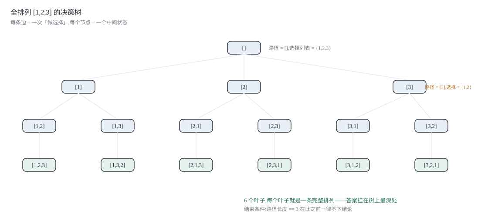
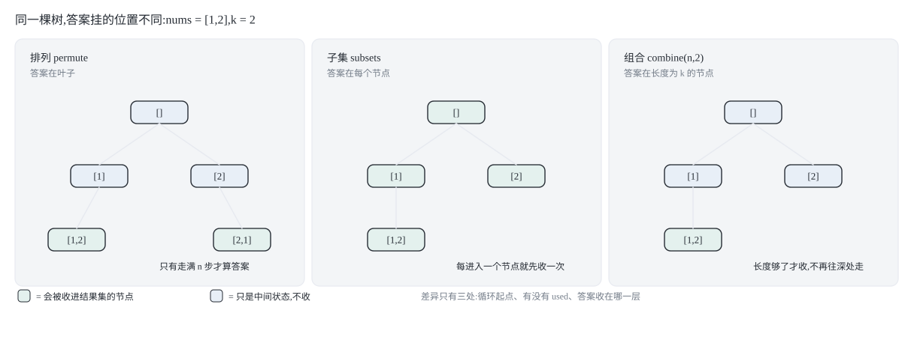
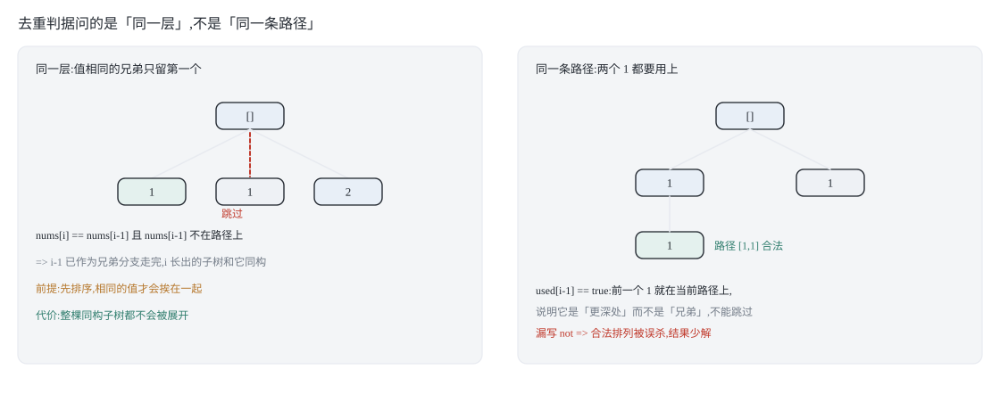
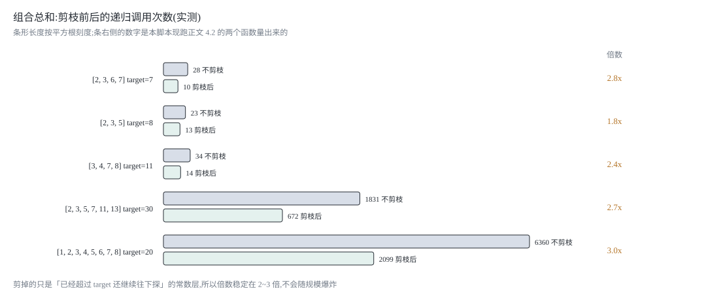
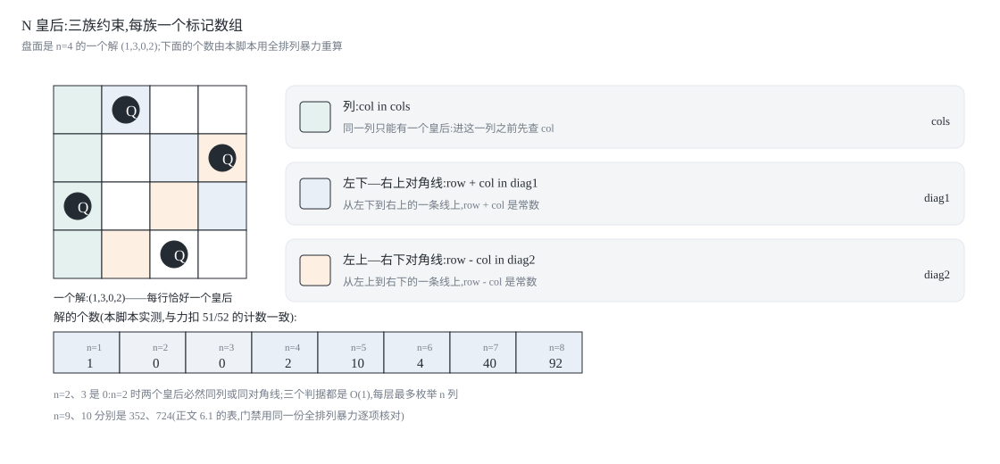
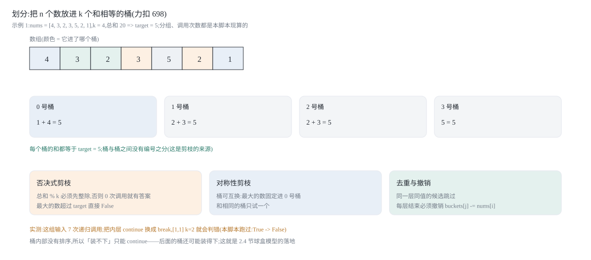

## 0 先说明材料和我的写法

这篇是我自己的学习笔记，材料来自 labuladong 的这几篇教程：

- 《回溯算法解题套路框架》—— <https://labuladong.online/zh/algo/essential-technique/backtrack-framework/>
- 《解答回溯算法/DFS 算法的若干疑问》—— <https://labuladong.online/zh/algo/essential-technique/backtrack-vs-dfs/>
- 《球盒模型：回溯算法穷举的两种视角》—— <https://labuladong.online/zh/algo/practice-in-action/two-views-of-backtrack/>
- 《回溯算法秒杀所有排列/组合/子集问题》—— <https://labuladong.online/zh/algo/essential-technique/permutation-combination-subset-all-in-one/>
- 《回溯算法实践：数独和 N 皇后问题》—— <https://labuladong.online/zh/algo/practice-in-action/sudoku-nqueue/>
- 《回溯算法经典习题》—— <https://labuladong.online/zh/algo/problem-set/backtrack-i/>

**代码是 Python 3 和 C++ 两版**，不是原文的语言。教程原文用 Java 写，我按自己的习惯重新实现了一遍，下面这些片段是我写的，不是从原文抄的。两种语言并排给出，因为它们踩的坑不一样：Python 的 `track` 是可变对象，往结果集里塞之前必须显式拷贝；C++ 的 `track.push_back` 进 `vector<vector<int>>` 时天然就是拷贝，反而没有这个问题。同一个"收集答案"的动作，两种语言里要防的东西正好相反。

关于材料，有一件事要坦白说清楚，因为它决定了这篇哪些部分是转述、哪些部分是推导：

- 《回溯算法解题套路框架》我取到了完整正文，"路径 / 选择列表 / 结束条件"这三个词、决策树的讲法、以及"回溯就是多叉树遍历"这个结论都出自这一篇。
- 《回溯算法秒杀所有排列/组合/子集问题》我只取到了标题、开头的分类（元素无重不可复选 / 可重不可复选 / 无重可复选三种形式，共九种变化）和它的小节标题列表（子集、组合、排列、子集/组合去重、排列去重、可复选）。**正文没有取到**，所以第 2 节和第 3 节里三份代码"只差哪几行"的逐行对比、以及去重条件的推导，是我自己写的，不是原文的表述。原文列出的九种变体清单我对照过，覆盖范围是一致的。
- 《解答回溯算法/DFS 算法的若干疑问》和《球盒模型》也只取到了开头和小节标题。所以"为什么撤销要写在递归之后"这一节（1.3）是我自己的推导。
- 第 4 节的剪枝实测、第 5 节与 `itertools` 的对拍，都是我自己的代码跑出来的，不是引用的数字。
- 第 6、7 节用到的两篇——《回溯算法实践：数独和 N 皇后问题》和《回溯算法经典习题》——**正文也都没有取到**，只取到小标题列表和关键术语（前者的小标题是「游戏简介 / 数独游戏 / N 皇后问题 / n 位二进制数的所有可能」，后者只有一个题目清单页的术语列表）。所以这两节的算法、代码、剪枝推导和全部数字都是我自己的；原文对这两类问题怎么讲，我一个字都没有引用。

所有代码块都会被 `assets/blog/backtracking-20261125/verify_code.py` 从这篇文章里正则抽出来真跑一遍（不是手抄一份去测），Python 侧直接 `exec`，C++ 侧抽出来拼上两个测试 `main`，用 `g++ -std=c++17 -Wall -Wextra -Werror -O1` 编译后运行，两个编译单元都要求零警告。第 6、7 节还各有一组**互相独立的参照**：N 皇后与全排列暴力对拍、数独与精确覆盖求解器对拍、划分与位掩码 DP 对拍、子集和与布尔 DP 对拍；正例还要由只看答案的见证程序重做一遍。

### 目录

- [0 先说明材料和我的写法](#0-先说明材料和我的写法)
- [1 回溯算法的三个词:路径、选择列表、结束条件](#1-回溯算法的三个词路径选择列表结束条件)
- [2 排列、组合、子集:其实只差一行](#2-排列组合子集其实只差一行)
- [3 有重复元素时:排序加同层去重](#3-有重复元素时排序加同层去重)
- [4 剪枝:用递归调用次数证明它真的生效](#4-剪枝用递归调用次数证明它真的生效)
- [5 与 itertools 暴力枚举对照](#5-与-itertools-暴力枚举对照)
- [6 棋盘类问题:N 皇后与解数独](#6-棋盘类问题n-皇后与解数独)
- [7 集合划分与子集划分:回溯加剪枝](#7-集合划分与子集划分回溯加剪枝)
- [8 把这几个套路收成一张表](#8-把这几个套路收成一张表)
- [9 材料与出处](#9-材料与出处)

## 1 回溯算法的三个词:路径、选择列表、结束条件

### 1.1 一棵树，三个词

先把话说死：**回溯算法不是一种"技巧"，它就是"把穷举过程画成一棵树，然后遍历这棵树"。** 这句话之所以有用，是因为它把"怎么穷举"这个开放问题，换成了一个有固定答案的问题——树怎么遍历，代码就怎么写。

拿全排列举例。`nums = [1,2,3]`，人肉穷举的时候我们不会乱试，而是：先定第一位，再定第二位，最后定第三位。这个过程的每一个"中间状态"都是一个节点：

- 根节点：一个都没选，`[]`；
- 根的第一个孩子：选了 1，路径 `[1]`；
- 它的第一个孩子：选了 2，路径 `[1,2]`；
- 再往下：只能选 3，路径 `[1,2,3]`——到底了，这是一个完整解。



这棵树叫**决策树**。树上每个节点都在回答同一个问题："站在这里，我接下来能选什么？"于是站在任意一个节点上，你只需要知道三件事：

| 词 | 含义 | 在全排列里 |
|---|---|---|
| 路径 | 已经做过的选择 | `track`，比如 `[1,2]` |
| 选择列表 | 当前还能做的选择 | 还没被用过的那些数，`{3}` |
| 结束条件 | 没法再做选择的条件 | `track` 的长度等于 `n` |

三个词里，**"选择列表"是最容易被写错的一个**，因为它经常不需要显式存在。全排列里我们用一个 `used` 数组标记"哪些数已经在路径上"，选择列表就是"`used[i] == false` 的那些 `i`"。标记是为了推导，不是为了遍历。

### 1.2 框架

把决策树的遍历写出来，就是回溯框架。它的骨架和普通的多叉树遍历几乎一样，只在递归调用的前后各加了一个动作：

```text
result = []
def backtrack(路径, 选择列表):
    if 满足结束条件:
        result.add(路径)
        return

    for 选择 in 选择列表:
        做选择            # 前序位置：把选择加到路径上
        backtrack(路径, 选择列表)
        撤销选择          # 后序位置：把选择从路径上拿掉
```

**为什么"做选择"和"撤销选择"是这个框架的全部？** 因为 `track` 这条路径是**所有节点共享的一份数据**。递归下降时你往它尾部追加，代表"我选了"；递归返回时你把它尾部弹掉，代表"我反悔了，回到父节点，去试下一个兄弟"。如果不撤销，兄弟节点看到的路径里就带着上一个分支留下的尾巴——那不是穷举，那是乱串。

对应的"前序 / 后序"说法也值得记住：**在进入节点前执行的是前序，在离开节点后执行的是后序。** 回溯框架把这两个位置挪到了 `for` 循环里面，是因为这里的"节点"对应的是"一次选择"，而不是"一个递归函数调用"。原文在框架那篇里特意提了这个差异，并把它留给了《解答回溯算法/DFS 算法的若干疑问》去展开——那篇我只取到了开头，所以下面这段解释是我自己的：

普通的 `traverse(root)` 写法里，前序位置在循环外面，因为"进入 `root` 这个节点"这件事只发生一次。而回溯里，`backtrack()` 每被调用一次，就代表决策树上多走了一条边；循环里的每一次迭代都是一条边，所以"做选择 / 撤销选择"这一对必须贴着每一次迭代，而不能贴在函数入口和出口。

### 1.3 为什么撤销必须写在递归之后

这是全篇最值得停下来想一秒的地方：把两个动作的**位置**换一下会怎样？

```text
for 选择 in 选择列表:
    做选择
    撤销选择
    backtrack(路径, 选择列表)   # 错：递归时路径是空的
```

这样写，递归下降的时候路径已经恢复原样了，等于什么都没选。所以"做选择 → 递归 → 撤销选择"的顺序不是风格问题，而是**它俩把递归调用夹在中间，才保证"进入子节点时路径里含这次选择，返回父节点后路径里不含"**——这正好是决策树上"沿边走下去再退回来"这个动作的完整描述。

还有一个更隐蔽的错法：忘了撤销 `used` 数组，只撤销了 `track`。这时路径读起来是对的，但选择列表错了——那些已经退回去的数仍然被标记为"用过"，后面的分支会因为候选变少而漏解，而且**漏得很安静**（结果少几个，不报错）。这就是为什么下面第 2 节我把 `used[i] = False` 单独写在 `track.pop()` 后面一行。

### 1.4 复杂度：为什么是 O(n·n!) 而不是 O(n!)

决策树的规模决定了复杂度，这里要分两笔算：

- **节点数（时间）**：叶子有 n! 个，每个叶子上面挂着一条长度为 n 的路径，树的总节点数 ≈ n!·(1 + 1/1! + 1/2! + …) < e·n!，也就是 O(n!)。每一层里的选择是 O(1) 的追加/弹出，所以搜索本身是 O(n!)。
- **拷贝（结果）**：每收集一个解要拷贝一次路径，O(n)。n! 个解就是 O(n·n!)。

所以全排列的时间是 **O(n·n!)**，其中 n! 是"解有那么多个"造成的下界，n 是"每个解要写下来"造成的。空间是 O(n)：递归栈深度 n，加上 `track` 和 `used` 各 O(n)；如果算上结果集，那就是答案本身的体积。

顺带一个实测锚点，来自本文的验证脚本：`permute` 在 n=7 时递归调用 **13700** 次，产出 5040 个排列（7! = 5040）。13700 / 5040 ≈ 2.7，和上面那个 e 的估计对得上——**树上的节点数只比叶子数大一个常数倍**，这就是"回溯是纯暴力穷举，复杂度被答案数量卡死"的意思。原文有一句话说得很直白：不像动态规划有重叠子问题可以优化，回溯算法就是纯暴力穷举，复杂度一般都很高。

## 2 排列、组合、子集:其实只差一行

这一节的三份代码，请当成**同一份骨架的三个填法**来看，而不是三道要背的题。我先给出三份完整实现，然后逐行对比差在哪。

### 2.1 全排列：循环从 0 开始，用 used 推导选择列表

**Python 3**:

```python
def permute(nums):
    res, track = [], []
    used = [False] * len(nums)

    def backtrack():
        if len(track) == len(nums):      # 结束条件:所有数都上了路径
            res.append(list(track))      # 必须拷贝:track 是共享的那一条路径
            return
        for i in range(len(nums)):       # 注意:从 0 开始,每个位置都要重看一遍
            if used[i]:
                continue                 # 已经在路径上的数不能再用
            used[i] = True
            track.append(nums[i])
            backtrack()
            track.pop()
            used[i] = False              # 和 track.pop() 一样,必须成对

    backtrack()
    return res
```

**C++**:

```cpp
#include <functional>
#include <vector>

std::vector<std::vector<int>> permute(const std::vector<int>& nums) {
    std::vector<std::vector<int>> res;
    std::vector<int> track;
    std::vector<bool> used(nums.size(), false);

    std::function<void()> backtrack = [&]() {
        if (track.size() == nums.size()) {   // 结束条件
            res.push_back(track);           // 这里天然是拷贝
            return;
        }
        for (int i = 0; i < static_cast<int>(nums.size()); ++i) {
            if (used[i]) continue;
            used[i] = true;
            track.push_back(nums[i]);
            backtrack();
            track.pop_back();
            used[i] = false;
        }
    };

    backtrack();
    return res;
}
```

**最容易写错的一行:** `res.append(list(track))`。写成 `res.append(track)` 的话，结果集里装的是**同一个列表对象的 n! 个引用**，而那个对象最后一定是空的（所有分支都撤销完了）。跑出来的现象是：答案个数对、内容全空。C++ 没有这个坑，`push_back` 进 `vector<vector<int>>` 会拷贝一份新的 `vector`。

### 2.2 子集：答案在每一个节点上，不在叶子上

子集问题换了一个收集答案的位置。

**Python 3**:

```python
def subsets(nums):
    res, track = [], []

    def backtrack(start):
        res.append(list(track))          # 每个节点都是一个合法子集,先收下再往下走
        for i in range(start, len(nums)):  # 注意:从 start 开始,不走回头路
            track.append(nums[i])
            backtrack(i + 1)             # 下一层只能从 i 后面选,所以不会有重复子集
            track.pop()

    backtrack(0)
    return res
```

**C++**:

```cpp
#include <functional>
#include <vector>

std::vector<std::vector<int>> subsets(const std::vector<int>& nums) {
    std::vector<std::vector<int>> res;
    std::vector<int> track;

    std::function<void(int)> backtrack = [&](int start) {
        res.push_back(track);                // 进来就收:每个节点都是答案
        for (int i = start; i < static_cast<int>(nums.size()); ++i) {
            track.push_back(nums[i]);
            backtrack(i + 1);
            track.pop_back();
        }
    };

    backtrack(0);
    return res;
}
```

两个设计决定的理由：

1. **`res.append` 放在函数开头，而不是 `return` 前面。** 因为子集问题的解集合是决策树的**全部节点**，不只是叶子。`[1]`、`[1,2]`、`[1,2,3]` 都是合法答案，它们分别落在根→叶这条链的不同深度上。全排列则相反：只有长度为 n 的路径才算答案，所以收集写在结束条件里面。
2. **循环从 `start` 开始，递归传 `i + 1`。** 这是"组合型"的走法：一旦决定了"下一个选谁"，就只允许从它后面继续选。这样 `[1,2]` 和 `[2,1]` 只会出现一次——因为顺序被"下标递增"钉死了。全排列要保留顺序差异，所以循环从 0 开始、靠 `used` 排重。

**注意这个函数对空输入的行为**：`subsets([])` 返回 `[[]]`，也就是"空集有一个子集，就是它自己"。这不是 bug，是数学定义，下面第 5 节会拿 `itertools` 对拍。

### 2.3 组合：给子集加一个长度条件

组合问题和子集问题在数学上就是同一件事：`C(n, k)` 是"大小为 k 的子集"。所以代码只需要在子集版本上加一个结束条件。

**Python 3**:

```python
def combine(n, k):
    res, track = [], []

    def backtrack(start):
        if len(track) == k:              # 长度够了就是一个组合,不要再往深处走
            res.append(list(track))
            return
        for i in range(start, n + 1):
            if n - i + 1 < k - len(track):   # 剩下的数不够填满 k 个,整枝砍掉
                break
            track.append(i)
            backtrack(i + 1)
            track.pop()

    backtrack(1)
    return res
```

**C++**:

```cpp
#include <functional>
#include <vector>

std::vector<std::vector<int>> combine(int n, int k) {
    std::vector<std::vector<int>> res;
    std::vector<int> track;

    std::function<void(int)> backtrack = [&](int start) {
        if (static_cast<int>(track.size()) == k) {
            res.push_back(track);
            return;
        }
        for (int i = start; i <= n; ++i) {
            if (n - i + 1 < k - static_cast<int>(track.size())) break;  // 剩余的数不够了
            track.push_back(i);
            backtrack(i + 1);
            track.pop_back();
        }
    };

    backtrack(1);
    return res;
}
```

这里出现了本文第一处真正的**剪枝**：`for` 的上界不是 `n`，而是"还差几个数"决定的位置。假如 `n = 5, k = 3`，当前路径长度为 0，那么 `i` 最多只能到 3——选 4 当第一个数以后就只剩 5 一个候选，凑不满 3 个。条件 `n - i + 1 < k - len(track)` 说的就是"从 i 到 n 一共还有几个数，够不够填满还差的坑位"。

它在搜索结果上不改变任何东西（被砍掉的枝上本来就没有解），但省掉了一整批"走到一半发现凑不齐"的递归。至于省下多少、怎么量，第 4 节给数字。

`combine(0, 0)` 这件小事也值得写一句：返回 `[[]]`。数学上"从 0 个元素里取 0 个"有 1 种取法。边界不是特例，是定义。

### 2.4 三份代码到底差在哪



把三份实现摊平了看，差异只有四处，其余部分逐字相同：

| | 全排列 `permute` | 子集 `subsets` | 组合 `combine` |
|---|---|---|---|
| 循环起点 | `0`（每个位置重看一遍） | `start`（只往后选） | `start`（只往后选） |
| 额外状态 | `used[]` 数组 | 无 | 无 |
| 收集答案的位置 | 结束条件里（叶子） | 函数开头（每个节点） | 结束条件里（长度为 k 的节点） |
| 结束条件 | `len(track) == n` | 没有（走到自然结束） | `len(track) == k` |
| 递归传参 | 无（靠 `used`） | `i + 1` | `i + 1` |

所以那句"只差一行"要拆成两句话才准确：

- **子集 → 组合**：只差一个结束条件（外加一处上界剪枝）。因为组合就是"限定大小的子集"。
- **子集 → 排列**：差的是"循环起点 + 一个 `used` 数组"。本质上，子集用"下标递增"消掉了顺序差异，排列则把顺序差异重新放开。

这种"同一棵树，收集位置不同"的视角，和原文提到的"球盒模型"是两条路线：原文的两种穷举视角（站在球的角度 / 站在盒的角度）讲的是**同一批解可以长在两棵不同的树上**；这里讲的是**同一棵树上，答案可以挂在不同深度**。两条路线都能推出这些代码，我用的是后者，因为它更容易和"三份代码只差几行"这个观察对上。

## 3 有重复元素时:排序加同层去重

### 3.1 重复的根源是"同一层里的两个相同选择"

`nums = [1,1,2]`。如果直接套用 2.1 的 `permute`，会输出 6 个排列，其中 `[1,1,2]` 出现了两次。为什么？

因为两个 `1` 在代码眼里是**两个不同的下标**（0 和 1），但对结果来说它们是同一个值。决策树上，根节点的两条边"选下标 0 的 1"和"选下标 1 的 1"会各自长出一棵**结构完全相同**的子树，两棵子树的叶子一模一样——重复就是这么来的。注意这里的"层"：这两条边是**从同一个节点伸出去的兄弟边**，它们处在决策树的同一层。

于是去重的判据可以是：**在同一层里，值相同的选择只允许走第一次出现的那个。** 关键词是"同一层"，不是"同一条路径"——同一条路径上必须允许重复值（`[1,1,2]` 本身就要用到两个 1）。这两件事的区别，落到代码上就是 `used[i-1]` 前面那个 `not`。

### 3.2 全排列 II

**Python 3**:

```python
def permute_unique(nums):
    nums = sorted(nums)                  # 先排序:让相同的值挨在一起
    res, track = [], []
    used = [False] * len(nums)

    def backtrack():
        if len(track) == len(nums):
            res.append(list(track))
            return
        for i in range(len(nums)):
            if used[i]:
                continue
            # 同一层里,值相同的数字只由"最左边那个还没用过"的来代表
            if i > 0 and nums[i] == nums[i - 1] and not used[i - 1]:
                continue
            used[i] = True
            track.append(nums[i])
            backtrack()
            track.pop()
            used[i] = False

    backtrack()
    return res
```

**C++**:

```cpp
#include <algorithm>
#include <functional>
#include <vector>

std::vector<std::vector<int>> permuteUnique(std::vector<int> nums) {
    std::sort(nums.begin(), nums.end());     // 相同的值必须挨在一起
    std::vector<std::vector<int>> res;
    std::vector<int> track;
    std::vector<bool> used(nums.size(), false);

    std::function<void()> backtrack = [&]() {
        if (track.size() == nums.size()) {
            res.push_back(track);
            return;
        }
        for (int i = 0; i < static_cast<int>(nums.size()); ++i) {
            if (used[i]) continue;
            // nums[i-1] 没被用过 => 它和 i 处在决策树的同一层,跳过 i
            if (i > 0 && nums[i] == nums[i - 1] && !used[i - 1]) continue;
            used[i] = true;
            track.push_back(nums[i]);
            backtrack();
            track.pop_back();
            used[i] = false;
        }
    };

    backtrack();
    return res;
}
```



**最容易写错的一行:** `if i > 0 and nums[i] == nums[i - 1] and not used[i - 1]` 里的 `not`。

- `not used[i - 1]` 表示：`nums[i-1]` 不在当前路径上。既然它不在路径上，那它一定是"被撤销过"或者"还没被选中"，也就是**当前层的前一个兄弟分支**——这时 `nums[i]` 和 `nums[i-1]` 是同一层里的相同选择，跳过。
- 写成 `used[i - 1]`（没有 `not`）意思就反了：它变成"只有当 `nums[i-1]` 已经在路径上时才跳过"。那恰好把合法的重复值排列（`[1,1,2]` 这种需要连着用两个 1 的）挡掉，却放过了同层的重复；结果是漏解。

这个判据只在**排序后**成立，`i > 0` 那个边界是给 `i = 0` 留的——第一个选择没有左邻居，永远不跳。

### 3.3 子集 II

子集版本的判据更短，因为子集没有 `used` 数组，可以用"是不是这一层的第一个选择"来替代：

**Python 3**:

```python
def subsets_with_dup(nums):
    nums = sorted(nums)
    res, track = [], []

    def backtrack(start):
        res.append(list(track))
        for i in range(start, len(nums)):
            # start 就是这一层的第一个选择;i > start 说明已经在看兄弟分支了
            if i > start and nums[i] == nums[i - 1]:
                continue
            track.append(nums[i])
            backtrack(i + 1)
            track.pop()

    backtrack(0)
    return res
```

**C++**:

```cpp
#include <algorithm>
#include <functional>
#include <vector>

std::vector<std::vector<int>> subsetsWithDup(std::vector<int> nums) {
    std::sort(nums.begin(), nums.end());
    std::vector<std::vector<int>> res;
    std::vector<int> track;

    std::function<void(int)> backtrack = [&](int start) {
        res.push_back(track);
        for (int i = start; i < static_cast<int>(nums.size()); ++i) {
            // 同一层里,重复值只取第一个
            if (i > start && nums[i] == nums[i - 1]) continue;
            track.push_back(nums[i]);
            backtrack(i + 1);
            track.pop_back();
        }
    };

    backtrack(0);
    return res;
}
```

### 3.4 两种去重的代价差在哪

"排序 + 同层去重"和"最后用 set 去重"得到的结果一样，但代价完全不在一个量级：

- **set 去重**发生在**结果层**：搜索仍然把两棵同构子树都走完了，只是最后把重复的解扔掉。树的规模一点没变。
- **同层去重**发生在**搜索层**：第二棵同构子树**根本不会被展开**。

这不是理论上的差别，本文的验证脚本量了递归调用次数：

| 输入 | 排序 + 同层去重 | 先全穷举再 set 去重 | 去重后解数 |
|---|---|---|---|
| `[1,1,2]` | 9 次调用 | 16 次调用 | 3 |
| `[1,1,1,2]` | 14 次调用 | 65 次调用 | 4 |
| `[1,2,2,3,3]` | 90 次调用 | 326 次调用 | 30 |
| `[1,1,2,2,3,3]` | **271 次调用** | **1957 次调用** | 90 |

最后一行是 7.2 倍的差距，而且重复元素越多、这个倍数越大——因为"同构的子树"是以重复元素的阶乘级别增长的。**去重条件写得越靠近树根，省得越多**，这和"剪枝"是同一个道理。

## 4 剪枝:用递归调用次数证明它真的生效

### 4.1 组合总和：从"撞墙才回头"到"看到墙就回头"

力扣 39「组合总和」：给一个**无重复元素**的数组 `candidates` 和一个目标数 `target`，找出所有和为 `target` 的组合，同一个数字可以重复使用。

先看一个只做"合法性检查"的版本：不排序，不预判，只在 `remain < 0` 的时候退回来。

**Python 3**:

```python
def combination_sum_naive(candidates, target):
    """只挡"已经超过目标",不排序、不剪枝。返回 (解集, 递归调用次数)。"""
    res, track = [], []
    calls = [0]

    def backtrack(start, remain):
        calls[0] += 1
        if remain == 0:
            res.append(list(track))
            return
        if remain < 0:                    # 唯一的一处检查:撞墙了才回头
            return
        for i in range(start, len(candidates)):
            track.append(candidates[i])
            backtrack(i, remain - candidates[i])   # 传 i 而不是 i+1:元素可重复使用
            track.pop()

    backtrack(0, target)
    return res, calls[0]
```

**C++**:

```cpp
#include <functional>
#include <utility>
#include <vector>

// 返回 {解集, 递归调用次数}
std::pair<std::vector<std::vector<int>>, long long> combinationSumNaive(
        const std::vector<int>& candidates, int target) {
    std::vector<std::vector<int>> res;
    std::vector<int> track;
    long long calls = 0;

    std::function<void(int, int)> backtrack = [&](int start, int remain) {
        ++calls;
        if (remain == 0) { res.push_back(track); return; }
        if (remain < 0) return;               // 撞墙才回头
        for (int i = start; i < static_cast<int>(candidates.size()); ++i) {
            track.push_back(candidates[i]);
            backtrack(i, remain - candidates[i]);
            track.pop_back();
        }
    };

    backtrack(0, target);
    return {res, calls};
}
```

再看剪枝版，只加了两件事：**先排序**，以及**在循环里提前 `break`**。

**Python 3**:

```python
def combination_sum_pruned(candidates, target):
    """排序之后,用"最小的候选都超过剩余"整枝砍掉。返回 (解集, 递归调用次数)。"""
    cand = sorted(candidates)
    res, track = [], []
    calls = [0]

    def backtrack(start, remain):
        calls[0] += 1
        if remain == 0:
            res.append(list(track))
            return
        for i in range(start, len(cand)):
            if cand[i] > remain:          # cand 是升序的,后面只会更大
                break                     # 整枝砍掉,不是跳过这一个
            track.append(cand[i])
            backtrack(i, remain - cand[i])
            track.pop()

    backtrack(0, target)
    return res, calls[0]
```

**C++**:

```cpp
#include <algorithm>
#include <functional>
#include <utility>
#include <vector>

std::pair<std::vector<std::vector<int>>, long long> combinationSumPruned(
        std::vector<int> candidates, int target) {
    std::sort(candidates.begin(), candidates.end());   // 排序是剪枝的前提
    std::vector<std::vector<int>> res;
    std::vector<int> track;
    long long calls = 0;

    std::function<void(int, int)> backtrack = [&](int start, int remain) {
        ++calls;
        if (remain == 0) { res.push_back(track); return; }
        for (int i = start; i < static_cast<int>(candidates.size()); ++i) {
            if (candidates[i] > remain) break;    // 升序 => 后面全部超过,整枝剪掉
            track.push_back(candidates[i]);
            backtrack(i, remain - candidates[i]);
            track.pop_back();
        }
    };

    backtrack(0, target);
    return {res, calls};
}
```

**最容易写错的一行:** 是 `break` 不是 `continue`。`continue` 只跳过当前这个候选，后面更大的候选还会被继续尝试，等于没剪；`break` 依赖的是"排序之后候选单调不减"这个前提，一刀砍掉整个后缀。把 `break` 写成 `continue` 的话，答案仍然是对的（那些分支本来也无解），但省下来的调用次数会少一大截——这种"正确但没生效"的错误最难发现，因为你不会看到任何失败。

顺便说清楚为什么剪枝版连 `remain < 0` 都不用判：进循环之前 `cand[i] <= remain` 已经保证了 `remain - cand[i] >= 0`，递归下去 `remain` 永远非负。

### 4.2 实测：剪枝前后的递归调用次数



两个函数返回的解集完全一致（验证脚本里逐个对拍过），差别只在递归调用次数。下面这些数字是验证脚本跑出来的原始输出：

| candidates | target | 解数 | 不剪枝调用次数 | 剪枝后调用次数 | 倍数 |
|---|---|---|---|---|---|
| `[2,3,6,7]` | 7 | 2 | 28 | 10 | 2.8× |
| `[2,3,5]` | 8 | 3 | 23 | 13 | 1.8× |
| `[3,4,7,8]` | 11 | 3 | 34 | 14 | 2.4× |
| `[2,3,5,7,11,13]` | 30 | 80 | 1831 | 672 | 2.7× |
| `[1,2,3,4,5,6,7,8]` | 20 | 434 | 6360 | 2099 | 3.0× |

怎么读这张表：

- **小用例看不出剪枝的价值。** `[2,3,6,7]` 那种规模，28 次和 10 次调用对人来说都是瞬间，所以"剪枝有没有生效"在小数据上无法用眼睛判断——必须数调用次数。这也是我把计数器直接写进函数返回值的原因。
- **倍数稳定在 2~3 倍，而不是随规模爆炸。** 原因不难想：剪掉的枝是"越过 `target` 之后继续往下探"的那一层，每条越界分支本来也只会多探常数深度，所以省的是常数倍。真正随规模爆炸的是**解的数量**（434 个解、6360 次调用），那是问题本身的下界，剪枝动不了它。
- 想要数量级级别的收益，得靠第 3 节那种"同层去重"：重复元素多的时候，砍掉的是一整棵子树。

### 4.3 剪枝的三个前提

剪枝写法很轻，但它成立需要三个条件，缺一个就会静默地错：

1. **顺序前提**：候选必须有序（这里是升序），否则 `break` 会在一个不该停的位置停下，直接漏解。所以排序那一行不是"顺手优化"，是正确性的一部分。
2. **单调前提**：越往深处走，"剩余额度"必须单调不增。组合总和里 `remain` 每次减去一个正数，一定变小，所以"这个候选已经太大"意味着"后面更大"。如果候选里有 0 或负数，这个前提就崩了。
3. **可判前提**：被剪掉的分支必须能被**证明**不含解。`cand[i] > remain` 加上候选均为正数，就是那个证明。判断不了的分支不能剪——这正是搜索和"猜"的区别。

## 5 与 itertools 暴力枚举对照

"结果对不对"不能靠肉眼扫一遍。Python 标准库里的 `itertools` 提供了不依赖任何算法的暴力枚举——它内部是纯迭代器，没有回溯、没有剪枝、没有去重逻辑——正好可以当作独立的标准答案来对拍。这些对拍写在验证脚本里，对拍用的函数就是从本文代码块里抽出来的那几个。

### 5.1 n=0 和 n=1：两个必须想清楚的边界

| 输入 | `permute` | `itertools.permutations` | `subsets` | `itertools`（所有长度的组合拼起来） | `combine(n, k)` |
|---|---|---|---|---|---|
| `[]` | `[[]]` | `[()]` | `[[]]` | `[()]` | `combine(0, 0)` → `[[]]` |
| `[1]` | `[[1]]` | `[(1,)]` | `[[], [1]]` | `[(), (1,)]` | `combine(1, 1)` → `[[1]]` |
| `[1,2]` | `[[1,2],[2,1]]` | `[(1,2),(2,1)]` | `[[], [1], [1,2], [2]]` | 同左 | `combine(2, 1)` → `[[1],[2]]` |
| `[1,2,3]` | 6 个 | 6 个 | 8 个 | 8 个 | `combine(3, 2)` → `[[1,2],[1,3],[2,3]]` |

两处容易吵起来的地方，我认为答案都很清楚：

- **空输入的排列是 `[[]]` 而不是 `[]`。** 0 个元素有 1 种排列方式（什么都不做），`itertools.permutations([])` 也返回一个含 `()` 的序列。力扣 46 题保证 n ≥ 1，所以这个边界在提交时不会出现，但自己写库函数时它是必须定的语义。本文的 `permute` 走的是"数学定义"这一侧。
- **空输入的子集是 `[[]]`。** 空集有且仅有一个子集，就是空集自己。

`combine` 在 `k > n` 时返回 `[]`（凑不齐就是没有），在 `k == 0` 时返回 `[[]]`，这两条也和 `itertools.combinations` 一致。

### 5.2 有重复元素时的对照

`itertools` 的枚举**不去重**，这正好让它成为一把好尺子：

| 输入 | `permute`（不去重） | `permute_unique` | `set(itertools.permutations(...))` | `subsets`（不去重） | `subsets_with_dup` | `set` 去重后的子集 |
|---|---|---|---|---|---|---|
| `[1,1,2]` | 6 | 3 | 3 | 8 | 6 | 6 |
| `[1,1,1,2]` | 24 | 4 | 4 | 16 | 8 | 8 |
| `[1,2,2,3,3]` | 120 | 30 | 30 | 32 | 18 | 18 |
| `[1,1,2,2,3,3]` | 720 | 90 | 90 | 64 | 27 | 27 |

对拍方式：把 `permute_unique` 的输出排序后，与 `sorted(set(itertools.permutations(nums)))` 排序后比较；子集侧同理，用 `sorted(map(tuple, ...))` 归一化后比较。三轮输入（n=0、n=1、含重复元素）都覆盖到了，验证脚本里是逐个断言的。

顺带可以把"重复元素有多少"这件事量化一下：`[1,1,2,2,3,3]` 的不去重枚举有 720 个排列，去重后只剩 90 个——**同一批解被重复枚举了 8 倍**。这就是第 3 节那 7.2 倍调用次数差距的来源。

## 6 棋盘类问题:N 皇后与解数独

**这一节是我自己的推导。** 素材里对应的那篇《回溯算法实践：数独和 N 皇后问题》，我只取到标题、四个小节名（游戏简介 / 数独游戏 / N 皇后问题 / n 位二进制数的所有可能）和一张术语表，正文没有取到。所以下面的建模、三个集合的写法、位运算版本、以及这一节里的每一个数字，都是我自己推、自己跑出来的；唯一从素材里得到的信息是"这节要讲数独、N 皇后，还会讲 n 位二进制数"。

前面五节的决策树都长在一维序列上：选择列表要么是"还没用过的数"，要么是"下标 ≥ start 的候选"。棋盘类问题把这棵树搬到二维棋盘上，骨架一个字都没改——**"逐层做选择"变成"逐行放子"，"选择列表"变成"这一行还能放哪一列"**。约束变多了，但约束多恰恰是好事：约束越紧，从靠近树根的地方就被砍掉的枝越多。这一节过两道题：力扣 51/52 N 皇后、力扣 37 解数独。

### 6.1 N 皇后：每行放一个，三条约束用三个集合

力扣 51 要求把所有解都画出来，52 只要解的个数。题面是 n×n 的棋盘上放 n 个皇后，任意两个不能同行、同列、同对角线。第一条简化来自题面本身：

**n 个皇后放进 n 行，每行恰好一个。** 所以搜索的"层"不用设计，棋盘自己给了：第 0 行放哪一列、第 1 行放哪一列……逐行决定。这一步把搜索空间从"n² 个格子挑 n 个"的 C(n², n) 压到 n!；而且**"逐行放"不是优化，是建模**——它把"每行一个"这条硬约束直接变成了树的结构，不需要再写判据去检查它。

剩下的三条约束（同列、同"\"对角线、同"/"对角线）用三个集合维护：

| 约束 | 判据 | 为什么是这个式子 |
|---|---|---|
| 同列 | `col` | 列号相同 |
| 同"\"对角线 | `row + col` | 这条线上往下一行，列号必然减一，`row + col` 是常数 |
| 同"/"对角线 | `row - col` | 同理，这条线上 `row - col` 是常数 |



**Python 3**:

```python
def solve_n_queens(n):
    res, queens = [], []                 # queens[row] = 这一行皇后所在的列
    cols, diag1, diag2 = set(), set(), set()

    def backtrack(row):
        if row == n:                     # 每行都放好了,棋盘就是一个解
            res.append(["." * c + "Q" + "." * (n - 1 - c) for c in queens])
            return
        for col in range(n):             # 这一行的选择列表:能放哪一列
            if col in cols or row + col in diag1 or row - col in diag2:
                continue                 # 三个集合就是这个格子的全部约束
            cols.add(col); diag1.add(row + col); diag2.add(row - col)
            queens.append(col)
            backtrack(row + 1)
            queens.pop()                 # 撤销:路径和三个集合一起回退
            cols.discard(col); diag1.discard(row + col); diag2.discard(row - col)

    backtrack(0)
    return res


def total_n_queens(n):
    count = 0                            # 力扣 52:不拼棋盘,只数叶子
    cols, diag1, diag2 = set(), set(), set()

    def backtrack(row):
        nonlocal count
        if row == n:
            count += 1
            return
        for col in range(n):
            if col in cols or row + col in diag1 or row - col in diag2:
                continue
            cols.add(col); diag1.add(row + col); diag2.add(row - col)
            backtrack(row + 1)
            cols.discard(col); diag1.discard(row + col); diag2.discard(row - col)

    backtrack(0)
    return count
```

**C++**:

```cpp
#include <functional>
#include <string>
#include <vector>

std::vector<std::vector<std::string>> solveNQueens(int n) {
    std::vector<std::vector<std::string>> res;
    std::vector<int> queens;                       // queens[row] = 这一行的列号
    std::vector<bool> cols(n, false), diag1(2 * n, false), diag2(2 * n, false);

    std::function<void(int)> backtrack = [&](int row) {
        if (row == n) {
            std::vector<std::string> board(n, std::string(n, '.'));
            for (int r = 0; r < n; ++r) board[r][queens[r]] = 'Q';
            res.push_back(board);
            return;
        }
        for (int col = 0; col < n; ++col) {
            // C++ 里下标不能是负数,所以副对角线整体平移 n 位
            if (cols[col] || diag1[row + col] || diag2[row - col + n]) continue;
            cols[col] = diag1[row + col] = diag2[row - col + n] = true;
            queens.push_back(col);
            backtrack(row + 1);
            queens.pop_back();
            cols[col] = diag1[row + col] = diag2[row - col + n] = false;
        }
    };

    backtrack(0);
    return res;
}

long long totalNQueens(int n) {
    long long count = 0;
    std::vector<bool> cols(n, false), diag1(2 * n, false), diag2(2 * n, false);

    std::function<void(int)> backtrack = [&](int row) {
        if (row == n) { ++count; return; }
        for (int col = 0; col < n; ++col) {
            if (cols[col] || diag1[row + col] || diag2[row - col + n]) continue;
            cols[col] = diag1[row + col] = diag2[row - col + n] = true;
            backtrack(row + 1);
            cols[col] = diag1[row + col] = diag2[row - col + n] = false;
        }
    };

    backtrack(0);
    return count;
}
```

**最容易写错的一行:** 副对角线那一项的减号。两条对角线必须用两个不同的不变量，`row + col` 和 `row - col`，缺一条就会把两个方向的对角线混成一类：

- 副对角线写成 `abs(row - col)`：`abs` 把 `/` 和 `\` 两个方向的对角线合并了，实际效果是**约束变松**（少了半个方向的检查），于是漏解。实测 n=4 会算成 0 个解（正确答案 2），n=5 算成 4（正确答案 10），n=6 和 n=8 都算成 0。
- 两条对角线都用 `row + col`（检查的和存进去的是同一个式子）：这次是**约束变紧**，多出来一堆假解。实测 n=2 算成 1 个解（正确答案 0，2 皇后无解），n=4 算成 7（正确答案 2），n=8 算成 2113（正确答案 92）。
- 忘了撤销（三个集合只加不减）：答案直接变成 0 个。这个最不容易看出来，因为程序不报错，只是"一个解都找不到"。

三种写错都不是崩溃型错误，而是**数字不对**型错误。这也是 N 皇后特别适合入门剪枝的原因：正确答案只有 10 个数，跑出来一比就知道对不对。

| n | 1 | 2 | 3 | 4 | 5 | 6 | 7 | 8 | 9 | 10 |
|---|---|---|---|---|---|---|---|---|---|---|
| 解的个数 | 1 | 0 | 0 | 2 | 10 | 4 | 40 | 92 | 352 | 724 |
| 递归调用次数 | 2 | 3 | 6 | 17 | 54 | 153 | 552 | 2057 | 8394 | 35539 |

这张表的十个解数不是我抄的：验证脚本用 `itertools.permutations` 把 n 个列号的全排列**全部枚举一遍**（不递归、不剪枝），再逐个验对角线，n=1 到 n=10 全跑一遍得到的正是这十个数字；同一组数字还由下面 6.2 的位运算版本独立算了一遍，两边的解集也逐元素比对过。n=4 的两个解长这样：

```text
n=4 的两个解(逐行给出列号):

(1, 3, 0, 2)      (2, 0, 3, 1)
.Q..              ..Q.
...Q              Q...
Q...              ...Q
..Q.              .Q..
```

**复杂度：** 不加任何约束时，逐行放是"第一行 n 种、第二行 n 种……"，上界 O(n!) 个叶子，每个叶子拼一次棋盘是 O(n)，所以朴素上界 O(n·n!)。三个集合把大部分分支在进入前就挡掉了：n=8 时 8! = 40320 个叶子，实际递归调用只有 2057 次，相差约 19.6 倍。空间是 O(n)：递归栈深度 n，三个集合各 O(n)，棋盘 O(n²) 只在收集答案时出现。

顺带说一个边界：n=0 时这个写法的答案是 1，也就是"空棋盘"这一个解，和 5.1 节 `permute([])` 返回 `[[]]` 是同一套语义（什么都不做也是一种做法）。力扣 51 保证 n ≥ 1，所以这个边界只在你自己封装库函数时才会碰到。

### 6.2 把三条约束压进位运算：一位就是一个集合

集合换个表示方式，就是位运算。第 `j` 位为 1 表示"第 j 列被占了"，那么"这一行哪些列还能放"就是一次按位或加取反：

**Python 3**:

```python
def total_n_queens_bitmask(n):
    """三个约束压进 n 位整数:第 j 位表示第 j 列被占。"""
    full, count = (1 << n) - 1, 0

    def backtrack(cols, diag1, diag2):
        nonlocal count
        if cols == full:                 # n 位全是 1:每一行都放下了
            count += 1
            return
        free = full & ~(cols | diag1 | diag2)    # 这一行的候选,一次算完
        while free:
            bit = free & -free           # 取最低位的 1,相当于取出一个候选
            free ^= bit                  # 把它从候选里删掉
            backtrack(cols | bit,
                      ((diag1 | bit) << 1) & full,   # \ 对角线:下一行整体左移
                      (diag2 | bit) >> 1)            # / 对角线:下一行整体右移

    backtrack(0, 0, 0)
    return count
```

**C++**:

```cpp
#include <functional>

long long totalNQueensBitmask(int n) {
    const unsigned full = (1u << n) - 1;           // n <= 30,够用了
    long long count = 0;

    std::function<void(unsigned, unsigned, unsigned)> backtrack =
            [&](unsigned cols, unsigned diag1, unsigned diag2) {
        if (cols == full) { ++count; return; }
        unsigned free = full & ~(cols | diag1 | diag2);
        while (free != 0) {
            unsigned bit = free & (~free + 1u);    // 最低位的 1
            free ^= bit;
            backtrack(cols | bit, ((diag1 | bit) << 1) & full, (diag2 | bit) >> 1);
        }
    };

    backtrack(0, 0, 0);
    return count;
}
```

这个版本有两个值得说的点。

**第一，它不需要撤销。** 集合版里 `cols.add()` / `cols.discard()` 必须成对出现，漏一个就永久污染状态；位运算版把三个约束做成**参数**，`cols | bit` 只活在这一次调用里，函数返回时自动"恢复"。同一个搜索，一个是共享状态加显式撤销，一个是纯参数传递——后者天生不会写错撤销，代价是每层多复制几个整数（n ≤ 30 时就是几个机器字，可以忽略）。

**第二，两种语言的差异在这里被放大了。** Python 的 `int` 是任意精度的，`1 << n` 想开多少位开多少位，`free & -free` 直接就能取最低位；C++ 必须选一个固定宽度的类型，`unsigned` 是 32 位，所以 `n ≤ 30` 是硬上限，写 `1u << n` 而 n = 32 时是未定义行为。C++ 里也有位运算的优势（`__builtin_popcount`、`std::bitset`），但那是另一条路。

实测两边完全一致：n=1..10 的解数一样，n=8 的递归调用次数都是 2057。也就是说**位运算没有改变搜索树，只是把每个节点的判断变便宜了**。这也说明一件事：剪枝的价值在于"少走节点"，编码技巧的价值在于"每个节点更便宜"，两者不能互相替代。

最后接回素材里那个小节名"n 位二进制数的所有可能"：一个 n 位整数天然就是一个子集——第 j 位为 1 表示元素 j 在集合里。把 `mask` 从 0 枚举到 `(1 << n) - 1` 就是枚举全部子集，这是第 7 节里当独立参照用的位掩码 DP 的基础。

### 6.3 解数独：选择列表是 1..9，约束是三个集合数组

力扣 37 给一个 9×9 的数独盘（`'.'` 表示空格），要求把它填满。N 皇后是"每行恰好一个"，数独没有这种整齐的结构，所以这里要老老实实**扫一遍棋盘找第一个空格**：

**Python 3**:

```python
def solve_sudoku(board):
    """力扣 37:原地填 board(9 个字符串的列表,'.' 表示空格)。"""
    rows = [set() for _ in range(9)]     # rows[r]:第 r 行已经用掉的数字
    cols = [set() for _ in range(9)]     # cols[c]:第 c 列已经用掉的数字
    boxes = [set() for _ in range(9)]    # boxes[b]:第 b 个 3x3 宫已经用掉的数字
    for r in range(9):
        for c in range(9):
            if board[r][c] != ".":
                v = board[r][c]
                rows[r].add(v); cols[c].add(v); boxes[(r // 3) * 3 + c // 3].add(v)

    def backtrack():
        for r in range(9):
            for c in range(9):
                if board[r][c] == ".":       # 选第一个空格:这就是这一层的"选择"
                    b = (r // 3) * 3 + c // 3
                    for v in "123456789":    # 选择列表是固定的 9 个数字
                        if v in rows[r] or v in cols[c] or v in boxes[b]:
                            continue
                        board[r][c] = v
                        rows[r].add(v); cols[c].add(v); boxes[b].add(v)
                        if backtrack():      # 这一格填对了,继续往下走
                            return True
                        rows[r].discard(v); cols[c].discard(v); boxes[b].discard(v)
                        board[r][c] = "."    # 撤销:格子和三个集合都要还原
                    return False             # 9 个数字都不行,这一格无解,交回上一层
        return True                          # 扫完没有空格:解出来了

    return backtrack()
```

**C++**:

```cpp
#include <functional>
#include <string>
#include <vector>

bool solveSudoku(std::vector<std::string>& board) {
    bool rowUsed[9][9] = {}, colUsed[9][9] = {}, boxUsed[9][9] = {};
    for (int r = 0; r < 9; ++r) {
        for (int c = 0; c < 9; ++c) {
            if (board[r][c] == '.') continue;
            int v = board[r][c] - '1';
            rowUsed[r][v] = colUsed[c][v] = boxUsed[(r / 3) * 3 + c / 3][v] = true;
        }
    }

    std::function<bool()> backtrack = [&]() {
        for (int r = 0; r < 9; ++r) {
            for (int c = 0; c < 9; ++c) {
                if (board[r][c] != '.') continue;
                int b = (r / 3) * 3 + c / 3;
                for (int v = 0; v < 9; ++v) {
                    if (rowUsed[r][v] || colUsed[c][v] || boxUsed[b][v]) continue;
                    char ch = static_cast<char>('1' + v);
                    board[r][c] = ch;
                    rowUsed[r][v] = colUsed[c][v] = boxUsed[b][v] = true;
                    if (backtrack()) return true;
                    rowUsed[r][v] = colUsed[c][v] = boxUsed[b][v] = false;
                    board[r][c] = '.';
                }
                return false;                // 9 个数字都不行
            }
        }
        return true;                         // 没有空格了
    };

    return backtrack();
}
```

**最容易写错的一行:** 宫号 `(r // 3) * 3 + c // 3`。3×3 宫的编号是"先按行块、再按列块"，所以两个因子都要用整除；写成 `(r % 3) * 3 + c % 3` 是把"块内位置"当成了"块编号"，看起来很像，实际上宫的分组全错了。实测：用错版本的代码**连最普通的那道题都解不出来**（返回 False，51 个空格一个没填），因为它的约束判断从头就是错的。

另一个更隐蔽的错误在撤销那一行：`board[r][c] = "."` 是必须的，漏掉的话递归返回上一层时，这一格会留着最后一次试过的 `9`。实测效果是**函数返回 True（"我解出来了"），但棋盘上有 34 处行/列/宫冲突**——返回值骗过了调用者，只有真的去校验棋盘才会发现。这类"返回值对、数据错"的 bug，在面试里比崩溃更难解释。

**复杂度：** 每层最多 9 个分支，深度最多 81，朴素上界 O(9^空格数)——这个上界大得没有参考价值，数独的复杂度意义在于"约束把 9 个候选砍到几个"。实测数据比渐近记号有用：脚本里那道经典题（30 个已知数）总共 4209 次递归调用，常被称作"最难数独"的那道题（第一行是 `8........`）是 49559 次，而一个 9×9 全空的盘只要 392 次——因为空格多的时候第一格填 1、第二格填 2 就能一路走通，反而是"已知数多但分布刁钻"的盘最费劲。空间上递归深度最多 81，三个 `9×9` 的布尔表是固定的 O(1)。

还有两件事值得说清楚，它们都由验证脚本独立跑过：

- **答案不唯一时，回溯给你的是它第一个找到的解。** 全空的盘至少有天文数字个解，这个写法返回的是逐格贪心填出来的那一个（`123456789 / 456789123 / 789123456 / ...`），脚本里的独立校验器只要求它合法、且不改动已知数，不要求它等于某个"标准答案"。
- **无解时它返回 False，并且棋盘保持原样。** 脚本里那个无解盘是在经典题上改一个已知数造出来的（把某一格改成另一个"本行本列本宫都不冲突"的数字），参照求解器确认它无解，本文的写法返回 False，50 个空格一个没动。注意这个反例的存在说明：局部合法（行、列、宫各自不冲突）不等于整体可解，回溯要做的正是把局部合法扩展到全局。

## 7 集合划分与子集划分:回溯加剪枝

**这一节也是我自己的推导。** 素材里那两篇（《回溯算法实践：数独和 N 皇后问题》和一份题解目录）都没有讲集合划分，这一节没有可用的原文，所以下面的建模、剪枝、代码和每一个数字都是我自己推、自己跑出来的；题目编号、题面和例子来自力扣。

路线图这一行把「集合划分」和「子集划分」并列，这两个词在不同资料里指的东西有重叠，本文按下面这个约定来分：**「划分」（partition）要求每个元素恰好进入一个子集，一个都不许剩**；**「子集和」（subset sum）只问「能不能挑出一个子集」**，元素可以不用。两者只差一条「必须全部用完」的约束，骨架完全一样——都是「逐个元素做选择、做完撤销、走不通就退回来」。这一节用两道题把这套骨架拆开：力扣 698 是划分（k 个和相等的子集），力扣 416 是子集和（凑出一半），最后一小节讲它们和力扣 473 之间的马甲关系。

第 2.4 节的球盒模型在这里第二次出现。那里的「盒」还是个抽象容器，这里的「桶」是它最直白的一次落地：n 个数放进 k 个桶，每个数必须落在某一个桶里，桶里数字的和不能超过目标和。球盒模型当时给出的结论——「选球」和「选盒」是同一棵树的两种看法——在这里会变成一条具体的剪枝：**桶之间是可以互换的，所以和相同的桶只需要试一个**。

### 7.1 力扣 698:把 n 个数放进 k 个和相等的桶

题面：给一个整数数组 `nums` 和一个正整数 `k`，判断能不能把数组分成 k 个非空子集，使每个子集的和都相等。力扣 698 的约束是 `1 <= k <= len(nums) <= 16`、`0 < nums[i] < 10000`，并且每个元素的出现次数在 1 到 4 次之间——数组很短，但和可以很大，这个组合决定了它适合搜索而不是打表。

进搜索之前先把账算清，有三件事可以直接定下来：

1. **总和必须能被 k 整除**，否则答案直接是 False。目标和就是 `total // k`，记作 `target`。
2. **最大的数不能超过 `target`**，否则它连一个桶都装不下。
3. **每个数只有 k 个去处**，所以搜索的「层」不用设计，数组下标就是层：第 0 个数放进哪个桶、第 1 个数放进哪个桶……

第 1、2 条是**否决式剪枝**（不用搜索就能给答案），第 3 条是**建模**：把「分成 k 个子集」翻译成「每个数挑一个桶」，于是「每个元素都必须被用上」这条约束又变成了树的结构，和前面几节一样，不需要再写判据去检查它。顺带一个可以直接算出来的结论：因为每个桶的和都不超过 `target` 而总和恰好是 `k * target`，所以最后不可能有桶是空的——题面要求的「非空」是这条推理的推论，不是一条需要单独写的判据。

进搜索之后还有两处剪枝，都是「去掉重复的活」：

- **桶可互换**：把最大的数直接固定进 0 号桶，不用再试「把它放进 1 号桶」这类对称分支。
- **同一层里和相同的桶只试一次**：这一层已经试过「往一个和为 3 的桶里放 5」并且走不通，那么另一个和也是 3 的桶不用再试，两个桶除了编号没有任何区别。



**Python 3**:

```python
def can_partition_k_subsets(nums, k):
    """力扣 698:能不能把 nums 分成 k 个和相等的非空子集。"""
    total = sum(nums)
    if k <= 0:
        return False
    if k == 1:
        return True                          # 整个数组就是那唯一一个子集
    if total % k:
        return False                         # 和除不尽,直接否决
    target = total // k
    nums = sorted(nums, reverse=True)        # 大数先放:小数留着填缝
    if not nums:
        return True
    if nums[0] > target:
        return False                         # 最大的数连一个桶都装不下

    buckets = [0] * k                        # buckets[j]:第 j 个桶当前的和
    buckets[0] = nums[0]                     # 桶可互换:最大的数固定进 0 号桶

    def backtrack(i):
        if i == len(nums):
            return True                      # 所有数都进了桶
        tried = set()                        # 这一层试过的"桶内和"
        for j in range(k):
            if buckets[j] in tried:
                continue                     # 同和的桶等价:已经试过,跳过
            tried.add(buckets[j])
            if buckets[j] + nums[i] > target:
                continue                     # 只能 continue:桶没排序,后面的桶还装得下
            buckets[j] += nums[i]
            if backtrack(i + 1):
                return True
            buckets[j] -= nums[i]            # 撤销:把数从桶里拿出来
        return False

    return backtrack(1)
```

**C++**:

```cpp
#include <algorithm>
#include <functional>
#include <numeric>
#include <set>
#include <vector>

bool canPartitionKSubsets(std::vector<int> nums, int k) {
    const int total = std::accumulate(nums.begin(), nums.end(), 0);
    if (k <= 0) return false;
    if (k == 1) return true;
    if (total % k != 0) return false;
    const int target = total / k;
    std::sort(nums.begin(), nums.end(), std::greater<int>());
    if (nums.empty()) return true;
    if (nums[0] > target) return false;

    std::vector<int> buckets(k, 0);
    buckets[0] = nums[0];

    std::function<bool(int)> backtrack = [&](int i) -> bool {
        if (i == static_cast<int>(nums.size())) return true;
        std::set<int> tried;
        for (int j = 0; j < k; ++j) {
            if (tried.count(buckets[j]) != 0) continue;
            tried.insert(buckets[j]);
            if (buckets[j] + nums[i] > target) continue;
            buckets[j] += nums[i];
            if (backtrack(i + 1)) return true;
            buckets[j] -= nums[i];
        }
        return false;
    };

    return backtrack(1);
}
```

**最容易写错的一行:** 装不下时那个 `continue`。桶数组是**没有排序**的，`buckets[j] + nums[i] > target` 只说明「第 j 个桶满了」，后面的桶可能还很空，所以这里只能跳过当前这个桶；写成 `break` 会连同后面所有桶一起放弃，把「还有解」的分支整片剪掉。

这个错误最阴的地方是它的反例小得离谱：`[1, 1]`、`k = 2`，正确答案是 True（两个 1 各进一个桶），`break` 版返回 False——最大的数 1 固定进 0 号桶，第二个 1 试 0 号桶时超出目标就 `break` 了，1 号桶根本轮不到。把 3000 组随机输入（k ≤ 4、长度 ≤ 8、值 1..7）拿去和位掩码 DP 逐组比对，`break` 版有 **268 组**答案错，本文写法 **0 组**错。

另一处容易漏掉的是撤销 `buckets[j] -= nums[i]`。漏掉它程序不会崩，只是桶里一直留着上一层试过的数，搜索的「当前状态」被污染，最后得到的 False 是假的。它的最小反例是 `[2, 2, 2, 2, 3, 3]`、`k = 2`（正确答案 True：3+2+2 与 3+2+2），同一批随机输入里这种漏撤销有 **16 组**答案错。

这两处剪枝值多少，跑一下就知道。下表是递归调用次数（「去掉同和桶去重」和「改成升序」都是改本文代码的对应行得到的正确版本，答案一样，只是慢）：

| 输入 | 本文写法 | 去掉同和桶去重 | 改成升序排列 | 位掩码 DP |
|---|---|---|---|---|
| `[4,3,2,3,5,2,1]` k=4（力扣示例 1） | 7 | 7 | 43 | 714 |
| `[2,2,3,4,4,5,5,5,5,6,7,7,8,9]` k=4 | 620 | 7545 | 876 | 194810 |
| `[2,2,2,2,3,3,4,6,7,7,7,7,8,8]` k=4 | 255 | 6117 | 4140 | 196490 |
| `[9,8,7,6,5,4,3,2,1]` k=3 | 9 | 9 | 12 | 3960 |

四个探针都在力扣的约束内（长度 ≤ 16、每个元素出现不超过 4 次）。第 2、3 行的差距是这张表里最值得看的：同一棵树，只是不再重复试「和相同的桶」，调用次数从 7545 掉到 620（约 12 倍）、从 6117 掉到 255（约 24 倍）。而「升序排列」这一列说明大数先放不是排版讲究：力扣示例 1 是 43 对 7，第 3 行是 4140 对 255。最后一列的位掩码 DP 是另一条完全不同的路（把「哪些数已经用掉」压成一个 16 位整数，见 6.2 节末尾），它的数字是内层格子更新次数：在这四个输入上，搜索的调用次数比 DP 少一到三个数量级——这正是 698「数组短、和很大」的约束想要的效果。

**复杂度：** 每个数有 k 个桶可选，搜索树的上界是 kⁿ 个叶子，每个叶子只做常数判断，所以朴素上界 O(kⁿ)；「同和桶去重」最多把每层的分支从 k 个压到「不同的桶和」的个数。这两条都不会改变最坏情况的指数形式——698 的难度就在这里，它的剪枝是常数倍与对称性的胜利，不是多项式时间。「固定最大数」值得单独交代一句：它保证搜索不会把同一份划分按 k! 种桶的排列各走一遍（**这一步是推理，不是实测**），但在本文的四个探针上它只值 1 次调用（255 → 256、620 → 621）——因为「同和桶去重」已经把大部分对称分支吃掉了——两个剪枝名义上是两件事，实测里前者几乎把后者的活干完了，所以叠起来的总收益远小于 k! 这个上界。空间是 O(n + k)：递归深度是数组长度，桶数组长度是 k，`tried` 集合每层最多 k 个元素。

### 7.2 力扣 416:能不能凑出一半（这是子集和，不是划分）

题面：给一个只包含正整数的非空数组 `nums`，判断能不能把它分割成两个子集，使两个子集的元素和相等。它和 698 的差别只有一条：**元素可以不选**——416 只要求挑出的那一半和为 `total / 2`，剩下的元素自动构成另一半，不要求「每个元素都被用上」的桶结构。

正因为如此，它的骨架从「给每个数挑一个桶」变成「给每个数决定要不要」：层还是数组下标，但选择列表只有两个选项。这一步变化让 416 成为**子集型**回溯的标准样板：路径是「已选出的那些数」，结束条件是「已选和正好是一半」。

**Python 3**:

```python
def can_partition(nums):
    """力扣 416:能不能挑出一个子集,和正好是总和的一半。"""
    total = sum(nums)
    if total % 2:
        return False                         # 总和是奇数:一半根本不存在
    half = total // 2
    nums = sorted(nums, reverse=True)        # 大数先试:失败得快
    if nums and nums[0] > half:
        return False                         # 最大的数都超过一半

    def backtrack(start, remain):
        if remain == 0:
            return True                      # 正好凑出一半
        for i in range(start, len(nums)):
            if nums[i] > remain:
                continue                     # 降序数组:装不下的是前面几个,后面的更小
            if i > start and nums[i] == nums[i - 1]:
                continue                     # 同层去重:和上一个候选同值,选哪个都一样
            if backtrack(i + 1, remain - nums[i]):
                return True
        return False

    return backtrack(0, half)
```

**C++**:

```cpp
#include <algorithm>
#include <functional>
#include <numeric>
#include <vector>

bool canPartition(std::vector<int> nums) {
    const int total = std::accumulate(nums.begin(), nums.end(), 0);
    if (total % 2 != 0) return false;
    const int half = total / 2;
    std::sort(nums.begin(), nums.end(), std::greater<int>());
    if (!nums.empty() && nums[0] > half) return false;

    std::function<bool(int, int)> backtrack = [&](int start, int remain) -> bool {
        if (remain == 0) return true;
        for (int i = start; i < static_cast<int>(nums.size()); ++i) {
            if (nums[i] > remain) continue;
            if (i > start && nums[i] == nums[i - 1]) continue;
            if (backtrack(i + 1, remain - nums[i])) return true;
        }
        return false;
    };

    return backtrack(0, half);
}
```

**最容易写错的一行:** 开头那三行 `if total % 2: return False`。它看起来像一条「优化」，实际上是**正确性**的一部分：总和是奇数时，「两个子集和相等」在整数里根本不可能，一半等于 `total // 2` 只是向下取整的产物。

去掉它以后，`[1, 1, 1]` 会被判成 True（`half = 1`，挑出一个 1 就算「凑齐」，剩下两个 1 构成的另一半和是 2），正确答案是 False。这不是精心构造的边角料：同一批 3000 组随机输入里，去掉这一行有 **1041 组**答案错——三分之一。所以它不该被写成注释里的「小优化」，它是这道题的第一条判据。

第二处容易写错的是降序排列之后那个 `continue`。数组降序时「装不下」的一定是**前面几个**候选，后面的更小、可能装得下，所以这里跳过的是前缀；换成 `break` 就等于把后面所有候选一起扔掉，`[1, 1, 2, 2]`（正确答案 True：2+1 与 2+1）会被判成 False。同一批 3000 组输入里 `break` 版有 **129 组**答案错。这和 7.1 的 `break` 是同一类错误，但方向相反：那里是「桶没排序」，这里是「候选降序」，判断依据始终是同一句话——**被跳过的那些候选里还有没有可能满足条件的**。

416 的官方解法是布尔 DP（`dp[s]` 表示「能不能凑出和 s」），和回溯是两条路。下表把两者放在一起（回溯这一列是递归调用次数，DP 这一列是内层循环里的格子更新次数）：

| 输入 | 本文写法 | 改成升序排列 | 去掉同层去重 | 布尔 DP |
|---|---|---|---|---|
| `[1,5,11,5]`（力扣示例 1，True） | 2 | 4 | 2 | 26 |
| `[1,2,3,5]`（力扣示例 2，False） | 0 | 0 | 0 | 0 |
| `[1,1,1]`（False） | 0 | 0 | 0 | 0 |
| `[2,4,6,8,10,12,14,16,18,20,22,24,26,28,30,32,34]`（False） | 65536 | 65536 | 65536 | 2312 |
| `[1,1,1,1,1,1,1,1,1,1,1,1,1,1,1,1,1,1,1,1]`（True） | 11 | 11 | 11 | 200 |
| `[3,3,3,4,5]`（True） | 3 | 4 | 3 | 32 |
| `[1,5,5,5,5,6,7,7,7,7,9]`（True） | 14 | 15 | 48 | 299 |
| `[2,2,3,5]`（False） | 6 | 6 | 8 | 16 |

前两行是力扣给的两个例子，也说明了两条否决式剪枝的威力：`[1,2,3,5]` 总和是奇数，第 3 行 `[1,1,1]` 也是，两次都是 0 次调用、0 次格子更新，一行算术就结束了。第 4 行是另一个极端，17 个偶数、总和 306、一半 153 是奇数——但总和是偶数，前面那条奇偶判据拦不住它，只能老实枚举，回溯要 65536 次调用才敢说「没有」，DP 只要 2312 次格子更新，快约 28 倍。第 5 行反过来：20 个 1 要凑出 10，回溯 11 次调用就找到了，DP 老老实实更新 200 个格子。**没有一种写法在所有输入上都赢**，这就是 416 值得把两条路都记住的原因：官方解法是 `O(n × half)` 的 DP（数组长度上限 200、元素上限 100 就是为它设的），而「n 很小、数值很大、答案很可能是 True」的时候，回溯常常几步就撞到解。

「同层去重」这一列只有第 7 行有明显差别（48 对 14），因为那组输入里有四个 5 和四个 7，同一个和值会被反复试；其余各行要么本来就没几个重复值，要么在第一层就被否决式剪枝拦住了。也就是说 7.1 和 7.2 里都有这条去重，但它的收益完全取决于输入里有多少重复值——它是「不多花钱的保险」，不是主力剪枝。

**复杂度：** 每个元素是「选 / 不选」两条路，上界 O(2ⁿ) 个叶子；那个 17 个偶数的探针实测 65536 次调用，正好落在 2¹⁶ 这个量级上（剪枝与去重只能削掉一部分，削不掉指数本身）。排序是 O(n log n)，递归深度 n。想真正摆脱指数，就得换成 DP：布尔 DP 的时间是 O(n × half)、空间 O(half)，代价是把「只问一半」这个结构和「挑出了哪些数」这条路径丢掉了。这也解释了 7.1 与 7.2 的分工：**要问「怎么分」就用回溯，只问「行不行」且和不大就用 DP。**

### 7.3 同一件马甲:473、术语和「什么时候用哪个」

**力扣 473「火柴拼正方形」就是 698 的 k = 4 版本。** 题面说要用所有火柴拼成一个正方形、不能折断、每根必须用一次，翻译过来就是：把 `matchsticks` 分成 4 个和相等的子集（边长 = 总和 / 4），而且因为「所有火柴都要用」，它属于划分那一类，不是子集和。所以 7.1 的函数直接就能用：`can_partition_k_subsets(matchsticks, 4)`。力扣给的两个例子也照此复核过：`[1,1,2,2,2]` 返回 True（5 次递归调用），`[3,3,3,3,4]` 返回 False（4 次）。

**k = 2 的 698 就是 416。** 这不是比喻：把 698 的桶数取 2，就变成「分成两个和相等的子集」，而「挑出一个和为一半的子集」和「剩下的自动是另一半」是同一件事。两份代码（本文 7.1 与 7.2）在 1500 组随机输入上逐组比对，答案 **0 处不一致**。差别在写法上：7.1 的路径是「每个数进了哪个桶」，7.2 的路径是「哪些数被选中」，问的是同一个问题的两种视角——第 2.4 节说「选球」和「选盒」是同一棵树，这里就是它的一个具体例子。

三种做法的分工可以收成一张表：

| 问题 | 每个元素 | 结束条件 | 剪枝 / 去重 | 最坏复杂度 |
|---|---|---|---|---|
| 698 / 473（划分） | 必须进恰好一个桶 | 所有数都进桶，每桶和 = target | 和整除、最大数 ≤ target、同和桶去重、大数先放 | O(kⁿ) |
| 416（子集和） | 可以不放 | 已选和 = half | 奇偶判据、最大数 ≤ half、降序、同层去重 | O(2ⁿ) |
| 416 的 DP 解法 | 逐个更新可达和 | `dp[half]` 为真 | 只需一维数组，倒序更新 | O(n × half) |

术语上还有一件事值得说清：这一行的标题是「集合划分与子集划分」，而「划分」这个词在中文资料里被用得很宽——有人把 416 也叫「集合划分」，有人把「分成 k 个等和子集」叫「集合划分」而把 416 叫「子集和」。**真正的区别不在名字，在那条约束：每个元素是否必须被用上。** 写代码之前先问这一句，选择列表和结束条件就定了：必须用上 → 每个元素挑一个桶（698）；可以不用 → 每个元素选或不选（416）。名字怎么叫都能对上号，但代码结构对不上，数字就全错。

最后回到路线图里的「回溯 + 剪枝」这四个字。这一节的两道题里，剪枝分成三类，值得分清：

- **否决式剪枝**（整除、奇偶、最大数超过目标）：不进搜索就给答案，最便宜，也最容易被误当成「优化」而删掉，而删掉它会直接改变答案（7.2 的 1041 组错例就是这么来的）。
- **对称性剪枝**（桶可互换、固定最大数）：把「同一件事的不同编号写法」合并成一个分支，答案不变，调用次数成倍下降。
- **去重剪枝**（同和桶只试一次、同层同值只试一次）：只对「输入里有重复」的测试点有感（7.2 第 7 行的 48 对 14），没有重复值时它什么都不做，但代价也只是每层一个集合。

这三类都要能说出「被剪掉的分支里为什么没有解」——说不出原因的那一刀，就是在赌测试数据。

## 8 把这几个套路收成一张表

| 问题 | 循环起点 | 额外状态 | 答案收集位置 | 结束条件 | 去重判据 | 最坏复杂度 |
|---|---|---|---|---|---|---|
| 全排列 `permute` | `0` | `used[]` | 叶子上 | `len(track) == n` | 无（元素不重复） | O(n·n!) |
| 全排列 II `permute_unique` | `0` | `used[]` | 叶子上 | `len(track) == n` | 排序 + `nums[i]==nums[i-1] and not used[i-1]` | O(n·n!) |
| 子集 `subsets` | `start` | 无 | **每个节点上** | 无 | 无（元素不重复） | O(n·2ⁿ) |
| 子集 II `subsets_with_dup` | `start` | 无 | **每个节点上** | 无 | 排序 + `i > start and nums[i]==nums[i-1]` | O(n·2ⁿ) |
| 组合 `combine` | `start` | 无 | 长度为 k 的节点上 | `len(track) == k` | 无 | O(k·C(n,k)) |
| 组合总和 `combination_sum` | `start` | 无 | `remain == 0` 的节点上 | `remain == 0` | 排序 + `cand[i] > remain` 时 `break` | 与解的数量同阶，剪枝只省常数倍 |
| N 皇后 `solve_n_queens` | 行 `row` | `cols` / `diag1` / `diag2` 三个集合 | 叶子上（拼棋盘） | `row == n` | 无（三族约束本身就是判据） | O(n!) |
| N 皇后 II `total_n_queens` | 行 `row` | 同上；位运算版换成三个整数掩码 | 叶子上（计数 +1） | `row == n` | 无 | O(n!) |
| 解数独 `solve_sudoku` | 第一个空格（每次现找） | 棋盘自身（就地改） | 找到一个解就层层返回 True | 没有空格可填 | 无（行列宫约束就是判据） | O(9^m)，m 是空格数 |
| 划分为 k 个等和子集 `can_partition_k_subsets` | 数组下标 `i` | `buckets[]` + 每层的 `tried` | 最后一个数放完 | `i == len(nums)` | 同和的桶只试一个 + 最大的数固定进 0 号桶 | O(kⁿ) |
| 分割等和子集 `can_partition` | 数组下标 `i` | `remain`（还差多少凑到一半） | `remain == 0` 的节点上（直接返回 True） | `remain == 0` | 降序 + 同层同值只试一个 | O(2ⁿ) |

如果只留一句话：**回溯的代码骨架只有一份，三个词（路径、选择列表、结束条件）就是它的全部参数。** 排列、组合、子集的差别落在两个位置上——"循环从 0 还是从 start 开始"决定了要不要保留顺序，"答案收在叶子还是收在每个节点"决定了问的是不是完整路径。棋盘类只是把"层"换成了行、把选择列表换成了"这一行还能放哪一列"，多出来的约束反而让剪枝更早发生；集合划分那一类则换了一个问题——"每个元素是否必须用上"——写代码之前先回答这一句，选择列表和结束条件就定了。去重和剪枝都是往这棵树上做减法，减法做得越靠近树根，省下的调用次数越多；而减法的每一步都必须能说出"为什么被减掉的分支里没有解"。

## 9 材料与出处

这篇的素材来自 labuladong 的教程，建议直接读原文，那里有决策树的可视化面板，对"函数在这棵树上游走"这件事的呈现比静态文字直观得多：

- 《回溯算法解题套路框架》
  <https://labuladong.online/zh/algo/essential-technique/backtrack-framework/>
  ——"路径 / 选择列表 / 结束条件"三个词、决策树、以及"回溯就是多叉树遍历"的框架出处；第 1 节主要依据这一篇。
- 《回溯算法秒杀所有排列/组合/子集问题》
  <https://labuladong.online/zh/algo/essential-technique/permutation-combination-subset-all-in-one/>
  ——"元素无重不可复选 / 可重不可复选 / 无重可复选"的分类和九种变体清单出处。**这篇的正文我没有取到**，只取到标题、开头分类和小节标题，所以第 2、3 节的逐行对比与去重条件推导是我自己的。
- 《解答回溯算法/DFS 算法的若干疑问》
  <https://labuladong.online/zh/algo/essential-technique/backtrack-vs-dfs/>
  ——原文在这篇里回答"回溯与 DFS 的区别""base case 与剪枝写在哪里"；**正文我没有取到**，1.3 节里"做选择 / 撤销选择为什么贴在循环里"的解释是我自己的推导。
- 《球盒模型：回溯算法穷举的两种视角》
  <https://labuladong.online/zh/algo/practice-in-action/two-views-of-backtrack/>
  ——"球盒模型"和两种穷举视角的出处；同样只取到开头部分，2.4 节末尾我把两种视角的差别写成了我自己的理解。
- 《回溯算法实践：数独和 N 皇后问题》
  <https://labuladong.online/zh/algo/practice-in-action/sudoku-nqueue/>
  ——从它的小标题（游戏简介 / 数独游戏 / N 皇后问题 / n 位二进制数的所有可能）能看出它把数独与 N 皇后放在一起讲，第 6 节的取材角度来自这里。**正文我没有取到**，只取到小标题和术语表，所以三个约束集合、位运算版、数独的搜索顺序和全部数字都是我自己的。
- 《回溯算法经典习题》
  <https://labuladong.online/zh/algo/problem-set/backtrack-i/>
  ——这份题目清单我**只取到了术语列表**（comments、III、labaladong），正文没有取到。第 7 节的两道题（力扣 698 / 416）是按路线图那一行自己选的，不是从这篇清单里抄的。

涉及的题目：

| 题号 | 题目 | 链接 |
|---|---|---|
| 46 | 全排列 | <https://leetcode.cn/problems/permutations/> |
| 47 | 全排列 II | <https://leetcode.cn/problems/permutations-ii/> |
| 78 | 子集 | <https://leetcode.cn/problems/subsets/> |
| 90 | 子集 II | <https://leetcode.cn/problems/subsets-ii/> |
| 77 | 组合 | <https://leetcode.cn/problems/combinations/> |
| 39 | 组合总和 | <https://leetcode.cn/problems/combination-sum/> |
| 51 | N 皇后 | <https://leetcode.cn/problems/n-queens/> |
| 52 | N 皇后 II | <https://leetcode.cn/problems/n-queens-ii/> |
| 37 | 解数独 | <https://leetcode.cn/problems/sudoku-solver/> |
| 698 | 划分为 k 个相等的子集 | <https://leetcode.cn/problems/partition-to-k-equal-sum-subsets/> |
| 473 | 火柴拼正方形 | <https://leetcode.cn/problems/matchsticks-to-square/> |
| 416 | 分割等和子集 | <https://leetcode.cn/problems/partition-equal-subset-sum/> |

代码与验证：本文的 Python 3 与 C++ 实现都是我自己写的，不是原文的 Java。正文里的每一个数字——第 4 节的调用次数、第 5 节的 `itertools` 对拍、第 6 节 N 皇后 n=0…10 的个数与三张数独棋盘、第 7 节两张表的 48 个格子——都由 `assets/blog/backtracking-20261125/verify_code.py` 从本文正文里抽出代码块后实际运行得到，没有手抄副本。第 6、7 节的参照实现与正文互相独立：N 皇后对全排列暴力、数独对精确覆盖求解器（Algorithm X）、划分对位掩码 DP 与 kⁿ 分配暴力、子集和对布尔 DP 与 2ⁿ 枚举；正例还会由只看答案的见证程序重新给出显式分组/子集。C++ 侧抽出同样的代码块拼成两个编译单元，用 `g++ -std=c++17 -Wall -Wextra -Werror -O1` 编译，两个单元都要求零警告。六张 SVG 由 `assets/blog/backtracking-20261125/make_figs.py` 生成，脚本自带文字/箭头重叠与出界自检（有碰撞就以非零码退出），图里的数字同样是脚本现算的。
