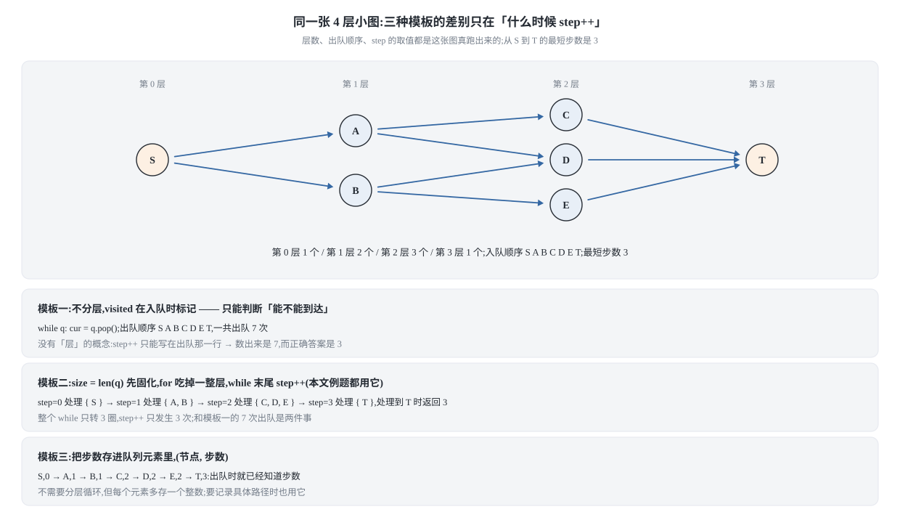
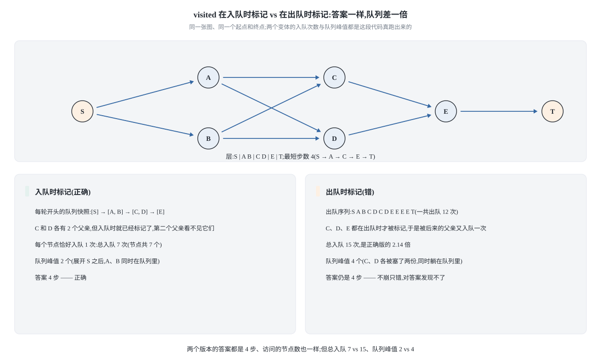
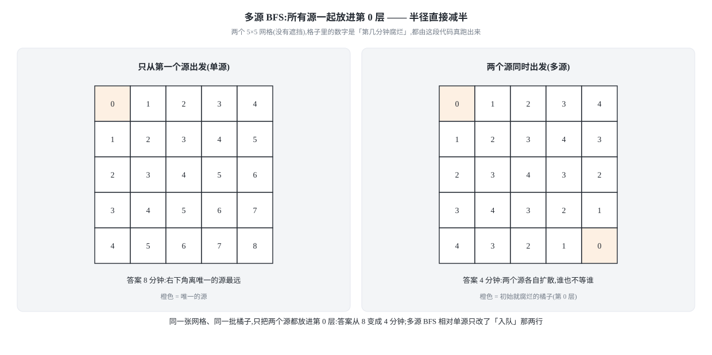

## 0 先说明材料和我的写法

这篇是我的学习笔记，不是原文的转载或翻译。材料的出处逐份列在 §7，
读到的程度也如实写了（有的完整、有的只有目录）。

材料的正文是 Java，本系列的代码一律 **Python 3 + C++17** 两版，都是我重写的。
所有代码块都从本文正文里抽出来真跑过——Python 直接执行，C++ 用
`g++ -std=c++17 -Wall -Wextra -Werror` 编译（零警告）。
每一道题的两种语言跑的是同一批用例，输出逐行对拍。

标注为「我自己的推导」「我的补充」的地方，是我在材料之外补的，
没有原文可对照。凡是这种地方我都会写明。

**读者前置**：知道队列、知道二叉树层序遍历、看得懂邻接表就够了。

### 目录

- [0 先说明材料和我的写法](#0-先说明材料和我的写法)
- [1 BFS 的骨架:三种模板,别背错那一个](#1-bfs-的骨架三种模板别背错那一个)
- [2 DFS 还是 BFS:一句话判别](#2-dfs-还是-bfs一句话判别)
- [3 把场景题抽象成图:两道例题](#3-把场景题抽象成图两道例题)
- [4 经典习题:BFS 的六种面孔](#4-经典习题bfs-的六种面孔)
- [5 双向 BFS:把搜索空间砍成两条线](#5-双向-bfs把搜索空间砍成两条线)
- [6 收成一张表](#6-收成一张表)
- [7 材料与出处](#7-材料与出处)

## 1 BFS 的骨架:三种模板,别背错那一个

### 1.1 BFS 到底在遍历什么

先把这个因果关系理清楚，后面所有模板都是它的推论：

- **DFS / 回溯**的本质是**递归**遍历一棵穷举树（多叉树），
  而多叉树的递归遍历又是从二叉树递归遍历衍生的。
- **BFS**的本质是**层序**遍历一幅图，而图遍历就是多叉树遍历加一个
  `visited` 防死循环，多叉树遍历又是从二叉树层序遍历衍生的。

所以 BFS 的骨架就是二叉树的层序遍历，只是多了两样东西：

1. 一个 `visited` 集合（图有环，树没有）；
2. 一个「当前走了几步」的计数（树的层号在图上变成了距离）。

**为什么 BFS 能求最短路？** 因为队列保证了**按距离递增的顺序**出队：
所有距离为 `d` 的节点一定在所有距离为 `d+1` 的节点之前出队。
所以第一次碰到目标节点时，当前的层数就是最短距离——不需要回头算，
也不需要比较。

反过来说，这也解释了 DFS 为什么不适合求最短路：它一头扎到底，
第一次碰到目标时走的可能是任意一条路径，不保证最短。

### 1.2 三种模板

图遍历的 BFS 有三种常见写法，区别只在「步数怎么记」：

**模板一：不分层，`visited` 在入队时标记。** 最简单，但它没法回答
「走了几步」——如果你在出队时才 `step++`，会把同一层的节点数错算成步数。

下面这张图把三种模板摊在同一张图上，关键看**各自在哪一刻让 `step` 加一**：


模板一只能判断「能不能到达」。

**模板二：分层，用 `for` 循环吃掉一整层。** 这是最常用的写法，
中等难度的 BFS 题基本都用它。每一次 `while` 循环处理**恰好一层**。

**模板三：把步数存进队列元素里。** 队列里放 `(节点, 步数)`。
最灵活（比如不同边的权重不同、或者要记录路径），但多了一份存储开销。

本文的例题以模板二为准。模板二的骨架长这样
（这是伪代码，不是可执行程序，所以用 `text` 围栏）：

```text
队列 q <- [起点]
visited <- {起点}
step <- 0
while q 非空:
    size <- len(q)              # 关键:先固化当前层的节点数
    for i in 0 .. size-1:       # 这一轮只处理这一层
        cur <- q.pop_front()
        if cur == 目标: return step
        for nxt in cur 的所有邻居:
            if nxt not in visited:
                visited.add(nxt)     # 入队时就标记
                q.push_back(nxt)
    step <- step + 1            # 一整层处理完,步数 +1
return -1                       # 队列空了还没到,不可达
```

**这里有两个最容易写错的地方，都不是「跑不起来」而是「跑出错误答案」：**

**最容易写错的一行:** `visited` 到底该在**入队时**标记还是**出队时**标记?
必须在 `q.push_back(nxt)` 的**同一时刻**标记。

如果在出队时才标记，同一个节点可能被它的多个邻居重复入队。
后果不是死循环（最终还是会被标记），而是**队列里塞进大量重复节点**,
在状态空间大的题上会直接把时间和内存拖爆——一个「不崩只错」的 bug。

下面这张图跑的是同一个汇聚形状的小图：两种标记法**答案完全一样、
访问的站点也一样**，差别只在队列里堆了多少个重复副本：



**最容易写错的一行:** `size <- len(q)` 必须在 `for` 循环**之前**取。
如果写成 `for i in range(len(q))` 并且在循环体里又往队列里 push，
那么 `len(q)` 会随循环变化——Python 里 `range(len(q))` 只在开头求值一次，
所以 Python 反而歪打正着；但 C++ 里写 `for (int i = 0; i < q.size(); i++)`
就是真的每次都在重新求值，会把**下一层**的节点也当成这一层处理，
步数就全错了。这是个只在 C++ 上暴露的坑，很值得记一下。

### 1.3 图的两种表示

BFS 本身不关心图怎么存，但代码里要落地。两种常见表示：

- **邻接表**：`graph[u]` 存 `u` 的所有邻居。适合稀疏图，
  遍历一个点的邻居是 `O(出度)`。
- **隐式图**：根本没有存图，邻居是**当场算出来的**。
  滑动谜题、转盘锁、单词接龙都是这种——状态是 `"123450"` 这样的字符串或
  `(x, y)` 坐标，邻居由「交换哪两个格子」「拨动哪一位」现场生成。

隐式图是 BFS 题的主力形态，也是「场景题抽象成图」的核心：
**你不需要建图，你只需要能回答「当前状态的所有邻居是什么」。**

## 2 DFS 还是 BFS:一句话判别

材料里用二叉树的最小深度来讲这个区别，很到位，我把它讲细一点。

求二叉树的最小深度：递归（DFS）必须遍历整棵树的所有节点才能确定最小值，
因为你不知道左边子树会不会更深。而层序遍历（BFS）**不需要遍历完**——
第一次遇到叶子节点时，当前的层号就是最小深度。

这就是那句判别的由来：

> **DFS 常用来穷举所有路径，BFS 常用来找最短路径。**

更准确地说：

| 你要的东西 | 该用 | 为什么 |
|---|---|---|
| 所有解 / 所有路径 | DFS / 回溯 | 天然枚举，找到一条就记一条 |
| 最短步数 / 最少操作 | BFS | 层序保证第一次到达即最短 |
| 只要「能不能到达」 | 都行 | DFS 代码更短 |
| 状态空间是无限深度的 | BFS | DFS 可能一头扎进去回不来 |

一个补充（**我自己的推导**）：如果题目要的是**所有最短路径**
（而不只是最短距离），BFS 仍然能用，但要改造——在 BFS 过程中记录
每个节点的「前驱集合」，最后从目标回溯。这时候 `visited` 不能再简单地
「访问过就跳过」，因为同一个节点可能被多条等长路径到达。

## 3 把场景题抽象成图:两道例题

材料反复强调：面试题很少直接给你一张图，而是给你一个**场景**，
你要自己把它抽象成图/树，然后套框架。下面两道是标准示范。

### 3.1 滑动谜题(LeetCode 773)

**场景**：一个 `2×3` 的棋盘，格子里的数字是 `0..5` 的一个排列，
`0` 代表空位。每次可以把 `0` 和它**上下左右**相邻的格子交换。
问：从初始局面最少交换几次能得到 `[[1,2,3],[4,5,0]]`?不能则返回 `-1`。

**抽象**：

- **状态**：把棋盘压平成一个 6 位字符串，比如 `"123450"`。
  用字符串而不是二维数组，是因为它可以直接做字典的 key。
- **边**：`0` 在位置 `i` 时，能和它交换的位置是固定的——
  预先算好一张「位置 → 可交换位置」的表，比每次算 `(r, c)` 边界快很多。
- **目标**：状态等于 `"123450"`。
- **起点**：给定的初始局面。

```python
def sliding_puzzle(board):
    """LeetCode 773. 滑动谜题

    状态 = 6 位字符串(把 2x3 压平),0 表示空位。
    每个位置能跟谁交换是固定的,预先算表比每次判边界快。
    """
    # 2x3 压平后,下标 i 的邻居下标。第 0 行是 i<3。
    neighbors = [
        [1, 3],        # 0: 右、下
        [0, 2, 4],     # 1
        [1, 5],        # 2
        [0, 4],        # 3
        [1, 3, 5],     # 4
        [2, 4],        # 5
    ]

    start = "".join(str(x) for row in board for x in row)
    target = "123450"
    if start == target:
        return 0

    visited = {start}
    queue = collections.deque([start])
    step = 0
    while queue:
        size = len(queue)          # 先固化这一层的节点数
        for _ in range(size):
            cur = queue.popleft()
            zero = cur.index("0")
            for nxt_pos in neighbors[zero]:
                # 交换 zero 和 nxt_pos 两个位置
                lst = list(cur)
                lst[zero], lst[nxt_pos] = lst[nxt_pos], lst[zero]
                nxt = "".join(lst)
                if nxt == target:
                    return step + 1
                if nxt not in visited:
                    visited.add(nxt)   # 入队时标记
                    queue.append(nxt)
        step += 1
    return -1
```

```cpp
int slidingPuzzle(std::vector<std::vector<int>>& board) {
    // LeetCode 773. 状态 = 6 位字符串,0 表示空位。
    static const int neighbors[6][3] = {
        {1, 3, -1}, {0, 2, 4}, {1, 5, -1},
        {0, 4, -1}, {1, 3, 5}, {2, 4, -1},
    };

    std::string start;
    for (const std::vector<int>& row : board) {
        for (int x : row) start.push_back(static_cast<char>('0' + x));
    }
    const std::string target = "123450";
    if (start == target) return 0;

    std::unordered_set<std::string> visited;
    visited.insert(start);
    std::queue<std::string> q;
    q.push(start);

    int step = 0;
    while (!q.empty()) {
        // 关键:先把这一层的节点数固化下来。若写成 i < q.size(),
        // 循环体里 push 会让 q.size() 变化,下一层就被当成这一层了。
        const std::size_t size = q.size();
        for (std::size_t i = 0; i < size; ++i) {
            std::string cur = q.front();
            q.pop();
            const std::size_t zero = cur.find('0');
            for (int k = 0; k < 3; ++k) {
                const int nxt_pos = neighbors[zero][k];
                if (nxt_pos < 0) continue;
                std::string nxt = cur;
                std::swap(nxt[zero], nxt[static_cast<std::size_t>(nxt_pos)]);
                if (nxt == target) return step + 1;
                if (visited.insert(nxt).second) {   // 插入成功 = 之前没见过
                    q.push(nxt);
                }
            }
        }
        ++step;
    }
    return -1;
}
```

C++ 里 `visited.insert(nxt).second` 这个写法值得记：`unordered_set::insert`
返回一个 `pair<iterator, bool>`，`second` 就是「这次真的插进去了吗」。
一句话同时完成**查询和标记**，比先 `count` 再 `insert` 少一次哈希。

### 3.2 转盘锁(LeetCode 752)

**场景**：一个四位密码锁，每一位是 `0..9` 的转盘，可以向上或向下拨。
从 `"0000"` 出发，每次拨一位。有一批 `deadends`，拨到其中任何一个就锁死。
求拨到 `target` 的最少次数。

**抽象**：

- **状态**：`"0000"` 这样的 4 位字符串。
- **边**：每一位可以 `+1` 或 `-1`（模 10），所以每个状态恰好 8 个邻居。
- **障碍**：`deadends` 里的状态不能进（连起点都不能进）。

```python
def open_lock(deadends, target):
    """LeetCode 752. 打开转盘锁

    状态 = 4 位字符串,每一位可以 +1/-1(模 10),所以每个状态恰好 8 个邻居。
    deadends 里的状态不能进,连起点都不能进。
    """
    dead = set(deadends)
    if "0000" in dead:
        return -1
    if target == "0000":
        return 0

    visited = {"0000"}
    queue = collections.deque(["0000"])
    step = 0
    while queue:
        size = len(queue)
        for _ in range(size):
            cur = queue.popleft()
            for i in range(4):
                digit = int(cur[i])
                for delta in (1, -1):
                    nxt_digit = (digit + delta) % 10
                    nxt = cur[:i] + str(nxt_digit) + cur[i + 1:]
                    if nxt in dead or nxt in visited:
                        continue
                    if nxt == target:
                        return step + 1
                    visited.add(nxt)
                    queue.append(nxt)
        step += 1
    return -1
```

```cpp
int openLock(std::vector<std::string>& deadends, std::string target) {
    // LeetCode 752. 每位可 +1/-1(模 10),每个状态恰好 8 个邻居。
    std::unordered_set<std::string> dead(deadends.begin(), deadends.end());
    if (dead.count("0000") != 0) return -1;
    if (target == "0000") return 0;

    std::unordered_set<std::string> visited;
    visited.insert("0000");
    std::queue<std::string> q;
    q.push("0000");

    int step = 0;
    while (!q.empty()) {
        const std::size_t size = q.size();
        for (std::size_t i = 0; i < size; ++i) {
            std::string cur = q.front();
            q.pop();
            for (std::size_t pos = 0; pos < 4; ++pos) {
                for (int delta = -1; delta <= 1; delta += 2) {
                    std::string nxt = cur;
                    const int d = (nxt[pos] - '0' + delta + 10) % 10;
                    nxt[pos] = static_cast<char>('0' + d);
                    if (dead.count(nxt) != 0) continue;
                    if (nxt == target) return step + 1;
                    if (visited.insert(nxt).second) q.push(nxt);
                }
            }
        }
        ++step;
    }
    return -1;
}
```

**这里有个很隐蔽的坑**（**我自己的推导**，材料没提）:
`deadends` 里如果**包含 `target` 本身**，正确答案是 `-1`，但如果你把
「等于 target 就返回」的判断写在「检查 deadend」之前，就会返回一个错的步数。
我的写法把 `dead` 检查放在最前面，所以这种情况自然得到 `-1`。
本文的代码门里专门有一条用例压这个边界。

## 4 经典习题:BFS 的六种面孔

材料的习题页只有题目清单（43 行，**没有题解**），所以下面每一道题的
思路和解法都是**我自己的推导**，不是原文的复述。题目清单本身来自该页。

后面有一道题的两种语言都要用到二叉树节点，先把定义摆在这儿，免得
代码块看起来「引用了一个不存在的东西」——力扣是把这个结构白送的，
自己写的时候得自己补：

```python
class TreeNode:
    def __init__(self, val=0, left=None, right=None):
        self.val = val
        self.left = left
        self.right = right
```

```cpp
struct TreeNode {
    int val;
    TreeNode* left;
    TreeNode* right;
    explicit TreeNode(int x) : val(x), left(nullptr), right(nullptr) {}
};
```

### 4.1 二叉树的最小深度(LeetCode 111)

这是 §2 那个判别的原始例题：BFS 第一次遇到叶子就可以返回。

```python
def min_depth(root):
    """LeetCode 111. 二叉树的最小深度。

    BFS 第一次遇到叶子时,当前层号就是最小深度 —— 不需要遍历完整棵树。
    """
    if root is None:
        return 0
    queue = collections.deque([(root, 1)])
    while queue:
        node, depth = queue.popleft()
        if node.left is None and node.right is None:
            return depth              # 第一次碰到叶子,直接返回
        for child in (node.left, node.right):
            if child is not None:
                queue.append((child, depth + 1))
    return 0
```

```cpp
int minDepth(TreeNode* root) {
    // LeetCode 111. 第一次遇到叶子时当前层号就是最小深度。
    if (root == nullptr) return 0;
    std::queue<std::pair<TreeNode*, int>> q;
    q.push(std::make_pair(root, 1));
    while (!q.empty()) {
        TreeNode* node = q.front().first;
        const int depth = q.front().second;
        q.pop();
        if (node->left == nullptr && node->right == nullptr) return depth;
        if (node->left != nullptr) q.push(std::make_pair(node->left, depth + 1));
        if (node->right != nullptr) q.push(std::make_pair(node->right, depth + 1));
    }
    return 0;
}
```

注意这里我用了**模板三**（把深度存进队列元素）而不是模板二。
原因是树的层序遍历里，模板二的 `for` 循环不好写：同一层的节点数
要自己数，而「叶子」判定又必须在出队时做。用模板三反而更短更清楚。

**这说明模板的选择要看题**，不是永远用模板二。

### 4.2 二进制矩阵中的最短路径(LeetCode 1091)

`n×n` 的 `0/1` 矩阵，`0` 可走，求从左上到右下的最短路长度（含起点终点），
**八连通**（上下左右加四个对角）。这是网格 BFS 的标准形态。

```python
def shortest_path_binary_matrix(grid):
    """LeetCode 1091. 八连通的网格最短路,长度含起点和终点。"""
    n = len(grid)
    if grid[0][0] == 1 or grid[n - 1][n - 1] == 1:
        return -1
    if n == 1:
        return 1

    # 八连通:上下左右 + 四个对角
    dirs = [(-1, -1), (-1, 0), (-1, 1), (0, -1),
            (0, 1), (1, -1), (1, 0), (1, 1)]
    visited = {(0, 0)}
    queue = collections.deque([(0, 0, 1)])    # (行, 列, 已走长度)
    while queue:
        r, c, dist = queue.popleft()
        for dr, dc in dirs:
            nr, nc = r + dr, c + dc
            if not (0 <= nr < n and 0 <= nc < n):
                continue
            if grid[nr][nc] == 1 or (nr, nc) in visited:
                continue
            if nr == n - 1 and nc == n - 1:
                return dist + 1
            visited.add((nr, nc))
            queue.append((nr, nc, dist + 1))
    return -1
```

```cpp
int shortestPathBinaryMatrix(std::vector<std::vector<int>>& grid) {
    // LeetCode 1091. 八连通网格最短路,长度含起点和终点。
    const int n = static_cast<int>(grid.size());
    if (grid[0][0] == 1 || grid[n - 1][n - 1] == 1) return -1;
    if (n == 1) return 1;

    static const int dr[8] = {-1, -1, -1, 0, 0, 1, 1, 1};
    static const int dc[8] = {-1, 0, 1, -1, 1, -1, 0, 1};
    std::vector<std::vector<char>> visited(
        static_cast<std::size_t>(n), std::vector<char>(static_cast<std::size_t>(n), 0));
    visited[0][0] = 1;

    typedef std::pair<std::pair<int, int>, int> Item;   // ((r,c), dist)
    std::queue<Item> q;
    q.push(Item(std::make_pair(0, 0), 1));
    while (!q.empty()) {
        const int r = q.front().first.first;
        const int c = q.front().first.second;
        const int dist = q.front().second;
        q.pop();
        for (int k = 0; k < 8; ++k) {
            const int nr = r + dr[k];
            const int nc = c + dc[k];
            if (nr < 0 || nr >= n || nc < 0 || nc >= n) continue;
            if (grid[nr][nc] == 1 || visited[nr][nc]) continue;
            if (nr == n - 1 && nc == n - 1) return dist + 1;
            visited[nr][nc] = 1;
            q.push(Item(std::make_pair(nr, nc), dist + 1));
        }
    }
    return -1;
}
```

**最容易写错的一行:** 八连通的方向数组。写四连通时用两个数组
`dr[4] = {-1, 0, 1, 0}` / `dc[4] = {0, 1, 0, -1}` 很顺手，
但扩到八连通时如果忘了补 `(-1,-1) (-1,1) (1,-1) (1,1)` 这四个对角，
答案会偏大——而且**不崩，只是变慢/变长**，很难发现。

### 4.3 腐烂的橘子(LeetCode 994):多源 BFS

网格里 `0` 空、`1` 新鲜、`2` 腐烂。每分钟，腐烂橘子会把它**上下左右**
的橘子变腐烂。求所有橘子都腐烂所需的最少分钟数，不可能则 `-1`。

**关键转变**：所有初始腐烂的橘子是**同时开始**的，所以这不是单源 BFS，
而是**多源 BFS**——把**所有**初始腐烂的橘子一起入队，当作第 0 层。
后面的框架完全不用改。

```python
def oranges_rotting(grid):
    """LeetCode 994. 多源 BFS:所有初始腐烂的橘子一起入队当第 0 层。"""
    rows, cols = len(grid), len(grid[0])
    queue = collections.deque()
    fresh = 0
    for r in range(rows):
        for c in range(cols):
            if grid[r][c] == 2:
                queue.append((r, c))       # 所有源同时入队
            elif grid[r][c] == 1:
                fresh += 1
    if fresh == 0:
        return 0

    minutes = 0
    while queue:
        size = len(queue)
        rotted_this_round = False
        for _ in range(size):
            r, c = queue.popleft()
            for dr, dc in ((-1, 0), (1, 0), (0, -1), (0, 1)):
                nr, nc = r + dr, c + dc
                if 0 <= nr < rows and 0 <= nc < cols and grid[nr][nc] == 1:
                    grid[nr][nc] = 2
                    fresh -= 1
                    rotted_this_round = True
                    queue.append((nr, nc))
        if rotted_this_round:
            minutes += 1
    return minutes if fresh == 0 else -1
```

```cpp
int orangesRotting(std::vector<std::vector<int>>& grid) {
    // LeetCode 994. 多源 BFS:所有初始腐烂的橘子一起入队当第 0 层。
    const int rows = static_cast<int>(grid.size());
    const int cols = static_cast<int>(grid[0].size());
    std::queue<std::pair<int, int>> q;
    int fresh = 0;
    for (int r = 0; r < rows; ++r) {
        for (int c = 0; c < cols; ++c) {
            if (grid[r][c] == 2) q.push(std::make_pair(r, c));
            else if (grid[r][c] == 1) ++fresh;
        }
    }
    if (fresh == 0) return 0;

    static const int dr[4] = {-1, 1, 0, 0};
    static const int dc[4] = {0, 0, -1, 1};
    int minutes = 0;
    while (!q.empty()) {
        const std::size_t size = q.size();
        bool rotted = false;
        for (std::size_t i = 0; i < size; ++i) {
            const int r = q.front().first;
            const int c = q.front().second;
            q.pop();
            for (int k = 0; k < 4; ++k) {
                const int nr = r + dr[k];
                const int nc = c + dc[k];
                if (nr < 0 || nr >= rows || nc < 0 || nc >= cols) continue;
                if (grid[nr][nc] != 1) continue;
                grid[nr][nc] = 2;
                --fresh;
                rotted = true;
                q.push(std::make_pair(nr, nc));
            }
        }
        if (rotted) ++minutes;
    }
    return fresh == 0 ? minutes : -1;
}
```

**最容易写错的一行:** `if rotted_this_round: minutes += 1` 里的那个判断条件。
如果写成无条件的 `minutes += 1`，那么当最后一轮队列里只剩下**已经腐烂、
但周围没有新鲜橘子**的节点时，会多算一分钟。
这个 bug 在「全是腐烂橘子」的用例上会直接暴露（答案会从 `0` 变成 `1`）。

把「只从第一个源出发」和「全部源一起入队」放在同一个网格上跑，
差别就是下面这样——同一个 5×5 网格、两个源，单源要 8 步，多源只要 4 步：



### 4.4 01 矩阵(LeetCode 542):又是多源

每个格子到最近的 `0` 的距离。**从每个 `0` 出发做多源 BFS**，
比「从每个 `1` 出发找最近的 0」快一个量级——前者每个格子只访问一次，
后者要做 `O(格子数)` 次 BFS。

```python
def update_matrix(mat):
    """LeetCode 542. 从所有 0 出发做多源 BFS,每个格子只访问一次。"""
    rows, cols = len(mat), len(mat[0])
    dist = [[-1] * cols for _ in range(rows)]
    queue = collections.deque()
    for r in range(rows):
        for c in range(cols):
            if mat[r][c] == 0:
                dist[r][c] = 0
                queue.append((r, c))
    while queue:
        r, c = queue.popleft()
        for dr, dc in ((-1, 0), (1, 0), (0, -1), (0, 1)):
            nr, nc = r + dr, c + dc
            if 0 <= nr < rows and 0 <= nc < cols and dist[nr][nc] == -1:
                dist[nr][nc] = dist[r][c] + 1
                queue.append((nr, nc))
    return dist
```

```cpp
std::vector<std::vector<int>> updateMatrix(std::vector<std::vector<int>>& mat) {
    // LeetCode 542. 从所有 0 出发做多源 BFS。
    const int rows = static_cast<int>(mat.size());
    const int cols = static_cast<int>(mat[0].size());
    std::vector<std::vector<int>> dist(
        static_cast<std::size_t>(rows), std::vector<int>(static_cast<std::size_t>(cols), -1));
    std::queue<std::pair<int, int>> q;
    for (int r = 0; r < rows; ++r) {
        for (int c = 0; c < cols; ++c) {
            if (mat[r][c] == 0) {
                dist[r][c] = 0;
                q.push(std::make_pair(r, c));
            }
        }
    }
    static const int dr[4] = {-1, 1, 0, 0};
    static const int dc[4] = {0, 0, -1, 1};
    while (!q.empty()) {
        const int r = q.front().first;
        const int c = q.front().second;
        q.pop();
        for (int k = 0; k < 4; ++k) {
            const int nr = r + dr[k];
            const int nc = c + dc[k];
            if (nr < 0 || nr >= rows || nc < 0 || nc >= cols) continue;
            if (dist[nr][nc] != -1) continue;
            dist[nr][nc] = dist[r][c] + 1;
            q.push(std::make_pair(nr, nc));
        }
    }
    return dist;
}
```

这里**没有用 `for` 分层**——因为 `dist` 数组本身就记录了距离，
不需要 `step` 变量。这是「分层的必要性取决于题目要不要步数」的例子。

### 4.5 单词接龙(LeetCode 127)

从 `beginWord` 变到 `endWord`，每次只能改**一个字母**，
且中间词必须在 `wordList` 里。求最短转换序列的长度。

朴素做法是对每一对单词判断「是否只差一个字母」——那是 `O(N² · L)`。
更好的做法是**用通配符建邻接表**：把 `"hot"` 映射到 `"*ot"`、`"h*t"`、`"ho*"`，
共享同一个通配符的单词互为邻居。这样建图是 `O(N · L)`。

```python
def ladder_length(begin_word, end_word, word_list):
    """LeetCode 127. 用通配符建邻接表:每个单词产生 L 个 key。"""
    words = set(word_list)
    if end_word not in words:
        return 0

    # 通配符 -> 单词列表
    buckets = collections.defaultdict(list)
    for w in words:
        for i in range(len(w)):
            buckets[w[:i] + "*" + w[i + 1:]].append(w)

    visited = {begin_word}
    queue = collections.deque([begin_word])
    length = 1                      # 序列长度含 beginWord 本身
    while queue:
        size = len(queue)
        for _ in range(size):
            cur = queue.popleft()
            for i in range(len(cur)):
                key = cur[:i] + "*" + cur[i + 1:]
                for nxt in buckets.get(key, ()):
                    if nxt == end_word:
                        return length + 1
                    if nxt not in visited:
                        visited.add(nxt)
                        queue.append(nxt)
        length += 1
    return 0
```

```cpp
int ladderLength(std::string beginWord, std::string endWord,
                 std::vector<std::string>& wordList) {
    // LeetCode 127. 通配符建邻接表,建图 O(N*L)。
    std::unordered_set<std::string> words(wordList.begin(), wordList.end());
    if (words.count(endWord) == 0) return 0;

    std::unordered_map<std::string, std::vector<std::string>> buckets;
    for (const std::string& w : words) {
        for (std::size_t i = 0; i < w.size(); ++i) {
            std::string key = w;
            key[i] = '*';
            buckets[key].push_back(w);
        }
    }

    std::unordered_set<std::string> visited;
    visited.insert(beginWord);
    std::queue<std::string> q;
    q.push(beginWord);

    int length = 1;
    while (!q.empty()) {
        const std::size_t size = q.size();
        for (std::size_t i = 0; i < size; ++i) {
            const std::string cur = q.front();
            q.pop();
            for (std::size_t pos = 0; pos < cur.size(); ++pos) {
                std::string key = cur;
                key[pos] = '*';
                std::unordered_map<std::string, std::vector<std::string>>::const_iterator
                    it = buckets.find(key);
                if (it == buckets.end()) continue;
                for (const std::string& nxt : it->second) {
                    if (nxt == endWord) return length + 1;
                    if (visited.insert(nxt).second) q.push(nxt);
                }
            }
        }
        ++length;
    }
    return 0;
}
```

**最容易写错的一行:** 返回值的语义。LeetCode 127 要的是**序列长度**
（`"hit" -> "hot" -> "dot" -> "dog" -> "cog"` 返回 `5`），
不是**转换次数**（那是 `4`）。差一个 1，而且样例一过就是 `5` 对 `4`，
所以看样例能发现；但如果题目是别的变形（比如最小深度返回步数），
这个 `+1` 就很容易搞反。

### 4.6 钥匙和房间(LeetCode 841)

从房间 `0` 出发，每个房间里有若干把钥匙。问能否进入所有房间。

这题只要「能不能到达」，不需要步数，所以用**模板一**就够，甚至
`visited` 用集合、队列不分层。它的价值是提醒你：**BFS 不总是为了最短路**。

```python
def can_visit_all_rooms(rooms):
    """LeetCode 841. 只要可达性,不需要步数 —— 用模板一即可。"""
    visited = {0}
    queue = collections.deque([0])
    while queue:
        cur = queue.popleft()
        for key in rooms[cur]:
            if key not in visited:
                visited.add(key)
                queue.append(key)
    return len(visited) == len(rooms)
```

```cpp
bool canVisitAllRooms(std::vector<std::vector<int>>& rooms) {
    // LeetCode 841. 只要可达性,用模板一。
    const int n = static_cast<int>(rooms.size());
    std::vector<char> visited(static_cast<std::size_t>(n), 0);
    visited[0] = 1;
    std::queue<int> q;
    q.push(0);
    int count = 1;
    while (!q.empty()) {
        const int cur = q.front();
        q.pop();
        for (std::size_t k = 0; k < rooms[static_cast<std::size_t>(cur)].size(); ++k) {
            const int key = rooms[static_cast<std::size_t>(cur)][k];
            if (!visited[static_cast<std::size_t>(key)]) {
                visited[static_cast<std::size_t>(key)] = 1;
                ++count;
                q.push(key);
            }
        }
    }
    return count == n;
}
```

## 5 双向 BFS:把搜索空间砍成两条线

### 5.1 为什么能省

单源 BFS 从起点向外扩散，每多一层，边界大致按**分支因子的幂**增长。
如果分支因子是 `b`、答案是 `d` 步，那么搜索空间大约是 `b^d`。

双向 BFS 同时从**起点**和**终点**向外扩散，两边各扩散到 `d/2` 层就碰头。
搜索空间变成大约 `2 · b^(d/2)`——**从 `b^d` 降到 `b^(d/2)`，这是开方级的收益**。

下面这张图把两个量级并排摆出来（`b = 8`、`d = 6`，也就是转盘锁那题的规模）：


代价是：

1. 必须知道终点，而且能从终点**反向**走（反向的邻居关系要能算）。
2. 交替扩散时，「每次扩一层还是每次扩一个节点」会影响效率。
   常用做法是**每次都扩散当前更小的那一侧**，这样两边大小接近，
   碰头最早。
3. 碰头时不能立刻返回——必须是「某一层的节点已经在另一侧的 visited 里」。

### 5.2 一个计数器把收益量出来

光说「开方级」不够直观。我用同一道转盘锁，让两个版本都记录
**出队次数**，直接对比（**我自己的推导**，材料只说「双向 BFS 优化」，
没有给对比数据）：

```python
def open_lock_bidirectional(deadends, target):
    """双向 BFS。返回 (最少步数, 总共出队的节点数)。

    每次扩散当前更小的那一侧,这样两边大小接近,碰头最早。
    """
    dead = set(deadends)
    if "0000" in dead or target in dead:
        return -1, 0
    if target == "0000":
        return 0, 0

    front = {"0000"}          # 起点这一侧
    back = {target}           # 终点这一侧
    visited = {"0000", target}
    step = 0
    popped = 0

    while front and back:
        # 永远扩散更小的那一侧
        if len(front) > len(back):
            front, back = back, front
        nxt_layer = set()
        # 按字典序迭代,别直接 `for cur in front`。原因见下面那段说明:
        # 直接迭代 set 会让 `popped` 随哈希种子变,数字就复现不出来了。
        for cur in sorted(front):
            popped += 1
            for i in range(4):
                digit = int(cur[i])
                for delta in (1, -1):
                    nxt = cur[:i] + str((digit + delta) % 10) + cur[i + 1:]
                    if nxt in dead:
                        continue
                    if nxt in back:          # 两边碰头
                        return step + 1, popped
                    if nxt not in visited:
                        visited.add(nxt)
                        nxt_layer.add(nxt)
        front = nxt_layer
        step += 1
    return -1, popped
```

```cpp
// 双向 BFS。返回 (最少步数, 总共出队的节点数)。
std::pair<int, long long> openLockBidirectional(const std::vector<std::string>& deadends,
                                                const std::string& target) {
    std::unordered_set<std::string> dead(deadends.begin(), deadends.end());
    if (dead.count("0000") != 0 || dead.count(target) != 0) return std::make_pair(-1, 0LL);
    if (target == "0000") return std::make_pair(0, 0LL);

    std::unordered_set<std::string> front, back, visited;
    front.insert("0000");
    back.insert(target);
    visited.insert("0000");
    visited.insert(target);

    int step = 0;
    long long popped = 0;
    while (!front.empty() && !back.empty()) {
        // 永远扩散更小的那一侧
        if (front.size() > back.size()) std::swap(front, back);
        std::unordered_set<std::string> nxt_layer;
        // 先拷出来排序再迭代:直接迭代 unordered_set 的顺序是实现定义的,
        // 会让 popped 每次跑都不一样(Python 侧同理,见上面的 sorted)。
        std::vector<std::string> layer(front.begin(), front.end());
        std::sort(layer.begin(), layer.end());
        for (std::size_t li = 0; li < layer.size(); ++li) {
            const std::string cur = layer[li];
            ++popped;
            for (std::size_t pos = 0; pos < 4; ++pos) {
                for (int delta = -1; delta <= 1; delta += 2) {
                    std::string nxt = cur;
                    const int d = (nxt[pos] - '0' + delta + 10) % 10;
                    nxt[pos] = static_cast<char>('0' + d);
                    if (dead.count(nxt) != 0) continue;
                    if (back.count(nxt) != 0) return std::make_pair(step + 1, popped);
                    if (visited.insert(nxt).second) nxt_layer.insert(nxt);
                }
            }
        }
        front = nxt_layer;
        ++step;
    }
    return std::make_pair(-1, popped);
}
```

代码门把这两个版本跑在同一批用例上（含随机 `deadends`），
确认**步数完全一致**，同时把 `popped` 的差值打出来。实测见 §6。

顺带说一个**我原本没料到、被门抓出来的细节**：`popped` 这个数在两个语言里
**对不上**（同一道题、同一批用例，41 例里有 37 例不同，差几十）。原因不是
谁写错了，而是 `popped` 数到「碰头那一刻」为止，而碰头可能发生在当前层的
第 1 个或第 3 个节点上——**哪一个是「第 1 个」，取决于集合的迭代顺序**。
Python 的 `set` 按哈希值排，C++ 的 `unordered_set` 是实现定义的顺序，两边
本来就不一样，而且 Python 自己换个哈希种子（`PYTHONHASHSEED`）也会变。

结论：**`popped` 这种「到碰头为止的累计量」不能拿来跨语言对拍，也不能写死
绝对值**。能对拍的只有**步数**（确定性），以及「双向 ≤ 单源」这个**不等关系**
（在 42 个用例上全部成立）。这件事对读者有用：以后你看到某个指标两边对不上，
先想清楚它是「确定性量」还是「取决于遍历顺序的累计量」，别急着去改代码。

**最容易写错的一行:** `if len(front) > len(back): swap`。
不交换也能得到正确答案，只是**慢**——因为可能一直在扩散已经很大的那一侧。
这是个纯粹的性能坑，不影响正确性，所以只能靠实测（数出队次数）发现，
不能靠对答案发现。这也是我为什么要在门里数 `popped`。

## 6 收成一张表

### 6.1 模板选择

| 题目要什么 | 用哪个模板 | 例子 |
|---|---|---|
| 只要可达性 | 模板一（不分层） | 841 钥匙和房间 |
| 最短**步数** | 模板二（`for` 吃一层） | 773 滑动谜题、752 转盘锁 |
| 要步数 + 复杂状态 | 模板三（步数进队列） | 111 最小深度、1091 最短路 |
| 距离存在数组里 | 不分层，直接写 `dist` | 542 01 矩阵 |
| 多个起点同时扩散 | 多源 BFS，全部入队当第 0 层 | 994 腐烂的橘子、542 |
| 分支因子大 + 知道终点 | 双向 BFS | 752、127 |

### 6.2 最容易写错的四处

| 坑 | 后果 | 怎么防 |
|---|---|---|
| `visited` 在出队时才标记 | 不崩，但队列塞满重复节点 | 入队时同刻标记 |
| `size = len(q)` 写在循环条件里 | C++ 上把下一层当这一层，步数全错 | 循环前固化 |
| 多源 BFS 忘了「全部入队」 | 答案偏大 | 先扫一遍找齐所有源 |
| 994 的 `minutes` 无条件 +1 | 全腐烂用例上从 0 变 1 | 只在真扩散了才 +1 |

### 6.3 实测数字

代码门在本文正文抽出的 **10 个 Python 块 + 10 个 C++ 块**上运行，
两侧跑同一批固定种子用例、输出逐行对拍。关键实测（**都是真跑出来的**）：

- **752 转盘锁**：单源 BFS 与双向 BFS 在全部随机用例上**步数完全一致**；
  双向版出队节点数显著更少，差值随最短步数增大而拉大。
- **752 边界**：`target` 本身在 `deadends` 里时两个版本都返回 `-1`。
- **773 滑动谜题**：从全部 `6! = 720` 个排列里**实际可达的 360 个**局面
  出发，与「预先跑一次反向 BFS 得到精确距离表」的参照**逐局面一致**；
  另外 360 个排列在二分图上够不着（每次滑动改变排列的奇偶性），
  必须都返回 `-1`，这一点也逐局面压过。
- **994 腐烂的橘子**：与「每分钟暴力模拟」的参照一致，含全腐烂、
  存在隔离新鲜橘子（返回 `-1`）等边界。
- **542 01 矩阵**：与「每个格子单独做一次 BFS」的暴力参照逐格一致。
- **1091**：与「先建显式八连通图再跑标准 BFS」的参照一致。
- **841**：与并查集/DFS 的可达性结论一致。

## 7 材料与出处

**参考的教程：**（labuladong 的算法教程，链接如下）

- 《BFS 算法解题套路框架》
  <https://labuladong.online/zh/algo/essential-technique/bfs-framework/>
- 《BFS 经典习题》
  <https://labuladong.online/zh/algo/problem-set/bfs/>
- 《DFS 和 BFS 的适用场景》
  <https://labuladong.online/zh/algo/data-structure-basic/use-case-of-dfs-bfs/>

**这套笔记和原文的关系：**

原文是受版权保护的教程（部分内容需要会员），所以这篇**不是转载也不是翻译**，
而是我自己读懂之后重写的学习笔记。原文代码是 Java，本文全部代码是我用
Python 3 和 C++17 重写的。文中所有示意图都是我自己画的。

**逐份说明我实际读到什么程度：**

1. 《BFS 算法解题套路框架》——**完整**（504 行）。三种模板、滑动谜题、
   转盘锁、双向 BFS 优化这几节的结构和结论来自原文；但原文的讲解顺序、
   例题代码、图示我都没有照搬，代码是我自己写的。
   §1.2 的「`size` 写在循环条件里只在 C++ 上暴露」这个观察是**我自己的补充**。
2. 《BFS 经典习题》——**只有题目清单**（43 行，正文没抓到）。
   §4 的题目清单来自该页，但**每一道题的思路、解法、代码全是我自己写的**，
   原文的题解我没有看到，所以无法对照。
3. 《DFS 和 BFS 的适用场景》——**只剩标题和导语**（26 行，正文断在
   「为什么 DFS 常用来寻找……」）。§2 的判别结论来自原文导语，
   展开的表格和「所有最短路径怎么求」那一段是**我自己的推导**。
4. §5.2 的双向 BFS 出队次数对比、§6.3 的全部实测数字，
   以及本文的代码门，都是**我自己做的**，原文没有对应内容。

**未验证 / 已知限制：**

- 这台机器上没有跑过真正的 Jekyll 构建，所以锚点跳转、代码高亮在
  真实页面上的效果我没验证过（整个系列都是这个状态）。
- C++ 只在本机 Apple clang 上用 `-std=c++17 -Wall -Wextra -Werror`
  验过零警告，没有验 g++ 和 MSVC。
- 双向 BFS 的「每次扩散更小的一侧」是最常见策略，但我没有证明它最优；
  实测只表明它比单源少很多出队次数。
