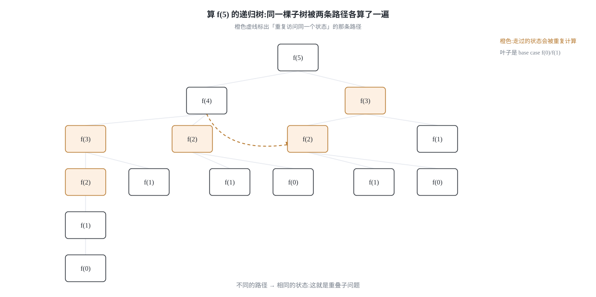
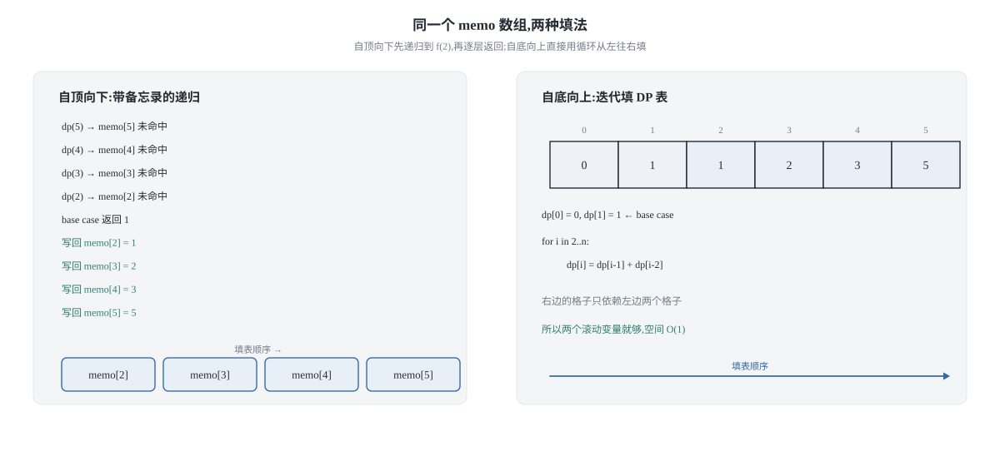
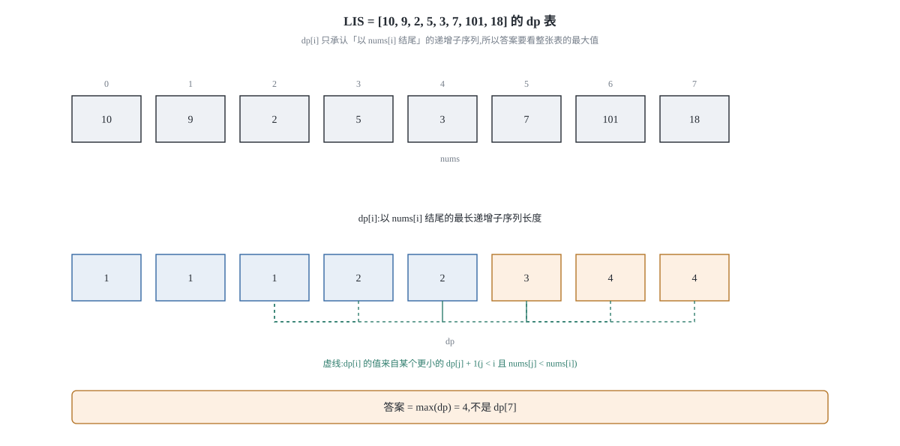
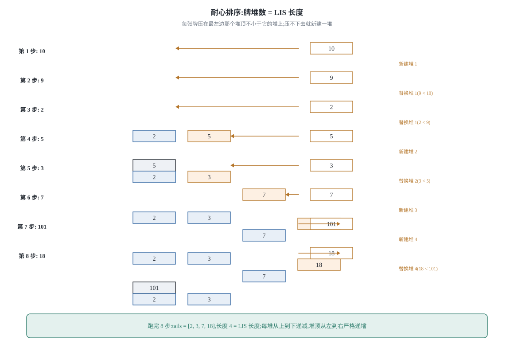

## 0 先说明材料和我的写法

这是我自己的动态规划学习笔记，材料来自 labuladong 的这几篇教程：

- 《动态规划解题套路框架》—— <https://labuladong.online/zh/algo/essential-technique/dynamic-programming-framework/>
- 《动态规划设计：最长递增子序列》—— <https://labuladong.online/zh/algo/dynamic-programming/longest-increasing-subsequence/>
- 《动态规划设计：最大子数组》—— <https://labuladong.online/zh/algo/dynamic-programming/maximum-subarray/>
- 《base case 和备忘录的初始值怎么定？》—— <https://labuladong.online/zh/algo/dynamic-programming/memo-fundamental/>
- 《对动态规划进行空间压缩》—— <https://labuladong.online/zh/algo/dynamic-programming/space-optimization/>

**这不是转载，也不是翻译。** 原文有配套的可视化面板和动图，那是这套教程最有价值的部分，我这里复现不了，所以下面写的是我自己重新推导的一遍：每个方程我都把「状态怎么定的」和「为什么这样转移是对的」写出来，而不是直接给结论。文中的 5 张示意图都是我用 SVG 自己画的。

有几处要坦白，免得你把我没做过的事当成我做过了：

- 《动态规划解题套路框架》我取到了完整正文，斐波那契和零钱兑换两节的结论、复杂度我都逐条核对过原文。
- 《最长递增子序列》也取到了完整正文。**但 O(n log n) 那节的正确性证明，原文明确写了「证明略」**，所以下面第 4 节里那段「为什么牌堆数等于 LIS 长度」的解释是我自己的推导，不是原文的。
- 《最大子数组》我只取到了题面和思路概述，三种解法的正文没取到，**第 5 节完全是我自己的推导和实现**。
- 《base case 和备忘录的初始值怎么定？》《对动态规划进行空间压缩》两篇我拿到的只有标题、摘要和目录。所以第 3 节里关于「怎么给备忘录挑初始值」的那段讨论是我自己的经验，不是从原文核对来的；空间压缩那节我只用到了「只保留被依赖的几行」这个基本结论。

**代码是 Python 3 和 C++ 两版，都是我自己写的**，不是原文的语言。教程原文用 Java 写，我按自己的习惯实现了一遍。两种语言并排给出，因为它们的坑不一样——这篇里最典型的一处是「用一个特殊值表示无解」：Python 能安全地拿一个比任何合法答案都大的整数当哨兵，C++ 则要先想清楚 `INT_MAX` 参与的加法会不会溢出，第 2.4 节会把这件事讲清楚。

一句话概括这篇要干什么：**动态规划最难的一步不是写代码，是定义状态**。所以下面的顺序永远是「状态取什么 → 最后一步有哪些选择 → 每种选择把状态退到哪里 → 方程自己长出来」。

### 目录

- [0 先说明材料和我的写法](#0-先说明材料和我的写法)
- [1 动态规划的三件套:先把话说清楚](#1-动态规划的三件套先把话说清楚)
- [2 从状态定义推出转移方程:两道入门题](#2-从状态定义推出转移方程两道入门题)
- [3 三种写法怎么选:暴力递归、记忆化搜索、迭代 DP](#3-三种写法怎么选暴力递归记忆化搜索迭代-dp)
- [4 最长递增子序列:同一套定义,两种复杂度](#4-最长递增子序列同一套定义两种复杂度)
- [5 最大子数组:状态定义换一下,答案就出来了](#5-最大子数组状态定义换一下答案就出来了)
- [6 把这篇的四个套路收成一张表](#6-把这篇的四个套路收成一张表)
- [7 材料与出处](#7-材料与出处)

## 1 动态规划的三件套:先把话说清楚

这三个名词到处都能看到，但很多解释一上来就是定义套定义。我按自己顺过来的理解讲一遍，重点放在「它们各自负责解决什么问题」上。



**重叠子问题**回答的是「为什么暴力递归会慢」。上面这棵树里，同一个状态会被不同的路径反复走到。斐波那契是最干净的例子：算 `f(5)` 需要 `f(4)` 和 `f(3)`，而算 `f(4)` 又要 `f(3)`——`f(3)` 被算了两次。节点总数是指数级的，但不同的状态只有 n 个。**慢不是因为状态多，是因为同一个状态被重复求解。**

**最优子结构**回答的是「凭什么可以用子问题的最优解拼出原问题的最优解」。它要求子问题之间互相独立，互不干扰。原文那个「考试总分」的类比我觉得很好用：如果各科成绩互不影响，那总分最高就是每科都考最高；但如果语文和数学会互相制约，那「每科都考最高」这个拼法就失效了，最优子结构被破坏。

**状态转移方程**回答的是「怎么从一个已知的状态算出下一个状态」。它的形式一般是

```text
dp[状态] = 择优( 做选择 1 之后的结果, 做选择 2 之后的结果, ... )
```

真正困难的是「状态取什么」。这一点没有通用公式，但有一个可以照做的流程，第 2 节会完整走两遍。

顺便说清一件事：**动态规划的暴力解和回溯的穷举，其实是同一棵决策树**。区别在于 DP 的树上有大量重复节点，可以缓存；而回溯的树通常每片叶子都是一个不同的合法解，没法缓存。判断一道题该往哪边走，一个实用的信号是：问的是「有多少种方案 / 所有具体方案」还是「最优值 / 方案数」。要枚举具体方案，回溯；只问最优值或总数，DP 有机会。

## 2 从状态定义推出转移方程:两道入门题

这一节是整篇的核心。我刻意不先给方程，而是先走「三问」，让方程自己出来。

### 2.1 三问流程

拿到一道题，先别想代码，按顺序问自己三件事：

1. **状态是哪些变量？** 也就是「原问题和子问题的区别在哪里」。能区分两个局面的那些量就是状态。背包问题是「前 i 个物品 + 剩余容量 w」，编辑距离是「s1 的前 i 个字符 + s2 的前 j 个字符」。
2. **选择有哪些？** 也就是「在某个状态上，我下一步能做什么」。每种选择会让状态发生什么变化。
3. **方程长什么样？** 把「做了某个选择之后落到哪个状态」写出来，外面套一层「择优」。

下面用斐波那契和零钱兑换各走一遍。

### 2.2 斐波那契:三问走完，方程就一句话

严格说斐波那契不是动态规划，因为它不求最值。但它把「重叠子问题」暴露得最干净，所以适合当第一个例子。

**三问：**

1. **状态**是什么？只有一个变量：`n`，即「还要求第几项」。
2. **选择**有哪些？求 `f(n)` 的最后一步，只能是「用 f(n-1)」或者「用 f(n-2)」。
3. **选择之后落到哪？** 用 f(n-1) 落到状态 n-1；用 f(n-2) 落到状态 n-2。

于是定义 `dp[i]` = 第 i 个斐波那契数。方程就是把两个选择相加：

```text
dp[i] = dp[i-1] + dp[i-2]
```

base case 来自定义本身：`dp[0] = 0`、`dp[1] = 1`（按力扣 509 的口径）。

**最容易写错的一行:** `dp[i] = dp[i-1] + dp[i-2]` 里两个下标。备忘录写法最容易错的是「查表」和「写表」的顺序——必须**先查再算**，算完立刻写回。如果先递归再查表，或者忘了写回，剪枝就完全失效，代码看起来是记忆化搜索，实际退化成暴力递归，而且这个错误不会报错，只会慢。

```python
def fib_bruteforce(n):
    """暴力递归：直接照着递推式的形状写，但子问题被重复求解。"""
    if n < 2:
        return n
    return fib_bruteforce(n - 1) + fib_bruteforce(n - 2)


def fib_memo(n):
    """记忆化搜索：把算过的答案记下来，下次先查表。"""
    memo = [-1] * (n + 1)          # -1 表示这个状态还没算过

    def dp(i):
        if i < 2:
            return i               # base case
        if memo[i] != -1:          # 先查：查到了就直接用，不再往下递归
            return memo[i]
        memo[i] = dp(i - 1) + dp(i - 2)
        return memo[i]             # 算完写回，这一步漏了就等于没写备忘录

    return dp(n)


def fib_dp(n):
    """迭代 DP：只保留被依赖的两个状态，空间从 O(n) 降到 O(1)。"""
    if n < 2:
        return n
    prev2, prev1 = 0, 1            # 分别代表 dp[i-2] 和 dp[i-1]
    for _ in range(2, n + 1):
        prev2, prev1 = prev1, prev2 + prev1
    return prev1
```

```cpp
#include <vector>

long long fib_bruteforce(int n) {
    // 暴力递归：子问题重复求解，n 稍大就跑不动
    if (n < 2) return n;
    return fib_bruteforce(n - 1) + fib_bruteforce(n - 2);
}

long long fib_memo(int n) {
    std::vector<long long> memo(n + 1, -1);   // -1 表示未计算
    // C++17 里 lambda 不能递归调用自己，用显式的 function 包装
    std::function<long long(int)> dp = [&](int i) -> long long {
        if (i < 2) return i;
        if (memo[i] != -1) return memo[i];
        memo[i] = dp(i - 1) + dp(i - 2);
        return memo[i];
    };
    return dp(n);
}

long long fib_dp(int n) {
    if (n < 2) return n;
    long long prev2 = 0, prev1 = 1;           // dp[i-2], dp[i-1]
    for (int i = 2; i <= n; ++i) {
        long long cur = prev2 + prev1;
        prev2 = prev1;
        prev1 = cur;
    }
    return prev1;
}
```

（C++ 里的 `std::function` 需要 `<functional>`；另一条路是写一个带 `memo` 参数的普通递归函数，那就不需要它了。）

**复杂度要推一遍，不能只丢结论。** 递归算法的时间复杂度 = 子问题个数 × 解决一个子问题的时间。

- 暴力递归：递归树高度为 n，节点数约 2ⁿ，每个节点只做一次加法，所以是 **O(2ⁿ) 时间、O(n) 栈空间**。
- 记忆化搜索：每个状态只真正计算一次，状态数是 n+1 个，每个状态一次加法，所以是 **O(n) 时间、O(n) 空间**（memo 数组加递归栈）。
- 迭代 DP：同样是 n 次加法，但只需要保存最近两个值，所以是 **O(n) 时间、O(1) 空间**。

空间能压到 O(1)，是因为转移方程右边只出现了 `dp[i-1]` 和 `dp[i-2]`。**能不能压缩、压到多小，取决于转移方程依赖哪几个旧状态**——这条规律在第 3 节还会再用一次。

### 2.3 零钱兑换:状态和选择都藏起来了

力扣 322「零钱兑换」：给 k 种面值（每种数量无限）和一个总金额 `amount`，问最少用几枚硬币凑出这个金额，凑不出返回 -1。

这道题的坑在于，题目里没有出现「状态」两个字，得自己找。

**三问：**

1. **状态是什么？** 硬币面额是给定的、数量无限，从头到尾**在变**的只有「还差多少钱」。所以状态就是剩余金额 `n`。
2. **选择有哪些？** 每选一枚硬币，就是一次选择。可选的是 `coins` 里的每一个面额。
3. **选择之后落到哪？** 选了面额 `c`，剩余金额从 `n` 变成 `n - c`。

于是定义 `dp[n]` = 凑出金额 n 所需的最少硬币数。做了选择 `c` 之后，还需要 `dp[n-c]` 枚，再加上刚选的这一枚：

```text
dp[n] = min( dp[n - c] + 1 )   for c in coins, c <= n
```

base case 同样来自定义：`dp[0] = 0`（凑出 0 元不需要硬币）。`dp[负数]` 无解，用一个特殊值表示。

![零钱兑换的状态依赖：dp[11] 回头看 dp[10]、dp[9]、dp[6]，分别对应选 1 元、2 元、5 元](/assets/img/dp-basics-20261127/05-coin-change.svg)

**这里有个思维上的关键点，我觉得比方程本身重要**：我们是「站在金额 n 上，回头看最后一枚硬币可能是哪一枚」，而不是「从前往后一枚一枚决定用不用」。这个「看最后一步」的视角，是把一个不好下手的序列决策问题变成可递归结构的那一步。第 4 节的 LIS 会再走一次同样的路。

**最容易写错的一行:** 无解的表示。`dp[n] = min(dp[n-c] + 1)` 里，如果某个 `dp[n-c]` 是「无解」，那么 `dp[n-c] + 1` 不能参与取 min，否则会用一个假的「无解 + 1」把真答案挤掉。Python 里用一个比任何合法答案都大的整数当哨兵最省事（下面用 `INF = amount + 1`，因为答案不可能超过 amount，用 `float('inf')` 也行）。C++ 里如果拿 `INT_MAX` 当哨兵，`INT_MAX + 1` 就是有符号整数溢出，属于未定义行为，`-Wall -Wextra` 不一定报得出来。

```python
def coin_change_bruteforce(coins, amount):
    """暴力递归：把每种选择都试一遍，没有任何缓存。"""
    if amount == 0:
        return 0
    if amount < 0:
        return -1                    # 凑不出来

    def dfs(rest):
        if rest == 0:
            return 0
        if rest < 0:
            return -1
        best = -1
        for c in coins:
            sub = dfs(rest - c)      # 选了面额 c 之后，还要凑 rest - c
            if sub != -1 and (best == -1 or sub + 1 < best):
                best = sub + 1
        return best

    return dfs(amount)


def coin_change_memo(coins, amount):
    """记忆化搜索：状态就是剩余金额，同一个 rest 只算一次。"""
    memo = {}

    def dfs(rest):
        if rest == 0:
            return 0
        if rest < 0:
            return -1
        if rest in memo:             # 先查表
            return memo[rest]
        best = -1
        for c in coins:
            sub = dfs(rest - c)
            if sub != -1 and (best == -1 or sub + 1 < best):
                best = sub + 1
        memo[rest] = best            # 再写回
        return best

    return dfs(amount)


def coin_change_dp(coins, amount):
    """迭代 DP：自底向上，dp[n] 表示凑出金额 n 的最少硬币数。"""
    INF = amount + 1                 # 比任何合法答案都大，当「无解」用
    dp = [INF] * (amount + 1)
    dp[0] = 0                        # base case：凑出 0 元需要 0 枚
    for n in range(1, amount + 1):
        for c in coins:
            if c <= n and dp[n - c] + 1 < dp[n]:
                dp[n] = dp[n - c] + 1
    return -1 if dp[amount] >= INF else dp[amount]
```

```cpp
#include <vector>
#include <algorithm>

int coin_change_bruteforce(const std::vector<int>& coins, int amount) {
    if (amount == 0) return 0;
    if (amount < 0) return -1;
    int best = -1;
    for (int c : coins) {
        int sub = coin_change_bruteforce(coins, amount - c);
        if (sub != -1 && (best == -1 || sub + 1 < best)) best = sub + 1;
    }
    return best;
}

int coin_change_memo(const std::vector<int>& coins, int amount) {
    // -2 表示没算过，-1 表示算过了但无解，这两个状态必须分开
    std::vector<int> memo(amount + 1, -2);
    std::function<int(int)> dfs = [&](int rest) -> int {
        if (rest == 0) return 0;
        if (rest < 0) return -1;
        if (memo[rest] != -2) return memo[rest];
        int best = -1;
        for (int c : coins) {
            int sub = dfs(rest - c);
            if (sub != -1 && (best == -1 || sub + 1 < best)) best = sub + 1;
        }
        memo[rest] = best;
        return best;
    };
    return dfs(amount);
}

int coin_change_dp(const std::vector<int>& coins, int amount) {
    const int INF = amount + 1;       // 别用 INT_MAX：INF + 1 会溢出
    std::vector<int> dp(amount + 1, INF);
    dp[0] = 0;
    for (int n = 1; n <= amount; ++n) {
        for (int c : coins) {
            if (c <= n && dp[n - c] + 1 < dp[n]) dp[n] = dp[n - c] + 1;
        }
    }
    return dp[amount] >= INF ? -1 : dp[amount];
}
```

### 2.4 两道题拼在一起看

| | 斐波那契 | 零钱兑换 |
|---|---|---|
| 状态 | `i`：第几项 | `n`：还差多少钱 |
| 选择 | 用 `f(i-1)` 还是 `f(i-2)` | 选哪个面额 |
| 择优方式 | 求和（只有一种走法） | 取 min（多种走法里挑最好） |
| 无解的表达 | 不存在无解 | `dp[负数]` 无解，需要哨兵 |

**表格最后一行才是这两道题真正的差别。** 斐波那契的每个状态都有解，所以它其实用不上「无解哨兵」这件事；零钱兑换有大量凑不出的金额，于是「怎么表示无解」变成了必须先想清楚的问题。

C++ 那边我特意把备忘录初始化成 `-2`（未计算）而不是 `-1`，因为 `-1` 在这道题里是**合法返回值**，表示「这个金额确实凑不出来」。如果两者混用，一个真·无解的状态会被当成「没算过」反复重算，而且如果函数最后返回 `memo[amount]`，还可能把「未计算」当成答案返回出去。这就是 CONVENTIONS 里说的「两种语言的坑不一样」的一个具体例子——Python 里我用了 `dict`，`rest in memo` 天然把「没算过」和「算出来是 -1」分开了，所以没这个坑，但一旦改成 `[-1] * (amount+1)` 的数组，坑就一模一样。

## 3 三种写法怎么选:暴力递归、记忆化搜索、迭代 DP



上面两道题我都写了三版。这三种写法不是三种算法，是**同一个算法的三种视角**：

- **暴力递归（自顶向下）**：从原问题出发，向下分解，遇到 base case 停止。写起来最贴近递推式的数学形状，但不做缓存，重叠子问题会指数爆炸。
- **记忆化搜索（自顶向下 + 缓存）**：加一个备忘录，算过的状态直接查表。它和暴力递归的代码几乎一样，改动的只有「进入时先查表、返回前写回表」。
- **迭代 DP table（自底向上）**：把 memo 数组当成一张表，从最小的状态开始，用循环一格一格填满。填完之后，`memo` 就是 `dp`。

**我的建议是：先写记忆化搜索，确认状态定义和转移是对的，再决定要不要改成迭代。** 理由是记忆化搜索的写法几乎就是递推式的直译，出错时容易定位；而迭代写法要先想清楚「循环的边界」和「遍历顺序」，顺序错了一般不报错，只是答案错，更难查。第 4 节和第 5 节会各有一个「遍历顺序」相关的坑。

### 3.1 备忘录的初始值怎么定

这是我在自己写的时候被绊过的地方，总结成两条：

1. **初始值必须是一个「合法答案取不到」的值。** 斐波那契的答案非负，所以 `-1` 安全；但如果状态的值域是整个整数范围（比如「最大子数组和」可以是负数），`-1` 就不安全了，得换 `None` / `-inf` / 一个单独的布尔数组。
2. **「没算过」和「算过了但无解」必须是两个不同的状态。** 零钱兑换就是活例子：`-2` = 没算过，`-1` = 无解。用哈希表（Python 的 `dict`）能天然避开这个问题，因为键存不存在本身就是信息；用定长数组就一定要自己留出两个不同的哨兵。

原文里有一篇专门讲这件事（《base case 和备忘录的初始值怎么定？》），但我拿到的只有标题和目录，**上面这两条是我自己踩出来的经验，没有逐字对照过原文**。

### 3.2 什么时候可以压空间

空间压缩的思路很直接：**如果转移方程右边只用到少数几个旧状态，那就没必要留着整张表。** 斐波那契只用 `dp[i-1]`、`dp[i-2]`，两个变量就够；0-1 背包的二维表只依赖上一行，也能压成一维（那是下一篇的主题）。

但空间压缩有代价。原文对这件事的态度是「不是必须掌握」，理由是代码可读性会明显下降、不便调试，我也同意。**面试里先给能跑对的版本，再提「这里还能压空间」，比反过来好。**

## 4 最长递增子序列:同一套定义,两种复杂度



力扣 300「最长递增子序列」（LIS）：给一个整数数组，返回最长严格递增子序列的长度。子序列不要求连续。

还是走三问，但这次重点在于**第一问的答案是错的选项也很有诱惑力**。

### 4.1 状态定义:为什么必须是「以 nums[i] 结尾」

直觉上会想定义 `dp[i]` = `nums[0..i]` 里最长递增子序列的长度。这个定义推不动：只知道前 i 个的最优长度，**不知道那个最优子序列的尾巴是谁**，就没法判断 `nums[i+1]` 能不能接上去。信息不够。

正确的定义是：**`dp[i]` = 以 `nums[i]` 结尾的最长递增子序列的长度。**

这个定义比上一个多了什么？多了「结尾是 `nums[i]`」这个约束。约束看起来是让问题变窄了，实际上是让状态**携带了足够的信息**：既然结尾固定是 `nums[i]`，那么「`nums[j]` 能不能接到它前面」就变成一次纯粹的数值比较 `nums[j] < nums[i]`，不再需要知道别的。

这大概是这一篇里我最想让你记住的一句话：**状态定义里多加一个约束，往往不是因为问题变简单了，而是因为你把「推导下一步所需要的信息」显式地写进了状态里。** 原文把这个思路叫做「数学归纳法」——假设 `dp[0..i-1]` 都已知，问怎么算出 `dp[i]`。

**三问：**

1. **状态**：`i`，并且约定子序列必须以 `nums[i]` 结尾。
2. **选择**：`nums[i]` 前面接哪个 `j`（`0 <= j < i` 且 `nums[j] < nums[i]`），或者谁也不接。
3. **选择之后落到哪**：接了 `j`，长度就是 `dp[j] + 1`；谁也不接，长度就是 1（`nums[i]` 自己）。

```text
dp[i] = max(1, max{ dp[j] + 1 | 0 <= j < i, nums[j] < nums[i] })
```

base case 直接来自定义：每个 `dp[i]` 至少是 1，因为只含自己的子序列一定递增。**最终答案不是 `dp[n-1]`，而是整个 `dp` 数组的最大值**——因为「以最后一个元素结尾」并不一定是最优的，这个细节很容易漏。

**最容易写错的一行:** `dp[i]` 的初值。如果初始化成 0 而不是 1，那么「所有元素都比自己大」的位置会算出 0，答案就会少 1；更隐蔽的是全相等或全递减的数组，正确答案是 1，写错会得到 0。

### 4.2 O(n * n):递归、记忆化、迭代

先用最贴近定义的方式写一遍。这里的暴力版本我写成「以 `i` 开头往后找」的递归，是为了和第 5 节的最大子数组对照；它和「以 `i` 结尾」的迭代版本是同一棵树的两个方向。

```python
def lis_bruteforce(nums):
    """暴力递归：枚举每一个可能的开头，向后找能接上的元素。指数级。"""
    if not nums:
        return 0

    def dfs(i):
        # 返回「以 nums[i] 开头」的最长递增子序列长度
        best = 1
        for j in range(i + 1, len(nums)):
            if nums[j] > nums[i]:
                best = max(best, 1 + dfs(j))
        return best

    return max(dfs(i) for i in range(len(nums)))


def lis_memo(nums):
    """记忆化搜索：每个下标只当一次「开头」，状态数 O(n)。"""
    if not nums:
        return 0
    n = len(nums)
    memo = [-1] * n

    def dfs(i):
        if memo[i] != -1:            # 先查：同一个开头不用重算
            return memo[i]
        best = 1
        for j in range(i + 1, n):
            if nums[j] > nums[i]:
                best = max(best, 1 + dfs(j))
        memo[i] = best               # 再写回
        return best

    return max(dfs(i) for i in range(n))


def lis_dp(nums):
    """迭代 DP：dp[i] 表示以 nums[i] 结尾的最长递增子序列长度。"""
    n = len(nums)
    if n == 0:
        return 0
    dp = [1] * n                     # base case：只含自己，长度为 1
    for i in range(n):
        for j in range(i):
            if nums[j] < nums[i]:
                dp[i] = max(dp[i], dp[j] + 1)
    return max(dp)                   # 答案在整张表里，不一定是 dp[n-1]
```

```cpp
#include <vector>
#include <algorithm>

int lis_bruteforce(const std::vector<int>& nums) {
    if (nums.empty()) return 0;
    std::function<int(int)> dfs = [&](int i) -> int {
        int best = 1;
        for (int j = i + 1; j < static_cast<int>(nums.size()); ++j) {
            if (nums[j] > nums[i]) best = std::max(best, 1 + dfs(j));
        }
        return best;
    };
    int res = 0;
    for (int i = 0; i < static_cast<int>(nums.size()); ++i) res = std::max(res, dfs(i));
    return res;
}

int lis_memo(const std::vector<int>& nums) {
    const int n = static_cast<int>(nums.size());
    if (n == 0) return 0;
    std::vector<int> memo(n, -1);    // 长度至少为 1，所以 -1 可以安全地表示「没算过」
    std::function<int(int)> dfs = [&](int i) -> int {
        if (memo[i] != -1) return memo[i];
        int best = 1;
        for (int j = i + 1; j < n; ++j) {
            if (nums[j] > nums[i]) best = std::max(best, 1 + dfs(j));
        }
        memo[i] = best;
        return best;
    };
    int res = 0;
    for (int i = 0; i < n; ++i) res = std::max(res, dfs(i));
    return res;
}

int lis_dp(const std::vector<int>& nums) {
    const int n = static_cast<int>(nums.size());
    if (n == 0) return 0;
    std::vector<int> dp(n, 1);
    for (int i = 0; i < n; ++i) {
        for (int j = 0; j < i; ++j) {
            if (nums[j] < nums[i]) dp[i] = std::max(dp[i], dp[j] + 1);
        }
    }
    return *std::max_element(dp.begin(), dp.end());
}
```

**复杂度推导：** 记忆化搜索有 n 个状态，每个状态内部的 for 循环扫 O(n) 次，所以是 **O(n²) 时间、O(n) 空间**（memo 加递归栈）。暴力递归没有缓存，`dfs(i)` 会被不同的开头反复调用，最坏是指数级。迭代 DP 是同样的 O(n²) 时间、O(n) 空间，但常数更小、没有栈开销。

### 4.3 O(n log n):每一步在维护什么

这一节我想先把「为什么可以更快」讲清楚，再给代码。因为如果只记「维护一个 tails 数组、二分找位置」，那下次换一道题还是不会用。

**先看 O(n²) 慢在哪里。** 内层那个 for 循环在干两件事：找出所有满足 `nums[j] < nums[i]` 的 `j`，再在它们的 `dp[j]` 里取最大值。**第二件事其实不需要每次都从头扫。** 如果我们维护一个辅助数组，让「长度为 L 的递增子序列的最小可能结尾」能 O(1) 或 O(log n) 查到，内层循环就省了。

**这个辅助数组为什么有定义。** 定义 `tails[L]` = 目前见过的所有长度为 L 的严格递增子序列中，**最小的结尾值**。这个数组是**严格递增**的：如果存在一个长度为 L+1 的子序列、结尾是 `x`，那么它的前 L 个元素构成一个长度为 L 的子序列，结尾 `y < x`，所以 `tails[L] <= y < x = tails[L+1]`。既然有序，就能二分。

**处理 `nums[i]` 时做什么。** 在 `tails` 里二分找**第一个 `>= nums[i]` 的位置** `pos`，把 `tails[pos]` 覆盖成 `nums[i]`。这一步的意思是：`nums[i]` 接到了长度为 `pos` 的子序列后面，凑出了一个长度为 `pos+1` 的、结尾更小的子序列，所以 `tails[pos]` 被改进了。如果找不到这样的 `pos`（即 `nums[i]` 比所有 `tails` 都大），就说明它能接在最长的那一条后面，于是 `tails` 增长一格。

注意二分找的是**第一个 `>=`**，不是 `>`。因为题目要求**严格**递增，相等的元素不能接在一起，所以遇到和 `tails[pos]` 相等的值时，应该覆盖它而不是往后放。

**为什么 `tails` 的长度就是答案。** `tails` 的长度显然不会超过真正的 LIS 长度（每个 `tails[L]` 都由某个长度为 L 的真实子序列产生）。反过来，这段论证是我自己补的：设真实 LIS 长度为 L\*，取其中一个子序列 `a₁ < a₂ < … < a_L*`，按下标顺序处理。用归纳法可以证明，处理完 `a_k` 之后，`tails` 的长度至少是 k——因为处理 `a_k` 时，`tails` 里第一个 `>= a_k` 的位置不可能小于 k（否则 `tails[k-1]` 已经存在且 `>= a_k`，而 `a_k` 严格大于 `a_1..a_{k-1}`，与 `tails` 的严格递增性矛盾）。所以处理完整个数组后 `tails` 的长度至少是 L\*。两边合起来，长度恰好等于 L\*。



这套「把牌压在最左边能压的堆上」的规则在原文里叫 patience game / 耐心排序。原文同时写了「这样可以保证牌堆顶有序」和「堆数就是 LIS 长度」这两个结论，并注明**证明略**；上面那两段就是我自己补的证明。

```python
import bisect


def lis_binary_search(nums):
    """O(n log n)：tails[L] 是当前所有长度为 L+1 的递增子序列里最小的结尾值。"""
    tails = []                       # tails 本身严格递增，所以能二分
    for x in nums:
        pos = bisect.bisect_left(tails, x)   # 第一个 >= x 的位置
        if pos == len(tails):
            tails.append(x)          # 比所有结尾都大 -> 接在最长的后面
        else:
            tails[pos] = x           # 严格递增要求相等时也覆盖，不能跳过后放
    return len(tails)
```

```cpp
#include <vector>
#include <algorithm>

int lis_binary_search(const std::vector<int>& nums) {
    std::vector<int> tails;          // tails 严格递增
    for (int x : nums) {
        // lower_bound 找第一个 >= x 的位置，对应 Python 的 bisect_left
        auto it = std::lower_bound(tails.begin(), tails.end(), x);
        if (it == tails.end()) tails.push_back(x);
        else *it = x;                // 相等时也是覆盖：严格递增不允许相等相邻
    }
    return static_cast<int>(tails.size());
}
```

**最容易写错的一行:** `lower_bound` / `bisect_left` 的选择。如果想要**非严格**递增（力扣 300 的某些变体、或者「最长不下降子序列」），这里要换成 `upper_bound` / `bisect_right`，否则相等元素会被错误地合并。两种写法长得很像，但答案在含重复元素的数组上会不同——下面的测试用例里我专门放了全相等和大量重复的数组来暴露这一点。

另外，`tails` 数组本身**不是**某一条具体的 LIS。比如 `[10, 9, 2, 5, 3, 7]` 跑完之后 `tails = [2, 3, 7]`，这恰好是一个合法解；但 `[3, 4, 5, 1]` 跑完是 `[1, 4, 5]`，它并不是原数组的子序列。**它只保证长度对，不保证内容是原数组里的某个子序列。** 需要还原具体方案时，得额外汇里存前驱指针，那是另一道题（力扣 354 那种）。

### 4.4 两种复杂度放在一起看

| | O(n²) DP | O(n log n) 二分 |
|---|---|---|
| 状态/辅助结构 | `dp[i]`：以 i 结尾的长度 | `tails[L]`：长度 L+1 的最小结尾 |
| 靠什么转移 | 向前扫所有更小的元素 | 二分定位 + 覆盖 |
| 时间 | O(n²) | O(n log n) |
| 能不能还原具体方案 | 能（`dp` 里有前驱信息可回溯） | 不能（`tails` 只保证长度） |

## 5 最大子数组:状态定义换一下,答案就出来了

力扣 53「最大子数组和」：找一个和最大的连续子数组，返回这个和。数组可能有负数。

这道题和 LIS 属于同一类——**状态定义里必须写进「结尾」这个约束**。但它多一层：如果照搬 LIS 的「以 `nums[i]` 结尾的最大和」，转移方程里会出现一个看起来不太自然的 `max(..., 0)`，很多人在这里卡住。我把两种写法都写出来，因为第二种更值得记住。

### 5.1 定义 A:以 nums[i] 结尾的子数组最大和

**三问：**

1. **状态**：`i`，约定子数组必须以 `nums[i]` 结尾。
2. **选择**：`nums[i]` 是接在前一个结尾的子数组后面，还是自己另起一个。
3. **选择之后落到哪**：接上去就是 `dp[i-1] + nums[i]`；另起一个就是 `nums[i]`。

```text
dp[i] = max(dp[i-1] + nums[i], nums[i])
```

整理一下就是 `dp[i] = nums[i] + max(dp[i-1], 0)`——「如果前面那段的和是负的，就别接」。base case：`dp[0] = nums[0]`。

**最容易写错的一行:** 和 LIS 一样，**答案不是 `dp[n-1]`，而是 `dp` 数组的最大值**。原因也一样：「必须以最后一个元素结尾」这个约束让 `dp[n-1]` 只是所有候选里的一个。这一条在两道题上都成立，不是巧合。

### 5.2 定义 B:以 nums[i] 开头的后缀最大和——转移变成一行

换个方向定义：`suffix[i]` = 从 `nums[i]` 开始往右走的**所有后缀**（`nums[i]`、`nums[i..i+1]`、……）里的最大和。

**三问：**

1. **状态**：`i`，约定必须是 `nums[i]` 开头的后缀。
2. **选择**：这个后缀是只要 `nums[i]` 自己，还是接上 `nums[i+1]` 开头的那个最优后缀。
3. **选择之后落到哪**：只要自己就是 `nums[i]`；接上就是 `nums[i] + suffix[i+1]`。

```text
suffix[i] = nums[i] + max(0, suffix[i+1])
```

这个写法比定义 A 好在两处：一是下标方向变成从右往左，`suffix[i+1]` 恰好是循环里刚算过的那个，所以**只需要一个变量滚动，空间 O(1)**；二是「只要自己」这个选项被 `max(0, ...)` 吸收了，不需要写成两项的 max。答案是所有 `suffix[i]` 的最大值。

两种定义算出来的答案当然一样，因为「以 i 结尾的最大和」和「以 i 开头的最大后缀和」只是同一批子数组按不同端点归类。**选哪种看你想让哪个方向变成一次滚动**——LIS 用的是「以 i 结尾 + 向前扫」，因为它的转移依赖所有更小的元素而不是紧邻的一个。

```python
def max_subarray_dp(nums):
    """dp[i]：以 nums[i] 结尾的子数组最大和。答案是整张表的最大值。"""
    if not nums:
        return 0                         # 空数组：约定返回 0
    n = len(nums)
    dp = [0] * n
    dp[0] = nums[0]
    for i in range(1, n):
        # 前面那段的和为负就别接，等于 0 时接不接都一样，这里选了「接」
        dp[i] = max(dp[i - 1] + nums[i], nums[i])
    return max(dp)


def max_subarray_kadane(nums):
    """从右往左滚一个变量：suffix[i] = nums[i] + max(0, suffix[i+1])。"""
    if not nums:
        return 0
    best = nums[-1]                      # 答案：所有 suffix 的最大值
    suffix = nums[-1]                    # suffix[i+1]，初始是最后一个元素
    for i in range(len(nums) - 2, -1, -1):
        suffix = nums[i] + max(0, suffix)   # max(0,..) 吸收了「另起一段」
        best = max(best, suffix)
    return best
```

```cpp
#include <vector>
#include <algorithm>
#include <climits>

int max_subarray_dp(const std::vector<int>& nums) {
    if (nums.empty()) return 0;
    const int n = static_cast<int>(nums.size());
    std::vector<int> dp(n);
    dp[0] = nums[0];
    for (int i = 1; i < n; ++i) {
        dp[i] = std::max(dp[i - 1] + nums[i], nums[i]);
    }
    return *std::max_element(dp.begin(), dp.end());
}

int max_subarray_kadane(const std::vector<int>& nums) {
    if (nums.empty()) return 0;
    const int n = static_cast<int>(nums.size());
    // 注意：这里不能用「best = 0」当初始值。全负数组的正确答案是那个
    // 最大的负数，用 0 初始化会把它吃掉。
    int best = nums[n - 1];
    int suffix = nums[n - 1];
    for (int i = n - 2; i >= 0; --i) {
        suffix = nums[i] + std::max(0, suffix);
        best = std::max(best, suffix);
    }
    return best;
}
```

**空数组的约定要自己定死。** 力扣 53 保证数组非空，所以「空数组返回什么」没有官方答案。我这里统一约定返回 0，并在测试里固定下来。**如果在面试里遇到，先问一句「输入会不会为空、为空时期望返回什么」比默默猜一个更好**——这类约定在 LIS（空数组返回 0）和背包（容量 0 返回 0）上都会再出现一次。

## 6 把这篇的四个套路收成一张表

| 问题 | 状态定义 | 转移 | 答案在哪 | 时间 / 空间 |
|---|---|---|---|---|
| 斐波那契 | `dp[i]`：第 i 项 | `dp[i-1] + dp[i-2]` | `dp[n]` | O(n) / O(n)，可压到 O(1) |
| 零钱兑换 | `dp[n]`：凑出 n 的最少硬币数 | `min(dp[n-c] + 1)` | `dp[amount]`，无解给 -1 | O(amount × k) / O(amount) |
| LIS（O(n²)） | `dp[i]`：**以 i 结尾**的长度 | `max(dp[j] + 1)`，`j < i` 且 `nums[j] < nums[i]` | **`max(dp)`** | O(n²) / O(n) |
| LIS（O(n log n)） | `tails[L]`：长度 L+1 的最小结尾 | 二分找第一个 `>= x`，覆盖或追加 | `len(tails)` | O(n log n) / O(n) |
| 最大子数组 | `dp[i]`：**以 i 结尾**的最大和 | `max(dp[i-1] + nums[i], nums[i])` | **`max(dp)`** | O(n) / O(n)，可压到 O(1) |

四句话带走：

1. **先定状态，再谈方程。** 状态定义不当时，你会感觉「信息不够」推不动——那不是你笨，是定义要改。
2. **「以 i 结尾 / 以 i 开头」是把信息写进状态的常用手段。** LIS 和最大子数组都是靠它才活下来的。
3. **带「结尾约束」的状态，答案通常在整张表里，不在最后一格。** 这个坑在两道题上都出现过。
4. **能不能压空间，看转移方程依赖几个旧状态**；能不能从 O(n²) 降到 O(n log n)，看内层循环是不是在找「第一个满足某种单调性的位置」。

## 7 材料与出处

教程链接：

- 《动态规划解题套路框架》—— <https://labuladong.online/zh/algo/essential-technique/dynamic-programming-framework/>
- 《动态规划设计：最长递增子序列》—— <https://labuladong.online/zh/algo/dynamic-programming/longest-increasing-subsequence/>
- 《动态规划设计：最大子数组》—— <https://labuladong.online/zh/algo/dynamic-programming/maximum-subarray/>
- 《base case 和备忘录的初始值怎么定？》—— <https://labuladong.online/zh/algo/dynamic-programming/memo-fundamental/>
- 《对动态规划进行空间压缩》—— <https://labuladong.online/zh/algo/dynamic-programming/space-optimization/>

哪些是我的推导、哪些核对过原文：

| 内容 | 来源 |
|---|---|
| 动态规划三要素的说法、斐波那契与零钱兑换的完整解法思路 | 核对过《动态规划解题套路框架》原文 |
| 「状态 + 选择 → 转移方程」的三问流程 | 原文强调的是「状态、选择、dp 数组定义」三步，我把它重排成了这里的三问，措辞是我的 |
| 复杂度推导（递归树节点数、子问题个数 × 单元时间） | 原文有同样的推导，我按自己的话重写 |
| LIS 的 O(n²) 状态定义与「数学归纳法」思路 | 核对过《最长递增子序列》原文 |
| `tails` 的严格递增性证明、长度等于 LIS 的证明 | **我自己的推导。原文对这两个结论都写了「证明略」** |
| 最大子数组的两种状态定义与实现 | **我自己的推导。原文只取到了题面和思路概述，三种解法的正文没取到** |
| 备忘录初始值、空间压缩的两条经验 | **我自己的经验。相关两篇原文只取到了标题、摘要和目录** |
| 所有 Python / C++ 代码 | 我自己写的。原文是 Java，没有可抄的对象 |

另外，原文有两处我明确没有采用：可视化面板和动图（复现不了，本文的 5 张图都是我用 SVG 自绘的），以及「耐心排序」那个纸牌游戏的叙述（我用 `tails` 的定义和二分位置的含义替代了它）。
