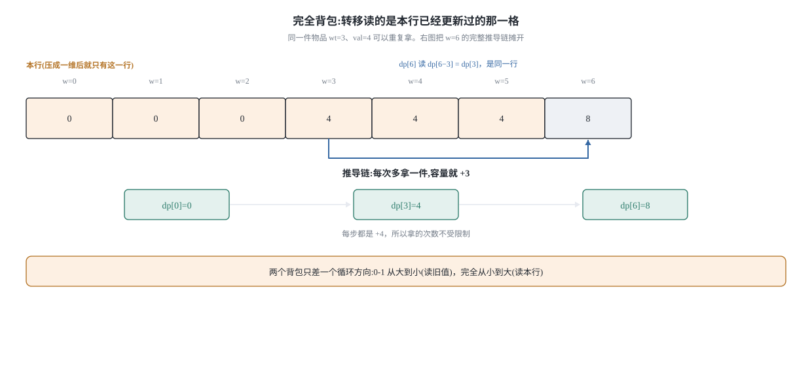
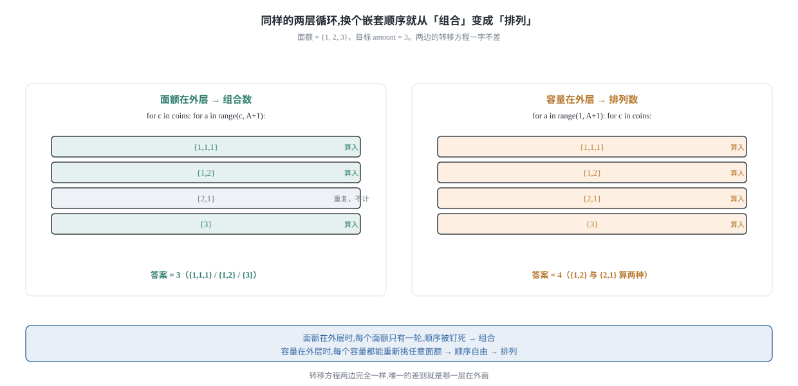
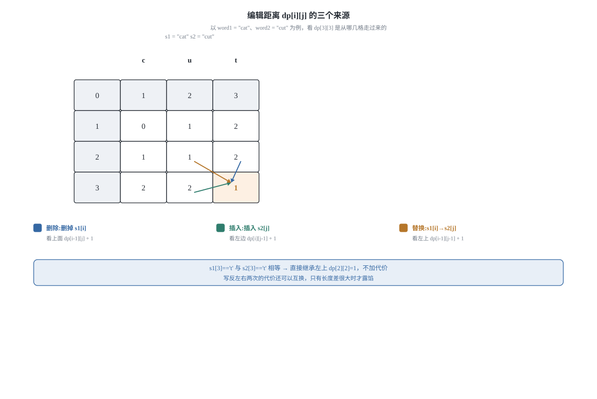

## 0 先说明材料和我的写法

这篇是我自己的学习笔记，材料来自 labuladong 的这几篇教程：

- 《经典动态规划：0-1 背包问题》—— <https://labuladong.online/zh/algo/dynamic-programming/knapsack1/>
- 《经典动态规划：子集背包问题》—— <https://labuladong.online/zh/algo/dynamic-programming/knapsack2/>
- 《经典动态规划：完全背包问题》—— <https://labuladong.online/zh/algo/dynamic-programming/knapsack3/>
- 《背包问题的变体：目标和》—— <https://labuladong.online/zh/algo/dynamic-programming/target-sum/>
- 《经典动态规划：编辑距离》—— <https://labuladong.online/zh/algo/dynamic-programming/edit-distance/>
- 《背包问题经典习题》—— <https://labuladong.online/zh/algo/problem-set/knapsack/>

**这不是转载，也不是翻译。** 原文有一套可以点着看的算法可视化面板，能一步步看 dp 表怎么被填满，那是这套教程最有价值的部分，我这里复现不了。所以下面写的是我自己的理解。

**取材情况要交代清楚。** 上面六篇里，只有《0-1 背包问题》和《编辑距离》我取到了完整正文；**《子集背包问题》《完全背包问题》《目标和》《背包问题经典习题》这四篇我只取到了题目、引言和小标题**，正文没有取到。所以：

- 第 1 节的 0-1 背包二维推导、空间压缩，有原文可对照；
- 第 4 节的编辑距离（三种操作的语义、DP table、还原操作序列）有原文可对照；
- **第 2 节（完全背包为什么正序）、第 2.3 节（组合数与排列数的循环顺序）、第 3 节（恰好装满的初始值语义）、第 3.3 节（目标和转成子集和）主要靠我自己的推导**。原文只告诉我这几节要讲什么，具体论证是我补的。

**代码是 Python 3 和 C++ 两版**，不是原文的语言。原文用 Java，我自己重新实现了一遍。两版并排给是因为它们错的点不一样：比如第 4 节里我用「一个大负数」表示「这个状态不可达」，Python 里可以用 `float("-inf")` 一了百了，C++ 里没有这个便利，必须挑一个 `int` 的哨兵并且小心它参与加法时溢出——这两种写法背后的推理负担完全不同。

### 目录

- [0 先说明材料和我的写法](#0-先说明材料和我的写法)
- [1 0-1 背包:每个物品只有一次机会](#1-0-1-背包每个物品只有一次机会)
- [2 完全背包:同一个问题,方向反过来](#2-完全背包同一个问题方向反过来)
- [3 恰好装满还是至多装满:初始值决定语义](#3-恰好装满还是至多装满初始值决定语义)
- [4 编辑距离:三种操作各对应哪个转移](#4-编辑距离三种操作各对应哪个转移)
- [5 把这几个套路收成一张表](#5-把这几个套路收成一张表)
- [6 材料与出处](#6-材料与出处)

## 1 0-1 背包:每个物品只有一次机会

### 1.1 题目和它唯一的暴力解

> 有一个最多能装 `W` 重量的背包，和 `N` 个物品。第 i 个物品重 `wt[i]`、值 `val[i]`。每个物品只能选或不选（这就是「0-1」的来历，不能切开装一半）。求不超过背包容量的前提下，能装的最大总价值。

原文有一句话我很认同：**这道题没有什么排序之类的巧办法，只能穷举所有可能。** 每个物品两种命运，一共 2ⁿ 种组合。所以暴力解就是枚举所有子集：

```python
# 本文所有 Python 片段共用这组导入；函数各自独立，可以单独拷走
from typing import List, Optional
```

```cpp
// 本文所有 C++ 片段都接在这组头部之后（力扣提交时平台会自动包好）
#include <algorithm>
#include <climits>
#include <functional>
#include <limits>
#include <string>
#include <vector>
using namespace std;
```

```python
def knapsackBrute(W: int, wt: List[int], val: List[int]) -> int:
    """暴力：枚举 2^N 个子集，取总重 <= W 的最大总价值。"""
    n = len(wt)
    best = 0
    for mask in range(1 << n):
        total_w = 0
        total_v = 0
        for i in range(n):
            if (mask >> i) & 1:
                total_w += wt[i]
                total_v += val[i]
        if total_w <= W and total_v > best:
            best = total_v
    return best
```

```cpp
int knapsackBrute(int W, const vector<int>& wt, const vector<int>& val) {
    int n = (int)wt.size();
    int best = 0;
    for (int mask = 0; mask < (1 << n); mask++) {
        int total_w = 0, total_v = 0;
        for (int i = 0; i < n; i++) {
            if ((mask >> i) & 1) { total_w += wt[i]; total_v += val[i]; }
        }
        if (total_w <= W && total_v > best) best = total_v;
    }
    return best;
}
```

`best` 从 0 开始是安全的，因为「一个都不装」永远是一个合法解。这个细节后面第 3 节会变得很重要——如果题目改成「必须恰好装满」，空集就不一定合法了，初始值也就不能是 0。

### 1.2 状态定义:两个维度分别是什么

暴力解慢在 2ⁿ。要消掉重复，得先找到**子问题**。用[上一篇](/2026-11-27-dp-basics/)的流程：找那个在变小的量。

枚举子集时，「还剩哪些物品」和「还剩多少容量」都在变。这两件事能不能都收进状态？

- 「还剩哪些物品」——如果物品可以任意挑，这个集合没法用一两个数字表示。
- 但注意：如果我把物品**排成一排**，规定「按顺序决定前 i 个物品装不装」，那么「还剩哪些物品」就退化成了「考虑到第几个了」。这是一个关键的动作：**把无序的集合变成有序的前缀。** 代价是我们要多证明一句：按某个固定顺序逐个决策，不会漏掉任何子集。这显然成立，因为任何一个子集都对应「每个位置上选或不选」的一串决策。
- 「还剩多少容量」本身就是个数字。

所以状态有两个，dp 数组是二维的：

```text
dp[i][w] 的定义：只在前 i 个物品里选、背包容量为 w 时，能装的最大总价值。
```

原文把这一步叫「状态 + 选择」，并说这个定义「你当做套路记下来就行」。我觉得更值得记住的是上面那个动作——**给物品定一个顺序，把集合换成前缀**。想清楚这一点，`dp[i][w]` 里那个 `i` 就不是凭空的：它是「决策进行到哪儿了」。

**选择**很直白：第 i 个物品装或者不装。

**把选择翻译成转移**（这一步是[上一篇](/2026-11-27-dp-basics/)第 1.3 节的机械动作）：

- **不装第 i 个**：状态从「前 i 个，容量 w」退化成「前 i-1 个，容量 w」，价值不变 → `dp[i-1][w]`。
- **装第 i 个**：先确认装得下（`wt[i-1] <= w`），拿到 `val[i-1]`，容量少掉 `wt[i-1]`，物品范围退到前 i-1 个 → `val[i-1] + dp[i-1][w - wt[i-1]]`。

（下标差一位是因为 dp 的 `i` 从 1 开始数，`wt`/`val` 从 0 开始。）

**base case**：`dp[0][*] = 0`（没有物品可选，价值只能是 0），`dp[*][0] = 0`（没有容量，什么都装不下）。所以整个表初始化成 0 就对了——**这是「至多装 W」这个语义带来的便利**，换成「恰好装满」，第 3 节会看到初始值必须改。

```python
def knapsack01(W: int, wt: List[int], val: List[int]) -> int:
    """dp[i][w] = 只在前 i 个物品里选、容量为 w 时的最大价值。"""
    n = len(wt)
    dp = [[0] * (W + 1) for _ in range(n + 1)]     # 第 0 行/列就是 base case
    for i in range(1, n + 1):
        for w in range(W + 1):
            dp[i][w] = dp[i - 1][w]                # 不装第 i 个物品
            if wt[i - 1] <= w:                     # 装得下，才谈得上「装」
                take = dp[i - 1][w - wt[i - 1]] + val[i - 1]
                if take > dp[i][w]:
                    dp[i][w] = take
    return dp[n][W]
```

```cpp
int knapsack01(int W, const vector<int>& wt, const vector<int>& val) {
    int n = (int)wt.size();
    vector<vector<int>> dp(n + 1, vector<int>(W + 1, 0));
    for (int i = 1; i <= n; i++) {
        for (int w = 0; w <= W; w++) {
            dp[i][w] = dp[i - 1][w];               // 不装第 i 个物品
            if (wt[i - 1] <= w) {
                int take = dp[i - 1][w - wt[i - 1]] + val[i - 1];
                if (take > dp[i][w]) dp[i][w] = take;
            }
        }
    }
    return dp[n][W];
}
```

复杂度：状态数是 (N+1)(W+1)，每个状态 O(1) 次转移（那个 `if` 不是循环）→ 时间 O(N·W)，空间 O(N·W)。

**最容易写错的一行:** `if wt[i - 1] <= w` 这个判断。少了它，`w - wt[i-1]` 就是负数。Python 里这**不会报错**——`dp[i-1][-3]` 会从这一行的末尾取元素，于是程序安静地算出一个偏大的错误答案；C++ 里它是越界读，行为不确定。两种语言都不会拦你。

### 1.3 依赖方向决定遍历方向

现在到了这篇的核心。看 `dp[i][w]` 用到了谁：

- `dp[i-1][w]`——**正上方**（上一行，同一列）
- `dp[i-1][w - wt[i-1]]`——**左上方的某一格**（上一行，更小的列）

两格都在上一行。也就是说，**算出第 i 行只需要第 i-1 行**，再往前的行全都没用了。既然如此，为什么还要留着整个 (N+1)×(W+1) 的表？只留一行不就行了。

但一维数组会把「上一行」和「本行」压在**同一块内存**里：`dp[w]` 在更新前是上一行的值，更新后就变成这一行的值了。于是问题变成：**遍历容量的顺序，必须保证我去读 `dp[w - wt[i]]` 的时候，读到的还是上一行的旧值。**

![0-1 背包一维数组：dp[w] 要读左边的旧值，所以容量必须从大到小遍历](/assets/img/knapsack-20261128/01-01-zero-one-reverse.svg)

`w - wt[i] < w`，左边。如果我们**从小到大**遍历 w：处理到 w 时，`dp[w - wt[i]]` 这个更小的下标**已经被本轮更新过了**，它现在是第 i 行的值，不是第 i-1 行的。读错了。

反过来**从大到小**：处理到 w 时，所有比 w 小的下标**都还没被本轮碰过**，`dp[w - wt[i]]` 干干净净地是上一行的值。这就对了。

所以「0-1 背包一维数组要倒序」不是口诀，它是这句话的直接后果：

> **转移要读左边的旧值，那就必须先把右边的格子写完。**

```python
def knapsack01Rolling(W: int, wt: List[int], val: List[int]) -> int:
    """一维数组：容量从大到小，保证读到的是上一轮的旧值。"""
    dp = [0] * (W + 1)
    for i in range(len(wt)):
        # range 的终点是 wt[i]-1（不含），所以 wt[i] > W 时循环体不执行
        for w in range(W, wt[i] - 1, -1):
            take = dp[w - wt[i]] + val[i]         # dp[w-wt[i]] 还没被本轮覆盖
            if take > dp[w]:
                dp[w] = take
    return dp[W]
```

```cpp
int knapsack01Rolling(int W, const vector<int>& wt, const vector<int>& val) {
    vector<int> dp(W + 1, 0);
    for (int i = 0; i < (int)wt.size(); i++) {
        for (int w = W; w >= wt[i]; w--) {         // 倒序
            int take = dp[w - wt[i]] + val[i];
            if (take > dp[w]) dp[w] = take;
        }
    }
    return dp[W];
}
```

空间从 O(N·W) 降到 O(W)。时间没变，还是 O(N·W)。

**最容易写错的一行:** `for w in range(W, wt[i] - 1, -1)` 的终点。Python 的 `range` 右端**不含**，所以写 `wt[i]` 而不是 `wt[i] - 1` 就会漏掉 `w == wt[i]` 这一格（也就是「正好把这个物品装满」的情况）。C++ 的 `w >= wt[i]` 是闭区间，写起来反而更不容易错——**同一个边界，Python 要减一、C++ 不要减一**，这是我两版都写才发现的差异。

### 1.4 与暴力对照:到底省下了什么

拿 `W=4, wt=[2,1,3], val=[4,2,3]` 试一遍（原文的例子）：答案是 6，装前两个物品，总重 3 ≤ 4。

把两个算法的代价摆在一起：

| | 状态数 | 每个状态的代价 | 总时间 |
|---|---|---|---|
| 暴力枚举子集 | 2ᴺ | O(N) 求和 | O(N·2ᴺ) |
| DP | (N+1)(W+1) | O(1) | O(N·W) |

关键在于：**DP 并没有变聪明，它只是发现了不同的子集会在「前 i 个、容量 w」这个路口撞车。** 撞车之后只保留最好的那一个，剩下的全扔掉。暴力解的 2ᴺ 条路径，在 dp 表里被合并成了 (N+1)(W+1) 个格子。

这也解释了 DP 什么时候会失效：如果每个子问题的「路口」都不一样（比如硬币每种只有一枚时，还得记住「用了哪些硬币」），就撞不上车，只能回到指数级。

## 2 完全背包:同一个问题,方向反过来

### 2.1 题目变了一句话

完全背包就是把「每个物品只能选一次」改成「**每种物品有无限多个，可以重复选**」。力扣 518「零钱兑换 II」就是这个模型的一个变体（求方案数而不是求最值），力扣 322「零钱兑换」求的是最少硬币数——它们都是完全背包。

暴力解变了：不再有 2ⁿ 个子集，而是「每种物品选几个」的组合。

### 2.2 依赖方向变了,所以方向反过来

先看**二维**怎么写。状态定义可以照抄，但转移里「装第 i 个」这一支变了：

在 0-1 背包里，装了第 i 个之后，第 i 个就用掉了，物品范围必须退到 i-1。但在完全背包里，第 i 个**还能再用**，所以物品范围**不用退**：

```text
dp[i][w] = max( dp[i-1][w],                      # 第 i 种一个都不装
                val[i-1] + dp[i][w - wt[i-1]] )   # 再装一个第 i 种（注意还是 i，不是 i-1）
```

两个式子的差别只有一处：`dp[i][...]` 还是 `dp[i-1][...]`。而 `i` 和 `i-1` 的差别，落在**同一行**还是**上一行**。

把这个差别压到一维数组上：



- 0-1 背包读 `dp[i-1][w - wt]` → 一维里对应**旧值** → 必须倒序（别让本轮碰过它）。
- 完全背包读 `dp[i][w - wt]` → 一维里对应**本行的新值** → 必须正序（**就是要本轮碰过它**）。

所以：

> **0-1 背包倒序，是因为它要躲开本轮的新值；完全背包正序，是因为它就是要用本轮的新值。**

这句话把两个方向的来历一次说清了，「正序允许重复选」这个结论也就不再是背下来的——`dp[w - wt]` 里如果已经包含了「再装一个第 i 种」的最优结果，那么 `dp[w]` 就是从它再叠一个，等于第 i 种被选了两次、三次……

```python
def unboundedKnapsack(W: int, wt: List[int], val: List[int]) -> int:
    """完全背包：每种物品可以重复选，容量从小到大。"""
    dp = [0] * (W + 1)
    for i in range(len(wt)):
        for w in range(wt[i], W + 1):             # 正序：允许用到本行刚算出的值
            take = dp[w - wt[i]] + val[i]
            if take > dp[w]:
                dp[w] = take
    return dp[W]
```

```cpp
int unboundedKnapsack(int W, const vector<int>& wt, const vector<int>& val) {
    vector<int> dp(W + 1, 0);
    for (int i = 0; i < (int)wt.size(); i++) {
        for (int w = wt[i]; w <= W; w++) {         // 正序
            int take = dp[w - wt[i]] + val[i];
            if (take > dp[w]) dp[w] = take;
        }
    }
    return dp[W];
}
```

**最容易写错的一行:** 把 0-1 的 `range(W, wt[i]-1, -1)` 直接复制过来改成完全背包（或者反过来）。**代码不会报错，小用例还经常对**——只有当某个物品能被选两次以上、且这样选确实更优时，答案才会偏小。我建议写完立刻用「一个物品、容量是它两倍」这种用例戳一下：`W=4, wt=[2], val=[3]`，完全背包的答案应该是 6（装两个），如果得到 3，就是遍历方向写反了。

**顺便说一个等价写法。** 完全背包也可以写成「外层容量、内层物品」：

```text
for w in [1..W]:
    for i in [1..N]:
        dp[w] = max(dp[w], val[i-1] + dp[w - wt[i-1]])
```

这个写法里 `dp[w]` 依赖同一行的 `dp[w - wt]`（更小的 w），所以正序也是对的。但它和「外层物品」的写法**含义不同**——见下一节，这是整篇文章里最容易埋雷的地方。

### 2.3 组合数还是排列数:外层循环是谁决定的

力扣 518「零钱兑换 II」问的是**组合数**：用给定的面额凑出 `amount`，有多少种**组合**。原文的例子里 `amount = 5, coins = [1,2,5]` 答案是 4，四种分别是 `5`、`2+2+1`、`2+1+1+1`、`1+1+1+1+1`——注意 `2+2+1` 和 `2+1+2` 算**同一种**。

如果把问题改成「有多少种**排列**」（顺序不同算不同），答案立刻变成 9。这两个数只差外层循环是谁，值得单独拎出来看。

**外层物品、内层容量 → 组合数。** 因为外层的每一轮只处理一种面额，`dp[n] += dp[n-c]` 的意思是「在已知方案的最后再补一枚 c」。由于面额是**一种一种**引入的，`{1,2}` 这个组合只会在「处理面额 2」的那一轮里被构造出来，不可能反过来在「处理面额 1」时先放 2——顺序被外层循环钉死了。

**外层容量、内层物品 → 排列数。** `dp[n]` 表示「凑出 n 的所有有序方案」，每个 `n` 都重新扫一遍所有面额，谁放在最后都可能，于是 `2+2+1` 和 `2+1+2` 被算成了两种。



```python
def changeCombinations(amount: int, coins: List[int]) -> int:
    """组合数（力扣 518）：外层面额、内层容量。{1,2} 和 {2,1} 算同一种。"""
    dp = [0] * (amount + 1)
    dp[0] = 1                                     # 凑出 0 元：一种方案，什么都不选
    for c in coins:                               # 先定「用哪些面额」
        for n in range(c, amount + 1):            # 正序 → 同一种面额可以重复用
            dp[n] += dp[n - c]
    return dp[amount]


def changePermutations(amount: int, coins: List[int]) -> int:
    """排列数：外层容量、内层面额。{1,2} 和 {2,1} 算两种。"""
    dp = [0] * (amount + 1)
    dp[0] = 1
    for n in range(1, amount + 1):
        for c in coins:
            if c <= n:                            # 又一次：这个判断不能省
                dp[n] += dp[n - c]
    return dp[amount]
```

```cpp
int changeCombinations(int amount, const vector<int>& coins) {
    vector<int> dp(amount + 1, 0);
    dp[0] = 1;
    for (int c : coins) {
        for (int n = c; n <= amount; n++) dp[n] += dp[n - c];
    }
    return dp[amount];
}

int changePermutations(int amount, const vector<int>& coins) {
    vector<int> dp(amount + 1, 0);
    dp[0] = 1;
    for (int n = 1; n <= amount; n++) {
        for (int c : coins) {
            if (c <= n) dp[n] += dp[n - c];
        }
    }
    return dp[amount];
}
```

复杂度都是 O(k·amount)，k 是面额种数。

**最容易写错的一行:** `dp[0] = 1`。方案数问题的起点必须是 1（「什么都不选」是唯一一种凑出 0 元的方案），不是 0。写成 0 的话整张表全是 0——这个错误比想象中常见，因为最值问题的 base case 习惯性写 0。

还有一个方向性的坑：**求方案数的完全背包，外层必须是物品。** 如果你把 518 写成外层容量，返回的是排列数，`amount = 5, coins = [1,2,5]` 会输出 9 而不是 4。这两个数字差得很远，所以这个 bug 比遍历方向写反更容易被发现——但也更容易「看着 9 觉得也行」，所以还是得记住：**题目问组合就物品在外层，问排列就容量在外层。**

## 3 恰好装满还是至多装满:初始值决定语义

### 3.1 两种语义,两种初始值

到这里为止，所有 dp 都初始化成 0。这是**「至多装 W」**的语义：装不满也没关系，剩下的容量空着就行，`dp[w]` 表示「容量不超过 w 时的最大价值」。

但有些题要求**「恰好装满」**：容量必须一分不剩地用掉。这时候「容量为 3 但什么都装不下」不该被当成价值 0，它应该是**不可达**。

区分这两种情况的不是转移方程，是**初始值**：

| 语义 | `dp[0]` | 其他 `dp[w]` | 不可达怎么表示 |
|---|---|---|---|
| 至多装满 | 0 | 0 | 不需要——任何容量都能靠「不装」达成 |
| 恰好装满 | 0 | 负无穷 | 用一个极小值 |

为什么恰好装满要用**负无穷**而不是 -1 之类的？因为 dp 里的值要参与 `+ val` 和 `max`。用一个「看起来很小但有限」的数，它会在若干次加法之后爬回到正常值域里，伪装成一个合法解。负无穷加任何有限数还是负无穷，永远不会赢。这是**必须让哨兵在运算下封闭**的一个例子，跟[上一篇](/2026-11-27-dp-basics/)里 `INF = amount + 1` 是同一个考虑，只是方向相反。

```python
def knapsack01Exact(W: int, wt: List[int], val: List[int]) -> int:
    """恰好装满：装不满的状态记为负无穷；返回 -1 表示无解。"""
    NEG = float("-inf")                           # Python 里可以直接用负无穷
    dp = [NEG] * (W + 1)
    dp[0] = 0                                     # 唯一可达的起点：容量 0 且价值 0
    for i in range(len(wt)):
        for w in range(W, wt[i] - 1, -1):          # 0-1：依然倒序
            if dp[w - wt[i]] == NEG:               # 从不可达状态转移，结果仍不可达
                continue
            take = dp[w - wt[i]] + val[i]
            if take > dp[w]:
                dp[w] = take
    return -1 if dp[W] == NEG else int(dp[W])
```

```cpp
int knapsack01Exact(int W, const vector<int>& wt, const vector<int>& val) {
    const int NEG = numeric_limits<int>::min() / 2;   // 除以 2，避免参与加法时溢出
    vector<int> dp(W + 1, NEG);
    dp[0] = 0;
    for (int i = 0; i < (int)wt.size(); i++) {
        for (int w = W; w >= wt[i]; w--) {
            if (dp[w - wt[i]] == NEG) continue;
            int take = dp[w - wt[i]] + val[i];
            if (take > dp[w]) dp[w] = take;
        }
    }
    return dp[W] == NEG ? -1 : dp[W];
}
```

**最容易写错的一行:** C++ 的 `const int NEG = INT_MIN;` 后面紧跟一个 `dp[...] + val[i]`。`INT_MIN + 正数` 在 C++ 里是**有符号溢出**，属于未定义行为，实际常常绕成一个正数，于是「不可达」摇身一变成了「最优解」。所以要写成 `INT_MIN / 2`，给加法留出余量——这也是为什么上面那个 `if (dp[...] == NEG) continue` 判断要留着，它是第二道保险。Python 那边没有这个问题，`float("-inf") + 5` 还是负无穷。

顺带说一句 C++ 里怎么少踩这个坑：如果值域已知非负，直接用 `-1` 当不可达哨兵是最省事的（判等就行）；只有值可能为负时才需要一个真正的大负数。我在上面用了 `NEG` 是为了让「哨兵参与运算」这件事显形——**能靠判等解决的问题，就别让它参与运算。**

### 3.2 416 分割等和子集:把判断题变成背包

> 给一个只含正整数的非空数组 `nums`，判断能不能把它分成两个子集，使两个子集的元素和相等。

原文我只取到了题面和标题，下面是自己的推导。

**第一步，把问题改写。** 设总和是 `total`。如果分成两部分且和相等，那么每部分的和都是 `total / 2`。所以：

- `total` 是奇数 → 直接 `false`（不可能平分成两个整数和）；
- 否则问题等价于：**能不能从 `nums` 里挑出一个子集，使其和恰好等于 `total / 2`。**

**第二步，认出这是背包。** 「每个数选或不选」= 0-1 背包；「恰好等于」= 恰好装满；价值是什么？这里没有价值——我们只关心「能不能」，所以 dp 存布尔值。

状态定义：`dp[s]` = 能不能用已经考虑过的数凑出和 `s`。

转移：对每个数 `x`，`dp[s] = dp[s] or dp[s - x]`（不选 x，或者选 x）。`s` 要**倒序**，因为这是 0-1——每个数只能用一次。

`dp[0] = True` 是 base case：一个数都不选，和就是 0。

```python
def canPartition(nums: List[int]) -> bool:
    """416：能否选出和为 total/2 的子集。"""
    total = sum(nums)
    if total % 2 != 0:
        return False                              # 和为奇数，怎么分都不等
    target = total // 2
    dp = [False] * (target + 1)
    dp[0] = True                                  # 空集的和是 0
    for x in nums:
        for s in range(target, x - 1, -1):        # 0-1：倒序，每个数只能用一次
            if dp[s - x]:
                dp[s] = True
    return dp[target]
```

```cpp
bool canPartition(const vector<int>& nums) {
    int total = 0;
    for (int x : nums) total += x;
    if (total % 2 != 0) return false;
    int target = total / 2;
    vector<char> dp(target + 1, 0);
    dp[0] = 1;
    for (int x : nums) {
        for (int s = target; s >= x; s--) {       // 0-1：倒序
            if (dp[s - x]) dp[s] = 1;
        }
    }
    return dp[target] != 0;
}
```

复杂度：时间 O(N·target)，空间 O(target)。这里 `target` 是数值大小而不是 N——**这是背包类问题的一个通病：复杂度里带一个「和」或「容量」，数值一大就崩。** 面试里如果 `nums[i]` 能到 10⁹，这个做法直接不可用，得换思路（而 416 的题目约束保证了总和不大，所以是可行的）。

**最容易写错的一行:** `if total % 2 != 0` 这个提前返回。少了它，`total // 2` 会向下取整，`[1,3]` 这种数组（total=4，其实可行）没事，但 `[1,2]`（total=3）会去凑 1，凑到了就返回 `true`——而 `[1,2]` 显然不能平分。**奇数总和必须先拦掉**，不能在取整之后继续算。

空数组的约定：`nums = []` 时 `total = 0`，是偶数，`target = 0`，`dp[0] = True` → 返回 `true`。从数学上说「空集和空集」确实是两个和相等的子集，所以我保留这个结果；力扣保证非空，所以这个分支不影响判题。**这类约定我在文章里都会写出来，因为「空输入返回什么」在不同的题里有不同的正确答案，靠猜迟早出事。**

### 3.3 494 目标和:暴力回溯与背包的两条路

> 给一个非负整数数组 `nums` 和一个目标 `target`。给每个数前面添 `+` 或 `-`，求能构造出多少种结果等于 `target` 的表达式。

原文这一篇我只取到了题面、回溯框架和小标题，下面是自己的推导——不过这道题有个好处：**暴力解非常短，可以先写出来当基准，再想怎么优化。**

**暴力解：** 每个数两种选择，直接回溯。

```python
def findTargetSumWaysBrute(nums: List[int], target: int) -> int:
    """暴力回溯：每个数试 + 和 - 两种，复杂度 O(2^N)。"""
    count = 0

    def backtrack(i: int, acc: int) -> None:
        nonlocal count
        if i == len(nums):
            if acc == target:
                count += 1
            return
        backtrack(i + 1, acc + nums[i])
        backtrack(i + 1, acc - nums[i])

    backtrack(0, 0)
    return count
```

```cpp
int findTargetSumWaysBrute(const vector<int>& nums, int target) {
    int count = 0;
    function<void(int, int)> backtrack = [&](int i, int acc) {
        if (i == (int)nums.size()) {
            if (acc == target) count++;
            return;
        }
        backtrack(i + 1, acc + nums[i]);
        backtrack(i + 1, acc - nums[i]);
    };
    backtrack(0, 0);
    return count;
}
```

这个暴力解返回的 count 就是答案，**它可以当基准来验证优化后的解法**——这正是我在测试里做的事（见本篇的代码门）。

**优化：把它变成子集和。** 设所有取 `+` 的数之和是 `P`，取 `-` 的数之和是 `N`。那么

```text
P + N = total          （所有数都要带一个符号）
P - N = target         （结果）
两式相加：2P = total + target  →  P = (total + target) / 2
```

所以问题等价于：**从 `nums` 里挑一个子集，使其和恰好是 `(total + target) / 2`，求方案数。** 这又是一个「恰好装满」的 0-1 背包，只不过这次数的是方案数。

三个前提必须先检查，否则 `P` 会算错：

1. `total + target` 必须是偶数。否则 `P` 不是整数，答案是 0。
2. `P` 必须 ≥ 0。`total + target < 0` 时无解。
3. `P` 必须 ≤ total。`total + target > 2·total` 时无解。

（第 3 条其实就是 `target > total`，但因为 `target` 可以是负的，写成 `total + target > 2 * total` 更不容易漏。）

```python
def findTargetSumWays(nums: List[int], target: int) -> int:
    """转成子集和：P = (total + target) / 2。"""
    total = sum(nums)
    p2 = total + target
    if p2 % 2 != 0 or p2 < 0 or p2 > 2 * total:
        return 0                                  # P 不是合法整数，无解
    P = p2 // 2
    dp = [0] * (P + 1)
    dp[0] = 1                                     # 不选任何数，和为 0 的方案数 1
    for x in nums:
        for s in range(P, x - 1, -1):             # 0-1：倒序
            dp[s] += dp[s - x]
    return dp[P]
```

```cpp
int findTargetSumWays(const vector<int>& nums, int target) {
    int total = 0;
    for (int x : nums) total += x;
    int p2 = total + target;
    if (p2 % 2 != 0 || p2 < 0 || p2 > 2 * total) return 0;
    int P = p2 / 2;
    vector<int> dp(P + 1, 0);
    dp[0] = 1;
    for (int x : nums) {
        for (int s = P; s >= x; s--) dp[s] += dp[s - x];
    }
    return dp[P];
}
```

时间 O(N·P)，空间 O(P)。

**最容易写错的一行:** `if p2 % 2 != 0` 里的符号。C++ 里 `(-3) % 2 == -1`，Python 里 `(-3) % 2 == 1`——**两种语言的取模对负数给出的结果不同**，但两者都不等于 0，所以「判 `!= 0`」这个写法在两种语言里都是对的。如果写成 `== 1`，C++ 上就会漏掉负奇数。这是我在两版都写的时候特意统一成 `!= 0` 的原因。

还有一个 Python 专属的坑：`p2 % 2` 里如果 `p2` 是 `float` 就会得到 `0.0`，和 `0` 比较相等，逻辑上没错；但后面 `P = p2 // 2` 会得到 `float`，然后 `[0] * (P + 1)` 会直接报 `TypeError`。所以这里的 `total`、`target` 必须是 `int`——Python 不会替你检查。

**为什么 `dp[0] = 1` 在这里也对？** 因为「和为 0 的方案数」在不含 0 的数组里确实只有「什么都不选」这一种。但如果 `nums` 里有 0，`dp[0]` 会在处理 0 的时候翻倍（`dp[0] += dp[0]`）——这正是我们想要的：`[0]` 配 `target=0` 有 `+0` 和 `-0` 两种表达式，答案是 2。这个 case 我在测试里专门留了一条。

## 4 编辑距离:三种操作各对应哪个转移

### 4.1 三种操作、三个指针动作

> 力扣 72：给两个单词 `word1` 和 `word2`，返回把 `word1` 变成 `word2` 所用的最少操作数。允许的操作有三种：插入一个字符、删除一个字符、替换一个字符。

原文用了一个很好用的技巧：**两个字符串的 DP，让两个指针分别指向两个字符串的尾部。** 这样每做一次操作，就是在缩小问题的规模。

定义：

```text
dp[i][j] 的定义：把 word1 的前 i 个字符 变成 word2 的前 j 个字符，最少要几步。
```

现在看末尾这一对字符 `word1[i-1]`（记为 a）和 `word2[j-1]`（记为 b）。**关键是把三种操作翻译成「哪一个指针往回走」**：

| 操作 | 对末尾做了什么 | 指针怎么走 | 对应转移 |
|---|---|---|---|
| 删除 | 把 a 删掉（a 是多余的） | i 减一，j 不动 | `dp[i-1][j] + 1` |
| 插入 | 在末尾补一个 b（b 在 word1 里没有） | i 不动，j 减一 | `dp[i][j-1] + 1` |
| 替换 | 把 a 换成 b，两个末尾一起解决 | i、j 同时减一 | `dp[i-1][j-1] + 1` |
| （什么都不做） | a 和 b 本来就一样 | i、j 同时减一 | `dp[i-1][j-1]` |

有几个地方值得掰开说：

- **为什么删除是 `dp[i-1][j]`？** 删掉 a 之后，word1 还剩前 i-1 个字符，而 word2 的 j 个字符一个都没解决，所以是 `dp[i-1][j]`。
- **为什么插入是 `dp[i][j-1]`？** 这一条最容易反。补上去的那个字符**就是 b**，它一出现就把 `word2[j-1]` 这一位对齐掉了，所以 j 要减一。而 word1 原来的 i 个字符**一个都没被消耗**（补的是额外的一个），所以 i 不动。**插入消耗的是 word2 的下标，不是 word1 的。** 我第一遍就是在这里把两者写反的，结果代码还能跑，只是答案偏大。
- **替换为什么是两个都减一？** 因为一次替换同时处理掉了 a 和 b 这一对。
- **a == b 时不做任何操作。** 原文专门提醒：很多人只记三种操作，忘了还有「第四种操作」——什么都不做。既然 a 已经等于 b，动它只会让步数变多。



**base case：**

- `dp[i][0] = i`：word2 是空的，word1 的 i 个字符只能一个个删掉。
- `dp[0][j] = j`：word1 是空的，只能把 word2 的 j 个字符一个个插进去。

原文说这两种情况「就是算法的 base case」，我一开始以为 `dp[0][0] = 0` 也该单列，其实它被上面两行同时覆盖了，写不写都对。

```python
def minDistance(s1: str, s2: str) -> int:
    """dp[i][j] = 把 s1 前 i 个字符变成 s2 前 j 个字符的最少操作数。"""
    m, n = len(s1), len(s2)
    dp = [[0] * (n + 1) for _ in range(m + 1)]
    for i in range(m + 1):
        dp[i][0] = i                     # s2 为空：只能删
    for j in range(n + 1):
        dp[0][j] = j                     # s1 为空：只能插
    for i in range(1, m + 1):
        for j in range(1, n + 1):
            if s1[i - 1] == s2[j - 1]:
                dp[i][j] = dp[i - 1][j - 1]              # 第四种操作：什么都不做
            else:
                dp[i][j] = 1 + min(
                    dp[i - 1][j],                        # 删除：i 减一
                    dp[i][j - 1],                        # 插入：j 减一
                    dp[i - 1][j - 1],                    # 替换：两个都减一
                )
    return dp[m][n]
```

```cpp
int minDistance(const string& s1, const string& s2) {
    int m = (int)s1.size(), n = (int)s2.size();
    vector<vector<int>> dp(m + 1, vector<int>(n + 1, 0));
    for (int i = 0; i <= m; i++) dp[i][0] = i;
    for (int j = 0; j <= n; j++) dp[0][j] = j;
    for (int i = 1; i <= m; i++) {
        for (int j = 1; j <= n; j++) {
            if (s1[i - 1] == s2[j - 1]) {
                dp[i][j] = dp[i - 1][j - 1];
            } else {
                dp[i][j] = 1 + min(dp[i - 1][j],
                                   min(dp[i][j - 1], dp[i - 1][j - 1]));
            }
        }
    }
    return dp[m][n];
}
```

复杂度：状态数 (m+1)(n+1)，每个 O(1) → 时间 O(mn)，空间 O(mn)。和[上一篇](/2026-11-27-dp-basics/)的 LCS 是同一个形状——事实上编辑距离和 LCS 是可以互相推出来的（两个字符串的 LCS 越长，编辑距离的「替换」就越少），但那是另一条路，这里不展开。

**最容易写错的一行:** `dp[i][j - 1]` 和 `dp[i - 1][j]` 的位置。这两个格子一个在**左边**一个在**上边**，写反了代码照样跑，只是把「插入」和「删除」的代价互换了。因为插入和删除的次数在最优解里恰好可以互换（把 word1 变成 word2 的插入序列，反过来就是 word2 变成 word1 的删除序列），**很多用例下最终答案居然还是对的**——只有在两个字符串长度差很大、且替换不划算的时候才会露馅。所以这一行我用「哪个指针往回走」来记，而不是记「左还是上」。

### 4.2 还原操作序列

算出了最少步数，很自然会想：到底是哪几步？做法是**从 `dp[m][n]` 倒着走回 `dp[0][0]`**，每一步看当前格子是从哪个邻居转移来的。

```python
def minDistanceOps(s1: str, s2: str) -> List[str]:
    """还原一条最优操作序列（可能有多个最优解，这里给一条）。

    每条操作都带上它在 s1 里的位置，格式固定为三种之一：
        "delete s1[i]='a'"           删除下标 i
        "replace s1[i]='a'->'b'"     替换下标 i
        "insert at i 'b'"            插在 s1 的前 i 个字符之后
    位置从左到右单调不减——这也正是「验证一条操作序列」时的检查项。
    """
    m, n = len(s1), len(s2)
    dp = [[0] * (n + 1) for _ in range(m + 1)]
    for i in range(m + 1):
        dp[i][0] = i
    for j in range(n + 1):
        dp[0][j] = j
    for i in range(1, m + 1):
        for j in range(1, n + 1):
            if s1[i - 1] == s2[j - 1]:
                dp[i][j] = dp[i - 1][j - 1]
            else:
                dp[i][j] = 1 + min(dp[i - 1][j], dp[i][j - 1], dp[i - 1][j - 1])

    ops: List[str] = []
    i, j = m, n
    while i > 0 or j > 0:
        if i > 0 and j > 0 and s1[i - 1] == s2[j - 1] and dp[i][j] == dp[i - 1][j - 1]:
            i, j = i - 1, j - 1                              # 跳过：本来就不用动
        elif i > 0 and j > 0 and dp[i][j] == dp[i - 1][j - 1] + 1:
            ops.append("replace s1[{}]='{}'->'{}'".format(i - 1, s1[i - 1], s2[j - 1]))
            i, j = i - 1, j - 1
        elif i > 0 and dp[i][j] == dp[i - 1][j] + 1:
            ops.append("delete s1[{}]='{}'".format(i - 1, s1[i - 1]))
            i -= 1
        else:
            ops.append("insert at {} '{}'".format(i, s2[j - 1]))
            j -= 1
    return ops[::-1]
```

```cpp
vector<string> minDistanceOps(const string& s1, const string& s2) {
    int m = (int)s1.size(), n = (int)s2.size();
    vector<vector<int>> dp(m + 1, vector<int>(n + 1, 0));
    for (int i = 0; i <= m; i++) dp[i][0] = i;
    for (int j = 0; j <= n; j++) dp[0][j] = j;
    for (int i = 1; i <= m; i++) {
        for (int j = 1; j <= n; j++) {
            if (s1[i - 1] == s2[j - 1]) dp[i][j] = dp[i - 1][j - 1];
            else dp[i][j] = 1 + min(dp[i - 1][j], min(dp[i][j - 1], dp[i - 1][j - 1]));
        }
    }
    // 三种操作的格式和 Python 版完全一致，方便交叉核对
    vector<string> ops;
    int i = m, j = n;
    while (i > 0 || j > 0) {
        if (i > 0 && j > 0 && s1[i - 1] == s2[j - 1] && dp[i][j] == dp[i - 1][j - 1]) {
            i--; j--;                                        // 跳过
        } else if (i > 0 && j > 0 && dp[i][j] == dp[i - 1][j - 1] + 1) {
            ops.push_back("replace s1[" + to_string(i - 1) + "]='" + string(1, s1[i - 1]) +
                          "'->'" + string(1, s2[j - 1]) + "'");
            i--; j--;
        } else if (i > 0 && dp[i][j] == dp[i - 1][j] + 1) {
            ops.push_back("delete s1[" + to_string(i - 1) + "]='" + string(1, s1[i - 1]) + "'");
            i--;
        } else {
            // 走到这里必然 j > 0：j == 0 时上面的删除分支一定会命中
            ops.push_back("insert at " + to_string(i) + " '" + string(1, s2[j - 1]) + "'");
            j--;
        }
    }
    reverse(ops.begin(), ops.end());
    return ops;
}
```

**操作序列为什么要带下标？** 我第一版写的是 `"delete a"` 这种不带位置的格式，看着更清爽，但它**没法验证**：`"insert b"` 到底插在哪儿，从字符串本身读不出来。比如 `"ac"` 变成 `"abc"`，最优解是插入一个 `b`，可插在 `a` 后面得到 `"abc"`，插在最前面得到 `"bac"`——同一个操作序列描述的其实是两个不同的结果。所以每条操作都得带上它在 `s1` 里的位置，位置**从左到右单调不减**，这也正好就是验证一条操作序列时该检查的东西。

**最容易写错的一行:** `while i > 0 or j > 0` 用的是 `or` 不是 `and`。用 `and` 的话，只要有一个指针走到 0 循环就停了，剩下的那次「一路删到底」或「一路插到底」就不会被记录——返回的操作序列**步数比答案少**，但每一步看起来都对，特别难发现。

判断顺序也有讲究：**「字符相等就跳过」必须放在最前面。** 如果先判 `dp[i][j] == dp[i-1][j-1] + 1`，在字符相等且 `dp[i][j] == dp[i-1][j-1]` 时，两个条件可能同时成立（比如 `dp[i-1][j-1] + 1 == dp[i][j]` 也满足的情况），于是会多做一次没必要的替换——步数不变，但操作序列不是最简的。

## 5 把这几个套路收成一张表

| 问题 | 状态定义 | 转移 | 遍历方向 | 初始值 | 时间 | 最容易错的一行 |
|---|---|---|---|---|---|---|
| 0-1 背包（最值） | `dp[i][w]` = 前 i 个物品、容量 w 的最大价值 | `max(dp[i-1][w], val[i-1]+dp[i-1][w-wt[i-1]])` | 二维行优先；一维**倒序** | 全 0 | O(N·W) | 漏了 `wt[i-1] <= w` |
| 0-1 背包（恰好装满） | 同上，但只有可达状态有效 | 同上 | **倒序** | `dp[0]=0`，其余 `-inf` | O(N·W) | C++ 用 `INT_MIN` 参与加法 |
| 完全背包 | `dp[i][w]` = 前 i **种**物品、容量 w（可重复选） | `max(dp[i-1][w], val[i-1]+dp[i][w-wt[i-1]])` | 一维**正序** | 全 0 | O(N·W) | 复制了 0-1 的倒序 |
| 518 零钱兑换 II（组合） | `dp[n]` = 凑出 n 的方案数 | `dp[n] += dp[n-c]` | 一维正序，**外层面额** | `dp[0]=1` | O(k·n) | `dp[0]` 写成 0 |
| （同上，改成排列） | 同上 | 同上 | 一维正序，**外层容量** | `dp[0]=1` | O(k·n) | 用了排列的顺序去答组合题 |
| 416 分割等和子集 | `dp[s]` = 能否凑出和 s（布尔） | `dp[s] \|= dp[s-x]` | 一维**倒序** | `dp[0]=True` | O(N·target) | 漏了 `total % 2` 的判断 |
| 494 目标和 | 转成子集和 `P=(total+target)/2`，`dp[s]` = 方案数 | `dp[s] += dp[s-x]` | 一维**倒序** | `dp[0]=1` | O(N·P) | `p2 % 2` 写成 `== 1` |
| 72 编辑距离 | `dp[i][j]` = 两个前缀的最少操作数 | 相等取左上；否则 `1+min(上, 左, 左上)` | 二维行优先 | `dp[i][0]=i`，`dp[0][j]=j` | O(mn) | 插入/删除的格写反 |

一句话总结这篇：**背包类的 dp 表只有一个形状，变的是「第 i 个物品还能不能用」和「装满是不是必须的」。** 前者决定一维数组的遍历方向（能用就是正序，不能用就是倒序），后者决定初始值（不必须就是 0，必须就是负无穷）。把这两个问题问清楚，方程和方向都不用背。

## 6 材料与出处

- 《经典动态规划：0-1 背包问题》
  <https://labuladong.online/zh/algo/dynamic-programming/knapsack1/>
  取到完整正文。第 1 节的状态/选择推导、「背包问题没有什么排序之类的巧办法」这个判断、滚动数组那段都对照过。
- 《经典动态规划：编辑距离》
  <https://labuladong.online/zh/algo/dynamic-programming/edit-distance/>
  取到完整正文。第 4 节的尾部双指针视角、三种操作加「什么都不做」这第四种、base case 的处理、还原操作序列的思路都对照过；`dp[i][j-1]` 与 `dp[i-1][j]` 的对应关系我按自己的理解重写了一遍。
- 《经典动态规划：子集背包问题》<https://labuladong.online/zh/algo/dynamic-programming/knapsack2/>
- 《经典动态规划：完全背包问题》<https://labuladong.online/zh/algo/dynamic-programming/knapsack3/>
- 《背包问题的变体：目标和》<https://labuladong.online/zh/algo/dynamic-programming/target-sum/>
- 《背包问题经典习题》<https://labuladong.online/zh/algo/problem-set/knapsack/>

上面后四篇我只取到了题目、引言和小标题，正文没有取到。所以**第 2 节（完全背包正序的依赖方向解释）、第 2.3 节（组合数与排列数的外层循环）、第 3 节（恰好装满的初始值语义、三种「恰好装满」的实例）、第 3.3 节（目标和转成子集和及其三个前提）主要靠我自己的推导**，原文只提示了该讲哪几件事。

涉及的力扣题目：

| 题号 | 题目 | 链接 |
|---|---|---|
| 416 | 分割等和子集 | <https://leetcode.cn/problems/partition-equal-subset-sum/> |
| 494 | 目标和 | <https://leetcode.cn/problems/target-sum/> |
| 518 | 零钱兑换 II | <https://leetcode.cn/problems/coin-change-ii/> |
| 322 | 零钱兑换 | <https://leetcode.cn/problems/coin-change/> |
| 72 | 编辑距离 | <https://leetcode.cn/problems/edit-distance/> |
| 1049 | 最后一块石头的重量 II | <https://leetcode.cn/problems/last-stone-weight-ii/> |

再次说明：本文的讲解、推导、图和 Python/C++ 代码都是我自己写的，教程原文是 Java。原文的算法可视化面板能一步步看 dp 表填满的过程，那部分我复现不了，建议直接去读原文。上一节里的「恰好装满」那几种实例（416 / 494）我只取到了题面，具体做法是我的推导，若与原文有出入请以原文为准。
