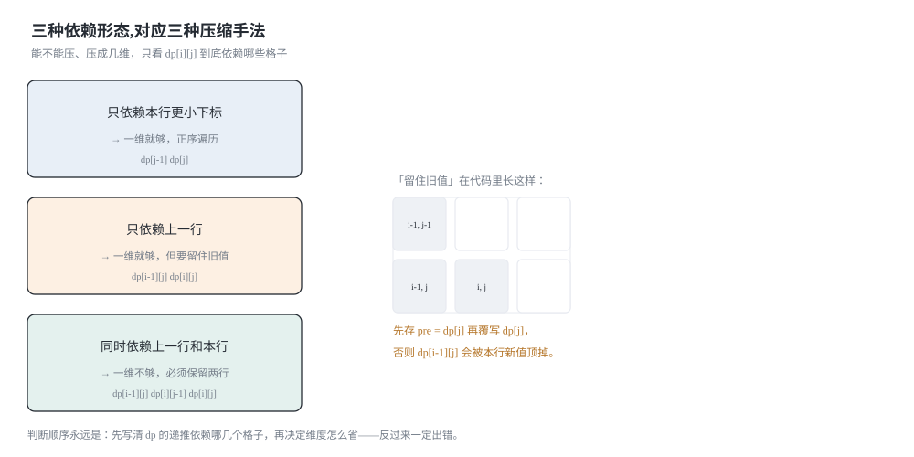
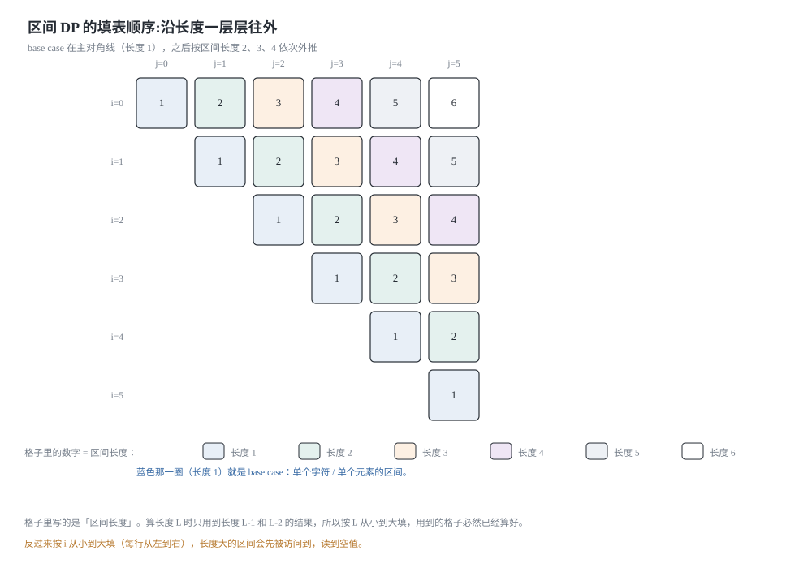
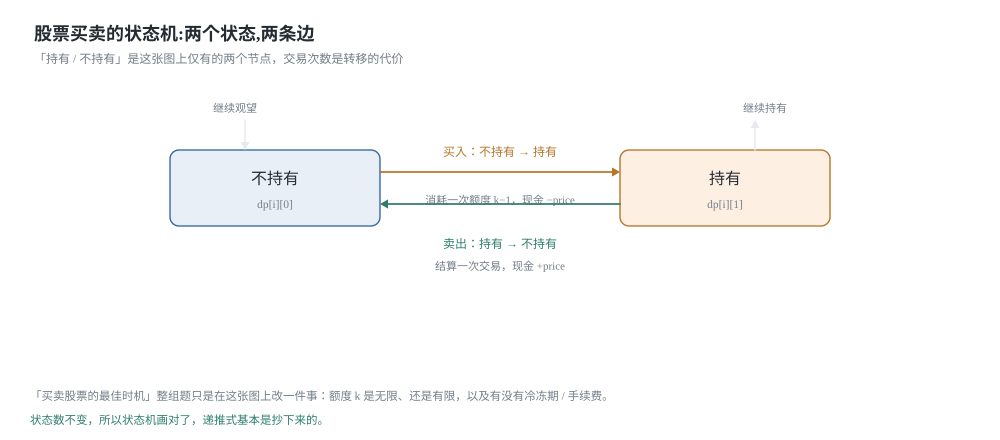
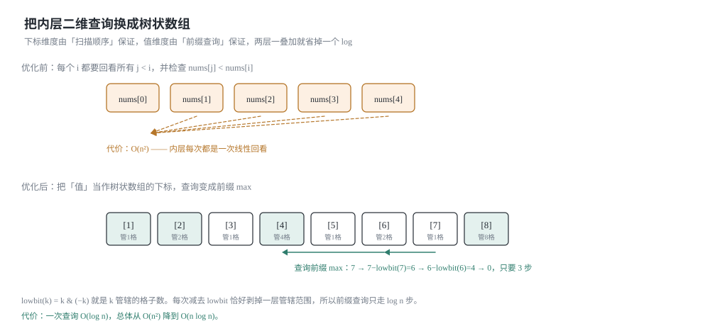

## 0 先说明材料和我的写法

这是我自己的动态规划进阶笔记，也是[上一篇《动态规划入门》](/2026-11-27-dp-basics/)的续篇。上一篇解决的是「状态怎么定义、方程怎么推出来」，这一篇处理三个在面试里反复出现的进阶动作：**把 dp 表压小**、**把状态定义从「前缀」换成「区间」**、**把 dp 表画成状态机**。结尾再用一道完整的例题走一遍 O(n²) 到 O(n log n) 的优化路径。

材料来自 labuladong 的这几篇教程：

- 《对动态规划进行空间压缩》—— <https://labuladong.online/zh/algo/dynamic-programming/space-optimization/>
- 《一个方法团灭 LeetCode 股票买卖问题》—— <https://labuladong.online/zh/algo/dynamic-programming/stock-problem-summary/>
- 《经典动态规划：博弈问题》—— <https://labuladong.online/zh/algo/dynamic-programming/game-theory/>
- 《经典动态规划：0-1 背包问题》—— <https://labuladong.online/zh/algo/dynamic-programming/knapsack1/>
- 《经典动态规划：编辑距离》—— <https://labuladong.online/zh/algo/dynamic-programming/edit-distance/>
- 《最优子结构原理和 dp 数组遍历方向》—— <https://labuladong.online/zh/algo/dynamic-programming/faq-summary/>

**这不是转载，也不是翻译。** 原文有配套的可视化面板（能一格一格看 dp 表被填满），那是这套教程最有价值的部分，我这里复现不了，所以下面写的是我自己重新推导的一遍。文中的 4 张示意图都是我用 SVG 自己画的。

有几处要坦白，免得你把我没做过的事当成我做过了：

- 《股票买卖问题》我取到了完整正文：三维 dp 的穷举框架、`dp[i][k][0/1]` 的两个转移方程、六道题怎么从同一个式子化简出来、冷冻期用 `i - cooldown - 1` 这种偏移量的写法，我都逐条核对过。
- 《博弈问题》也取到了完整正文。第 2 节那个 `dp[i][j]` 的定义、以及「base case 是斜着的、所以倒着遍历」这个观察来自原文；不过原文用的是 `(先手, 后手)` 二元组，**我换成了「先手减后手」的单个整数**，下面会讲为什么这样换、以及两者为什么等价。
- 《0-1 背包问题》取到了大部分正文，包括「滚动数组优化」那一段，以及末尾那句「进一步压缩成一维数组，不过这需要注意遍历顺序」。但一维那篇的正文没有单独取到，第 1.2 节里「倒序还是正序」的完整判据是我自己整理的。
- 《编辑距离》取到了完整正文，包括「空间复杂度可以压缩成 `O(min(M,N))`」这个结论和「可解释性大大降低」这个提醒。**但压缩后代码里那个临时变量该怎么摆，原文没有细说，第 1.3 节是我自己推的，并且用随机对拍验证过。**
- 《对动态规划进行空间压缩》《最优子结构原理和 dp 数组遍历方向》两篇**我只取到了标题、摘要和目录**。摘要里给的结论是「某些情况下状态转移方程仅依赖于相邻的状态，那就没必要维护整个 dp 数组」，以及「有的正着遍历，有的倒着遍历，有的斜着遍历」这个现象。所以**第 1 节那条三步判据、第 2.2 节「为什么区间 DP 要按长度遍历」都是我自己的推导**，不是从原文核对来的。
- 第 4 节（树状数组优化 LIS）**完全是我自己的推导和实现**，教程里没有对应的篇章。

**代码是 Python 3 和 C++ 两版，都是我自己写的**，不是原文的语言（原文用 Java）。两种语言并排给出是有实际收益的，这篇里最典型的一处是「无解」的表示：Python 里 `float("-inf")` 参与加法永远是 `-inf`，怎么算都不会溢出；C++ 里如果拿 `LLONG_MIN` 去减一个价格，就是有符号整数下溢（UB）。第 3.4 节会把这件事讲清楚。

### 目录

- [0 先说明材料和我的写法](#0-先说明材料和我的写法)
- [1 空间压缩:能不能压,由依赖方向决定](#1-空间压缩能不能压由依赖方向决定)
- [2 区间 DP:状态是一段区间](#2-区间-dp状态是一段区间)
- [3 状态机 DP:股票系列只是多了两个维度](#3-状态机-dp股票系列只是多了两个维度)
- [4 从 O(n^2) 到 O(n log n):把内层循环换成前缀最值](#4-从-on2-到-on-log-n把内层循环换成前缀最值)
- [5 把这几个套路收成一张表](#5-把这几个套路收成一张表)
- [6 材料与出处](#6-材料与出处)

## 1 空间压缩:能不能压,由依赖方向决定

### 1.1 压缩的本质:两块内存变成一块

「空间压缩」这个词听起来像是一种优化技巧，但它其实只是**一次内存的复用**。想清楚这一点，所有的口诀都会自己掉出来。

二维 dp 表里，第 `i` 行的每个格子写在 `dp[i][...]`，第 `i-1` 行写在 `dp[i-1][...]`，两块内存互不干扰。压缩的意思是：**我不再给每一行分配内存，而是让所有行共用同一块数组**。于是 `dp[j]` 这个名字就变得有歧义了——它在被本轮更新之前是第 `i-1` 行的值，被更新之后是第 `i` 行的值。

所以压缩的全部风险就一句话：

> **我要读的那个格子，在读的时候是不是已经被本轮覆盖了？**

要回答它，只需要做一件事：把 `dp[i][j]` 依赖的所有格子在表上圈出来，看看它们相对当前位置在哪个方向；然后选一个遍历顺序，让「会被读到的旧值」在被写掉之前先被读完。这就是判据，不需要背。

### 1.2 三种依赖形态

把常见转移按「依赖的格子在哪」分成三类，每类对应一种压缩手法。



**(a) 只依赖本行更小的下标。** 斐波那契的 `dp[i] = dp[i-1] + dp[i-2]` 是这种：依赖在本行左边。正序遍历，读到的一定是已经算好的新值——正确。而且既然只需要前两个，连数组都不用，两个变量足矣。

**(b) 只依赖上一行。** 0-1 背包的 `dp[i][w]` 用到 `dp[i-1][w]`（正上方）和 `dp[i-1][w - wt]`（左上方的某一格）。两格都在上一行，所以**两行滚轮**一定是对的：

```python
# 本文所有 Python 片段共用这组导入；函数各自独立，可以单独拷走
from typing import List
```

```cpp
// 本文所有 C++ 片段都接在这组头部之后（力扣提交时平台会自动包好）
#include <algorithm>
#include <climits>
#include <string>
#include <vector>
using namespace std;
```

```python
def knapsack01Rows(W: int, wt: List[int], val: List[int]) -> int:
    """两行滚轮：算第 i 行只读第 i-1 行，所以物理上只需要两行。"""
    n = len(wt)
    dp = [[0] * (W + 1) for _ in range(2)]
    for i in range(1, n + 1):
        cur, pre = i % 2, (i - 1) % 2      # 本行写进 cur，上一行留在 pre
        for w in range(W + 1):
            dp[cur][w] = dp[pre][w]                    # 不装第 i 个物品
            if wt[i - 1] <= w:
                take = dp[pre][w - wt[i - 1]] + val[i - 1]
                if take > dp[cur][w]:
                    dp[cur][w] = take
    return dp[n % 2][W]
```

```cpp
int knapsack01Rows(int W, const vector<int>& wt, const vector<int>& val) {
    int n = (int)wt.size();
    vector<vector<int>> dp(2, vector<int>(W + 1, 0));
    for (int i = 1; i <= n; i++) {
        int cur = i % 2, pre = (i - 1) % 2;   // 本行写进 cur，上一行留在 pre
        for (int w = 0; w <= W; w++) {
            dp[cur][w] = dp[pre][w];                       // 不装第 i 个物品
            if (wt[i - 1] <= w) {
                int take = dp[pre][w - wt[i - 1]] + val[i - 1];
                if (take > dp[cur][w]) dp[cur][w] = take;
            }
        }
    }
    return dp[n % 2][W];
}
```

空间从 `O(N·W)` 降到 `O(W)`，时间一点没变。**注意这里不需要关心遍历方向**：读的是 `pre` 行，写的是 `cur` 行，两块内存，怎么遍历都不会读脏。

那为什么还能再压成一行？因为「两行」这个约束本身也是浪费的——第 `i-2` 行确实没用了，但第 `i-1` 行也没必要整行留着，它只在被读的那一刻有用。压成一行之后，`dp[pre][...]` 和 `dp[cur][...]` 变成同一个数组，读脏的风险就来了：

- 一维数组里 `dp[w]` 正序更新时，`dp[w - wt]` 这个更小的下标**已经被本轮写过了**，它现在是第 `i` 行的值，而 0-1 背包要的是第 `i-1` 行的值 → 读错了。
- 所以**容量必须倒序遍历**：处理到 `w` 时，所有比 `w` 小的下标都还没被本轮碰过，读到的干干净净是旧值。

[上一篇《背包问题》](/2026-11-28-knapsack/)第 1.3 节把这条推得很细，还给了完全背包的反例（同一个位置要读的恰好是**本行**的新值，于是方向反过来，必须正序）。这里不重复，只把它归到判据里：**(b) 类压成一行之后，方向由「要读旧值还是新值」决定**。

**(c) 同时依赖上一行和本行。** 这就到了这一类里最不直观的情况，也是第 1.3 节的主题。

### 1.3 编辑距离:压成一行时必须留一个「被覆盖的角」

编辑距离的转移[上一篇](/2026-11-28-knapsack/)已经推过，这里只看它的依赖形状：

```text
dp[i][j] 用到三个格子：
  dp[i-1][j]     正上方      ┐
  dp[i][j-1]     正左方      ├ 前两个在「上一行」和「本行」各一个
  dp[i-1][j-1]   左上方      ┘ 第三个横跨两行
```

先写出没有压缩的版本，作为对照：

```python
def editDistance2D(s1: str, s2: str) -> int:
    """dp[i][j] = s1 的前 i 个字符变成 s2 的前 j 个字符的最少操作数。"""
    m, n = len(s1), len(s2)
    dp = [[0] * (n + 1) for _ in range(m + 1)]
    for i in range(m + 1):
        dp[i][0] = i                    # 全是删除
    for j in range(n + 1):
        dp[0][j] = j                    # 全是插入
    for i in range(1, m + 1):
        for j in range(1, n + 1):
            if s1[i - 1] == s2[j - 1]:
                dp[i][j] = dp[i - 1][j - 1]          # 字符相同，什么都不做
            else:
                dp[i][j] = 1 + min(dp[i - 1][j],     # 删除
                                   dp[i][j - 1],     # 插入
                                   dp[i - 1][j - 1])  # 替换
    return dp[m][n]
```

```cpp
int editDistance2D(const string& s1, const string& s2) {
    int m = (int)s1.size(), n = (int)s2.size();
    vector<vector<int>> dp(m + 1, vector<int>(n + 1, 0));
    for (int i = 0; i <= m; i++) dp[i][0] = i;   // 全是删除
    for (int j = 0; j <= n; j++) dp[0][j] = j;   // 全是插入
    for (int i = 1; i <= m; i++) {
        for (int j = 1; j <= n; j++) {
            if (s1[i - 1] == s2[j - 1]) {
                dp[i][j] = dp[i - 1][j - 1];         // 字符相同，什么都不做
            } else {
                dp[i][j] = 1 + min(min(dp[i - 1][j], // 删除
                                       dp[i][j - 1]), // 插入
                                   dp[i - 1][j - 1]); // 替换
            }
        }
    }
    return dp[m][n];
}
```

现在尝试压成一行。`dp[j]` 在更新前是 `dp[i-1][j]`，更新后是 `dp[i][j]`：

- `dp[i-1][j]` → 就是**还没被覆盖**的 `dp[j]`，现成的；
- `dp[i][j-1]` → 本轮已经写好了的 `dp[j-1]`，也是现成的；
- `dp[i-1][j-1]` → **麻烦在这里**。它要么已经被 `dp[j-1]` 覆盖掉了，要么根本没地方存。

它没地方存，是因为它「横跨两行」：行列都变了。所以必须额外拿一个变量在它被覆盖之前把它接住。顺序是这样的：

```text
进入内层循环前：prev = dp[0] 的旧值 = dp[i-1][0] = i-1
每一轮 j：
    tmp  = dp[j]          # ① 先接住「正上方」的旧值，它马上要被覆盖
    dp[j] = f(prev, dp[j-1], tmp)
                          #    f 里的三个参数依次是 左上、左、上
    prev = tmp            # ② 交棒：这一轮的「正上方」，就是下一轮的「左上方」
```

第 ② 步是整段代码里唯一需要想一下的地方：对 `j+1` 来说，`dp[i-1][j]` 正好就是它的左上方。所以「被覆盖的正上方」和「下一格的左上方」是同一个值，一个 `tmp` 就够周转了。

```python
def editDistance1D(s1: str, s2: str) -> int:
    """一行数组 + 一个 prev：保存被覆盖掉的 dp[i-1][j-1]。"""
    m, n = len(s1), len(s2)
    dp = list(range(n + 1))        # 第 0 行：空串插入成 s2 的前 j 个字符
    for i in range(1, m + 1):
        prev = dp[0]               # dp[i-1][0]，也就是 i-1
        dp[0] = i                  # dp[i][0]：s1 的前 i 个字符全删掉
        for j in range(1, n + 1):
            tmp = dp[j]            # 先接住 dp[i-1][j]，它立刻会被覆盖
            if s1[i - 1] == s2[j - 1]:
                dp[j] = prev
            else:
                dp[j] = 1 + min(dp[j], dp[j - 1], prev)
            prev = tmp             # 本轮的「上」＝ 下一轮的「左上」
    return dp[n]
```

```cpp
int editDistance1D(const string& s1, const string& s2) {
    int m = (int)s1.size(), n = (int)s2.size();
    vector<int> dp(n + 1);
    for (int j = 0; j <= n; j++) dp[j] = j;          // 第 0 行
    for (int i = 1; i <= m; i++) {
        int prev = dp[0];                            // dp[i-1][0]
        dp[0] = i;                                   // dp[i][0]
        for (int j = 1; j <= n; j++) {
            int tmp = dp[j];                         // 先接住 dp[i-1][j]
            if (s1[i - 1] == s2[j - 1]) {
                dp[j] = prev;
            } else {
                dp[j] = 1 + min(min(dp[j], dp[j - 1]), prev);
            }
            prev = tmp;                              // 本轮的「上」＝ 下一轮的「左上」
        }
    }
    return dp[n];
}
```

空间 `O(m·n)` → `O(n)`（把 `s2` 取短的那一个就是 `O(min(m,n))`，原文也是这个结论）。注意 `dp[j]` 在 `min` 里代表的仍然是「上」，因为 `tmp` 只是被存进了一个局部变量，`dp[j]` 本身还没写。

**最容易写错的一行:** `prev = dp[0]` 和 `dp[0] = i` 的**顺序**。这两行必须一前一后、不能交换——`prev` 要的是第 `i-1` 行的第 0 列（值是 `i-1`），而 `dp[0]` 紧接着就要被改写成第 `i` 行的第 0 列（值是 `i`）。我先写的时候把 `dp[0] = i` 放在前面，结果 `prev` 变成了 `i`，于是每一行的第一格「左上」都多算了 1，短字符串上完全看不出来，长字符串上答案就整体偏大——这种错只看单步是查不出来的，得对拍。

另外补一句原文的提醒，我完全同意：**空间压缩之后代码可解释性会明显下降**。所以正常写题时，先写二维版、先让它过，再决定要不要压。上面的 `editDistance2D` 请留着，它是 `editDistance1D` 的对照组。

### 1.4 一条可以照做的判据

把上面三类的经验收成三步。拿到一个转移，先别写代码，按这个走：

1. **列出依赖**：`dp[i][j]` 用到了哪几格？把相对坐标写出来（上 / 左 / 左上 / 下一行 / 任意 `k`）。
2. **判断能否压**：压缩会把哪些原本不同的坐标映射到同一格？如果所有依赖都落在「本行的更小下标」或「上一行」里，能压；如果依赖里出现了**行索引更大**的格子（`dp[i+1][...]`），那外层循环是倒着走的，压缩后要读的行还没算出来 → 压不动。第 2.3 节会看到一个真实例子。
3. **定方向**：能压之后，逐个检查每个依赖「要的是旧值还是新值」。
   - 要旧值（对应上一行） → 该维度**逆着**遍历，或者用两行滚轮；
   - 要新值（对应本行） → 该维度**顺着**遍历；
   - 两个方向都要 → 留一个临时变量接住被覆盖的那个角，就是 1.3 节的 `prev`。

第 3 步是纯机械的。真正的判断在第 2 步——**能不能压不是一个工程口味问题，它是转移方程的形状决定的。**

## 2 区间 DP:状态是一段区间

### 2.1 石子游戏:把「一段区间」当成状态

先看题。`piles` 是一排石头堆，两个人轮流从**两端**取走一整堆，都足够聪明，问最后先手最多比后手多得多少分（力扣 877 / 486 是它的两种问法）。

[上一篇](/2026-11-27-dp-basics/)的三问流程在这里照样能用，只是「状态」变了：

1. **状态是什么？** 剩下的石头永远是原数组的**一段连续区间** `piles[i..j]`——因为每次只能从两端拿，中间不会出现洞。所以状态的形状是 `(i, j)` 两个下标，而不是「前 i 个」。这是区间 DP 和前缀型 DP 最根本的区别。
2. **选择有哪些？** 轮到谁，谁就只能选 `piles[i]` 或者 `piles[j]`。
3. **选择之后落到哪？** 拿左边 → 区间变成 `[i+1, j]`；拿右边 → 变成 `[i, j-1]`。

原文用的是 `dp[i][j].fir` / `dp[i][j].sec` 两个数，分别表示「面对这段区间时先手/后手能拿到的最高分」。这样写很直观，但它有个副作用：**要维护两张表**。我换成只存一个数的版本：

```text
dp[i][j] = 面对 piles[i..j] 时，轮到的那个人 得分 - 对手得分 的最大值。
```

好处是「轮到谁」这件事被符号吃掉了：如果我先拿左边，我拿到 `piles[i]`，接下来**对方**变成面对 `[i+1, j]` 的「轮到的人」，也就是他能领先我 `dp[i+1][j]`。所以我拿左边之后的净胜分是 `piles[i] - dp[i+1][j]`。两种选择取最大：

```text
dp[i][j] = max( piles[i] - dp[i+1][j],
                piles[j] - dp[i][j-1] )
```

**base case：** 区间里只剩一堆时，轮到的人直接拿走，`dp[i][i] = piles[i]`。注意它在表上的位置——**全都在主对角线上**。这就是原文那句「base case 是斜着的」：它不是第一行或第一列，而是一条斜线。

```python
def stoneGameDiff(piles: List[int]) -> int:
    """dp[i][j] = 面对 piles[i..j] 时，轮到的人 得分 - 对手得分 的最大值。"""
    n = len(piles)
    if n == 0:
        return 0
    dp = [[0] * n for _ in range(n)]
    for i in range(n):
        dp[i][i] = piles[i]                # base case 在主对角线上
    for length in range(2, n + 1):         # 区间长度从小到大
        for i in range(0, n - length + 1):
            j = i + length - 1
            left = piles[i] - dp[i + 1][j]     # 拿左端，剩下的让对手先手
            right = piles[j] - dp[i][j - 1]    # 拿右端
            dp[i][j] = left if left > right else right
    return dp[0][n - 1]
```

```cpp
int stoneGameDiff(const vector<int>& piles) {
    int n = (int)piles.size();
    if (n == 0) return 0;
    vector<vector<int>> dp(n, vector<int>(n, 0));
    for (int i = 0; i < n; i++) dp[i][i] = piles[i];   // base case 在主对角线上
    for (int length = 2; length <= n; length++) {      // 区间长度从小到大
        for (int i = 0; i + length - 1 < n; i++) {
            int j = i + length - 1;
            int left = piles[i] - dp[i + 1][j];        // 拿左端
            int right = piles[j] - dp[i][j - 1];       // 拿右端
            dp[i][j] = max(left, right);
        }
    }
    return dp[0][n - 1];
}
```

力扣 877 问的是「先手是否必胜」，答案是 `stoneGameDiff(piles) > 0`。

这里有两处我一开始写错、被对拍脚本抓出来的地方，值得单独说：

**第一，「偶数堆所以先手必胜」这个归因是错的。** 偶数堆**不**充分：
`[4, 4]` 先手净胜 `0`、`[9, 9, 9, 9]` 也是 `0`。真正的条件是
**偶数下标之和 ≠ 奇数下标之和**——先手只要一直取同一奇偶性的堆，
那一类就固定归他。877 之所以「先手永远必胜」，是因为它额外保证了
**总石子数是奇数**，而总数为奇数就保证那两个和不相等。
偶数堆只是 877 的约束之一，不是必胜的原因。

**第二，877 和 486 的判定并不完全相同。** 486 的规则是
**平局也算先手赢**，所以要判 `>= 0` 而不是 `> 0`。
反例就是 `[4, 4]`：`stoneGameDiff` 给 `0`，
按 877 的 `> 0` 判是「先手不胜」，按 486 的规则却是「先手赢」。
`[4, 4]` 是 486 的合法输入（`1 <= n <= 20`），所以这个差别是真的。
**裁判条件要跟着题走，不能照抄。**

两版定义（原文的二元组版和这里的差值版）**我写了对拍脚本互相验证**，
结论一致，见第 6 节。

**为什么差值版是对的？** 关键在于 `dp` 的定义里自带了一次「视角翻转」：`dp[i+1][j]` 描述的是**对手领先我多少**。我要的是自己领先多少，所以是 `piles[i] - dp[i+1][j]` 而不是 `piles[i] + 对手之后能拿的`。原文用两个数组把「我是先手时拿多少」「我是后手时拿多少」分开存，差值版把它们压成一个带符号的数——**代价是可读性下降**：第一次看到 `- dp[i+1][j]` 的人一定会愣一下。

### 2.2 遍历顺序:按区间长度，而不是按行

现在看依赖方向。`dp[i][j]` 用到：

- `dp[i+1][j]`——**下面一行**，同一列；
- `dp[i][j-1]`——**本行**，左边一列。

`i+1` 在 `i` 的下面，`j-1` 在 `j` 的左边。如果按照普通二维 DP 那样「外层 `i` 从 0 到 n-1，内层 `j` 从 0 到 n-1」，算 `dp[0][5]` 时要用到 `dp[1][5]`——第 1 行根本还没算。错。

必须换一个遍历次序，让**区间更短的格子先算完**。区间 `[i, j]` 的长度是 `j - i + 1`：`dp[i+1][j]` 的长度比它小 1，`dp[i][j-1]` 的长度也比它小 1。所以只要按长度从小到大填，所有依赖都已经就位：



```text
for length in 2..n:            # 长度 1 就是对角线，已经填好了
    for i in 0 .. n-length:
        j = i + length - 1
        dp[i][j] = f(dp[i+1][j], dp[i][j-1])
```

这串两层循环等价于原文那种写法（`i` 从 `n-2` 递减，`j` 从 `i+1` 递增）：那种写法里，当外层 `i` 走到某个值时，所有 `i' > i` 的行都已经填完了，于是 `dp[i+1][j]` 一定有值；而 `dp[i][j-1]` 是本行左边的格子，内层正序也保证了它有值。两种写法是同一件事的两种排列。我更愿意用「长度」这一版，因为**它把「为什么这个顺序对」直接写在了循环变量上**：区间 DP 的依赖是「长度更小的区间」，那循环变量就该是长度。

**最容易写错的一行:** 内层循环的上界。`i` 最大只能到 `n - length`（含），因为 `j = i + length - 1` 必须 `<= n - 1`。写成 `range(n - length + 1)` 之外的形式（比如 `range(n)`）不只是越界：Python 里 `dp[i+1][j]` 在 `i+1 == n` 时会抛 `IndexError`，反而还算好；C++ 里就是越界读，可能悄悄算出一个偏小或偏大的答案。另外 Python 的 `range(2, n + 1)` 右端不含，`n = 1` 时整个长度循环不执行，直接返回 `dp[0][0]`——这个边界也要对拍过才放心。

### 2.3 区间 DP 一般压不动，为什么

第 1 节的判据在这里刚好能验证一遍。`dp[i][j]` 依赖 `dp[i+1][j]`（**行索引更大**）。压缩掉 `i` 维意味着外层 `i` 要么正序、要么逆序，只有一个方向：

- 若 `i` 正序：写 `dp[i]` 这一行时，`dp[i+1]` 还没算 → 依赖读不到；
- 若 `i` 逆序：`dp[i+1][j]` 读得到（它在同一格数组里、还是新值），但 `dp[i][j-1]` 要读的是**本行的新值**，而逆序更新一维数组时本行左边的格子已经被覆盖成上一行的旧值了。

两个方向各满足一个依赖、各破坏另一个。这就是第 1.4 节第 2 步说的那种情况：**依赖里同时出现了「行更大」和「列更小」两个相反方向时，一维压缩装不下**。

原文对这一点也说得很干脆：石子游戏「只依赖左边和下边的元素，肯定有优化空间……但是一维 dp 比较复杂，可解释性比较差，大家就不必浪费这个时间去理解了」。我核对过这句，它的结论是「不必学」，而这里我想补上**为什么不必学**——不是没时间，是这类转移本来就没有一个干净的一维形式。

有一个例外值得知道：**如果区间 DP 的转移不含枚举分割点 `k`，而只依赖 `dp[i+1][j]`、`dp[i][j-1]`、`dp[i+1][j-1]` 这三格**（比如最长回文子序列），那么它和编辑距离是同一个形状，用第 1.3 节那套「外层倒序 + 一个 `prev`」是可以压成 `O(n)` 的。真正压不动的是**枚举分割点**的那一类，比如戳气球：

```text
dp[i][j] = max over k in (i, j) of  dp[i][k] + dp[k][j] + nums[i]*nums[k]*nums[j]
```

这里 `dp[i][k]` 是「本行更小的列」（新值），`dp[k][j]` 是「下面若干行」（还没算），方向相反，一行数组装不下。**判断标准不是「它是不是区间 DP」，而是第 1.4 节那三步。**

## 3 状态机 DP:股票系列只是多了两个维度

### 3.1 把「持有 / 未持有」画成两个状态

股票系列（力扣 121 / 122 / 123 / 188 / 309 / 714）看起来是六道题，其实只有一个模型。原文说得很清楚：不要去看那些「几个变量滚来滚去」的巧妙解法，**用状态机**，一套框架全部打穿。

先把每天的局面画出来。你在某一天结束时，只可能处于两种状态之一：手上**持有**股票，或者**不持有**。加上「今天是第几天」和「还剩几次交易额度」，就是全部状态：



每天有三种动作：买入（`buy`）、卖出（`sell`）、什么都不做（`rest`）。但动作不是随便选的：`sell` 必须在 `buy` 之后，下一次 `buy` 必须在上一次 `sell` 之后。也就是说，`rest` 要分成两种——持有中的 `rest` 和空仓的 `rest`——这正是「两个状态」的来历。

### 3.2 通式:一个式子管六道题

三个维度：天数 `i`、**最多允许**的交易次数 `j`、持有状态 `0/1`。注意 `j` 的语义是「上限」而不是「已用次数」，这一点在后面化简的时候很关键。

```text
dp[i][j][0] = max( dp[i-1][j][0],              # 昨天就没持有，今天 rest
                   dp[i-1][j][1] + p[i] )      # 昨天持有，今天 sell

dp[i][j][1] = max( dp[i-1][j][1],              # 昨天就持有，今天 rest
                   dp[i-1][j-1][0] - p[i] )    # 昨天空仓，今天 buy，用掉一次额度
```

两个式子的解释都能用自然语言念出来，这正是原文强调的做法：**一旦觉得哪里不好理解，就把它翻译成一句人话。** `dp[i-1][j-1][0] - p[i]` 读作「截至昨天、最多允许 `j-1` 次交易、手上没有股票时的最大利润，减去今天买股票花的钱」。

**base case：** `dp[-1][j][0] = 0`（还没开始，空仓，利润 0）、`dp[-1][j][1] = -inf`（还没开始不可能持有）、`dp[i][0][0] = 0`、`dp[i][0][1] = -inf`（一次都不许交易，就不可能持有）。答案取 `dp[n-1][K][0]`——最后一天还持有着股票没有意义，卖掉一定不亏。

原文在这里特别解释了一句「为什么不是 `dp[n-1][K][1]`」，我觉得值得抄下来：**把状态翻译成自然语言，一旦你发现某个状态描述的局面不如另一个，答案自然就选定了。**

`j` 这一维只依赖 `j-1`，不能滚掉；`i` 这一维只依赖 `i-1`，可以滚掉。于是滚动版本长这样（力扣 188，`k` 笔上限）：

```python
def maxProfitK(k: int, prices: List[int]) -> int:
    """力扣 188：最多 k 笔交易。dp0[j] / dp1[j] 对应「不持有 / 持有、额度上限 j」。"""
    if k <= 0 or not prices:
        return 0
    NEG = float("-inf")
    dp0 = [0] * (k + 1)              # 不持有：利润恒 >= 0（可以一笔都不做）
    dp1 = [NEG] * (k + 1)            # 持有：还没买过，是「不可能」
    for p in prices:
        # j 必须倒序：dp1[j] 要读 dp0[j-1] 的「昨天」值
        for j in range(k, 0, -1):
            old1 = dp1[j]                      # 昨天的「持有」
            buy = dp0[j - 1] - p               # dp0[j-1] 还没被本轮覆盖，是昨天的
            dp1[j] = old1 if old1 > buy else buy
            sell = old1 + p                    # 用 old1，而不是刚被改写过的 dp1[j]
            dp0[j] = dp0[j] if dp0[j] > sell else sell
    return dp0[k]
```

```cpp
int maxProfitK(int k, const vector<int>& prices) {
    if (k <= 0 || prices.empty()) return 0;
    const long long NEG = LLONG_MIN / 4;   // 不能用 LLONG_MIN：它减价格会下溢
    vector<long long> dp0(k + 1, 0);       // 不持有
    vector<long long> dp1(k + 1, NEG);     // 持有
    for (int p : prices) {
        for (int j = k; j >= 1; j--) {     // j 倒序，保护 dp0[j-1] 的旧值
            long long old1 = dp1[j];
            dp1[j] = max(old1, dp0[j - 1] - p);
            dp0[j] = max(dp0[j], old1 + p);   // 用 old1，而不是刚改过的 dp1[j]
        }
    }
    return (int)dp0[k];
}
```

**最容易写错的一行:** `dp0[j] = max(dp0[j], old1 + p)` 里的 `old1`。如果顺手写成 `dp1[j] + p`，那读到的就是**刚刚被本行上一个语句改写过的** `dp1[j]`——它已经包含「今天买入」这个动作了，于是「今天买入又今天卖出」这种同一天空转被算了进去。

**这里我要诚实地修正一句：** 我本来写的是「遇到带手续费或冷冻期的变体时立刻出错」，但对拍脚本把这句话证伪了——实测 1500 组用例里，正确版和写成 `dp1[j]` 的版本**答案完全相同**。原因可以证出来：多出来的候选是 `dp0[j-1] - fee`，而 `dp0` 对 `j` 单调不减，所以它永远大不过已有的 `dp0[j]`，会被 `max` 吃掉。

所以 `old1` **不是正确性问题，是语义问题和可维护性问题**：它保证「每天最多做一件事」这个语义在代码里是显式的，而不是靠 `max` 恰好把它咽下去。这种「碰巧对」的地方，一旦以后改了变体（比如手续费按持有天数计）就会真的炸。**我的结论没变——该写 `old1`；但理由要老实说成上面这个，不能说成「不写就算错」。**

这个「倒序保护 `j-1`」的动作，正是第 1.4 节第 3 步里「要旧值就逆着遍历」的直接应用，只不过这次要保护的维度是 `j`（交易额度），而不是背包里的容量。

### 3.3 六道题只改三处

把通式摆在中间，其余五道题都是往它上面填参数：

| 题号 | 题目 | 相对通式改了什么 |
|---|---|---|
| 121 | 买卖股票的最佳时机 | `k = 1`：`j` 维只有 0/1，退化成「记录历史最低价」 |
| 122 | 买卖股票的最佳时机 II | `k = +inf`：`j` 维消失，见 3.4 |
| 123 | 买卖股票的最佳时机 III | `k = 2` |
| 188 | 买卖股票的最佳时机 IV | `k` 任意，就是上面那段代码 |
| 309 | 含冷冻期 | 卖出后隔一天才能买：`buy` 从 `dp[i-2][j-1][0]` 转移 |
| 714 | 含手续费 | 在 `sell` 时减 `fee`（或在 `buy` 时减，二者选一且不能都减） |

原文处理冷冻期用了一个很省事的技巧：给 `dp` 数组**多开几行空位**（`offset = cooldown + 1`），让 `dp[i]` 直接对准 `i - offset`，这样转移式子不用改，只要把前几行填成 base case。我核对过这个写法，它是对的，但代价是下标和天数的对应关系变得不直观——我个人更愿意在 `buy` 时显式地写 `dp0[i - 2][j - 1]`，可读性好得多。

### 3.4 状态机上的空间压缩:k = +inf 时只剩两个变量

不限交易次数（122）时，`j` 这个维度没用了：额度永远够，`j-1` 和 `j` 是同一个东西。于是 `dp[i][0]` 和 `dp[i][1]` 各自只依赖前一天的两个值——**四个数里其实只有两个在两个状态之间轮转**：

```python
def maxProfitInf(prices: List[int]) -> int:
    """力扣 122：不限交易次数，只需要「持有 / 不持有」两个数。"""
    hold = float("-inf")   # 今天结束时持有股票的最大利润
    cash = 0               # 今天结束时不持有的最大利润（也可以一笔都不做）
    for p in prices:
        # 右边的两个表达式同时求值：hold 和 cash 都还是「昨天」的值
        hold, cash = max(hold, cash - p), max(cash, hold + p)
    return cash
```

```cpp
int maxProfitInf(const vector<int>& prices) {
    const long long NEG = LLONG_MIN / 4;
    long long hold = NEG, cash = 0;
    for (int p : prices) {
        long long newHold = max(hold, cash - p);   // 先算完两个新值
        long long newCash = max(cash, hold + p);   // 再一起赋回去
        hold = newHold;
        cash = newCash;
    }
    return (int)cash;
}
```

**两种语言在「无解」这件事上的差异，在这里最刺眼。** Python 的 `float("-inf")` 是浮点无穷，`-inf + p` 还是 `-inf`，`max(0, -inf)` 返回整数 `0`，全程不需要担心；C++ 里如果写 `LLONG_MIN` 再去减价格，就是有符号整数下溢——这是未定义行为，`-O1` 下可能得到正数。所以 C++ 侧用一个「足够小但不极端」的值（`LLONG_MIN / 4`），或者干脆用一个布尔数组标记可达性。**这不是风格差异，是语言语义差异**：Python 的动态类型让它能把「负无穷」当成一个普通值传来传去，C++ 的定长整数不能。

Python 那行的元组赋值也不是花哨写法：`hold, cash = A, B` 会先把两个表达式都算完、再一起绑定，也就是天然的「用旧值算新值」。

**同样要修正一句：** 我本来写的是「写成两行 `hold = ...` / `cash = ...` 就会出错」，这句也被对拍脚本证伪了——实测 1500 组用例两版**完全相同**。原因也证得出来：如果拆行后 `hold` 被更新成 `cash - p`，那么 `hold + p == cash`，于是 `cash` 那行变成 `max(cash, cash)`，等于没变；如果 `hold` 没被更新，两版逐字一样。换句话说「买入当天就卖出」收益为 0，又被 `max` 咽掉了。

所以元组赋值仍然该写，理由同样是**让「同时用旧值」这件事在代码里看得见**，而不是「不写就算错」。凡是靠 `max` 恰好咽下去的写法，都经不起以后改变体。

## 4 从 O(n^2) 到 O(n log n):把内层循环换成前缀最值

### 4.1 先看清楚内层循环在问什么

[上一篇](/2026-11-27-dp-basics/)讲过最长递增子序列（LIS）的 O(n²) 状态定义，也用 `tails` + 二分给出了 O(n log n)。这里换一条完全不同的路，因为那条路能推得更远。

先把 O(n²) 版的式子摆出来：

```text
dp[i] = 1 + max{ dp[j] : j < i 且 nums[j] < nums[i] }
```

现在只看内层那一句。它其实在问一个**二维偏序的查询**：在所有「下标比我小」且「值比我小」的 `j` 里，找一个 `dp[j]` 的最大值。O(n²) 的写法是把这个查询扫一遍，每个 `i` 花 `O(n)`。

于是优化方向变得很具体：**换一个能在 `O(log n)` 里回答「前缀最大值」的结构。** 有两种常见选择：

1. **`tails` + 二分**（上一篇的做法）。它利用了 LIS 特有的结构：`tails[k]` 是「长度为 `k+1` 的递增子序列的最小结尾」，这个数组是严格递增的，所以可以二分。**代价是它只回答长度**，不告诉你「以 `i` 结尾的 LIS 有多长」，也不好带权。
2. **树状数组 / 线段树，下标是「值」而不是「位置」。** 把 `dp` 的值挂到值域上，查询就是「值小于 `nums[i]` 的那段前缀里的最大值」。

### 4.2 树状数组查前缀最值

树状数组（Fenwick Tree）平时用来做「单点加、前缀和」，把 `+` 换成 `max` 之后，它就变成「单点取最大、前缀最大值」。这里要小心一个前提：**`max` 版本只支持「只增不减」的更新**——前缀和可以靠加负数撤销，前缀最大值不能靠加负数撤销。LIS 里 `dp` 值是只增不减地填进去的，所以没问题。

值域可能很大（`nums` 里是任意整数），所以先**离散化**：把所有出现的值排序去重，用排名当树状数组的下标。



```python
class FenwickMax:
    """只支持「单点取最大」和「前缀最大值」的树状数组。"""

    def __init__(self, n: int) -> None:
        self.n = n
        self.tree = [0] * (n + 1)      # 0 表示「这个位置还没有值」

    def update(self, i: int, val: int) -> None:
        while i <= self.n:
            if val > self.tree[i]:
                self.tree[i] = val
            i += i & (-i)

    def query(self, i: int) -> int:
        """max(tree[1..i])，i <= 0 时返回 0。"""
        res = 0
        while i > 0:
            if self.tree[i] > res:
                res = self.tree[i]
            i -= i & (-i)
        return res


def lengthOfLISFenwick(nums: List[int]) -> int:
    """内层循环换成前缀最大值查询：O(n log n)。"""
    if not nums:
        return 0
    rank = {v: r + 1 for r, v in enumerate(sorted(set(nums)))}   # 离散化
    bit = FenwickMax(len(rank))
    best = 0
    for v in nums:
        r = rank[v]
        cur = bit.query(r - 1) + 1     # 严格递增：只查严格小于 v 的那些值
        bit.update(r, cur)
        if cur > best:
            best = cur
    return best
```

```cpp
struct FenwickMax {
    int n;
    vector<int> tree;                  // tree[i] 表示一段值域区间里的最大值

    explicit FenwickMax(int n_) : n(n_), tree(n_ + 1, 0) {}

    void update(int i, int val) {
        for (; i <= n; i += i & (-i)) {
            if (val > tree[i]) tree[i] = val;
        }
    }

    int query(int i) const {           // max(tree[1..i])
        int res = 0;
        for (; i > 0; i -= i & (-i)) {
            if (tree[i] > res) res = tree[i];
        }
        return res;
    }
};

int lengthOfLISFenwick(const vector<int>& nums) {
    if (nums.empty()) return 0;
    vector<int> sorted(nums);
    sort(sorted.begin(), sorted.end());
    sorted.erase(unique(sorted.begin(), sorted.end()), sorted.end());   // 离散化
    FenwickMax bit((int)sorted.size());
    int best = 0;
    for (int v : nums) {
        int r = (int)(lower_bound(sorted.begin(), sorted.end(), v) - sorted.begin()) + 1;
        int cur = bit.query(r - 1) + 1;   // 严格递增：查严格小于 v 的前缀
        bit.update(r, cur);
        if (cur > best) best = cur;
    }
    return best;
}
```

**复杂度推导：** 每个元素做一次 `query` + 一次 `update`，各自是「沿着 `i ± lowbit(i)` 跳」，最多跳 `log₂n` 次（因为每一步至少消掉一个二进制位或进一个位），所以单元素 `O(log n)`，整体 `O(n log n)`；离散化排序是 `O(n log n)`，不改变总阶。空间 `O(n)`——树状数组本身，加上一张排名表。

**最容易写错的一行:** `bit.query(r - 1)` 里的 `-1`。题目要的是**严格**递增，所以值相等的元素不能互相转移；`query(r)` 会把「值等于 `nums[i]`」的历史位置也算进来，于是 `[2, 2, 2]` 这种输入会返回 3 而不是 1。反过来，如果题目求的是「非递减子序列」，那就该写 `query(r)`——**这个 `-1` 是题目语义的一部分，不是下标习惯**。

（用 `tails` 的版本也有一个同源的坑：`bisect_left` 还是 `bisect_right`。两处踩的是同一个坑，只是长在不同代码里。）

### 4.3 两条 O(n log n) 路线怎么选

| | `tails` + 二分 | 树状数组查前缀最值 |
|---|---|---|
| 时间 | O(n log n) | O(n log n)（常数更大） |
| 空间 | O(n) | O(n) + 离散化表 |
| 能回答 | 只有「整体 LIS 长度」 | 「以 `i` 结尾的 LIS 长度」等更细的问题 |
| 依赖的结构性质 | `tails` 严格递增（LIS 特有） | 只要转移是「前缀最值」就行 |
| 变体（带权、计数、二维偏序） | 基本改不动 | 换个合并方式就能上 |

一句话：**`tails` 更快更省，但它是一个为 LIS 量身定做的结论；树状数组是一个通用的查询结构，能吃下所有「`dp[i] = f(前缀里的 dp 最大值)`」形状的转移。** 后者才是把 O(n²) 打到 O(n log n) 的通用武器——比如「最长递增子序列的个数」「带权 LIS」「俄罗斯套娃信封（排序后跑 LIS）」，都能套。

### 4.4 再往前还有什么（我没做实现）

同一条「换掉内层循环」的思路，还有两个更靠后的技术，这里只留名字和适用形状，**我没有实现也没有对拍，只是知道它们的存在**：

- **四边形不等式 / 决策单调性**：用于「枚举分割点」的区间 DP（戳气球、石子合并），在代价函数满足凸性时可以把 `O(n³)` 降到 `O(n²)`。
- **斜率优化 / 单调队列优化**：用于 `dp[i] = min_j (dp[j] + a_i·b_j + c_j)` 这种内层是「线性函数取最小」的转移，能降到 `O(n)`。

它们的共同前提都是**转移的内层循环有可利用的单调结构**。判断能不能用，起点和 4.1 一样：先把内层循环写成一个查询，再看这个查询有没有结构。没有结构就只能 `O(n²)`。

## 5 把这几个套路收成一张表

| 套路 | 状态形状 | 转移依赖 | 压缩成什么 | 遍历方向 | 最容易错的一行 |
|---|---|---|---|---|---|
| 滚动数组（通用） | `dp[i][...]` | 只依赖 `i-1` 行 | 两行 `dp[i%2]` | 任意 | 忘记两行各自清零 |
| 一维压缩（要旧值） | `dp[i][...]` | 依赖 `i-1` 行的**更大**列 | 一行 | 该维度**逆序** | 方向写反 → 同一物品被用两次 |
| 一维压缩（要新值） | `dp[i][...]` | 依赖**本行**的更大列 | 一行 | 该维度**正序** | 复制了 0-1 的逆序 |
| 一维压缩（两个方向都要） | `dp[i][j]` | 上 + 左 + 左上 | 一行 + `prev` | 外层正序、内层正序 | `prev` 被覆盖后才赋值 |
| 区间 DP（无分割点） | `dp[i][j]` | `dp[i+1][j]`、`dp[i][j-1]` | 一行 + `prev`（同上一行） | **按区间长度** | `i` 的上界写成 `n` |
| 区间 DP（枚举分割点） | `dp[i][j]` | `dp[i][k]`、`dp[k][j]` | **压不动** | 按区间长度 | 试图压成一维 |
| 状态机（通用） | `dp[i][j][0/1]` | `i-1` 天、`j` 与 `j-1` | 滚掉天，保留 `j` | `j` **逆序** | `dp0[j]` 用了改写后的 `dp1[j]` |
| 状态机（k 无限） | `hold` / `cash` | 前一天的两个值 | 两个变量 | —— | 顺序赋值，用了当天的新值 |
| 前缀最值优化 | `dp[i]` | `max{dp[j] : j<i, a_j<a_i}` | 树状数组 / `tails` | 从左到右单趟 | 严格递增漏了 `query(r-1)` 的 `-1` |

一句话总结这篇：**进阶 DP 的所有技巧，问的都是同一个问题——「我需要的那一格，现在还在不在？」** 空间压缩问的是它在不在（内存里有没有被覆盖），区间 DP 问的是它算没算（长度够不够短），状态机问的是它是不是昨天的（`old1` 拿到了没有），前缀最值优化问的是能不能别一格一格找（有没有结构可以直接查）。把这四个「在不在 / 算没算 / 是不是昨天 / 能不能查」问清楚，方程和方向都不用背。

## 6 材料与出处

- 《一个方法团灭 LeetCode 股票买卖问题》
  <https://labuladong.online/zh/algo/dynamic-programming/stock-problem-summary/>
  取到完整正文。第 3 节的穷举框架、`dp[i][k][0/1]` 两个转移方程、「为什么答案是 `dp[n-1][K][0]` 而不是 `[1]`」、六道题的化简表格、以及冷冻期用偏移量 `offset` 的写法都对照过原文。本文的表格、代码和 3.2 节「`old1` 为什么是正确性问题」的推导是我自己写的。
- 《经典动态规划：博弈问题》
  <https://labuladong.online/zh/algo/dynamic-programming/game-theory/>
  取到完整正文。第 2.1 节的题目、`(先手, 后手)` 的定义、base case 在对角线上、以及「只依赖左边和下边、一维 dp 比较复杂」这个判断都来自原文。**「先手减后手」的差值版定义是我自己改写的**，第 2.2 节「按区间长度遍历」的表述和 2.3 节的两方向冲突分析也是我自己的推导。
- 《经典动态规划：0-1 背包问题》
  <https://labuladong.online/zh/algo/dynamic-programming/knapsack1/>
  取到大部分正文。第 1.2 节的两行滚动数组来自原文的「滚动数组优化」，末尾「进一步压缩成一维数组，不过这需要注意遍历顺序」这句也核对过；一维版本的方向判据我按第 1.4 节的三步重写了一遍，细节在[上一篇《背包问题》](/2026-11-28-knapsack/)里。
- 《经典动态规划：编辑距离》
  <https://labuladong.online/zh/algo/dynamic-programming/edit-distance/>
  取到完整正文。`O(min(M,N))` 这个空间结论和「可解释性大大降低」的提醒来自原文；**第 1.3 节那个 `prev` 变量的摆放顺序、以及「用旧值算新值」的两步循环是我自己推的**，并用随机对拍验证过（见下）。
- 《对动态规划进行空间压缩》<https://labuladong.online/zh/algo/dynamic-programming/space-optimization/>
- 《最优子结构原理和 dp 数组遍历方向》<https://labuladong.online/zh/algo/dynamic-programming/faq-summary/>

上面最后两篇**我只取到了标题、摘要和目录，正文没有取到**。摘要里能看到的结论是：空间压缩的适用条件是「状态转移方程仅依赖于相邻的状态」，以及遍历方向有正着、倒着、斜着三种。所以**第 1 节那条三步判据、第 1.4 节的整理、第 2.2 节「为什么按长度遍历」的完整解释都是我自己组织的**；原文这两篇里可能有更细的例子，我没有读到，写错的地方以原文为准。

第 4 节（用树状数组把 LIS 优化到 O(n log n)）**教程里没有对应篇章，完全是我自己的推导和实现**。4.4 节提到的四边形不等式与斜率优化我只是知道它们解决什么形状的问题，**没有实现、没有对拍**。

涉及的力扣题目：

| 题号 | 题目 | 链接 |
|---|---|---|
| 877 | 石子游戏 | <https://leetcode.cn/problems/stone-game/> |
| 486 | 预测赢家 | <https://leetcode.cn/problems/predict-the-winner/> |
| 121 | 买卖股票的最佳时机 | <https://leetcode.cn/problems/best-time-to-buy-and-sell-stock/> |
| 122 | 买卖股票的最佳时机 II | <https://leetcode.cn/problems/best-time-to-buy-and-sell-stock-ii/> |
| 123 | 买卖股票的最佳时机 III | <https://leetcode.cn/problems/best-time-to-buy-and-sell-stock-iii/> |
| 188 | 买卖股票的最佳时机 IV | <https://leetcode.cn/problems/best-time-to-buy-and-sell-stock-iv/> |
| 309 | 买卖股票的最佳时机含冷冻期 | <https://leetcode.cn/problems/best-time-to-buy-and-sell-stock-with-cooldown/> |
| 714 | 买卖股票的最佳时机含手续费 | <https://leetcode.cn/problems/best-time-to-buy-and-sell-stock-with-transaction-fee/> |
| 300 | 最长递增子序列 | <https://leetcode.cn/problems/longest-increasing-subsequence/> |
| 72 | 编辑距离 | <https://leetcode.cn/problems/edit-distance/> |
| 312 | 戳气球 | <https://leetcode.cn/problems/burst-balloons/> |

最后把这一篇的验证方式说清楚，方便你自己复核：本文所有 Python 片段和 C++ 片段都由 `assets/blog/dp-advanced-20261129/verify_code.py` **从这篇文章的正文里正则抽取出来**再执行，不是另抄的一份；压缩版函数（编辑距离一维、滚动数组、树状数组 LIS）与各自未压缩的版本在同一批随机用例上对拍，区间 DP 的差值版与原文的二元组版也对拍，随机种子固定。教程原文是 Java，本文的 Python / C++ 代码、4 张示意图都是我自己写的，原文的可视化面板我复现不了，建议直接去读原文。
