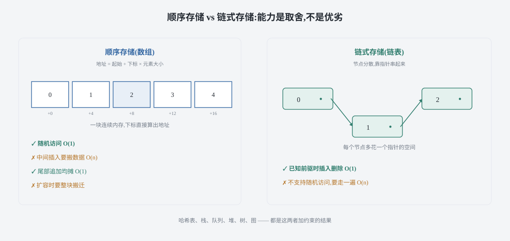
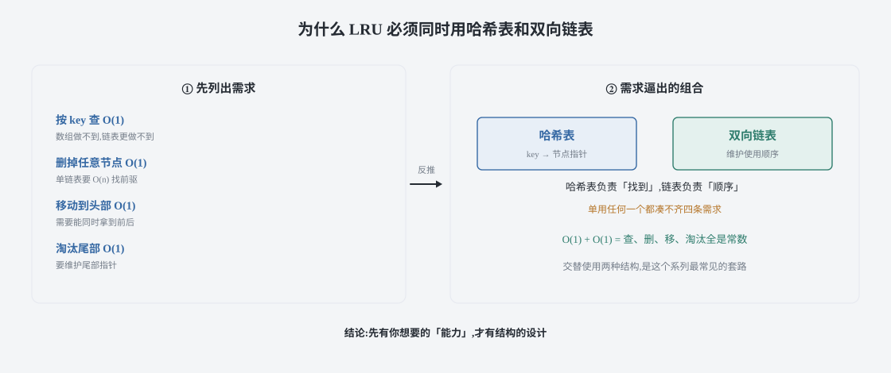
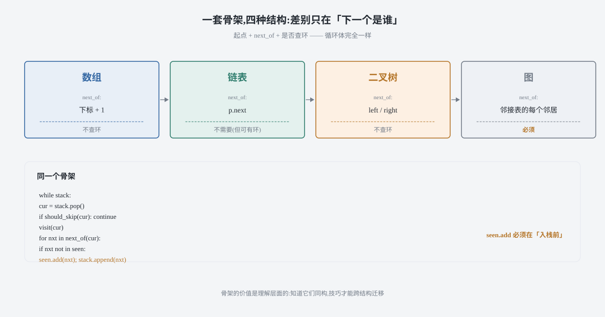
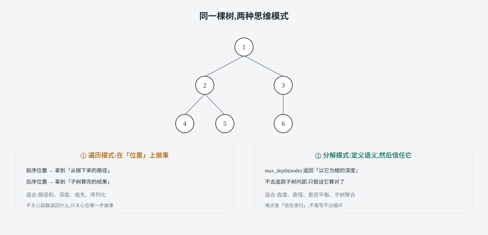

## 0 先说明材料和我的写法

这是整个系列的第一篇，也是纲领。

我写这一系列的起因很实际：算法题刷了不少，但见到新题仍然要靠"这题我见过"来反应，而不是靠"这类问题的结构是这样"。后来发现症结不在题量，在于我脑子里没有一张能挂住所有题的骨架——每道题都是独立记住的，所以每道题都在占用记忆，而不是在复用记忆。

这篇要做的就是那张骨架。它不教你任何一道具体的题，但会让你看后面每一篇时都知道"这一篇挂在哪根枝上"。

材料上要说清楚：这个系列的选题顺序参考了 labuladong 的算法教程体系，其中《学习数据结构和算法的框架思维》是这一篇的直接对照材料。**但这篇是我自己的读法和写法**，不是那篇的翻译或复述——论证顺序、代码、比喻、以及第七节那张表都是我重写的。站内有[一张路线图](/roadmap/)，把这套顺序按章节排开了，可以对照着看。

**代码是 Python 3 和 C++ 两版**，不是原文的语言。教程原文用 Java，我按自己的习惯重新实现了一遍，所以下面的片段是我写的；不过**框架本身忠于原文的归纳**。两种语言并排给出，因为它们的坑不一样。

### 目录

- [0 先说明材料和我的写法](#0-先说明材料和我的写法)
- [1 一个个学,还是先搭骨架](#1-一个个学还是先搭骨架)
- [2 所有数据结构,都是数组和链表的变形](#2-所有数据结构都是数组和链表的变形)
- [3 遍历是一切数据结构的通用语言](#3-遍历是一切数据结构的通用语言)
- [4 所有算法,都是穷举](#4-所有算法都是穷举)
- [5 树的两种思维模式](#5-树的两种思维模式)
- [6 动手之前先问四个问题](#6-动手之前先问四个问题)
- [7 把这套框架收成一张表](#7-把这套框架收成一张表)
- [8 材料与出处](#8-材料与出处)

## 1 一个个学,还是先搭骨架

先做个对比。

**路线 A：按数据结构逐个学。** 学完数组学链表，学完链表学栈和队列，然后哈希表、堆、二叉树、图……每个结构都有自己的一套 API、自己的复杂度、自己的经典题。这条路走得通，问题是知识点是**平铺**的：学到图的时候，数组那一套已经忘得差不多了；而且每学一个新结构，都要重新记一遍"什么时候用它"。

**路线 B：先搞清楚底下是什么。** 先接受一个断言——所有数据结构在存储层面只有两种基础，其余都是在这两种基础上加约束、加索引、加平衡条件得到的。然后你会发现：栈和队列是"只在两端操作的链表或数组"，哈希表是"用哈希函数把键映射到数组下标"，堆是"用数组存的一棵满足偏序的完全二叉树"，二叉树和图是"用指针或数组把节点连起来"。**新结构不再是新东西，而是老东西的特例。**

路线 B 的好处是可迁移：见到一个没学过的结构，你会本能地问"它是顺序存储还是链式存储？它允许在哪些位置增删？"——这两个问题的答案基本决定了它所有操作的时间复杂度。这就是骨架的作用。

需要说明的是，这不是"捷径"。路线 B 该写的代码一行都不会少——本站后面的实现篇会把每个结构真的手写一遍。骨架的价值在于**决定你先看哪里**，不在于省掉细节。

## 2 所有数据结构,都是数组和链表的变形

这是全篇第一根承重梁。

### 2.1 断言

数据结构种类很多，但**存储方式只有两种**：

- **顺序存储**：一块连续内存，靠下标算出地址，直接跳过去。数组。
- **链式存储**：每个节点额外存一个（或几个）指针，靠指针跳过去。链表。

其余结构都是这两种的**上层建筑**。这个说法容易引起反驳："哈希表、树、图明明都不一样，怎么能说只有两种？"

关键在于分清**存储**和**操作**。一个"哈希表"其实是两件事的合成：底层一个数组（顺序存储），加一层哈希函数把键映射成下标。一个"二叉堆"底层也是一个数组，只是额外约定"父节点下标 i 的两个孩子是 2i+1 和 2i+2"。一个"邻接表"底层是数组的数组，或者数组加链表——取决于图怎么存。

所以真正的问题不是"有多少种数据结构"，而是"这块连续内存（或不连续内存）上，允许我做哪些操作"。

### 2.2 一个结构的能力,由它能"快速做什么"定义

把常见结构按底层存储和关键操作列一下，这张表比背复杂度有用，因为它能推出来：

| 结构 | 底层存储 | 靠什么获得能力 | 最主要的能力 |
|---|---|---|---|
| 数组 | 连续 | 下标算术 | 随机访问 O(1) |
| 链表 | 分散 + 指针 | 指针改写 | 已知位置时增删 O(1) |
| 动态数组 | 连续 + 扩容 | 均摊扩容 | 随机访问 O(1) + 尾部增删均摊 O(1) |
| 栈 / 队列 | 上面二者之一 | 限制操作端 | 只在端点操作，语义清晰 |
| 哈希表 | 数组 + 哈希函数 | 键到下标的映射 | 按内容查找均摊 O(1) |
| 二叉堆 | 数组 | 完全二叉树下标关系 | 取最值 O(1)，增删 O(log n) |
| 二叉搜索树 | 节点 + 指针 | 中序有序这个不变量 | 有序查找 / 增删 O(log n)（平衡时） |
| 图（邻接表） | 数组 + 链表 | 边的显式表示 | 表示任意连接关系 |

看最后两列的因果关系：**先有你想要的"能力"，才有结构的设计**。不是先有哈希表再想它能干什么，而是"我想按内容 O(1) 查"这个需求，逼出了"数组 + 哈希函数"这个组合。

### 2.3 顺序还是链式,是一个取舍不是优劣

这两者没有谁更好，只有谁更适合：

- 顺序存储**访问快**（一次地址算术），但**中间插入要搬数据**（O(n)），而且需要预先知道或动态申请连续空间。
- 链式存储**插入删除不搬数据**（改几个指针），但**不支持随机访问**（非要走一遍），而且每个节点多花指针的空间。

有一个容易忽略的点：**数组的"插入慢"说的是中间插入**。如果总在尾部追加，动态数组的均摊代价是 O(1)——因为扩容次数是按倍数增长的，总搬迁量可以摊到每一次追加上。这个均摊分析是这个系列后面实现篇要重点推的东西，先记住结论。



### 2.4 四个基本操作,一切结构的通用坐标系

任何数据结构，都只在回答四个问题：

1. **查**：给定条件，找到元素。
2. **改**：修改已有元素。
3. **增**：插入新元素。
4. **删**：移除元素。

"遍历"严格说不是第五个操作，它是**实现查/改/删的方式**——大多数时候你没法直接跳到目标，只能走一遍。

所以评估任何结构的套路是固定的：**把这四个操作各自的最坏/均摊复杂度写出来，然后看你的场景最常用哪个**。LRU 缓存之所以是"哈希表 + 双向链表"，就是因为需求要求查是 O(1)（靠哈希表）、删和移动到头部也是 O(1)（靠双向链表），单用任何一个都凑不齐。



## 3 遍历是一切数据结构的通用语言

第二根承重梁：**遍历框架是通用的**。

### 3.1 同构性

看四段遍历代码。先看最朴素的两种：

```python
def traverse_array(arr):
    """数组:下标就是路径"""
    for i in range(len(arr)):
        visit(arr[i])


def traverse_linked_list(head):
    """链表:指针就是路径"""
    p = head
    while p is not None:
        visit(p.val)
        p = p.next
```

```cpp
void traverseArray(const std::vector<int>& arr) {
    for (std::size_t i = 0; i < arr.size(); ++i)
        visit(arr[i]);                    // 下标就是路径
}

void traverseLinkedList(ListNode* head) {
    for (ListNode* p = head; p != nullptr; p = p->next)
        visit(p->val);                    // 指针就是路径
}
```

再看树和图：

```python
def traverse_tree(root):
    """二叉树:前序位置做事"""
    if root is None:
        return
    visit(root.val)
    traverse_tree(root.left)
    traverse_tree(root.right)


def traverse_graph(graph, start, visited=None):
    """图:多一个 visited,因为可能有环"""
    if visited is None:
        visited = set()
    visited.add(start)
    visit(start)
    for nxt in graph[start]:
        if nxt not in visited:
            traverse_graph(graph, nxt, visited)
```

```cpp
void traverseTree(TreeNode* root) {
    if (root == nullptr) return;
    visit(root->val);                     // 前序位置做事
    traverseTree(root->left);
    traverseTree(root->right);
}

void traverseGraph(const std::vector<std::vector<int>>& graph, int start,
                   std::vector<bool>& visited) {
    visited[start] = true;                // 进入时就标记,见下面那个坑
    visit(start);
    for (int nxt : graph[start])
        if (!visited[nxt])
            traverseGraph(graph, nxt, visited);
}
```

四段代码的骨架是同一件事：**从起点出发，沿着"下一个"关系走下去，直到没有下一个**。

差别只在两处：

1. **"下一个"怎么算**：数组是 `i+1`，链表是 `p.next`，二叉树是 `left` 和 `right`，图是邻接表里的每个邻居。
2. **要不要记"来过了"**：数组和链表天然不会回头（单向），树也不会（子节点不指回父节点），图**会**——所以图必须带 `visited`，否则有环就死循环。

**最容易写错的一行：** 图的 `visited` 必须在**进入节点时**就标记，而不是在"准备访问邻居时"才标记。如果推迟到出队/出栈时标记，同一个节点会被重复入队多次。这个坑在 BFS 里更明显，本站图论那篇会专门展开。



### 3.2 把差异抽出来,框架就只剩一层壳

既然差别只有那两处，就可以抽一个统一的形式：

```python
def traverse_unified(start, next_of, should_skip):
    """一个骨架:所有遍历都是它的特例

    start      : 起点(数组传 0,链表传头节点,树传根,图传起始点)
    next_of    : 给定当前位置,返回所有"下一个"位置
    should_skip: 给定位置,返回是否该跳过(图用来查环)
    """
    stack = [start]
    seen = {start}          # 标记在"入栈时",不是"出栈时"
    while stack:
        cur = stack.pop()
        if should_skip(cur):
            continue
        visit(cur)
        for nxt in next_of(cur):
            if nxt not in seen:
                seen.add(nxt)   # 关键:入栈前就标记
                stack.append(nxt)
```

```cpp
// 同一个骨架的 C++ 版本。注意这里用 std::function 而不是模板,
// 因为骨架的价值在于"看得懂",不是为了性能。
void traverseUnified(int start,
                     const std::function<std::vector<int>(int)>& nextOf,
                     const std::function<bool(int)>& shouldSkip) {
    std::vector<int> stack{start};
    std::unordered_set<int> seen{start};      // 标记在入栈时
    while (!stack.empty()) {
        int cur = stack.back();
        stack.pop_back();
        if (shouldSkip(cur)) continue;
        visit(cur);
        for (int nxt : nextOf(cur))
            if (!seen.count(nxt)) {
                seen.insert(nxt);             // 关键:入栈前就标记
                stack.push_back(nxt);
            }
    }
}
```

这段代码不长，但它的意义在于：**你不需要为每种结构单独记一套遍历**。写题时只要想清楚"下一个是什么"和"用不用查环"两件事，剩下的循环结构是共通的。

不过要诚实说一句：实际写题时大家不会真的抽这个统一函数，因为展平成显式栈会丢掉递归的语义（尤其是树的"前中后序位置"）。它的价值是**理解层面**的——知道它们同构，你就能把一个结构上的技巧迁移到另一个结构上。比如"快慢指针找中点"是链表技巧，但"双指针夹逼"在数组上同样成立，因为两者都是"在一条线性路径上用两个游标"。

### 3.3 递归与迭代只是写法,不是两种算法

同一棵树的中序遍历，可以写成递归也可以写成显式栈：

```cpp
// 递归版本:代码短,但要知道"位置"在哪里
void inorderRec(TreeNode* root, std::vector<int>& out) {
    if (root == nullptr) return;
    inorderRec(root->left, out);
    out.push_back(root->val);   // 中序位置
    inorderRec(root->right, out);
}

// 迭代版本:显式维护栈,好处是不会递归爆栈
std::vector<int> inorderIter(TreeNode* root) {
    std::vector<int> out;
    std::vector<TreeNode*> stk;
    TreeNode* cur = root;
    while (cur != nullptr || !stk.empty()) {
        while (cur != nullptr) { stk.push_back(cur); cur = cur->left; }
        cur = stk.back(); stk.pop_back();
        out.push_back(cur->val);   // 中序位置,和上面同一行
        cur = cur->right;
    }
    return out;
}
```

两版输出完全一样。迭代版的价值不是"更快"，而是**深树不会爆栈**；递归版的价值是**结构更贴近思维**。选哪个看数据规模——这个系列后面每篇都会两只手都给。

## 4 所有算法,都是穷举

第三根承重梁，也是最有争议的一句：**所有算法本质都是穷举，区别只在聪明程度**。

### 4.1 穷举的两个要求

既然都是穷举，那"好算法"和"坏算法"的差别在哪？答案是两个指标：

1. **无遗漏**：所有合法答案都在你的枚举范围内。这决定了**正确性**。
2. **无冗余**：同一个状态不会被反复计算。这决定了**效率**。

用这两个指标去看，很多"不同"的算法立刻归到同一类：

- **回溯 / DFS**：老老实实枚举所有组合。它保证了无遗漏（框架正确的话），但冗余多。
- **动态规划**：还是穷举所有状态，但**用备忘录消掉冗余**——同一个子问题只算一次。所以 DP 常被说成"带备忘录的暴力"。
- **BFS**：穷举所有"走 k 步能到的地方"，逐层扩展。第一次到达终点就是最短路，因为它是按步数递增枚举的。
- **二分搜索**：看起来最不像穷举——它一次砍掉一半。但它砍的依据是"这一半里不可能有答案"，所以它是在**用信息缩小枚举范围**，本质仍是穷举，只是每步都排除了大量候选。
- **贪心**：每步只走一条路，还敢保证最优。它靠的是**证明"局部最优选择不会导致丢掉全局最优"**——所以贪心不是"更聪明的穷举"，而是"被证明了可以只枚举一条路径"。这也是贪心比 DP 难的原因：难的不是写，是证。

### 4.2 这个视角的实际用处

把算法看成穷举，最大的好处是**卡住时知道该往哪想**：

- 暴力能过但超时 → 找**冗余**，加备忘录或改成 DP。
- 暴力都不知道怎么写 → 说明你还**没想清楚"所有可能"长什么样**，先写出枚举范围。
- 想不出来更快的 → 先写暴力，再找冗余。**从暴力到最优，比从零到最优容易得多。**

第二点的实用性常常被低估。回溯框架之所以值得单独学，就是它给了"无遗漏地枚举所有可能"一个**机械化的模板**——把选择列出来、把路径记下来、把结束条件写清楚，剩下的交给递归。

```python
def backtrack(path, choices, result):
    """回溯框架:无遗漏地枚举所有可能

    path    : 已经做的选择
    choices : 当前还能做的选择
    result  : 收集答案
    """
    if is_solution(path):        # 结束条件
        result.append(path[:])   # 注意:必须拷贝,否则后续修改会污染结果
        return
    for c in choices:            # 枚举所有选择
        if not is_valid(path, c):  # 剪枝:去掉不可能的
            continue
        path.append(c)           # 做选择
        backtrack(path, next_choices(choices, c), result)
        path.pop()               # 撤销选择
```

**最容易写错的一行：** `result.append(path[:])` 里的那个 `[:]`。不拷贝的话，`result` 里存的都是同一个列表对象，最后全变成空列表（因为回溯结束时会一路 `pop` 干净）。这个 bug 的症状非常典型——输出是一堆空列表而不是报错，很容易看半天。

```cpp
// 同样的框架,C++ 版本:注意 path 也要拷贝
void backtrack(std::vector<int>& path,
               std::vector<std::vector<int>>& result,
               int n) {
    if ((int)path.size() == n) {          // 结束条件
        result.push_back(path);           // vector 的 push_back 是拷贝,天然安全
        return;
    }
    for (int c = 0; c < n; ++c) {         // 枚举所有选择
        if (std::find(path.begin(), path.end(), c) != path.end()) continue;  // 剪枝
        path.push_back(c);                // 做选择
        backtrack(path, result, n);
        path.pop_back();                  // 撤销选择
    }
}
```

这里有个语言差异值得指出：**C++ 的 `result.push_back(path)` 天然是拷贝**，所以不会犯 Python 那个错；反过来，C++ 里如果想避免拷贝就得显式用 `std::move`，那时就要自己保证 `path` 之后不再被修改。同一个框架，两种语言的"默认行为"正好相反，这是必须写两遍才能撞上的地方。

## 5 树的两种思维模式

树之所以要单独讲，是因为它上承数组链表（线性结构的推广），下接图和回溯（非线性搜索的入口）。而在树上写递归，只有两种模式。

### 5.1 遍历模式:在递归的"位置"上做事

这种模式下，你写一个 `traverse` 函数，**不关心它返回什么**，只关心在某一步该做什么。前序、中序、后序的差别，就是"做事的那一行放在哪"：

```python
def traverse(root):
    if root is None:
        return
    # 前序位置:刚进入节点,还没处理子树
    traverse(root.left)
    # 中序位置:左子树处理完,右子树还没开始
    traverse(root.right)
    # 后序位置:子树都处理完了
```

**位置的语义差别**：前序位置拿到的是"从根到当前节点的路径信息"（因为此时还没往下走），后序位置拿到的是"子树的处理结果"（因为此时子树已经算完）。所以：

- 需要**自顶向下传递信息**（比如"当前路径和""深度"）→ 用前序位置。
- 需要**自底向上汇总信息**（比如"子树高度""子树是否平衡"）→ 用后序位置。

### 5.2 分解模式:定义函数的语义,然后信任它

这种模式下，你明确回答"这个函数**返回**什么"，然后**假设子问题的答案已经算好了**，只写怎么把子问题的答案组合成当前答案。以"求最大深度"为例：

```python
def max_depth(root):
    """返回以 root 为根的树的最大深度"""
    if root is None:
        return 0
    # 不用关心左右子树内部怎么算的,只假设它算对了
    left = max_depth(root.left)
    right = max_depth(root.right)
    return 1 + max(left, right)
```

```cpp
// 同一件事的两种写法:递归版贴近思维,迭代版不爆栈
int maxDepthRec(TreeNode* root) {
    if (root == nullptr) return 0;
    // 不用关心左右子树内部怎么算的,只假设它算对了
    int left = maxDepthRec(root->left);
    int right = maxDepthRec(root->right);
    return 1 + std::max(left, right);
}

// 迭代版:显式栈 + 记录每个节点当前走到哪一步,避免深树递归爆栈。
// 代价是代码长得多 —— 这就是"递归版贴近思维"的实际含义。
int maxDepthIter(TreeNode* root) {
    if (root == nullptr) return 0;
    int best = 0;
    std::vector<std::pair<TreeNode*, int>> stk{{root, 1}};
    while (!stk.empty()) {
        auto [node, depth] = stk.back();
        stk.pop_back();
        best = std::max(best, depth);
        if (node->left)  stk.push_back({node->left,  depth + 1});
        if (node->right) stk.push_back({node->right, depth + 1});
    }
    return best;
}
```

这段代码之所以短，是因为它建立在**信任**上：我不去追踪 `max_depth(root.left)` / `maxDepthRec(root->left)` 内部发生了什么，只关心它返回了正确的深度。这种"信任递归"的能力，是能不能写出树形递归的分水岭——很多人写不出来，是因为总想在脑子里把整个递归栈展开，而这是人脑做不好的事。



### 5.3 两种模式怎么选

一个实用的判别法：**看你要的信息在哪**。

- 信息在"从根下来的路上"（路径、祖先、前缀和）→ 遍历模式，用前序位置。
- 信息在"子树汇总上来的结果里"（高度、节点数、是否平衡）→ 分解模式，或遍历模式的后序位置。

两种模式有时都能解同一道题，但代码长短差别很大。选对了模式，题目会突然变简单——这也是为什么这个系列把二叉树单独拆成两篇来讲。

## 6 动手之前先问四个问题

前面讲的是世界观，这一节是可操作的部分。这四个问题可以直接写成一个检查清单：

四个问题是：

1. 数据是**线性的还是非线性的**？
2. 要求**所有方案还是最优值**？
3. 能不能**缩小成同类的子问题**？
4. **暴力解法是什么**，它的冗余在哪？

把这四个答案映射到框架，逻辑本身就是一小段代码：

```python
def route(data_is_linear, wants_all_solutions, has_overlap):
    """把四个问题的答案映射到该用的框架"""
    if not data_is_linear:
        return "回溯" if wants_all_solutions else ("DP" if has_overlap else "BFS/DFS 搜索")
    return "双指针 / 滑动窗口 / 前缀和 / 二分"
```

```cpp
// C++ 里没有"返回不同字符串"的便利,用枚举把选择显式化更清楚
enum class Framework { TwoPointers, Backtracking, DynamicProgramming, Search };

Framework route(bool dataIsLinear, bool wantsAllSolutions, bool hasOverlap) {
    if (!dataIsLinear) {
        if (wantsAllSolutions) return Framework::Backtracking;
        return hasOverlap ? Framework::DynamicProgramming : Framework::Search;
    }
    return Framework::TwoPointers;   // 线性结构优先想这四个之一
}
```

拿到一道没见过的题，按顺序问自己四个问题，基本能定位到该用哪个框架：

**问题一：数据是线性的还是非线性的？**

- 线性（数组、链表、字符串）→ 优先想**双指针、滑动窗口、前缀和、二分**。这四个覆盖了绝大多数线性题。
- 非线性（树、图）→ 优先想**遍历框架（DFS/BFS）**，再考虑是否需要额外状态。

**问题二：要求"所有方案"还是"最优值"？**

- 所有方案 → **回溯**（排列、组合、子集、棋盘）。
- 最优值 → 看有没有**重叠子问题**：有就用 **DP**，没有就用 **BFS/DFS 搜索**。

**问题三：能不能把问题缩小成同类的子问题？**

能，就写递归，并且明确用第五节的哪种模式。不能，说明状态定义还没想清楚——这时候别急着写代码，先拿纸把"状态是什么"写下来。

**问题四：暴力解法是什么？它的冗余在哪？**

先写出暴力解，再找重复计算的部分。**能指出冗余，优化方向就自己浮出来了**：重复的是子问题 → 备忘录；重复的是候选范围 → 二分或剪枝；重复的是同一段区间 → 前缀和或滑动窗口。

这四个问题不需要每次都全问。熟练之后它会变成直觉，但在"卡住"的时候，按顺序过一遍几乎总能找到下手处。

## 7 把这套框架收成一张表

**三句话：**

1. 数据结构只有两种存储方式（顺序、链式），其余都是变形。
2. 遍历只有一套骨架（起点 + 下一个 + 查环），其余都是特例。
3. 算法只有一种本质（穷举），差别只在无遗漏、无冗余。

**四个基本操作的取舍：**

| 我要的操作 | 顺序存储 | 链式存储 |
|---|---|---|
| 按下标随机访问 | O(1) | 不支持，O(n) 走一遍 |
| 按内容查找 | O(n) 线性扫描 | O(n) 线性扫描 |
| 头部插入 / 删除 | O(n)，要搬数据 | O(1)，改指针 |
| 尾部追加 | 均摊 O(1)（动态数组） | O(1)（维护尾指针）或 O(n)（无尾指针） |
| 中间插入 / 删除 | O(n) | 已知前驱时 O(1) |

**四种结构的遍历差异：**

| 结构 | "下一个"是什么 | 要不要查环 | 典型技巧 |
|---|---|---|---|
| 数组 | 下标 + 1 | 不需要 | 双指针、滑动窗口、前缀和 |
| 链表 | `next` 指针 | 不需要（但可能有环，要判） | 快慢指针、虚拟头结点 |
| 二叉树 | `left` / `right` | 不需要 | 前中后序位置、分解问题 |
| 图 | 邻接表每个邻居 | **必须** | BFS 求最短路、拓扑排序、并查集 |

**"位置"决定能解什么题：**

| 做事的位置 | 拿到的信息 | 适合的问题 |
|---|---|---|
| 前序 | 从根到当前的路径 | 路径和、深度、祖先、序列化 |
| 中序 | 左子树结果（BST 下是有序序列） | BST 校验与查找、第 k 小 |
| 后序 | 子树的汇总结果 | 高度、直径、是否平衡、子树聚合 |
| 层序 | 整层节点 | 最短层数、右侧视图、按层聚合 |

## 8 材料与出处

这一篇的选题顺序参考了 labuladong 的算法教程体系，直接对照材料是《学习数据结构和算法的框架思维》：

- 原文：<https://labuladong.online/zh/algo/essential-technique/algorithm-summary/>

需要说清楚边界：教程原文的可视化面板和动图我没有复制，站内的示意图都是自绘的；原文用 Java 写，这里的代码是我自己重新实现的 Python 3 和 C++ 两版。**"数据结构只有顺序和链式两种存储""算法本质是穷举"这两条归纲来自原文**，第七节的表和我对四个问题的提炼是我自己的整理。

这篇没有外部数据需要引用，所有代码结论都是可执行的：站内 `assets/blog/framework-thinking-20261130/` 下有三个验证脚本，分别检查文章结构、把文章里的 Python 与 C++ 代码抽出来真跑、以及核对路线图链接。

系列的读法也在这里说明一下：后面每一篇都是同样的体例——**先讲清这个套路为什么成立，再给代码**，每节标出最容易写错的那一行，复杂度给推导，结尾一张归纳表。所有代码都是 Python 3 和 C++ 双版本，**而且都真跑过**，不是看着像对的。

站内[路线图](/roadmap/)是这套顺序的完整目录，按章节分好了，可以点开对照。
