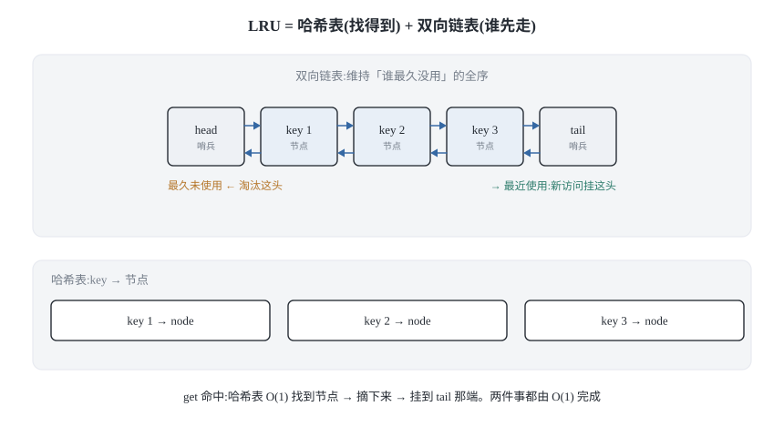
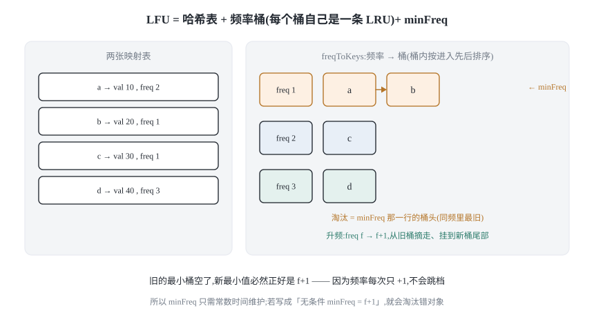
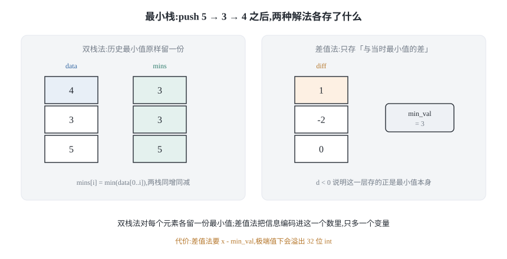
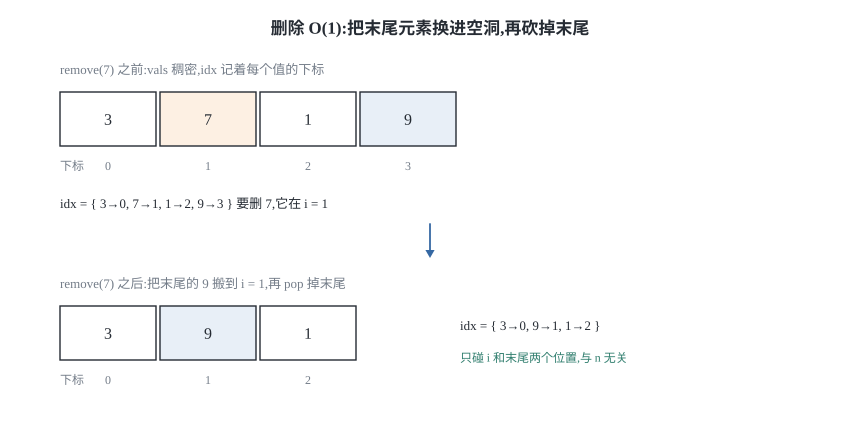
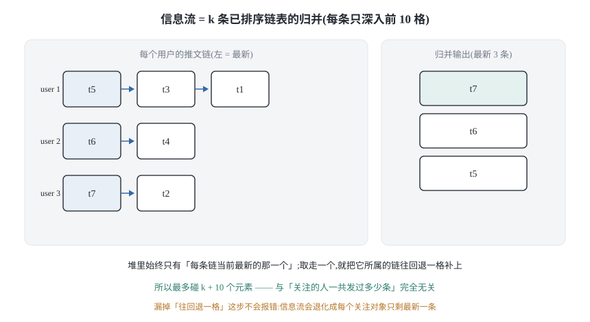

## 0 先说明材料和我的写法

这篇讲的是**数据结构设计题**:题目不给你算法,只给你一组操作约束——
`get`/`put` 都要 O(1)、要能随机取一个元素、要能取最近 10 条——让你反推出
「该把哪几种基本结构拼起来」。所以这篇的重点不是代码,而是**每一节里的
「为什么非得是这个组合」**。

**先说清材料。** 我读的是 labuladong《经典数据结构设计》这一组文章,
但其中**只有 LRU 一篇是完整的**。另外几篇我拿到的正文是残缺的:

- LFU 那篇的正文断在「这个需求应该是 LFU 算法的核心,所以我们分开说:」之后,
  频率桶的设计整段没有给出来;
- 《更多经典设计习题》只剩一份题目清单,没有正文;
- 《谈谈游戏中的随机算法》断在「其实是有的,而且有很多种解决方案」,
  而且它讲的是扫雷里撒雷,不是 LeetCode 380。

所以本文和素材的真实对应关系是:

| 节 | 素材里有什么 | 这一节写了什么 |
|---|---|---|
| §1 LRU | 完整论证 | 原文结论 + 我补的复杂度推导与边界用例 |
| §2 LFU | 只有题目描述和三条事实 | **频率桶设计是我自己推的**,原文无对应正文 |
| §3 最小栈 | 无 | **我自己推的**,原文无对应章节 |
| §4 O(1) 随机集合 | 无(邻近的是扫雷撒雷) | **我自己推的** |
| §5 推特时间线 | 无 | **我自己推的** |

**凡是我自己推的部分,我只保证代码在本文附带的测试里跑通、结论可复现,
不声称它们是原文的观点。** 这也符合这个系列的规矩:只写自己验证过的东西。

**关于代码语言:** 教程原文是 Java。这个系列一律 **Python 3 + C++17**,
且都是我自己写的实现,不是从原文抄的。两种语言都写并不冗余——它们踩的坑不一样,
文中碰到时会专门点出来。

### 目录

- [0 先说明材料和我的写法](#0-先说明材料和我的写法)
- [1 LRU 缓存:哈希表负责找得到,双向链表负责谁先走](#1-lru-缓存哈希表负责找得到双向链表负责谁先走)
- [2 LFU 缓存:给频率本身再挂一条链表](#2-lfu-缓存给频率本身再挂一条链表)
- [3 最小栈:只记住一个最小值为什么必然出错](#3-最小栈只记住一个最小值为什么必然出错)
- [4 O(1) 插入删除随机取:把删中间换成换到末尾](#4-o1-插入删除随机取把删中间换成换到末尾)
- [5 设计推特:哈希表存关系,链表做归并](#5-设计推特哈希表存关系链表做归并)
- [6 把这五个套路收成一张表](#6-把这五个套路收成一张表)
- [7 材料与出处](#7-材料与出处)

## 1 LRU 缓存:哈希表负责找得到,双向链表负责谁先走

LRU 是 Least Recently Used:缓存满了,淘汰**最久没被访问过**的那一个。
LeetCode 146 要求 `get(key)` 和 `put(key, val)` 都是 O(1)。



### 1.1 把「O(1)」翻译成三条具体需求

别一上来就想数据结构。先把「O(1)」这句话拆开,看它到底约束了什么:

1. **按 key 找 value 必须 O(1)。** 这一条基本只有哈希表能满足。
2. **「最近使用」必须有全序。** 淘汰时要知道谁最久没用过,
   所以元素之间得有一条能排出先后的链。
3. **能在任意位置 O(1) 摘掉一个节点。** 因为每次 `get` 命中,
   都要把那个元素从当前位置摘下来、再挂到「最近使用」那一端。

三条需求摆在一起就出现矛盾了:哈希表满足 1,但没有顺序;链表满足 2 和 3,
但查找是 O(n)。**一个结构满足不了,就让两个各管一半**——LRU 的全部设计思想
到这里就结束,后面都是工程细节。

### 1.2 为什么链表必须是双向的

这是这道题最核心的一个「为什么」,也是面试最爱追问的点。

需求 3 说「把节点从任意位置摘下来」。摘这个动作,本质是改**两个**指针,
两个都要改,缺一不可:

```text
x.prev.next = x.next
x.next.prev = x.prev
```

现在看单链表:它能拿到 `x.next`,但**拿不到 `x.prev`**。想拿到前驱,
只能从头结点开始走一遍——那是 O(n),需求 3 直接破产。

所以「双向」不是为了代码好看,而是因为**删除操作天然需要前驱指针**。

**一句话记法:需要「拿着节点本身去删除」,就必须双向。**

### 1.3 为什么还要两个哨兵节点

如果不用哨兵,`addLast` 和 `remove` 就得处理一堆边界:表为空怎么办、
删的是不是第一个、插的是不是第一个……每多一个分支就多一个 bug 面。

放一个假头 `head`、一个假尾 `tail`,让它们互相指,链表就**永远不会为空**。
于是「在尾部插入」永远是同样四行指针操作,一个 `if` 都没有:

```text
x.prev = tail.prev
x.next = tail
tail.prev.next = x
tail.prev = x
```

代价是两个节点。本文实现里,哨兵的 `key`/`val` 从头到尾没被读过。

### 1.4 为什么节点里要同时存 key 和 val

这个问题看着像废话,其实不是。

淘汰发生在尾部:我们手上只有「最久未使用的那个节点」。但哈希表是按 **key**
索引的,要把它从哈希表里删掉,就必须知道它的 key。如果节点里只有 val,
我们就再也找不回 key 了,哈希表里会留下一个永远删不掉的僵尸条目,
容量于是越用越少。

**一句话记法:节点要能反向索引回哈希表,所以 key 必须跟着节点走。**

### 1.5 Python 3 实现

```python
class Node:
    """双向链表节点。key 必须存,否则淘汰时没法回删哈希表。"""

    __slots__ = ("key", "val", "prev", "next")

    def __init__(self, key=0, val=0):
        self.key = key
        self.val = val
        self.prev = None
        self.next = None


class LRUCache:
    def __init__(self, capacity):
        self.cap = capacity
        self.map = {}          # key -> Node,负责「找得到」
        self.head = Node()     # 哨兵:head.next 是最久未使用
        self.tail = Node()     # 哨兵:tail.prev 是最近使用
        self.head.next = self.tail
        self.tail.prev = self.head

    def _unlink(self, x):
        # 双向链表才能两行摘掉任意节点;单链表这里得先 O(n) 找前驱
        x.prev.next = x.next
        x.next.prev = x.prev

    def _push_back(self, x):
        # 尾部 = 最近使用。哨兵让这里不需要判空
        x.prev = self.tail.prev
        x.next = self.tail
        self.tail.prev.next = x
        self.tail.prev = x

    def get(self, key):
        if key not in self.map:
            return -1
        x = self.map[key]
        self._unlink(x)        # 命中也要改时序,不只是取值
        self._push_back(x)
        return x.val

    def put(self, key, val):
        if self.cap <= 0:
            return             # 容量 0 时 put 只能是空操作
        if key in self.map:
            x = self.map[key]
            x.val = val
            self._unlink(x)
            self._push_back(x)  # 这一行最容易漏
            return
        if len(self.map) == self.cap:
            lru = self.head.next
            self._unlink(lru)
            del self.map[lru.key]   # 靠节点自带的 key 才能删掉哈希表条目
        x = Node(key, val)
        self.map[key] = x
        self._push_back(x)
```

### 1.6 C++17 实现

```cpp
#include <unordered_map>

// 手写双向链表节点:prev 是 O(1) 删除的前提
struct Node {
    int key = 0;
    int val = 0;
    Node* prev = nullptr;
    Node* next = nullptr;
};

class LRUCache {
public:
    explicit LRUCache(int capacity) : cap_(capacity), head_(new Node{}), tail_(new Node{}) {
        head_->next = tail_;
        tail_->prev = head_;
    }

    // 节点是裸指针,禁用拷贝,否则会双重释放
    LRUCache(const LRUCache&) = delete;
    LRUCache& operator=(const LRUCache&) = delete;

    ~LRUCache() {
        for (Node* p = head_; p != nullptr;) {
            Node* nxt = p->next;
            delete p;
            p = nxt;
        }
    }

    int get(int key) {
        auto it = map_.find(key);
        if (it == map_.end()) return -1;
        unlink(it->second);
        pushBack(it->second);
        return it->second->val;
    }

    void put(int key, int val) {
        if (cap_ <= 0) return;
        auto it = map_.find(key);
        if (it != map_.end()) {
            it->second->val = val;
            unlink(it->second);
            pushBack(it->second);
            return;
        }
        if (size_ == cap_) {
            Node* lru = head_->next;
            unlink(lru);
            map_.erase(lru->key);
            delete lru;
            --size_;
        }
        Node* x = new Node{key, val, nullptr, nullptr};
        map_[key] = x;
        pushBack(x);
        ++size_;
    }

private:
    void unlink(Node* x) {
        x->prev->next = x->next;
        x->next->prev = x->prev;
    }

    void pushBack(Node* x) {
        x->prev = tail_->prev;
        x->next = tail_;
        tail_->prev->next = x;
        tail_->prev = x;
    }

    int cap_;
    int size_ = 0;
    Node* head_;
    Node* tail_;
    std::unordered_map<int, Node*> map_;
};
```

### 1.7 最容易写错的一行,和复杂度推导

**最容易写错的一行:** `put` 里命中已存在的 key 时的 `self._push_back(x)`。

很多人会顺手写成:

```text
if key in self.map:
    self.map[key].val = val
    return
```

值确实更新了,但**时序没更新**——这个 key 在链表里还待在老位置。
后果不会立刻报错,而是过一会儿淘汰时把一个「刚刚才写过」的元素淘汰掉。
这类 bug 最难受的地方就是它不崩,只是结果慢慢不对。

第二容易错的是**容量检查的位置**:`if len(self.map) == self.cap` 必须在
「key 是新的」这个分支里,不能提到前面。提上去的话,当缓存已满且
`put` 的是一个**已存在的** key 时,会先白白淘汰一个无辜元素。

**复杂度推导**(不背结论):

- `get`:1 次哈希查找 + `_unlink` 的 2 次赋值 + `_push_back` 的 4 次赋值。
- `put`:1 次哈希查找 + 最多 1 次哈希删除 + 1 次节点分配 + 常数次赋值。
- 每次操作里**指针赋值次数恒定**,与 `capacity` 和元素个数都无关。

所以真正的结论是:**指针部分是严格 O(1),哈希部分是期望 O(1)**。
说「LRU 是 O(1)」时,那个 O(1) 是带期望的——哈希表最坏情况会退化到 O(n)。
把这两件事分开说,比笼统地讲「O(1)」准确。

空间上,哈希表最多 `capacity` 个条目,链表有 `capacity + 2` 个节点,
合起来 O(capacity)。

**附一个边界观察(我自己的):** `get` 用 `-1` 表示「没找到」,
这只有在**值域保证非负**时才无歧义。LeetCode 146 恰好保证 val ≥ 0,
所以这个哨兵是安全的;换成值可以是任意整数,就得改用别的表示
(比如返回 `Optional` 或抛异常)。这类「哨兵值与值域冲突」的坑在设计题里很常见。

## 2 LFU 缓存:给频率本身再挂一条链表

> **这一节的来源说明:** 我拿到的 LFU 素材只有题目描述和三条事实,
> 正文断在「这个需求应该是 LFU 算法的核心」之后,**频率桶的设计原文没有给出**。
> 下面的推导、实现和复杂度论证都是我自己做的,不是原文的观点。
> 我把它写出来是因为这一节恰好是整组题里最容易讲错的地方。

LFU 是 Least Frequently Used:淘汰**被访问次数最少**的那一个。
LeetCode 460。它比 LRU 多了两条规则:

1. 访问(`get` 或 `put` 命中已有 key)会把该 key 的 `freq` 加一;
2. 淘汰时先看 `freq` 最小的;如果**有多个 key 的 `freq` 相同**,
   淘汰其中**最久没被加入该频率**的那一个。

第 2 条就是 LRU 规则的复现。它也是 LFU 最常被写错的地方——很多人只做到了
「按频率淘汰」,漏掉了同频时还要按时间。



### 2.1 需要哪些映射

照 LRU 的老办法,把需求拆成「要快速回答什么问题」:

- 要快速拿到 `val` → `keyToVal`;
- 要快速拿到某个 key 的当前 `freq` → `keyToFreq`;
- 要快速知道**当前最小频率是多少** → 一个变量 `minFreq`;
- 要快速拿到**某个频率下的所有 key**,并且能按加入顺序取出最旧的那个
  → `freqToKeys: freq -> 一个有序集合`。

前三个是普通的哈希表和变量。第四个才是 LFU 真正的结构:
**它把一个频率映射到一组 key,而这组 key 内部还要维持先后顺序。**

### 2.2 为什么 minFreq 能做到 O(1)

这是整个 LFU 里最漂亮的一步,也是必须讲清「为什么」的地方。

朴素想法是:要淘汰时,扫一遍所有 key 找最小频率。那是 O(n),不行。
所以用一个变量 `minFreq` 记住它。但问题来了——
**当一个 key 的频率从 f 升到 f+1,`minFreq` 该怎么改?**

答案是:

```text
如果频率 f 的那个桶被搬空了,并且 f 正好等于 minFreq:
    minFreq = f + 1
否则:
    minFreq 不变
```

为什么这样就对?**因为频率每次只加一。**

- 如果 `minFreq` 对应的桶还有 key,那最小频率当然还是 `minFreq`;
- 如果那个桶空了,那么此刻**没有任何 key 的频率等于 `minFreq`**,
  所以真正的最小值至少是 `minFreq + 1`;而刚刚被提升的那个 key
  恰好就是 `minFreq + 1`,下界和上界撞在一起,所以新最小值**正好**是 `minFreq + 1`。

关键在于频率是**逐级加一**的,不会从 3 直接跳到 7,所以**不会跳过任何一档**,
新最小值必然紧挨着旧最小值。如果频率能一次加很多,这个 O(1) 的维护方式立刻失效。

还有一个地方免费拿到了 O(1):**插入一个新 key 时,它的 `freq` 是 1,
所以直接令 `minFreq = 1` 即可**,不需要比较。

### 2.3 为什么每个频率桶本身必须是一个 LRU

回到第 2 条规则:同频时要淘汰「最久没被加入该频率」的那个。
也就是说,**每个频率桶内部必须维持一个先后顺序**,而且我们要能在 O(1) 内
从桶里取出最旧的那个、以及在 key 升频时 O(1) 把它从桶里摘走。

看出来了吗?这**正好又是 LRU 那一套需求**:有序 + 按节点 O(1) 删除 + O(1) 取端点。
所以 LFU 的结构其实是:

```text
LFU = 哈希表(key -> val) + 哈希表(key -> freq) + minFreq
      + 哈希表(freq -> 桶),其中每个桶是一个 LRU
```

**每个频率桶就是一个 LRU 链表。**把这句话记住,LFU 就不再是"背下来的结构",
而是"把 §1 的结构当零件,再拼一层"。

### 2.4 Python 3 实现

```python
class LFUCache:
    def __init__(self, capacity):
        self.cap = capacity
        self.key_to_val = {}
        self.key_to_freq = {}
        # freq -> 该频率下的 key。用 dict 当"插入有序集合"用:
        # 新 key 记在末尾,所以 next(iter(bucket)) 就是同频里最旧的
        self.freq_to_keys = {}
        self.min_freq = 0

    def _bump(self, key):
        """把 key 的频率加一。LFU 唯一需要小心的地方就是这里。"""
        f = self.key_to_freq[key]
        bucket = self.freq_to_keys[f]
        del bucket[key]                 # dict 按 key 删除是 O(1),不需要遍历桶
        if not bucket:
            del self.freq_to_keys[f]
            # 频率每次只 +1:旧的最小桶空了,新的最小值必然正好是 f+1
            if self.min_freq == f:
                self.min_freq = f + 1
        self.key_to_freq[key] = f + 1
        self.freq_to_keys.setdefault(f + 1, {})[key] = None

    def get(self, key):
        if key not in self.key_to_val:
            return -1
        self._bump(key)
        return self.key_to_val[key]

    def put(self, key, val):
        if self.cap <= 0:
            return
        if key in self.key_to_val:
            self.key_to_val[key] = val
            self._bump(key)             # put 命中已有 key 也要加频率
            return
        if len(self.key_to_val) == self.cap:
            bucket = self.freq_to_keys[self.min_freq]
            victim = next(iter(bucket))  # 同频里最旧的那个 = 桶头
            del bucket[victim]
            if not bucket:
                del self.freq_to_keys[self.min_freq]
            del self.key_to_val[victim]
            del self.key_to_freq[victim]
        self.key_to_val[key] = val
        self.key_to_freq[key] = 1
        self.freq_to_keys.setdefault(1, {})[key] = None
        self.min_freq = 1               # 新 key 的 freq 是 1,必然成为新的最小
```

### 2.5 C++17 实现

```cpp
#include <iterator>
#include <list>
#include <unordered_map>

// LFU = 「哈希表 -> LRU 桶」再加一个 minFreq。
// 每个频率桶自己就是一个 LRU:按进入本桶的先后排序,同频淘汰时取桶头。
class LFUCache {
public:
    explicit LFUCache(int capacity) : cap_(capacity) {}

    int get(int key) {
        auto it = keyToVal_.find(key);
        if (it == keyToVal_.end()) return -1;
        bump(key);
        return it->second;
    }

    void put(int key, int val) {
        if (cap_ <= 0) return;
        auto it = keyToVal_.find(key);
        if (it != keyToVal_.end()) {
            it->second = val;
            bump(key);
            return;
        }
        if (static_cast<int>(keyToVal_.size()) == cap_) {
            std::list<int>& bucket = freqToKeys_[minFreq_];
            int victim = bucket.front();          // 桶头 = 同频里最旧的
            bucket.pop_front();
            keyIter_.erase(victim);
            if (bucket.empty()) freqToKeys_.erase(minFreq_);
            keyToVal_.erase(victim);
            keyToFreq_.erase(victim);
        }
        keyToVal_[key] = val;
        keyToFreq_[key] = 1;
        freqToKeys_[1].push_back(key);
        keyIter_[key] = std::prev(freqToKeys_[1].end());
        minFreq_ = 1;                             // 新 key 的 freq 是 1
    }

private:
    void bump(int key) {
        int f = keyToFreq_[key];
        // 靠 keyIter_ 里的迭代器 O(1) 摘除。若写成 freqToKeys_[f].remove(key),
        // 那是 O(桶大小),整个 LFU 就不再是 O(1) 了
        freqToKeys_[f].erase(keyIter_[key]);
        if (freqToKeys_[f].empty()) {
            freqToKeys_.erase(f);
            // 频率每次只 +1:旧的最小桶空了,新的最小值必然正好是 f+1
            if (minFreq_ == f) minFreq_ = f + 1;
        }
        keyToFreq_[key] = f + 1;
        freqToKeys_[f + 1].push_back(key);
        keyIter_[key] = std::prev(freqToKeys_[f + 1].end());
    }

    int cap_;
    int minFreq_ = 0;
    std::unordered_map<int, int> keyToVal_;
    std::unordered_map<int, int> keyToFreq_;
    std::unordered_map<int, std::list<int>> freqToKeys_;
    // 这条映射才是 O(1) 的关键:它让"在桶里按 key 定位到节点"也变成 O(1)
    std::unordered_map<int, std::list<int>::iterator> keyIter_;
};
```

### 2.6 最容易写错的一行,和复杂度推导

**最容易写错的一行:** `if self.min_freq == f: self.min_freq = f + 1` 里的**那个条件**。

- 漏掉整段 → 旧桶空了 `min_freq` 还指着它,淘汰时读一个空桶,直接崩;
- 把条件去掉、无条件写 `self.min_freq = f + 1` → 当还有更小的频率桶存在时,
  你把 `min_freq` 抬高了,淘汰会**淘汰错的对象**(淘汰了高频的,留下了低频的)。
  这个 bug 不崩,只是结果错,更难查。

第二容易错的是**同频淘汰的顺序**。如果桶用无序集合(比如 C++ 的
`std::unordered_set`、Python 的 `set`),`next(iter(bucket))` 取出来的
**不是最旧的那个**,而是任意一个。这一条错得最隐蔽,因为大部分随机测试
不一定能撞出来——所以本文的测试里专门为「同频按 LRU 淘汰」写了一个定向用例。

第三容易错的是 C++ 里的 `freqToKeys_[f].remove(key)`:能跑、结果也对,
**但复杂度悄悄变成了 O(桶大小)**。这是"功能对、性能错"的典型,
靠对拍测不出来,只能靠盯着代码看。

**复杂度推导:**

- `get`:2 次哈希查找 + 1 次桶内 O(1) 删除 + 1 次桶尾插入 + 常数次判断。
- `put`:1 次哈希查找 + 可能的 1 次桶头弹出 + 几次哈希删除 + 常数次插入。
- **没有任何一处循环的圈数依赖于元素个数或 `capacity`**,`minFreq` 的维护
  只花常数时间。

所以 LFU 的 `get`/`put` 也是 O(1)(哈希部分同样是**期望** O(1))。
空间上每个 key 同时出现在 `keyToVal`、`keyToFreq` 和它所属的桶里,
常数个条目,合计 O(capacity)。

### 2.7 Python 和 C++ 在这里的差别

这一节很值得单独说,因为它体现的正是本文的主题。

Python 的 `dict` **同时**是哈希表(按 key O(1) 查找)和**插入有序**的,
所以上面那个「频率桶」在 Python 里一个 `dict` 就够了:按 key 删除是 O(1),
`next(iter(bucket))` 拿到的是最早插入的那个,也是 O(1)。

C++ 没有这样的现成类型。`std::list` 有顺序但没有 O(1) 按值查找,
`std::unordered_map` 有 O(1) 查找但没有顺序——**这跟 §1 里 LRU 面临的矛盾一模一样**。
所以 C++ 版必须把两者再配一次:桶用 `std::list<int>`,另外用
`keyIter_` 记录每个 key 在它所属桶里的迭代器,靠它做到 O(1) 摘除。

**换句话说:Python 用内置类型省掉的那层组合,C++ 里得自己搭一遍。
而搭它的方法,就是 LRU 的方法。**

## 3 最小栈:只记住一个最小值为什么必然出错

> **这一节的来源说明:** 我拿到的素材里**没有最小栈(LeetCode 155)的对应章节**
> ——《队列实现栈以及栈实现队列》讲的是 232/225 两道互实现题。
> 下面的推导和两种实现都是我自己做的。

题目:设计一个栈,支持 `push` / `pop` / `top` / `getMin`,
且**四个操作都是 O(1)**。



### 3.1 为什么「存一个 min 变量」不行

最直觉的做法是加一个成员变量 `min_val`,每次 `push` 时更新它:

```text
push(x):  st.push(x); min_val = min(min_val, x)
getMin(): return min_val
```

这个做法在 `pop` 面前立刻垮掉。假设依次压入 `5, 3, 4`:
`min_val` 是 3。现在 `pop` 掉 4,`min_val` 还是 3,没错;
但再 `pop` 掉 3 之后,**栈里只剩 5,而 `min_val` 依然是 3** —— 错了。

问题的本质是:**`min_val` 是一个「历史信息」,而 `pop` 要求能撤销历史。**
一个变量只能记住「当前最小值」这一个数,它记不住「这个最小值是在哪一层进来的、
它下面那一层的最小值又是多少」。所以撤销的时候无从回退。

**结论:要支持 O(1) 撤销,就必须把每一层的历史最小值都留着。**
两种解法只是「怎么留」的区别。

### 3.2 双栈法:把历史最小值原样存一份

最直接的做法:再开一个栈 `mins`,让 `mins[i]` 等于 `data[0..i]` 的最小值。

- `push(x)`:压 `x`;`mins` 压 `min(x, mins.top())`。
- `pop()`:两个栈一起弹。
- `getMin()`:`mins` 的栈顶。

`mins` 和 `data` 是**同增同减**的,所以两者的栈顶永远对应当前这一层,
`pop` 时两个一起弹,历史自然就回退了。

注意到一件事:`mins` 是**单调不增**的(越往上越小或相等),
所以它其实只是一条「阶梯」。这个观察可以直接推出一个推论:
**当 `push` 的序列是严格递减时,`mins` 会和 `data` 一样长**,空间是 2n。
这就是它的最坏情况。

### 3.3 差值法:把「差」存进栈里

双栈法用了两个栈。能不能只用一个栈加一个变量?
可以,代价是把**信息编码进栈里存的那个数**:

- 栈里存的不是 `x`,而是 **`x` 与「入栈那一刻的最小值」的差**;
- 另外用一个变量 `min_val` 记住当前最小值。

```text
push(x):
    若栈空:  压 0,min_val = x
    否则:    压 (x - min_val);若 x < min_val 则 min_val = x

pop():
    d = 弹出栈顶
    若 d < 0:min_val = min_val - d      # 说明当时压进来的就是最小值本身,要回退
```

两个方向要能还原:

- **`d >= 0`** 说明当时压进来的 `x` 不小于当时的最小值,所以 `x = min_val + d`;
- **`d < 0`** 说明当时压进来的 `x` **比当时的最小值还小**,于是当时的最小值
  被更新成了 `x` 本身。也就是说**栈顶这一层存的就是最小值**,`top()` 该返回 `min_val`。

这里有个容易唬人的地方:还原 `x` 时用的是**当前的** `min_val`,为什么不用旧的?

**因为当某个元素处在栈顶时,它下面的所有元素从它入栈那一刻起就没变过。**
栈只能在栈顶增删,所以「它入栈时的最小值」和「现在整个栈的最小值」是同一个数。
`min_val` 之所以会在中途变小,只可能是因为压进了更小的元素;
而那样的话,那些更小的元素要么还在上面(那栈顶就不是它了),
要么已经被 `pop` 掉了——而 `pop` 里的 `min_val - d` 正好把 `min_val` 还原回去了。
所以**不变量是:`min_val` 始终等于当前整个栈的最小值。**

### 3.4 两种方法的取舍

| | 双栈法 | 差值法 |
|---|---|---|
| 额外空间 | 最坏 2n(严格递减时) | n + 1 个变量 |
| 可读性 | 一眼就懂 | 要证明才敢用 |
| 主要风险 | 几乎没有 | **`x - min` 会溢出** |
| `pop` 返回值 | 直接返回 | 要先判 `d` 的正负 |

**差值法真正的问题不是难懂,是溢出。** 栈里存的是 `x - min_val`,
当 `x` 取 `INT_MAX` 而 `min_val` 取 `INT_MIN` 时,这个差是
`2^32 - 1`,**装不进 32 位 `int`**。它节省的是一点空间,
换来的是一类很难复现的整数溢出 bug。

**所以工程上我更推荐双栈法**:它多用的那点空间是 O(n) 级别的常数因子,
而差值法把「正确性」押在了数值范围上。这也是这一节的取舍结论——
不是说差值法不优雅,而是**它优化的东西(一个栈的常数倍空间)不值它引入的风险**。

### 3.5 Python 3 实现

```python
class MinStackTwoStacks:
    """双栈法:一个栈存数据,一个栈存「到目前为止的最小值」。"""

    def __init__(self):
        self.data = []
        self.mins = []          # mins[i] = min(data[0..i])

    def push(self, val):
        self.data.append(val)
        # 新元素不会让历史最小值变大,只可能不变或变小
        self.mins.append(val if not self.mins else min(val, self.mins[-1]))

    def pop(self):
        self.mins.pop()         # 两个栈同增同减,历史才能跟着回退
        return self.data.pop()

    def top(self):
        return self.data[-1]

    def get_min(self):
        return self.mins[-1]


class MinStackDiff:
    """差值法:只用一个栈,存「与入栈时最小值的差」。"""

    def __init__(self):
        self.diff = []          # 存 x - 入栈时的 min_val
        self.min_val = 0

    def push(self, val):
        if not self.diff:
            self.diff.append(0)
            self.min_val = val
            return
        self.diff.append(val - self.min_val)
        if val < self.min_val:
            self.min_val = val

    def pop(self):
        d = self.diff.pop()
        if d < 0:
            # 当时压进来的就是最小值本身:先把它还回去,再回退 min_val
            popped = self.min_val
            self.min_val -= d
            return popped
        return self.min_val + d

    def top(self):
        d = self.diff[-1]
        # d < 0 表示这一层存的就是最小值本身
        return self.min_val if d < 0 else self.min_val + d

    def get_min(self):
        return self.min_val
```

### 3.6 C++17 实现

> 两个语言版本我给的是**同一个 API**:`pop` 直接返回被弹出的值。
> LeetCode 的原始签名是 `void pop()`,这里返回它并不冲突(调用方可以忽略返回值),
> 但 §3.7 说的那个「不能先 `pop` 再取栈顶」的坑,**只有 `pop` 有返回值时才测得到**。

```cpp
#include <algorithm>
#include <vector>

// 双栈法:推荐。逻辑直白,没有数值风险
class MinStackTwoStacks {
public:
    void push(int val) {
        data_.push_back(val);
        mins_.push_back(mins_.empty() ? val : std::min(val, mins_.back()));
    }
    int pop() {
        int popped = data_.back();
        mins_.pop_back();       // 两个栈同增同减,历史才能跟着回退
        data_.pop_back();
        return popped;
    }
    int top() const { return data_.back(); }
    int getMin() const { return mins_.back(); }

private:
    std::vector<int> data_;
    std::vector<int> mins_;
};

// 差值法:注意差值必须用 long long 存,否则 x - min 会溢出 int
class MinStackDiff {
public:
    void push(int val) {
        if (diff_.empty()) {
            diff_.push_back(0);
            minVal_ = val;
            return;
        }
        diff_.push_back(static_cast<long long>(val) - minVal_);
        if (val < minVal_) minVal_ = val;
    }
    int pop() {
        long long d = diff_.back();
        diff_.pop_back();
        if (d < 0) {
            // 当时压进来的就是最小值本身:先把它还回去,再回退 minVal_
            int popped = minVal_;
            minVal_ = static_cast<int>(minVal_ - d);
            return popped;
        }
        return static_cast<int>(minVal_ + d);
    }
    int top() const {
        long long d = diff_.back();
        return d < 0 ? minVal_ : static_cast<int>(minVal_ + d);
    }
    int getMin() const { return minVal_; }

private:
    std::vector<long long> diff_;   // long long:给 x - min 留出余量
    int minVal_ = 0;
};
```

### 3.7 最容易写错的一行,和复杂度推导

**最容易写错的一行:** 差值法里 `pop` 的 `self.min_val -= d` 必须是
**`d < 0` 时**才做。

`d < 0` 的含义是「这一层压进来的时候,它比当时的最小值还小,
所以 `min_val` 被它顶替过」。只有这种情况下 `pop` 才需要把 `min_val` 还原。
如果无条件执行 `min_val -= d`,那么当 `d > 0` 时你会把 `min_val`
错误地**调大**,后面 `getMin` 就开始返回错误答案。

第二个易错点是 `pop` 的返回值:差值法**不能**先 `pop` 再 `top`,
因为弹掉之后栈顶就换人了。必须先用弹出的 `d` 还原出被弹出的那个值。

**复杂度推导:**

- 双栈法:`push`/`pop` 各是两次 `append`/`pop`(均摊 O(1)),
  `top`/`getMin` 各是一次取栈顶。四个操作都是 O(1)。
  空间上 `data` 有 n 个元素、`mins` 最多 n 个,合计 O(n)。
- 差值法:`push` 一次比较加一次压栈,`pop` 一次弹栈加一次判断,
  `top`/`getMin` 常数次运算。四个操作都是 O(1)。
  空间是一个长度 n 的栈加一个变量,O(n)。
- 两者的**空间复杂度同阶**,差值法省的只是一个常数因子;
  时间上完全没有区别。

### 3.8 Python 和 C++ 在这里的差别

这一节的差别是我特意在测试里验证过的,值得单独讲:

**差值法的溢出 bug 在 Python 里不存在,所以 Python 测试测不出它。**
Python 的 `int` 是任意精度,`INT_MAX - INT_MIN` 照样算得对;
而 C++ 的 32 位 `int` 会回绕(有符号溢出其实是未定义行为)。
这意味着**如果你只用 Python 对拍差值法,会得到一个虚假的安全感** ——
把同一份算法翻译成 C++ 时就炸了。

所以 §3.6 的 C++ 版本里 `diff_` 用的是 `std::vector<long long>`,
而不是 `std::vector<int>`。测试里我特意用
`INT_MIN` / `INT_MAX` 这一组极值去压它,就是为了盯住这个点。

## 4 O(1) 插入删除随机取:把删中间换成换到末尾

> **这一节的来源说明:** 素材里**没有 LeetCode 380 的对应章节**。
> 我拿到的《谈谈游戏中的随机算法》讲的是扫雷撒雷和「二维降一维」的编码,
> 而且正文是截断的。所以这一节的推导是我自己做的;
> 唯一沿用素材的是"二维降一维"这个思路(§4.5 会说明用在哪儿)。

题目(LeetCode 380):设计一个集合,支持

- `insert(val)`:不存在则插入,返回是否插入成功;
- `remove(val)`:存在则删除,返回是否删除成功;
- `getRandom()`:**等概率**返回集合中的一个元素。

三个操作都要 O(1)。



### 4.1 getRandom 这一条就把结构定死了

前两条需求(`insert` / `remove` / 判存在都 O(1))用**一个哈希集合**就够了。
但第三条不行。

`getRandom` 要求**等概率**,意味着要实现一个"均匀随机采样"。哈希集合
没有下标,你没法"随机挑第 k 个";唯一能做的 `random.choice(list(s))`
每次都要把集合整个复制成列表,那是 O(n)。

**能 O(1) 做到「按下标等概率取一个元素」的结构只有一个:数组。**
数组的内存连续、按下标访问是 O(1),而且只要数组里**没有空洞**,
"随机下标"就等价于"随机元素"。

所以结构必须是数组 + 哈希表:
**数组负责随机取,哈希表负责查得到。**

### 4.2 剩下的矛盾:数组删中间是 O(n)

数组的问题是删除。删掉下标 `i` 的元素,如果老老实实把后面全体往前挪一格,
那是 O(n)。

关键的一步来了:**题目不要求维持任何顺序。**
集合是无序的,`getRandom` 也不关心顺序。既然顺序无所谓,
那就**没必要挪动整段**——只要把"空洞"填上就行:

```text
删除下标 i 的元素:
    1) 把数组末尾那个元素搬到下标 i
    2) 把数组长度减一(砍掉末尾)
    3) 更新哈希表:被搬走的那个元素下标变成了 i;被删的元素从表里去掉
```

这三步都只碰到**固定几个位置**,与 n 无关。这就是 O(1) 删除的全部秘密:
**用"把末尾换过来"代替"把后面全部往前挪"。**

打个比方:一排编号的储物柜,要抽掉 3 号柜。你可以把 4 号到 100 号全部
往前挪一格(费劲),也可以直接把 100 号柜的东西倒进 3 号柜、然后把
100 号柜撤掉(省事)。因为没人规定柜子必须按原顺序排,后者完全合法。

### 4.3 为什么必须"无空洞",以及它怎么保住均匀性

上面说了「数组里没有空洞,随机下标才等价于随机元素」。这句话值得展开,
因为它正是"随机"和"正确"的交界处。

假设我们偷懒:删除时只把哈希表里的条目删掉,数组那个位置留个 `None`
(所谓 lazy deletion)。那么数组长度 `n` 里有一部分是洞,`getRandom`
随机到一个洞就只能重抽。**重抽会让剩下的元素等概率吗?**会让它们等概率,
但**循环重抽的期望次数是 n / 有效元素数**——当删除很多时这个比值会变得很大,
O(1) 就没了。这就是"能用但不是 O(1)"。

而"换到末尾"的做法保证了**数组永远稠密**:有效元素恰好占满 `[0, n)`。
于是:

> **不变量:数组长度 == 集合大小,且每个元素恰好出现一次、下标连续。**

在这个不变量下,`[0, n)` 上均匀的随机下标,落到每个元素上的概率都是 `1/n`。
均匀性不是靠"重抽"凑出来的,是**结构本身保证**的。

### 4.4 Python 3 实现

```python
import random


class RandomizedSet:
    """数组负责「随机取」,哈希表负责「找得到」,删除靠和末尾交换。"""

    def __init__(self):
        self.vals = []          # 稠密:无空洞、无重复,所以随机下标 == 随机元素
        self.idx = {}           # val -> 它在 vals 里的下标

    def insert(self, val):
        if val in self.idx:
            return False
        self.idx[val] = len(self.vals)   # 先记下标,再追加,两者必须一致
        self.vals.append(val)
        return True

    def remove(self, val):
        if val not in self.idx:
            return False
        i = self.idx[val]
        last = self.vals[-1]
        self.vals[i] = last      # 把末尾元素搬进空洞
        self.idx[last] = i       # 它的下标变了,必须同步
        self.vals.pop()          # 再砍掉末尾
        del self.idx[val]        # 这一行必须在 self.idx[last] = i 之后
        return True

    def get_random(self):
        return random.choice(self.vals)
```

### 4.5 C++17 实现

```cpp
#include <cstddef>
#include <random>
#include <unordered_map>
#include <vector>

class RandomizedSet {
public:
    bool insert(int val) {
        if (idx_.count(val) != 0) return false;
        idx_[val] = static_cast<int>(vals_.size());
        vals_.push_back(val);
        return true;
    }

    bool remove(int val) {
        auto it = idx_.find(val);
        if (it == idx_.end()) return false;
        int i = it->second;
        int last = vals_.back();
        vals_[i] = last;          // 末尾元素搬进空洞
        idx_[last] = i;           // 同步它的新下标
        vals_.pop_back();
        idx_.erase(val);          // 必须在 idx_[last] = i 之后
        return true;
    }

    int getRandom() {
        // 0..size-1 均匀取下标;数组稠密,所以等价于均匀取元素
        std::uniform_int_distribution<std::size_t> dist(0, vals_.size() - 1);
        return vals_[dist(rng_)];
    }

private:
    std::vector<int> vals_;
    std::unordered_map<int, int> idx_;
    std::mt19937 rng_{12345};     // 固定种子,测试才可复现
};
```

### 4.6 最容易写错的一行,和复杂度推导

**最容易写错的一行:** `remove` 里 `del self.idx[val]` 和
`self.idx[last] = i` 的**先后顺序**。

这两行看起来可以互换,其实不行。考虑**被删的元素恰好就是末尾元素**的情况
(此时 `last == val`):

- 按正确顺序:`idx[last] = i` 先把 `idx[val]` 设成 `i`(等于原值,无变化),
  然后 `del idx[val]` 把它删掉 → 干净;
- 如果先 `del idx[val]`,再执行 `idx[last] = i`,因为 `last == val`,
  这一行会把刚删掉的 `val` **重新写回哈希表**,而且指向的下标已经越界。

后果:这个元素明明已经不在数组里了,哈希表却认为它在。
下次 `insert(val)` 会返回 `False`(误以为已存在),而 `getRandom` 却取不到它。
**又是一个不崩、只错的 bug。**

第二个易错点是 `insert` 里 `self.idx[val] = len(self.vals)` 必须写在
`append` **之前**——否则下标就差了一位。

**复杂度推导:**

- `insert`:1 次哈希查找 + 1 次哈希插入 + 1 次 `append`。
  `append` 均摊 O(1)(数组扩容是倍增的,总代价均摊到每次是常数)。
- `remove`:1 次哈希查找 + 常数次数组赋值 + 1 次 `pop` + 2 次哈希改动。
  **关键是它只碰下标 `i` 和末尾两个位置,与 n 无关** ——
  这正是"换到末尾"换来的。
- `getRandom`:1 次随机数 + 1 次按下标访问,严格 O(1)。

三个操作都是 O(1)(哈希部分期望 O(1),`insert` 的数组部分是均摊 O(1))。
空间是 n 个数组元素 + n 个哈希条目,O(n)。

**关于素材里那个思路的用法:** 我读到的《谈谈游戏中的随机算法》讲的是
在 m×n 的棋盘上撒 k 个雷,做法是把二维坐标**编码成一维**
(`idx = i * n + j`),这样"在 m*n 个位置里挑 k 个"就变成在一维区间里挑。
本节用的是同一个思想的另一面:**先把「随机取」归约成「随机取下标」,
问题就只剩「怎么让下标和元素一一对应」。** 让数组保持稠密,
这个一一对应就成立了。

**一个延伸(没有给代码):** LeetCode 381 允许集合里有重复元素。
那时哈希表要变成 `val -> 下标的集合`,删除时从集合里取一个下标来换末尾,
并记得把这个下标从集合里也删掉。结构不变,只是"一个值对应一个下标"
放宽成"一个值对应一组下标"。

## 5 设计推特:哈希表存关系,链表做归并

> **这一节的来源说明:** 素材里**没有推特/时间线(LeetCode 355)的对应章节**,
> 所以这一节完全是我自己的推导。

题目(LeetCode 355):实现四个操作

- `postTweet(userId, tweetId)`:发一条推;
- `getNewsFeed(userId)`:返回**最近 10 条**推文 id。这条信息流由
  「该用户自己发的」+「他关注的每个人发的」组成,按时间**从新到旧**排列;
- `follow(followerId, followeeId)` / `unfollow(...)`。



### 5.1 先看清 getNewsFeed 是一道什么题

`postTweet` 和 `follow` 都很直白,用哈希表就够了:

- `userId -> 该用户发过的推文链`(按时间升序追加);
- `userId -> 他关注的人的集合`。

真正有内容的是 `getNewsFeed`。把它换个说法:

> 我有 k 条**各自已经按时间排好序**的链表(自己一条,每个关注对象一条),
> 要取出**全局最新的 10 条**。

这就是**k 路归并取前 10**。所以「哈希表 + 链表归并」这个组合不是硬凑的:
哈希表负责**找到这 k 条链表**,归并负责**把它们合成一条**。

### 5.2 为什么不能"全捞出来排序"

最朴素的做法是把这 k 条链表的所有元素收集起来,按时间排序,取前 10。
它是对的,但代价是 O(N log N),N 是这些人的**推文总数**。

问题在于:**你只需要 10 条,却为全部 N 条付了钱。** 一个关注对象如果发过
十万条推,这个做法就要处理十万条——而你最后只留 10 条。

归并的做法是:每条链表只从**最新那一头**开始,每次从 k 个"当前最新的候选"里
挑一个最新的拿走,拿完之后**只把那条链表往回退一格**补上新的候选。
这样最多碰 `k + 10` 个元素,和 N 完全无关。

**这就是"归并"相对于"排序"的全部价值:它允许你只要前 10 条,就真的只碰前 10 条。**

### 5.3 时间戳必须是全局单调的

排序需要一个可比的时间。这里有个容易忽略的点:

**时间戳不能用「每个用户各自的第几条」,必须是全局递增的计数器。**

如果用每个用户自己的计数,那么 A 用户的第 3 条和 B 用户的第 3 条会被认为
同样新,归并的先后顺序就错了。用一个全局 `time`,每次 `postTweet` 加一,
就能保证**所有推文有一个唯一且与真实发布顺序一致的全序**。

顺带解决了并列问题:全局计数器让任意两条推文的时间戳都不相等,
所以归并时**永远不需要比较时间以外的字段**。这一点在 §5.7 里会引出
Python 和 C++ 的一个真实差异。

### 5.4 Python 3 实现

```python
import heapq


class Twitter:
    def __init__(self):
        self.time = 0
        self.tweets = {}        # userId -> [(time, tweetId), ...],按时间升序
        self.following = {}     # userId -> set(followeeId)

    def post_tweet(self, user_id, tweet_id):
        self.time += 1          # 全局单调时钟:保证全序,且让时间戳唯一
        self.tweets.setdefault(user_id, []).append((self.time, tweet_id))

    def get_news_feed(self, user_id):
        # 要归并的 k 条链表 = 自己 + 所有关注对象
        sources = {user_id} | self.following.get(user_id, set())
        heap = []
        for uid in sources:
            chain = self.tweets.get(uid)
            if chain:
                i = len(chain) - 1               # 从这条链表的"最新"开始
                tm, tid = chain[i]
                heap.append((-tm, uid, i, tid))  # 取负 → 最小堆当最大堆用
        heapq.heapify(heap)
        feed = []
        while heap and len(feed) < 10:
            _neg_tm, uid, i, tid = heapq.heappop(heap)
            feed.append(tid)
            if i > 0:                            # 顺着同一条链表往回退一格
                tm2, tid2 = self.tweets[uid][i - 1]
                heapq.heappush(heap, (-tm2, uid, i - 1, tid2))
        return feed

    def follow(self, follower_id, followee_id):
        self.following.setdefault(follower_id, set()).add(followee_id)

    def unfollow(self, follower_id, followee_id):
        s = self.following.get(follower_id)
        if s:
            s.discard(followee_id)   # 没关注过也不报错
```

### 5.5 C++17 实现

```cpp
#include <queue>
#include <unordered_map>
#include <unordered_set>
#include <utility>
#include <vector>

class Twitter {
    // 堆里的一项:时间戳 + 它来自哪条链表(userId)+ 在链表里的位置
    struct Item {
        int time;
        int userId;
        int pos;
        int tweetId;
    };

public:
    void postTweet(int userId, int tweetId) {
        ++time_;                 // 全局单调时钟:保证全序
        tweets_[userId].emplace_back(time_, tweetId);
    }

    std::vector<int> getNewsFeed(int userId) {
        std::unordered_set<int> sources = following_[userId];
        sources.insert(userId);          // 自己的推文也在自己的信息流里

        // 只读 time 字段:即使其它字段不可比也不影响
        auto cmp = [](const Item& a, const Item& b) { return a.time < b.time; };
        std::priority_queue<Item, std::vector<Item>, decltype(cmp)> pq(cmp);

        for (int uid : sources) {
            auto it = tweets_.find(uid);
            if (it == tweets_.end() || it->second.empty()) continue;
            int i = static_cast<int>(it->second.size()) - 1;   // 最新的那条
            pq.push(Item{it->second[i].first, uid, i, it->second[i].second});
        }

        std::vector<int> feed;
        while (!pq.empty() && feed.size() < 10) {
            Item top = pq.top();
            pq.pop();
            feed.push_back(top.tweetId);
            if (top.pos > 0) {               // 顺着同一条链表往回退一格
                const auto& chain = tweets_.at(top.userId);
                int j = top.pos - 1;
                pq.push(Item{chain[j].first, top.userId, j, chain[j].second});
            }
        }
        return feed;
    }

    void follow(int followerId, int followeeId) {
        following_[followerId].insert(followeeId);
    }

    void unfollow(int followerId, int followeeId) {
        following_[followerId].erase(followeeId);
    }

private:
    int time_ = 0;
    std::unordered_map<int, std::vector<std::pair<int, int>>> tweets_;
    std::unordered_map<int, std::unordered_set<int>> following_;
};
```

### 5.6 最容易写错的一行,和复杂度推导

**最容易写错的一行:** `if i > 0:` 那一段 —— 也就是**取走一条之后,
要把同一条链表往回退一格再压回堆里**。

漏掉它不会报错,而且 `getNewsFeed` 照样返回一个"看起来挺合理"的列表:
每个关注对象只贡献**最新的一条**。于是信息流最多只有 k 条,
**一个活跃用户的第 2 新到第 10 新的推文全部消失**。这是个很隐蔽的
"结果少了但不崩"的 bug。

第二易错的是 §5.3 说的**时间戳范围**:用 per-user 计数代替全局计数,
跨用户的新旧顺序就错了。

**复杂度推导:** 设 k = 1 + 关注人数。

- `postTweet`:一次追加,均摊 O(1)。
- `follow` / `unfollow`:一次哈希集合操作,期望 O(1)。
- `getNewsFeed`:建堆时压入至多 k 项(Python 用 `heapify` 是 O(k),
  C++ 逐个 `push` 是 O(k log k));然后最多弹 10 次,每次弹完最多再压 1 项,
  即 O(10 log k)。合计 **O(k log k + 10 log k)**,可以简写 O(k log k)。
- **这个代价和"关注对象一共发过多少条推"完全无关**——因为每条链表
  最多只被深入 10 格。这正是 §5.2 说的归并的价值。

空间上,所有推文 O(总推文数)、所有关注关系 O(总边数)。

### 5.7 Python 和 C++ 在这里的差别

这一节的差异很具体,我在测试里专门验证了。

Python 的 `heapq` 把元素按**元组逐位比较**。上面压进去的是
`(-tm, uid, i, tid)`:一旦第一位 `-tm` 相等,它就会去比第二位 `uid`。
因为我们用了唯一的全局时间戳,第一位**永不相等**,所以后面的字段实际没被比过
——但这是**运气**,不是保证。如果哪天时间戳允许并列,而第二位是个不可比较的
对象(比如 `dict`),`heapq` 会直接抛 `TypeError`。

C++ 的 `std::priority_queue` 用的是**自定义比较器** `cmp`,里面只读
`a.time < b.time`。`Item` 的其它字段**从头到尾没被比较过**,
所以哪怕给 `Item` 塞一个不可比较的成员,编译和运行都不会有问题。

**换句话说:Python 的 tuple 堆是"全字段比较",C++ 的比较器是"按需比较"。**
写 Python 版本时,你得自己保证**所有字段都可比较**;
写 C++ 版本时,你只要保证**比较器只碰你想碰的字段**。
这个差异在"堆里放复杂对象"的时候特别容易咬人。

### 5.8 一个真实系统的延伸:推和拉

上面这个设计是**读时合并(拉模型)**:发推是 O(1),读信息流时才去归并
k 条链表。LeetCode 355 要的就是这个。

但真实的推特还有另一种思路:**写时扩散(推模型)**——某人一发推,
就立刻把这条推文 id 塞进他**所有粉丝**的信息流列表里。这样读信息流是 O(1)
(直接取前 10),代价是发一条推是 O(粉丝数)。一个千万粉的账号发一条推,
就要写一千万次。

两种做法各自的短板很明显:

- 拉模型:读的时候要归并 k 条链,关注了几千人就慢;
- 推模型:发的时候要写粉丝数那么多次,大 V 一发就雪崩。

所以真实系统用的是**混合**:普通账号走推模型(粉丝少,写得起),
大 V 走拉模型(读的时候再合并)。这个取舍点常被当作"设计推特"的加分回答——
**它说明你意识到"频率"和"规模"会改变正确答案**,而不是背了一个结构就完事。

## 6 把这五个套路收成一张表

五道题看起来各不相同,但走的是同一条路:**先把操作约束翻译成"要快速回答哪些问题",
再看一个结构能不能同时回答——不能,就拆成两个各管一半。**

| 结构 | 哈希表管什么 | 另一个结构管什么 | 最关键的那一手 | 时间 | 空间 |
|---|---|---|---|---|---|
| LRU 缓存 | `key → 节点` | 双向链表维持新旧序 | 摘任意节点需要前驱,所以必须双向 | `get`/`put` 期望 O(1) | O(capacity) |
| LFU 缓存 | `key → val`、`key → freq` | `freq → 频率桶`,每个桶自己是一个 LRU | 频率每次只 +1,旧最小桶空了新最小必是 `f+1` | `get`/`put` 期望 O(1) | O(capacity) |
| 最小栈 | (不需要哈希表) | 辅助栈存"每一层的历史最小值" | `pop` 要撤销历史,历史最小值必须留在栈里 | 四个操作 O(1) | O(n) |
| O(1) 随机集合 | `val → 下标` | 数组保证"按下标等概率取" | 删除用末尾元素换过来,让数组保持稠密 | 三个操作 O(1)(`insert` 均摊) | O(n) |
| 推特时间线 | `user → 推文链`、`user → 关注集` | k 路归并取前 10 | 只要前 10 条,就真的只碰前 10 条 | 读 O(k log k) | O(总推文 + 关注边) |

再收成几条**判断信号**。下次遇到新的设计题,可以先问这几个问题:

```text
1. "查找"和"顺序"能不能由一个结构同时满足?
   不能 → 用哈希表 + 链表/数组,各管一半。        (LRU、LFU、随机集合、推特)

2. 需不需要"拿着节点本身去删除"?
   需要 → 链表必须双向,单向拿不到前驱。          (LRU、LFU 的频率桶)

3. 淘汰规则是不是只依赖一个"极值"?
   是 → 用一个变量记住它,再想办法 O(1) 维护它。
        维护得动的前提通常是"变化是逐级的"。      (LFU 的 minFreq)

4. 是不是"只需要前 k 个"?
   是 → 别排序,用归并或堆,代价与总量无关。      (推特取前 10)

5. 删除会不会留下空洞?
   会 → 空洞会破坏"随机下标 == 随机元素",
        用"和末尾交换"把洞填掉。                  (O(1) 随机集合)
```

还有两条**跨语言的坑**,是我把每道题都写成两种语言之后才碰出来的:

- **Python 的 `dict` 天生"哈希 + 插入有序"**,所以频率桶一个 `dict` 就够了;
  C++ 没有这种类型,必须自己把 `list` 和 `unordered_map` 配起来——
  而配它的方法,正好就是 LRU 的方法。
- **Python 的大整数不会溢出**,所以差值法的溢出 bug 在 Python 里根本不存在;
  **Python 的 tuple 堆是全字段比较**,而 C++ 的比较器只碰你指定的字段。
  这两个差异都会让"Python 测过了"给人虚假的安全感。

## 7 材料与出处

这篇对照的材料来自 labuladong 的教程,属《经典数据结构设计》这一组。
我把**实际读到的状态**如实列出来,包括残缺的部分:

| 材料 | 链接 | 我读到的状态 |
|---|---|---|
| 算法就像搭乐高:手撸 LRU 算法 | [lru-cache](https://labuladong.online/zh/algo/data-structure/lru-cache/) | **完整**。§1 里"为什么双向""为什么节点存 key"的论证来自这篇 |
| 算法就像搭乐高:手撸 LFU 算法 | [lfu](https://labuladong.online/zh/algo/frequency-interview/lfu/) | **只有开头**。正文断在"这个需求应该是 LFU 算法的核心"之后 |
| 更多经典设计习题 | [ds-design](https://labuladong.online/zh/algo/problem-set/ds-design/) | **只剩一份题目清单**,没有正文 |
| 谈谈游戏中的随机算法 | [random-algorithm](https://labuladong.online/zh/algo/frequency-interview/random-algorithm/) | **只有开头**,且讲的是扫雷撒雷 |
| 队列实现栈以及栈实现队列 | [stack-queue](https://labuladong.online/zh/algo/data-structure/stack-queue/) | 完整,但内容是 225/232,**不含最小栈** |

所以本文的覆盖情况是:

| 节 | 素材里有没有 | 说明 |
|---|---|---|
| §1 LRU | 有 | 原文结论 + 我补的复杂度推导与边界用例 |
| §2 LFU | 只有题目描述和三条事实 | **频率桶设计、`minFreq` 的 O(1) 维护是我自己推的** |
| §3 最小栈 | 无 | **全部是我自己推的** |
| §4 O(1) 随机集合 | 无 | **全部是我自己推的**;只沿用了"二维降一维"的归约思想 |
| §5 推特时间线 | 无 | **全部是我自己推的** |

**代码说明:** 教程原文是 Java。本文所有代码是我自己写的
**Python 3 + C++17** 实现,不是从原文抄的,全文不含 Java。
文中所有复杂度结论都给了推导过程,**没有引用任何"实测性能数字"**。

**可复现性:** 本文每个代码块都是从上面这篇文章的正文里**现场抽出来**执行/编译的,
不是另存的副本(副本会漂移)。校验脚本是
`assets/blog/ds-design-20261201/verify_code.py`,它做的事:

1. 解析本文正文,取出所有 `python` / `cpp` 代码块,并检查两种语言的块数相等;
2. LRU、LFU、最小栈、O(1) 随机集合、推特时间线**各自与一个朴素参照实现对拍**;
3. **LFU 的 O(1) 是数出来的,不是掐表掐出来的**:给频率桶加一层计数包装,
   验证「桶里躺了 260 个 key,单次 `get`/`put` 最多只碰其中 1 个」。
   掐表会被机器负载干扰,数触碰次数不会 —— 而且如果实现改成扫桶找最旧,
   这个数会立刻从 1 涨到桶的长度,所以它真的能分辨 O(1) 和 O(桶);
4. C++ 版用 `g++ -std=c++17 -Wall -Wextra -Werror` 编译,**零警告才算过**,
   并跑同一套对拍;
5. 覆盖边界:容量 1、容量等于元素数、空 `get`、重复 `put`、
   **同频按 LRU 淘汰**(两种形态各一个用例)、0 与负数。

另外,`assets/img/ds-design-20261201/` 下的示意图由
`assets/blog/ds-design-20261201/make_figures.py` 生成。
