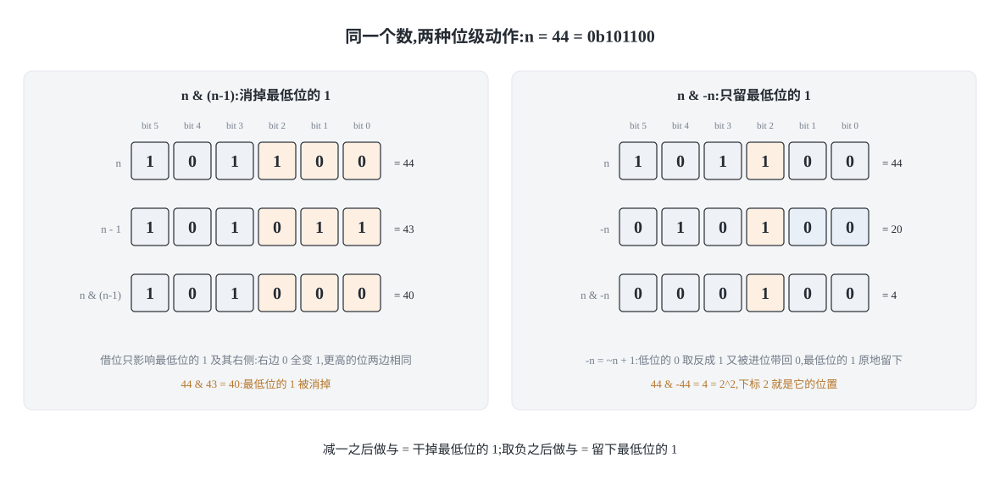
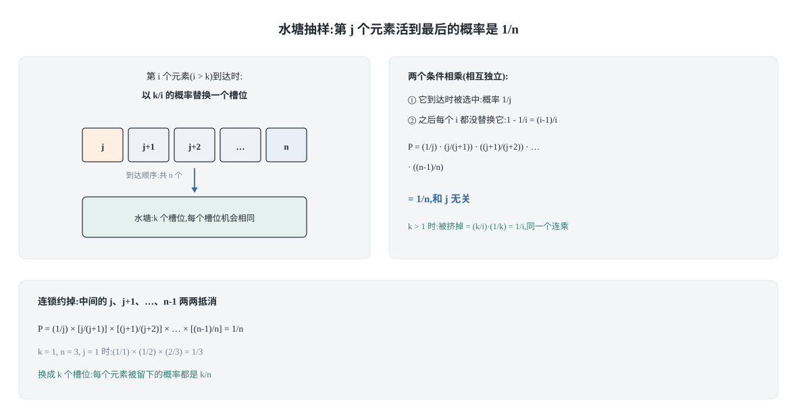
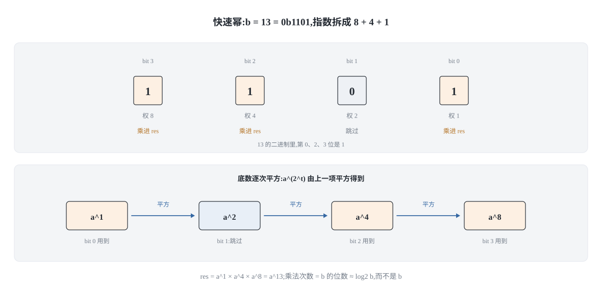

## 0 先说明材料和我的写法

这是面试算法系列的数学专题。数学题在面试里出现的方式很固定：它不考你会不会推公式，而是让你在十分钟内写出一个**边界不出错**的小函数。指数为 0 的快速幂、从前往后的洗牌、忘了处理负数的取模，任何一个都会当场挂掉。

这篇讲四块：

1. **位运算**的三个高频动作，以及位图；
2. **随机与概率**：洗牌、水塘抽样、带权随机，重点是"等概率"这件事的证明；
3. **取模与快速幂**：三条运算律、指数二分、以及 C++ 里的溢出；
4. **五道数学题的固定套路**：质因数分解、GCD/LCM、判素数、阶乘尾零、不用乘除的除法。

材料上，选题顺序对着 labuladong 的《数学运算技巧》一章，我实际读到的文本是这几份：

- 《必知必会数学技巧》——模运算的三条运算律（含乘法运算律的证明）、快速幂的参考实现、GCD 辗转相除、LCM「先除后乘」防溢出；
- 《常用的位操作》——二进制与位移基础、`x % 2^k` 等价于 `x & (2^k - 1)`、`n & (n - 1)`（力扣 191、231）、`a ^ a = 0`（力扣 136、268）；
- 《位图原理及实现》——为什么 `boolean[]` 会浪费 7/8 的内存；
- 《如何高效寻找素数》——判断素数只需试到 `sqrt(n)`、埃氏筛的两个优化；
- 《谈谈游戏中的随机算法》和《带权重的随机选择算法》——**这两份我只读到开头**：前者的洗牌、水塘抽样、蒙特卡洛三节只有目录没有正文，后者只有力扣 528 的题面和提示。

所以要把边界说清楚，哪些是原文的结论、哪些是我自己推的：

- **原文给的结论**：模运算律、`n & (n-1)` 能消掉最低位的 1、`x % 2^k = x & (2^k - 1)`、位图的动机（bool 占一字节只用一位）、GCD 的辗转相除、LCM 的「先除后乘」、判素数只需试到 `sqrt(n)`、埃氏筛的复杂度 O(n log log n)。
- **我自己写的推导与实现**：Fisher-Yates 的正确性证明（以及"从前往后"为什么错）、水塘抽样每个元素概率都是 `k/n` 的归纳证明、带权随机的前缀和 + 二分、快速幂的迭代版与 C++ 溢出处理、费马小定理求模逆、阶乘尾零、以及"不用乘除实现除法"的思路。

代码是 **Python 3 和 C++17 两版**，是我自己写的实现，不是教程原文 Java 的转写。两版并排给出，因为它们的坑不一样——这篇里会反复出现同一个主题：**同一个写法在 Python 里对、在 C++ 里错**（取模的符号、`&` 和 `==` 的优先级、整数溢出的位置）。

代码不靠颜色高亮，只靠排版和注释讲清楚。文末的 `verify_code.py` 会把这篇里的代码块**从 markdown 原文抽出来真跑**（16 个 Python 块 + 16 个 C++ 块），不是另存一份副本去测：

- **快速幂**：小指数下把 `a^n mod m` 和暴力连乘**逐项**对拍（`a ∈ [-3, 12]`、`n ∈ [0, 12]`、`m ∈ [1, 13]`，共 2704 组，全部一致），大指数（含 `n = 10^18`）用 Python 大整数算出真值再比对（48 组）；
- **两个实现逐行对拍**：同一套用例表同时驱动 Python 和 C++，两边各打印 `名字(参数)=结果`，514 行必须逐字节相同——"两种语言的用例集等价"是比对出来的结论，不是我的保证；
- **洗牌与水塘抽样**：多次采样的卡方检验，**这只是一种粗略检验，能证伪不能证明**（真正的证明在后面各节的计数与归纳里）。同时跑一个故意写错的洗牌当对照组，它的统计量必须被拒绝，否则说明检验本身无效；
- **穷举类的严格验证**：二进制枚举子集的集合、带权随机的 `index_of`（把 `[0, total)` 每个整数都试一遍）、位运算与朴素定义的对比；
- **C++ 侧**：`g++ -std=c++17 -Wall -Wextra -Werror` 零警告，编译与运行退出码都是 0。

两个必须说明的限度：统计检验只在**固定种子**下成立，抓不到"只对某些随机取值出错"的 bug；另外我没有做极限规模压测——`m` 接近 `10^18` 的快速幂、`n` 接近 `10^18` 的质因数分解试除，这些在真实题面里会出现，但本文的用例没覆盖那么大的规模。

出处链接和我没验证到的部分写在[最后一节](#6-材料与出处)。

### 目录

- [0 先说明材料和我的写法](#0-先说明材料和我的写法)
- [1 位运算:三个动作,撑起一大半题](#1-位运算三个动作撑起一大半题)
- [2 随机与概率:等概率这件事需要证明](#2-随机与概率等概率这件事需要证明)
- [3 取模与快速幂:从线性次乘法到对数次](#3-取模与快速幂从线性次乘法到对数次)
- [4 几道高频数学题的固定套路](#4-几道高频数学题的固定套路)
- [5 把这四个板块收成一张表](#5-把这四个板块收成一张表)
- [6 材料与出处](#6-材料与出处)
## 1 位运算:三个动作,撑起一大半题

位运算的题看起来零散，但高频的其实只有三个动作：

1. `n & (n - 1)`：消掉最低位的那个 1；
2. `n & -n`：只留下最低位的那个 1；
3. `a ^ a = 0`：让成对的数自己消掉。

三个动作各自对应一类题。剩下的（位图、枚举子集）都是它们的组合用法。

### 1.1 先把「最低位的 1」这个词说清楚

二进制从右往左编号，最低位是第 0 位。所谓「最低位的 1」，是从右往左数第一个等于 1 的位。用 `n = 44` 举例：

```text
n         = 0b101100   (44)
n - 1     = 0b101011   (43)   最低位的 1 变 0,它右边的 0 全变 1,更高位不动
n & (n-1) = 0b101000   (40)   最低位的 1 被消掉,其余位原样保留
n & -n    = 0b000100   (4)    只剩最低位的 1,它的下标是 2,值就是 2^2
```



记住这两行的区别就够了：**减一之后做与，是"干掉"；取负之后做与，是"留下"。**

### 1.2 n & (n-1):消掉最低位的 1

**为什么成立。** 把 `n` 减 1，借位只会发生在最低位的那个 1 上：它变成 0，它右边的所有 0 因为借位变成 1，而它左边的高位一位都不动。现在拿 `n - 1` 和 `n` 做与：

- 最低位那个 1：`n` 是 1，`n - 1` 是 0 → 结果为 0，**这就是被消掉的那一位**；
- 它右边的位：`n` 是 0，`n - 1` 是 1 → 结果为 0；
- 更高的位：两边完全相同 → 原样保留。

所以 `n & (n - 1)` 的作用精确地是「把最低位的 1 变成 0，其它位不变」。这个操作可以直接推出两个高频结论：

- **力扣 191「位 1 的个数」**：反复消 1 并计数，循环次数等于 1 的个数，而不是位宽。`n` 有 32 位但只有 3 个 1 时，循环 3 次就结束——这是它比"逐位检查 32 次"快的地方。
- **力扣 231「2 的幂」**：2 的幂的二进制里只有一个 1，所以消掉它之后必然变成 0。

**最容易写错的一行:** `n > 0 and (n & (n - 1)) == 0` 里的 `n > 0` 不能省。`0 & (-1)` 正好是 0，漏掉这个判断，`n = 0` 会被判成 2 的幂。我顺手扫了一遍 `[-100000, 0)` 的整个区间，没有一个负数满足 `n & (n-1) == 0`，所以真正要挡的边界就是 0 本身。

C++ 里还有第二个坑：**`==` 的优先级高于 `&`**，`n & n - 1 == 0` 会被解析成 `n & ((n - 1) == 0)`。原文在这一处专门标了「括号不可以省略」。

```python
def hamming_weight(n: int) -> int:
    """力扣 191:数 n 的二进制里有几个 1。
    循环次数 = 1 的个数,不是位宽。"""
    if n < 0:
        raise ValueError("这里只处理非负整数")
    count = 0
    while n:
        n &= n - 1          # 每轮消掉最低位的 1
        count += 1
    return count


def is_power_of_two(n: int) -> bool:
    """力扣 231。
    最容易写错的一行:先判 n > 0。0 & -1 == 0,漏了就会把 0 判成 2 的幂。"""
    return n > 0 and (n & (n - 1)) == 0
```

```cpp
#include <cstdint>

// 力扣 191 的签名是 (unsigned int)。这里用 unsigned long long 是为了和
// Python 的任意精度对齐:否则测 2^40 这种数时会被静默截断,两边结果不一致。
int hamming_weight(unsigned long long n) {
    int count = 0;
    while (n != 0) {
        n &= n - 1;             // 每轮消掉最低位的 1
        ++count;
    }
    return count;
}

bool is_power_of_two(long long n) {
    // 最容易写错的一行:括号不能省。C++ 的 == 优先级高于 &,
    // 写成 n & n - 1 == 0 会先算 (n - 1) == 0,再和 n 做与。
    return n > 0 && (n & (n - 1)) == 0;
}
```

### 1.3 n & -n:只留下最低位的 1

**为什么成立。** 整数用补码表示，`-n` 就是 `~n + 1`（取反加一）。这个过程对低位是"进位"：`n` 最低位那个 1 右边的 0，取反后全变成 1，加一之后又全部进位变回 0；最低位那个 1，取反成 0，被进位加回 1；它左边的高位则全部取反。于是 `n` 和 `-n` 只在「最低位的那个 1」这一位上同时为 1，与的结果就只剩这一位，值恰好是 `2^k`（k 是它的下标）。

它的经典用途是**一次跳过一个 1**：`n & -n` 拿到最低位，`n ^= (n & -n)` 把它抹掉，循环次数还是 1 的个数。树状数组（Fenwick）的 `i += i & -i` 用的是同一个式子。

**最容易写错的一行:** `n & -n` 在 C++ 里对 `int` 的 `INT_MIN` 取负是**有符号溢出（UB）**；写 `int` 版本时要么保证输入是正数，要么干脆用 `unsigned long long`（无符号的取负是良定义的模运算），我在下面用的是后者。

```python
from typing import List


def lowbit(n: int) -> int:
    """只保留 n 最低位的那个 1;n = 0 时返回 0。"""
    return n & -n


def bits_of(n: int) -> List[int]:
    """从低到高列出所有 1 的下标。靠 lowbit 一次跳过一个 1,
    所以循环次数也是 1 的个数,而不是位宽。"""
    if n < 0:
        raise ValueError("只处理非负整数")
    out = []
    while n:
        low = n & -n
        out.append(low.bit_length() - 1)   # 2^k 的下标就是 k
        n ^= low                            # 抹掉这一个 1
    return out
```

```cpp
#include <vector>

// 用无符号类型:对 int 的 INT_MIN 取负是有符号溢出(UB)。
unsigned long long lowbit(unsigned long long n) {
    return n & -n;              // 无符号取负 = 模 2^64,良定义
}

std::vector<int> bits_of(unsigned long long n) {
    std::vector<int> out;
    while (n != 0) {
        unsigned long long low = n & -n;
        int idx = 0;
        for (unsigned long long t = low; t > 1; t >>= 1) ++idx;  // 求 k
        out.push_back(idx);
        n ^= low;
    }
    return out;
}
```

### 1.4 异或:让成对的数自己消掉

异或的三条性质决定了它的用法：

- `a ^ a = 0`：成对的消掉；
- `a ^ 0 = a`：0 是单位元，不干扰结果；
- 满足交换律和结合律：所以**异或与顺序无关**，这是"全部异或起来"这种写法成立的前提。

**力扣 136「只出现一次的数字」**：一个数出现一次，其余都出现两次。全部异或，成对的全变成 0，剩下的就是它。**力扣 268「丢失的数字」**：[0, n] 里少了一个数，数组长度是 n。把下标 `0..n-1` 也一起异或进去，索引和元素就凑成了对，落单的就是缺的那个数。

**最容易写错的一行:** 累加器的初值必须是 `0`（异或的单位元），不是 `-1`，也不是 `nums[0]` 加特判——前者会让结果永远差一个 `-1`，后者在空数组上直接崩。

还有一条边界要知道：异或找"唯一"只对「其余每个都出现**偶数**次」成立。如果题目改成其余都出现三次，异或就不管用了，得按位统计 `mod 3`。

```python
from typing import List


def single_number(nums: List[int]) -> int:
    """力扣 136:只有一个数出现一次,其余都出现两次。"""
    res = 0                      # 初值必须是 0(异或的单位元)
    for x in nums:
        res ^= x
    return res


def missing_number(nums: List[int]) -> int:
    """力扣 268:[0, n] 里少了一个数,数组长度是 n。
    把索引 0..n-1 也异或进去,索引和元素凑成对,剩下的就是缺的。"""
    n = len(nums)
    res = n                      # 先把 n 这个"多出来的索引"异或进来
    for i, x in enumerate(nums):
        res ^= i ^ x
    return res
```

```cpp
#include <vector>

int single_number(const std::vector<int>& nums) {
    int res = 0;                 // 初值必须是 0(异或的单位元)
    for (int x : nums) res ^= x;
    return res;
}

int missing_number(const std::vector<int>& nums) {
    int n = static_cast<int>(nums.size());
    int res = n;                 // 先把 n 这个"多出来的索引"异或进来
    for (int i = 0; i < n; ++i) res ^= i ^ nums[i];
    return res;
}
```

### 1.5 二进制枚举子集

一个 `m` 位的掩码 `mask` 有 `2^popcount(mask)` 个子集。要全部枚举出来，标准写法是：

```text
sub = mask
while True:
    使用 sub
    if sub == 0: break
    sub = (sub - 1) & mask
```

**为什么成立。** 把 `sub` 看成 `mask` 的一个子掩码，`(sub - 1) & mask` 就是"子掩码意义下的减一"：`sub - 1` 先把最低位的 1 变 0、把右边的 0 全变 1（和上一节同一个借位过程），此时可能会冒出 `mask` 之外的 1；再 `& mask` 把这些越界的 1 清掉。得到的结果正好是比 `sub` 小的最大的那个子掩码。从 `mask` 一路递减到 0，恰好把全部子集走一遍，不重不漏。

**最容易写错的一行:** 循环必须"先处理后退出"。如果写成 `while sub: ... sub = (sub-1) & mask` 之后再补一次处理，很容易漏掉空集；如果写成 `while sub: sub = (sub-1) & mask; 使用 sub`，那么 `sub = 0` 时 `(0 - 1) & mask` 会绕回 `mask` 本尊，直接死循环。Python 没有 `do-while`，所以用 `while True` + 底部 `break` 最稳。

顺带一个复杂度：**枚举一个集合的所有子集的所有子集**，总迭代次数是 `3^m`——因为每个元素有三种去向（不在 `mask` 里 / 在 `mask` 里但不在 `sub` 里 / 在 `sub` 里）。

```python
from typing import List


def subsets_of_mask(mask: int) -> List[int]:
    """枚举 mask 的所有子掩码(含 mask 自己和 0),从大到小。
    总迭代次数 = 2^popcount(mask)。"""
    out = []
    sub = mask
    while True:
        out.append(sub)
        if sub == 0:
            break
        sub = (sub - 1) & mask      # 子掩码意义下的"减一"
    return out
```

```cpp
#include <vector>

std::vector<unsigned long long> subsets_of_mask(unsigned long long mask) {
    std::vector<unsigned long long> out;
    unsigned long long sub = mask;
    while (true) {
        out.push_back(sub);
        if (sub == 0) break;        // 先登记再退出,否则 (0-1)&mask 绕回 mask
        sub = (sub - 1) & mask;
    }
    return out;
}
```

### 1.6 位图:把 boolean[] 压成 bit

**动机。** 一个布尔值只需要 1 个比特，但语言里的 `boolean`/`bool` 通常占 1 个字节（8 比特），实际浪费了 7/8——这是原文给出的理由，也是它给读者降温的地方：**除非数据规模特别大，否则用语言自带的布尔数组就够了**，位图主要是给布隆过滤器这类超大集合准备的结构。

**实现。** 用一组整数当"字"数组，第 `i` 位落在第 `i >> 6` 个字的第 `i & 63` 位上（64 位字）。这里 `i & 63` 能替代 `i % 64`，正是因为 64 是 2 的幂——也就是原文提到的 `x % 2^k = x & (2^k - 1)`。


**两版差别最大的地方。** Python 的 `int` 本身就是任意精度的位串，所以一个整数就是一个位图，`bits |= 1 << i` 就完事了，不需要字数组——下面 Python 版就这么写；C++ 版必须自己算字下标和位偏移。

**最容易写错的一行:** `((words[i >> 6] >> (i & 63)) & 1) == 1` 里的括号。Python 的 `&` 优先级**高于** `==`，所以 `x & 1 == 1` 在 Python 里是对的；C++ 的 `&` 优先级**低于** `==`，同一个表达式会被解析成 `x & (1 == 1)`。这种差异不会报错，只会算错，所以我的建议是两边都写括号。

```python
from typing import List


class Bitmap:
    """Python 版:一个整数就是整个位图,不需要字数组。"""

    def __init__(self, size: int):
        self.size = size
        self.bits = 0

    def add(self, i: int) -> None:
        self.bits |= 1 << i

    def remove(self, i: int) -> None:
        self.bits &= ~(1 << i)

    def contains(self, i: int) -> bool:
        return ((self.bits >> i) & 1) == 1

    def ones(self) -> List[int]:
        """从低到高列出所有被置位的下标,用 lowbit 跳着走。"""
        out = []
        b = self.bits
        while b:
            low = b & -b
            out.append(low.bit_length() - 1)
            b ^= low
        return out
```

```cpp
#include <cstdint>
#include <vector>

// C++ 版:自己算字下标和位偏移。64 位字,所以用 6 和 63。
class Bitmap {
public:
    explicit Bitmap(int size) : words_((static_cast<std::size_t>(size) + 63) / 64, 0ULL) {}

    void add(int i) { words_[i >> 6] |= 1ULL << (i & 63); }
    void remove(int i) { words_[i >> 6] &= ~(1ULL << (i & 63)); }

    bool contains(int i) const {
        // 最容易写错的一行:括号。C++ 的 & 优先级低于 ==,
        // 少了括号会被解析成 x >> ((i & 63) & (1 == 1))。
        return ((words_[i >> 6] >> (i & 63)) & 1ULL) == 1ULL;
    }

    std::vector<int> ones() const {
        std::vector<int> out;
        for (std::size_t w = 0; w < words_.size(); ++w) {
            std::uint64_t b = words_[w];
            while (b != 0) {
                std::uint64_t low = b & -b;
                int bit = 0;
                for (std::uint64_t t = low; t > 1; t >>= 1) ++bit;
                out.push_back(static_cast<int>(w) * 64 + bit);
                b ^= low;
            }
        }
        return out;
    }

private:
    std::vector<std::uint64_t> words_;
};
```
## 2 随机与概率:等概率这件事需要证明

随机算法在面试里的形式很特别：题目让你"实现一个类"，而判分靠的是**跑很多次看统计**。所以这一节的每个算法，我都要能回答一个问题——**为什么每个元素被选中的概率相等**。回答不了，就说明你只是背下了模板。

### 2.1 Fisher-Yates:为什么必须从后往前

洗牌要的是「`n` 个元素的所有排列等概率出现」。标准做法是从后往前：

```text
for i = n-1 down to 1:
    j = [0, i] 上的均匀随机整数
    swap(a[i], a[j])
```


**为什么成立（计数证明）。** 每一步的选择次数分别是 `n`、`n-1`、…、`2`，所以整个过程的随机选择序列共有 `n × (n-1) × … × 2 × 1 = n!` 种，而每一种选择序列出现的概率都是 `1/n × 1/(n-1) × … × 1/2`，彼此相等。另一方面，**每一种选择序列对应一个不同的排列**（第 `i` 步把哪个元素放到了位置 `i`，被逐一记录下来了，最后位置 0 剩下的元素也唯一确定）。所以 `n!` 种序列与 `n!` 个排列一一对应、概率相同，每个排列的概率恰好是 `1/n!`。

注意这里的关键是**每一步的选择范围在缩小**：位置 `i` 一旦确定，就再也不会被后面的步骤碰到。这就是"从后往前"的全部含义——它是"把还没定下来的位置缩小一格"的自然写法。（从前往后、每次在 `[i, n-1]` 里选，是同一个算法的镜像，也对。）

**为什么"每次都跟任意位置交换"是错的。** 一个常见的错误写法是：

```text
for i = 0 to n-1:
    j = [0, n-1] 上的均匀随机整数     # 注意:不是 [i, n-1]
    swap(a[i], a[j])
```

它的选择序列有 `n^n` 种，每一种概率相等。如果结果真的是均匀分布，那么每个排列的概率必须是 `1/n!`；而这个概率只能写成 `m / n^n`（`m` 是得到该排列的选择序列条数）。于是必须 `n! | n^n`。但 `n ≥ 3` 时这个整除关系不成立：`n = 3` 时 6 不能整除 27，`n = 4` 时 24 不能整除 256。所以这种写法**不可能是均匀的**，连"碰巧均匀"的机会都没有。这是个纯计数论证，不需要跑程序就能判死刑；`verify_code.py` 里我也实测了它的卡方统计量（`7086.3`，临界值 `74.8`），确实是爆的。

**最容易写错的一行:** `j` 的取值。除了上面的范围错误，还有一个隐蔽的坑是**取模偏置**：C 风格的 `rand() % (i + 1)` 在 `RAND_MAX + 1` 不是 `i + 1` 的整数倍时，小的 `j` 会被更频繁地取到。用 `std::uniform_int_distribution`（或在 Python 里用 `random.randrange`）就没有这个问题。面试时提一句这个坑，通常是加分项而不是加戏。

```python
import random
from typing import List, Optional


def shuffle(arr: List[int], rng: Optional[random.Random] = None) -> None:
    """原地 Fisher-Yates,从后往前。
    传入 rng 只是为了测试可复现;生产代码直接用 random.randrange。"""
    r = rng if rng is not None else random
    for i in range(len(arr) - 1, 0, -1):
        j = r.randrange(i + 1)      # 均匀取 [0, i],注意是闭区间
        arr[i], arr[j] = arr[j], arr[i]
```

```cpp
#include <cstddef>
#include <random>
#include <utility>
#include <vector>

// 原地 Fisher-Yates,从后往前。
// 用 uniform_int_distribution 而不是 rand() % (i+1):后者在
// RAND_MAX+1 不是 i+1 的倍数时有取模偏置,小的 j 会更常出现。
void shuffle(std::vector<int>& arr, std::mt19937_64& rng) {
    for (std::size_t i = arr.size(); i > 1; --i) {
        std::uniform_int_distribution<std::size_t> dist(0, i - 1);
        std::swap(arr[i - 1], arr[dist(rng)]);
    }
}
```

### 2.2 水塘抽样:每个元素概率都是 k/n

场景：数据是一条**长度未知的流**，你只能顺序读一遍，要在其中等概率地留下 `k` 个。做法是维护一个大小为 `k` 的"水塘"：

```text
前 k 个元素直接进水塘
第 i 个元素到达时(i > k,从 1 开始数):
    以 k/i 的概率替换:随机挑一个槽位扔掉,换成它
    以 1 - k/i 的概率什么都不做
```

**为什么每个元素被留在水塘里的概率都是 `k/n`。** 先看最简单的 `k = 1`。第 `j` 个元素（`j ≥ 1`）能活到最后，需要两件事同时发生：

1. 它到达时被选中：概率 `1/j`（`j = 1` 时是必然事件，概率 1）；
2. 它之后到达的每个元素 `i = j+1, …, n` 都**没有**把它替换掉：每个的概率是 `1 - 1/i = (i-1)/i`。

乘起来，中间项会连锁约掉（这就是水塘抽样最漂亮的地方）：

```text
P(第 j 个元素最终在水塘里)
  = (1/j) × ∏(i = j+1 … n) (1 - 1/i)
  = (1/j) × [j/(j+1)] × [(j+1)/(j+2)] × … × [(n-1)/n]
  = 1/n
```

`k = 1` 时每个元素概率都是 `1/n`，与 `j` 无关——包括最后一个元素，它只有一个 `1/n` 的机会，但前面每一步都替它"清过场"。

`k > 1` 的推广：第 `i` 个元素到达时，水塘里**某一个特定元素**被挤掉的概率是 `(k/i) × (1/k) = 1/i`——和 `k = 1` 时完全一样。所以对第 `j` 个元素：

- `j ≤ k`：它一开始就在水塘里，只需要躲过后面每一次，概率 `∏(i=k+1…n)(1 - 1/i) = k/n`；
- `j > k`：它到达时被选中的概率是 `k/j`，之后躲过每一次的概率是 `∏(i=j+1…n)(1 - 1/i) = j/n`，相乘得 `k/j × j/n = k/n`。

**更强的一条结论**：不只每个元素的边际概率是 `k/n`，而是**每个 `k` 元子集被留下的概率都相等**（`1/C(n,k)`）。对已处理的元素个数 `i` 做归纳：处理完 `i` 个元素后，这 `i` 个元素的每个 `k` 元子集都是当前水塘的概率为 `1/C(i,k)`。第 `i+1` 个元素到达时，若是"不选它"，则子集 `S` 必须先是水塘且被拒绝，概率 `[1/C(i,k)] × (1 - k/(i+1))`；若是"选它"，则 `S` 必须由一个恰好差它一个元素的旧水塘加上"被挤掉的正好是缺的那个"得到，这里要对 `i - k + 1` 种旧水塘求和，概率 `(i - k + 1) × [1/C(i,k)] × (k/(i+1)) × (1/k)`。两式化简后都等于 `1/C(i+1,k)`，归纳成立。

**最容易写错的一行:** `i` 从 **1** 开始数。第 `i` 个元素（1-indexed）的替换概率是 `k/i`；如果循环写成 0-indexed 的 `for i in range(k, len(stream))` 却仍然用 `k / i`，那么第一个该被替换的元素概率会算成 `k/k = 1`（必然替换），上面整条归纳立刻塌掉。另一个边界是 `n < k`：此时水塘里就应该是全部 `n` 个元素，长度是 `n` 而不是 `k`，不要补空值。



```python
import random
from typing import Iterable, List, Optional


def reservoir_sample(stream: Iterable[int], k: int,
                     rng: Optional[random.Random] = None) -> List[int]:
    """水塘抽样:流式数据里等概率取 k 个。
    n < k 时返回全部元素;返回顺序不代表任何含义。"""
    if k <= 0:
        return []
    r = rng if rng is not None else random
    reservoir: List[int] = []
    for i, x in enumerate(stream, start=1):     # i 从 1 开始数
        if i <= k:
            reservoir.append(x)                 # 前 k 个直接进水塘
        elif r.random() < k / i:                # 以概率 k/i 替换
            reservoir[r.randrange(k)] = x       # 再均匀挑一个槽位
    return reservoir
```

```cpp
#include <cstddef>
#include <random>
#include <vector>

// 水塘抽样:流式数据里等概率取 k 个。n < k 时返回全部元素。
std::vector<int> reservoir_sample(const std::vector<int>& stream, std::size_t k,
                                  std::mt19937_64& rng) {
    std::vector<int> reservoir;
    if (k == 0) return reservoir;
    std::uniform_real_distribution<double> uni(0.0, 1.0);
    for (std::size_t i = 1; i <= stream.size(); ++i) {   // i 从 1 开始数
        int x = stream[i - 1];
        if (i <= k) {
            reservoir.push_back(x);
        } else if (uni(rng) < static_cast<double>(k) / static_cast<double>(i)) {
            std::uniform_int_distribution<std::size_t> slot(0, k - 1);
            reservoir[slot(rng)] = x;
        }
    }
    return reservoir;
}
```

### 2.3 带权随机:前缀和 + 二分

题目（力扣 528）：给权重数组 `w`，要求按下标 `i` 的概率正比于 `w[i]` 来返回下标。

**做法。** 先求前缀和 `P[i] = w[0] + … + w[i]`，总和 `W = P[n-1]`。每次选取时在 `[0, W)` 里均匀取一个整数 `u`，返回**第一个满足 `P[i] > u` 的 `i`**。因为 `u` 落在区间 `(P[i-1], P[i]]` 里的概率正好是这个区间的长度除以 `W`，也就是 `w[i]/W`。

前缀和的性质是单调不减，所以"第一个大于 `u` 的位置"可以二分，单次选取 `O(log n)`，预处理 `O(n)`。不用二分、直接线性扫描累积区间也能做（每次 `O(n)`），代码更短——我在验证脚本里就是拿这个朴素实现来对拍的。

**最容易写错的一行:** 用 `bisect_left`（`>=`）还是 `bisect_right`（`>`）。`u` 落在区间边界上时两者结果不同，而**权重为 0 的下标必须永远选不到**：`w = [0, 1]` 时，`u = 0` 应该返回下标 1；用 `>=` 的写法会返回下标 0，把一个概率为 0 的事件变成可能事件。整数随机数取 `[0, W)`，配上严格的 `>`，这个边界才是准的。

另外，把随机数取成浮点 `uniform(0, W)` 也能工作，但当 `W` 很大时浮点精度不够，边界会漂。**用整数前缀和 + 整数随机数**更稳，这也是力扣 528 的标准写法。

```python
import bisect
import random
from typing import List, Optional


class WeightedPicker:
    """带权随机:预处理前缀和 O(n),每次选取 O(log n)。
    权重必须非负、总和为正;权重为 0 的下标永远不会被选中。"""

    def __init__(self, weights: List[int]):
        if not weights:
            raise ValueError("权重数组不能为空")
        if any(w < 0 for w in weights):
            raise ValueError("权重不能为负")
        prefix = []
        total = 0
        for w in weights:
            total += w
            prefix.append(total)
        if total <= 0:
            raise ValueError("权重之和必须为正")
        self.prefix = prefix
        self.total = total

    def index_of(self, u: int) -> int:
        """u ∈ [0, total) 落在哪个区间。抽出来单独放是为了能对拍:
        verify_code.py 会对 [0, total) 的每个 u 穷举验证。"""
        return bisect.bisect_right(self.prefix, u)   # 第一个 > u 的位置

    def pick(self, rng: Optional[random.Random] = None) -> int:
        r = rng if rng is not None else random
        return self.index_of(r.randrange(self.total))
```

```cpp
#include <algorithm>
#include <stdexcept>
#include <vector>

// 带权随机:前缀和 + 二分。权重必须非负、总和为正。
class WeightedPicker {
public:
    explicit WeightedPicker(const std::vector<long long>& weights) {
        if (weights.empty()) throw std::invalid_argument("empty weights");
        for (long long w : weights) {
            if (w < 0) throw std::invalid_argument("negative weight");
            total_ += w;
            prefix_.push_back(total_);
        }
        if (total_ <= 0) throw std::invalid_argument("non-positive total");
    }

    // u ∈ [0, total) 落在哪个区间。upper_bound = Python 的 bisect_right,
    // 找第一个 > u 的位置(用 >= 会让权重 0 的下标在边界上被选中)。
    int index_of(long long u) const {
        return static_cast<int>(
            std::upper_bound(prefix_.begin(), prefix_.end(), u) - prefix_.begin());
    }

    int pick(std::mt19937_64& rng) const {
        std::uniform_int_distribution<long long> dist(0, total_ - 1);  // [0, total)
        return index_of(dist(rng));
    }

    long long total() const { return total_; }

private:
    std::vector<long long> prefix_;
    long long total_ = 0;
};
```

### 2.4 蒙特卡洛:统计检验只能证伪

上面三个算法的正确性是**证出来的**（计数证明、归纳、区间长度），不是测出来的。那为什么还要写统计检验？因为它能抓住实现 bug，而且是唯一能自动化的手段——你没法让程序"读懂证明"。

我在 `verify_code.py` 里做的是这几件事，强度必须说清楚：

- **洗牌**：`n = 4`，`4! = 24` 个排列全部纳入检验，各跑 24 万轮，对 24 个格子做卡方（自由度 23，临界值 `74.8`）。**实测量到的统计量**：Python 侧 `13.6`、C++ 侧 `19.8` —— 通过。这是比"看每个位置分布均匀"更强的检验，因为它直接检验排列级别的均匀性。
- **对照组（错误写法）**：同样 24 万轮，"每轮跟任意位置交换"的卡方统计量实测 `7086.3`（Python）/ `7381.8`（C++），是临界值的两个数量级之上，被干净地拒绝。这一条比正确实现"通过"更重要：它证明检验本身是有效的，而不是永远说 OK。
- **水塘抽样**：`n = 10, k = 1` 统计 10 个下标的频率，实测卡方 `9.7` / `7.1`（自由度 9，临界值 `49.1`）；`n = 4, k = 2` 统计全部 `C(4,2) = 6` 个子集的频率，实测 `3.2` / `2.8`（自由度 5，临界值 `40.6`）。子集级检验才是"每个 k 元子集等概率"这条更强结论的证据。
- **带权随机**：这一条不是统计，是严格验证——把 `[0, total)` 的每个 `u` 穷举一遍，检查 `index_of(u)` 的落点分布**精确等于**权重本身（实测 `1, 3, 2, 0, 4` 逐项吻合，权重 0 的下标出现 0 次）。因为映射是确定性的，穷举就是证明。
- **两个实现各测一遍**：随机数没法跨语言逐行对拍（两边的 RNG 不同），所以 C++ 程序在 `stats` 模式下只输出"分桶计数"，由 Python 读回来算卡方。上面每个数字都有 Python / C++ 两行，说的就是这件事。

样本量、统计量、临界值都会真实打印出来。判定阈值我用 Wilson–Hilferty 近似现算（`z = 5`，对应尾部概率约 `3e-7`），不查表，所以两种语言里算出的临界值完全一致。**固定种子 + 固定样本量时结果是确定的**，这些检验不会随机翻车；但这不等于"通过检验 = 算法正确"，它只等于"没有发现反例"。真正的保证仍然来自上面的证明。

还有一个必须承认的局限：**固定种子的检验抓不到"只对某些种子出错"的 bug**（比如洗牌内部某个只在特定取值下才走错的边界）。这类 bug 只能靠穷举小规模状态空间去抓——我在 `verify_code.py` 里对 `n = 4` 的全部 24 个排列、对带权随机的全部 `u` 都做了穷举——以及靠读代码去抓，加大样本量没有用。

顺带一句：设计这类检验就是在算"样本空间"，和《几个反直觉的概率问题》里那两个原则是一回事——**先想清楚样本空间是什么（自由度对不对），再用频数去比**。如果样本空间搞错了，检验给出的结论也是错的（比如把所有位置的数据混在一起做一次卡方，自由度就错了，再大的偏差也可能"通过"）。
## 3 取模与快速幂:从线性次乘法到对数次

这一节的主线只有一句话：**把 `b` 次乘法压成 `log b` 次，同时保证中间结果不溢出。** 但真正做到"不出错"，难的是边界，不是主循环。

### 3.1 三条运算律,和那个必须补上的 k

模运算可以拆开算，靠的是三条运算律：

```text
(a + b) mod k = ((a mod k) + (b mod k)) mod k
(a - b) mod k = ((a mod k) - (b mod k) + k) mod k
(a * b) mod k = ((a mod k) * (b mod k)) mod k
```

乘法律值得推一遍（原文给了这个证明，我按自己的话重写）：

```text
设 a = A·k + B,b = C·k + D,其中 0 ≤ B, D < k(B = a mod k,D = b mod k)
a·b = A·C·k² + (A·D + B·C)·k + B·D
前两项都含因子 k,所以 a·b mod k = B·D mod k
而 (a mod k)·(b mod k) mod k = B·D mod k
两者相等,证毕
```

**这条律的价值在于它允许"边乘边取模"**：每一步都把中间结果压回 `[0, k)`，于是两个 10 位数的乘积不会变成 20 位数。快速幂能用，靠的就是它。

**最容易写错的一行:** 减法那条里的 `+ k`。原因是不同语言的 `%` 语义不同：

- **C++ / Java 的 `%` 是截断取余**，符号跟着被除数：`(1 - 3) % 5 == -2`，所以必须补成 `((a - b) % k + k) % k`；
- **Python 的 `%` 返回非负数**（符号跟着除数）：`(1 - 3) % 5 == 3`，本来就不需要 `+ k`。

所以 Python 版看起来"少一步"是正常的，别以为写漏了。真正危险的是把 Python 的习惯带进 C++——那里少一个 `+ k` 就会在负数上直接错。

### 3.2 快速幂:迭代版把指数拆成二进制

朴素做法是循环 `b` 次乘 `a`，复杂度 `O(b)`。`b = 10^9` 时这就没救了。快速幂的思路来自幂运算本身的性质：

```text
a^(x + y) = a^x · a^y
```

把指数 `b` 写成二进制，`b = 2^t1 + 2^t2 + …`，那么 `a^b` 就是若干个 `a^(2^t)` 的乘积。而 `a^(2^t)` 可以由前一项平方向上传：`a^(2^(t+1)) = (a^(2^t))²`。

于是迭代版只需要维护两个变量：`res`（已经攒起来的乘积）和 `base`（当前的 `a^(2^t)`）。每一步看 `b` 的最低位：是 1 就把 `base` 乘进 `res`，然后把 `b` 右移一位、`base` 平方。

```text
b = 13 = 0b1101
需要的是 a^13 = a^8 · a^4 · a^1     (指数 13 = 8 + 4 + 1)
base 依次是 a^1 → a^2 → a^4 → a^8,第 0、2、3 位的 base 要被乘进 res
```



复杂度推导：循环次数等于 `b` 的位数，即 `floor(log2 b) + 1`，每轮做常数次乘法和取模，所以是 `O(log b)` 次乘法，额外空间 `O(1)`。`b = 10^9` 时大约 30 轮，和"循环十亿次"是两个世界。

**最容易写错的一行:** `a %= m` 这一步（我两版都放在循环之前）。如果底数可能为负（或者可能大于模数），不先规约，后面 `a * a` 里会带着负数/大数一路乘下去：C++ 里是溢出，Python 里虽然不会溢出，但 `a % m` 的符号语义会让结果和预期不一致。

```python
def pow_mod(a: int, b: int, m: int) -> int:
    """迭代版快速幂:算 a^b mod m。
    b >= 0,m >= 1;返回 [0, m) 里的非负结果。"""
    if m == 1:
        return 0                      # 任何数对 1 取模都是 0
    res = 1
    a %= m                            # 先把底数压进 [0, m),负底数也能处理
    while b > 0:
        if b & 1:                     # b 的最低位是 1,就把当前的 a^(2^t) 乘进来
            res = res * a % m
        a = a * a % m                 # 底数平方:a^(2^t) → a^(2^(t+1))
        b >>= 1                       # 指数右移一位
    return res
```

```cpp
// 迭代版快速幂:算 a^b mod m。b >= 0,m >= 1,返回 [0, m) 里的非负结果。
long long pow_mod(long long a, long long b, long long m) {
    if (m == 1) return 0;             // 任何数对 1 取模都是 0
    long long res = 1;
    a %= m;
    if (a < 0) a += m;                // C++ 的 % 可能返回负数,补成非负
    while (b > 0) {
        if (b & 1LL) res = res * a % m;
        a = a * a % m;                // 底数平方
        b >>= 1;
    }
    return res;
}
```

### 3.3 快速幂:递归版

递归写法直接照着幂运算的折半性质来：

```text
a^b = (a^(b/2))²         b 为偶数
a^b = a · (a^(b/2))²     b 为奇数
```

原文给的是 `(a^(b/2))²` 与 `a · a^(b-1)` 两条分支。我把奇数分支也写成 `a · (a^(b/2))²`，好处是**每一层只递归一次**，`T(b) = T(b/2) + O(1)`，深度恰好是 `log b`。（照 `a · a^(b-1)` 写也不会退化——因为 `b-1` 是偶数，下一步就折半了——但"只递归一次"更容易看出复杂度。）

递归深度是 `O(log b)`：就算 `b` 是 `long long`，也只有 63 层，不会爆栈。

**最容易写错的一行:** 递归调用的结果**必须只算一次**。写成 `pow_mod_rec(a, b // 2, m) * pow_mod_rec(a, b // 2, m)` 会调用两遍，递推式变成 `T(b) = 2T(b/2) + O(1) = O(b)`——复杂度从对数悄悄退回线性，而代码看起来还挺"对称"的。这是这一节最值钱的一个坑。

```python
def pow_mod_rec(a: int, b: int, m: int) -> int:
    """递归版快速幂,只为讲清"指数折半";工程上用迭代版。"""
    if m == 1:
        return 0
    a %= m
    if b == 0:
        return 1 % m                  # 指数为 0:a^0 = 1,对 1 取模是 0
    half = pow_mod_rec(a, b >> 1, m)  # 最容易写错的一行:只递归一次
    square = half * half % m
    return square if (b & 1) == 0 else a * square % m
```

```cpp
// 递归版快速幂,只为讲清"指数折半";工程上用迭代版。
long long pow_mod_rec(long long a, long long b, long long m) {
    if (m == 1) return 0;
    a %= m;
    if (a < 0) a += m;
    if (b == 0) return 1 % m;         // 指数为 0:a^0 = 1
    long long half = pow_mod_rec(a, b >> 1, m);   // 最容易写错的一行:只递归一次
    long long square = half * half % m;
    return (b & 1LL) ? a * square % m : square;
}
```

### 3.4 溢出:(a * b) 先溢出,取模救不了

这是 C++ 侧最容易翻车的地方。`pow_mod` 里那两行乘法 `res * a % m`、`a * a % m`，都是**先乘后模**：如果 `m` 接近 `10^18`，`a` 和 `res` 都在 `[0, m)` 内，乘积可以到 `10^36`，`long long`（上限约 `9.2 × 10^18`）直接溢出。溢出之后取模得到的是垃圾，不是"稍微不准"。

三种处理方式：

1. **升宽到 `__int128`**：GCC / Clang 都支持，一行搞定，是竞赛里的默认做法。缺点是 MSVC 没有这个类型；
2. **龟速乘（`O(log b)` 的加法版乘法）**：把 `a * b` 拆成"按位加"，每步只做加法并取模，纯标准 C++，代价是多一个 `log`；
3. **只在小模数下直接用 `long long`**：如果 `m ≤ 10^9`，两个 `[0, m)` 的数乘积不超过 `10^18`，安全。很多题面给的模数是 `10^9 + 7`，就是靠这个。

**最容易写错的一行:** 类型转换的位置。`(__int128)a * b % m` 必须先转再乘；写成 `(long long)(a * b) % m` 或 `(__int128)(a * b) % m`，乘法已经在 64 位里溢出了，转型只是把垃圾搬了个家。

这条不是纸上谈兵，我让 `verify_code.py` 实测了：取 5 组大数乘法，把"64 位乘积再取模"和真实值对比，`(10^18 - 1) × (10^18 - 2) mod 999999999999999989`、`(10^18 - 3) × (10^9 + 7) mod (10^9 + 7)`、`(2^40)^2 mod (10^9 + 7)`、`123456789012345678 × 987654321098765432 mod (10^9 + 7)` 这四组的结果都与真值不同——不是"差一点"，是毫不相干；只有 `(10^9)^2 mod (10^9 + 7)` 那一组相同，因为 `10^18` 恰好还塞得进 64 位。**安全性取决于模数多大，不取决于代码看起来多顺眼。**

```python
def mul_mod(a: int, b: int, m: int) -> int:
    """Python 版什么都不用做:int 是任意精度,乘完再取模就是精确值。"""
    return a * b % m
```

```cpp
// C++ 版必须先升宽再乘。__int128 是 GCC/Clang 扩展;
// 要可移植就换成 O(log b) 的龟速乘(按位加 + 取模)。
long long mul_mod(long long a, long long b, long long m) {
    if (m == 1) return 0;
    a %= m;
    if (a < 0) a += m;
    b %= m;
    if (b < 0) b += m;
    return static_cast<long long>(static_cast<__int128>(a) * b % m);
}
```

### 3.5 模逆:费马小定理,只在模是质数时成立

模逆要解决的是"模意义下的除法"：`a · x ≡ 1 (mod m)`，记 `x = a⁻¹`。有了它，`b / a mod m` 就能写成 `b · a⁻¹ mod m`。

**什么时候存在。** `a` 在模 `m` 下有逆元，当且仅当 `gcd(a, m) = 1`。`a ≡ 0 (mod m)` 时一定不存在。

**怎么算。** 当 `m` 是质数、且 `a` 不是 `m` 的倍数时，费马小定理给出 `a^(m-1) ≡ 1 (mod m)`。两边同乘 `a⁻¹`，得到：

```text
a⁻¹ ≡ a^(m-2)  (mod m)
```

所以模逆就是一次快速幂——这正是快速幂在数论题里最常见的用途。`m` 不是质数时不能这么算，要用扩展欧几里得（`m` 与 `a` 互质时才有解）。

**最容易写错的一行:** 把费马小定理用在**合数模**上。这不会报错，只会给出错误答案：`m = 8, a = 3` 时 `3^(8-2) = 3^6 = 729 ≡ 1 (mod 8)`，而正确答案是 `3`（因为 `3 × 3 = 9 ≡ 1`）。也就是说错用公式会返回 1，一个看起来"很像对"的值。所以我在两版里都用 `gcd(a, m) != 1` 做守卫，返回"无逆元"。

```python
from math import gcd
from typing import Optional


def mod_inverse(a: int, m: int) -> Optional[int]:
    """费马小定理求模逆:只在 m 为质数且 gcd(a, m) = 1 时成立。
    m 为合数时请改用扩展欧几里得;这里返回 None 表示无逆元。"""
    if m <= 1:
        return None
    if gcd(a % m, m) != 1:
        return None                   # 没有逆元,不是"算得慢"
    return pow_mod(a, m - 2, m)
```

```cpp
#include <numeric>

// 费马小定理求模逆:只在 m 为质数且 gcd(a, m) = 1 时成立。
// 返回 -1 表示无逆元(而不是返回一个错的值)。
long long mod_inverse(long long a, long long m) {
    if (m <= 1) return -1;
    long long r = a % m;
    if (r < 0) r += m;
    if (std::gcd(r, m) != 1) return -1;
    return pow_mod(a, m - 2, m);
}
```
## 4 几道高频数学题的固定套路

这一节的四道题（加上一道只讲思路的）在面试里出现的频率很高，共同点是：**算法本身只有三五行，分数全在边界上。**

### 4.1 质因数分解:试除到 sqrt(n)

**为什么试除到 `sqrt(n)` 就够了。** 如果 `n` 是合数，那它一定能写成 `n = p × q`（`p ≤ q`，两个因子都大于 1）。由 `p ≤ q` 可得 `p ≤ sqrt(n)`——也就是说，**最小的那个因子一定不超过平方根**。所以从 2 开始试除，一直试到 `sqrt(n)`；如果这一段里没有任何因子，`n` 就是质数。

实际实现里有一个更省的地方：**每除掉一个因子，剩下的 `n` 就变小，试除的上界也跟着变小**。比如 `n = 2^10`，第一轮把 2 除干净后 `n` 变成 1，循环立刻结束，一次多余试除都没有。

```text
n = 360
试除 2:360 = 2^3 × 45     → 得到 2, 2, 2
试除 3:45 = 3^2 × 5       → 得到 3, 3
此时 n = 5,而 d = 4 已经满足 d*d > n,循环结束
剩下的 n = 5 > 1,它就是最后一个质因子 → [2, 2, 2, 3, 3, 5]
```

复杂度：最坏情况是 `n` 本身为质数，要试到 `sqrt(n)`，所以是 `O(sqrt(n))`；合数会显著快于这个上界（因为 `n` 在变小）。

**最容易写错的一行:** C++ 里判断循环边界的写法。`d * d <= n` 在 `d` 大时会溢出成负数，条件永远为真，变成死循环；写成 `d <= n / d` 就没有这个问题（Python 的 `int` 是任意精度，`d * d` 怎么写都不会溢出，所以两版在这里长得不一样是正常的）。

```python
from typing import List


def prime_factors(n: int) -> List[int]:
    """质因数分解,返回从小到大的质因子(带重复)。
    n < 2 返回空列表:0 和 1 没有质因数分解,负数这里也不处理。"""
    out: List[int] = []
    if n < 2:
        return out
    d = 2
    while d * d <= n:                 # Python 的 int 不会溢出,直接写 d*d
        while n % d == 0:
            out.append(d)
            n //= d                   # 除掉因子后 n 变小,试除上界跟着变小
        d += 1 if d == 2 else 2       # 2 之后只看奇数
    if n > 1:                         # 剩下的一定是质数
        out.append(n)
    return out
```

```cpp
#include <vector>

// 质因数分解,返回从小到大的质因子(带重复)。n < 2 返回空列表。
std::vector<long long> prime_factors(long long n) {
    std::vector<long long> out;
    if (n < 2) return out;
    // 最容易写错的一行:d <= n / d 而不是 d * d <= n —— 后者在 d 接近 1e9
    // 时会溢出,条件恒真,循环出不来。
    for (long long d = 2; d <= n / d; d += (d == 2 ? 1 : 2)) {
        while (n % d == 0) {
            out.push_back(d);
            n /= d;
        }
    }
    if (n > 1) out.push_back(n);
    return out;
}
```

### 4.2 GCD 与 LCM:先除后乘

**欧几里得算法（辗转相除）。** 核心等式是 `gcd(a, b) = gcd(b, a mod b)`，递归到 `b == 0` 时 `a` 就是答案。它成立的理由只有一句话：**`a` 和 `b` 的公约数，就是 `b` 和 `a mod b` 的公约数**——因为 `a mod b = a - q·b`（`q = a // b`，即 Python 的整除），任何同时整除 `a` 和 `b` 的数必然整除 `a - q·b`，反过来也成立。

原文给的例子 `gcd(48, 18)` 一路是 `gcd(18, 12) → gcd(12, 6) → gcd(6, 0) → 6`。复杂度是 `O(log min(a, b))`：最坏情况出现在相邻的斐波那契数上（每一步的余数衰减最慢），这是数论里的标准结论，我不在这里重复证明。

**LCM 的公式是 `lcm(a, b) = a × b / gcd(a, b)`，但代码里必须先除后乘。** 先乘的话，`a × b` 可能在你除以 `gcd` 之前就溢出了。`lcm(a, 0)` 按公式是 0（因为 `gcd(a, 0) = a`），`lcm(0, 0)` 也是 0——所以**除之前要先判 `gcd` 是否为 0**，否则就是对 0 取模/取商。

**最容易写错的一行:** 负数。C++ 的 `%` 是截断取余（符号跟被除数），Python 的 `%` 结果非负（符号跟除数），同一个辗转相除在两边会走出不同的中间值。最省事的办法是**两版都先取绝对值**，这也正是 `std::gcd` 的语义（返回非负值）。

```python
def gcd_euclid(a: int, b: int) -> int:
    """辗转相除。先取绝对值,和 C++17 的 std::gcd 语义一致(返回非负)。"""
    a, b = abs(a), abs(b)
    while b:
        a, b = b, a % b               # Python 的 % 结果非负,不必补符号
    return a


def lcm_(a: int, b: int) -> int:
    """lcm(a, b) = a / gcd * b:先除后乘,避免 a * b 溢出。
    lcm(a, 0) = lcm(0, 0) = 0。"""
    if a == 0 or b == 0:
        return 0
    return abs(a) // gcd_euclid(a, b) * abs(b)
```

```cpp
#include <cstdlib>

// 辗转相除。先取绝对值,和 C++17 的 std::gcd 语义一致(返回非负)。
long long gcd_euclid(long long a, long long b) {
    a = std::llabs(a);
    b = std::llabs(b);
    while (b != 0) {
        long long t = a % b;          // C++ 的 % 可能是负数,但取过绝对值后不会
        a = b;
        b = t;
    }
    return a;
}

// lcm(a, b) = a / gcd * b:先除后乘,避免 a * b 溢出。
// lcm(a, 0) = lcm(0, 0) = 0。
long long lcm_(long long a, long long b) {
    if (a == 0 || b == 0) return 0;
    return std::llabs(a) / gcd_euclid(a, b) * std::llabs(b);
}
```

### 4.3 判断质数:因子的对称性

**为什么只需试到 `sqrt(n)`。** 把 `n` 的因子成对写出来，它们关于 `sqrt(n)` 对称。原文用 `n = 12` 举的例子最直观：

```text
12 = 2 × 6
12 = 3 × 4
12 = sqrt(12) × sqrt(12)      ← 临界点
12 = 4 × 3
12 = 6 × 2
```

后两行是前两行的反过来。所以**只要 `[2, sqrt(n)]` 里没有能整除 `n` 的数，`[sqrt(n), n]` 里也一定不会有**，可以直接判定为质数。

复杂度：`O(sqrt(n))` 时间、`O(1)` 空间。注意这是"判断一个数"，和"筛出 `[2, n)` 里所有质数"（力扣 204）是两个不同的问题。

原文还讲了埃氏筛，并给出两个优化：外层只筛到 `sqrt(n)`；内层从 `i * i` 开始标记（因为 `i × 2`、`i × 3` 这些更小的倍数已经被更小的质数标过了）。它的复杂度是 `O(n log log n)`，推导是 `n/2 + n/3 + n/5 + n/7 + … = n × Σ(1/p)`，括号里是质数的倒数和。**筛法我没有写实现，这一段的结论来自原文**，只在这里备一笔。

**最容易写错的一行:** `i * i <= n` 的溢出。如果 `i` 和 `n` 都是 `int`、而 `n` 接近 `INT_MAX`，`i * i` 会溢出成负数，循环条件永远成立，程序直接死循环。写成 `i <= n / i` 就安全——这是 4.1 那个坑的第二次出现，值得单独记一条。

```python
from math import isqrt


def is_prime(n: int) -> bool:
    """试除法判断质数,只需要试到 sqrt(n)。
    先处理偶数和小于 2 的边界,循环里再跳过偶数。"""
    if n < 2:
        return False
    if n < 4:                         # 2 和 3
        return True
    if n % 2 == 0:
        return False
    i = 3
    limit = isqrt(n)                  # Python 3.8+;等价于 int(n ** 0.5) 但无浮点误差
    while i <= limit:
        if n % i == 0:
            return False
        i += 2
    return True
```

```cpp
// 试除法判断质数,只需要试到 sqrt(n)。
bool is_prime(long long n) {
    if (n < 2) return false;
    if (n < 4) return true;           // 2 和 3
    if (n % 2 == 0) return false;
    // 最容易写错的一行:i <= n / i 而不是 i * i <= n。
    // int 版本下 i * i 溢出会让条件恒真,循环出不来。
    for (long long i = 3; i <= n / i; i += 2) {
        if (n % i == 0) return false;
    }
    return true;
}
```

### 4.4 阶乘尾零:数 5 的个数

`n!` 末尾有多少个 0？末尾的一个 0 来自一个因子 10，也就是一对 `(2, 5)`。`n!` 里因子 2 的数量远多于因子 5（每个偶数都贡献 2），所以**尾零的个数就等于 `n!` 里因子 5 的个数**。

数因子 5 的个数用勒让德公式，逐层数：

```text
count(n) = n//5 + n//25 + n//125 + …
```

为什么是逐层相加：`n // 5` 数的是所有 5 的倍数（每个至少贡献一个 5），`n // 25` 数的是 25 的倍数（每个**额外**贡献一个 5），`n // 125` 再补一层，依此类推。用 `n = 100` 验一下：`20 + 4 + 0 = 24`，而 `100!` 确实有 24 个尾零。

复杂度：`O(log₅ n)`，循环里 `n` 每次除以 5，最多几十轮。

**最容易写错的一行:** 只写 `n // 5`。这样 `n = 25` 会得到 5，而正确答案是 6（25 本身贡献两个 5）。必须让 `n` 一直除以 5 直到 0，把每一层的商都累加。另外 Python 里要用 `//`（`/` 会得到浮点数，`n` 大时精度不够）。

```python
def trailing_zeros_factorial(n: int) -> int:
    """n! 末尾 0 的个数 = n! 里因子 5 的个数(勒让德公式)。
    n < 0 时阶乘没有定义,返回 0。"""
    if n < 0:
        return 0
    count = 0
    while n > 0:
        n //= 5                       # 必须是整除;135! 之后浮点就不精确了
        count += n                     # 每一层都累加,不能只看 n // 5
    return count
```

```cpp
// n! 末尾 0 的个数 = n! 里因子 5 的个数(勒让德公式)。n < 0 返回 0。
long long trailing_zeros_factorial(long long n) {
    if (n < 0) return 0;
    long long count = 0;
    while (n > 0) {
        n /= 5;                       // 整数除法天然截断
        count += n;                   // 每一层都累加,不能只看 n / 5
    }
    return count;
}
```

### 4.5 不用乘除实现除法:只讲思路

力扣 29「两数相除」：不用乘法、除法和取模，算出 `a / b` 的商（**向零取整**），并且处理溢出。这题我不给完整代码，因为它演示的价值在思路和边界，而不在那几十行。

**思路是二进制长除法**（等价于"用 2 的幂试商"）：

```text
1. 记下符号:商为负 当且仅当 两个操作数异号;把两边都转成绝对值
2. 令 rem = |a|,ret = 0
3. 当 rem >= |b|:
     找到最大的 k,使得 |b| << k <= rem      ← 移位代替乘法
     rem -= |b| << k
     ret += 1 << k
4. 按符号返回 ±ret,并在返回前检查溢出
```

每一步都把"最大的 `k`"找出来，等价于在商的那个二进制位上放一个 1；总共最多 `O(log n)` 轮，每轮内部的倍增是 `O(log n)`，所以时间 `O(log² n)`、空间 `O(1)`。

**最容易写错的一行:** 对 `INT_MIN` 取绝对值。`-INT_MIN` 在 C++ 里是**有符号溢出（UB）**，`abs(INT_MIN)` 同样是 UB——它有一个 int 装不下的绝对值（`2147483648`）。所以第一步必须先把两个操作数转成更宽的类型（`long long`）再取负。这道题在力扣上被标成"中等"，难点几乎全在这个边界，而不是在算法。

另外两个边界：除数不能为 0（题目保证，但生产代码要断言）；当 `a = INT_MIN, b = -1` 时，真实商是 `2^31`，**超出 int 的范围**，力扣要求返回 `INT_MAX`——这一条必须显式处理，不能指望类型转换。
## 5 把这四个板块收成一张表

这张表是给我自己查的：看到题目先判断"触发条件"，再写代码，最后拿"最容易写错的一行"自查一遍。

| § | 技巧 | 看到什么就用它 | 最容易写错的一行 | 复杂度 |
| --- | --- | --- | --- | --- |
| 1.2 | `n & (n-1)` 消最低位的 1 | 数 1 的个数、判断 2 的幂 | `n > 0` 不能省（`0 & -1 == 0`）；C++ 里括号不能省 | `O(popcount)`，`O(1)` 空间 |
| 1.3 | `n & -n` 取最低位的 1 | 跳着遍历所有 1、树状数组 | C++ 里对 `INT_MIN` 取负是有符号溢出 | `O(popcount)` |
| 1.4 | 异或 `a ^ a = 0` | 其余元素都出现**偶数**次时找落单 | 初值必须是 0；改成出现三次就不成立 | `O(n)`，`O(1)` 空间 |
| 1.5 | 二进制枚举子集 | 要遍历 `mask` 的全部子集 | 先处理后退出，否则 `(0-1)&mask` 绕回 `mask` | 总迭代 `2^popcount`；两层枚举是 `O(3^m)` |
| 1.6 | 位图 | 集合大到布尔数组开不下 | 字下标 `i>>6`、位偏移 `i&63`；`&` 与 `==` 的优先级两语言相反 | 单点 `O(1)`，空间 `n/64` 个字 |
| 2.1 | Fisher-Yates 洗牌 | 等概率打乱 | `j` 的范围必须是 `[0, i]`；`rand() % (i+1)` 有取模偏置 | `O(n)`，`O(1)` 空间 |
| 2.2 | 水塘抽样 | 流式数据等概率取 `k` 个 | `i` 从 1 开始数，概率是 `k/i`；`n < k` 返回 `n` 个 | `O(n)` 时间，`O(k)` 空间 |
| 2.3 | 前缀和 + 二分 | 按权重随机选下标 | 用 `>` 不用 `>=`，否则权重 0 的下标会被选中 | `O(n)` 预处理，单次 `O(log n)` |
| 3.1 | 减法取模补 `+k` | 差分、前缀和相减 | C++ 必须补，Python 不需要——方向反了就错 | `O(1)` |
| 3.2 | 快速幂（迭代） | `a^b mod m` 且 `b` 很大 | 先 `a %= m`；`m == 1` 时任何结果都是 0 | `O(log b)`，`O(1)` 空间 |
| 3.3 | 快速幂（递归） | 讲清"指数折半" | 递归结果只算一次，写两遍就退化成 `O(b)` | `O(log b)` 时间与栈深 |
| 3.4 | 先升宽再乘 | `(a * b) % m` 且 `m` 接近 `10^18` | `(__int128)a * b % m`，转换必须在乘之前 | `O(1)` |
| 3.5 | 费马小定理求模逆 | 模是**质数**时做除法 | 合数模会给出错值（`m=8, a=3` 返回 1，正确是 3） | 一次快速幂 `O(log m)` |
| 4.1 | 质因数分解 | 分解、约数个数、欧拉函数 | C++ 写 `d <= n / d`，`d * d` 会溢出 | 最坏 `O(sqrt(n))`，合数远快于此 |
| 4.2 | GCD / LCM | 约分、周期、同余 | LCM 先除后乘；两版都先取绝对值 | `O(log min(a,b))` |
| 4.3 | 试除法判质数 | 单个数是不是质数 | `i <= n / i`，`i * i` 在 `int` 下会溢出 | `O(sqrt(n))`，`O(1)` 空间 |
| 4.4 | 阶乘尾零 | `n!` 末尾有几个 0 | 每一层商都要累加，只看 `n // 5` 会漏掉 25、125 | `O(log n)` |
| 4.5 | 倍增试商做除法 | 不许用乘除的除法 | `abs(INT_MIN)` 是 UB，必须先升宽 | `O(log² n)`，`O(1)` 空间 |

如果只能背三句话，我背这三句：

1. **位运算只有三个动作**：消最低位（`n & (n-1)`）、取最低位（`n & -n`）、成对消掉（`^`）；
2. **随机算法的分水岭是"证明"**：洗牌靠计数、水塘抽样靠连锁约掉、带权随机靠区间长度；测出来的只能是"没发现问题"；
3. **数学题的分数在边界上**：`n > 0`、`m == 1`、指数为 0、负数、`n < k`、溢出——把这些当成清单，写完一条条过。

## 6 材料与出处

这篇的选题顺序对着 labuladong 的《数学运算技巧》一章，正文材料是站点文章的抓取文本。我逐份说明**读了多少**、**用到了什么**：

| 材料 | 我读到的范围 | 用到的结论 |
| --- | --- | --- |
| [必知必会数学技巧](https://labuladong.online/zh/algo/essential-technique/math-techniques-summary/) | 全文（3190 字，含模运算律的乘法证明、快速幂参考实现、GCD/LCM 两节） | 三条模运算律及乘法律的证明、`a %= k` 的必要性、辗转相除的终止条件、LCM「先除后乘」防溢出 |
| [常用的位操作](https://labuladong.online/zh/algo/frequency-interview/bitwise-operation/) | 约 85%（全文 550 行，我读到 372 行，尾部 507–550 行；中间 373–506 行是力扣 136/268 的题面与 Java 代码，只跳读） | `x % 2^k = x & (2^k - 1)` 与环形数组、`n & (n-1)` 的两个用法（力扣 191、231）、`a ^ a = 0` 的两个用法（力扣 136、268）、「括号不可以省略」的提醒 |
| [位图原理及实现](https://labuladong.online/zh/algo/data-structure-basic/bitmap/) | 全文（828 字，很短） | `boolean[]` 每个元素占 1 字节、实际只需要 1 比特，浪费 7/8；原文也提醒日常开发用布尔数组就够 |
| [如何高效寻找素数](https://labuladong.online/zh/algo/frequency-interview/print-prime-number/) | 全文（2681 字；其中代码行有几处被抓取截断） | 试除只需到 `sqrt(n)` 与因子对称的 `n = 12` 例子、埃氏筛的两个优化、`O(n log log n)` 的推导 |
| [谈谈游戏中的随机算法](https://labuladong.online/zh/algo/frequency-interview/random-algorithm/) | **只有开头**（1424 字；索引里这份材料的标题数为 0，说明抓取没有拿到小节正文） | 二维棋盘降维成一维的 `encode/decode`、拒绝采样在 `k` 接近总数时会急剧退化 |
| [带权重的随机选择算法](https://labuladong.online/zh/algo/frequency-interview/random-pick-with-weight/) | **只有题面**（1994 字，力扣 528 的题面、示例与提示） | 力扣 528 的输入约束（`1 ≤ w.length ≤ 10^4`、`1 ≤ w[i] ≤ 10^5`、`pickIndex` 最多调用 `10^4` 次）——这个约束正是"单次选取必须 `O(log n)`"的理由 |
| [几个反直觉的概率问题](https://labuladong.online/zh/algo/frequency-interview/probability-problem/) | 全文（3575 字） | 条件概率要靠"样本空间"想清楚的两个原则；用作 §2.4 里"做统计检验先定样本空间"的旁证 |

**哪些是我自己的推导，而不是原文的结论**（这一点必须写清楚，因为上面有两份材料的正文我根本没读到）：

- **Fisher-Yates 的正确性证明**，包括用 `n! | n^n` 论证"每次都跟任意位置交换"不可能均匀——原文的洗牌一节我只看到目录；
- **水塘抽样**的 `k/n` 连锁约掉证明，以及"每个 `k` 元子集等概率"的归纳——原文的这一节同样只有目录；
- **带权随机的前缀和 + 二分实现**（`upper_bound` / `bisect_right` 的取舍、权重为 0 的边界）——原文只给了题面；
- **§2.4 的蒙特卡洛检验设计**（24 个排列的卡方、子集级别的卡方、把错误洗牌当对照组）；
- **快速幂的迭代版实现与 C++ 溢出处理**（`__int128`、`m == 1` 的边界）——原文只有一段 Java 参考实现，没有讲溢出；
- **费马小定理求模逆**、**阶乘尾零**、**不用乘除的除法**、以及 §4 里所有 Python / C++ 代码。

顺带说明几件"我做了什么、没做什么"：

- 力扣题号在文中出现的地方是：191（位 1 的个数）、231（2 的幂）、136（只出现一次的数字）、268（丢失的数字）、528（按权重随机选择）、204（计数质数，只在 §4.3 提到）、29（两数相除，§4.5）。这些是题面出处，我没有复制题解代码。
- 文中的数字都有出处：卡方统计量、样本量、临界值、对拍行数都来自同目录 `verify_code.py` 的真实输出（脚本用固定种子，结果可复现）。
- **我实际跑过的检查**：结构检查（front matter、目录锚点、代码围栏、5 张图片都存在）、SVG 检查（5/5 通过）、代码检查（48 个代码块里 16 个 Python 块被 `exec` 执行、16 个 C++ 块与生成的 `main` 一起用 `g++ -std=c++17 -Wall -Wextra -Werror` 编译并零警告运行，两侧 514 行输出逐字节一致）。5 张 SVG 我也逐张转成 PNG 看了一眼。
- **公式全部用纯文本和代码块写**，没有用 LaTeX / MathJax——我没有验证过本站是否启用了数学渲染，所以不去依赖它。
- **未验证的部分**：我没有在浏览器里渲染过这篇的页面，也没有跑过 Jekyll 构建；`__int128` 是 GCC / Clang 扩展，MSVC 上没有；统计检验只能证伪、且只在固定种子下成立，不能替代证明；埃氏筛我只记录了原文的两个优化点，**没有写实现也没有验证**；极限规模（`m` 接近 `10^18` 的快速幂、`n` 接近 `10^18` 的试除分解）没有压测。
- SVG 的文字标签全部在生成脚本里用 `Check` 注册过（重叠、越界都会报错），但仓库的 `verify_svg.py` 只在生成脚本与 SVG 同目录时才自动核对这件事；我的生成脚本放在 `assets/blog/math-tricks-20261202/`、图放在 `assets/img/math-tricks-20261202/`，所以那一条自动核对是**跳过**的。注册本身是我手工保证的。
